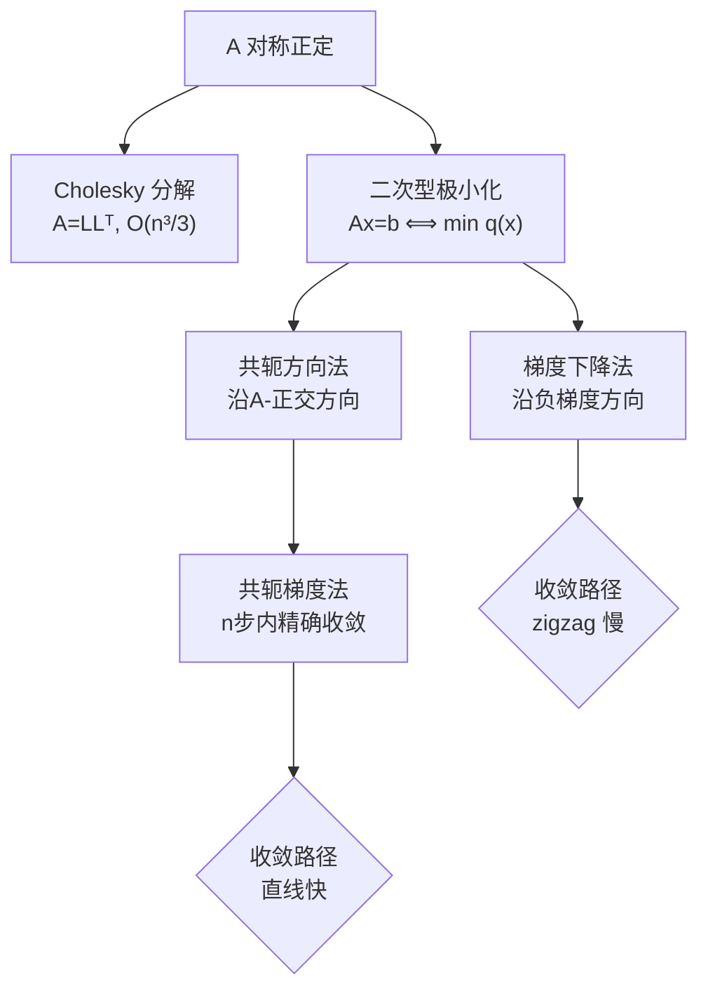
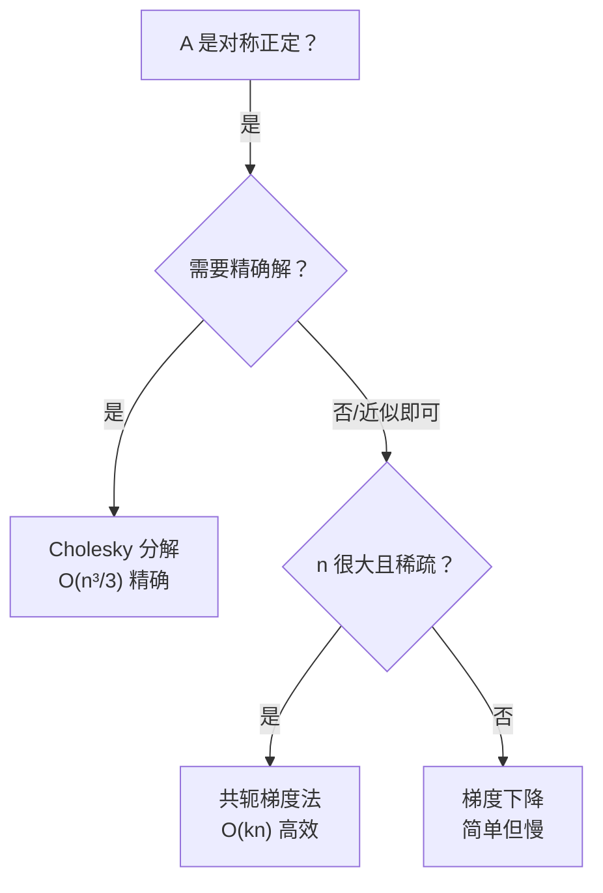

# 第05章 对称正定线性方程组

---

## 一、本章核心脉络

**核心问题**：当 $A$ 是对称正定（SPD）矩阵时，如何利用其特殊结构，既加速直接法（Cholesky 比 LU 快一倍），又设计出比 Jacobi/GS 快得多的迭代法（共轭梯度）？



> 这条脉络的核心逻辑：**SPD 结构同时打开了"更快的直接法"和"更聪明的迭代法"两扇门。Cholesky 是 LU 的 SPD 特化（省一半计算），共轭梯度是梯度下降的 A-正交升级（从 zigzag 变直线，n 步精确收敛）。**

---

## 二、对称正定矩阵

> 一句话来说：对称正定 = 对称 + 任意非零向量二次型为正——这意味着它一定是可逆的、特征值全正、所有主子式都正定。

### 定义

- **对称**：$A^T = A$
- **正定**：$\forall x \neq 0$，有 $x^T A x > 0$

### 核心性质

| 性质 | 含义 |
|------|------|
| 非奇异（可逆） | 行列式不为零 |
| 主子式也 SPD | 子矩阵继承正定性 |
| 特征值全正 | 充要条件：$\lambda_i > 0$ |
| 二次型保持 | 若 $A$ 为 $n\times n$ SPD，$P$ 为满列秩的 $n\times m$ 矩阵（$n\ge m$），则 $P^TAP$ 为 $m\times m$ SPD；$P$ 秩亏时不保证正定 |

**例题**：$A = \begin{pmatrix}2 & 2 \\ 2 & 5\end{pmatrix}$（正定 ✅）；$A = \begin{pmatrix}2 & 4 \\ 4 & 5\end{pmatrix}$（非正定 ❌，特征值有一负）

---

## 三、Cholesky 分解（**核心**）

### 3.1 从 LU 到 Cholesky

> 一句话来说：对于 SPD 矩阵，$LU$ 分解天然具有 $U = L^T$ 的关系——存储和计算量都减半。

**定理**（$LDL^T$）：实对称非奇异且存在 LU 分解 $\implies A = LDL^T$

**定理**（Cholesky）：$A$ 是实对称正定 $\implies A = LL^T$，其中 $L$ 是下三角阵。

#### 三角矩阵的两个辅助引理

- 两个上三角矩阵的乘积仍为上三角矩阵；下三角矩阵同理。
- 可逆上三角矩阵的逆仍为上三角矩阵；下三角矩阵同理。

### 3.2 递推公式

$$A = LL^T, \quad a_{ij} = \sum_{s=1}^{\min(i,j)} l_{is} l_{js}$$

$$l_{kk} = \sqrt{a_{kk} - \sum_{s=1}^{k-1} l_{ks}^2}$$

$$l_{ik} = (a_{ik} - \sum_{s=1}^{k-1} l_{is} l_{ks}) / l_{kk} \quad (k < i \leq n)$$

### 3.3 计算量

$$\frac{1}{3}n^3 + \frac{1}{2}n^2 + \frac{1}{6}n = O\!\left(\frac{n^3}{3}\right)$$

| 方法 | 计算量 | 存储 |
|------|:---:|:---:|
| Gauss 消元 | $\frac{2}{3}n^3$ | $n^2$ |
| LU 分解 | $\frac{2}{3}n^3$ | $n^2$ |
| **Cholesky** | $\frac{1}{3}n^3$ | $\frac{1}{2}n^2$ |

> 核心洞察：Cholesky 比 LU 快一倍、省一半存储——因为对称性让 $U$ 不需要单独存储（它就是 $L^T$）。

**例题**：$A = \begin{pmatrix}4 & -2 & 2 \\ -2 & 2 & -4 \\ 2 & -4 & 11\end{pmatrix}$
$$L = \begin{pmatrix}2 & 0 & 0 \\ -1 & 1 & 0 \\ 1 & -3 & 1\end{pmatrix}$$

---

## 四、梯度（最速）下降法

### 4.1 二次型等价性

> 一句话来说：$Ax=b$（$A$ SPD）等价于求二次型 $q(x)=\frac{1}{2}x^T A x - x^T b$ 的极小值点——这是一个无约束凸优化问题。

$$\arg\min_{x \in \mathbb{R}^n} q(x) = \frac{1}{2}\langle x, Ax\rangle - \langle x, b\rangle$$

### 4.2 算法框架

每步沿搜索方向 $v_k$ 做一维精确线搜索：
$$x_{k+1} = x_k + t_k v_k, \quad t_k = \frac{\langle r_k, v_k\rangle}{\langle v_k, Av_k\rangle}, \quad r_k = b - Ax_k$$

**梯度下降**：取 $v_k = -\nabla q(x_k) = b - Ax_k = r_k$（负梯度方向）

> [!warning] 梯度下降在扁长椭球形的等值线上会产生"zigzag"路径——收敛极慢。

#### 精确线搜索的新残差正交性质

在搜索方向 $v_k$ 上取最优步长
$$
t_k=\frac{\langle r_k,v_k\rangle}{\langle v_k,Av_k\rangle},
$$
则新残差满足
$$
\langle r_{k+1},v_k\rangle=0.
$$
即新残差与旧搜索方向正交，这是精确线搜索的性质。

### 4.3 迭代步骤

1. $v_k = r_k = b - Ax_k$
2. $t_k = \langle r_k, r_k\rangle / \langle r_k, Ar_k\rangle$
3. $x_{k+1} = x_k + t_k v_k$
4. $r_{k+1} = r_k - t_k Av_k$

**例题**：$\begin{pmatrix}2 & 2 \\ 2 & 5\end{pmatrix}\begin{pmatrix}u \\ v\end{pmatrix} = \begin{pmatrix}6 \\ 3\end{pmatrix}$，真解 $(4,-1)^T$。

$t_0 = \frac{45}{189} = \frac{5}{21}$，$x_1 = (\frac{10}{7},\frac{5}{7})^T$——需要多步才能收敛。

---

## 五、共轭梯度法（**核心**）

### 5.1 A-共轭

> 一句话来说：普通正交方向在椭球形等值线上会走弯路；A-正交方向（沿矩阵 $A$ 定义的"弯曲内积"正交）在椭球上走直线——n 步精确到。

**A-内积**：$\langle v, w\rangle_A = v^T A w$

**A-共轭**：$\langle v, w\rangle_A = 0$

**核心定理**：若 $\{u_1,\ldots,u_n\}$ 是 A-正交系，则从任意初值出发，沿这 $n$ 个方向各做一次精确线搜索，就得到精确解。

### 5.2 共轭梯度算法

> 一句话来说：CG 不需要预先构造 A-正交系——它在迭代过程中"边算边构造"出 A-共轭的搜索方向，同时保证残差两两正交。

```
r₀ = b - Ax₀, v₀ = r₀
for k = 0,1,...
    t_k = ⟨r_k, r_k⟩ / ⟨v_k, Av_k⟩
    x_{k+1} = x_k + t_k v_k
    r_{k+1} = r_k - t_k Av_k
    s_k = ⟨r_{k+1}, r_{k+1}⟩ / ⟨r_k, r_k⟩
    v_{k+1} = r_{k+1} + s_k v_k
```

**三条不变性质**（理论保证）：
- (a) $\text{span}\{r_0,\ldots,r_{k-1}\} = \text{span}\{v_0,\ldots,v_{k-1}\}$
- (b) 残差两两正交：$\langle r_k, r_j\rangle = 0 \;(j < k)$
- (c) 搜索方向 A-共轭：$\langle v_k, v_j\rangle_A = 0 \;(j < k)$

### 5.3 CG vs 梯度下降 vs Gauss-Seidel（同一题）

| 方法 | 迭代次数（$n=10^7$, TOL=$10^{-7}$） | 计算时间 |
|------|:---:|------|
| Gauss消元 | — | >1483秒 |
| Gauss-Seidel | 91 | 22.65秒 |
| **共轭梯度** | **53** | **19.94秒** |

> 核心洞察：CG 在理论上 $n$ 步精确收敛，实际中由于舍入误差需要更多步——但仍远快于 GS，且每步计算量与 GS 相当（一次矩阵-向量乘）。

---

## 判定/决策流程



---

## 核心公式速查表

| 概念 | 公式 |
|------|------|
| SPD 定义 | $A^T=A$, $x^TAx>0$ |
| Cholesky | $A = LL^T$, $l_{kk}=\sqrt{a_{kk}-\sum l_{ks}^2}$ |
| Cholesky 计算量 | $\frac{1}{3}n^3$ |
| 二次型等价 | $\min_x \frac{1}{2}x^TAx - x^Tb$ |
| 梯度下降步长 | $t_k = \langle r_k,r_k\rangle/\langle r_k,Ar_k\rangle$ |
| A-共轭定义 | $\langle v,w\rangle_A = v^TAw = 0$ |
| CG 步长 | $t_k = \langle r_k,r_k\rangle/\langle v_k,Av_k\rangle$ |
| CG 更新系数 | $s_k = \langle r_{k+1},r_{k+1}\rangle/\langle r_k,r_k\rangle$ |
| 残差正交 | $\langle r_k, r_j\rangle = 0 \;(j < k)$ |

---

## 易错点与注意事项

> [!warning] **Cholesky 只适用于 SPD 矩阵**
> 非 SPD 的对称矩阵不能用 Cholesky（会出现负数开方）。此时可用 $LDL^T$ 分解替代。

> [!warning] **梯度下降的方向选择很重要**
> 最速下降"最速"仅指局部——从全局看，它可能在等高线的狭长山谷中来回 zigzag，收敛极慢。CG 通过 A-共轭避免了这一问题。

> [!warning] **共轭梯度 n 步收敛是理论结果**
> 精确算术下 CG 必在 n 步收敛。但浮点运算中，由于舍入误差破坏正交性，可能需要更多步。实际使用中常配合预处理。

---

## 相关知识点链接

| 章节 | 关联点 |
|------|--------|
| [[课程/归档/数值分析/课件/MD/03-线性方程组的直接解法]] | Cholesky 是 LU 的 SPD 特化 |
| [[课程/归档/数值分析/课件/MD/04-线性方程组的迭代法]] | 迭代法比较：CG vs Jacobi/GS/SOR |
| [[课程/归档/数值分析/课件/MD/06-矩阵特征值的数值解法]] | 正定性 ⇔ 特征值全正 |

### 与Newton方法的联系

- [[课程/归档/数值分析/知识点解析梳理/02-非线性方程求根-知识梳理|非线性方程求根]]：从优化视角比较 Newton 法与最速下降法。

---

## 作业与练习

1. 判断正定性，给出 Cholesky 分解或 $LDL^T$ 分解
2. 共轭方向法手算
3. 编程实现梯度下降法 + 共轭梯度法，对比收敛速度

### Cholesky例题与练习数据

- 对
  $$
  A=\begin{pmatrix}4&2&2\\2&5&3\\2&3&6\end{pmatrix}
  $$
  求 Cholesky 分解 $A=LL^T$。
- 判断下列系数矩阵是否正定，给出相应的 Cholesky 或 $LDL^T$ 分解，并回代求解：
  $$
  \begin{pmatrix}2&2&1\\2&5&2\\1&2&2\end{pmatrix}
  \begin{pmatrix}x_1\\x_2\\x_3\end{pmatrix}
  =
  \begin{pmatrix}0\\3\\-7\end{pmatrix}.
  $$
  再用梯度下降法和共轭梯度法编程求解，并比较两种方法。

## 可复用知识条目

本章涉及以下独立条目；后续补充与跨课程应用统一维护在条目中。

### 概念入口

- [[概念/对称正定矩阵|对称正定矩阵]]

### 方法入口

- [[方法/Cholesky分解|Cholesky分解]]
- [[方法/共轭梯度法|共轭梯度法]]
- [[方法/梯度下降法|梯度下降法]]
