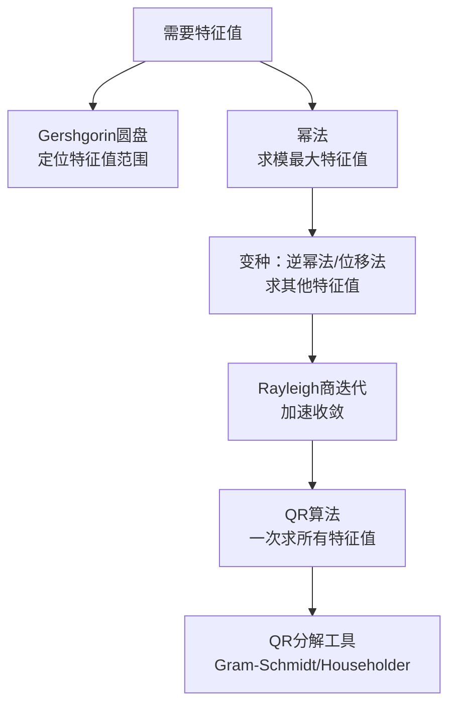
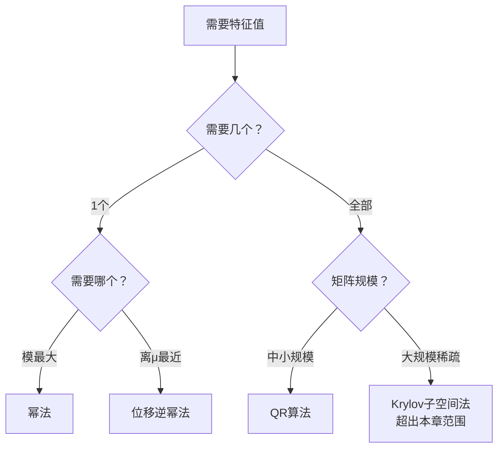

 
# 第06章 矩阵特征值的数值解法

---

## 一、本章核心脉络

**核心问题**：$n$ 很大时，$\det(A-\lambda I)=0$ 是 $n$ 次方程——求高次多项式根本身就是病态问题。如何绕过特征多项式，直接从矩阵出发计算特征值？



> 这条脉络的核心逻辑：**幂法是"一个向量反复乘 A"的朴素想法 → 加入归一化防溢出 → 位移/逆幂法找不同特征值 → Rayleigh 商加速 → QR 算法将幂法的思想推广到整个矩阵，同时求所有特征值。**

---

## 二、特征值估计 — Gershgorin 圆盘定理（**核心**）

### 2.1 动机

> 一句话来说：不用计算特征值就能知道它们大致在哪——用矩阵的"行和"画圆盘，所有特征值落在这些圆盘的并集内。

### 2.2 定理

**行圆盘**：$C_i = \{z \in \mathbb{C} : |z - a_{ii}| \leq \sum_{j=1, j\neq i}^n |a_{ij}|\}$

**列圆盘**（利用 $A^T$ 同谱）：$D_i = \{z \in \mathbb{C} : |z - a_{ii}| \leq \sum_{k=1, k\neq i}^n |a_{ki}|\}$

**结论**：所有特征值落在 $\left(\bigcup_{i=1}^n C_i\right) \cap \left(\bigcup_{i=1}^n D_i\right)$ 中。

### 2.3 应用

- 判定迭代法收敛性（$\rho(G) < 1$ 的快速判断）
- 判定矩阵可逆性与正定性
- 扰动分析：$A+B$ 的特征值在 $A$ 的特征值附近，半径受 $\mathrm{cond}(P) \cdot \|B\|$ 控制

---

## 三、幂法（Power Method）— **核心**

### 3.1 基本原理

> 一句话来说：随机取一个向量 $x_0$，反复用 $A$ 去乘它——在 $|\lambda_1| > |\lambda_2|$ 的条件下，$x_k = A^k x_0$ 的方向会收敛到 $\lambda_1$ 对应的特征向量。

**前提**：假设 $A$ 可对角化，特征值按模从大到小排列：
$$|\lambda_1| > |\lambda_2| \ge |\lambda_3| \ge \cdots \ge |\lambda_n|$$
$\lambda_1$ 称为**主特征值**，$|\lambda_1| > |\lambda_2|$ 保证它严格占优。

$$x_k = A^k x_0 = \lambda_1^k\left(c_1 v_1 + \left(\frac{\lambda_2}{\lambda_1}\right)^k c_2 v_2 + \left(\frac{\lambda_3}{\lambda_1}\right)^k c_3 v_3 + \cdots\right)$$

当 $k$ 足够大时，$x_k \approx \lambda_1^k c_1 v_1$。

**收敛率**：$(\lambda_2/\lambda_1)^k$ 衰减最慢，所以整体收敛速度由它决定——$S \leq |\lambda_2 / \lambda_1|$（线性收敛）。

**归一化**：为防止 $x_k$ 溢出/下溢，每步除以最大分量（$\|\cdot\|_\infty$ 归一化）或除以 2-范数。

> [!note]- 手算实例：幂法 3 步
> 
> $$A = \begin{pmatrix}3&2\\4&1\end{pmatrix},\quad \lambda_1=5,\;\lambda_2=-1,\quad v_1=\begin{pmatrix}1\\1\end{pmatrix},\;v_2=\begin{pmatrix}1\\-2\end{pmatrix}$$
> 
> 初值 $x_0=(1,0)^T$。每步：乘 $A$ → 用 $\|\cdot\|_\infty$ 归一化 → 算 Rayleigh 商近似 $\lambda$。
> 
> **第 1 步**：$x_1 = A x_0 = \begin{pmatrix}3\\4\end{pmatrix}$，归一化 $y_1 = \begin{pmatrix}0.75\\1\end{pmatrix}$，$\lambda \approx \frac{x_0^T A x_0}{x_0^T x_0} = 3$
> 
> **第 2 步**：$x_2 = A y_1 = \begin{pmatrix}4.25\\4.00\end{pmatrix}$，归一化 $y_2 = \begin{pmatrix}1\\0.941\end{pmatrix}$，$\lambda \approx \frac{y_1^T A y_1}{y_1^T y_1} = \frac{4.25\times0.75+4\times1}{1.5625}=4.6$
> 
> **第 3 步**：$x_3 = A y_2 = \begin{pmatrix}4.882\\4.941\end{pmatrix}$，归一化 $y_3 = \begin{pmatrix}0.988\\1.000\end{pmatrix}$，$\lambda \approx \frac{4.882\times1+4.941\times0.941}{1.885}=5.06$
> 
> | $k$ | $y_k$ | $\lambda$ 近似 | 误差 $|5-\lambda|$ |
> |:---:|------|:---:|:---:|
> | 1 | $(0.75, 1)^T$ | 3.0 | 2.0 |
> | 2 | $(1, 0.941)^T$ | 4.6 | 0.4 |
> | 3 | $(0.988, 1)^T$ | 5.06 | 0.06 |
> 
> 特征向量方向 $\to (1,1)^T$，特征值 $\to 5$。收敛率 $S = |-1|/5 = 0.2$——每步误差缩小约 5 倍。

### 3.2 特殊情况

**$\lambda_1 = -\lambda_2$ 等模异号**：$x_k$ 在两个方向间来回震荡。
$$\lambda_1^2 \approx x_k^{(i)} / x_{k-2}^{(i)}$$

### 3.3 变种方法

| 方法    | 迭代                       | 用途              |
| ----- | ------------------------ | --------------- |
| 逆幂法   | $Ax_{k+1} = x_k$         | 求模最小特征值         |
| 位移幂法  | $x_{k+1} = (A-\mu I)x_k$ | 求离 $\mu$ 最远的特征值 |
| 位移逆幂法 | $(A-\mu I)x_{k+1} = x_k$ | 求离 $\mu$ 最近的特征值 |

> 核心洞察：位移逆幂法是"最强"的变种——取 $\mu$ 为近似特征值，一步就能精确到机器精度。

> [!note]- 手算实例：逆幂法 3 步
> 
> 同一矩阵 $A = \begin{pmatrix}3&2\\4&1\end{pmatrix}$。$A^{-1} = \frac{1}{-5}\begin{pmatrix}1&-2\\-4&3\end{pmatrix} = \begin{pmatrix}-0.2&0.4\\0.8&-0.6\end{pmatrix}$。
> 
> 逆幂法实际求解 $A x_{k+1} = x_k$（不显式求逆），但 $2\times2$ 手算时用 $A^{-1}$ 乘更方便演示。
> 
> $x_0=(1,0)^T$。每步：乘 $A^{-1}$ → $\|\cdot\|_\infty$ 归一化 → Rayleigh 商。
> 
> **第 1 步**：$x_1 = A^{-1}x_0 = \begin{pmatrix}-0.2\\0.8\end{pmatrix}$，归一化 $y_1 = \begin{pmatrix}-0.25\\1\end{pmatrix}$，$\lambda \approx -0.29$
> 
> **第 2 步**：$x_2 = A^{-1}y_1 = \begin{pmatrix}0.45\\-0.80\end{pmatrix}$，归一化 $y_2 = \begin{pmatrix}0.563\\-1\end{pmatrix}$，$\lambda \approx -1.08$
> 
> **第 3 步**：$x_3 = A^{-1}y_2 = \begin{pmatrix}-0.513\\1.050\end{pmatrix}$，归一化 $y_3 = \begin{pmatrix}-0.488\\1\end{pmatrix}$，$\lambda \approx -0.98$
> 
> | $k$ | $y_k$ | $\lambda$ 近似 | 目标 $\lambda_2=-1$ |
> |:---:|------|:---:|:---:|
> | 1 | $(-0.25, 1)^T$ | $-0.29$ | |
> | 2 | $(0.563, -1)^T$ | $-1.08$ | |
> | 3 | $(-0.488, 1)^T$ | $-0.98$ | $\to -1$ |
> 
> 特征向量 $\to v_2 = (1,-2)^T \propto (-0.5,1)^T$。收敛率 $S = |(1/5)/(-1)| = 0.2$——与幂法相同（特征值间距比例一致）。
> 
> > 注意：$x_2$ 归一化后 $(0.563,-1)^T$ 出现一次"翻转"——因为 $\lambda_2=-1$ 为负，$(-1)^k$ 的振荡在归一化中每次消不掉，导致方向正负交替。这不影响收敛。

---

## 四、Rayleigh 商迭代

> 一句话来说：如果已有近似特征向量 $x$，$\lambda = \frac{x^T A x}{x^T x}$（Rayleigh 商）是 $\lambda$ 的最佳近似——用这个 $\lambda$ 做位移逆幂法，收敛速度变为立方（对实对称矩阵）。

$$\lambda_k = \frac{x_k^T A x_k}{x_k^T x_k}$$

对实对称矩阵，Rayleigh 商迭代的收敛是**立方**的——误差 $e_k$ 满足 $e_{k+1} \approx C e_k^3$。矩阵不对称时降为平方收敛。

---

## 五、QR 分解（**核心工具**）

### 5.1 定义与作用

> 一句话来说：QR 分解把矩阵的列向量“正交化”：$Q$ 保存正交方向，$R$ 记录原列向量在这些正交方向上的投影系数。

设 $A\in\mathbb{R}^{m\times n}$，且 $m\ge n$、列满秩。QR 分解把 $A$ 写成：

$$
A=QR
$$

其中：

- $Q$ 的列向量两两正交且为单位向量；
- $R$ 是上三角矩阵；
- 若只取 $A$ 的列空间，得到**消减 QR 分解**：$Q\in\mathbb{R}^{m\times n}$，$R\in\mathbb{R}^{n\times n}$；
- 若把 $Q$ 补成完整正交基，得到**完全 QR 分解**：$Q\in\mathbb{R}^{m\times m}$，$R\in\mathbb{R}^{m\times n}$。

为什么 $R$ 一定是上三角？因为第 $j$ 个原列向量 $A_j$ 只由前 $j$ 个正交方向表示：

$$
A_j=r_{1j}q_1+r_{2j}q_2+\cdots+r_{jj}q_j
$$

不会出现 $q_{j+1},q_{j+2},\dots$ 的分量，所以对角线下方系数为 $0$。

QR 分解的核心用途：

| 用途 | 作用 |
|------|------|
| 解线性方程组 | $Ax=b\Rightarrow QRx=b\Rightarrow Rx=Q^Tb$ |
| 最小二乘 | 把病态的正规方程 $A^TAx=A^Tb$ 转化为更稳定的 QR 形式 |
| QR 算法 | 每次做 QR 分解再重组 $RQ$，逐步把矩阵化成三角/Schur 型 |

---

### 5.2 Gram-Schmidt 正交化（手算最直观）

> 一句话来说：从 $A$ 的第 $1$ 列开始，逐个减去它在已有正交方向上的投影，剩下的部分就是新的正交方向。

设 $A=[A_1,A_2,\dots,A_n]$。Gram-Schmidt 的目标是构造正交单位向量 $q_1,\dots,q_n$，并把每个 $A_j$ 表示成：

$$
A_j=r_{1j}q_1+\cdots+r_{j-1,j}q_{j-1}+r_{jj}q_j
$$

#### 经典 Gram-Schmidt

对 $j=1,2,\dots,n$：

$$
r_{ij}=q_i^TA_j,\quad i=1,\dots,j-1
$$

$$
y_j=A_j-\sum_{i=1}^{j-1}r_{ij}q_i
$$

$$
r_{jj}=\|y_j\|_2,\quad q_j=\frac{y_j}{r_{jj}}
$$

合并起来就是：

$$
q_j=\frac{A_j-\sum_{i=1}^{j-1}(q_i^TA_j)q_i}{\left\|A_j-\sum_{i=1}^{j-1}(q_i^TA_j)q_i\right\|_2}
$$

#### 改进 Gram-Schmidt

经典 Gram-Schmidt 的问题是：如果列向量几乎平行，减去投影时会出现严重相消，导致 $q_i$ 不再真正正交。

改进 Gram-Schmidt 的做法是：每减掉一个方向，就立刻用“当前剩余向量”继续减下一个方向。

伪代码：

```text
for j = 1 to n
    y = A_j
    for i = 1 to j-1
        r_ij = q_i^T y
        y = y - r_ij q_i
    end for
    r_jj = ||y||_2
    q_j = y / r_jj
end for
```

> [!hint] 记忆技巧
> 经典 GS：一次性算完所有投影，再统一减。
> 改进 GS：算一个投影，立刻减一个；正交性更稳定。

#### 手算例子：对 $A$ 做消减 QR 分解

$$
A=
\begin{pmatrix}
1 & -4\\
2 & 3\\
2 & 2
\end{pmatrix}
$$

第 1 列：

$$
A_1=
\begin{pmatrix}
1\\2\\2
\end{pmatrix},
\quad
r_{11}=\|A_1\|_2=3
$$

$$
q_1=\frac{A_1}{r_{11}}
=
\begin{pmatrix}
1/3\\2/3\\2/3
\end{pmatrix}
$$

第 2 列：

$$
r_{12}=q_1^TA_2
=
\begin{pmatrix}
1/3&2/3&2/3
\end{pmatrix}
\begin{pmatrix}
-4\\3\\2
\end{pmatrix}
=2
$$

$$
y_2=A_2-r_{12}q_1
=
\begin{pmatrix}
-4\\3\\2
\end{pmatrix}
-
2
\begin{pmatrix}
1/3\\2/3\\2/3
\end{pmatrix}
=
\begin{pmatrix}
-14/3\\5/3\\2/3
\end{pmatrix}
$$

$$
r_{22}=\|y_2\|_2=5
$$

$$
q_2=\frac{y_2}{r_{22}}
=
\begin{pmatrix}
-14/15\\1/3\\2/15
\end{pmatrix}
$$

所以：

$$
Q=
\begin{pmatrix}
1/3 & -14/15\\
2/3 & 1/3\\
2/3 & 2/15
\end{pmatrix},
\quad
R=
\begin{pmatrix}
3 & 2\\
0 & 5
\end{pmatrix}
$$

即：

$$
A=QR
$$

---

### 5.3 Householder 变换（实际标准方法）

> 一句话来说：Householder 变换用一个“镜面反射”一次性把某一列主对角线以下的元素清零。

Gram-Schmidt 适合手算和理解，但实际数值计算中更常用 **Householder QR**。原因是它用正交反射消元，数值稳定性更好。

Householder 反射子定义为：

$$
H=I-2\frac{vv^T}{v^Tv}
$$

它有两个重要性质：

$$
H^T=H,\quad H^TH=I
$$

所以 $H$ 是对称正交矩阵。

#### 如何把向量 $x$ 变成 $\alpha e_1$？

给定列向量 $x$，想找一个 Householder 矩阵 $H$，使得：

$$
Hx=\alpha e_1
$$

其中：

$$
|\alpha|=\|x\|_2
$$

通常取：

$$
\alpha=-\operatorname{sign}(x_1)\|x\|_2
$$

这样比取 $\alpha=\|x\|_2$ 更稳定，因为它避免相近数相减。

令：

$$
v=\alpha e_1-x
$$

则：

$$
H=I-2\frac{vv^T}{v^Tv}
$$

就满足：

$$
Hx=\alpha e_1
$$

#### Householder QR 算法步骤

对 $A\in\mathbb{R}^{m\times n}$，从第 $1$ 列开始逐列消元。

第 $k$ 步只处理第 $k$ 列从第 $k$ 行往下的部分：

$$
x=A_{k:m,k}
$$

构造小 Householder 矩阵 $H_k$，把它嵌入到 $m\times m$ 单位矩阵中，然后做：

$$
A\leftarrow H_kA
$$

这样第 $k$ 列第 $k+1$ 行以下的元素就变成 $0$。

如果还要显式得到 $Q$，则同步更新：

$$
Q\leftarrow QH_k
$$

最后得到：

$$
R=H_n\cdots H_2H_1A
$$

$$
Q=H_1H_2\cdots H_n
$$

因为每个 $H_k$ 都满足 $H_k^T=H_k^{-1}$，所以：

$$
A=QR
$$

#### 小例子：用 Householder 分解 $2\times 2$ 矩阵

$$
A=
\begin{pmatrix}
3 & 1\\
4 & 3
\end{pmatrix}
$$

先处理第一列：

$$
x=
\begin{pmatrix}
3\\4
\end{pmatrix},
\quad
\|x\|_2=5
$$

取 $\alpha=5$，目标是把 $x$ 反射到：

$$
w=
\begin{pmatrix}
5\\0
\end{pmatrix}
$$

令：

$$
v=w-x=
\begin{pmatrix}
5\\0
\end{pmatrix}
-
\begin{pmatrix}
3\\4
\end{pmatrix}
=
\begin{pmatrix}
2\\-4
\end{pmatrix}
$$

于是：

$$
H=I-2\frac{vv^T}{v^Tv}
$$

$$
v^Tv=20
$$

$$
vv^T=
\begin{pmatrix}
4 & -8\\
-8 & 16
\end{pmatrix}
$$

所以：

$$
H=
\begin{pmatrix}
1&0\\0&1
\end{pmatrix}
-
\frac{2}{20}
\begin{pmatrix}
4 & -8\\
-8 & 16
\end{pmatrix}
=
\begin{pmatrix}
0.6&0.8\\
0.8&-0.6
\end{pmatrix}
$$

验证：

$$
H
\begin{pmatrix}
3\\4
\end{pmatrix}
=
\begin{pmatrix}
5\\0
\end{pmatrix}
$$

继续作用到整个矩阵：

$$
HA=
\begin{pmatrix}
0.6&0.8\\
0.8&-0.6
\end{pmatrix}
\begin{pmatrix}
3&1\\
4&3
\end{pmatrix}
=
\begin{pmatrix}
5&3\\
0&-1
\end{pmatrix}
=R
$$

因为 $H^T=H$，所以：

$$
Q=H=
\begin{pmatrix}
0.6&0.8\\
0.8&-0.6
\end{pmatrix}
$$

于是：

$$
A=QR
$$

---

#### 三维例子：对 $3\times 3$ 矩阵做两轮 Householder 反射

对 $2\times2$ 矩阵，一轮反射就完成 QR。对 $3\times3$，需要**两轮**：第一轮消第一列的下三角，第二轮消剩下 $2\times2$ 子矩阵的下三角。

$$
A=
\begin{pmatrix}
1 & -4 & 2\\
2 & 3 & 1\\
2 & 2 & 1
\end{pmatrix}
$$

---

**第一轮：消第一列**

$A$ 的第一列：$x=(1,2,2)^T$，$\|x\|_2=\sqrt{1+4+4}=3$。

取 $w=(-3,0,0)^T$（取负号使 $v$ 的第一个分量更大，避免相近数相减）：

$$
v=w-x=
\begin{pmatrix}
-3\\0\\0
\end{pmatrix}
-
\begin{pmatrix}
1\\2\\2
\end{pmatrix}
=
\begin{pmatrix}
-4\\-2\\-2
\end{pmatrix}
$$

$$
v^Tv=16+4+4=24
$$

$$
vv^T=
\begin{pmatrix}
16 & 8 & 8\\
8 & 4 & 4\\
8 & 4 & 4
\end{pmatrix}
$$

$$
H_1=I-\frac{2}{24}\cdot vv^T
=I-\frac{1}{12}
\begin{pmatrix}
16 & 8 & 8\\
8 & 4 & 4\\
8 & 4 & 4
\end{pmatrix}
=
\begin{pmatrix}
-\frac{1}{3} & -\frac{2}{3} & -\frac{2}{3}\\[4pt]
-\frac{2}{3} & \frac{2}{3} & -\frac{1}{3}\\[4pt]
-\frac{2}{3} & -\frac{1}{3} & \frac{2}{3}
\end{pmatrix}
$$

验证 $H_1$ 把第一列变成 $(-3,0,0)^T$：

$$
H_1
\begin{pmatrix}
1\\2\\2
\end{pmatrix}
=
\begin{pmatrix}
-\frac{1}{3}-\frac{4}{3}-\frac{4}{3}\\[4pt]
-\frac{2}{3}+\frac{4}{3}-\frac{2}{3}\\[4pt]
-\frac{2}{3}-\frac{2}{3}+\frac{4}{3}
\end{pmatrix}
=
\begin{pmatrix}
-3\\0\\0
\end{pmatrix}
$$

现在把 $H_1$ 作用到整个 $A$ 上：

$$
H_1A=H_1
\begin{pmatrix}
1 & -4 & 2\\
2 & 3 & 1\\
2 & 2 & 1
\end{pmatrix}
$$

逐列计算：

- 第一列已算：$(-3,0,0)^T$
- 第二列 $( -4,3,2)^T$：

$$
H_1
\begin{pmatrix}
-4\\3\\2
\end{pmatrix}
=
\begin{pmatrix}
\frac{4}{3}-\frac{6}{3}-\frac{4}{3}\\[4pt]
\frac{8}{3}+\frac{6}{3}-\frac{2}{3}\\[4pt]
\frac{8}{3}-\frac{3}{3}+\frac{4}{3}
\end{pmatrix}
=
\begin{pmatrix}
-2\\4\\3
\end{pmatrix}
$$

- 第三列 $(2,1,1)^T$：

$$
H_1
\begin{pmatrix}
2\\1\\1
\end{pmatrix}
=
\begin{pmatrix}
-\frac{2}{3}-\frac{2}{3}-\frac{2}{3}\\[4pt]
-\frac{4}{3}+\frac{2}{3}-\frac{1}{3}\\[4pt]
-\frac{4}{3}-\frac{1}{3}+\frac{2}{3}
\end{pmatrix}
=
\begin{pmatrix}
-2\\-1\\-1
\end{pmatrix}
$$

所以第一轮结果：

$$
H_1A=
\begin{pmatrix}
-3 & -2 & -2\\
0 & 4 & -1\\
0 & 3 & -1
\end{pmatrix}
$$

第一列下三角已清零 ✓。现在只需处理右下角 $2\times2$ 子矩阵的第二列。

---

**第二轮：消第二列（在子矩阵上）**

只看右下角的 $2\times2$ 子矩阵（第 2-3 行，第 2-3 列）：

$$
\widetilde{A}=
\begin{pmatrix}
4 & -1\\
3 & -1
\end{pmatrix}
$$

它的第一列是 $x=(4,3)^T$，$\|x\|_2=5$。

取 $w=(-5,0)^T$：

$$
v=w-x=
\begin{pmatrix}
-5\\0
\end{pmatrix}
-
\begin{pmatrix}
4\\3
\end{pmatrix}
=
\begin{pmatrix}
-9\\-3
\end{pmatrix}
$$

$$
v^Tv=81+9=90
$$

$$
vv^T=
\begin{pmatrix}
81 & 27\\
27 & 9
\end{pmatrix}
$$

$$
\widetilde{H}_2=I-\frac{2}{90}\cdot vv^T
=I-\frac{1}{45}
\begin{pmatrix}
81 & 27\\
27 & 9
\end{pmatrix}
=
\begin{pmatrix}
1-\frac{81}{45} & -\frac{27}{45}\\[4pt]
-\frac{27}{45} & 1-\frac{9}{45}
\end{pmatrix}
=
\begin{pmatrix}
-\frac{4}{5} & -\frac{3}{5}\\[4pt]
-\frac{3}{5} & \frac{4}{5}
\end{pmatrix}
$$

验证 $\widetilde{H}_2$ 把 $(4,3)^T$ 变成 $(-5,0)^T$：

$$
\widetilde{H}_2
\begin{pmatrix}
4\\3
\end{pmatrix}
=
\begin{pmatrix}
-\frac{16}{5}-\frac{9}{5}\\[4pt]
-\frac{12}{5}+\frac{12}{5}
\end{pmatrix}
=
\begin{pmatrix}
-5\\0
\end{pmatrix}
$$

将这个小矩阵嵌入到 $3\times3$ 中（第一行第一列保持不变）：

$$
H_2=
\begin{pmatrix}
1 & 0 & 0\\
0 & -\frac{4}{5} & -\frac{3}{5}\\[4pt]
0 & -\frac{3}{5} & \frac{4}{5}
\end{pmatrix}
$$

作用 $H_2$ 到 $H_1A$ 上：

$$
R=H_2(H_1A)=
\begin{pmatrix}
1 & 0 & 0\\
0 & -\frac{4}{5} & -\frac{3}{5}\\[4pt]
0 & -\frac{3}{5} & \frac{4}{5}
\end{pmatrix}
\begin{pmatrix}
-3 & -2 & -2\\
0 & 4 & -1\\
0 & 3 & -1
\end{pmatrix}
$$

第一行不变，只算第 2-3 行：

$$
\begin{pmatrix}
-\frac{4}{5} & -\frac{3}{5}\\[4pt]
-\frac{3}{5} & \frac{4}{5}
\end{pmatrix}
\begin{pmatrix}
4 & -1\\
3 & -1
\end{pmatrix}
=
\begin{pmatrix}
-\frac{16}{5}-\frac{9}{5} & \frac{4}{5}+\frac{3}{5}\\[4pt]
-\frac{12}{5}+\frac{12}{5} & \frac{3}{5}-\frac{4}{5}
\end{pmatrix}
=
\begin{pmatrix}
-5 & \frac{7}{5}\\[4pt]
0 & -\frac{1}{5}
\end{pmatrix}
$$

所以：

$$
R=
\begin{pmatrix}
-3 & -2 & -2\\
0 & -5 & \frac{7}{5}\\[4pt]
0 & 0 & -\frac{1}{5}
\end{pmatrix}
$$

上三角 ✓。

---

**组装 $Q$**

$$
Q=H_1H_2=
\begin{pmatrix}
-\frac{1}{3} & -\frac{2}{3} & -\frac{2}{3}\\[4pt]
-\frac{2}{3} & \frac{2}{3} & -\frac{1}{3}\\[4pt]
-\frac{2}{3} & -\frac{1}{3} & \frac{2}{3}
\end{pmatrix}
\begin{pmatrix}
1 & 0 & 0\\
0 & -\frac{4}{5} & -\frac{3}{5}\\[4pt]
0 & -\frac{3}{5} & \frac{4}{5}
\end{pmatrix}
$$

逐列计算 $Q$：

$$
Q_{:,1}=H_1\cdot
\begin{pmatrix}
1\\0\\0
\end{pmatrix}
=
\begin{pmatrix}
-\frac{1}{3}\\[4pt]
-\frac{2}{3}\\[4pt]
-\frac{2}{3}
\end{pmatrix}
$$

$$
Q_{:,2}=H_1\cdot
\begin{pmatrix}
0\\[2pt]-\frac{4}{5}\\[2pt]-\frac{3}{5}
\end{pmatrix}
=
\begin{pmatrix}
\frac{8}{15}+\frac{6}{15}\\[4pt]
-\frac{8}{15}+\frac{3}{15}\\[4pt]
\frac{4}{15}-\frac{6}{15}
\end{pmatrix}
=
\begin{pmatrix}
\frac{14}{15}\\[4pt]
-\frac{1}{3}\\[4pt]
-\frac{2}{15}
\end{pmatrix}
$$

$$
Q_{:,3}=H_1\cdot
\begin{pmatrix}
0\\[2pt]-\frac{3}{5}\\[2pt]\frac{4}{5}
\end{pmatrix}
=
\begin{pmatrix}
\frac{6}{15}-\frac{8}{15}\\[4pt]
-\frac{6}{15}-\frac{4}{15}\\[4pt]
\frac{3}{15}+\frac{8}{15}
\end{pmatrix}
=
\begin{pmatrix}
-\frac{2}{15}\\[4pt]
-\frac{2}{3}\\[4pt]
\frac{11}{15}
\end{pmatrix}
$$

所以：

$$
Q=
\begin{pmatrix}
-\frac{1}{3} & \frac{14}{15} & -\frac{2}{15}\\[4pt]
-\frac{2}{3} & -\frac{1}{3} & -\frac{2}{3}\\[4pt]
-\frac{2}{3} & -\frac{2}{15} & \frac{11}{15}
\end{pmatrix}
$$

---

**验证**：$A=QR$

$$
QR=
\begin{pmatrix}
-\frac{1}{3} & \frac{14}{15} & -\frac{2}{15}\\[4pt]
-\frac{2}{3} & -\frac{1}{3} & -\frac{2}{3}\\[4pt]
-\frac{2}{3} & -\frac{2}{15} & \frac{11}{15}
\end{pmatrix}
\begin{pmatrix}
-3 & -2 & -2\\
0 & -5 & \frac{7}{5}\\[4pt]
0 & 0 & -\frac{1}{5}
\end{pmatrix}
$$

第一列：$Q\cdot(-3,0,0)^T = (-3\cdot(-\frac{1}{3}), -3\cdot(-\frac{2}{3}), -3\cdot(-\frac{2}{3}))^T = (1,2,2)^T$ ✓

第二列：$Q\cdot(-2,-5,0)^T$：

$$
\begin{pmatrix}
\frac{2}{3}-\frac{70}{15}\\[4pt]
\frac{4}{3}+\frac{5}{3}\\[4pt]
\frac{4}{3}+\frac{10}{15}
\end{pmatrix}
=
\begin{pmatrix}
\frac{10-70}{15}\\[4pt]
3\\[4pt]
\frac{20+10}{15}
\end{pmatrix}
=
\begin{pmatrix}
-4\\3\\2
\end{pmatrix}
$$

​  ✓

第三列：$Q\cdot(-2,\frac{7}{5},-\frac{1}{5})^T$：

$$
\begin{pmatrix}
\frac{2}{3}+\frac{98}{75}+\frac{2}{75}\\[4pt]
\frac{4}{3}-\frac{7}{15}+\frac{2}{15}\\[4pt]
\frac{4}{3}-\frac{14}{75}-\frac{11}{75}
\end{pmatrix}
=
\begin{pmatrix}
\frac{50+98+2}{75}\\[4pt]
\frac{20-7+2}{15}\\[4pt]
\frac{100-14-11}{75}
\end{pmatrix}
=
\begin{pmatrix}
2\\1\\1
\end{pmatrix}
$$

​  ✓

三维 Householder QR 分解完成。两轮反射，每轮消一列的下三角。

> **与 Gram-Schmidt 的对比**：同一个 $3\times3$ 矩阵，Gram-Schmidt 需要做 3 次正交化（$q_1\to q_2\to q_3$），而 Householder 只需 2 轮反射（$H_1\to H_2$）——且 $Q$ 不需要显式构造即可得到 $R$。对于大型矩阵，Householder 既稳定又高效。

---

### 5.4 为什么 QR 分解能服务 QR 算法？

QR 算法不是一次分解就结束，而是反复做：

$$
A_j=Q_jR_j
$$

然后重组：

$$
A_{j+1}=R_jQ_j
$$

关键点是：

$$
A_{j+1}=R_jQ_j=Q_j^TA_jQ_j
$$

这说明每一步都是**正交相似变换**，所以 $A_{j+1}$ 和 $A_j$ 有相同特征值。

反复迭代后，矩阵会逐渐接近上三角或实 Schur 型；对角元或 $2\times2$ 对角块就给出特征值。

---

### 5.5 方法对比

| 方法 | 数值稳定性 | 计算量 | 使用场景 |
|------|:---:|------|------|
| 经典 Gram-Schmidt | 差 | $O(mn^2)$ | 教学演示、手算理解 |
| 改进 Gram-Schmidt | 较好 | $O(mn^2)$ | 中小规模、手算/教学 |
| Householder | 最好 | 约 $2mn^2-\frac{2}{3}n^3$ 次浮点运算 | 实际数值计算、QR 算法基础 |

> [!warning]
> 考试/手算时，Gram-Schmidt 更常见；实际软件中，QR 分解通常用 Householder 或 Givens 变换，而不是经典 Gram-Schmidt。

---

## 六、QR 算法（**核心**）

### 6.1 核心思想：从幂法路线到 QR 算法

> 一句话来说：幂法往一个方向跑，QR 算法往多个方向同时跑——取一组正交向量同时迭代，每次做完正交化就得到所有特征向量方向的近似。

回顾幂法路线：

```
单向量幂法 → 归一化同时迭代 → QR 算法
```

为什么是这条路？

- 单向量幂法：$x_{k+1}=Ax_k$，只收敛到主特征向量，因为只有一个向量被“乘”。
- 如果同时取一组正交向量 $Q=[q_1,\dots,q_n]$，并行做幂迭代，会怎样？
- 每次乘 $A$ 后，不同特征值对应的特征向量方向会按不同速度放大，导致正交性丢失 → 需要重新正交化。

“归一化同时迭代”就是这个思路：

$$
\begin{aligned}
Q_0&=I\\
AQ_j&=Q_{j+1}R_{j+1}
\end{aligned}
$$

这里 $AQ_j$ 是 $A$ 乘以 $n$ 个初始正交向量得到的矩阵；然后对 $AQ_j$ 做 QR 分解，$Q_{j+1}$ 自动就是正交化后的结果。

反复做下去，$Q_{j+1}$ 的列会收敛到 $A$ 的特征向量。

---

### 6.2 QR 算法的标准形式

归一化同时迭代可以等价改写为不需要显式保存 $Q$ 的形式。这就是真正的 **QR 算法**：

$$
\begin{aligned}
A_0&=A\\
A_j&=Q_j R_j\\
A_{j+1}&=R_j Q_j
\end{aligned}
$$

就是：

1. 对 $A_j$ 做 QR 分解，得到 $Q_j,R_j$；
2. 交换 $Q_j$ 和 $R_j$ 的乘法顺序，得到下一个 $A_{j+1}$。

关键性质：每一步都是**正交相似变换**——

$$
A_{j+1}=R_j Q_j
=Q_j^T A_j Q_j
$$

所以 $A_{j+1}$ 和 $A_j$ **有完全相同的一组特征值**。反复迭代，矩阵本身不改变特征值，但形状会逐渐变成更容易读出特征值的形式。

---

### 6.3 QR 算法伪代码

```text
A_0 = A
for j = 1, 2, 3, ... to N_iter
    对 A_j 做 QR 分解:  A_j = Q_j R_j
    重组:            A_{j+1} = R_j Q_j
end for
```

就这么三行。QR 分解可以用 Gram-Schmidt、Householder、Givens 中的任意一种实现，算法逻辑完全相同。

---

### 6.4 一步一步跟算：QR 迭代收敛过程

用具体例子看每一步 $A_j$ 怎么逼近对角/三角矩阵。

$$
A=A_0=
\begin{pmatrix}
4 & 3\\
3 & 2
\end{pmatrix}
$$

这个矩阵的真特征值大约是：
$$
\lambda_1\approx5.541,\quad \lambda_2\approx0.459
$$

**迭代 1**

对 $A_0$ 做 QR 分解（用 Gram-Schmidt）：

$$
r_{11}=\|A_1\|_2=\sqrt{4^2+3^2}=5
$$
$$
q_1=\begin{pmatrix}
0.8\\0.6
\end{pmatrix}
$$
$$
r_{12}=q_1^TA_2
=\begin{pmatrix}
0.8&0.6
\end{pmatrix}
\begin{pmatrix}
3\\2
\end{pmatrix}
=3.6
$$
$$
y_2=A_2-r_{12}q_1
=\begin{pmatrix}
3\\2
\end{pmatrix}
-3.6
\begin{pmatrix}
0.8\\0.6
\end{pmatrix}
=
\begin{pmatrix}
0.12\\-0.16
\end{pmatrix}
$$
$$
r_{22}=\|y_2\|_2
=
0.2,\quad
q_2=
\begin{pmatrix}
0.6\\-0.8
\end{pmatrix}
$$

所以：

$$
Q_0=
\begin{pmatrix}
0.8&0.6\\
0.6&-0.8
\end{pmatrix},
\quad
R_0=
\begin{pmatrix}
5&3.6\\
0&0.2
\end{pmatrix}
$$

重组：

$$
A_1=R_0Q_0
=
\begin{pmatrix}
5&3.6\\
0&0.2
\end{pmatrix}
\begin{pmatrix}
0.8&0.6\\
0.6&-0.8
\end{pmatrix}
=
\begin{pmatrix}
6.16&1.12\\
0.12&-0.16
\end{pmatrix}
$$

**迭代 2**

对 $A_1$ 做 QR 分解：

$$
r_{11}=\|A_1\|_2
=
\sqrt{6.16^2+0.12^2}
\approx
6.1612
$$

这一步我就不列全部细节了——规律已经看得出来：

- $A_1$ 相比 $A_0$，左下角从 $3$ 缩小到了 $0.12$；
- 对角元 $6.16$ 和 $-0.16$ 更接近真特征值了。

继续迭代下去，$A_j$ 会越来越接近对角矩阵：

$$
A_{\infty}\to
\begin{pmatrix}
5.541&0\\
0&0.459
\end{pmatrix}
$$

对角元就是特征值。

---

### 6.5 为什么收敛？直觉和原因

单向量幂法的收敛率是 $|\lambda_2/\lambda_1|$。QR 算法可以看作 $n$ 路单向量幂法同时跑——每个正交化步骤相当于把 $\lambda_1$ 方向上的“优势”分离出来，剩下一个降维问题继续收敛下一个特征值。最终下三角元素被消平，所有特征值从对角元析出。

收敛速率取决于特征值的模之比：

- 第 $k$ 个特征值的收敛率：$|\lambda_{k+1}/\lambda_k|$
- 对角元从上到下按特征值模递减排列

移位技巧（带平移的 QR 算法）可以大幅加速收敛，不过那是进阶内容。

---

### 6.6 收敛性定理（定理了解即可）

| 前提 | 结论 |
|------|------|
| $A$ 实对称，特征值互异 | $A_j$ 收敛于对角阵，对角元=特征值 |
| $A$ 非奇异，特征值互异 | $A_j$ 收敛于实 Schur 型（对角 $1\times1$ 或 $2\times2$ 块） |
| $2\times2$ 块 | 对应一对共轭复特征值 |

> [!hint] 理解要点
> QR 算法本身不要求对称—对称只是保证收敛到最简形式（对角阵）。非对称情况收敛到实 Schur 型，已经足够读出特征值了。

---

## 判定/决策流程



---

## 核心公式速查表

| 概念 | 公式 | 用途 |
|------|------|------|
| Gershgorin 行圆盘 | $\|z-a_{ii}\|\leq \sum_{j\neq i}a_{ij}\|$ | 定位特征值范围 |
| 幂法迭代 | $x_{k+1}=Ax_k$，归一化取分量比 | 求模最大特征值 |
| 收敛率 | $S\leq\|\lambda_2/\lambda_1\|$ | 预判迭代速度 |
| Rayleigh 商 | $\lambda=x^TAx/x^Tx$ | 近似特征值 |
| 逆幂法 | $Ax_{k+1}=x_k$ | 求模最小特征值 |
| 位移逆幂法 | $(A-\mu I)x_{k+1}=x_k$ | 求离 $\mu$ 最近特征值 |
| Gram-Schmidt | $q_j=(A_j-\sum_{i<j}r_{ij}q_i)/r_{jj}$ | QR 分解（手算） |
| Householder | $H=I-2vv^T/v^Tv$ | QR 分解（数值稳定） |
| QR 算法 | $A_j=Q_jR_j,\;A_{j+1}=R_jQ_j$ | 一次求所有特征值 |

---

## 易错点与注意事项

> [!warning] **幂法要求 $|\lambda_1| > |\lambda_2|$**
> 等模特征值会导致不收敛或震荡（如 $\lambda_1 = -\lambda_2$）。

> [!warning] **经典 Gram-Schmidt 数值不稳定**
> 生产代码必须用改进 Gram-Schmidt 或 Householder。经典 GS 在列向量几乎平行时正交性被破坏。

> [!warning] **QR 算法的加速技巧**
> 实用 QR 算法会引入上 Hessenberg 型约化和位移策略来加速收敛——本章只介绍基础版本。

---

## 相关知识点链接

| 章节 | 关联点 |
|------|--------|
| [[课程/数值分析/课件/MD/03-线性方程组的直接解法]] | QR 分解可解线性方程组 |
| [[课程/数值分析/课件/MD/04-线性方程组的迭代法]] | 谱半径 $\rho(G)$ 判定收敛 |
| [[课程/数值分析/课件/MD/05-对称正定线性方程组]] | 正定性 ⇔ 特征值全正 |

---

## 作业与练习

1. 判断幂法/逆幂法/位移法能找到哪个特征值，并分析收敛率
2. 完全 QR 分解
3. 编程：幂法 + 逆幂法各 12 步求最大/最小模特征值
