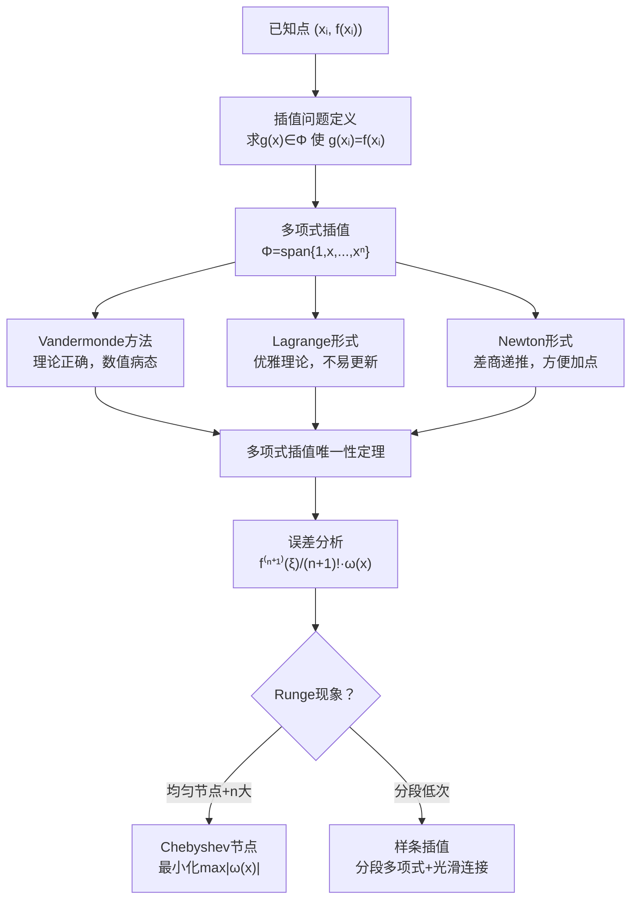
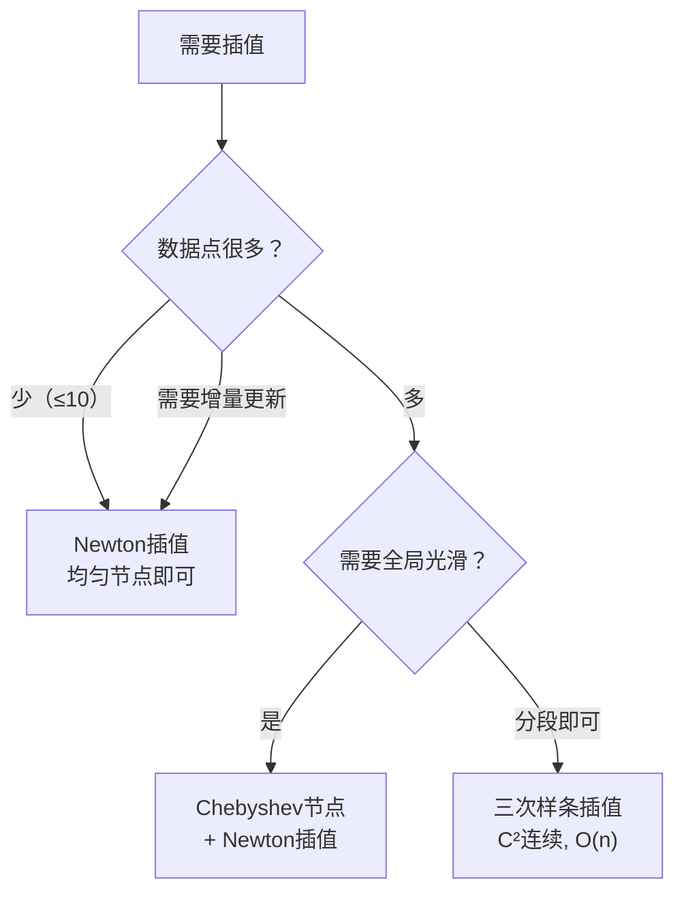

# 第07章 插值法

---

## 一、本章核心脉络

**核心问题**：已知函数在若干点上的值，如何构造一个简单函数（通常是多项式）精确经过这些点，用来估计函数在其他点的值？

> 这条脉络的核心逻辑：**插值问题天然有唯一解（Vandermonde行列式≠0）→ 但直接解方程组（Vandermonde法）数值不可行 → Lagrange给出显式构造 → Newton通过差商实现增量式构造（新增节点只加一项）→ 误差分析揭示 $\omega(x)$ 是 Runge 现象的根源 → 两种出路：优化节点（Chebyshev）和分段低次（样条）。**

---

## 二、插值问题的数学定义

### 2.1 什么是插值

> 一句话来说：插值 = 找一条曲线精确经过所有已知数据点——与"拟合"的区别在于后者只要求"尽可能靠近"。

已知 $f(x)$ 在 $m+1$ 个互不相同点 $\{x_i\}_{i=0}^m$ 上的值，选择基函数空间 $\Phi = \text{span}\{\varphi_0,\ldots,\varphi_n\}$，求 $g(x) \in \Phi$ 满足：
$$g(x_i) = f(x_i), \quad i = 0,\ldots,m$$

**核心问题**：存在性、唯一性、构造方法、误差估计。

### 2.2 一般求解框架

设 $g(x) = a_0\varphi_0(x) + \cdots + a_n\varphi_n(x)$，代入插值条件得：
$$M a = f, \quad M_{ij} = \varphi_j(x_i)$$

$Ma=f$ 存在唯一解的条件：$m=n$ 且 $M$ 可逆。

---

## 三、多项式插值（**核心**）

### 3.1 Vandermonde 方法

> 一句话来说：取 $\{1, x, \ldots, x^n\}$ 为基函数，插值条件给出 Vandermonde 方程组——行列式非零保证解存在唯一，但矩阵病态使其不可用于实际计算。

$$\begin{pmatrix} 1 & x_0 & \cdots & x_0^n \\ 1 & x_1 & \cdots & x_1^n \\ \vdots & \vdots & \ddots & \vdots \\ 1 & x_n & \cdots & x_n^n \end{pmatrix} \begin{pmatrix} a_0 \\ a_1 \\ \vdots \\ a_n \end{pmatrix} = \begin{pmatrix} f(x_0) \\ f(x_1) \\ \vdots \\ f(x_n) \end{pmatrix}$$

$$\det(V) = \prod_{0 \leq j < i \leq n} (x_i - x_j) \neq 0$$

> [!warning] Vandermonde 矩阵在 $n \geq 10$ 时条件数极大（$>10^{10}$），此法数值上完全不可用。

### 3.2 多项式插值唯一性定理

> 一句话来说：经过 $n+1$ 个不同点的次数不超过 $n$ 的插值多项式存在且唯一——不管用什么方法（Lagrange/Newton/Vandermonde），得到的是同一个多项式。

**定理**：若 $x_0,\ldots,x_n$ 互不相同，则对任意 $y_0,\ldots,y_n$，存在唯一的次数不超过 $n$ 的多项式 $P_n(x)$ 满足 $P_n(x_i) = y_i\;(0 \leq i \leq n)$。

### 3.3 Lagrange 插值（**优雅的理论**）

> 一句话来说：不用解方程组——直接构造基函数 $l_i(x)$，它在 $x_i$ 处为1、其余节点处全为0，线性组合即得插值多项式。

$$l_i(x) = \prod_{j=0, j\neq i}^n \frac{x-x_j}{x_i-x_j}, \quad P_n(x) = \sum_{i=0}^n f(x_i) l_i(x)$$

**Lagrange 基函数**：$l_i(x_j)=\delta_{ij}$（$i=j$ 时为1，否则为0）——这一性质来自分子分母的巧妙构造：$x=x_i$ 时分子=分母（每个因子都约掉）；$x=x_j$ 时分子含因子 $(x_j-x_j)=0$。

| 优点 | 缺点 |
|------|------|
| 表达式简洁，理论分析完美 | 新增节点需重算所有基函数 |
| 无需求解方程组 | 基函数乘积形式计算量大 |

**手算例子**：已知三点 $(0,1),(1,3),(2,0)$，用 Lagrange 构造二次插值多项式。

$$
l_0(x)=\frac{(x-1)(x-2)}{(0-1)(0-2)}=\frac{(x-1)(x-2)}{2}
$$
$$
l_1(x)=\frac{(x-0)(x-2)}{(1-0)(1-2)}=\frac{x(x-2)}{-1}=-x(x-2)
$$
$$
l_2(x)=\frac{(x-0)(x-1)}{(2-0)(2-1)}=\frac{x(x-1)}{2}
$$

验证：$l_0(0)=1, l_0(1)=l_0(2)=0$；$l_1(1)=1,$ 其余为0；$l_2(2)=1,$ 其余为0。

组合得：

$$
P_2(x)=1\cdot l_0(x)+3\cdot l_1(x)+0\cdot l_2(x)
=\frac{(x-1)(x-2)}{2}-3x(x-2)
$$

展开：

$$
=\frac{x^2-3x+2}{2}-3x^2+6x
=\frac{x^2-3x+2-6x^2+12x}{2}
=\frac{-5x^2+9x+2}{2}
$$

检验：$P_2(0)=1\checkmark,\; P_2(1)=(-5+9+2)/2=3\checkmark,\; P_2(2)=(-20+18+2)/2=0\checkmark$。
 
### 3.4 Newton 插值（**实用的选择**）

> 一句话来说：用"差商"作为增量系数，每次加一个节点只需多算一项——前面算的全保留。

$$P_n(x) = f[x_0] + f[x_0,x_1](x-x_0) + f[x_0,x_1,x_2](x-x_0)(x-x_1) + \cdots + f[x_0,\ldots,x_n]\prod_{i=0}^{n-1}(x-x_i)$$

**基函数**：$N_0(x)=1,\; N_1(x)=x-x_0,\; N_k(x)=\prod_{i=0}^{k-1}(x-x_i)$（下三角结构）

**差商递推**：
$$f[x_i,x_j] = \frac{f(x_j)-f(x_i)}{x_j-x_i}$$
$$f[x_0,\ldots,x_k] = \frac{f[x_1,\ldots,x_k] - f[x_0,\ldots,x_{k-1}]}{x_k-x_0}$$

**差商性质**：
- **对称性**：$f[x_{i_0},\ldots,x_{i_n}]$ 与节点排列顺序无关
- **递推性**：可由低阶差商组合出高阶差商

$$
\begin{array}{cccc}
x_0 & f[x_0] \\
    &   & f[x_0,x_1] \\
x_1 & f[x_1]     &               & f[x_0,x_1,x_2] \\
    &   & f[x_1,x_2] \\
x_2 & f[x_2]
\end{array}
$$

> 核心洞察：Newton 插值的下三角系数矩阵 $M$ 天然适合前代求解——$a_0 = f[x_0]$ 一步得出，然后 $a_1$、$a_2$…依次递推。

**例题**：求经过 $(1,6),(2,1),(3,12)$ 的二次多项式。

$$f[x_0,x_1] = \frac{1-6}{2-1} = -5, \quad f[x_1,x_2] = \frac{12-1}{3-2} = 11$$
$$f[x_0,x_1,x_2] = \frac{11 - (-5)}{3-1} = 8$$
$$P_2(x) = 6 - 5(x-1) + 8(x-1)(x-2) = 8x^2 - 29x + 27$$

### 3.5 三种方法对比

| 方法 | 基函数 | 系数求解 | 增点代价 | 数值稳定性 |
|------|--------|----------|:---:|:---:|
| Vandermonde | $\{1,x,\ldots,x^n\}$ | 解满阵 | 全重算 | 差 |
| Lagrange | $\{l_i(x)\}$ | 直接（不需解方程） | 全重算 | 较好 |
| Newton | $\{N_k(x)\}$ | 前代（下三角） | 只加一项 | 较好 |

---

## 四、插值误差与 Runge 现象（**难点**）

### 4.1 误差公式

$$f(x) - P_n(x) = \frac{f^{(n+1)}(\xi)}{(n+1)!} \omega(x), \quad \omega(x) = \prod_{i=0}^n (x-x_i), \quad \xi \in (a,b)$$

> 核心洞察：误差 = 导数项 × $\omega(x)$。导数项取决于 $f$ 的光滑性；$\omega(x)$ 取决于节点分布。均匀节点下 $\omega(x)$ 在两端剧烈摆动——这就是 Runge 现象的根源。

#### 插值余项的光滑性条件与差商形式

设 $f\in C^{n+1}[a,b]$，$P_n$ 是在 $n+1$ 个互异节点 $x_0,\ldots,x_n\in[a,b]$ 上的次数不超过 $n$ 的插值多项式，则余项还可写为差商形式：
$$
f(x)-P_n(x)
=f[x_0,\ldots,x_n,x]\prod_{i=0}^{n}(x-x_i)
=\frac{f^{(n+1)}(c)}{(n+1)!}\prod_{i=0}^{n}(x-x_i).
$$
其中 $c\in(a,b)$；差商形式在 $x$ 与已有节点互异时直接使用。

### 4.2 Runge 现象

> 一句话来说：**均匀节点下增加插值点数，两端误差反而爆炸**——高次多项式插值的"阿克琉斯之踵"。

**经典例子**：$f(x) = \frac{1}{1+25x^2}$ 在 $[-1,1]$ 上均匀取点——$n$ 增大时两端剧烈震荡，误差远超函数值本身。

### 4.3 Chebyshev 插值（**难点**）

> 一句话来说：把插值节点"往两端集中"可以最小化 $\max|\omega(x)|$——Chebyshev 多项式的零点就是这样的最优节点。

**Chebyshev 多项式**：$T_n(x) = \cos(n\cos^{-1}x)$

递推：$T_{n+1} = 2x T_n - T_{n-1}$，$T_0=1,T_1=x$

**性质**：$T_n(x)$ 在 $[-1,1]$ 上绝对值不超过1，$n$ 次项系数 $2^{n-1}$，零点在 $x_k = \cos\frac{(2k+1)\pi}{2n}$。

**首一多项式定理**（**minimax 性质**）：$q(x)=2^{1-n}T_n(x)$ 是首一多项式（最高次项系数为1），且所有 $n$ 次首一多项式 $p(x)$ 满足：
$$\max_{x\in[-1,1]}|p(x)| \geq 2^{1-n} = \max_{x\in[-1,1]}|q(x)|$$
> 核心洞察：**$\boldsymbol{2^{1-n}T_n(x)}$ 是所有 $n$ 次首一多项式中 $\infty$-范数最小的那个**——正因如此，以其根为插值节点能最小化 $\max|\omega(x)|$，因为 $\omega(x)$ 恰好就是 $2^{-n}T_{n+1}(x)$。

**标准区间 $\boldsymbol{[-1,1]}$ 的 Chebyshev 插值误差定理**：取 $T_{n+1}(x)$ 的 $n+1$ 个根为插值节点
$$x_k = \cos\left(\frac{2k+1}{2n+2}\pi\right), \quad k = 0,1,\ldots,n$$

则 $\omega(x)=\prod_{i=0}^n(x-x_i) = 2^{-n}\,T_{n+1}(x)$，所以 $\displaystyle\max_{x\in[-1,1]}|\omega(x)| = \frac{1}{2^n}$。代入一般插值误差公式得：
$$|f(x)-P_n(x)| \leq \frac{1}{2^n (n+1)!}\,\max_{c\in[-1,1]}|f^{(n+1)}(c)|,\quad x\in[-1,1]$$

**任意区间 $\boldsymbol{[a,b]}$ 的 Chebyshev 插值误差定理**：通过线性变换 $x\mapsto\frac{2x-(b+a)}{b-a}$ 将 $[a,b]$ 映射到 $[-1,1]$，得
$$x_k = \frac{b-a}{2}\cos\left(\frac{2k+1}{2n+2}\pi\right) + \frac{b+a}{2}, \quad k=0,1,\ldots,n$$

$$\max_{x\in[a,b]}|\omega(x)| \leq \frac{\left(\frac{b-a}{2}\right)^{n+1}}{2^n}$$

误差界为：
$$|f(x)-P_n(x)| \leq \frac{\left(\frac{b-a}{2}\right)^{n+1}}{2^n (n+1)!}\,\max_{c\in[a,b]}|f^{(n+1)}(c)|,\quad x\in[a,b]$$

> **对比**：均匀节点下 $\max|\omega(x)|$ 随 $n$ 指数增长（Runge）；Chebyshev 节点下分母有 $2^n$ 压制——误差随 $n\to\infty$ 趋于零（只要 $f^{(n+1)}$ 增长不太快）。这就是 Chebyshev 节点"根治"Runge 的定量理由。

#### Chebyshev多项式的端点与极值点

除零点公式外，Chebyshev 多项式还满足
$$
T_n(1)=1,\qquad T_n(-1)=(-1)^n,
$$
以及
$$
T_n\!\left(\cos\frac{k\pi}{n}\right)=(-1)^k,\qquad k=0,1,\ldots,n\quad(n\ge1).
$$
因此它在这些 $n+1$ 个点交替达到 $1$ 和 $-1$。

---

## 五、样条插值（**核心**）

### 5.1 动机

> 一句话来说：与其用一个高次多项式硬撑（Runge），不如把区间分成多段，每段用低次多项式——段间保持光滑连接。

### 5.2 三次样条

最常用的是**三次样条**：每段为三次多项式，整体 $C^2$ 连续（函数值+一阶导+二阶导连续）。

**自由度分析**：$n$ 个区间 × 4个参数/段 = $4n$ 个未知数。

**约束条件**：
- 函数值连续（$n+1$ 个节点）：$2n$ 个方程
- 一阶导连续（$n-1$ 个内部节点）：$n-1$ 个方程
- 二阶导连续（$n-1$ 个内部节点）：$n-1$ 个方程
- **边界条件**：2个（如自然边界 $S''(x_0)=S''(x_n)=0$）

总计 $4n$ 个方程 = $4n$ 个未知数 → 参数唯一确定，计算量 $O(n)$（追赶法解三对角方程组）。

#### 一般k次样条与方程组结构

结点 $x_0,\ldots,x_n$ 上的 $k$ 次样条函数 $S(x)$ 满足：

1. 在每个子区间 $[x_{i-1},x_i]$ 上，$S$ 是次数不超过 $k$ 的多项式。
2. $S$ 在 $[x_0,x_n]$ 上具有 $k-1$ 阶连续导数。

自然三次样条导出的线性方程组不仅是三对角的，也具有对角占优结构。

### 5.3 三次样条的构造（**难点**）

课件以 $c_i = \frac{1}{2}S''(x_i)$ 为核心未知数，第 $i$ 段 $[x_i, x_{i+1}]$ 的三次多项式取简洁形式：

$$S_i(x) = \underbrace{f(x_i)}_{a_i} + b_i(x-x_i) + c_i(x-x_i)^2 + d_i(x-x_i)^3$$

（$4n$ 个系数 $b_i, c_i, d_i$ 待定，$a_i = f(x_i)$ 直接取。）

**消去 $d_i$**（由 C2 连续 $S_i''(x_{i+1}) = S_{i+1}''(x_{i+1})$）：

$$S_i''(x) = 2c_i + 6d_i(x-x_i), \quad S_i''(x_{i+1}) = 2c_i + 6d_i\delta_i = 2c_{i+1}$$

$$d_i = \frac{c_{i+1} - c_i}{3\delta_i}$$

**消去 $b_i$**（由插值条件 $S_i(x_{i+1}) = f(x_{i+1})$）：

$$f(x_i) + b_i\delta_i + c_i\delta_i^2 + d_i\delta_i^3 = f(x_{i+1})$$

代入 $d_i$，解出：

$$b_i = \frac{\Delta_i}{\delta_i} - \frac{\delta_i}{3}(2c_i + c_{i+1})$$

**三对角方程**（代入 C1 连续 $S_i'(x_{i+1}) = S_{i+1}'(x_{i+1})$，消去 $b_i, d_i$）：

$$\delta_i c_i + 2(\delta_i+\delta_{i+1})c_{i+1} + \delta_{i+1}c_{i+2} = 3\left(\frac{\Delta_{i+1}}{\delta_{i+1}} - \frac{\Delta_i}{\delta_i}\right) \quad (i=0,\dots,n-2)$$

其中 $\delta_i = x_{i+1}-x_i$，$\Delta_i = f(x_{i+1})-f(x_i)$。

**自然边界**：$c_0 = c_n = 0$（$S''(x_0)=2c_0=0,\; S''(x_n)=2c_n=0$）。

**求解流程**：
1. 算 $\delta_i, \Delta_i$，构造三对角方程组 → 解出 $c_0,\dots,c_n$
2. **回代**：$a_i = f(x_i),\; d_i = \frac{c_{i+1}-c_i}{3\delta_i},\; b_i = \frac{\Delta_i}{\delta_i} - \frac{\delta_i}{3}(2c_i+c_{i+1})$

> 有些教材用 $M_i = S''(x_i) = 2c_i$。代换后三对角方程变为 $\frac{h_{i-1}}{6}M_{i-1}+\frac{h_{i-1}+h_i}{3}M_i+\frac{h_i}{6}M_{i+1} = \frac{\Delta_i}{h_i}-\frac{\Delta_{i-1}}{h_{i-1}}$（两边乘 6 即见等价），边界 $M_0=M_n=0$。

### 5.4 手算例子：三点构造自然三次样条

给定数据：$(0,0),\;(1,1),\;(2,0)$。构造自然三次样条。

区间 $[0,1]$ 和 $[1,2]$，$n=2$ 个区间，$\delta_0=\delta_1=1$，$\Delta_0=1,\;\Delta_1=-1$。

自然边界：$c_0=0,\;c_2=0$。只需解 $c_1$。

三对角方程（$i=0$）：

$$
\delta_0 c_0 + 2(\delta_0+\delta_1)c_1 + \delta_1 c_2 = 3\left(\frac{\Delta_1}{\delta_1} - \frac{\Delta_0}{\delta_0}\right)
$$

$$
1\cdot 0 + 4c_1 + 1\cdot 0 = 3(-1-1) = -6
$$

$$
c_1 = -\frac{3}{2}
$$

所以：$c_0=0,\;c_1=-\frac{3}{2},\;c_2=0$。（注意：$M_1 = 2c_1 = -3$。）

**回代**（从 $c_i$ 求每段的 $a,b,c,d$ 系数）：

> [!note]- 推导：$a_i,b_i,d_i$ 公式
> 
> 在第 $i$ 段 $[x_i,x_{i+1}]$ 上用局部幂基：$S_i(x)=a_i+b_i(x-x_i)+c_i(x-x_i)^2+d_i(x-x_i)^3$。
> 
> ① **$a_i$**：$S_i(x_i)=y_i \implies a_i=y_i$。
> 
> ② **$c_i$（局部 $x^2$ 系数）**：$S_i''(x)=2c_i+6d_i(x-x_i)$，在 $x_i$ 处 $S_i''(x_i)=2c_i$。定义 $c_i^{\text{全局}}=S''(x_i)/2$ → 局部 $c_i = c_i^{\text{全局}}$（记号重合，但含义一致：$x^2$ 系数 $= S''(x_i)/2$）。
> 
> ③ **$d_i$**：$S_i''(x_{i+1})=2c_i+6d_i\delta_i = 2c_{i+1}$ → $6d_i\delta_i=2(c_{i+1}-c_i)$ → $d_i=\dfrac{c_{i+1}-c_i}{3\delta_i}$。
> 
> ④ **$b_i$**：$S_i(x_{i+1})=a_i+b_i\delta_i+c_i\delta_i^2+d_i\delta_i^3=y_{i+1}$。代 $a_i$,$d_i$：
> $$b_i\delta_i = \Delta_i - c_i\delta_i^2 - \frac{c_{i+1}-c_i}{3\delta_i}\delta_i^3 = \Delta_i - \frac{\delta_i^2}{3}(2c_i+c_{i+1})$$
> $$b_i = \frac{\Delta_i}{\delta_i} - \frac{\delta_i}{3}(2c_i+c_{i+1})$$

| 段 | $a_i$ | $d_i = \frac{c_{i+1}-c_i}{3\delta_i}$ | $b_i = \frac{\Delta_i}{\delta_i} - \frac{\delta_i}{3}(2c_i+c_{i+1})$ |
| :-------------- | :---- | :------------------------------------ | :------------------------------------------------------------------- |
| $S_0$ ($[0,1]$) | $0$   | $\frac{-3/2-0}{3} = -\frac{1}{2}$     | $1 - \frac{1}{3}(0-\frac{3}{2}) = \frac{3}{2}$                       |
| $S_1$ ($[1,2]$) | $1$   | $\frac{0-(-3/2)}{3} = \frac{1}{2}$    | $-1 - \frac{1}{3}(-3+0) = 0$                                         |

**第1段** ($x\in[0,1]$)：

$$
S_0(x) = 0 + \frac{3}{2}x + 0\cdot x^2 - \frac{1}{2}x^3 = \frac{3}{2}x - \frac{1}{2}x^3
$$

**第2段** ($x\in[1,2]$)：

$$
S_1(x) = 1 + 0\cdot(x-1) - \frac{3}{2}(x-1)^2 + \frac{1}{2}(x-1)^3
$$

**验证**：$S_0(0)=0\checkmark,\;S_0(1)=\frac{3}{2}-\frac{1}{2}=1\checkmark,\;S_1(1)=1\checkmark,\;S_1(2)=1-\frac{3}{2}+\frac{1}{2}=0\checkmark$。

一阶导：$S_0'(1)=\frac{3}{2}-\frac{3}{2}=0$，$S_1'(1)=0 \checkmark$（C1 连续）。

二阶导：$S_0''(1)=-3x|_{x=1}=-3=2c_1$，$S_1''(1)=-3=2c_1\checkmark$（C2 连续）。

> 核心洞察：样条插值 = "分段低次 + 光滑连接"——既避免了 Runge 震荡，又具有 $C^2$ 光滑性，计算量线性。

---

## 判定/决策流程

---

## 核心公式速查表

| 概念 | 公式 | 说明 |
|------|------|------|
| 插值定义 | $g(x_i)=f(x_i)$ | 精确经过 |
| Vandermonde行列式 | $\det(V)=\prod_{i>j}(x_i-x_j)$ | 非零→解存在唯一 |
| Lagrange基 | $l_i(x)=\prod_{j\neq i}\frac{x-x_j}{x_i-x_j}$ | $l_i(x_j)=\delta_{ij}$ |
| 一阶差商 | $f[x_i,x_j]=\frac{f(x_j)-f(x_i)}{x_j-x_i}$ | — |
| 高阶差商 | $f[x_0,\ldots,x_k]=\frac{f[x_1,\ldots,x_k]-f[x_0,\ldots,x_{k-1}]}{x_k-x_0}$ | 递推构造 |
| Newton插值 | $P_n(x)=\sum_{k=0}^n f[x_0,\ldots,x_k]\prod_{i=0}^{k-1}(x-x_i)$ | 增量形式 |
| 插值误差 | $\frac{f^{(n+1)}(\xi)}{(n+1)!}\prod(x-x_i)$ | $\omega(x)$导致Runge |
| Chebyshev节点 | $x_k=\cos\frac{(2k+1)\pi}{2n+2}$ | 最小化$\max\|\omega\|$ |
| Chebyshev递推 | $T_{n+1}=2xT_n-T_{n-1}$ | $T_0=1,T_1=x$ |
| Chebyshev误差($[-1,1]$) | $\|f-P_n\|\le\frac{\|f^{(n+1)}\|}{2^n(n+1)!}$ | $\omega=2^{-n}T_{n+1}$ |
| Chebyshev误差($[a,b]$) | $\|f-P_n\|\le\frac{\left(\frac{b-a}{2}\right)^{n+1}}{2^n(n+1)!}\|f^{(n+1)}\|$ | 区间变换后应用 |

---

## 易错点与注意事项

> [!warning] **插值 ≠ 拟合**：插值严格过所有点（$g(x_i)=f(x_i)$），拟合追求整体误差最小。用插值处理含噪数据 = 过拟合。

> [!warning] **高次 ≠ 高精度**：Runge 现象说明均匀节点下提高次数反而害事——$n$ 增大时 $\omega(x)$ 在边界处的值呈指数增长。

> [!warning] **Newton 优于 Lagrange 于实用**：增点时 Newton 只需加一项，Lagrange 需重算所有基函数。但 Lagrange 在理论分析中更简洁。

> [!warning] **经典 Gram-Schmidt 不止用于 QR**：在数值微分中差商代替微商的误差分析也用到插值思想。

> [!warning] **Vandermonde 矩阵是病态的经典例子**：行列式公式说明理论上可逆，但条件数极差——这正是"理论上存在"和"数值上可行"之间的鸿沟。

### 节点密集时的舍入误差

> [!warning] 差商中的小分母
> 节点密集时，差商分母可能很小，计算中需注意舍入误差。

---

## 相关知识点链接

| 章节 | 关联点 | 为什么相关 |
|------|--------|-----------|
| [[课程/数值分析/课件/MD/08-数据拟合与最小二乘]] | 插值 vs 拟合 | 同一数据的不同处理策略 |
| [[课程/数值分析/课件/MD/09-数值积分与数值微分]] | 内插求积公式 | Newton-Cotes由内插多项式导出 |
| [[课程/数值分析/课件/MD/02-非线性方程求根]] | Muller法 | 用抛物线插值求根（三点插值） |
| [[课程/数值分析/课件/MD/01-背景与基础知识]] | 条件数 | Vandermonde的病态说明数值稳定性重要 |

---

## 作业与练习

本章练习覆盖所有主要插值方法。详见源文件末尾思考题：
1. **手算**：给定数据点，用 Lagrange 和 Newton 两种方法构造插值多项式
2. **Runge验证**：对 $f(x)=1/(1+25x^2)$ 在不同 $n$ 下画插值曲线，观测 Runge 现象
3. **Chebyshev节点**：用均匀节点 vs Chebyshev 节点对比 Runge 函数的插值效果
4. **样条插值**：编程实现三次样条插值并验证 $C^2$ 连续性

**建议做题顺序**：先手算理解差商 → 再代码验证 Runge → 最后用 Chebyshev 和样条对比改善效果

### 练习的完整数据

1. 分别用 Lagrange 和 Newton 插值构造通过 $(-1,0),(2,1),(3,1),(5,2)$ 的多项式，并验证结果一致。
2. 构造通过 $(-1,1),(1,1),(2,4)$ 的自然三次样条。
3. 在 $[-2,2]$ 上分别取11、21、31个节点，对 $f(x)=1/(1+12x^2)$ 作多项式插值，比较均匀节点与 Chebyshev 节点的误差。
4. 对同一函数在 $[-2,2]$ 上均匀取11、21、31个节点，作自然三次样条，并与相同节点的 Newton 插值比较。

