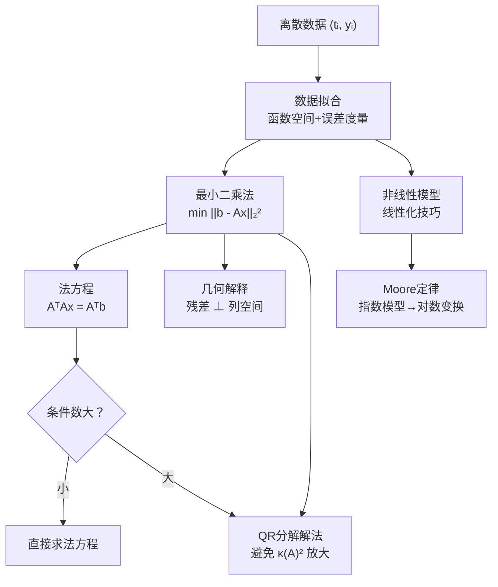
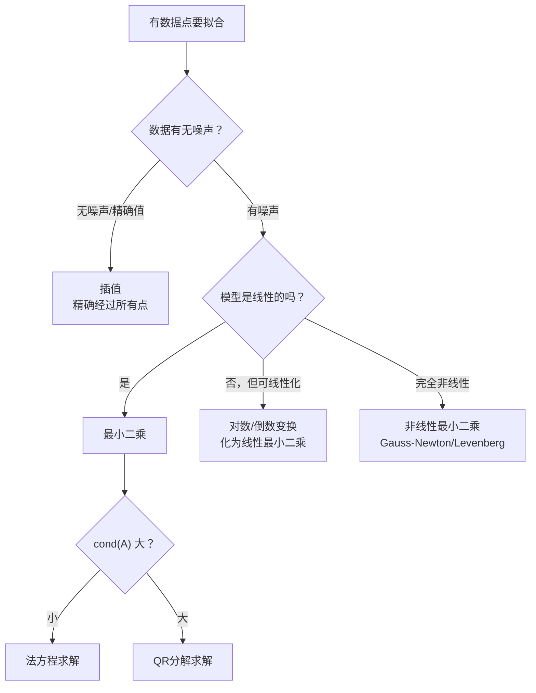

# 第08章 数据拟合与最小二乘

---

## 一、本章核心脉络

**核心问题**：观测数据含有噪声，曲线不必（也不该）精确经过每个点——如何在某种误差度量下找到"最优逼近"？

> 这条脉络的核心逻辑：**数据拟合的本质是在函数空间中找一个函数使某个误差最小 → 选平方误差（2-范数）得到最小二乘法 → 求导得法方程 $A^T A x = A^T b$ → 但法方程的条件数是原问题的平方（病态隐患）→ QR 分解直接处理 $A$ 绕过这一隐患 → 非线性模型通过对数变换等技巧化为线性最小二乘。**

---

## 二、数据拟合 vs 插值（**基础概念**）

### 2.1 为什么需要拟合？

> 一句话来说：插值要求曲线"精确经过每个点"——这在有噪声的观测数据中不仅毫无意义，而且有害（过拟合）。拟合追求的是"整体误差最小"。

| | 插值 | 拟合 |
|------|:---:|:---:|
| 条件 | $g(x_i) = f(x_i)$，精确经过 | $\min \sum (g(t_i) - y_i)^2$，距离最小 |
| 基函数个数 | 至少等于数据点数 | 可远少于数据点数 |
| 适用场景 | 精确函数值（如数学用表） | 含噪声观测数据（实验数据、传感器） |
| 过拟合风险 | 高次插值→Runge现象 | 模型复杂度合理时可控 |

### 2.2 拟合的数学定义

给定数据点 $(t_0, y_0), \ldots, (t_m, y_m)$，选择基函数空间 $\Phi = \text{span}\{\varphi_0(t), \ldots, \varphi_n(t)\}$（通常 $n \ll m$），求：

$$\varphi(t) = a_0\varphi_0(t) + \cdots + a_n\varphi_n(t)$$

使 $\varphi(t)$ 在某种度量下"最佳逼近"数据点。

### 2.3 两种研究范式

| 范式 | 方法 | 代表 | 实例 |
|------|------|------|------|
| **开普勒范式** | 从观测数据总结规律（数据驱动） | Kepler | G.I. Taylor 用量纲分析 + 核爆照片推算当量 |
| **牛顿范式** | 先推导理论形式，再用数据拟合参数（第一性原理） | Newton | 用物理定律建模，实验数据确定参数 |

> **G.I. Taylor 的传奇**：仅凭量纲分析推导爆炸能量公式 $\displaystyle E = \frac{R^5\rho}{t^2}$，从公开核爆照片拟合参数，估算出约2万吨TNT当量——与实际值2.1万吨误差仅5%。这是"开普勒范式"的经典案例。

---

## 三、最小二乘法（**本章核心**）

### 3.1 核心思想

> 一句话来说：选平方误差（2-范数）作为度量——因为它在数学上可导、在统计上对应高斯噪声的最大似然估计、在几何上有漂亮的正交投影解释。

**残差向量**：$r = [\varphi(t_0)-y_0, \ldots, \varphi(t_m)-y_m]^T$

**平方误差**：
$$\text{SE}(a_0,\ldots,a_n) = \|r\|_2^2 = \sum_{i=0}^m \left[\sum_{j=0}^n a_j\varphi_j(t_i) - y_i\right]^2$$

### 3.2 法方程的推导

对每个参数求偏导 = 0：
$$\frac{\partial\text{SE}}{\partial a_k} = 2\sum_{i=0}^m \varphi_k(t_i)\left[\sum_{j=0}^n a_j\varphi_j(t_i) - y_i\right] = 0 \quad (k=0,\ldots,n)$$

展开并交换求和顺序，得**法方程**（Normal Equations）：
$$\sum_{j=0}^n \left[\sum_{i=0}^m \varphi_k(t_i)\varphi_j(t_i)\right] a_j = \sum_{i=0}^m \varphi_k(t_i) y_i \quad (k=0,\ldots,n)$$

### 3.3 矩阵形式

定义 $A_{ij} = \varphi_{j-1}(t_{i-1})$（$m+1$ 行 $\times$ $n+1$ 列），$b = [y_0,\ldots,y_m]^T$：
$$A^T A x = A^T b$$

其中 $x = [a_0,\ldots,a_n]^T$。

**核心洞察**：超定方程 $Ax=b$ 无解 $\implies$ 转求 $A^T A x = A^T b$——这恰好是 $\|b-Ax\|_2^2$ 取极小的必要条件。

### 3.4 几何解释（**难点**）

> 一句话来说：最小二乘解的残差向量 $b-Ax$ 与 $A$ 的列空间正交——最优解就是 $b$ 在 $A$ 的列空间上的正交投影。

$Ax = b$ 等价于 $x_1 A_1 + \cdots + x_n A_n = b$（$A_i$ 是 $A$ 的第 $i$ 列）。

- $b$ 不一定在 $\text{span}\{A_1,\ldots,A_n\}$ 中 → 原方程无解
- 最小二乘解 = 找一个在 $\text{span}\{A_1,\ldots,A_n\}$ 中且最接近 $b$ 的向量

正交条件：$(b - Ax) \perp \text{span}\{A_1,\ldots,A_n\} \implies A^T(b-Ax) = 0 \implies A^T A x = A^T b$

这就是法方程的**几何证明**——无需求导！

**例题**：用最小二乘法解超定方程（几何视角）：

$$A = \begin{pmatrix} 1 & 1 \\ 1 & -1 \\ 1 & 1 \end{pmatrix}, \quad b = \begin{pmatrix} 2 \\ 1 \\ 3 \end{pmatrix}$$

法方程 $A^T A x = A^T b$ 得 $\begin{pmatrix}3 & 1 \\ 1 & 3\end{pmatrix}x = \begin{pmatrix}6 \\ 4\end{pmatrix}$，得 $x_1=1.75, x_2=0.75$。

---

## 四、多项式拟合与病态问题（**核心**）

### 4.1 多项式拟合

> 一句话来说：取 $\{1, t, t^2, \ldots, t^n\}$ 为基函数是最直接的选择——但法方程的系数矩阵是 Hilbert 型矩阵，$n$ 稍大就病态得没法用。

法方程系数矩阵：
$$\begin{pmatrix}
m+1 & \sum t_i & \cdots & \sum t_i^n \\
\sum t_i & \sum t_i^2 & \cdots & \sum t_i^{n+1} \\
\vdots & \vdots & \ddots & \vdots \\
\sum t_i^n & \sum t_i^{n+1} & \cdots & \sum t_i^{2n}
\end{pmatrix}$$

> [!warning] 这是 Hilbert 型矩阵，条件数随 $n$ 指数增长。$n \geq 5$ 时法方程的结果可能完全不可靠。

### 4.2 非线性模型的线性化（**实用技巧**）

> 一句话来说：很多非线性模型通过对数、倒数等变换可以变成线性形式——Moore 定律的指数模型取对数就变成了直线拟合。

**Moore 定律**：$y = c_1 e^{c_2 t}$ → 取对数 $\ln y = \ln c_1 + c_2 t$

从1970-2003年CPU晶体管数据拟合得 $c_2 \approx 0.3546$，翻倍时间 $= \ln 2 / c_2 \approx 1.95$ 年——与 Moore 定律的"每两年翻倍"高度吻合。

**常见可线性化模型**：

| 原模型 | 变换 | 线性化形式 |
|--------|------|------------|
| $y = c_1 e^{c_2 t}$ | $\ln y = \ln c_1 + c_2 t$ | $Y = A + Bt$ |
| $y = c_1 t^{c_2}$ | $\ln y = \ln c_1 + c_2 \ln t$ | $Y = A + B(\ln t)$ |
| $y = \frac{1}{c_1 + c_2 t}$ | $1/y = c_1 + c_2 t$ | $Y = c_1 + c_2 t$ |

> [!warning] 线性化后的最小二乘解与原非线性最小二乘解不完全等价（误差度量变了），但对工程应用通常足够。

---

## 五、QR 分解求解最小二乘（**核心**）

### 5.1 动机

> 一句话来说：法方程的致命弱点是 $\kappa(A^T A) = \kappa(A)^2$——原问题稍有病态，法方程就病态到不可用。QR 分解直接处理 $A$，条件数不平方。

### 5.2 推导

设 $A = QR$（$Q$ 正交，$R$ 上三角）。由于正交变换保2-范数：

$$\|b - Ax\|_2 = \|b - QRx\|_2 = \|Q^T b - Rx\|_2$$

令 $d = Q^T b$：

$$Rx - d = \begin{pmatrix} \widehat{R} \\ 0 \end{pmatrix} x - \begin{pmatrix} \widehat{d} \\ \widetilde{d} \end{pmatrix} = \begin{pmatrix} \widehat{R}x - \widehat{d} \\ -\widetilde{d} \end{pmatrix}$$

其中 $\widehat{R}$ 是 $R$ 的前 $n$ 行（上三角方阵），$\widehat{d}$ 是 $d$ 的前 $n$ 个分量。

$$\|Q^T b - Rx\|_2^2 = \|\widehat{R}x - \widehat{d}\|_2^2 + \|\widetilde{d}\|_2^2$$

第二项与 $x$ 无关 → 最小化等价于 $\widehat{R}x = \widehat{d}$（回代即可求解）。

### 5.3 手算例子：QR 分解 vs 法方程

用第 3.4 节同一个超定方程组，分别用法方程和 QR 求解，直观对比。

$$
A = \begin{pmatrix} 1 & 1 \\ 1 & -1 \\ 1 & 1 \end{pmatrix}, \quad b = \begin{pmatrix} 2 \\ 1 \\ 3 \end{pmatrix}
$$

**法方程方法**（已算过）：

$$
A^TA = \begin{pmatrix} 3 & 1 \\ 1 & 3 \end{pmatrix}, \quad
A^Tb = \begin{pmatrix} 6 \\ 4 \end{pmatrix}
$$

解 $\begin{pmatrix}3&1\\1&3\end{pmatrix}x = \begin{pmatrix}6\\4\end{pmatrix}$，得 $x_1=1.75,\;x_2=0.75$。

**QR 分解方法**：

对 $A$ 做 Gram-Schmidt QR 分解。

$$
r_{11} = \|A_1\|_2 = \sqrt{1^2+1^2+1^2} = \sqrt{3}
$$
$$
q_1 = \frac{A_1}{r_{11}} = \frac{1}{\sqrt{3}}\begin{pmatrix}1\\1\\1\end{pmatrix}
$$
$$
r_{12} = q_1^T A_2 = \frac{1}{\sqrt{3}}\begin{pmatrix}1&1&1\end{pmatrix}\begin{pmatrix}1\\-1\\1\end{pmatrix}
= \frac{1}{\sqrt{3}}(1-1+1) = \frac{1}{\sqrt{3}}
$$
$$
y_2 = A_2 - r_{12}q_1 = \begin{pmatrix}1\\-1\\1\end{pmatrix} - \frac{1}{\sqrt{3}}\cdot\frac{1}{\sqrt{3}}\begin{pmatrix}1\\1\\1\end{pmatrix}
= \begin{pmatrix}1\\-1\\1\end{pmatrix} - \frac{1}{3}\begin{pmatrix}1\\1\\1\end{pmatrix}
= \begin{pmatrix}2/3\\-4/3\\2/3\end{pmatrix}
$$
$$
r_{22} = \|y_2\|_2 = \sqrt{\frac{4}{9}+\frac{16}{9}+\frac{4}{9}} = \sqrt{\frac{24}{9}} = \frac{2\sqrt{6}}{3}
$$
$$
q_2 = \frac{y_2}{r_{22}} = \frac{3}{2\sqrt{6}}\begin{pmatrix}2/3\\-4/3\\2/3\end{pmatrix}
= \frac{1}{\sqrt{6}}\begin{pmatrix}1\\-2\\1\end{pmatrix}
$$

所以：

$$
Q = \begin{pmatrix}
1/\sqrt{3} & 1/\sqrt{6}\\
1/\sqrt{3} & -2/\sqrt{6}\\
1/\sqrt{3} & 1/\sqrt{6}
\end{pmatrix},\quad
R = \begin{pmatrix}
\sqrt{3} & 1/\sqrt{3}\\
0 & 2\sqrt{6}/3
\end{pmatrix}
$$

计算 $d = Q^T b$：

$$
d_1 = \frac{1}{\sqrt{3}}(2+1+3) = \frac{6}{\sqrt{3}}=2\sqrt{3}
$$
$$
d_2 = \frac{1}{\sqrt{6}}(2-2+3) = \frac{3}{\sqrt{6}}=\frac{\sqrt{6}}{2}
$$

回代 $\widehat{R}x = \widehat{d}$：

$$
\begin{pmatrix}
\sqrt{3} & 1/\sqrt{3}\\
0 & 2\sqrt{6}/3
\end{pmatrix}
\begin{pmatrix}x_1\\x_2\end{pmatrix}
= \begin{pmatrix}2\sqrt{3}\\\sqrt{6}/2\end{pmatrix}
$$

从第二行：$\frac{2\sqrt{6}}{3}x_2 = \frac{\sqrt{6}}{2} \Rightarrow x_2 = \frac{3}{4}=0.75$。

从第一行：$\sqrt{3}x_1 + \frac{1}{\sqrt{3}}\cdot\frac{3}{4} = 2\sqrt{3} \Rightarrow \sqrt{3}x_1 = 2\sqrt{3}-\frac{\sqrt{3}}{4} = \frac{7\sqrt{3}}{4} \Rightarrow x_1 = \frac{7}{4}=1.75$。

**结果一致**：$x=(1.75,0.75)^T$。

### 5.4 方法对比

| 方法 | 条件数 | 数值稳定性 | 计算步骤 | 适用场景 |
|------|:---:|:---:|------|------|
| 法方程 | $\kappa(A)^2$ | 差（病态时） | ①算$A^TA$, $A^Tb$ ②解方程组 | 小问题，$A$ 良态 |
| QR 分解 | $\kappa(A)$ | 好 | ①QR分解 ②算$d=Q^Tb$ ③回代$\widehat{R}x=\widehat{d}$ | 生产代码首选 |

> 核心洞察：QR 分解的最小二乘解不需要显式构造 $A^T A$——一步正交变换就将超定问题变成了上三角回代，规避了条件数平方。

---

## 判定/决策流程

---

## 核心公式速查表

| 概念 | 公式 | 说明 |
|------|------|------|
| 最小二乘目标 | $\min_x \|b - Ax\|_2^2$ | 残差平方和最小 |
| 法方程 | $A^T A x = A^T b$ | 求导=0 |
| 残差正交性 | $A^T(b - Ax) = 0$ | 几何：残差 $\perp$ 列空间 |
| QR最小二乘 | $\widehat{R}x = \widehat{d}$ | $\widehat{R}$ 为 $R$ 前 $n$ 行 |
| 多项式法方程 | $(A^T A)_{kj} = \sum_{i=0}^m t_i^{k+j}$ | Hilbert型，病态 |
| 条件数关系 | $\kappa(A^T A) = \kappa(A)^2$ | 法方程比QR敏感|
| 指数→线性 | $y=c_1 e^{c_2 t} \to \ln y=\ln c_1 + c_2 t$ | Moore定律应用 |

---

## 易错点与注意事项

> [!warning] **插值 ≠ 拟合**：插值要求精确经过——用于精确数据；拟合容忍误差——用于含噪声数据。拿插值去拟合噪声数据 = 过拟合。

> [!warning] **法方程的条件数是原问题的平方**
> - 良态矩阵（$\kappa(A) \approx 10$）→ 法方程可（$\kappa(A^T A) \approx 100$）
> - 病态矩阵（$\kappa(A) \approx 10^6$）→ 法方程不能用（$\kappa(A^T A) \approx 10^{12}$，双精度已不够）

> [!warning] **线性化 ≠ 等价**
> 对 $y=c_1 e^{c_2 t}$ 取对数后的最小二乘，最小化的是 $\sum(\ln y_i - \ln c_1 - c_2 t_i)^2$，而非 $\sum(y_i - c_1 e^{c_2 t_i})^2$。两者结果不完全一致。

> [!warning] **高阶多项式拟合是病态问题**
> 多项式次数 $n \geq 5$ 时法方程条件数极大，结果不可靠。实际中考虑使用：
> - 正交多项式基（如 Chebyshev 多项式）
> - QR 分解直接求解
> - 样条拟合替代全局多项式

---

## 相关知识点链接

| 章节 | 关联点 | 为什么相关 |
|------|--------|-----------|
| [[课程/数值分析/课件/MD/07-插值法]] | 插值 vs 拟合对比 | 插值是拟合的特殊情况（$n=m$） |
| [[课程/数值分析/课件/MD/03-线性方程组的直接解法]] | 法方程和 QR 回代 | 都归结为求解线性方程组和上三角回代 |
| [[课程/数值分析/课件/MD/06-矩阵特征值的数值解法]] | QR 分解 | QR 分解是第6章的核心工具，本章复用 |
| [[课程/数值分析/课件/MD/01-背景与基础知识]] | 条件数 | 条件数概念是理解法方程 vs QR 差异的关键 |

---

## 作业与练习

本章练习覆盖最小二乘和QR分解应用。详见：
- 源文件末尾思考与练习题
- 重点练习：
  1. 周期模型 $F_3(t) = c_1 + c_2\cos 2\pi t + c_3\sin 2\pi t$ 拟合（法方程 + QR）
  2. 超定方程组分别用法方程和QR分解求解，对比二范数误差
  3. 编程：高阶多项式拟合，对比法方程和QR分解的效果（Hilbert病态验证）

**建议做题顺序**：
1. 先手算简单超定方程组的最小二乘解（理解法方程推导）
2. 再用法方程和QR分别求解（体会数值差异）
3. 最后用编程验证多项式拟合的病态现象

### 练习的数据与实验设置

1. 用周期模型
   $$
   F_3(t)=c_1+c_2\cos2\pi t+c_3\sin2\pi t
   $$
   拟合数据
   $$
   (0,0),\ \left(\frac16,2\right),\ \left(\frac13,0\right),\
   \left(\frac12,-1\right),\ \left(\frac23,1\right),\
   \left(\frac56,1\right).
   $$
   分别用法方程和 QR 分解求最小二乘解，并求二范数误差。
2. 求超定方程的最小二乘解：
   $$
   \begin{pmatrix}1&1\\2&3\\3&-2\end{pmatrix}
   \begin{pmatrix}x_1\\x_2\end{pmatrix}
   =
   \begin{pmatrix}3\\9\\0\end{pmatrix}.
   $$
3. 编程：在 $[2,4]$ 上均匀取 $x_0,\ldots,x_{20}$，令
   $$
   y_i=\sum_{n=0}^{10}x_i^n.
   $$
   分别用法方程和 QR 分解求拟合多项式
   $P(x)=\sum_{n=0}^{10}c_nx^n$，比较数值结果。

