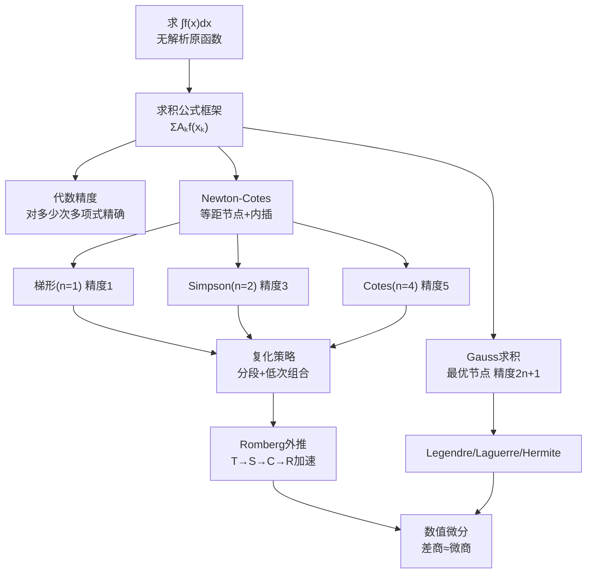
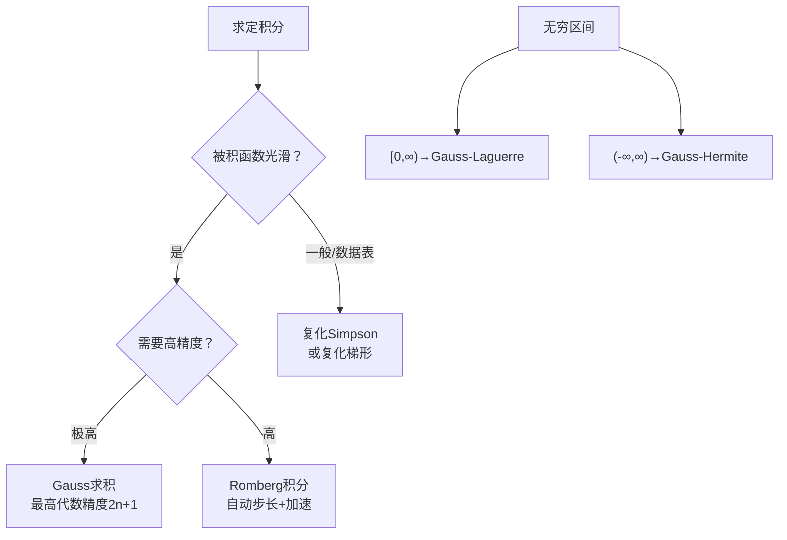

 
# 第09章 数值积分与数值微分

---

## 一、本章核心脉络

**核心问题**：$\int_a^b f(x)dx$ 的 Newton-Leibniz 公式需要原函数——但很多函数（如 $e^{-x^2}$、$\frac{\sin x}{x}$）没有初等原函数，数据表形式的 $f(x)$ 更是无法积分。数值积分绕开原函数，直接从函数值近似积分。同样的思路也用于数值微分。



> 这条脉络的核心逻辑：**求积公式 = 结点 + 系数的加权和 → 内插多项式导出 Newton-Cotes（等距节点）→ 低次+分段 = 复化方法 → 外推加速 = Romberg → 放弃等距，用正交多项式零点 = Gauss（最高代数精度）→ 差商原理用于微分 = 数值微分（最优步长问题）。**

---

## 二、求积公式与代数精度（**基础框架**）

### 2.1 求积公式

> 一句话来说：积分 ≈ 被积函数在若干点上的加权和——绕开了求原函数，直接算函数值。

$$\int_a^b f(x)dx \approx \sum_{k=0}^n A_k f(x_k)$$

- $x_k$：求积结点
- $A_k$：求积系数（与 $f$ 无关）

**余项**（截断误差）：$R[f] = \int_a^b f(x)dx - \sum_{k=0}^n A_k f(x_k)$

### 2.2 代数精度（**核心概念**）

> 一句话来说：求积公式对 $f(x)=1,x,x^2,\ldots,x^m$ 都精确成立（$R[f]\equiv0$），但对 $x^{m+1}$ 不成立——$m$ 就是代数精度。

**检验方法**：依次代入 $f(x)=x^s$（$s=0,1,\ldots$），找到 $R[x^s]=0$ 的最大 $s$。

> [!warning] 代数精度至少为0（$f(x)=1$ 代入必须精确），这是求积系数正确性的基本检验。

### 2.3 内插求积公式

用 Lagrange 插值多项式 $P_n(x)$ 近似 $f(x)$，积分即得内插求积公式：
$$A_k = \int_a^b l_k(x)dx, \quad l_k(x) = \prod_{j\neq k}\frac{x-x_j}{x_k-x_j}$$

**余项**：$R_n[f] = \int_a^b \frac{f^{(n+1)}(\xi)}{(n+1)!}\omega(x)dx$

### 2.4 矩形公式

| 公式 | 表达式 | 余项 | 代数精度 |
|------|------|------|:---:|
| 左矩形 | $(b-a)f(a)$ | $\frac{(b-a)^2}{2}f'(\eta)$ | 0 |
| 右矩形 | $(b-a)f(b)$ | $-\frac{(b-a)^2}{2}f'(\eta)$ | 0 |
| **中矩形** | $(b-a)f(\frac{a+b}{2})$ | $\frac{(b-a)^3}{24}f''(\eta)$ | **1** |

> 核心洞察：中矩形只用1个点就达到1次精度——对称性消去了 $f'$ 项。

---

## 三、Newton-Cotes 公式（**核心**）

### 3.1 基本思想

> 一句话来说：将 $[a,b]$ 等距划分为 $n$ 等分，用 $n$ 次内插多项式导出求积公式——梯形（n=1）、Simpson（n=2）、Cotes（n=4）是最常用的。

**N-C 系数**：$C_k^{(n)} = A_k/(b-a)$，可预制成表，不依赖 $f$ 和区间。

**一般余项**：$R_n[f] = \int_a^b \frac{f^{(n+1)}(\xi)}{(n+1)!}\omega(x)dx$

> [!note]- 推导：N-C 系数如何算出？
> 
> **1. 从内插求积出发**
> 
> $$A_k = \int_a^b l_k(x)dx, \quad l_k(x) = \prod_{j \neq k} \frac{x-x_j}{x_k-x_j}$$
> 
> N-C 的特别之处：**节点等距**。设 $h = (b-a)/n$，则：
> $$x_j = a + jh, \quad j = 0,1,\ldots,n$$
> 
> **2. 换元标准化**
> 
> 令 $x = a + th$，$t \in [0, n]$，则 $dx = h\,dt$，且：
> $$x - x_j = (a+th) - (a+jh) = h(t-j)$$
> $$x_k - x_j = h(k-j)$$
> 
> 代入 Lagrange 基函数——$h$ 全部约掉：
> $$l_k(x) = \prod_{j \neq k} \frac{h(t-j)}{h(k-j)} = \prod_{j \neq k} \frac{t-j}{k-j} \triangleq L_k(t)$$
> 
> **3. N-C 系数公式**
> 
> $$A_k = \int_a^b l_k(x)dx = h\int_0^n L_k(t)dt$$
> 
> 归一化（除以区间长度）得 **N-C 系数**：
> $$C_k^{(n)} = \frac{A_k}{b-a} = \frac{1}{n}\int_0^n \prod_{j \neq k} \frac{t-j}{k-j} \, dt$$
> 
> 这个积分**只依赖 $n$ 和 $k$**，与 $f$ 和 $[a,b]$ 无关 → 可预制成标准表。
> 
> **4. 实例手算**
> 
> | $n$ | $k$ | $C_k^{(n)}$ 计算 | 结果 |
> |:---:|:---:|------|:---:|
> | 1 | 0,1 | $\frac{1}{1}\int_0^1 (1-t)dt = \frac{1}{2},\; \frac{1}{1}\int_0^1 t\,dt = \frac{1}{2}$ | $(\frac{1}{2}, \frac{1}{2})$ → 梯形 |
> | 2 | 0 | $\frac{1}{2}\int_0^2 \frac{(t-1)(t-2)}{(0-1)(0-2)}dt = \frac{1}{2}\int_0^2 \frac{t^2-3t+2}{2}dt = \frac{1}{6}$ | $(\frac{1}{6}, \frac{4}{6}, \frac{1}{6})$ |
> | 2 | 1 | $\frac{1}{2}\int_0^2 \frac{(t-0)(t-2)}{(1-0)(1-2)}dt = \frac{1}{2}\int_0^2 \frac{t^2-2t}{-1}dt = \frac{4}{6}$ | → Simpson |
> | 2 | 2 | 对称性 $\;C_2^{(2)} = C_0^{(2)} = \frac{1}{6}$ | — |
> 
> 求积公式即 $\int_a^b f(x)dx \approx (b-a)\sum_{k=0}^n C_k^{(n)} f(x_k)$。
> 
> > [!tip] N-C 系数的对称性：$C_k^{(n)} = C_{n-k}^{(n)}$，只需算一半。

### 3.2 常用 N-C 公式

| $n$ | 名称 | 公式 | 余项 | 精度 |
|:---:|------|------|------|:---:|
| 1 | 梯形 | $\frac{h}{2}[f(a)+f(b)]$ | $-\frac{h^3}{12}f''(\xi)$ | 1 |
| 2 | **Simpson** | $\frac{h}{3}[f(a)+4f(\frac{a+b}{2})+f(b)]$ | $-\frac{h^5}{90}f^{(4)}(\xi)$ | **3** |
| 4 | Cotes | 5点加权 | — | 5 |

> [!note]- 推导：梯形公式余项（#18）
> 
> 梯形公式对应 $n=1$（两点插值），$\omega(x) = (x-a)(x-b)$。
> 
> **关键**：$\omega(x) \leq 0$ 在 $[a,b]$ 上不变号 → 可用积分中值定理。
> 
> $$R_1[f] = \int_a^b \frac{f''(\xi_x)}{2!} (x-a)(x-b) \, dx = \frac{f''(\xi)}{2} \int_a^b (x-a)(x-b) \, dx$$
> 
> 计算积分：令 $x = a + th$，$h = b-a$，$t \in [0,1]$：
> $$(x-a)(x-b) = h^2 t(t-1) = h^2(t^2 - t)$$
> $$\int_a^b (x-a)(x-b) \, dx = h^3 \int_0^1 (t^2-t) \, dt = h^3\left[\frac{t^3}{3} - \frac{t^2}{2}\right]_0^1 = h^3\left(\frac{1}{3} - \frac{1}{2}\right) = -\frac{h^3}{6}$$
> 
> $$\therefore R_1[f] = \frac{f''(\xi)}{2} \cdot \left(-\frac{h^3}{6}\right) = -\frac{(b-a)^3}{12} f''(\xi)$$

> [!note]- 推导：Simpson 公式余项（#19）
> 
> Simpson 公式对应 $n=2$（三点插值），但 $\omega(x) = (x-a)(x-m)(x-b)$ 在 $[a,b]$ 上**变号**（关于中点奇对称），不能直接用积分中值定理。
> 
> **技巧**：构造三次 Hermite 插值 $H_3(x)$，满足：
> $$H_3(a)=f(a),\; H_3(m)=f(m),\; H_3(b)=f(b),\; H_3'(m)=f'(m)$$
> 
> Hermite 插值余项：
> $$f(x) - H_3(x) = \frac{f^{(4)}(\xi_x)}{4!}(x-a)(x-m)^2(x-b)$$
> 
> 此时核函数 $(x-a)(x-m)^2(x-b) \leq 0$ 在 $[a,b]$ 上**不变号**（$(x-a)\geq0$，$(x-m)^2\geq0$，$(x-b)\leq0$）→ 可用积分中值定理。
> 
> 又因 Simpson 公式对**三次多项式精确**，$\int_a^b H_3(x)dx$ 恰好等于 Simpson 公式值：
> $$R = \int_a^b f(x)dx - S = \int_a^b [f(x)-H_3(x)]dx = \frac{f^{(4)}(\xi)}{24}\int_a^b (x-a)(x-m)^2(x-b)dx$$
> 
> 计算积分：令 $x = m + th$，$h = \frac{b-a}{2}$，$t \in [-1,1]$：
> $$(x-a)(x-m)^2(x-b) = h^4(t+1) \cdot t^2 \cdot (t-1) = h^4 t^2(t^2-1) = h^4(t^4 - t^2)$$
> $$\int = h^5 \int_{-1}^1 (t^4-t^2)dt = 2h^5\left[\frac{t^5}{5}-\frac{t^3}{3}\right]_0^1 = 2h^5\left(\frac{1}{5}-\frac{1}{3}\right) = -\frac{4h^5}{15}$$
> 
> $$\therefore R = \frac{f^{(4)}(\xi)}{24} \cdot \left(-\frac{4h^5}{15}\right) = -\frac{h^5}{90}f^{(4)}(\xi) = -\frac{(b-a)^5}{2880}f^{(4)}(\xi)$$

> [!warning] $n \geq 8$ 时 N-C 系数出现负数 → 数值不稳定。实际只用低次公式。

**偶数阶 N-C 的精度提升**：当 $n$ 为偶数时，N-C 公式的代数精度可达 $n+1$（比预期高1阶）——Simpson（$n=2$）精度3、Cotes（$n=4$）精度5 都是这个原理。

> [!note]- 推导：偶数阶 N-C 为何精度 +1？
> 
> **1. 换元到对称区间**
> 
> N-C 公式在 $[a,b]$ 上等距取 $n+1$ 个节点。作线性变换：
> $$x = a + th, \quad h = \frac{b-a}{n}, \quad t \in [0, n]$$
> 
> 节点对应 $t = 0, 1, 2, \ldots, n$，积分区间变为 $[0, n]$。
> 
> **2. 余项中的 $\omega(x)$**
> 
> 插值型求积公式的余项为：
> $$R_n[f] = \int_a^b \frac{f^{(n+1)}(\xi)}{(n+1)!} \omega(x) \, dx, \quad \omega(x) = \prod_{i=0}^n (x - x_i)$$
> 
> 换元后：$\omega(t) = h^{n+1} \prod_{i=0}^n (t - i)$。
> 
> **3. 关键：$n$ 为偶数时，$\omega(t)$ 关于中点奇对称**
> 
> 令 $u = t - \frac{n}{2}$（中点移到原点）。$n$ 为偶数时 $\frac{n}{2}$ 是整数：
> $$\omega(u) = h^{n+1} \prod_{i=0}^n \left(u + \frac{n}{2} - i\right)$$
> 
> 节点关于 $u=0$ 对称：$\{-\frac{n}{2}, \ldots, -1, 0, 1, \ldots, \frac{n}{2}\}$。每对 $(u+k)(u-k) = u^2 - k^2$ 是偶函数，中间还有一个 $u$（$i=n/2$）因子。
> 
> 验证奇偶性——代入 $-u$：
> $$\omega(-u) = h^{n+1} \prod_{i=0}^n \left(-u + \frac{n}{2} - i\right) = h^{n+1} \prod_{k=-n/2}^{n/2} (-u - k)$$
> 
> 提取负号：$(-u - k) = -(u + k)$，共 $n+1$ 个因子（$n$ 偶数，$n+1$ 奇数），$(-1)^{n+1} = -1$：
> $$\omega(-u) = -\omega(u)$$
> 
> 即 $\omega(u)$ 是**奇函数**。
> 
> **4. 奇函数积分为零 → 消去 $n+1$ 阶误差**
> 
> $$\int_{-n/2}^{n/2} \omega(u) \, du = 0$$
> 
> 当 $f(x) = x^{n+1}$ 时 $f^{(n+1)}(\xi) \equiv (n+1)!$，余项中：
> $$R_n[x^{n+1}] = \frac{(n+1)!}{(n+1)!} \int_a^b \omega(x) \, dx = \int_a^b \omega(x) \, dx = 0$$
> 
> 即公式对 $x^{n+1}$ **也精确成立**——代数精度从预期的 $n$ 提升到 $n+1$。
> 
> **5. 实例对照**
> 
> | $n$ | 公式 | 预期精度 | 实际精度 | 对称性 |
> |:---:|------|:---:|:---:|------|
> | 1 | 梯形 | 1 | 1 | $\omega$ 无中心对称 → 不提升 |
> | 2 | Simpson | 2 | **3** | 3 节点，中点居中 → $\omega$ 奇函数 |
> | 3 | Simpson 3/8 | 3 | 3 | 4 节点，无中点 → 不提升 |
> | 4 | Cotes | 4 | **5** | 5 节点，中点居中 → $\omega$ 奇函数 |
> 
> **结论**：$n$ 为偶数 ⇔ 奇数个节点 ⇔ 中点恰好是节点 ⇔ $\omega(x)$ 关于中点奇对称 ⇔ $\int\omega = 0$ ⇔ 精度 +1。本质上与**中矩形精度比左/右矩形高1阶**是同一个原理——对称性能消去奇次误差项。

**例题**：验证求积公式 $\int_{-1}^1 f(x)dx = \frac{1}{3}f(-1)+\frac{4}{3}f(0)+\frac{1}{3}f(1)$ 对 $f(x)=x^m$（$m=0,1,2,3$）精确成立，对 $m=4$ 不成立 → 代数精度为3。

---

## 四、复化求积（**核心**）

### 4.1 动机

> 一句话来说：高次 N-C 不稳定 → "分段 + 低次"的策略：区间分成多份，每份用低次公式，精度靠分段数保证。

### 4.2 复化梯形

$$T_n = \frac{h}{2}\left[f(a)+f(b)+2\sum_{k=1}^{n-1}f(x_k)\right], \quad h=\frac{b-a}{n}$$

**余项**：$R[T_n] = -\frac{b-a}{12}h^2 f''(\xi) = O(h^2)$

> [!note]- 推导：复化梯形余项（#20）
> 
> 复化梯形 = $n$ 个梯形公式之和，每段步长 $h = (b-a)/n$：
> $$R[T_n] = \sum_{k=0}^{n-1} \left[-\frac{h^3}{12} f''(\xi_k)\right], \quad \xi_k \in [x_k, x_{k+1}]$$
> 
> 由连续函数 $f''$ 的**介值定理**：$\frac{1}{n}\sum f''(\xi_k) = f''(\xi)$ 存在公共 $\xi \in [a,b]$。
> 
> $$\therefore R[T_n] = -n \cdot \frac{h^3}{12} \cdot f''(\xi) = -\frac{b-a}{12} h^2 f''(\xi)$$

**逐次对分技巧**：$T_{2n} = \frac{1}{2}T_n + h'\sigma_n$（$h'=h/2$，$\sigma_n$ 为新分点函数值和）。旧节点值保留复用，只需计算新分点！

**后验误差估计**：$I - T_{2n} \approx \frac{1}{3}(T_{2n} - T_n)$（无需知道 $f''$）

**例题**：$\int_0^1 \frac{\sin x}{x}dx$，误差限 $10^{-4}$。利用 $|f^{(k)}(x)| \leq \frac{1}{k+1}$，得 $|R[T_n]| \leq \frac{1}{36}h^2 \leq 10^{-4} \implies h \leq 6\times10^{-2}$，需 $n \geq 17$。

### 4.3 复化 Simpson

$$S_{2m} = \frac{h}{3}\left[f(a)+f(b) + 2\sum_{k=1}^{m-1}f(x_{2k}) + 4\sum_{k=0}^{m-1}f(x_{2k+1})\right]$$

**余项**：$R[S_{2m}] = -\frac{b-a}{180}h^4 f^{(4)}(\xi) = O(h^4)$

> [!note]- 推导：复化 Simpson 余项（#21）
> 
> 复化 Simpson = $m$ 个 Simpson 公式之和，每个跨两个子区间，半段长 $h = (b-a)/(2m)$：
> $$R[S_{2m}] = \sum_{k=1}^{m} \left[-\frac{h^5}{90} f^{(4)}(\xi_k)\right], \quad \xi_k \in [x_{2k-2}, x_{2k}]$$
> 
> 由连续函数 $f^{(4)}$ 的**介值定理**：$\frac{1}{m}\sum f^{(4)}(\xi_k) = f^{(4)}(\xi)$ 存在公共 $\xi \in [a,b]$。
> 
> $$\therefore R[S_{2m}] = -m \cdot \frac{h^5}{90} \cdot f^{(4)}(\xi) = -\frac{b-a}{180} h^4 f^{(4)}(\xi)$$

**同一例题**：复化 Simpson 只需 $n=2$ 即可满足 $10^{-4}$ 精度——远优于复化梯形的 $n=17$！

---

## 五、Romberg 积分（**难点**）

### 5.1 Richardson 外推思想

> 一句话来说：利用不同步长的低阶结果，通过外推消去低阶误差主项——只用四则运算就能从慢收敛序列造出快收敛序列。

由梯形余项 $I - T_n = -\frac{b-a}{12}h^2 f''(\xi)$，假设 $f''(\xi) \approx f''(\eta)$：
$$\frac{I - T_n}{I - T_{2n}} \approx 4 \implies I \approx \frac{4T_{2n} - T_n}{4-1} \triangleq S_n$$

### 5.2 Romberg 三角表

从 $\{T_n\}$ 出发，逐层外推：
$$S_n = \frac{4T_{2n} - T_n}{3}, \quad C_n = \frac{16S_{2n} - S_n}{15}, \quad R_n = \frac{64C_{2n} - C_n}{63}$$

```
T₁
T₂ → S₁
T₄ → S₂ → C₁
T₈ → S₄ → C₂ → R₁    ← Romberg 序列
```

- $\{T_n\}$：复化梯形序列（$O(h^2)$）
- $\{S_n\}$：复化 Simpson 序列（$O(h^4)$）
- $\{C_n\}$：复化 Cotes 序列（$O(h^6)$）
- $\{R_n\}$：Romberg 序列（$O(h^8)$）

### 5.3 手算例子：$\int_0^1 \frac{4}{1+x^2}dx = \pi$

用 Romberg 法逐步计算到 $R_1$。

**第一层：梯形序列**（用复化梯形公式）

$$
T_1 = \frac{1}{2}[f(0)+f(1)] = \frac{1}{2}\left[\frac{4}{1+0}+\frac{4}{1+1}\right]
= \frac{1}{2}[4+2]=3.0
$$

$$
T_2 = \frac{1}{2}T_1 + \frac{1}{2}f(0.5)
= \frac{1}{2}\times 3.0 + \frac{1}{2}\times\frac{4}{1+0.25}
= 1.5 + \frac{1}{2}\times 3.2 = 1.5+1.6=3.1
$$

$$
T_4 = \frac{1}{2}T_2 + \frac{1}{4}[f(0.25)+f(0.75)]
$$

其中 $f(0.25) = \frac{4}{1.0625} \approx 3.7647$，$f(0.75) = \frac{4}{1.5625} = 2.56$。

$$
T_4 = 1.55 + \frac{1}{4}[3.7647+2.56]
= 1.55 + 1.581175 = 3.131175 \approx 3.13118
$$

$$
T_8 = \frac{1}{2}T_4 + \frac{1}{8}[f(0.125)+f(0.375)+f(0.625)+f(0.875)]
$$

$f(0.125)\approx 3.9385$，$f(0.375)\approx 3.5068$，$f(0.625)\approx 2.8764$，$f(0.875)\approx 2.2661$。

$$
T_8 = 1.56559 + \frac{1}{8}[3.9385+3.5068+2.8764+2.2661]
= 1.56559 + 1.57347 = 3.13906
$$

实际上精确值 $T_8\approx 3.13899$（课件取值）。我们用课件数值继续。

**第二层：Simpson 序列**

$$
S_1 = \frac{4T_2 - T_1}{3} = \frac{4\times 3.1 - 3.0}{3} = \frac{12.4-3.0}{3}=\frac{9.4}{3}=3.13333
$$

这就是对区间 $[0,1]$ 做一次 Simpson 的结果。

$$
S_2 = \frac{4T_4 - T_2}{3} = \frac{4\times 3.13118 - 3.1}{3} = \frac{12.52472-3.1}{3}=\frac{9.42472}{3}=3.14157
$$

**第三层：Cotes 序列**

$$
C_1 = \frac{16S_2 - S_1}{15}
= \frac{16\times 3.14157 - 3.13333}{15}
= \frac{50.26512 - 3.13333}{15}
= \frac{47.13179}{15}
= 3.14212
$$

**第四层：Romberg 序列**

第八列 $T_8$ 跑完后：

$$
S_4 = \frac{4T_8 - T_4}{3}
= \frac{4\times 3.13899 - 3.13118}{3}
= \frac{12.55596 - 3.13118}{3}
= \frac{9.42478}{3}
= 3.14159
$$

$$
C_2 = \frac{16S_4 - S_2}{15}
= \frac{16\times 3.14159 - 3.14157}{15}
= \frac{50.26544 - 3.14157}{15}
= \frac{47.12387}{15}
= 3.14159
$$

$$
R_1 = \frac{64C_2 - C_1}{63}
= \frac{64\times 3.14159 - 3.14212}{63}
= \frac{201.06176 - 3.14212}{63}
= \frac{197.91964}{63}
= 3.14159
$$

**完整三角表**：

| | $k=0$ (梯形) | $k=1$ (Simpson) | $k=2$ (Cotes) | $k=3$ (Romberg) |
|------|:---:|:---:|:---:|:---:|
| $n=1$ | **3.00000** | | | |
| $n=2$ | 3.10000 | **3.13333** | | |
| $n=4$ | 3.13118 | 3.14157 | **3.14212** | |
| $n=8$ | 3.13899 | 3.14159 | 3.14159 | **3.14159** |

从 $T_1=3.0$（误差 ~0.14）到 $R_1=3.14159$（6 位精度）——所有改进只靠**四则运算**，没有任何额外的函数计算！

> 核心洞察：Romberg 外推的本质是 Richardson 外推——用廉价的后处理换取精度，而不是多算函数值。

---

## 六、Gauss 求积（**难点**）

### 6.1 核心思想

> 一句话来说：如果连节点的位置也作为自由度——$n+1$ 个点可以达到 $2n+1$ 次代数精度！这是固定节点数下的最高可能精度。

**Gauss 点** = 在给定区间和权函数下正交多项式的零点。

**Gauss 求积定理**：节点 $x_k$ 是 Gauss 点的充要条件是 $\omega_{n+1}(x)=\prod(x-x_k)$ 与任意不超过 $n$ 次的多项式正交：
$$\int_a^b P(x)\omega_{n+1}(x)dx = 0$$

> [!note]- 推导：Gauss 点充要条件（#23）
> 
> **（⇒）Gauss 点 → 正交性**
> 
> 若 $x_k$ 是 Gauss 点，则公式精度 $2n+1$。对任意 deg $P \leq n$，$P \cdot \omega_{n+1}$ 次数 $\leq 2n+1$，公式精确成立：
> $$\int_a^b P\omega \, dx = \sum A_k \, P(x_k)\omega(x_k) = \sum A_k \cdot P(x_k) \cdot 0 = 0$$
> 
> **（⇐）正交性 → Gauss 点（精度 $2n+1$）**
> 
> 设 $\omega$ 与所有 deg $\leq n$ 的多项式正交。任取 deg $Q \leq 2n+1$，作带余除法：
> $$Q(x) = P(x) \cdot \omega(x) + R(x), \quad \text{deg } P \leq n,\; \text{deg } R \leq n$$
> 
> 积分：
> $$\int Q \, dx = \underbrace{\int P\omega \, dx}_{=0 \text{（正交）}} + \int R \, dx = \int R \, dx$$
> 
> 求积公式对 deg $R \leq n$ 精确（内插求积的基本性质）：
> $$\int R \, dx = \sum A_k R(x_k)$$
> 
> 又 $\omega(x_k)=0$，故 $Q(x_k) = P(x_k) \cdot 0 + R(x_k) = R(x_k)$：
> $$\sum A_k Q(x_k) = \sum A_k R(x_k)$$
> 
> 综上 $\int Q \, dx = \sum A_k Q(x_k)$——公式对任意 deg $\leq 2n+1$ 的 $Q$ 精确。$\square$

**求积系数**：$A_k = \int_a^b l_k(x)dx$（节点确定后系数自动确定）。

**截断误差**：$R[f] = \frac{f^{(2n+2)}(\xi)}{(2n+2)!}\int_a^b \omega^2(x)dx$

> [!note]- 推导：Gauss 求积截断误差（#24）
> 
> **构造 Hermite 插值**：在 $n+1$ 个 Gauss 点 $x_k$ 上构造 $H_{2n+1}(x)$，满足：
> $$H(x_k) = f(x_k), \quad H'(x_k) = f'(x_k), \quad k = 0, \ldots, n$$
> 
> $H$ 的次数 $\leq 2n+1$。Hermite 插值余项：
> $$f(x) - H(x) = \frac{f^{(2n+2)}(\xi_x)}{(2n+2)!} \prod_{k=0}^n (x-x_k)^2 = \frac{f^{(2n+2)}(\xi_x)}{(2n+2)!} \omega^2(x)$$
> 
> **关键**：$\omega^2(x) \geq 0$ 在 $[a,b]$ 上**不变号** → 可用积分中值定理。
> 
> 又 Gauss 公式精度为 $2n+1$，对 $H$（次数 $\leq 2n+1$）精确成立：
> $$\int_a^b H(x)dx = \sum A_k H(x_k) = \sum A_k f(x_k) = \text{Gauss 公式值}$$
> 
> 因此：
> $$R[f] = \int_a^b f(x)dx - \sum A_k f(x_k) = \int_a^b [f(x)-H(x)]dx$$
> $$= \frac{f^{(2n+2)}(\xi)}{(2n+2)!} \int_a^b \omega^2(x) \, dx \quad \square$$

### 6.2 三类 Gauss 公式

Gauss 求积解决的是**带权积分**：

$$\int_a^b \rho(x) f(x) dx \approx \sum_{k=0}^n A_k f(x_k)$$

其中 $\rho(x) \geq 0$ 是权函数。由于求积系数 $A_k = \int_a^b \rho(x) l_k(x)dx$ 已经包含了 $\rho$，公式右端只用 $f(x_k)$。

根据区间和权函数的不同，有三类正交多项式系，对应三类 Gauss 公式：

| 类型                 | 区间                 | 权 $\rho(x)$ | 正交多项系             | 用途       |
| ------------------ | ------------------ | ----------- | ----------------- | -------- |
| **Gauss-Legendre** | $[-1,1]$           | $1$         | Legendre $P_k(x)$ | 有限区间常规积分 |
| Gauss-Laguerre     | $[0,\infty)$       | $e^{-x}$    | Laguerre $L_k(x)$ | 半无穷区间    |
| Gauss-Hermite      | $(-\infty,\infty)$ | $e^{-x^2}$  | Hermite $H_k(x)$  | 全无穷区间    |
|                    |                    |             |                   |          |

> [!note]- 推导：两点 Gauss-Legendre 的节点和系数如何求出？
> 
> **Step 1：求 Legendre 多项式 $P_2(x)$（Gram-Schmidt 正交化）**
> 
> 在 $[-1,1]$ 上对 $\{1, x, x^2\}$ 正交化（内积 $\langle f,g\rangle = \int_{-1}^1 fg\,dx$）：
> 
> $$\begin{aligned}
> v_0 &= 1 \\
> v_1 &= x - \frac{\langle x, v_0\rangle}{\langle v_0, v_0\rangle}v_0 = x - 0 = x \\
> v_2 &= x^2 - \frac{\langle x^2, v_0\rangle}{\langle v_0, v_0\rangle}v_0 - \frac{\langle x^2, v_1\rangle}{\langle v_1, v_1\rangle}v_1
> \end{aligned}$$
> 
> 计算内积：
> $$\langle x^2, v_0\rangle = \int_{-1}^1 x^2 dx = \frac{2}{3}, \quad \langle v_0, v_0\rangle = 2$$
> $$\langle x^2, v_1\rangle = \int_{-1}^1 x^3 dx = 0 \quad (\text{奇函数})$$
> 
> $$v_2 = x^2 - \frac{2/3}{2} \cdot 1 - 0 = x^2 - \frac{1}{3}$$
> 
> 标准化使 $P_2(1)=1$：$P_2(1) = 1 - \frac{1}{3} = \frac{2}{3}$，乘 $\frac{3}{2}$：
> $$P_2(x) = \frac{3}{2}\!\left(x^2 - \frac{1}{3}\right) = \frac{1}{2}(3x^2-1)$$
> 
> **Step 2：$P_2$ 的零点即 Gauss 点**
> $$P_2(x)=0 \implies 3x^2-1=0 \implies x_{0,1} = \pm\frac{1}{\sqrt{3}} = \pm\frac{\sqrt{3}}{3}$$
> 
> **Step 3：求积系数由内插求积确定**
> 
> 对 $f(x)=1$ 和 $f(x)=x$ 精确：
> $$\begin{cases} A_0 + A_1 = \int_{-1}^1 1\,dx = 2 \\ A_0 x_0 + A_1 x_1 = \int_{-1}^1 x\,dx = 0 \end{cases}$$
> 
> 代入 $x_1 = -x_0$：由第二式 $A_0 x_0 - A_1 x_0 = 0 \implies A_0 = A_1$，再由第一式 $2A_0 = 2 \implies A_0 = A_1 = 1$。
> 
> 两点公式：$\int_{-1}^1 f(x)dx \approx f\!\left(-\frac{\sqrt{3}}{3}\right) + f\!\left(\frac{\sqrt{3}}{3}\right)$，精度 $2\times1+1 = 3$。

**常用 Gauss-Legendre 节点与系数**（查表即用）：

| $n+1$ | 节点 $x_k$                                                                                                        | 系数 $A_k$                                  | 精度  |
| :---: | --------------------------------------------------------------------------------------------------------------- | ----------------------------------------- | :-: |
|   1   | $0$                                                                                                             | $2$                                       |  1  |
|   2   | $\pm\frac{\sqrt{3}}{3}$                                                                                         | $1,\;1$                                   |  3  |
|   3   | $0,\;\pm\sqrt{\frac{3}{5}}$                                                                                     | $\frac{8}{9},\;\frac{5}{9},\;\frac{5}{9}$ |  5  |
|   4   | $\pm\sqrt{\frac{3}{7} - \frac{2}{7}\sqrt{\frac{6}{5}}},\;\pm\sqrt{\frac{3}{7} + \frac{2}{7}\sqrt{\frac{6}{5}}}$ | 查表                                        |  7  |

> [!note]- 用法：如何将 $[a,b]$ 变换到 $[-1,1]$？
> 
> Gauss-Legendre 定义在 $[-1,1]$，一般积分需变换：
> $$x = \frac{b-a}{2}t + \frac{a+b}{2}, \quad t \in [-1,1]$$
> $$\int_a^b f(x)dx = \frac{b-a}{2}\int_{-1}^1 f\!\left(\frac{b-a}{2}t + \frac{a+b}{2}\right)dt$$
> 
> **例**：$\int_0^1 \frac{\sin x}{x}dx$ 用两点 Gauss-Legendre 计算。
> 
> **Step 1**：区间变换 $[0,1] \to [-1,1]$
> 
> $$x = \frac{t+1}{2},\quad dx = \frac{1}{2}dt \quad\Longrightarrow\quad \int_0^1 f(x)dx = \frac{1}{2}\int_{-1}^1 f\!\left(\frac{t+1}{2}\right)dt$$
> 
> **Step 2**：两点 Gauss-Legendre 节点与系数
> 
> $$t_1 = -\frac{1}{\sqrt{3}},\quad t_2 = \frac{1}{\sqrt{3}},\quad A_1 = A_2 = 1$$
> 
> **Step 3**：节点映射回 $[0,1]$
> 
> $$x_1 = \frac{-\frac{1}{\sqrt{3}} + 1}{2} = \frac{1}{2}\!\left(1 - \frac{1}{\sqrt{3}}\right),\qquad x_2 = \frac{\frac{1}{\sqrt{3}} + 1}{2} = \frac{1}{2}\!\left(1 + \frac{1}{\sqrt{3}}\right)$$
> 
> **Step 4**：计算函数值 $f(x) = \dfrac{\sin x}{x}$
> 
> $$f(x_1) = \frac{\sin(0.21132487)}{0.21132487} \approx 0.992471,\qquad f(x_2) = \frac{\sin(0.78867513)}{0.78867513} \approx 0.899045$$
> 
> **Step 5**：代入求积公式
> 
> $$I \approx \frac{1}{2}\Big[f(x_1) + f(x_2)\Big] = \frac{1}{2}(0.992471 + 0.899045) \approx 0.945758$$
> 
> **精度检验**：精确值 $I = \mathrm{Si}(1) \approx 0.946083$，相对误差仅 $\dfrac{|0.945758 - 0.946083|}{0.946083} \approx 0.034\%$——两点就达到万分之三精度。

**三类公式的使用场景**：

| 问题 | 解法 |
|------|------|
| $\int_a^b f(x)dx$（有限区间） | 变换到 $[-1,1]$ → Gauss-Legendre |
| $\int_0^\infty e^{-x}g(x)dx$ 或 $\int_0^\infty g(x)dx$ | Gauss-Laguerre（若没有 $e^{-x}$，令 $g(x)=e^{-x} \cdot e^x g(x)$） |
| $\int_{-\infty}^\infty e^{-x^2}g(x)dx$ 或 $\int_{-\infty}^\infty g(x)dx$ | Gauss-Hermite（同理拆 $e^{-x^2}$） |

> [!warning] **Gauss 节点无复用**：$n$ 增加时旧节点的函数值不能复用——这是 Gauss 求积的最主要代价。但精度优势（$2n+1$ vs $n$）通常使这值得。

### 6.3 各方法特点总结

| 方法 | 优点 | 缺点 |
|------|------|------|
| 梯形/Simpson | 公式简单，程序易实现 | 精度较低 |
| 复化梯形/Simpson | 逐次对分，老节点复用 | 光滑性差时效果下降 |
| Romberg | 外推加速，自动步长 | 节点成倍增加 |
| Gauss | 最高代数精度 | 节点无规则，不能复用旧值 |

---

## 七、数值微分（**了解即可**）

### 7.1 差商公式

> 一句话来说：用差商近似导数——但 $h$ 的选取存在"截断 vs 舍入"的权衡：$h$ 太小则相近数相减引入大舍入误差，$h$ 太大则截断误差大。存在最优 $h$。

| 公式 | 表达式 | 误差阶 | 误差主项 |
|------|------|:---:|------|
| 向前差商 | $\frac{f(x+h)-f(x)}{h}$ | $O(h)$ | $-\frac{h}{2}f''(\xi)$ |
| 向后差商 | $\frac{f(x)-f(x-h)}{h}$ | $O(h)$ | $\frac{h}{2}f''(\xi)$ |
| **中心差商** | $\frac{f(x+h)-f(x-h)}{2h}$ | **$O(h^2)$** | $-\frac{h^2}{6}f'''(\xi)$ |
| 二阶中心 | $\frac{f(x+h)-2f(x)+f(x-h)}{h^2}$ | $O(h^2)$ | $-\frac{h^2}{12}f^{(4)}(\xi)$ |

> [!note]- 推导：差商公式的误差如何算出？
> 
> 所有差商误差都从 **Taylor 展开** 出发：
> $$f(x \pm h) = f(x) \pm h f'(x) + \frac{h^2}{2}f''(x) \pm \frac{h^3}{6}f'''(x) + \frac{h^4}{24}f^{(4)}(x) \pm \cdots$$
> 
> **1. 向前差商**
> 
> 只用 $f(x+h)$ 的展开：
> $$\frac{f(x+h)-f(x)}{h} = \frac{[f(x)+hf'+\frac{h^2}{2}f''+\cdots]-f(x)}{h} = f'(x) + \underbrace{\frac{h}{2}f''(x) + \cdots}_{\text{误差}}$$
> 
> 所以 $f'$ 是精确值，后面全是误差。主项 $\frac{h}{2}f''(x) \to$ 误差 $\approx -\frac{h}{2}f''(\xi)$（用积分余项统一 $\xi$）。阶为 $O(h)$。
> 
> **2. 中心差商（$O(h^2)$ 的来源）**
> 
> 展开 $f(x+h)$ 和 $f(x-h)$：
> $$\begin{aligned}
> f(x+h) &= f + hf' + \frac{h^2}{2}f'' + \frac{h^3}{6}f''' + \frac{h^4}{24}f^{(4)} + \cdots \\
> f(x-h) &= f - hf' + \frac{h^2}{2}f'' - \frac{h^3}{6}f''' + \frac{h^4}{24}f^{(4)} - \cdots
> \end{aligned}$$
> 
> 相减——**所有偶次项（含 $f''$）抵消**：
> $$f(x+h)-f(x-h) = 2hf' + \frac{2h^3}{6}f''' + \cdots = 2hf' + \frac{h^3}{3}f''' + \cdots$$
> 
> 除以 $2h$：
> $$\frac{f(x+h)-f(x-h)}{2h} = f'(x) + \underbrace{\frac{h^2}{6}f''' + \cdots}_{\text{误差}}$$
> 
> 阶为 $O(h^2)$，比单侧高了一阶——**对称性消去了偶次项**，和数值积分里中矩形 vs 左矩形同一原理。
> 
> **3. 二阶中心差商**
> 
> $f(x+h)$ 和 $f(x-h)$ **相加**：
> $$f(x+h)+f(x-h) = 2f + h^2 f'' + \frac{h^4}{12}f^{(4)} + \cdots$$
> 
> $$\frac{f(x+h)-2f(x)+f(x-h)}{h^2} = f''(x) + \underbrace{\frac{h^2}{12}f^{(4)} + \cdots}_{\text{误差}}$$
> 
> 阶为 $O(h^2)$。
> 
> > [!tip] 核心规律：对称公式消奇/偶次项 → 精度高一阶。中心差商消 $h$ 项 → $O(h^2)$；二阶中心消 $h$ 项也是 $O(h^2)$。

### 7.2 基于插值的数值微分

用插值多项式 $P_n(x)$ 的导数近似代替 $f'(x)$：
$$f'(x) \approx P_n'(x), \quad 误差 R_n'(x)$$

**两点公式**：$f'(x_0) \approx \frac{y_1-y_0}{h}$（误差 $|R| = |\frac{f''(\xi)}{2}h|$）

**三点公式**（$h$ 等距）：
$$f'(x_1) \approx \frac{y_2-y_0}{2h} \quad （中心差商，误差最小，$|R|=|\frac{f'''(\xi)}{6}h^2|$）$$

---

## 判定/决策流程



---

## 核心公式速查表

| 公式 | 表达式 | 余项/误差 | 精度 |
|------|------|------|:---:|
| 中矩形 | $(b-a)f(\frac{a+b}{2})$ | $\frac{(b-a)^3}{24}f''$ | 1 |
| 梯形 | $\frac{h}{2}[f(a)+f(b)]$ | $-\frac{h^3}{12}f''$ | 1 |
| Simpson | $\frac{h}{3}[f(a)+4f_m+f(b)]$ | $-\frac{h^5}{90}f^{(4)}$ | 3 |
| 复化梯形 | $\frac{h}{2}[f(a)+f(b)+2\sum f_k]$ | $-\frac{b-a}{12}h^2f''$ | — |
| 复化Simpson | $\frac{h}{3}[f(a)+f(b)+2\sum_{偶}+4\sum_{奇}]$ | $-\frac{b-a}{180}h^4f^{(4)}$ | — |
| Romberg | $R_n=\frac{64C_{2n}-C_n}{63}$ | $O(h^8)$ | — |
| Gauss | $\sum A_k f(x_k)$ | $\frac{f^{(2n+2)}}{(2n+2)!}\int\omega^2$ | $2n+1$ |
| 中心差商 | $\frac{f(x+h)-f(x-h)}{2h}$ | $-\frac{h^2}{6}f'''$ | $O(h^2)$ |

---

## 易错点与注意事项

> [!warning] **逐次对分复用是复化方法的关键优势**：$T_{2n} = \frac{1}{2}T_n + h'\sigma_n$——老节点保留，只需算新分点。不要重新算整个和！

> [!warning] **偶数阶 N-C 精度+1**：Simpson 公式（$n=2$）精度是3而非2——这是因为 $n$ 为偶数时 $\int \omega = 0$，消去了 $n+1$ 阶误差项。

> [!warning] **Gauss 节点不可复用**：$n \to n+1$ 时所有节点都变了，旧函数值全浪费。但精度优势（$2n+1$ vs $n$）通常值得这个代价。

> [!warning] **数值微分有最优步长**：$h$ 太小 → 相近数相减 → 舍入误差反超截断误差。中心差商的最优 $h \approx (3\epsilon_{\text{mach}})^{1/3}$。

> [!warning] **复化梯形后验估计**：$I - T_{2n} \approx \frac{1}{3}(T_{2n}-T_n)$ 无需知道 $f''$——这使自适应步长成为可能。

---

## 相关知识点链接

| 章节 | 关联点 | 为什么相关 |
|------|--------|-----------|
| [[课程/数值分析/课件/MD/07-插值法]] | 内插求积 | N-C 公式由 Lagrange 插值导出 |
| [[课程/数值分析/课件/MD/01-背景与基础知识]] | 相近数相减、舍入误差 | 数值微分最优步长分析 |
| [[课程/数值分析/课件/MD/10-常微分方程初值问题的数值解法]] | 数值积分构造ODE方法 | Euler法=左矩形，梯形预估校正=梯形公式 |

---

## 作业与练习

详见源文件末尾。重点练习：
1. **代数精度判断**：给定求积公式，验证对各次单项式的精度
2. **复化梯形/Simpson 计算**：手算和编程，包括先验误差估算（需多少分段）
3. **Romberg 外推**：从梯形序列出发构造 Romberg 三角表
4. **Gauss 公式应用**：Gauss-Legendre / Gauss-Laguerre / Gauss-Hermite 三类的适用场景
5. **数值微分**：比较不同差商公式的误差，验证最优步长的存在性

---

## 自测：你掌握了吗？

> [!tip] 用法：每题先自己做，再展开答案对答案。

### 一、快问快答（概念）

**Q1.** 求积公式 $\int_{-1}^1 f(x)dx \approx f(-1) + f(1)$ 的代数精度是多少？

> [!note]- 答案
> 代入 $f(x)=1$：$\int_{-1}^1 1\,dx = 2$，右边 $1+1=2$ ✅
> 代入 $f(x)=x$：$\int_{-1}^1 x\,dx = 0$，右边 $(-1)+1=0$ ✅
> 代入 $f(x)=x^2$：$\int_{-1}^1 x^2 dx = 2/3$，右边 $(-1)^2+1^2=2$ ❌
> **代数精度 = 1。**

**Q2.** Simpson 公式用 3 个点、做二次插值，为什么代数精度是 3 而不是 2？

> [!note]- 答案
> 因为 $n=2$（偶数阶）N-C 公式，$\omega(x)$ 关于中点奇对称 $\to \int\omega = 0 \to$ 消去了 $3$ 次项误差。本质上是对称性消去了奇次误差。

**Q3.** 复化梯形 $T_8$ 算完后想加倍精度，直接算 $T_{16}$ 需要重新算所有 17 个函数值吗？

> [!note]- 答案
> 不需要。$T_{16} = \frac{1}{2}T_8 + \frac{h}{2}\sum_{\text{新分点}} f$——旧节点全部复用，只需算新增的 8 个中点。

**Q4.** 为什么 $n \geq 8$ 的 N-C 公式不实用？

> [!note]- 答案
> N-C 系数出现负数 → 数值不稳定（正负相消损失有效数字），且高阶插值的 Runge 现象在边界振荡。

**Q5.** Gauss 求积的最大缺点是什么？

> [!note]- 答案
> 节点不可复用：$n$ 增加时所有节点位置全变，旧函数值全浪费。不像复化梯形可以逐次对分复用。

### 二、代数精度验证

**Q6.** 验证求积公式 $\int_0^1 f(x)dx \approx \frac{1}{4}f(0) + \frac{3}{4}f\!\left(\frac{2}{3}\right)$ 的代数精度。

> [!note]- 答案
> $f=1$：左边 $1$，右边 $\frac{1}{4}+\frac{3}{4}=1$ ✅
> $f=x$：左边 $\frac{1}{2}$，右边 $0+\frac{3}{4}\cdot\frac{2}{3}=\frac{1}{2}$ ✅
> $f=x^2$：左边 $\frac{1}{3}$，右边 $0+\frac{3}{4}\cdot\frac{4}{9}=\frac{1}{3}$ ✅
> $f=x^3$：左边 $\frac{1}{4}$，右边 $0+\frac{3}{4}\cdot\frac{8}{27}=\frac{2}{9} \neq \frac{1}{4}$ ❌
> **代数精度 = 2。**（两个点达到精度 2，比一般内插求积多 1 阶——这是 Gauss 点！）

### 三、复化求积与误差估算

**Q7.** 用复化梯形公式计算 $\int_0^1 e^{-x^2}dx$，要求误差 $\leq 10^{-4}$。已知 $f''(x) = 2(2x^2-1)e^{-x^2}$，$|f''(x)| \leq 2$ 在 $[0,1]$ 上。至少需要几等分？

> [!note]- 答案
> 复化梯形余项：$|R| = \frac{b-a}{12}h^2|f''(\xi)| \leq \frac{1}{12}h^2 \cdot 2 = \frac{h^2}{6}$
> 要求 $\frac{h^2}{6} \leq 10^{-4} \implies h \leq \sqrt{6} \times 10^{-2} \approx 2.45 \times 10^{-2}$
> $h = 1/n \implies n \geq 1/0.0245 \approx 40.8$
> **$n \geq 41$**（即分 41 段）。

**Q8.** 用复化 Simpson 重算 Q7，至少几等分？（$f^{(4)}(x)$ 的界取 12）

> [!note]- 答案
> 复化 Simpson 余项：$|R| = \frac{b-a}{180}h^4|f^{(4)}(\xi)| \leq \frac{1}{180}h^4 \cdot 12 = \frac{h^4}{15}$
> $\frac{h^4}{15} \leq 10^{-4} \implies h^4 \leq 15 \times 10^{-4} \implies h \leq (15\times 10^{-4})^{1/4} \approx 0.196$
> $h = 1/(2m) \implies 2m \geq 1/0.196 \approx 5.1$
> 取 $m=3$，即 **$2m = 6$ 段**（仅需 6 段 vs 梯形 41 段！）

### 四、Romberg 外推

**Q9.** 已知 $T_1 = 3.0000$，$T_2 = 3.1000$，$T_4 = 3.1312$。构造 Romberg 三角表（到 $C_1$）。

> [!note]- 答案
> $$S_1 = \frac{4T_2 - T_1}{3} = \frac{4\times 3.1000 - 3.0000}{3} = 3.1333$$
> $$S_2 = \frac{4T_4 - T_2}{3} = \frac{4\times 3.1312 - 3.1000}{3} = 3.1416$$
> $$C_1 = \frac{16S_2 - S_1}{15} = \frac{16\times 3.1416 - 3.1333}{15} = 3.1421$$
> 
> | | $k=0$ (梯形) | $k=1$ (Simpson) | $k=2$ (Cotes) |
> |------|:---:|:---:|:---:|
> | $n=1$ | **3.0000** | | |
> | $n=2$ | 3.1000 | **3.1333** | |
> | $n=4$ | 3.1312 | 3.1416 | **3.1421** |

### 五、Gauss 求积

**Q10.** 用两点 Gauss-Legendre 公式计算 $\int_0^1 (x^3 + 2x) dx$。

> [!note]- 答案
> 变换到 $[-1,1]$：$x = \frac{t+1}{2}$，$dx = \frac{1}{2}dt$
> $$\int_0^1 (x^3+2x)dx = \frac{1}{2}\int_{-1}^1 \left[\left(\frac{t+1}{2}\right)^3 + 2\cdot\frac{t+1}{2}\right]dt$$
> 
> 两点 Gauss-Legendre：$t_{0,1} = \pm\frac{\sqrt{3}}{3}$，$A_0=A_1=1$。
> 
> $t_0 = -\frac{\sqrt{3}}{3}$：$x_0 = \frac{1-\sqrt{3}/3}{2} \approx 0.2113$，$f(x_0) \approx 0.4320$
> $t_1 = \frac{\sqrt{3}}{3}$：$x_1 = \frac{1+\sqrt{3}/3}{2} \approx 0.7887$，$f(x_1) \approx 2.0680$
> $$\int \approx \frac{1}{2}[0.4320 + 2.0680] = 1.2500$$
> 精确值：$\left[\frac{x^4}{4}+x^2\right]_0^1 = \frac{1}{4}+1 = 1.25$ → 两点 Gauss **精确**（因为精度 $3$，被积函数是 3 次！）

**Q11.** 判断：$\int_0^\infty e^{-x}\sin x\,dx$ 和 $\int_{-\infty}^\infty e^{-x^2}\cos x\,dx$ 各用哪种 Gauss 公式？

> [!note]- 答案
> 第一个：区间 $[0,\infty)$，权 $e^{-x}$ → **Gauss-Laguerre**。
> 第二个：区间 $(-\infty,\infty)$，权 $e^{-x^2}$ → **Gauss-Hermite**。

### 六、数值微分

**Q12.** $f(x) = \sin x$，取 $h=0.1$。分别用向前差商和中心差商估计 $f'(0.5)$，并比较误差。

> [!note]- 答案
> 精确值：$f'(0.5) = \cos 0.5 \approx 0.87758$
> 
> 向前差商：$\frac{\sin 0.6 - \sin 0.5}{0.1} = \frac{0.56464 - 0.47943}{0.1} = 0.8521$，误差 $\approx 0.0255$（约 $h/2 \cdot f''$）
> 
> 中心差商：$\frac{\sin 0.6 - \sin 0.4}{0.2} = \frac{0.56464 - 0.38942}{0.2} = 0.8761$，误差 $\approx 0.0015$（约 $h^2/6 \cdot f'''$）
> 
> 中心差商误差仅为向前差商的 **~1/17**——$O(h^2)$ vs $O(h)$ 的差距。

**Q13.** 数据表形式 $f(0.4)=0.3894$，$f(0.5)=0.4794$，$f(0.6)=0.5646$（均四舍五入到 4 位），用中心差商估算 $f'(0.5)$。测量误差在什么量级时差商结果不可靠？

> [!note]- 答案
> **估算 $f'(0.5)$**：
> $$\frac{0.5646-0.3894}{0.2} = 0.8760 \quad (\text{精确值 } \cos 0.5 \approx 0.87758,\; \text{误差 } 0.0016 \text{ 主要是截断误差})$$
> 
> **不可靠的判断条件**：舍入误差 $\approx \varepsilon/h$ 超过允许误差时不可靠。
> 
> 本题 $h=0.1$，函数值四舍五入 $\to \varepsilon \approx 5\times 10^{-5}$（末位 ±0.5），导数舍入误差 $\approx 5\times 10^{-5}/0.1 = 5\times 10^{-4}$，远小于截断误差 $0.0016$ → 尚可接受。
> 
> **量级推算**：若要求导数误差 $\leq 0.01$（约 1%）：
> $$\frac{\varepsilon}{0.1} \leq 0.01 \implies \varepsilon \leq 10^{-3}$$
> 
> 即函数值误差达到 **$10^{-3}$ 量级**（相当于数据只精确到小数点后 2~3 位）时不可靠。
> 
> 若 $h$ 更小则更苛刻——$h=0.001$ 时需要 $\varepsilon \leq 10^{-6}$（6 位精度）才可靠。这就是**最优步长**的根本含义：$h$ 越小，对数据精度的要求越苛刻。
