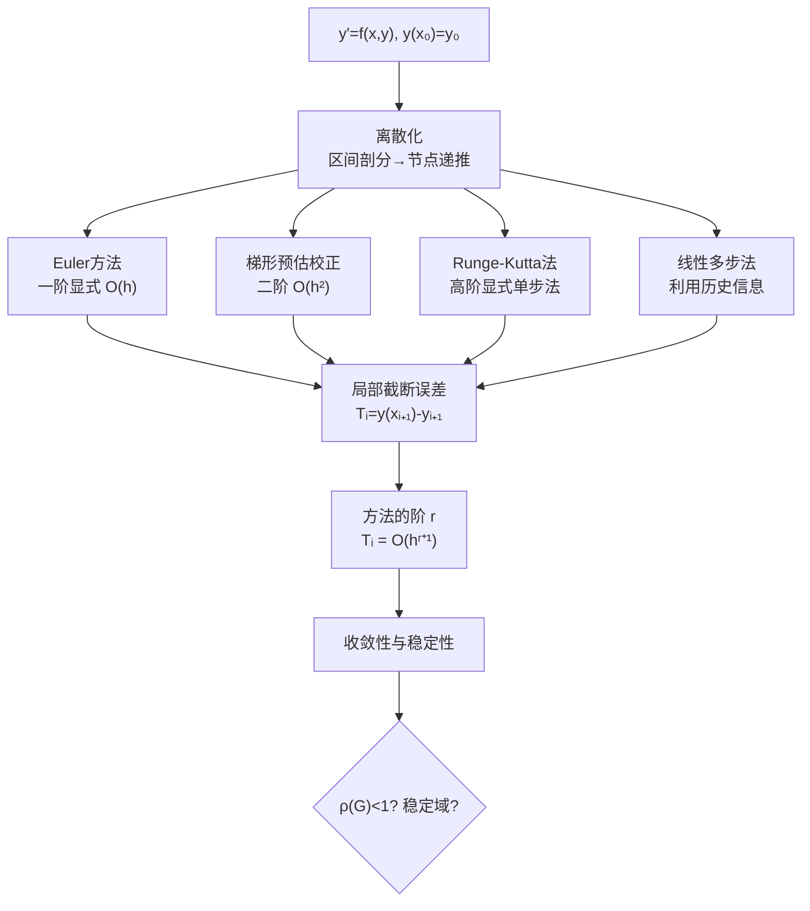
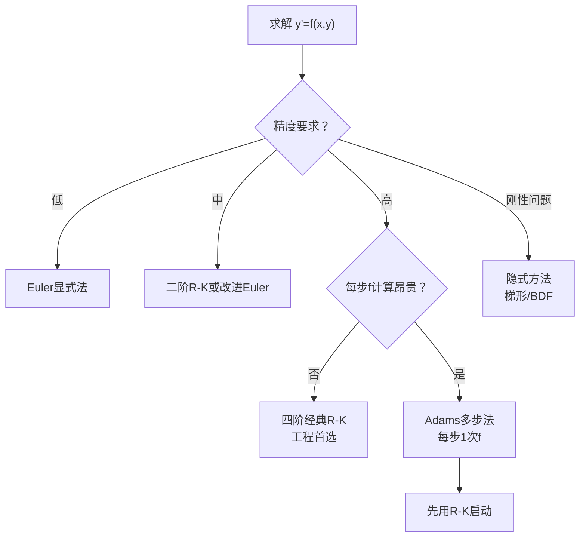

# 第10章 常微分方程初值问题的数值解法

---

## 零、为什么需要数值解法？

高数里你学过的 ODE 都能写出**解析解**（分离变量、常数变易、特征方程……），看起来天下无敌。但现实是：

> **绝大多数 ODE 没有解析解。**

不是"暂时没找到"——是**根本没有初等函数形式的解**。

| 方程 | 看起来简单？ | 有解析解？ |
|------|:---:|:---:|
| $y' = x^2 + y^2$ | ✅ 多项式 | ❌ 无初等函数解（Riccati 方程） |
| $y' = e^{-x^2}$ | ✅ 右边有名函数 | ❌ 原函数 $\int e^{-x^2}dx$ 不是初等函数 |
| $y' = \sin(xy)$ | ✅ 只含 $\sin$ | ❌ 无解析解 |
| $y'' = -y^3$（非线性摆） | ✅ 物理意义明确 | ❌ 涉及椭圆积分 |

**怎么办？** 回到导数的定义本身：

$$y'(x) \approx \frac{y(x+h) - y(x)}{h}$$

给定起点 $(x_0, y_0)$，用这个近似**一步步往前走**——不需要原函数，只需要函数值和四则运算。这就是所有数值方法的共同基因：

> **连续的 ODE → 离散的递推公式 → 从起点一步一步算到终点。**

整章就是围绕一个问题展开：**怎么构造这个递推公式，让它又准又稳又省？** 不同的"怎么"产生了 Euler、梯形、R-K、多步法——但它们共享同一个起点：导数 = 差商，差商 = 向前走一步。

---

## 一、本章核心脉络

**核心问题**：$\begin{cases} y' = f(x,y) \\ y(x_0) = y_0 \end{cases}$ 的解析解常常不存在——如何在离散点 $\{x_i\}$ 上逐步算出近似解 $y_i \approx y(x_i)$？

> 这条脉络的核心逻辑：**把连续ODE离散成节点上的递推公式 → Euler是最简单的起点（一阶） → 预估校正融合显式便利与隐式精度（二阶） → Runge-Kutta在区间内试探多个点提高阶数（四阶经典R-K是工程首选） → 线性多步法利用历史值减少每步计算量 → 局部截断误差定阶，谱半径判稳定。**

---

## 二、问题基础（**了解即可**）

### 2.1 初值问题的适定性

> 一句话来说：$f(x,y)$ 对 $y$ 满足 Lipschitz 条件是初值问题存在唯一解的充分条件——这是所有数值方法的前提保障。

**Lipschitz 条件**：$\exists L > 0,\; \forall x \in [a,b],\; \forall y_1,y_2$：
$$|f(x,y_1) - f(x,y_2)| \leq L|y_1 - y_2|$$

### 2.2 方法分类

| 维度 | 分类 | 含义 | 代表 |
|------|------|------|------|
| **步数** | 单步法 | 只用 $y_i$ 算 $y_{i+1}$ | Euler, R-K |
| | 多步法 | 用 $y_i, y_{i-1}, \ldots$ | Adams, Milne |
| **格式** | 显式 | 右端不含 $y_{i+1}$，直接算 | Euler显式, R-K |
| | 隐式 | 右端含 $y_{i+1}$，需解方程 | 梯形公式(隐式) |

### 2.3 高阶方程与方程组的处理

**二阶方程** $y'' = f(x,y,y')$ 可化为一阶方程组：
$$\begin{cases} y' = u \\ u' = f(x,y,u) \end{cases}$$

> 核心洞察：所有高阶ODE都可降阶为一阶方程组 → 本章方法全部向量化即可处理方程组。

---

## 三、局部截断误差与方法的阶（**核心概念**）

> 一句话来说：假设前面全对，这一步公式产生的误差 = 局部截断误差。若其为 $O(h^{r+1})$，则称为 $r$ 阶方法。

$$T_i = y(x_{i+1}) - y_{i+1} \quad \text{（精确解 - 公式近似值）}$$

- Euler 公式：$|T_i| = O(h^2)$ → **1阶方法**
- 梯形公式：$|T_i| = O(h^3)$ → **2阶方法**

**渐近误差常数** $C$：$y(x_{i+1}) - y_{i+1} = C h^{r+1} + O(h^{r+2})$

---

## 四、Euler 方法族（**基础**）

> **为什么有这一族？** 离散化 ODE 最直接的想法：把 $y(x_{i+1})$ 在 $x_i$ 处 Taylor 展开，截断到一阶 → $y_{i+1} = y_i + h y'_i$。这就是 Euler 显式——**只用当前点的切线方向走一步**。它的三种变体分别解决不同问题：Euler 显式最简单但精度低 → Euler 隐式用终点斜率牺牲便利性换稳定性 → Euler 中点用上一步信息牺牲自启动性换二阶精度。

### 4.1 Euler 显式公式

> 一句话来说：用左矩形公式近似积分——$y_{i+1} = y_i + h f(x_i, y_i)$，一阶方法，最简单也最粗糙。

**推导**（积分形式）：$\int_{x_i}^{x_{i+1}} y' dx = \int_{x_i}^{x_{i+1}} f(x,y)dx$，右端用左矩形：
$$y_{i+1} = y_i + h f(x_i, y_i)$$

**推导**（Taylor展开）：$y(x_{i+1}) = y(x_i) + h y'(x_i) + \frac{h^2}{2}y''(\xi)$，舍去 $h^2$ 项。

**局部截断误差**：$R_i = \frac{y''(\xi)}{2}h^2 = O(h^2)$ → **1阶方法**。

> [!note]- 推导：Euler 显式的局部截断误差怎么来的？
> 
> 局部截断误差 = 精确解在 $x_{i+1}$ 处的值 − Euler 公式算出的值，**假设 $y_i = y(x_i)$ 精确**。
> 
> Taylor 展开 $y(x_{i+1})$ 在 $x_i$ 处：
> $$y(x_{i+1}) = y(x_i) + h y'(x_i) + \frac{h^2}{2}y''(x_i) + \frac{h^3}{6}y'''(x_i) + \cdots$$
> 
> Euler 公式：$y_{i+1} = y_i + h f(x_i, y_i) = y(x_i) + h y'(x_i)$
> 
> 相减（$y(x_i)$ 和 $h y'(x_i)$ 抵消）：
> $$T_i = y(x_{i+1}) - y_{i+1} = \frac{h^2}{2}y''(x_i) + \frac{h^3}{6}y'''(x_i) + \cdots$$
> 
> 主导项是 $\frac{h^2}{2}y''(x_i) = O(h^2)$。所以 Euler 是 **1 阶方法**（阶 = 主导项的 $h$ 指数 − 1）。
> 
> > [!tip] 为什么"阶"比主导项少 1？因为 $T_i = O(h^{r+1})$ → $r$ 阶。Euler 的 $T_i = O(h^2)$ → 1 阶。这对应"步长减半，误差减半"。

**手算例子**：求解 $y' = y,\; y(0)=1$，步长 $h=0.1$，算两步。

$$
y_1 = y_0 + h f(x_0,y_0) = 1 + 0.1\times 1 = 1.1
$$
$$
y_2 = y_1 + h f(x_1,y_1) = 1.1 + 0.1\times 1.1 = 1.21
$$

真解 $y(x)=e^x$：$y(0.1)=1.10517$，$y(0.2)=1.22140$。Euler 的误差 ≈ $-0.0052$ 和 $-0.0114$，约 $O(h)$ 级别。

### 4.2 Euler 隐式公式

$$y_{i+1} = y_i + h f(x_{i+1}, y_{i+1})$$

右端含 $y_{i+1}$ → 每步需解方程（通常用不动点迭代）。也是一阶方法，但稳定性更好。

**手算**（同一方程 $y'=y$）：$y_{i+1}=y_i+0.1y_{i+1}$ → $y_{i+1}-0.1y_{i+1}=y_i$ → $y_{i+1}=y_i/0.9$。

$$
y_1=1/0.9=1.1111,\quad y_2=1.1111/0.9=1.2346
$$

隐式 Euler 比显式略大（误差偏正），但模式一致。

### 4.3 Euler 中点公式（二步法）

$$y_{i+1} = y_{i-1} + 2h f(x_i, y_i)$$

**二阶方法**！但需要两个初值 $y_0, y_1$ 才能启动（需先用单步法算出 $y_1$）。

### 4.4 三种 Euler 对比

| 公式 | 显/隐 | 步数 | 阶 | 特点 |
|------|:---:|:---:|:---:|------|
| Euler显式 | 显 | 单步 | 1 | 最简单 |
| Euler隐式 | 隐 | 单步 | 1 | 稳定性好 |
| Euler中点 | 显 | 二步 | 2 | 精度高，需启动 |

---

## 五、梯形公式与预估校正法（**核心**）

> **为什么需要？** Euler 用左矩形近似积分 $\int f$ → 一阶精度。直觉上，用**梯形**（左右端点平均）比单用左端点更准（二阶）。但梯形需要 $f(x_{i+1}, y_{i+1})$——而 $y_{i+1}$ 正是你要求的东西 → 变成隐式方程。预估校正法的智慧：**先用 Euler 预测一个近似值，代入梯形公式校正**——同时获得梯形的高精度和显式的便利。只校正一次就够，因为梯形公式本身的精度上限就是二阶，多迭代不提升阶数。

### 5.1 梯形公式

> 一句话来说：积分用梯形公式代替矩形 → 二阶精度，但变成隐式了。

$$y_{i+1} = y_i + \frac{h}{2}[f(x_i, y_i) + f(x_{i+1}, y_{i+1})]$$

**局部截断误差**：$-\frac{h^3}{12}y'''(\xi) = O(h^3)$ → **2阶方法**。单步隐式。

> [!note]- 推导：梯形公式的局部截断误差
> 
> 积分形式出发：$y(x_{i+1}) - y(x_i) = \int_{x_i}^{x_{i+1}} y'(x)dx = \int_{x_i}^{x_{i+1}} f(x, y(x))dx$
> 
> 右端用梯形公式（见第 9 章）：$\int_{x_i}^{x_{i+1}} g(x)dx = \frac{h}{2}[g(x_i)+g(x_{i+1})] - \frac{h^3}{12}g''(\xi)$
> 
> 其中 $g(x) = f(x, y(x)) = y'(x)$，$g''(x) = y'''(x)$：
> $$y(x_{i+1}) - y(x_i) = \frac{h}{2}[y'(x_i) + y'(x_{i+1})] - \frac{h^3}{12}y'''(\xi)$$
> 
> 移项得 $y(x_{i+1}) = y(x_i) + \frac{h}{2}[f_i + f_{i+1}] - \frac{h^3}{12}y'''(\xi)$
> 
> 而梯形公式的 $y_{i+1}$ 正是 $y_i + \frac{h}{2}[f_i + f_{i+1}]$（假设 $y_i = y(x_i)$），所以：
> $$T_i = y(x_{i+1}) - y_{i+1} = -\frac{h^3}{12}y'''(\xi) = O(h^3)$$
> → **2 阶方法**。

### 5.2 预估校正法（Predictor-Corrector）

> 一句话来说：先用显式 Euler 预估算一个初值，再代入梯形公式校正——避开隐式解方程的麻烦，同时获得二阶精度。

$$\begin{cases} y_{i+1}^{(0)} = y_i + h f(x_i, y_i) & \text{（预估）} \\[4pt] y_{i+1}^{(k+1)} = y_i + \frac{h}{2}[f(x_i, y_i) + f(x_{i+1}, y_{i+1}^{(k)})] & \text{（校正）} \end{cases}$$

通常只迭代一次（$k=0 \to k=1$）：先预估再校正一次即得二阶方法。

> [!note]- 为什么校正一次就够？迭代更多次会更好吗？
> 
> 预估（Euler 显式，1 阶）给出初始值 $y_{i+1}^{(0)}$，校正一次（梯形）使精度提升到 2 阶。
> 
> **再迭代呢？** 第二次校正后 $y_{i+1}^{(2)}$ 的局部截断误差**仍然是 $O(h^3)$**——阶数不会再提高。因为梯形公式本身的精度上限就是 2 阶，多迭代只是微调数值、改善稳定性，不改变阶数。实用中一次校正足矣。

**例题**：对 $\begin{cases} y' = ax+b \\ y(0)=0 \end{cases}$，用 Euler 和改进 Euler 分别计算 $x_n=nh$ 处的近似值，对比精度。

> [!note]- 解答
> **解析解**：$y(x) = \frac{a}{2}x^2 + bx$，$y(x_n) = \frac{a}{2}n^2 h^2 + bnh$。
> 
> **Euler 显式**（1 阶）：
> $$y_{i+1} = y_i + h(ax_i + b) = y_i + h(a \cdot ih + b) = y_i + ah^2 i + bh$$
> 累加 $n$ 步：
> $$y_n = \sum_{i=0}^{n-1}(ah^2 i + bh) = ah^2 \cdot \frac{n(n-1)}{2} + bhn$$
> 误差：$y(x_n) - y_n = \frac{a}{2}n h^2 = \frac{a}{2} x_n h$ —— **$O(h)$ 误差，随步数线性累积**。
> 
> **改进 Euler**（2 阶 R-K，$c_1=c_2=1/2,\; a_2=1$）：
> $$y_{i+1} = y_i + \frac{h}{2}[f(x_i, y_i) + f(x_{i+1}, y_i + h f(x_i, y_i))]$$
> 由于 $f(x,y) = ax+b$ 不含 $y$：
> $$\begin{aligned}y_{i+1} &= y_i + \frac{h}{2}[ax_i+b + a(x_i+h)+b] \\ &= y_i + h(ax_i+b) + \frac{ah^2}{2} \\ &= y_i + ah^2 i + bh + \frac{ah^2}{2}\end{aligned}$$
> 累加 $n$ 步：
> $$y_n = ah^2 \cdot \frac{n(n-1)}{2} + bhn + \frac{ah^2}{2}n = \frac{a}{2}n^2 h^2 + bhn = y(x_n)$$
> **改进 Euler 在此题中精确**！因为 $f$ 只依赖 $x$ → 改进 Euler 退化为对积分 $\int (ax+b)dx$ 用梯形公式 → 梯形对线性函数精确。

---

## 六、Runge-Kutta 方法（**核心**）

> **为什么需要？** Euler 只用一个点（区间起点）的斜率走一步 → 一阶精度。**直觉**：如果在区间内多试探几个点，取加权平均，能不能更准？这就是 R-K 的核心思想——在区间内采样 $p$ 次 $f$，做**加权平均**作为等效斜率。试探次数（级数 $p$）越多 → 可匹配的 Taylor 展开项数越多 → 阶数越高。二阶 R-K 试探两次就能达到二阶，四阶 R-K 试探四次达到四阶——工程上性价比最优。

### 6.1 基本思想

> 一句话来说：Euler 只在区间左端点计算一次 $f$ → R-K 在区间内多个试探点计算 $f$，加权平均 → 级数越多、阶数越高。

**$p$ 级 R-K 法的一般形式**：
$$y_{i+1} = y_i + h\sum_{j=1}^p c_j K_j, \quad K_j = f\!\left(x_i + a_j h,\; y_i + h\sum_{l=1}^{j-1} b_{jl}K_l\right)$$

其中 $a_j = \sum_{l=1}^{j-1} b_{jl}$（保证节点一致）。

### 6.2 二阶 R-K 法

二级 R-K 形式：$\begin{cases} y_{i+1} = y_i + h(c_1 K_1 + c_2 K_2) \\ K_1 = f(x_i, y_i) \\ K_2 = f(x_i + a_2 h, y_i + a_2 h K_1) \end{cases}$

**参数条件**（与 Taylor 展开匹配得）：$c_1 + c_2 = 1,\; a_2 c_2 = \frac{1}{2}$

> [!note]- 推导：二阶 R-K 的参数条件如何得出？
> 
> 设二级 R-K 公式：$y_{i+1} = y_i + h(c_1 K_1 + c_2 K_2)$，其中
> $$K_1 = f(x_i, y_i), \quad K_2 = f(x_i + a_2 h,\; y_i + a_2 h K_1)$$
> 
> **Step 1：Taylor 展开 $K_2$**（二元函数展开）
> $$K_2 = f + a_2 h f_x + a_2 h K_1 f_y + O(h^2) = f + a_2 h(f_x + f f_y) + O(h^2)$$
> （这里 $f = f(x_i, y_i)$，$K_1 = f$，$f_y = \partial f/\partial y$，$f_x = \partial f/\partial x$）
> 
> **Step 2：代入 R-K 公式**
> $$\begin{aligned}
> y_{i+1} &= y_i + h[c_1 f + c_2(f + a_2 h(f_x + f f_y) + O(h^2))] \\
> &= y_i + h(c_1 + c_2)f + h^2 c_2 a_2(f_x + f f_y) + O(h^3)
> \end{aligned}$$
> 
> **Step 3：Taylor 展开精确解 $y(x_{i+1})$**
> $$y(x_i + h) = y_i + h y' + \frac{h^2}{2}y'' + O(h^3)$$
> 其中 $y' = f$，$y'' = f_x + f_y y' = f_x + f f_y$：
> $$y(x_{i+1}) = y_i + h f + \frac{h^2}{2}(f_x + f f_y) + O(h^3)$$
> 
> **Step 4：逐项匹配**
> 
> | $h$ 的幂 | 精确解系数 | R-K 系数 | 要求 |
> |:---:|------|------|------|
> | $h^1$ | $f$ | $(c_1 + c_2)f$ | $c_1 + c_2 = 1$ |
> | $h^2$ | $\frac{1}{2}(f_x + f f_y)$ | $c_2 a_2(f_x + f f_y)$ | $c_2 a_2 = \frac{1}{2}$ |
> 
> 2 方程 3 未知数 → **无穷多解**。两种最常用：
> - 改进 Euler：取 $c_1 = c_2 = 1/2 \implies a_2 = 1$
> - 中点公式：取 $c_1 = 0,\; c_2 = 1 \implies a_2 = 1/2$

**无穷多解！两种最常见的**：

| 名称 | $c_1$ | $c_2$ | $a_2$ | 公式 |
|------|:---:|:---:|:---:|------|
| **改进Euler** | $1/2$ | $1/2$ | $1$ | $y_{i+1}=y_i+\frac{h}{2}(K_1+K_2)$ |
| **中点公式** | $0$ | $1$ | $1/2$ | $y_{i+1}=y_i+h K_2$ |

改进 Euler 等价于梯形预估校正只迭代一次。

### 6.3 四阶经典 R-K 法（**工程首选**）

> 这是实际应用中最常用的单步法——四阶精度、每步4次 $f$ 计算。

$$\begin{cases} K_1 = f(x_i, y_i) \\ K_2 = f(x_i + \frac{h}{2}, y_i + \frac{h}{2}K_1) \\ K_3 = f(x_i + \frac{h}{2}, y_i + \frac{h}{2}K_2) \\ K_4 = f(x_i + h, y_i + h K_3) \\[4pt] y_{i+1} = y_i + \frac{h}{6}(K_1 + 2K_2 + 2K_3 + K_4) \end{cases}$$

**权重解释**：$K_1, K_4$ 权重1，$K_2, K_3$ 权重2——类似于 Simpson 公式的比例。四阶精度，局部截断误差 $O(h^5)$。

> [!note]- 为什么 RK4 权重是 $1,2,2,1$？
> 
> 四阶 R-K 需要与 Taylor 展开匹配到 $h^4$ 项——推导过程极其繁琐（数十页），但最终结果非常简洁。直观理解：
> 
> - $K_1$：区间**起点**的斜率（权重 1）
> - $K_2, K_3$：区间**中点**的两次独立斜率估计（权重各 2 = 中点信息更重要）
> - $K_4$：区间**终点**的斜率（权重 1）
> 
> 加权 $\frac{1+2+2+1}{6} = 1$，归一化。这个 $1,2,2,1$ 的比例与 **Simpson 公式** $\frac{1+4+1}{6}$ 的权重分布完全对应——本质上 R-K 就是 Simpson 从数值积分推广到 ODE。

**手算例子**：求解 $y' = y,\; y(0)=1$，步长 $h=0.2$，算一步。真解 $y(x)=e^x$。

$f(x,y)=y$，$x_0=0,\;y_0=1$。

$$
K_1 = f(0, 1) = 1
$$

$$
K_2 = f\!\left(0+0.1,\; 1+0.1\times1\right) = f(0.1, 1.1) = 1.1
$$

$$
K_3 = f\!\left(0+0.1,\; 1+0.1\times1.1\right) = f(0.1, 1.11) = 1.11
$$

$$
K_4 = f\!\left(0+0.2,\; 1+0.2\times1.11\right) = f(0.2, 1.222) = 1.222
$$

$$
y_1 = y_0 + \frac{0.2}{6}(K_1+2K_2+2K_3+K_4)
= 1 + \frac{0.2}{6}(1 + 2.2 + 2.22 + 1.222)
$$

$$
= 1 + \frac{0.2}{6}\times 6.642
= 1 + 0.2\times 1.107
= 1.2214
$$

真解 $y(0.2)=e^{0.2}\approx 1.22140$。

对比：Euler 显式得 $1.2$（误差 $\approx$0.021），四阶 R-K 得 $1.2214$（误差 ≈ 0）——同样 $h=0.2$，精度天壤之别。

**例题**：用四阶 R-K 求解 $\begin{cases} y' = -y - xy^2 \\ y(0) = 1 \end{cases}$ 在 $[0,1]$ 上以 $h=0.2$ 求解，与精确解 $y(x) = (2e^x - x - 1)^{-1}$ 比较。

> [!note]- 解答（第一步 $x_0=0 \to x_1=0.2$）
> $f(x,y) = -y - xy^2$，$h=0.2$，$y_0 = 1$。
> 
> **$K_1$**（起点斜率）：
> $$K_1 = f(0, 1) = -1 - 0 \cdot 1 = -1$$
> 
> **$K_2$**（中点，用 $K_1$ 推进半步）：
> $$K_2 = f\!\left(0.1,\; 1 + 0.1\times(-1)\right) = f(0.1,\, 0.9) = -0.9 - 0.1\times 0.81 = -0.981$$
> 
> **$K_3$**（中点，用 $K_2$ 推进半步）：
> $$K_3 = f\!\left(0.1,\; 1 + 0.1\times(-0.981)\right) = f(0.1,\, 0.9019) = -0.9019 - 0.1\times 0.8134 = -0.9833$$
> 
> **$K_4$**（终点，用 $K_3$ 推进整步）：
> $$K_4 = f\!\left(0.2,\; 1 + 0.2\times(-0.9833)\right) = f(0.2,\, 0.8033) = -0.8033 - 0.2\times 0.6454 = -0.9324$$
> 
> **加权平均**（权重 $1,2,2,1$）：
> $$y_1 = 1 + \frac{0.2}{6}[(-1) + 2(-0.981) + 2(-0.9833) + (-0.9324)]$$
> $$= 1 + \frac{0.2}{6} \times (-5.861) = 1 - 0.1954 = 0.8046$$
> 
> **与精确解对比**：
> $$y(0.2) = (2e^{0.2} - 0.2 - 1)^{-1} = (2\times 1.2214 - 1.2)^{-1} = (1.2428)^{-1} \approx 0.8046$$
> 
> 四阶 R-K 一步即吻合到 4 位有效数字——这就是四阶精度的威力。

---

## 七、线性多步法（**难点**）

> **为什么需要？** R-K 的隐忧：四阶 R-K 每步要算 4 次 $f$，但这些试探点都在区间**内部**——算完就扔了，下一步从头来过。**直觉**：上一步已经算过的 $f(x_{i-1}, y_{i-1}), f(x_{i-2}, y_{i-2}), \ldots$ 白扔不可惜吗？多步法正是用**历史斜率**加权平均来代替 R-K 的试探点，每步只算 1 次新 $f$。代价：需要前几步的历史值才能启动（通常先用 R-K 帮它"热身"），且存储历史信息。

### 7.1 一般形式

> 一句话来说：R-K 法在非节点处额外地计算 $f$ 来提高精度 → 多步法则利用历史节点值（已算好的 $f$），每步只算一次 $f$，效率更高。

$$\sum_{j=0}^k \alpha_j y_{i+j} = h\sum_{j=0}^k \beta_j f_{i+j}$$

- $\beta_k = 0$：**显式**（Adams-Bashforth）
- $\beta_k \neq 0$：**隐式**（Adams-Moulton）

### 7.2 构造方法：待定系数法

将 $y(x+jh)$ 和 $y'(x+jh)$ 在 $x$ 处 Taylor 展开，令 $h^0, h^1, \ldots, h^r$ 项系数为零 → 确定 $\alpha_j, \beta_j$ 使方法达到 $r$ 阶。

> [!note]- 推导：Adams-Bashforth 4 阶公式如何得出？
> 
> Adams-Bashforth 是 $\alpha_k=1,\; \alpha_{k-1}=-1$，其余 $\alpha_j=0$ 的显式多步法（$\beta_k=0$）。4 步形式：
> $$y_{i+1} = y_i + h(\beta_3 f_i + \beta_2 f_{i-1} + \beta_1 f_{i-2} + \beta_0 f_{i-3})$$
> 
> **Step 1：Taylor 展开各 $f_{i-j}$ 在 $x_i$ 处**
> $$f_{i-j} = f(x_i - jh, y(x_i - jh)) = y'(x_i - jh)$$
> $$= y'_i - jh y''_i + \frac{(jh)^2}{2}y'''_i - \frac{(jh)^3}{6}y^{(4)}_i + \cdots$$
> 
> **Step 2：代入求和**
> $$\begin{aligned}
> \sum \beta_j f_{i-j} &= (\beta_0+\beta_1+\beta_2+\beta_3)y'_i \\
> &\quad - h(\beta_1+2\beta_2+3\beta_3)y''_i \\
> &\quad + \frac{h^2}{2}(\beta_1+4\beta_2+9\beta_3)y'''_i \\
> &\quad - \frac{h^3}{6}(\beta_1+8\beta_2+27\beta_3)y^{(4)}_i + \cdots
> \end{aligned}$$
> 
> **Step 3：Taylor 展开精确解 $y(x_{i+1})$**
> $$y(x_{i+1}) = y_i + h y'_i + \frac{h^2}{2}y''_i + \frac{h^3}{6}y'''_i + \frac{h^4}{24}y^{(4)}_i + \cdots$$
> 
> **Step 4：逐项匹配**（使 $y(x_{i+1}) - y_{i+1} = O(h^5)$）：
> 
> | $h$ 的幂 | 精确解系数 | 公式系数 | 方程 |
> |:---:|------|------|------|
> | $h^1$ | $1$ | $\sum\beta_j$ | $\sum\beta_j = 1$ |
> | $h^2$ | $1/2$ | $-(\beta_1+2\beta_2+3\beta_3)$ | $\beta_1+2\beta_2+3\beta_3 = -1/2$ |
> | $h^3$ | $1/6$ | $(\beta_1+4\beta_2+9\beta_3)/2$ | $\beta_1+4\beta_2+9\beta_3 = 1/3$ |
> | $h^4$ | $1/24$ | $-(\beta_1+8\beta_2+27\beta_3)/6$ | $\beta_1+8\beta_2+27\beta_3 = -1/4$ |
> 
> **Step 5：解 4 元线性方程组**
> $$\beta_0 + \beta_1 + \beta_2 + \beta_3 = 1$$
> $$\beta_1 + 2\beta_2 + 3\beta_3 = -1/2$$
> $$\beta_1 + 4\beta_2 + 9\beta_3 = 1/3$$
> $$\beta_1 + 8\beta_2 + 27\beta_3 = -1/4$$
> 
> 从第 2,3,4 式解出 $\beta_1,\beta_2,\beta_3$，再代入第 1 式得 $\beta_0$：
> $$\beta_3 = \frac{55}{24},\; \beta_2 = -\frac{59}{24},\; \beta_1 = \frac{37}{24},\; \beta_0 = -\frac{9}{24}$$
> 
> 即 Adams-Bashforth 4 阶：$y_{i+1} = y_i + \frac{h}{24}(55f_i - 59f_{i-1} + 37f_{i-2} - 9f_{i-3})$。

### 7.3 常用多步法

| 方法 | 步数 | 阶 | 显/隐 | 特点 |
|------|:---:|:---:|:---:|------|
| **Adams-Bashforth 4阶** | 4 | 4 | 显式 | $y_{i+1}=y_i+\frac{h}{24}(55f_i-59f_{i-1}+37f_{i-2}-9f_{i-3})$ |
| Adams-Moulton 4阶 | 3 | 4 | 隐式 | 需要解方程，但相同步数的隐式方法比显式高一阶 |
| Milne 公式 | 4 | 4 | 显式 | — |
| Hamming 公式 | 3 | 4 | 隐式 | — |

### 7.4 多步法的启动

多步法需要前 $k$ 个值才能启动 → 通常先用同阶的 Runge-Kutta 算出起始值，再切换到多步法。

> 核心洞察：多步法 vs R-K 的权衡：多步法每步只计算1次 $f$（利用历史），但需要启动和存储历史值；R-K 法自启动但每步多次计算 $f$。$f$ 昂贵时多步法胜出。

---

## 八、收敛性与稳定性

> **为什么需要？** 有了方法和阶数还不够——两个关键问题：(1) **收敛性**：$h \to 0$ 时数值解是否趋近真解？(2) **稳定性**：对于衰减的真解，数值解是否也跟着衰减？前者关乎方法是否"能用"，后者关乎方法是否"好用"——对刚性方程，不稳定的方法步长被压得极小而无法实用。

### 8.1 收敛性

> 一句话来说：当 $h \to 0$ 时数值解是否趋近真解——$r$ 阶方法的全局误差为 $O(h^r)$，比局部截断误差低一阶。

- **局部截断误差**：$T_i = O(h^{r+1})$（单步）
- **全局误差**：$e_i = |y(x_i) - y_i| = O(h^r)$（累积 $n \approx 1/h$ 步）

### 8.2 稳定性

> 一句话来说：某一步的微小误差在后续传播中是被放大还是衰减——对"刚性"问题，隐式方法远优于显式方法。

**绝对稳定域**：对试验方程 $y' = \lambda y$（$\text{Re}(\lambda) < 0$），数值方法产生的序列保持有界的 $h\lambda$ 区域。

> [!note]- 推导：Euler 显式的稳定域 $|1+h\lambda| < 1$
> 
> 对试验方程 $y' = \lambda y$，Euler 显式给出：
> $$y_{i+1} = y_i + h \lambda y_i = (1 + h\lambda) y_i$$
> 
> 递推 $n$ 步：$y_n = (1 + h\lambda)^n y_0$。
> 
> 真解 $y(x) = y_0 e^{\lambda x}$，$\text{Re}(\lambda) < 0 \implies$ 真解衰减。
> 
> 数值解也衰减的条件：$|1 + h\lambda| < 1$。
> 
> 若 $\lambda$ 为实数：$-1 < 1 + h\lambda < 1 \implies -2 < h\lambda < 0 \implies h < 2/|\lambda|$。
> 
> 若 $h > 2/|\lambda|$，数值解振荡发散——即使真解光滑衰减。
> 
> **实例**：$y' = -100y,\; y(0)=1$，真解 $e^{-100x}$ 急速衰减。Euler 显式若要稳定：
> $$h < \frac{2}{100} = 0.02$$
> 若取 $h=0.05$：$1+h\lambda = 1-5 = -4$，$|1+h\lambda| = 4 > 1$ → 数值解振荡爆炸！
> 这就是**刚性方程**的根本困境：$|\lambda|$ 巨大 → 稳定域强制 $h$ 极小 → 对慢变分量是巨大浪费。

> [!note]- 刚性方程：为什么是个"硬"问题？
> 
> **刚性 = 系统中同时存在快慢两种时间尺度。**
> 
> 例：$y_1' = -1000y_1 + 1000y_2,\; y_2' = y_1 - y_2$。特征值 $\lambda_1 \approx -1001,\; \lambda_2 \approx -0.001$。
> 
> - 快分量：$e^{-1001x}$，几乎瞬间消失（约 $10^{-3}$ 时间单位内衰减 $>99\%$）
> - 慢分量：$e^{-0.001x}$，衰减极其缓慢（要上千时间单位）
> 
> 若用 Euler 显式：稳定域要求 $h < 2/1001 \approx 0.002$。为了追踪慢分量的千单位变化，需要 $1000/0.002 = \mathbf{500{,}000}$ 步！而隐式 Euler（无条件稳定）可取大步长如 $h=1$，仅需 1000 步。
> 
> **症结**：显式方法的步长由**最快的分量**决定，而求解时长由**最慢的分量**决定。两者差距（刚性比）越大，显式方法越无力。

| 方法 | 稳定域特点 |
|------|-----------|
| Euler 显式 | $|1+h\lambda| < 1$，区间有限 |
| Euler 隐式 | $|1-h\lambda|^{-1} < 1$，无条件稳定 |
| 梯形公式 | 无条件 A-稳定 |
| 四阶 R-K | 有限区间，实轴约 $[-2.78, 0]$ |

> 核心洞察：对刚性方程（特征值尺度跨越多个量级），显式方法因稳定域限制必须取极小的 $h$，而隐式方法的无条件稳定使其可取大步长。

---

## 判定/决策流程

---

## 核心公式速查表

| 方法 | 公式 | 阶 | 显/隐 |
|------|------|:---:|:---:|
| Euler 显式 | $y_{i+1}=y_i+hf_i$ | 1 | 显 |
| Euler 隐式 | $y_{i+1}=y_i+hf_{i+1}$ | 1 | 隐 |
| Euler 中点 | $y_{i+1}=y_{i-1}+2hf_i$ | 2 | 显(二步) |
| 梯形公式 | $y_{i+1}=y_i+\frac{h}{2}(f_i+f_{i+1})$ | 2 | 隐 |
| 改进Euler | $y_{i+1}=y_i+\frac{h}{2}[f_i+f(x_{i+1},y_i+hf_i)]$ | 2 | 显 |
| **四阶R-K** | $\frac{h}{6}(K_1+2K_2+2K_3+K_4)$ | **4** | 显 |
| Adams-Bashforth(4) | $y_{i+1}=y_i+\frac{h}{24}(55f_i-59f_{i-1}+37f_{i-2}-9f_{i-3})$ | 4 | 显(多步) |
| 局部截断误差 | $T_i = y(x_{i+1}) - y_{i+1} = O(h^{r+1})$ | — | — |
| 全局误差 | $e_i = O(h^r)$ | — | — |

---

## 易错点与注意事项

> [!warning] **局部截断误差 ≠ 全局误差**：局部截断 $O(h^{r+1})$ 是单步的，全局误差 $O(h^r)$ 是累积 $1/h$ 步后的结果——差一个 $h$ 的幂次。

> [!warning] **隐式方法需要解方程**：每步求解 $y_{i+1}$ 的非线性方程——常用不动点迭代或 Newton 法。预估校正只用一次校正迭代，是实用折中。

> [!warning] **多步法不能自启动**：前 $k$ 步需用同阶单步法（如 R-K）计算初始值。Adams 4阶外推法需先用四阶 R-K 算出 $y_0, y_1, y_2, y_3$。

> [!warning] **显式方法对刚性方程不适用**：刚性问题中稳定域将步长限制得极小时（$h|\lambda| < C$），隐式方法因无条件稳定而更实用。

> [!warning] **二阶 R-K 有无穷多种**：参数满足 $c_1+c_2=1, a_2c_2=1/2$ 即可——都是二阶。改进Euler和中点公式只是其中两种常用选择。

---

## 相关知识点链接

| 章节 | 关联点 | 为什么相关 |
|------|--------|-----------|
| [[课程/数值分析/课件/MD/09-数值积分与数值微分]] | 数值积分构造ODE方法 | Euler=左矩形、梯形=梯形公式、R-K=多点加权 |
| [[课程/数值分析/课件/MD/02-非线性方程求根]] | 隐式方法求解 | 隐式每步解 $y_{i+1}$ 的非线性方程 |
| [[课程/数值分析/课件/MD/04-线性方程组的迭代法]] | 迭代矩阵谱半径 | 稳定性分析核心判据 $\rho(G)<1$ |
| [[课程/数值分析/课件/MD/01-背景与基础知识]] | 误差累积 | 局部截断→全局误差的累积分析 |

---

## 作业与练习

详见源文件末尾。重点练习：
1. **Euler方法编程**：显式、隐式、改进Euler三种方法对比精度
2. **梯形预估校正**：手算和编程，验证二阶收敛
3. **四阶 R-K 实践**：求解并对比精确解，验证 $O(h^4)$ 收敛
4. **线性多步法**：Adams 外推公式的推导和编程
5. **稳定性分析**：对试验方程分析各方法的稳定域

**建议做题顺序**：Euler（理解基本概念） → 梯形预估校正（理解显/隐差异） → 四阶 R-K（体会高阶收敛） → Adams 多步法（理解效率优势）
