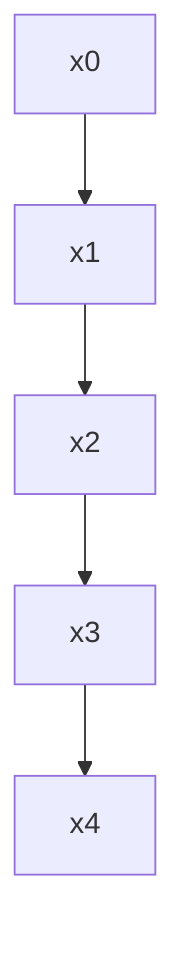

## 非线性求解方程

u二分法  
不动点迭代  
精度极限\根搜索敏感性  
牛顿迭代法  
割线法  
抛物法\混合方法  
方程组的牛顿迭代法

## 二分法

## • 二分法伪代码(pseudo-code)

Given initial interval $[a, b]$ such that $f(a)f(b) < 0$ while $(b - a)/2 > \text{TOL}$ $c = (a + b)/2$ if $f(c) = 0$ , stop, end
    if $f(a)f(c) < 0$ $b = c$ else $a = c$ end
end
The final interval $[a, b]$ contains a root.
The approximate root is $(a + b)/2$ .

误差？计算量？

## 不动点迭代

• 定义：如果 $g ( r ) = r$ ，则?为 $g ( x )$ 的不动点。  
• 例： $g ( x ) = \cos { ( x ) }$ 的不动点为0.739085…

## 不动点迭代

例： $g ( x ) = x ^ { 3 }$ 的不动点？  
• 不动点与方程根的关系： $g ( r ) = r \Longleftrightarrow f ( r ) = g ( r ) - r = 0$  
• 例： $r = 0 . 7 3 9 0 8 5$ …为 $f ( x ) = \cos x - x$ 的根。

## 不动点迭代

• 不动点迭代

$$
x _ {0} = \text { initial   guess }
$$

$$
x _ {i + 1} = g \left(x _ {i}\right) \text {for} i = 0, 1, 2, \dots
$$

$$
x _ {1} = g \left(x _ {0}\right)
$$

$$
x _ {2} = g \left(x _ {1}\right)
$$

$$
x _ {3} = g (x _ {2})
$$

• 如果? ? 连续且 $\operatorname* { l i m } _ { i \to \infty } x _ { i } = r$ i→8 （收敛）：

$$
g (r) = g \left(\lim _ {i \to \infty} x _ {i}\right) = \lim _ {i \to \infty} g (x _ {i}) = \lim _ {i \to \infty} x _ {i + 1} = r
$$

## 不动点迭代

• 定义：假设 $g ( x )$ 在区间?存在不动点 $\ b { x } ^ { * }$ ，若对∀ $\mathbf { \boldsymbol { x } } _ { 0 } \in I$ ，不动点迭代产生的序列 $\{ x _ { k } \}$ 收敛到 $| x ^ { * }$ ，则称不动点迭代在区间?全局收敛。  
• 定义：假设 $g ( x )$ 在区间?存在不动点 $x ^ { * }$ ，若存在 $x ^ { * }$ 的邻域 $N \subset I$ ，对∀ $/ x _ { 0 } \in N$ ，不动点迭代产生的序列 $\left| \left\{ x _ { k } \right\} \right.$ 收敛到 $\lvert x ^ { * }$ ，则称不动点迭代在区间?局部收敛。  
• 定义：如果存在常数 $L > 0 ,$ , 使得∀ $x _ { 1 } , x _ { 2 } \in$ ?满足 $| f ( x _ { 1 } ) - f ( x _ { 2 } ) | \leq L | x _ { 1 } - x _ { 2 } |$ ，则称函数 $f ( x )$ 在区间?满足L $\mathsf { i p s c h i t z }$ 条件，其中?称为 $\lfloor \mathsf { i p s c h i t z }$ 常数。

## 不动点迭代

定理： $g ( x ) \in C [ a , b ]$ 连续

1、如果 $\forall x \in [ a , b ]$ 有 $a \leq g ( x ) \leq b$ ,则 $g ( x )$ 在 $[ a , b ]$ 上存在不动点。  
2、在满足条件1的基础上，如果存在常数 $L \in ( 0 , 1 )$ ，使得

$$
| g (x _ {1}) - g (x _ {2}) | \leq L | x _ {1} - x _ {2} |, \forall x _ {1}, x _ {2} \in [ a, b ],
$$

则:

① $g ( x )$ 在 $[ a , b ]$ 上存在唯一不动点 $x ^ { * }$

② $\forall x _ { 0 } \in [ a , b ]$ ,不动点迭代收敛到 $| x ^ { * }$ (全局收敛)，误差满足：

$$
| x _ {k} - x ^ {*} | \leq \frac {L}{1 - L} | x _ {k} - x _ {k - 1} | \leq \ldots \leq \frac {L ^ {k}}{1 - L} | x _ {1} - x _ {0} |
$$

## 不动点迭代

• 推论： $g ( x )$ 在 $[ a , b ]$ 连续，在 $( a , b )$ 可微，对 $\forall x \in [ a , b ]$ ]有 $a \leq g ( x ) \leq b$ ，且存在常数$L \in ( 0 , 1 )$ ，使得

$$
\left| g ^ {\prime} (x) \right| \leq L, \forall x \in (a, b)
$$

则 $g ( x )$ 在 $[ a , b ]$ 上存在唯一不动点，并且不动点迭代在 $[ a , b ]$ 上全局收敛。

• 局部收敛定理：设 $x ^ { * }$ 为 $g ( x )$ 的不动点，如果 $g ^ { \prime } ( x )$ 在区间?连续且 $| g ^ { \prime } ( x ^ { * } ) | < 1$ ，则不动点迭代 ${ \boldsymbol x } _ { i + 1 } = g ( { \boldsymbol x } _ { i } )$ 局部收敛。

## 不动点迭代

• 例：求解 $x ^ { 3 } + x - 1 = 0$ 的不动点迭代对于 $r \approx 0 . 6 8 2 3$ 是否收敛？

1. $g ( x ) = 1 - x ^ { 3 } ; ~ | g ^ { \prime } ( r ) | = 3 r ^ { 2 } \approx 1 . 3 9 5$  
2 $g ( x ) = \sqrt [ 3 ] { 1 - x } ; ~ | g ^ { \prime } ( r ) | = \textstyle { \frac { 1 } { 3 } } ( 1 - r ) ^ { - \frac { 2 } { 3 } } \approx 0 . 7 1 6$  
$\begin{array} { r } { 3 , g ( x ) = \frac { 1 + 2 x ^ { 3 } } { 1 + 3 x ^ { 2 } } ; g ^ { \prime } ( x ) = \frac { 6 x ^ { 2 } \left( 1 + 3 x ^ { 2 } \right) - 6 x \left( 1 + 2 x ^ { 3 } \right) } { \left( 1 + 3 x ^ { 2 } \right) ^ { 2 } } = \frac { 6 x \left( x ^ { 3 } + x - 1 \right) } { \left( 1 + 3 x ^ { 2 } \right) ^ { 2 } } } \end{array}$ 1+3?2 ; ?′ ?

## 精度的极限


<details>
<summary>line chart</summary>

| x    | y     |
| ---- | ----- |
| -1   | -1    |
| 0    | 0     |
| 1    | 0.5   |
| 2    | 1     |
</details>

$\begin{array} { r } { f ( x ) = \left( x - \frac { 2 } { 3 } \right) ^ { 3 } } \end{array}$ 的函数图像


<details>
<summary>scatterplot</summary>

| x           | y         |
|-------------|-----------|
| 0.666660    | -10^-15   |
| 0.666670    | 10^-15    |
| 0.666670    | 2/3       |
</details>

放大的双精度函数图像

前向误差： $\vert x _ { n } - r$  
后向误差： $\left| f ( x _ { n } ) \right|$  
• 误差放大因子=相对前向误差/相对后向误差  
• 条件数：问题本身所决定的误差放大

## 根搜索的敏感度

• 敏感性问题：输入的小误差⟹输出的大误差。  
例：求? ? 的根

原问题： $f ( x ) = 0 \Longrightarrow x = r$

输入有误差的问题： $f ( x ) + \epsilon g ( x ) = 0 \Longrightarrow x = r + \Delta r$

$$
\Delta r \approx \frac {- \epsilon g (r)}{f ^ {\prime} (r) + \epsilon g ^ {\prime} (r)} \approx - \epsilon \frac {g (r)}{f ^ {\prime} (r)}
$$

误差放大因 $\begin{array} { r } { \mp = \left| \frac { \Delta r / r } { \epsilon g ( r ) / g ( r ) } \right| = \left| \frac { g ( r ) } { r f ^ { \prime } ( r ) } \right| } \end{array}$

## 根搜索的敏感度

• 例：估计 $\cdot P ( x ) = ( x - 1 ) ( x - 2 ) ( x - 3 ) ( x - 4 ) ( x - 5 ) ( x - 6 ) - 1 0 ^ { - 6 } x ^ { 7 }$ 的最大根

$$
\Delta r \approx - \epsilon \frac {g (r)}{f ^ {\prime} (r)} = - \epsilon \frac {6 ^ {7}}{5 !} = - 2 3 3 2. 8 \epsilon , \epsilon = - 1 0 ^ {- 6}
$$

$$
r + \Delta r \approx 6. 0 0 2 3 3 2 8
$$

精确的根是6.0023268

误差放大因子 $= \left| { \frac { g ( r ) } { r f ^ { \prime } ( r ) } } \right| = { \frac { 6 ^ { 7 } } { 6 \times 5 ! } } \approx 3 8 8 . 8$

• 定义：设序列 $\left| \left\{ x _ { k } \right\} \right.$ 收敛到 $| x ^ { * }$ ，定义误差 $e _ { i } : = | x _ { i } - x ^ { * } |$ ，如果存在实数 $p \geq 1$ ,使得

$$
\lim _ {i \to \infty} \frac {e _ {i + 1}}{e _ {i} ^ {p}} = C
$$

则称序列 $\rfloor _ { p }$ 阶收敛 $( p = 1$ 称为线性收敛，需满足 $C < 1 ; \ p = 2$ 称为平方收敛)。

• 定理：假设函数 $g \in C ^ { p } ( a , b ) , g ( x ^ { * } ) = x ^ { * } \in ( a , b )$ , 并且满足

$$
g ^ {\prime} (x ^ {*}) = g ^ {\prime \prime} (x ^ {*}) \dots = g ^ {(p - 1)} (x ^ {*}) = 0, g ^ {(p)} (x ^ {*}) \neq 0, (p \geq 1)
$$

则不动点迭代 $\dot { \mathbf { \xi } } _ { x _ { i + 1 } } = g ( x _ { i } )$ , ?阶局部收敛到不动点 $x ^ { * }$ ，且有

$$
\lim _ {i \to \infty} \frac {e _ {i + 1}}{e _ {i} ^ {p}} = \frac {\left| g ^ {(p)} (x ^ {*}) \right|}{p !},
$$

$p = 1$ 时需满足 $| g ^ { \prime } ( x ^ { * } ) | < 1$ 。

## 牛顿迭代法

Newton–Raphson 迭代法


<details>
<summary>text_image</summary>

f(x)
x₂
x₁
x₀
代数解释
</details>

几何解释

经过 $\left( { { x } _ { i } } , f ( { { x } _ { i } } ) \right)$ 的切线 $L _ { i }$ ：

$$
y = f (x _ {i}) + f ^ {\prime} (x _ {i}) (x - x _ {i})
$$

迭代公式 $( L _ { i }$ 与?轴的交点)：

$$
x _ {i + 1} = x _ {i} - \frac {f (x _ {i})}{f ^ {\prime} (x _ {i})}
$$

释：

$$
0 = f (x) = f (x _ {i}) + f ^ {\prime} (x _ {i}) (x - x _ {i}) + \frac {1}{2} f ^ {\prime \prime} (\xi) (x - x _ {i}) ^ {2}
$$

## 牛顿迭代法

• 定理：如果 $f \in C ^ { 2 } [ a , b ] , \exists r \in ( a , b )$ 满 足 $f ( r ) = 0$ ,且 $f ^ { \prime } ( r ) \neq 0 , f ^ { \prime \prime } ( r )$ $\neq 0$ ,则牛顿迭代法局部二次收敛到?.且迭代误差 $e _ { i } = | x _ { i } - r |$ 满足

$$
\lim _ {i \to \infty} \frac {e _ {i + 1}}{e _ {i} ^ {2}} = \left| \frac {f ^ {\prime \prime} (r)}{2 f ^ {\prime} (r)} \right|
$$

## 牛顿迭代法

• 定理：假设 $f \in C ^ { m + 1 } [ a , b ]$ 在 $[ a , b ]$ 上有?重根 $r ( m > 1 )$ ，则牛顿迭代法局部线性收 敛到?，误差满足

$$
\lim _ {i \to \infty} \frac {e _ {i + 1}}{e _ {i}} = \frac {m - 1}{m}
$$

• 定理：假设 $f \in C ^ { m + 1 } [ a , b ]$ 在 $[ a , b ]$ 上有?重根? 且 $f ^ { ( m + 1 ) } ( r ) \neq 0$ ，则改进的牛顿迭代法

$$
x _ {i + 1} = x _ {i} - \frac {m f (x _ {i})}{f ^ {\prime} (x _ {i})}
$$

局部二次收敛到?，误差满足

$$
\lim _ {i \to \infty} \frac {e _ {i + 1}}{e _ {i} ^ {2}} = \frac {1}{m (m + 1)} \left| \frac {f ^ {(m + 1)} (r)}{f ^ {(m)} (r)} \right|
$$

## 割线法


<details>
<summary>text_image</summary>

x₁
x₂
x₀ x₃
几何解释
f(x)
</details>

牛顿迭代公式(切线与?轴的交点)：

$$
x _ {i + 1} = x _ {i} - \frac {f (x _ {i})}{f ^ {\prime} (x _ {i})}
$$

割线法迭代公式(割线与?轴的交点)：

$$
x _ {i + 1} = x _ {i} - \frac {f (x _ {i}) (x _ {i} - x _ {i - 1})}{f (x _ {i}) - f (x _ {i - 1})}
$$

谁会收敛更快？

$$
f (x) = f (x _ {i}) + f ^ {\prime} (x _ {i}) (x - x _ {i}) + \frac {1}{2} f ^ {\prime \prime} (\xi) (x - x _ {i}) ^ {2}
$$

## 非线性方程组的牛顿迭代

包含?未知数的?个非线性方程组：

$$
\left\{ \begin{array}{l} f _ {1} (x _ {1}, x _ {2}, \dots , x _ {n}) = 0 \\ f _ {2} (x _ {1}, x _ {2}, \dots , x _ {n}) = 0 \\ \vdots \\ f _ {n} (x _ {1}, x _ {2}, \dots , x _ {n}) = 0 \end{array} \right.
$$

如何求解？

迭代思想：给定 $X _ { i } = \left[ x _ { 1 } ^ { ( i ) } , x _ { 2 } ^ { ( i ) } , . . . , x _ { n } ^ { ( i ) } \right] ^ { T }$ 递推计算? $X _ { i + 1 }$

• 线性化

$$
\left\{ \begin{array}{l} 0 = f _ {1} (X) \approx f _ {1} (X _ {i}) + \frac {\partial f _ {1} (X _ {i})}{\partial x _ {1}} \Big (x _ {1} - x _ {1} ^ {(i)} \Big) + \frac {\partial f _ {1} (X _ {i})}{\partial x _ {2}} \Big (x _ {2} - x _ {2} ^ {(i)} \Big) + \ldots + \frac {\partial f _ {1} (X _ {i})}{\partial x _ {n}} \Big (x _ {n} - x _ {n} ^ {(i)} \Big) \\ 0 = f _ {2} (X) \approx f _ {2} (X _ {i}) + \frac {\partial f _ {2} (X _ {i})}{\partial x _ {1}} \Big (x _ {1} - x _ {1} ^ {(i)} \Big) + \frac {\partial f _ {2} (X _ {i})}{\partial x _ {2}} \Big (x _ {2} - x _ {2} ^ {(i)} \Big) + \ldots + \frac {\partial f _ {2} (X _ {i})}{\partial x _ {n}} \Big (x _ {n} - x _ {n} ^ {(i)} \Big) \\ \vdots \\ 0 = f _ {n} (X) \approx f _ {n} (X _ {i}) + \frac {\partial f _ {n} (X _ {i})}{\partial x _ {1}} \Big (x _ {1} - x _ {1} ^ {(i)} \Big) + \frac {\partial f _ {n} (X _ {i})}{\partial x _ {2}} \Big (x _ {2} - x _ {2} ^ {(i)} \Big) + \ldots + \frac {\partial f _ {n} (X _ {i})}{\partial x _ {n}} \Big (x _ {n} - x _ {n} ^ {(i)} \Big) \end{array} \right.
$$

定义： $F = [ f _ { 1 } , f _ { 2 } , . . . , f _ { 3 } ] ^ { T }$ ,Jacobi矩阵： $J ( \boldsymbol { X } ) = F ^ { \prime } ( \boldsymbol { X } ) = \left( \begin{array} { c c c } { \frac { \partial f _ { 1 } ( \boldsymbol { X } ) } { \partial x _ { 1 } } } & { \cdots } & { \frac { \partial f _ { 1 } ( \boldsymbol { X } ) } { \partial x _ { n } } } \\ { \vdots } & { \ddots } & { \vdots } \\ { \frac { \partial f _ { n } ( \boldsymbol { X } ) } { \partial x _ { 1 } } } & { \cdots } & { \frac { \partial f _ { n } ( \boldsymbol { X } ) } { \partial x _ { n } } } \end{array} \right)$ ??1 ???

线性化方程可写成： $F ( X _ { i } ) + J ( X _ { i } ) ( X - X _ { i } ) = 0$

→牛顿迭代： $X _ { i + 1 } = X _ { i } - J ^ { - 1 } ( X _ { i } ) F ( X _ { i } )$

## 非线性方程组的牛顿迭代

• 例：求解方程组

$$
\left\{ \begin{array}{l l} f _ {1} (u, v) = v - u ^ {3} = 0 \\ f _ {2} (u, v) = u ^ {2} + v ^ {2} - 1 = 0 \end{array} \right.
$$

Jacobi矩阵

$$
J (u, v) = \left[ \begin{array}{c c} - 3 u ^ {2} & 1 \\ 2 u & 2 v \end{array} \right]
$$

牛顿迭代式 $( X = [ u , v ] ^ { T } , F = [ f _ { 1 } , f _ { 2 } ] )$ ：

$$
J (u _ {i}, v _ {i}) (X _ {i + 1} - X _ {i}) = - F (X _ {i})
$$

取 $X _ { 0 } = [ 1 , 2 ]$

第一步迭代计算为

$$
\left[ \begin{array}{l l} - 3 & 1 \\ 2 & 4 \end{array} \right] \left[ \begin{array}{l} u _ {i + 1} - u _ {i} \\ v _ {i + 1} - v _ {i} \end{array} \right] = - \left[ \begin{array}{l} 1 \\ 4 \end{array} \right] \Longrightarrow \left[ \begin{array}{l} u _ {i + 1} \\ v _ {i + 1} \end{array} \right] = \left[ \begin{array}{l} 1 \\ 1 \end{array} \right]
$$

## 思考与练习

• 对以下几种计算 $\sqrt [ 4 ] { 2 }$ 的算法的收敛速率从最快到最慢排序，并说明理由

1. 使用二分法求解 $f ( x ) = x ^ { 4 } - 2 = 0$  
2. 使用割线法求解 $f ( x ) = x ^ { 4 } - 2 = 0$  
3. $g ( x ) = \frac { x } { 2 } + \frac { 1 } { x ^ { 3 } }$  
4. 通过迭代求 $\begin{array} { c l l } { \displaystyle { g ( x ) = \frac { 5 x } { 6 } + \frac { 1 } { 3 x ^ { 3 } } } } \end{array}$ 的不动点  
5. 使用牛顿法求解 $f ( x ) = x ^ { 4 } - 2 = 0$

• 如果 $f ( x ) \in C ^ { m } ( \mathbb { R } )$ ，并满足 $f ( r ) = 0 , f ^ { \prime } ( r ) \neq 0 , f ^ { \prime \prime } ( r ) = . . . = f ^ { ( m - 1 ) } ( r ) = 0 ,$ $f ^ { ( m ) } ( r ) \neq 0 ( m > 2 )$ ,试分析标准牛顿迭代法的收敛性及误差。

## 练习与思考

• 找出函数 $g ( x ) = x ^ { 2 } - { \textstyle { \frac { 3 } { 2 } } } x + { \frac { 3 } { 2 } }$ 的每个不动点，并确定不动点迭代是否局部收敛  
• $\begin{array} { l } { \iff f ( x ) = x ^ { 4 } - 7 x ^ { 3 } + 1 8 x ^ { 2 } - 2 0 x + 8 } \\ { \iff { } \ H \ln { e _ { i + 1 } } / { e _ { i } } } \end{array}$ ,牛顿法是否会二次收敛到根? = 2？确定

• 取 $( u _ { 0 } , v _ { 0 } ) = ( 1 , 1 )$ ，使用牛顿迭代进行两步迭代求解

$$
\left\{ \begin{array}{c} u ^ {2} + v ^ {2} = 1 \\ (u - 1) ^ {2} + v ^ {2} = 1 \end{array} \right.
$$

• 编程：使用二分法、不动点迭代、牛顿法、试位法求 $\mathrm { e } ^ { x } + x = 7$ 的根,结果精确到小数点后8位，并对各方法的收敛性进行比较。

## 线性方程组的直接解法

Gauss消元法  
uLU三角分解  
范数/误差  
部分主元Gauss消元法  
LU分解与Gauss消元法的联系

## 理论基础

• 如何求解 $A x = b ?$

1.如果 $| A | \neq 0 , x = A ^ { - 1 } b$  
2.如果 $| A | \neq 0$ ,由 $G r a m e r$ 法则知：

$$
x _ {k} = \frac {| A _ {k} |}{| A |}
$$

• 有没有更简单实用的求解方法？

## 高斯消元

• 核心思想：将方程组化简为三角形方程组


<details>
<summary>natural_image</summary>

Portrait painting of a man in 18th-century academic regalia and cap, wearing a dark robe and white collar (no text or symbols visible)
</details>

高斯1777-1855


<details>
<summary>text_image</summary>

九章算術卷第一
魏劉敏注
唐朝議大夫行本史令上輕車都尉臣李淳恩等奉勒注释
方田以御域
今有田廣十五步從十六步間爲田幾何
答曰一畝
又有田廣十二步從十四步間爲田幾何
答曰一百六十八步圖從十四
方田
周謂算經卷上
劉敏注
施思焉
周謂算經卷上
劉敏注
周謂算經卷上
劉敏注
周謂算經卷上
劉敏注
周謂算經卷上
劉敏注
周謂算經卷上
劉敏注
周謂算經卷上
劉敏注
周謂算經卷上
劉敏注
周謂算經卷上
劉敏注
周謂算經卷上
劉敏注
周謂算經卷上
劉敏注
</details>

九章算术成书于约公元前150年

• 理论支撑：对一个方程组做有限次行初等运算得到的方程与原方程同解

Ø交换方程组中的两个方程  
Ø用一个非零数乘一个方程  
一个方程加上某个其它方程的倍数

## 高斯消元

• 具体操作

$$
{\left[ \begin{array}{l l l l} a _ {1 1} & a _ {1 2} & \dots & a _ {1 n} \\ a _ {2 1} & a _ {2 2} & \dots & a _ {2 n} \\ \vdots & \vdots & \vdots & \vdots \\ a _ {n 1} & a _ {n 2} & \dots & a _ {n n} \end{array} \right]} {\left[ \begin{array}{l} x _ {1} \\ x _ {2} \\ \vdots \\ x _ {n} \end{array} \right]} = {\left[ \begin{array}{l} b _ {1} \\ b _ {2} \\ \vdots \\ b _ {n} \end{array} \right]}
$$

$$
a _ {i j} \leftarrow a _ {i j} - \left(\frac {a _ {i 1}}{a _ {1 1}}\right) a _ {1 j} \quad \Bigg \downarrow b _ {i} \leftarrow b _ {i} - \left(\frac {a _ {i 1}}{a _ {1 1}}\right) b _ {1}, a _ {1 1} \neq 0
$$

$$
\left[ \begin{array}{c c c c} a _ {1 1} & a _ {1 2} & \ldots & a _ {1 n} \\ 0 & a _ {2 2} & \ldots & a _ {2 n} \\ \vdots & \vdots & \vdots & \vdots \\ 0 & a _ {n 2} & \ldots & a _ {n n} \end{array} \right] \left[ \begin{array}{c} x _ {1} \\ x _ {2} \\ \vdots \\ x _ {n} \end{array} \right] = \left[ \begin{array}{c} b _ {1} \\ b _ {2} \\ \vdots \\ b _ {n} \end{array} \right]
$$

## 高斯消元

• 经过?−1轮操作后

$$
\cdot \text {回代求解} \left\{ \begin{array}{l l} {{a _ {1 1} x _ {1} + a _ {1 2} x _ {2} + a _ {1 3} x _ {3} +}} & {{\ldots + a _ {1 n} x _ {n} = b _ {1}}} \\ {{a _ {2 2} x _ {2} + a _ {2 3} x _ {3} +}} & {{\ldots + a _ {2 n} x _ {n} = b _ {2}}} \\ {} & {{\vdots}} \\ {} & {{a _ {n - 1, n - 1} x _ {n - 1} + a _ {n - 1, n} x _ {n} = b _ {n - 1}}} \\ {} & {{a _ {n n} x _ {n} = b _ {n}}} \end{array} \right.
$$

$$
x _ {n} = b _ {n} / a _ {n n}
$$

$$
x _ {n - 1} = \left(b _ {n - 1} - a _ {n - 1, n} x _ {n}\right) / a _ {n - 1, n - 1}
$$

$$
x _ {i} = \left(b _ {i} - \sum_ {j = i + 1} ^ {n} a _ {i j} x _ {j}\right) / a _ {i i}, i = n - 1, n - 2, \dots , 1
$$

## 高斯消元

例：求解线性方程组

$$
\left\{ \begin{array}{l l} x + 2 y - z = 3 \\ 2 x + y - 2 z = 3 \\ - 3 x + y + z = - 6 \end{array} \right.
$$

## 高斯消元

第一轮消元计算量

$$
{\left[ \begin{array}{l l l l} a _ {1 1} & a _ {1 2} & \dots & a _ {1 n} \\ a _ {2 1} & a _ {2 2} & \dots & a _ {2 n} \\ \vdots & \vdots & \vdots & \vdots \\ a _ {n 1} & a _ {n 2} & \dots & a _ {n n} \end{array} \right]} {\left[ \begin{array}{l} x _ {1} \\ x _ {2} \\ \vdots \\ x _ {n} \end{array} \right]} = {\left[ \begin{array}{l} b _ {1} \\ b _ {2} \\ \vdots \\ b _ {n} \end{array} \right]}
$$

$$
a _ {i j} \leftarrow a _ {i j} - \left(\frac {a _ {i 1}}{a _ {1 1}}\right) a _ {1 j} \quad \Bigg \downarrow b _ {i} \leftarrow b _ {i} - \left(\frac {a _ {i 1}}{a _ {1 1}}\right) b _ {1},   a _ {1 1} \neq 0
$$

$$
\left[ \begin{array}{c c c c} a _ {1 1} & a _ {1 2} & \ldots & a _ {1 n} \\ 0 & a _ {2 2} & \ldots & a _ {2 n} \\ \vdots & \vdots & \vdots & \vdots \\ 0 & a _ {n 2} & \ldots & a _ {n n} \end{array} \right] \left[ \begin{array}{c} x _ {1} \\ x _ {2} \\ \vdots \\ x _ {n} \end{array} \right] = \left[ \begin{array}{c} b _ {1} \\ b _ {2} \\ \vdots \\ b _ {n} \end{array} \right]
$$

消去一个元的计算量：1次除法，?次乘法，?次减法（加法）

## 高斯消元

消元总体计算量 $( N _ { e } )$

$$
\left[ \begin{array}{cccccc} 0 &  &  &  &  &  \\ 2 n + 1 &  & 0 &  &  &  \\ 2 n + 1 & 2 (n - 1) + 1 & \ddots &  &  &  \\ \vdots & \vdots & \ddots & 0 &  &  \\ 2 n + 1 & 2 (n - 1) + 1 & \dots & 2 (2) + 1 &  & 0 \\ \end{array} \right]
$$

$$
N _ {e} = \sum_ {j = 1} ^ {n} (2 j + 1) (j - 1) = \frac {2}{3} n ^ {3} + \frac {1}{2} n ^ {2} - \frac {7}{6} n = O (n ^ {3})
$$

## 高斯消元

回代计算量 $( N _ { b } )$

$$
x _ {n} = b _ {n} / a _ {n n}
$$

$$
x _ {i} = \left(b _ {i} - \sum_ {j = i + 1} ^ {n} a _ {i j} x _ {j}\right) / a _ {i i}, i = n - 1, n - 2, \dots , 1
$$

$$
N _ {b} = \sum_ {i = 1} ^ {n} [ 2 (n - i) + 1 ] = n ^ {2} = O (n ^ {2})
$$

## LU分解

• 什么是矩阵?的??分解？  
• ??分解有什么用？  
• 怎么分解？

$$
\left[ \begin{array}{c c c c c} a _ {1 1} & a _ {1 2} & a _ {1 3} & \ldots & a _ {1 n} \\ a _ {2 1} & a _ {2 2} & a _ {2 3} & \ldots & a _ {2 n} \\ a _ {3 1} & a _ {3 2} & a _ {3 3} & \ldots & a _ {3 n} \\ \vdots & \vdots & \vdots & \vdots & \vdots \\ a _ {n 1} & a _ {n 2} & a _ {n 3} & \ldots & a _ {n n} \end{array} \right] = \left[ \begin{array}{c c c c c} l _ {1 1} & 0 & 0 & \ldots & 0 \\ l _ {2 1} & l _ {2 2} & 0 & \ldots & 0 \\ l _ {3 1} & l _ {3 2} & l _ {3 3} & \ldots & 0 \\ \vdots & \vdots & \vdots & \ddots & \vdots \\ l _ {n 1} & l _ {n 2} & l _ {n 3} & \ldots & l _ {n n} \end{array} \right] \cdot \left[ \begin{array}{c c c c c} u _ {1 1} & u _ {1 2} & u _ {1 3} & \ldots & u _ {1 n} \\ 0 & u _ {2 2} & u _ {2 3} & \ldots & u _ {2 n} \\ 0 & 0 & u _ {3 3} & \ldots & u _ {3 n} \\ \vdots & \vdots & \vdots & \ddots & \vdots \\ 0 & 0 & 0 & \ldots & u _ {n n} \end{array} \right]
$$

$$
a _ {i j} = \sum_ {s = 1} ^ {s = n} l _ {i s} u _ {s j} = \sum_ {s = 1} ^ {s = \min (i, j)} l _ {i s} u _ {s j} \qquad n ^ {2} \mathrm{个方程}, n ^ {2} + n \mathrm{个未知数}
$$

## LU分解

• Doolittle分解

$$
\left[ \begin{array}{c c c c c} a _ {1 1} & a _ {1 2} & a _ {1 3} & \ldots & a _ {1 n} \\ a _ {2 1} & a _ {2 2} & a _ {2 3} & \ldots & a _ {2 n} \\ a _ {3 1} & a _ {3 2} & a _ {3 3} & \ldots & a _ {3 n} \\ \vdots & \vdots & \vdots & \vdots & \vdots \\ a _ {n 1} & a _ {n 2} & a _ {n 3} & \ldots & a _ {n n} \end{array} \right] = \left[ \begin{array}{c c c c c} 1 & 0 & 0 & \ldots & 0 \\ l _ {2 1} & 1 & 0 & \ldots & 0 \\ l _ {3 1} & l _ {3 2} & 1 & \ldots & 0 \\ \vdots & \vdots & \vdots & \ddots & \vdots \\ l _ {n 1} & l _ {n 2} & l _ {n 3} & \ldots & 1 \end{array} \right] \cdot \left[ \begin{array}{c c c c c} u _ {1 1} & u _ {1 2} & u _ {1 3} & \ldots & u _ {1 n} \\ 0 & u _ {2 2} & u _ {2 3} & \ldots & u _ {2 n} \\ 0 & 0 & u _ {3 3} & \ldots & u _ {3 n} \\ \vdots & \vdots & \vdots & \ddots & \vdots \\ 0 & 0 & 0 & \ldots & u _ {n n} \end{array} \right]
$$

• Crout分解

$$
\left[ \begin{array}{c c c c c} a _ {1 1} & a _ {1 2} & a _ {1 3} & \ldots & a _ {1 n} \\ a _ {2 1} & a _ {2 2} & a _ {2 3} & \ldots & a _ {2 n} \\ a _ {3 1} & a _ {3 2} & a _ {3 3} & \ldots & a _ {3 n} \\ \vdots & \vdots & \vdots & \vdots & \vdots \\ a _ {n 1} & a _ {n 2} & a _ {n 3} & \ldots & a _ {n n} \end{array} \right] = \left[ \begin{array}{c c c c c} l _ {1 1} & 0 & 0 & \ldots & 0 \\ l _ {2 1} & l _ {2 2} & 0 & \ldots & 0 \\ l _ {3 1} & l _ {3 2} & l _ {3 3} & \ldots & 0 \\ \vdots & \vdots & \vdots & \ddots & \vdots \\ l _ {n 1} & l _ {n 2} & l _ {n 3} & \ldots & l _ {n n} \end{array} \right] \cdot \left[ \begin{array}{c c c c c} 1 & u _ {1 2} & u _ {1 3} & \ldots & u _ {1 n} \\ 0 & 1 & u _ {2 3} & \ldots & u _ {2 n} \\ 0 & 0 & 1 & \ldots & u _ {3 n} \\ \vdots & \vdots & \vdots & \ddots & \vdots \\ 0 & 0 & 0 & \ldots & 1 \end{array} \right]
$$

## LU分解

$$
\left[ \begin{array}{c c c c c} a _ {1 1} & a _ {1 2} & a _ {1 3} & \ldots & a _ {1 n} \\ a _ {2 1} & a _ {2 2} & a _ {2 3} & \ldots & a _ {2 n} \\ a _ {3 1} & a _ {3 2} & a _ {3 3} & \ldots & a _ {3 n} \\ \vdots & \vdots & \vdots & \vdots & \vdots \\ a _ {n 1} & a _ {n 2} & a _ {n 3} & \ldots & a _ {n n} \end{array} \right] = \left[ \begin{array}{c c c c c} l _ {1 1} & 0 & 0 & \ldots & 0 \\ l _ {2 1} & l _ {2 2} & 0 & \ldots & 0 \\ l _ {3 1} & l _ {3 2} & l _ {3 3} & \ldots & 0 \\ \vdots & \vdots & \vdots & \ddots & \vdots \\ l _ {n 1} & l _ {n 2} & l _ {n 3} & \ldots & l _ {n n} \end{array} \right] \cdot \left[ \begin{array}{c c c c c} u _ {1 1} & u _ {1 2} & u _ {1 3} & \ldots & u _ {1 n} \\ 0 & u _ {2 2} & u _ {2 3} & \ldots & u _ {2 n} \\ 0 & 0 & u _ {3 3} & \ldots & u _ {3 n} \\ \vdots & \vdots & \vdots & \ddots & \vdots \\ 0 & 0 & 0 & \ldots & u _ {n n} \end{array} \right]
$$

$$
a _ {1 1} = \sum_ {s = 1} l _ {1 s} u _ {s 1} = l _ {1 1} u _ {1 1} \to l _ {1 1} \setminus u _ {1 1}
$$

$$
s = \min (1, j)
$$

$$
\begin{array}{l} a _ {1 j} = \sum_ {s = 1} l _ {1 s} u _ {s j} = l _ {1 1} u _ {1 j} \rightarrow u _ {1 j} (2 \leq j \leq n) \\ s = \min (i, 1) \\ \end{array}
$$

$$
a _ {i 1} = \sum_ {s = 1} l _ {i s} u _ {s 1} = l _ {i 1} u _ {1 1} \rightarrow l _ {i 1} (2 \leq i \leq n)
$$

## LU分解

$$
\left[ \begin{array}{c c c c c} a _ {1 1} & a _ {1 2} & a _ {1 3} & \ldots & a _ {1 n} \\ a _ {2 1} & a _ {2 2} & a _ {2 3} & \ldots & a _ {2 n} \\ a _ {3 1} & a _ {3 2} & a _ {3 3} & \ldots & a _ {3 n} \\ \vdots & \vdots & \vdots & \vdots & \vdots \\ a _ {n 1} & a _ {n 2} & a _ {n 3} & \ldots & a _ {n n} \end{array} \right] = \left[ \begin{array}{c c c c c} l _ {1 1} & 0 & 0 & \ldots & 0 \\ l _ {2 1} & l _ {2 2} & 0 & \ldots & 0 \\ l _ {3 1} & l _ {3 2} & l _ {3 3} & \ldots & 0 \\ \vdots & \vdots & \vdots & \ddots & \vdots \\ l _ {n 1} & l _ {n 2} & l _ {n 3} & \ldots & l _ {n n} \end{array} \right] \cdot \left[ \begin{array}{c c c c c} u _ {1 1} & u _ {1 2} & u _ {1 3} & \ldots & u _ {1 n} \\ 0 & u _ {2 2} & u _ {2 3} & \ldots & u _ {2 n} \\ 0 & 0 & u _ {3 3} & \ldots & u _ {3 n} \\ \vdots & \vdots & \vdots & \ddots & \vdots \\ 0 & 0 & 0 & \ldots & u _ {n n} \end{array} \right]
$$

$$
a _ {2 2} = \sum_ {s = 1} l _ {2 s} u _ {s 2} = l _ {2 1} u _ {1 2} + l _ {2 2} u _ {2 2} \rightarrow l _ {2 2} \setminus u _ {2 2}
$$

$$
s = \min (2, j)
$$

$$
a _ {2 j} = \sum_ {s = 1} l _ {2 s} u _ {s j} = l _ {2 1} u _ {1 j} + l _ {2 2} u _ {2 j} \rightarrow u _ {2 j} (3 \leq j \leq n)
$$

$$
s = \min (i, 2)
$$

$$
a _ {i 2} = \sum_ {s = 1} l _ {i s} u _ {s 2} = l _ {i 1} u _ {1 2} + l _ {i 2} u _ {2 2} \rightarrow l _ {i 2} (3 \leq i \leq n)
$$

## LU分解

$$
\left[ \begin{array}{c c c c c} a _ {1 1} & a _ {1 2} & a _ {1 3} & \ldots & a _ {1 n} \\ a _ {2 1} & a _ {2 2} & a _ {2 3} & \ldots & a _ {2 n} \\ a _ {3 1} & a _ {3 2} & a _ {3 3} & \ldots & a _ {3 n} \\ \vdots & \vdots & \vdots & \vdots & \vdots \\ a _ {n 1} & a _ {n 2} & a _ {n 3} & \ldots & a _ {n n} \end{array} \right] = \left[ \begin{array}{c c c c c} l _ {1 1} & 0 & 0 & \ldots & 0 \\ \vdots & \ddots & 0 & \ldots & 0 \\ l _ {k - 1, 1} & \ldots & l _ {k - 1, k - 1} & \ldots & 0 \\ \vdots & \vdots & \vdots & \ddots & \vdots \\ l _ {n 1} & \ldots & l _ {n, k - 1} & \ldots & l _ {n n} \end{array} \right] \cdot \left[ \begin{array}{c c c c c} u _ {1 1} & \ldots & u _ {1, k - 1} & \ldots & u _ {1 n} \\ 0 & \ddots & \vdots & \ldots & \vdots \\ 0 & 0 & u _ {k - 1, k - 1} & \ldots & u _ {k - 1, n} \\ \vdots & \vdots & \vdots & \ddots & \vdots \\ 0 & 0 & 0 & \ldots & u _ {n n} \end{array} \right]
$$

$$
a _ {k, k} = \sum_ {s = 1} ^ {s = \min (k, k)} l _ {k s} u _ {s k} = \sum_ {s = 1} ^ {k - 1} l _ {k s} u _ {s k} + l _ {k k} u _ {k k} \to l _ {k k} \setminus u _ {k k}
$$

$$
a _ {k j} = \sum_ {s = 1} ^ {s = \min (k, j)} l _ {k s} u _ {s j} = \sum_ {s = 1} ^ {k - 1} l _ {k s} u _ {s j} + l _ {k k} u _ {k, j} \rightarrow u _ {k j} (k <   j \leq n)
$$

$$
a _ {i k} = \sum_ {s = 1} ^ {s = \min (i, k)} l _ {i s} u _ {s k} = \sum_ {s = 1} ^ {k - 1} l _ {i s} u _ {s k} + l _ {i k} u _ {k k} \to l _ {i k} (k <   i \leq n)
$$

## LU分解

• $A = L U$ 分解过程

$$
\left[ \begin{array}{c c c c c} a _ {1 1} & a _ {1 2} & a _ {1 3} & \ldots & a _ {1 n} \\ a _ {2 1} & a _ {2 2} & a _ {2 3} & \ldots & a _ {2 n} \\ a _ {3 1} & a _ {3 2} & a _ {3 3} & \ldots & a _ {3 n} \\ \vdots & \vdots & \vdots & \vdots & \vdots \\ a _ {n 1} & a _ {n 2} & a _ {n 3} & \ldots & a _ {n n} \end{array} \right] = \left[ \begin{array}{c c c c c} l _ {1 1} & 0 & 0 & \ldots & 0 \\ \framebox {l _ {2 1}} & l _ {2 2} & 0 & \ldots & 0 \\ l _ {3 1} & \framebox {l _ {3 2}} & l _ {3 3} & \ldots & 0 \\ \vdots & \vdots & \framebox {\vdots} & \ddots & \vdots \\ l _ {n 1} & l _ {n 2} & l _ {n 3} & \ldots & l _ {n n} \end{array} \right] \cdot \left[ \begin{array}{c c c c c} u _ {1 1} & u _ {1 2} & u _ {1 3} & \ldots & u _ {1 n} \\ \hline 0 & u _ {2 2} & u _ {2 3} & \ldots & u _ {2 n} \\ 0 & 0 & u _ {3 3} & \ldots & u _ {3 n} \\ \vdots & \vdots & \vdots & \vdots & \vdots \\ 0 & 0 & 0 & \ldots & u _ {n n} \end{array} \right]
$$

求解顺序: $u _ { 1 1 }  l _ { i 1 } , u _ { 1 j }  u _ { 2 2 }  l _ { i 2 } , u _ { 2 j }  . . .  u _ { n n }$

显式求解：

$$
u _ {k j} = \left(a _ {k j} - \sum_ {s = 1} ^ {k - 1} l _ {k s} u _ {s j}\right) / l _ {k k}
$$

$$
l _ {i k} = \left(a _ {i k} - \sum_ {s = 1} ^ {k - 1} l _ {i s} u _ {s k}\right) / u _ {k k}
$$

## LU分解

• 例：3 × 3矩阵的Doolittle分解

$$
A = \left[ \begin{array}{c c c} 1 & 2 & - 1 \\ 2 & 1 & - 2 \\ - 3 & 1 & 1 \end{array} \right] = L U = \left[ \begin{array}{c c c} 1 & 0 & 0 \\ l _ {2 1} & 1 & 0 \\ l _ {3 1} & l _ {3 2} & 1 \end{array} \right] \left[ \begin{array}{c c c} u _ {1 1} & u _ {1 2} & u _ {1 3} \\ 0 & u _ {2 2} & u _ {2 3} \\ 0 & 0 & u _ {3 3} \end{array} \right]
$$

$$
= \left[ \begin{array}{c c c} u _ {1 1} & u _ {1 2} & u _ {1 3} \\ l _ {2 1} u _ {1 1} & l _ {2 1} u _ {1 2} + u _ {2 2} & l _ {2 1} u _ {1 3} + l _ {2 2} u _ {2 3} \\ l _ {3 1} u _ {1 1} & l _ {3 1} u _ {1 2} + l _ {3 2} u _ {2 2} & l _ {3 1} u _ {1 3} + l _ {3 2} u _ {2 3} + u _ {3 3} \end{array} \right]
$$

• 求解

$$
{\left[ \begin{array}{l l l} 1 & 2 & - 1 \\ 2 & 1 & - 2 \\ - 3 & 1 & 1 \end{array} \right]} {\left[ \begin{array}{l} x _ {1} \\ x _ {2} \\ x _ {3} \end{array} \right]} = {\left[ \begin{array}{l} 3 \\ 3 \\ - 6 \end{array} \right]}
$$

## 误差

直接法有误差吗？  
• 如何衡量误差？  
向量 $x \in \mathbb { R } ^ { n }$ 的范数 $\| x \| \in$ ℝ满足

1. 正定性： $\| x \| \geq 0$ ，仅当 $x = 0$ 时等号成立  
2. 齐次性： $\| \alpha x \| = \left| \alpha \right| \cdot \| x \|$  
3. 三角不等式： $\| x + y \| \leq \| x \| + \| y \|$  
• 例：

$$
\left\| x \right\| _ {1} = \left| x _ {1} \right| + \ldots + \left| x _ {n} \right|
$$

$$
\| x \| _ {2} = \sqrt {x _ {1} ^ {2} + \ldots + x _ {n} ^ {2}}
$$

$$
\| x \| _ {\infty} = \max _ {1 \leq i \leq n} | x _ {i} |
$$

## 误差

矩阵?的范数 $\| A \| \in \mathbb { R }$ 满足

1. 正定性： $\left. A \right. \geq 0$ ，仅当 $A = 0$ 时等号成立  
2. 齐次性： $\| \alpha A \| = { \big | } \alpha { \big | } \cdot \| A \| $  
3. 三角不等式： $\| A + B \| \leq \| A \| + \| B \|$

• 算子（从属矩阵）范数： $\begin{array} { r } { \| A \| = m a x \frac { \| A x \| } { \| x \| } \left( \forall x \in \mathbb { R } ^ { n } , x \neq 0 \right) } \end{array}$

性质1. $\left. I \right. = 1$

性质2. $\| A \| \cdot \| x \| \geq \| A x \| , \forall x \in \mathbb { R } ^ { n }$

性质3. $\| A \| \cdot \| B \| \geq \| A B \|$

## 误差

算子范数的例子

1. $\| A \| _ { 1 } = \operatorname* { m a x } _ { 1 \leq j \leq n } \left( \left| a _ { 1 j } \right| + \ldots + \left| a _ { n j } \right| \right)$ , 最大绝对列和  
2. $\| A \| _ { 2 } = \sqrt { \rho ( A ^ { T } A ) }$ ， $A ^ { T } A$ 的谱半径(特征值的最大模)的平方根  
3. $\| A \| _ { \infty } = \max _ { 1 \leq i \leq n } \left( | a _ { i 1 } | + \ldots + | a _ { i n } | \right)$ , 最大绝对行和

## 误差

• 求解 $A x = b$ 的误差定义：

1. 近似解 $x _ { a }$ 的前向误差 $\| x _ { a } - x \| _ { \infty }$  
2. 后向误差 $\| b - A x _ { a } \| _ { \infty } = \| r \| _ { \infty }$  
3. 误差放大因子 $\dot { \mathbf { \tau } } = \frac { \| x _ { a } - x \| _ { \infty } / \| x \| _ { \infty } } { \| r \| _ { \infty } / \| b \| _ { \infty } }$

4. 也可以采用其它范数来定义误差

## 误差

• 定义：?阶可逆方阵?的条件数 $c o n d ( A )$ 为求解?? = ?时，对于所有 $b \neq 0 \overline { { \mathsf { H } } }$ 能出现的最大误差放大因子，即：

$$
c o n d (A) = \max _ {b \in \mathbb {R} ^ {n}, b \neq 0} \frac {\| x _ {a} - x \| _ {\infty} / \| x \| _ {\infty}}{\| r \| _ {\infty} / \| b \| _ {\infty}}
$$

• 定理：可逆方阵?的条件数 $c o n d ( A ) = \ \| A \| _ { \infty } \ \| A ^ { - 1 } \| _ { \infty }$ ，即：

$$
\frac {\| x _ {a} - x \| _ {\infty}}{\| x \| _ {\infty}} \leq \| A \| _ {\infty} \| A ^ {- 1} \| _ {\infty} \frac {\| r \| _ {\infty}}{\| b \| _ {\infty}}
$$

## 误差

• 定理：求解方程?? = ?时，前向误差和后向误差满足:

$$
\frac {1}{c o n d (A)} \frac {\| r \| _ {\infty}}{\| b \| _ {\infty}} \leq \frac {\| x _ {a} - x \| _ {\infty}}{\| x \| _ {\infty}} \leq c o n d (A) \frac {\| r \| _ {\infty}}{\| b \| _ {\infty}}
$$

• 大条件数的矩阵是病态的。

## LU分解与高斯消元的联系

• 高斯消元基本的行变换操作与左乘初等矩阵对应

1. 交换第?行和第?行⟺左乘初等矩阵

$$
P = \left[ \begin{array}{c c c c c c c} 1 & \dots & 0 & \dots & 0 & \dots & 0 \\ \vdots & \vdots & \vdots & \vdots & \vdots & \dots & \vdots \\ 0 & \dots & 0 & \dots & 1 & \dots & 0 \\ \vdots & \vdots & \vdots & \vdots & \vdots & \vdots & \vdots \\ 0 & \dots & 1 & \dots & 0 & \dots & 0 \\ \vdots & \vdots & \vdots & \vdots & \vdots & \vdots & \vdots \\ 0 & \dots & 0 & \dots & 0 & \dots & 1 \end{array} \right] _ {\text {第} i \text {行}}
$$

第?列 第?列

## LU分解与高斯消元的联系

2. 非零数?乘第?行加到第?行⟺左乘初等矩阵

$$
E = {\left[ \begin{array}{l l l l l l l} {{1}} & {{\dots}} & {{0}} & {{\dots}} & {{0}} & {{\dots}} & {{0}} \\ {{\vdots}} & {{\vdots}} & {{\vdots}} & {{\vdots}} & {{\vdots}} & {{\dots}} & {{\vdots}} \\ {{0}} & {{\dots}} & {{1}} & {{\dots}} & {{0}} & {{\dots}} & {{0}} \\ {{\vdots}} & {{\vdots}} & {{\vdots}} & {{\vdots}} & {{\vdots}} & {{\vdots}} & {{\vdots}} \\ {{0}} & {{\dots}} & {{\lambda}} & {{\dots}} & {{1}} & {{\dots}} & {{0}} \\ {{\vdots}} & {{\vdots}} & {{\vdots}} & {{\vdots}} & {{\vdots}} & {{\vdots}} & {{\vdots}} \\ {{0}} & {{\dots}} & {{0}} & {{\dots}} & {{0}} & {{\dots}} & {{1}} \end{array} \right]} {\mathrm{第} i \mathrm{行}} {\mathrm{第} j \mathrm{行}}
$$

第?列 第?列

## LU分解与高斯消元的联系

• 顺序高斯消元 $\begin{array} { r } { \Longleftrightarrow E _ { m } . . . E _ { 1 } A = U \Longleftrightarrow A = E _ { 1 } ^ { - 1 } . . . E _ { m } ^ { - 1 } U , m \leq \frac { n ( n - 1 ) } { 2 } } \end{array}$ ? ?−1  
• $E _ { 1 } ^ { - 1 } . . . E _ { m } ^ { - 1 } = L ?$

$$
\left[ \begin{array}{c c c c c c c} 1 & \ldots & 0 & \ldots & 0 & \ldots & 0 \\ \vdots & \vdots & \vdots & \vdots & \vdots & \ldots & \vdots \\ 0 & \ldots & 1 & \ldots & 0 & \ldots & 0 \\ \vdots & \vdots & \vdots & \vdots & \vdots & \vdots & \vdots \\ 0 & \ldots & \lambda & \ldots & 1 & \ldots & 0 \\ \vdots & \vdots & \vdots & \vdots & \vdots & \vdots & \vdots \\ 0 & \ldots & 0 & \ldots & 0 & \ldots & 1 \end{array} \right] ^ {- 1} = \left[ \begin{array}{c c c c c c c} 1 & \ldots & 0 & \ldots & 0 & \ldots & 0 \\ \vdots & \vdots & \vdots & \vdots & \vdots & \ldots & \vdots \\ 0 & \ldots & 1 & \ldots & 0 & \ldots & 0 \\ \vdots & \vdots & {\vdots} & \vdots & \vdots & \vdots & \vdots \\ 0 & \ldots & - \lambda & \ldots & 1 & \ldots & 0 \\ \vdots & \vdots & \vdots & \vdots & \vdots & \vdots & \vdots \\ 0 & \ldots & 0 & \ldots & 0 & \ldots & 1 \end{array} \right]
$$

## LU分解与高斯消元的联系

$$
\begin{array}{r l} E _ {1} ^ {- 1} \dots E _ {m} ^ {- 1} = E _ {1} ^ {- 1} \dots E _ {m - 1} ^ {- 1} \cdot \left[ \begin{array}{l l l l l} 1 & \dots & 0 & 0 & 0 \\ 0 & \ddots & \vdots & 0 & 0 \\ \vdots & \ddots & 1 & \vdots & \vdots \\ 0 & \ddots & 0 & 1 & 0 \\ 0 & \dots & 0 & c _ {n, n - 1} & 1 \end{array} \right] & = E _ {1} ^ {- 1} \dots E _ {m - 2} ^ {- 1} \cdot \left[ \begin{array}{l l l l l} 1 & \dots & 0 & 0 & 0 \\ 0 & \ddots & \vdots & 0 & 0 \\ \vdots & \ddots & 1 & \vdots & \vdots \\ 0 & \ddots & 0 & 1 & 0 \\ 0 & \dots & c _ {n, n - 2} & c _ {n, n - 1} & 1 \end{array} \right] \end{array}
$$

$$
= E _ {1} ^ {- 1} \dots E _ {m - 3} ^ {- 1} \cdot \left[ \begin{array}{c c c c c} 1 & \dots & 0 & 0 & 0 \\ 0 & \ddots & \vdots & 0 & 0 \\ \vdots & \ddots & 1 & \vdots & \vdots \\ 0 & \ddots & c _ {n - 1, n - 2} & 1 & 0 \\ 0 & \dots & c _ {n, n - 2} & c _ {n, n - 1} & 1 \end{array} \right] = E _ {1} ^ {- 1} \dots E _ {n - 2} ^ {- 1} \cdot \left[ \begin{array}{c c c c c} 1 & \dots & 0 & 0 & 0 \\ 0 & \ddots & \vdots & 0 & 0 \\ \vdots & \ddots & 1 & \vdots & \vdots \\ 0 & \ddots & c _ {n - 1, n - 2} & 1 & 0 c _ {n, n - 1} \\ c _ {n, 1} & \dots & c _ {n, n - 2} & c _ {n, n - 1} & 1 \end{array} \right]
$$

$$
= E _ {1} ^ {- 1} \dots E _ {n - 3} ^ {- 1} \cdot \left[ \begin{array}{c c c c c} 1 & \dots & 0 & 0 & 0 \\ 0 & \ddots & \vdots & 0 & 0 \\ \vdots & \ddots & 1 & \vdots & \vdots \\ c _ {n - 1, 1} & \ddots & c _ {n - 1, n - 2} & 1 & 0 \\ c _ {n, 1} & \dots & c _ {n, n - 2} & c _ {n, n - 1} & 1 \end{array} \right] = \left[ \begin{array}{c c c c c} 1 & \dots & 0 & 0 & 0 \\ c _ {2 1} & \ddots & \vdots & 0 & 0 \\ \vdots & \ddots & 1 & \vdots & \vdots \\ c _ {n - 1, 1} & \ddots & c _ {n - 1, n - 2} & 1 & 0 \\ c _ {n, 1} & \dots & c _ {n, n - 2} & c _ {n, n} - 1 & 1 \end{array} \right]
$$

## LU分解与高斯消元的联系

例：推导?的??分解

$$
A = \left[ \begin{array}{l l l} 1 & 2 & - 1 \\ 2 & 1 & - 2 \\ - 3 & 1 & 1 \end{array} \right]
$$

## LU分解与高斯消元的联系

• 定义：严格行对角占优矩阵是指

$$
\left| a _ {i i} \right| > \sum_ {j = 1, j \neq i} ^ {n} \left| a _ {i j} \right|, (1 \leq i \leq n)
$$

• 定理：不选主元Gauss消元法保持矩阵的严格行对角占优性质。  
• 推论：行对角占优矩阵可逆且有??分解。

## 思考与练习

• 证明矩阵的无穷算子范数 $\| A \| _ { \infty } = \operatorname* { m a x } _ { 1 \leq i \leq n } \left( | a _ { i 1 } | + \ldots + | a _ { i n } | \right)$  
• 给定方程组 $\begin{array} { r l } { \left[ { \begin{array} { c c } { 1 } & { 1 } \\ { 1 + \delta } & { 1 } \end{array} } \right] \left[ { \begin{array} { c } { x _ { 1 } } \\ { x _ { 2 } } \end{array} } \right] = \left[ { \begin{array} { c } { 2 } \\ { 2 + \delta } \end{array} } \right] , \delta > 0 . 1 } \end{array}$ 、计算系数矩阵的条件数。2、计算近似解 $x _ { a } = [ -$ $1 , 3 + \delta ]$ 的误差放大因子。  
• 用Gauss消元法、列主消元法、??分解法、 $P A = L U$ 分解法求解下列方程组

$$
{\left[ \begin{array}{l l l} 3 & 1 & 2 \\ 6 & 3 & 4 \\ 3 & 2 & 5 \end{array} \right]} {\left[ \begin{array}{l} x _ {1} \\ x _ {2} \\ x _ {3} \end{array} \right]} = {\left[ \begin{array}{l} 1 1 \\ 2 4 \\ 2 2 \end{array} \right]}
$$

• 编写通用的Gauss消元法和??分解法程序:1、求解以上方程组对程序进行验证；2、用程序求解$H x = b$ ，?设置为12阶和20阶Hilbert矩阵， $b = H \cdot [ 1 , . . . , 1 ] ^ { T }$ 。

## 线性方程组的迭代法

## 迭代法的一般形式

Ø Richardson迭代  
Ø Jacobi迭代  
Ø Gauss-Seidel迭代  
Ø 连续过松弛(SOR)迭代

## 迭代法的收敛性

## 线性方程组的迭代法

引例：求解方程组 $\begin{array} { l } { { 3 u + v = 5 } } \\ { { u + 2 v = 5 } } \end{array}$

$\left\{ \begin{array} { l l } { u _ { k + 1 } = \frac { 5 - v _ { k } } { 3 } } \\ { v _ { k + 1 } = \frac { 5 - u _ { k } } { 2 } } \end{array} \right.$ 5−? ??+1 迭代1: 5−?? ??+1

迭代2: ??+1 = 5 − 3?? $\left\{ \begin{array} { l l } { u _ { k + 1 } = 5 - 2 v _ { k } } \\ { v _ { k + 1 } = 5 - 3 u _ { k } } \end{array} \right.$

需要回答的问题：

1. 为什么需要迭代法？  
2. 如何设计通用的迭代法？  
3. 迭代的收敛性？

## 迭代法的一般形式

• $Q x _ { k + 1 } = ( Q - A ) x _ { k } + b$ ， ?是分裂矩阵  
不动点形式 ${ \mathrm { . } } x _ { k + 1 } = ( I - Q ^ { - 1 } A ) x _ { k } + Q ^ { - 1 } b$ 迭代矩阵 $G = ( I - Q ^ { - 1 } A )$  
设计原则： 易算、收敛  
• (定义）赋范线性空间 $( V , \| \cdot \| )$ 向量序列 $( v _ { 0 } , v _ { 1 } , . . . , v _ { k } , . . . )$ 收敛： $\operatorname* { l i m } _ { k \to \infty } \| v _ { k } - v \| = 0$

## Jacobi迭代

$$
\bullet Q x _ {k + 1} = (Q - A) x _ {k} + b, Q = D, G = - D ^ {- 1} (L + U)
$$

$$
D = \left[ \begin{array}{c c c c} a _ {1 1} & 0 & \dots & 0 \\ 0 & a _ {2 2} & \ddots & 0 \\ \vdots & \ddots & \ddots & \vdots \\ 0 & 0 & \dots & a _ {n n} \end{array} \right]
$$

$$
L = \left[ \begin{array}{c c c c} 0 & 0 & \dots & 0 \\ a _ {2 1} & 0 & \ddots & 0 \\ \vdots & \ddots & \ddots & \vdots \\ a _ {n 1} & a _ {n 2} & \dots & 0 \end{array} \right], U = \left[ \begin{array}{c c c c} 0 & a _ {1 2} & \dots & a _ {1 n} \\ 0 & 0 & \ddots & a _ {2 n} \\ \vdots & \ddots & \ddots & \vdots \\ 0 & 0 & \dots & 0 \end{array} \right]
$$

## Jacobi迭代

• 例： $\begin{array} { l } { { 3 u + v = 5 } } \\ { { u + 2 v = 5 } } \end{array}$

$A = { \left[ \begin{array} { l l } { 3 } & { 1 } \\ { 1 } & { 2 } \end{array} \right] }$

$\mathsf { J a c o b i }$ 迭代： $Q x _ { k + 1 } = ( Q - A ) x _ { k } + b , \ Q = D$

$$
\begin{array}{r l r} \left[ \begin{array}{l} u _ {k + 1} \\ v _ {k + 1} \end{array} \right] = & \left[ \begin{array}{l l} 3 & 0 \\ 0 & 2 \end{array} \right] ^ {- 1} \left[ \begin{array}{l l} 0 & - 1 \\ - 1 & 0 \end{array} \right] \left[ \begin{array}{l} u _ {k} \\ v _ {k} \end{array} \right] + & \left[ \begin{array}{l l} 3 & 0 \\ 0 & 2 \end{array} \right] ^ {- 1} \left[ \begin{array}{l} 5 \\ 5 \end{array} \right] = \left[ \begin{array}{l l} 0 & - 1 / 3 \\ - 1 / 2 & 0 \end{array} \right] \left[ \begin{array}{l} u _ {k} \\ v _ {k} \end{array} \right] + \left[ \begin{array}{l} 5 / 3 \\ 5 / 2 \end{array} \right] \\ D ^ {- 1} & D - A & D ^ {- 1} \\ & & = \left[ \begin{array}{l} (5 - v _ {k}) / 3 \\ (5 - u _ {k}) / 2 \end{array} \right] \end{array}
$$

## Gauss-Seidel迭代

$$
\bullet Q x _ {k + 1} = (Q - A) x _ {k} + b, Q = D + L, G = - (L + D) ^ {- 1} U
$$

$$
D = \left[ \begin{array}{c c c c} a _ {1 1} & 0 & \dots & 0 \\ 0 & a _ {2 2} & \ddots & 0 \\ \vdots & \ddots & \ddots & \vdots \\ 0 & 0 & \dots & a _ {n n} \end{array} \right]
$$

$$
L = \left[ \begin{array}{c c c c} 0 & 0 & \dots & 0 \\ a _ {2 1} & 0 & \ddots & 0 \\ \vdots & \ddots & \ddots & \vdots \\ a _ {n 1} & a _ {n 2} & \dots & 0 \end{array} \right], U = \left[ \begin{array}{c c c c} 0 & a _ {1 2} & \dots & a _ {1 n} \\ 0 & 0 & \ddots & a _ {2 n} \\ \vdots & \ddots & \ddots & \vdots \\ 0 & 0 & \dots & 0 \end{array} \right]
$$

## Gauss-Seidel迭代

• 例 ： $\begin{array} { l } { { 3 u + v = 5 } } \\ { { u + 2 v = 5 } } \end{array}$

$A = { \left[ \begin{array} { l l } { 3 } & { 1 } \\ { 1 } & { 2 } \end{array} \right] }$

$\mathsf { G a u s s - S e i d e }$ 迭代： $Q x _ { k + 1 } = ( Q - A ) x _ { k } + b , \ Q = L + D$

$$
\begin{array}{r l} & {\left[ \begin{array}{l l} 3 & 0 \\ 1 & 2 \end{array} \right] \left[ \begin{array}{l} u _ {k + 1} \\ v _ {k + 1} \end{array} \right] = \left[ \begin{array}{l l} 0 & - 1 \\ 0 & 0 \end{array} \right] \left[ \begin{array}{l} u _ {k} \\ v _ {k} \end{array} \right] + \left[ \begin{array}{l} 5 \\ 5 \end{array} \right] \Rightarrow \left[ \begin{array}{l} u _ {k + 1} \\ v _ {k + 1} \end{array} \right] = \left[ \begin{array}{l} \frac {5 - v _ {k}}{3} \\ \frac {5 - u _ {k + 1}}{2} \end{array} \right]} \\ & {L + D - U} \end{array}
$$

## 连续超松弛（SOR）迭代

• 对于一般的线性迭代

$$
x _ {k + 1} = G x _ {k} + c
$$

采用外推(松弛)法得到新的迭代

$$
x _ {k + 1} = \gamma (G x _ {k} + c) + (1 - \gamma) x _ {k}, \gamma \neq 0
$$

即：

$$
x _ {k + 1} = G _ {\gamma} x _ {k} + \gamma c, G _ {\gamma} = \gamma G + (1 - \gamma) I
$$

## 连续超松弛（SOR）迭代

• SOR迭代： $x _ { k + 1 } = ( 1 - \omega ) x _ { k } + \omega \big | D ^ { - 1 } ( b - U x _ { k } - L x _ { k + 1 } )$ Gauss-Seidel

1. $\omega = 1 , \mathsf { G a u s s { - S e i d e } }$  
2. $\omega > 1 ,$ ,超松弛  
3. $\omega < 1 ,$ ,欠松弛

• 不动点形式： $Q x _ { k + 1 } = ( Q - A ) x _ { k } + b$

分裂矩阵： $\begin{array} { r } { Q = \frac { 1 } { \omega } ( D + \omega L ) } \end{array}$

迭代矩阵： $G = ( D + \omega L ) ^ { - 1 } [ ( 1 - \omega ) D - \omega U ]$

## 连续超松弛（SOR）迭代

• 例： $\begin{array} { l } { { 3 u + v = 5 } } \\ { { u + 2 v = 5 } } \end{array}$

Gauss-Seidel迭代： $\mathbf { \lfloor } \boldsymbol { v } _ { k + 1 } \mathbf { \rfloor } = \left[ \begin{array} { l } { \frac { 5 - v _ { k } } { 3 } } \\ { \frac { 5 - u _ { k + 1 } } { 2 } } \end{array} \right]$ ??+1 5−??+1

SOR迭代： $\begin{array} { r } { \left[ ^ { u _ { k + 1 } } _ { v _ { k + 1 } } \right] = ( 1 - \omega ) \left[ ^ { u _ { k } } _ { v _ { k } } \right] + \omega \left[ ^ { \frac { 5 - v _ { k } } { 3 } } _ { 2 } \right] } \end{array}$ ??+1 5−??+1

## 迭代法的收敛性

• 引理（诺伊曼级数定理）：若对某个算子范数 $\| G \| < 1$ ,则 $I - G$ 可逆，且

$$
(I - G) ^ {- 1} = \sum_ {k = 0} ^ {\infty} G ^ {k}
$$

• 迭代收敛定理：若迭代矩阵的某个算子范数 $\| I - Q ^ { - 1 } A \| = \delta < 1$ ,则 $x _ { k + 1 } = ( I - Q ^ { - 1 } A ) x _ { k } + Q ^ { - 1 } b$ 收敛于 $A x = b$ 的解。并且

$$
\| x - x _ {k} \| \leq \frac {\delta}{1 - \delta} \| x _ {k} - x _ {k - 1} \| \leq \dots \frac {\delta^ {k}}{1 - \delta} \| x _ {1} - x _ {0} \|
$$

## 迭代法的收敛性

• 推论2：如果?是严格行对角占优矩阵，即

$$
\left| a _ {i i} \right| > \sum_ {j = 1, j \neq i} ^ {n} \left| a _ {i j} \right|, (1 \leq i \leq n)
$$

则Jacobi迭代 $\mathrm { . } x _ { k + 1 } = - D ^ { - 1 } ( L + U ) x _ { k } + D ^ { - 1 } b$ 收敛。

## 迭代法的收敛性

• 例：求解?? = ?，Jacobi迭代能否保证收敛？

$$
\left\{ \begin{array}{l} 3 u + v = 5 \\ u + 2 v = 5 \end{array} \right. \Longrightarrow A = \left[ \begin{array}{c c} 3 & 1 \\ 1 & 2 \end{array} \right]
$$


$$
\left\{ \begin{array}{l} u - v + 3 w = b _ {1} \\ - 5 u + 2 v + 2 w = b _ {2} \Rightarrow A = \left[ \begin{array}{c c c} 1 & - 1 & 3 \\ - 5 & 2 & 2 \\ 6 & 8 & 1 \end{array} \right] \\ 6 u + 8 v + w = b _ {3} \end{array} \right.
$$


$$
\left\{ \begin{array}{l l} - 5 u + 2 v + 2 w = b _ {2} \\ 6 u + 8 v + w = b _ {3} \\ u - v + 3 w = b _ {1} \end{array} \right. \Rightarrow A = \left[ \begin{array}{l l l} - 5 & 2 & 2 \\ 6 & 8 & 1 \\ 1 & - 1 & 3 \end{array} \right]
$$


## 迭代法的收敛性

谱半径定理：

Ø矩阵?的谱半径满足 $\rho ( A ) \leq \| A \| _ { \cdot }$ , ∙ 为“任意算子范数"

Ø存在算子范数 ∙ ∗任意接近? ? ，即：

$$
\| A \| ^ {*} \leq \rho (A) + \epsilon , \epsilon \text {为任意正数}
$$

## 迭代法的收敛性

• 迭代收敛定理2：迭代 $\dot { } { } _ { x _ { k + 1 } } = G x _ { k } + c$ （?为任意向量）对任意初始向量 $x _ { 0 }$ 收敛于 $( I - G ) ^ { - 1 } c$ ? 的充要条件是 $\rho ( G ) < 1$ .  
• 定理：若 $A { \overline { { p } } }$ 格行对角占优，对任何初始向量Gauss-Seidel迭代$x _ { k + 1 } = - ( L + D ) ^ { - 1 } U x _ { k } + ( L + D ) ^ { - 1 } b$ 收敛到 $A x = b$ 的解。

## 迭代法的收敛性

• 例 ： $\begin{array} { l } { { 3 u + v = 5 } } \\ { { u + 2 v = 5 } } \end{array}$

• $R i \mathsf { c h a r d s o n }$ 迭代: $\begin{array} { r } { G = I - A = \left[ - 2 \quad - 1 \right] , \rho ( G ) = \frac { 3 + \sqrt { 5 } } { 2 } } \end{array}$


$\mathsf { J a c o b i }$ 迭代： $\begin{array} { r } { G = I - D ^ { - 1 } A = \left[ \begin{array} { l l } { 0 } & { - \frac { 1 } { 3 } } \\ { - \frac { 1 } { 2 } } & { 0 } \end{array} \right] , \rho ( G ) = \frac { 1 } { \sqrt { 6 } } } \end{array}$


$\mathsf { G a u s s - S e i d e }$ l迭代： $\begin{array} { r } { G = - \left( L + D \right) ^ { - 1 } U = \left[ \begin{array} { c c } { 0 } & { - \frac { 1 } { 3 } } \\ { 0 } & { \frac { 1 } { 6 } } \end{array} \right] , \rho ( G ) = \frac { 1 } { 6 } } \end{array}$


## 为什么需要迭代方法？

• Gauss消元/LU分解复杂度 $O ( n ^ { 3 } )$ , 矩阵乘向量 $O ( n ^ { 2 } )$ ，迭代法复杂 度 $O ( k n ^ { 2 } )$ ，?为迭代步数。  
• 对于稀疏矩阵,非零元个数为? ? ，迭代法优势明显：更少的内存更快的速度！

$$
A = \left[ \begin{array}{c c c c c c c c c c c c} 3 & - 1 & 0 & 0 & 0 & 0 & 0 & 0 & 0 & 0 & 0 & \frac {1}{2} \\ - 1 & 3 & - 1 & 0 & 0 & 0 & 0 & 0 & 0 & 0 & \frac {1}{2} & 0 \\ 0 & - 1 & 3 & - 1 & 0 & 0 & 0 & 0 & 0 & \frac {1}{2} & 0 & 0 \\ 0 & 0 & - 1 & 3 & - 1 & 0 & 0 & 0 & \frac {1}{2} & 0 & 0 & 0 \\ 0 & 0 & 0 & - 1 & 3 & - 1 & 0 & \frac {1}{2} & 0 & 0 & 0 & 0 \\ 0 & 0 & 0 & 0 & - 1 & 3 & - 1 & 0 & 0 & 0 & 0 & 0 \\ 0 & 0 & 0 & 0 & 0 & - 1 & 3 & - 1 & 0 & 0 & 0 & 0 \\ 0 & 0 & 0 & 0 & \frac {1}{2} & 0 & - 1 & 3 & - 1 & 0 & 0 & 0 \\ 0 & 0 & 0 & \frac {1}{2} & 0 & 0 & 0 & - 1 & 3 & - 1 & 0 & 0 \\ 0 & 0 & \frac {1}{2} & 0 & 0 & 0 & 0 & 0 & - 1 & 3 & - 1 & 0 \\ 0 & \frac {1}{2} & 0 & 0 & 0 & 0 & 0 & 0 & 0 & - 1 & 3 & - 1 \\ \frac {1}{2} & 0 & 0 & 0 & 0 & 0 & 0 & 0 & 0 & 0 & - 1 & 3 \end{array} \right]
$$

消元

$$
\left[ \begin{array}{r r r r r r r r r r r r} 3 & - 1. 0 & 0 & 0 & 0 & 0 & 0 & 0 & 0 & 0 & 0 & 0. 5 0 0 \\ 0 & 2. 7 & - 1. 0 & 0 & 0 & 0 & 0 & 0 & 0 & 0 & 0. 5 0 0 & 0. 1 6 5 \\ 0 & 0 & 2. 6 & - 1. 0 & 0 & 0 & 0 & 0 & 0 & 0. 5 0 0 & 0. 1 8 7 & 0. 0 6 2 \\ 0 & 0 & 0 & 2. 6 & - 1. 0 0 0 & 0 & 0 & 0 & 0. 5 0 0 & 0. 1 9 1 & 0. 0 7 1 & 0. 0 2 4 \\ 0 & 0 & 0 & 0 & 2. 6 1 8 & - 1. 0 0 0 & 0 & 0. 5 0 0 & 0. 1 9 1 & 0. 0 7 3 & 0. 0 2 7 & 0. 0 0 9 \\ 0 & 0 & 0 & 0 & 0 & 2. 6 1 8 & - 1. 0 0 0 & 0. 1 9 1 & 0. 0 7 3 & 0. 0 2 8 & 0. 0 1 0 & 0. 0 0 4 \\ 0 & 0 & 0 & 0 & 0 & 0 & \text {2.618} & - \text {2.618} & - \text {2.618} & \text {2.618} & \text {2.618} & \text {2.618} \\ \hline \text {2.562} & - \text {1.332} & - \text {2.618} & - \text {2.618} \\ \text {2.562} & - \text {1.332} & - \text {2.618} & - \text {2.618} \\ \text {2.562} & - \text {1.332} & - \text {2.618} \\ \text {2.562} & - \text {1.332} & - \text {2.618} \\ \text {2.562} & - \text {1.332} & - \text {2.618} \\ \text {2.562} & - \text {1.332} & - - \text {2.618} \\ \text {2.562} & - \text {1.332} & - \text {2.618} \\ \text {2.562} & - \text {1.332} & - \text {2.618} \\ \text {2.562} & - \text {1.332} & - \text {-1.332} \\ \text {2.562} & - \text {1.332} & - \text {-1.332} \\ \text {2.562} & - \text {-1.332} & - \text {-1.332} \\ \text {2.562} & - \text {-1.332} & - \text {-1.332} \\ \text {2.562} & - \text {-1.332} & - \text {-1.332} \\ \text {2.562} & - \text {-1.3}
$$

## 为什么需要迭代方法？

• 例：稀疏矩阵大规模计算： $n = 1 0 ^ { 5 }$

1. Gauss消元：双精度内存 $8 \times n ^ { 2 } = 8 \times 1 0 ^ { 1 0 } { = } 8 0 6$ 字节；操作数的量级 $n ^ { 3 } = 1 0 ^ { 1 5 }$ ,CPU频率几个GHz（每秒 $1 0 ^ { 8 }$ 次浮点数操作），计算时间量级 $1 0 ^ { 7 }$ 秒（1年 $3 \times 1 0 ^ { 7 }$ 秒）  
2. 迭代法：内存? ? ，每步迭代操作数? ? ，100次迭代的计算时间在秒量级

## 思考与练习

• 对方程重新组织，得到一个严格行对角占优系数矩阵，并推导相应的Jacobi迭代和Gauss-Seidel迭代公式

$$
\left\{ \begin{array}{l} u - 8 v - 2 w = 1 \\ u + v + 5 w = 4 \\ 3 u - v + w = - 2 \end{array} \right.
$$

• 编程实现Jacobi迭代、Gauss-Seidel迭代和SOR迭代，并迭代求解以上方程组。所有迭代初始向量取0，误差限取10−6 ，结果保留8位小数。  
• 编程实现Jacobi迭代求解课件中的稀疏系数矩阵的线性方程组(矩阵维度尽可能高)，并与之前实现的Gauss消元进行比较。

## 对称正定线性方程组的解法

对称正定矩阵的定义和性质  
uCholesky分解  
梯度（最速） 下降法  
共轭方向法：共轭梯度法

## 对称正定矩阵

• 性质1：对称正定矩阵非奇异(可逆)  
• 性质2：任何对称正定矩阵的主子式也是对称正定矩阵。  
• 性质3：如果?是对称矩阵，则?是正定矩阵的充要条件是其所有特征值是正数。  
• 性质4：如果?是? × ?对称正定矩阵,?是一个满秩的 $n \times m$ 矩阵（ $( n \geq m )$ ），则 $P ^ { T } A P$ 是 $m \times m$ 对称正定矩阵。

## Cholesky分解

• 引理1：两个上（下）三角阵相乘是上（下）三角阵。

• 引理2：上（下）三角阵的逆是上（下）三角阵。

$$
L ^ {- 1} = \left[ \begin{array}{c c c c c} l _ {1 1} & 0 & 0 & \ldots & 0 \\ l _ {2 1} & l _ {2 2} & 0 & \ldots & 0 \\ l _ {3 1} & l _ {3 2} & l _ {3 3} & \ldots & 0 \\ \vdots & \vdots & \vdots & \ddots & \vdots \\ l _ {n 1} & l _ {n 2} & l _ {n 3} & \ldots & l _ {n n} \end{array} \right] ^ {- 1} = L ^ {*}?
$$

## Cholesky分解

• $L D L ^ { T }$ 分解定理：?是实对称非奇异矩阵，并存在??分解，则它可以分解为 $A = L D L ^ { T }$ ，其中?是下三角阵。  
• Cholesky分解定理：?是实对称正定矩阵，则它可以分解为 $A =$ $L L ^ { T }$ ,其中?是下三角阵。


<details>
<summary>natural_image</summary>

Portrait of a young man in military uniform with cap and insignia (no visible text or symbols)
</details>

André-Louis Cholesky,1875-1918

## Cholesky分解

• 怎么分解？

$$
\left[ \begin{array}{c c c c c} a _ {1 1} & a _ {2 1} & a _ {3 1} & \ldots & a _ {n 1} \\ a _ {2 1} & a _ {2 2} & a _ {3 2} & \ldots & a _ {n 2} \\ a _ {3 1} & a _ {3 2} & a _ {3 3} & \ldots & a _ {n 3} \\ \vdots & \vdots & \vdots & \vdots & \vdots \\ a _ {n 1} & a _ {n 2} & a _ {n 3} & \ldots & a _ {n n} \end{array} \right] = \left[ \begin{array}{c c c c c} l _ {1 1} & 0 & 0 & \ldots & 0 \\ l _ {2 1} & l _ {2 2} & 0 & \ldots & 0 \\ l _ {3 1} & l _ {3 2} & l _ {3 3} & \ldots & 0 \\ \vdots & \vdots & \vdots & \ddots & \vdots \\ l _ {n 1} & l _ {n 2} & l _ {n 3} & \ldots & l _ {n n} \end{array} \right] \cdot \left[ \begin{array}{c c c c c} l _ {1 1} & l _ {2 1} & l _ {3 1} & \ldots & l _ {n 1} \\ 0 & l _ {2 2} & l _ {3 2} & \ldots & l _ {n 2} \\ 0 & 0 & l _ {3 3} & \ldots & l _ {n 3} \\ \vdots & \vdots & \vdots & \ddots & \vdots \\ 0 & 0 & 0 & \ldots & u _ {n n} \end{array} \right]
$$

$$
a _ {i j} = \sum_ {s = 1} ^ {s = n} l _ {i s} u _ {s j} = \sum_ {s = 1} ^ {s = \min (i, j)} l _ {i s} l _ {j s}
$$

$( n ^ { 2 } + n ) / 2$ 个方程， $( n ^ { 2 } + n ) / 2$ 个未知数

## Cholesky分解

$$
\left[ \begin{array}{c c c c c} a _ {1 1} & a _ {2 1} & a _ {3 1} & \ldots & a _ {n 1} \\ a _ {2 1} & a _ {2 2} & a _ {3 2} & \ldots & a _ {n 2} \\ a _ {3 1} & a _ {3 2} & a _ {3 3} & \ldots & a _ {n 3} \\ \vdots & \vdots & \vdots & \vdots & \vdots \\ a _ {n 1} & a _ {n 2} & a _ {n 3} & \ldots & a _ {n n} \end{array} \right] = \left[ \begin{array}{c c c c c} l _ {1 1} & 0 & 0 & \ldots & 0 \\ l _ {2 1} & l _ {2 2} & 0 & \ldots & 0 \\ l _ {3 1} & l _ {3 2} & l _ {3 3} & \ldots & 0 \\ \vdots & \vdots & \vdots & \ddots & \vdots \\ l _ {n 1} & l _ {n 2} & l _ {n 3} & \ldots & l _ {n n} \end{array} \right] \cdot \left[ \begin{array}{c c c c c} l _ {1 1} & l _ {2 1} & l _ {3 1} & \ldots & l _ {n 1} \\ 0 & l _ {2 2} & l _ {3 2} & \ldots & l _ {n 2} \\ 0 & 0 & l _ {3 3} & \ldots & l _ {n 3} \\ \vdots & \vdots & \vdots & \ddots & \vdots \\ 0 & 0 & 0 & \ldots & u _ {n n} \end{array} \right]
$$

$$
s = \min (1, 1)
$$

$$
a _ {1 1} = \sum_ {s = 1} l _ {1 s} l _ {s 1} = l _ {1 1} ^ {2} \rightarrow l _ {1 1}
$$

$$
s = \min (i, 1)
$$

$$
a _ {i 1} = \sum_ {s = 1} l _ {i s} l _ {1 s} = l _ {i 1} l _ {1 1} \rightarrow l _ {i 1} (2 \leq i \leq n)
$$

## Cholesky分解

$$
\left[ \begin{array}{c c c c c} a _ {1 1} & a _ {2 1} & a _ {3 1} & \ldots & a _ {n 1} \\ a _ {2 1} & \boxed {a _ {2 2}} & a _ {3 2} & \ldots & a _ {n 2} \\ a _ {3 1} & a _ {3 2} & a _ {3 3} & \ldots & a _ {n 3} \\ \vdots & \vdots & \vdots & \vdots & \vdots \\ a _ {n 1} & a _ {n 2} & a _ {n 3} & \ldots & a _ {n n} \end{array} \right] = \left[ \begin{array}{c c c c c} l _ {1 1} & 0 & 0 & \ldots & 0 \\ l _ {2 1} & \boxed {l _ {2 2}} & 0 & \ldots & 0 \\ l _ {3 1} & l _ {3 2} & l _ {3 3} & \ldots & 0 \\ \vdots & \vdots & \vdots & \ddots & \vdots \\ l _ {n 1} & l _ {n 2} & l _ {n 3} & \ldots & l _ {n n} \end{array} \right] \cdot \left[ \begin{array}{c c c c c} l _ {1 1} & l _ {2 1} & l _ {3 1} & \ldots & l _ {n 1} \\ 0 & l _ {2 2} & l _ {3 2} & \ldots & l _ {n 2} \\ 0 & 0 & l _ {3 3} & \ldots & l _ {n 3} \\ \vdots & \vdots & \vdots & \ddots & \vdots \\ 0 & 0 & 0 & \ldots & u _ {n n} \end{array} \right]
$$

$$
a _ {2 2} = \sum_ {s = 1} ^ {s = \min (2, 2)} l _ {2 s} l _ {2 s} = l _ {2 1} ^ {2} + l _ {2 2} ^ {2} \rightarrow l _ {2 2}
$$

$$
a _ {i 2} = \sum_ {s = 1} ^ {s = \min (i, 2)} l _ {i s} l _ {2 s} = l _ {i 1} l _ {2 1} + l _ {i 2} l _ {2 2} \rightarrow l _ {i 2} (3 \leq i \leq n)
$$

## Cholesky分解

$$
\left[ \begin{array}{c c c c c} a _ {1 1} & a _ {2 1} & a _ {3 1} & \ldots & a _ {n 1} \\ a _ {2 1} & a _ {2 2} & a _ {3 2} & \ldots & a _ {n 2} \\ a _ {3 1} & a _ {3 2} & a _ {3 3} & \ldots & a _ {n 3} \\ \vdots & \vdots & \vdots & \vdots & \vdots \\ a _ {n 1} & a _ {n 2} & a _ {n 3} & \ldots & a _ {n n} \end{array} \right] = \left[ \begin{array}{c c c c c} l _ {1 1} & 0 & 0 & \ldots & 0 \\ \vdots & \ddots & 0 & \ldots & 0 \\ l _ {k - 1, 1} & \ldots & l _ {k - 1, k - 1} & \ldots & 0 \\ \vdots & \vdots & \vdots & \ddots & \vdots \\ l _ {n 1} & \ldots & l _ {n, k - 1} & \ldots & l _ {n n} \end{array} \right] \cdot \left[ \begin{array}{c c c c c} l _ {1 1} & \ldots & l _ {k - 1, 1} & \ldots & l _ {n 1} \\ 0 & \ddots & \vdots & \ldots & \vdots \\ 0 & 0 & l _ {k - 1, k - 1} & \ldots & l _ {n, k - 1} \\ \vdots & \vdots & \vdots & \ddots & \vdots \\ 0 & 0 & 0 & \ldots & l _ {n n} \end{array} \right]
$$

$$
a _ {k k} = \sum_ {s = 1} ^ {s = \min (k, k)} l _ {k s} l _ {k s} = \sum_ {s = 1} ^ {k - 1} l _ {k s} ^ {2} + l _ {k k} ^ {2} \rightarrow l _ {k k}
$$

$$
a _ {i k} = \sum_ {s = 1} ^ {s = \min (i, k)} l _ {i s} l _ {k s} = \sum_ {s = 1} ^ {k - 1} l _ {i s} l _ {k s} + l _ {i k} l _ {k k} \rightarrow l _ {i k} (k <   i \leq n)
$$

## Cholesky分解

• $A = L L ^ { T }$ 分解过程(?对称正定)

$$
\left[ \begin{array}{c c c c c} a _ {1 1} & a _ {2 1} & a _ {3 1} & \ldots & a _ {n 1} \\ a _ {2 1} & a _ {2 2} & a _ {3 2} & \ldots & a _ {n 2} \\ a _ {3 1} & a _ {3 2} & a _ {3 3} & \ldots & a _ {n 3} \\ \vdots & \vdots & \vdots & \vdots & \vdots \\ a _ {n 1} & a _ {n 2} & a _ {n 3} & \ldots & a _ {n n} \end{array} \right] = \left[ \begin{array}{c c c c c} l _ {1 1} & 0 & 0 & \ldots & 0 \\ l _ {2 1} & l _ {2 2} & 0 & \ldots & 0 \\ l _ {3 1} & l _ {3 2} & l _ {3 3} & \ldots & 0 \\ \vdots & \vdots & \vdots & \ddots & \vdots \\ l _ {n 1} & l _ {n 2} & l _ {n 3} & \ldots & l _ {n n} \end{array} \right] \cdot \left[ \begin{array}{c c c c c} l _ {1 1} & l _ {2 1} & l _ {3 1} & \ldots & l _ {n 1} \\ 0 & l _ {2 2} & l _ {3 2} & \ldots & l _ {n 2} \\ 0 & 0 & l _ {3 3} & \ldots & l _ {n 3} \\ \vdots & \vdots & \vdots & \ddots & \vdots \\ 0 & 0 & 0 & \ldots & u _ {n n} \end{array} \right]
$$

求解顺序: $l _ { 1 1 } \to l _ { i 1 } \to l _ { 2 2 } \to l _ { i 2 } \to \ldots \to l _ { n n }$

显式求解：

$$
\begin{array}{r} l _ {k k} = \left(a _ {k k} - \sum_ {s = 1} ^ {k - 1} l _ {k s} ^ {2}\right) ^ {1 / 2} \\ l _ {i k} = \left(a _ {i k} - \sum_ {s = 1} ^ {k - 1} l _ {i s} l _ {k s}\right) / l _ {k k} \end{array}
$$

## Cholesky分解

• 例：

$$
A = \left[ \begin{array}{c c c} 4 & - 2 & 2 \\ - 2 & 2 & - 4 \\ 2 & - 4 & 1 1 \end{array} \right] = L L ^ {T} = \left[ \begin{array}{c c c} l _ {1 1} & 0 & 0 \\ l _ {2 1} & l _ {2 2} & 0 \\ l _ {3 1} & l _ {3 2} & l _ {3 3} \end{array} \right] \left[ \begin{array}{c c c} l _ {1 1} & l _ {2 1} & l _ {3 1} \\ 0 & l _ {2 2} & l _ {3 2} \\ 0 & 0 & l _ {3 3} \end{array} \right]
$$

$$
= \left[ \begin{array}{c c c} l _ {1 1} ^ {2} & l _ {1 1} l _ {2 1} & l _ {1 1} l _ {3 1} \\ l _ {2 1} l _ {1 1} & l _ {2 1} ^ {2} + l _ {2 2} ^ {2} & l _ {2 1} l _ {3 1} + l _ {2 2} l _ {3 2} \\ l _ {3 1} l _ {1 1} & l _ {3 1} l _ {2 1} + l _ {3 2} l _ {2 2} & l _ {3 1} ^ {2} + l _ {3 2} ^ {2} + l _ {3 3} ^ {2} \end{array} \right]
$$

$$
L = \left[ \begin{array}{c c c} 2 & 0 & 0 \\ - 1 & 1 & 0 \\ 1 & - 3 & 1 \end{array} \right]
$$

## 梯度下降法

• 二次型引理：若?是?阶对称正定方阵，则求解?? = ?等价于极小化二次型问题（优化问题）

$$
\arg \min _ {x \in \mathbb {R} ^ {n}} q (x) = \frac {1}{2} \langle x, A x \rangle - \langle x, b \rangle
$$

其中 $\langle x , y \rangle = x ^ { T } y$ .

## 梯度下降法

• 二次型引理引出的一类迭代法：在第?步确定合适的搜索方向 $v _ { k }$ ,进行一次迭代

$$
x _ {k + 1} = x _ {k} + t _ {k} v _ {k}
$$

$$
t _ {k} = \frac {\langle r _ {k} , v _ {k} \rangle}{\langle v _ {k} , A v _ {k} \rangle}, \text {残差向量:} r _ {k} = b - A x _ {k}
$$

• 迭代的性质： $\langle r _ { k + 1 } , v _ { k } \rangle = 0$  
• 梯度（最速）下降法，取负梯度方向

$$
v _ {k} = - \nabla q (x _ {k}) = b - A x _ {k}
$$

## 梯度下降法

梯度下降法的几何解释


<details>
<summary>flowchart</summary>


</details>

## 梯度下降法

• 梯度下降算法

$$
x _ {k + 1} = x _ {k} + t _ {k} v _ {k}
$$

$$
t _ {k} = \frac {\langle r _ {k} , v _ {k} \rangle}{\langle v _ {k} , A v _ {k} \rangle}
$$

$$
v _ {k} = r _ {k} = b - A x _ {k}
$$

## 梯度下降法

• 例：

$$
\left[ \begin{array}{c c} 2 & 2 \\ 2 & 5 \end{array} \right] \left[ \begin{array}{c} u \\ v \end{array} \right] = \left[ \begin{array}{c} 6 \\ 3 \end{array} \right], u = 4, v = - 1
$$

$$
x _ {0} = [ 0, 0 ] ^ {T}, v _ {0} = b - A x _ {0} = [ 6, 3 ] ^ {T}, A v _ {0} = [ 1 8, 2 7 ] ^ {T}
$$

$$
t _ {0} = \frac {\langle v _ {0} , v _ {0} \rangle}{\langle v _ {0} , A v _ {0} \rangle} = \frac {4 5}{1 8 9} = \frac {5}{2 1}
$$

$$
x _ {1} = x _ {0} + t _ {0} v _ {0} = \left[ \frac {1 0}{7}, \frac {5}{7} \right] ^ {T}
$$

$$
v _ {1} = v _ {0} - t A v _ {0} = \left[ \frac {1 2}{7}, - \frac {2 4}{7} \right] ^ {T}
$$

## 思考与练习

1. 判断下列矩阵是否正定，如果正定请给出Cholesky分解，否则给出????分解，并进行回代求解：

$$
{\left[ \begin{array}{l l l} 4 & - 2 & 0 \\ - 2 & 2 & - 1 \\ 0 & - 1 & 5 \end{array} \right]} {\left[ \begin{array}{l} x _ {1} \\ x _ {2} \\ x _ {3} \end{array} \right]} = {\left[ \begin{array}{l} 0 \\ 3 \\ - 7 \end{array} \right]}
$$

2. 编程实现梯度下降法及共轭梯度法，用程序求解第1题中的方程并对两种方法进行比较。

## 矩阵特征值的数值解法

特征值的估计  
幂法  
QR算法

## 幂法求特征值

• ?阶?方阵存在?个线性无关的特征向量 $\left\{ v _ { 1 } , v _ { 2 } , . . . , v _ { n } \right\} , \ \lambda _ { i }$ 是对应特征值

幂迭代： $x _ { k } = A ^ { k } x _ { 0 } = A ^ { k } ( c _ { 1 } v _ { 1 } + c _ { 2 } v _ { 2 } . . . + c _ { n } v _ { n } )$

$$
= \lambda_ {1} ^ {k} \left[ c _ {1} v _ {1} + \left(\frac {\lambda_ {2}}{\lambda_ {1}}\right) ^ {k} c _ {2} v _ {2} + \ldots + \left(\frac {\lambda_ {n}}{\lambda_ {1}}\right) ^ {k} c _ {n} v _ {n} \right]
$$

1、 $| \lambda _ { 1 } | > | \lambda _ { 2 } | \ge \ldots \ge | \lambda _ { n } |$

$$
\lim _ {k \to \infty} x _ {k} = \lambda_ {1} ^ {k} \left[ c _ {1} v _ {1} + \left(\frac {\lambda_ {2}}{\lambda_ {1}}\right) ^ {k} c _ {2} v _ {2} \right], c _ {1} \neq 0
$$

特征向量： $\widehat { \boldsymbol { v } } _ { 1 } \approx \boldsymbol { x } _ { k }$

特征值： $\begin{array} { r } { \lambda _ { 1 } \approx r _ { k } = \frac { x _ { k } ^ { ( i ) } } { x _ { k - 1 } ^ { ( i ) } } , x _ { k - 1 } ^ { ( i ) } \not = 0 , 1 \leq i \leq n } \end{array}$ ??−1 ?

线性收敛率： $S \leq | \lambda _ { 2 } / \lambda _ { 1 } |$

## 幂法求特征值

$$
2 、 | \lambda_ {1} | = | \lambda_ {2} | > \ldots \geq | \lambda_ {n} |, \lambda_ {1} = - \lambda_ {2}
$$

$$
\lim _ {k \to \infty} x _ {k} = \lambda_ {1} ^ {k} \left[ \underbrace {c _ {1} v _ {1} + (- 1) ^ {k} c _ {2} v _ {2}} _ {w} + \left(\frac {\lambda_ {3}}{\lambda_ {1}}\right) ^ {k} c _ {3} v _ {3} \right], w \neq 0
$$

特征值：

$$
x _ {k} \approx \lambda_ {1} ^ {2} x _ {k - 2} \rightarrow \lambda_ {1} ^ {2} \approx \frac {x _ {k} ^ {(i)}}{x _ {k - 2} ^ {(i)}}
$$

特征向量：

$$
\left.\begin{array}{r}x _ {k} \approx \lambda_ {1} ^ {k} (c _ {1} v _ {1} + (- 1) ^ {k} c _ {2} v _ {2})\\x _ {k - 1} \approx \lambda_ {1} ^ {k - 1} (c _ {1} v _ {1} + (- 1) ^ {k - 1} c _ {2} v _ {2})\end{array}\right\}\rightarrow \left\{\begin{array}{l l}\hat {v} _ {1} \approx x _ {k} + \lambda_ {1} x _ {k - 1}\\\hat {v} _ {2} \approx x _ {k} - \lambda_ {1} x _ {k - 1}\end{array}\right.
$$

线性收敛率： $S \leq | \lambda _ { 3 } / \lambda _ { 1 } |$

## 幂法求特征值

• 如何求其它特征值和特征向量？

1. 逆幂法： $x _ { k + 1 } = A ^ { - 1 } x _ { k } \to A x _ { k + 1 } = x _ { k }$ (求模最小特征值及对应特征向量)  
2. 位移幂法： $x _ { k + 1 } = ( A - \mu I ) x _ { k }$ (求离?最远的特征值及对应特征向量)  
3. 位移逆幂法： $( A - \mu I ) x _ { k + 1 } = x _ { k }$ (求离?最近的特征值及对应特征向量)

## 幂法求特征值

• 例：用幂法和逆幂法求?的最大模和最小模特征值

$$
A = \left[ \begin{array}{c c c} - 4 & 1 4 & 0 \\ - 5 & 1 3 & 0 \\ - 1 & 0 & 2 \end{array} \right], x _ {0} = \left[ \begin{array}{c} 1 \\ 1 \\ 1 \end{array} \right], \lambda = 6, 3, 2
$$

? 幂迭代 逆幂迭代

<table><tr><td>1</td><td>10.000000</td><td>-18.000000</td></tr><tr><td>2</td><td>7.200000</td><td>2.428571</td></tr><tr><td>3</td><td>6.500000</td><td>2.495050</td></tr><tr><td>4</td><td>6.230769</td><td>2.463415</td></tr><tr><td>5</td><td>6.111111</td><td>2.392220</td></tr><tr><td>6</td><td>6.054545</td><td>2.310861</td></tr><tr><td>7</td><td>6.027027</td><td>2.234829</td></tr><tr><td>8</td><td>6.013453</td><td>2.171126</td></tr><tr><td>9</td><td>6.006711</td><td>2.121427</td></tr><tr><td>10</td><td>6.003352</td><td>2.084517</td></tr></table>

## Rayleigh商迭代

• 已知?是?的近似特征向量，求对应特征值的近似

$$
A x \approx \lambda x (\text {超定方程})
$$

最小化残差： $\lambda = \frac { x ^ { T } A x } { x ^ { T } x } ( \mathsf { R a y l e i g }$ ????( h商)

• $R a y | \ e i \ g h$ 商迭代算法：

$$
x \leftarrow x _ {0}
$$

??? $k = 0 \mathrm { t } \mathbf { o } \ k _ { m a x } \ \mathrm { d } \mathbf { o }$

$$
u \leftarrow x / \| x \| _ {2}
$$

$$
x \leftarrow A u
$$

$$
\lambda \leftarrow u ^ {T} x
$$

$$
\lambda_ {k} = \frac {x _ {k} ^ {T} A x _ {k}}{x _ {k} ^ {T} x _ {k}}
$$

??? ???

$$
u \leftarrow x / \| x \| _ {2}
$$

## QR分解：Gram-Schmit正交化

$\mathsf { G r a m - S c h m i }$ t正交化实现??分解

1、如果?×?矩阵?的列向量 $A _ { 1 } , . . . , A _ { n } \in \mathbb { R } ^ { m }$ 线性无关 $\left( m \geq n \right)$ ，则可进行Gram-Schmit正交化

$$
y _ {1} = A _ {1}, q _ {1} = \frac {y _ {1}}{\| y _ {1} \| _ {2}}
$$

$$
y _ {2} = A _ {2} - (q _ {1} ^ {T} A _ {2}) q _ {1}, q _ {2} = \frac {y _ {2}}{\| y _ {2} \| _ {2}}
$$

$$
\vdots
$$

$$
y _ {j} = A _ {j} - \big (q _ {1} ^ {T} A _ {j} \big) q _ {1} - \ldots - \big (q _ {j - 1} ^ {T} A _ {j} \big) q _ {j - 1}, q _ {j} = \frac {y _ {j}}{\left\| y _ {j} \right\| _ {2}}, 2 \le j \le n
$$

2、定义 $r _ { j j } = \left\| y _ { j } \right\| _ { 2 } , r _ { i j } = q _ { i } ^ { T } A _ { j }$ ,则有：

$$
\begin{array}{l} A _ {1} = r _ {1 1} q _ {1} \\ A _ {2} = r _ {1 2} q _ {1} + r _ {2 2} q _ {2} \\ \vdots \\ A _ {j} = r _ {1 j} q _ {1} + \ldots + r _ {j - 1, j} q _ {j - 1} + r _ {j j} q _ {j}, \\ \xrightarrow {\mathrm{消减} \mathbb {E} \mathrm{方解}} [ A _ {1}, A _ {2},..., A _ {n} ] = \\ 2 \leq j \leq n \\ \left[ \underbrace {q _ {1} , q _ {2} , \ldots , q _ {n}} _ {m \times n} \right] \\ \left[ \begin{array}{c c c c} r _ {1 1} & r _ {1 2} & \dots & r _ {1 n} \\ & r _ {2 2} & \dots & r _ {2 n} \\ & & \ddots & \vdots \\ & & & r _ {n n} \end{array} \right] \\ \end{array}
$$

• 例：利用Gram-Schmidt正交化对?进行消减QR分解

$$
A = \left[ \begin{array}{c c} 1 & - 4 \\ 2 & 3 \\ 2 & 2 \end{array} \right]
$$

$1 . \ y _ { 1 } = A _ { 1 } = [ 1 , 2 , 2 ] ^ { T } , r _ { 1 1 } = \| y _ { 1 } \| _ { 2 } = 3 , \ q _ { 1 } = { \frac { y _ { 1 } } { \| y _ { 1 } \| _ { 2 } } } = \left[ { \frac { 1 } { 3 } } , { \frac { 2 } { 3 } } , { \frac { 2 } { 3 } } \right] ^ { T }$

$2 . \ r _ { 1 2 } = q _ { 1 } ^ { T } A _ { 2 } = 2 , y _ { 2 } = A _ { 2 } - r _ { 1 2 } q _ { 1 } = { \left[ \begin{array} { l } { - 4 } \\ { 3 } \\ { 2 } \end{array} \right] } - 2 { \left[ \frac { 1 } { 3 } \right] } = { \left[ \begin{array} { l } { - { \frac { 1 4 } { 3 } } } \\ { { \frac { 5 } { 3 } } } \\ { { \frac { 2 } { 3 } } } \end{array} \right] }$

$$
r _ {2 2} = \| y _ {2} \| _ {2} = 5, q _ {2} = \frac {y _ {2}}{\| y _ {2} \| _ {2}} = \left[ - \frac {1 4}{1 5}, \frac {1}{3}, \frac {2}{1 5} \right] ^ {T}
$$

$$
A = \left[ \begin{array}{l l} \frac {1}{3} & - \frac {1 4}{1 5} \\ \frac {2}{3} & \frac {1}{3} \\ \frac {2}{3} & \frac {2}{1 5} \end{array} \right] \left[ \begin{array}{l l} 3 & 2 \\ 0 & 5 \end{array} \right] = Q R
$$

## QR分解：Gram-Schmit正交化

• $\mathsf { G r a m - S c h m i }$ t正交化实现完全??分解

1、如果?×?矩阵?的列向量 $A _ { 1 } , . . . , A _ { n }$ 线性无关 ? > ? ，则可进行Gram-Schmit正交化

$$
y _ {1} = A _ {1}, q _ {1} = \frac {y _ {1}}{\| y _ {1} \| _ {2}}
$$

$$
y _ {2} = A _ {2} - (q _ {1} ^ {T} A _ {2}) q _ {1}, q _ {2} = \frac {y _ {2}}{\| y _ {2} \| _ {2}}
$$

⋮

$$
y _ {n} = A _ {n} - (q _ {1} ^ {T} A _ {n}) q _ {1} - \ldots - (q _ {j - 1} ^ {T} A _ {n}) q _ {j - 1}, q _ {n} = \frac {y _ {n}}{\| y _ {n} \| _ {2}}
$$

任意增加 $\vert m - n \uparrow \mathbb { R } ^ { m }$ 向量构成线性无关向量组 $\{ A _ { 1 } , . . . , A _ { n } , A _ { n + 1 } , . . . , A _ { m } \}$ 进行正交化

$$
y _ {k} = A _ {k} - (q _ {1} ^ {T} A _ {k}) q _ {1} - \ldots - (q _ {k - 1} ^ {T} A _ {k}) q _ {k - 1}, q _ {k} = \frac {y _ {k}}{\| y _ {k} \| _ {2}}, 1 + n \leq k \leq m
$$

## QR分解：Gram-Schmit正交化

2、定义 $r _ { j j } = \left\| y _ { j } \right\| _ { 2 } , r _ { i j } = q _ { i } ^ { T } A _ { j }$ ,则有：

$$
A _ {1} = r _ {1 1} q _ {1}
$$

$$
A _ {2} = r _ {1 2} q _ {1} + r _ {2 2} q _ {2}
$$

$$
\begin{array}{c} \bullet \\ \vdots \\ \bullet \end{array}
$$

$$
A _ {n} = r _ {1 n} q _ {1} + \ldots + r _ {n - 1, n} q _ {n - 1} + r _ {n n} q _ {n}
$$

$$
A _ {k} = r _ {1 k} q _ {1} + \ldots + r _ {k - 1, k} q _ {k - 1} + r _ {k k} q _ {k}, 1 + n \leq k \leq m
$$

$$
\xrightarrow {\text {完全} Q R \text {分解}} [ A _ {1}, A _ {2},..., A _ {n} ] = [ q _ {1}, q _ {2},..., q _ {n}, q _ {n + 1},..., q _ {m} ] \left[ \begin{array}{c c c c} {{r _ {1 1}}} & {{r _ {1 2}}} & {{\dots}} & {{r _ {1 n}}} \\ {} & {{r _ {2 2}}} & {{\dots}} & {{r _ {2 n}}} \\ {} & {} & {{\ddots}} & {{\vdots}} \\ {} & {} & {} & {{r _ {n n}}} \\ {{0}} & {{0}} & {{\dots}} & {{0}} \\ {{\vdots}} & {{\vdots}} & {{\vdots}} & {{\vdots}} \\ {{0}} & {{0}} & {{\dots}} & {{0}} \end{array} \right]
$$

## QR分解：Gram-Schmit正交化

• 例：利用Gram-Schmidt正交化对?进行完全QR分解

$$
A = \left[ \begin{array}{c c} 1 & - 4 \\ 2 & 3 \\ 2 & 2 \end{array} \right]
$$

解：1、前面已经得到： $\begin{array} { r } { r _ { 1 1 } = \| y _ { 1 } \| _ { 2 } = 3 , q _ { 1 } = \frac { y _ { 1 } } { \| y _ { 1 } \| _ { 2 } } = \left[ \frac { 1 } { 3 } , \frac { 2 } { 3 } , \frac { 2 } { 3 } \right] ^ { T } } \end{array}$

$$
r _ {1 2} = 2, r _ {2 2} = \| y _ {2} \| _ {2} = 5, q _ {2} = \frac {y _ {2}}{\| y _ {2} \| _ {2}} = \left[ - \frac {1 4}{1 5}, \frac {1}{3}, \frac {2}{1 5} \right] ^ {T}
$$

2、令 $\mathbf { \mathit { A } } _ { 3 } = [ 1 , 0 , 0 ] ^ { T }$

$$
y _ {3} = A _ {3} - (q _ {1} ^ {T} A _ {3}) q _ {1} - (q _ {2} ^ {T} A _ {3}) q _ {2} = \frac {1}{2 2 5} [ 4, 2 0, - 2 2 ] ^ {T}
$$

$$
q _ {3} = \frac {y _ {3}}{\| y _ {3} \| _ {2}} = \left[ \frac {2}{1 5}, \frac {2}{3}, - \frac {1 1}{1 5} \right] ^ {T}
$$

$$
A = \left[ \begin{array}{c c c} \frac {1}{3} & - \frac {1 4}{1 5} & \frac {2}{1 5} \\ \frac {2}{3} & \frac {1}{3} & \frac {2}{3} \\ \frac {2}{3} & \frac {2}{1 5} & - \frac {1 1}{1 5} \end{array} \right] \left[ \begin{array}{c c} 3 & 2 \\ 0 & 5 \\ 0 & 0 \end{array} \right] = Q R
$$

## QR变换：Householder变换

• 引理： $x , w \in \mathbb { R } ^ { n }$ ,如果 $\| x \| _ { 2 } = \| w \| _ { 2 }$ ,则 $\langle w - x , w + x \rangle = 0$  
• (定义)投影矩阵?满足： $P ^ { T } = P ( \vec { \bf x }$ 称 , $P ^ { 2 } = P$ (幂等)。  
• $\begin{array} { r } { v \in \mathbb { R } ^ { n } , P = \frac { v v ^ { T } } { v ^ { T } v } } \end{array}$ 是投影矩阵，且 $P u$ 是?在?上的投影。  
已知 $\ b { \mathrm { c } } , \ b { w } \in \mathbb { R } ^ { n }$ , $\| x \| _ { 2 } = \| w \| _ { 2 } , \ x { \overset { ? ? ? } { \to } } w$


<details>
<summary>text_image</summary>

x
-Px
v = w - x
w
</details>

$$
w = x + \underbrace {(w - x)} _ {v} = x - 2 P x = \underbrace {\left(I - 2 \frac {v v ^ {T}}{v ^ {T} v}\right)} _ {H} x, v = w - x
$$

?:Householder反射子

$H x$ 是?关于超平面 $v ^ { \perp }$ 的镜像

?是对称、正交矩阵： $H ^ { 2 } = I$

## QR变换：Householder变换

定理： $x , w \in \mathbb { R } ^ { n }$ ,且 $\| x \| _ { 2 } = \| w \| _ { 2 }$ ,定义 $\begin{array} { r } { v : = w - x , H : = I - 2 \frac { v v ^ { T } } { v ^ { T } v } ; } \end{array}$ ??? 则?为?对称正交矩阵，且 $H x = w$  
• 例：已知 $| x = [ 3 , 4 ] ^ { T } , w = [ 5 , 0 ] ^ { T }$ ,找出?使得 $H x = w$

解： $v = w - x = \left[ { \mathsf { \bar { b } } } _ { 0 } \right] - \left[ { \mathsf { \bar { \beta } } } _ { 4 } \right] = \left[ { \begin{array} { l l l } { 2 } \\ { - 4 } \end{array} } \right]$

计算投影矩阵： $P = { \frac { v v ^ { T } } { v ^ { T } v } } = { \frac { 1 } { 2 0 } } { \left[ \begin{array} { l l } { 4 } & { - 8 } \\ { - 8 } & { 1 6 } \end{array} \right] }$ ?

$$
H = I - 2 P = \left[ \begin{array}{c c} 1 & 0 \\ 0 & 1 \end{array} \right] - \left[ \begin{array}{c c} 0. 4 & - 0. 8 \\ - 0. 8 & 1. 6 \end{array} \right] = \left[ \begin{array}{c c} 0. 6 & 0. 8 \\ 0. 8 & - 0. 6 \end{array} \right]
$$

## QR变换：Householder变换

• 如何利用Householder变换做QR分解？  
$A = { \left[ \begin{array} { l l } { 3 } & { 1 } \\ { 4 } & { 3 } \end{array} \right] }$ 进行QR分解

$$
A = [ A _ {1}, A _ {2} ], A _ {1} = \left[ \begin{array}{c} 3 \\ 4 \end{array} \right], A _ {2} = \left[ \begin{array}{c} 1 \\ 3 \end{array} \right]
$$

$$
A = Q R \rightarrow Q ^ {T} A = R \rightarrow [ Q ^ {T} A _ {1}, Q ^ {T} A _ {2} ] = \left[\begin{array}{c c}\times&\times\\0&\times\end{array}\right]
$$

$$
\mathrm{令} Q ^ {T} = H = {\left[ \begin{array}{l l} {{0. 6}} & {{0. 8}} \\ {{0. 8}} & {{- 0. 6}} \end{array} \right]}
$$

$$
Q ^ {T} A = \left[ H A _ {1}, H A _ {2} \right] = \left[ \begin{array}{c c} 5 & 3 \\ 0 & - 1 \end{array} \right]
$$

$$
A = Q R = H R = \left[ \begin{array}{c c} 0. 6 & 0. 8 \\ 0. 8 & - 0. 6 \end{array} \right] \left[ \begin{array}{c c} 5 & 3 \\ 0 & - 1 \end{array} \right]
$$

## QR变换：Householder变换

• $A = [ A _ { 1 } , A _ { 2 } , . . . , A _ { n } ] , A _ { j } \in \mathbb { R } ^ { m }$ , H $\mathsf { l o u s e h o l d e r }$ 变换实现QR分解的具体算法：  
• 第一步：约化第一列

1. 如果 $\| A _ { 1 } \| _ { 2 } = 0 , H _ { 1 } = I$ ,跳到第二步  
2. $| r _ { 1 1 } | = \| A _ { 1 } \| _ { 2 } , w = r _ { 1 1 } e _ { 1 }$  
3. $v = w - A _ { 1 } |$ 避免相近的数相减，取 $r _ { 1 1 } = \left\{ \begin{array} { l l } { - \| A _ { 1 } \| _ { 2 } , a _ { 1 1 } > 0 } \\ { \| A _ { 1 } \| _ { 2 } , a _ { 1 1 } < 0 } \end{array} \right)$  
?1 = ? − 2 ?????? $\begin{array} { r } { H _ { 1 } = I - 2 \frac { v v ^ { T } } { v ^ { T } v } } \end{array}$  
$H _ { 1 } A = \left[ \begin{array} { c c } { { r _ { 1 1 } } } & { { b _ { 1 \times ( n - 1 ) } } } \\ { { 0 _ { ( m - 1 ) \times 1 } } } & { { \widetilde { A } _ { ( m - 1 ) \times ( n - 1 ) } } } \end{array} \right]$ ?1× ?−1 5. ? ?−1 × ?−1

## QR变换：Householder变换

• 执行?步之后

$$
H _ {k} \dots H _ {1} A = \left[ \begin{array}{c c} \widetilde {R} _ {k \times k} & W _ {k \times (n - k)} \\ 0 _ {(m - k) \times k} & \widetilde {A} _ {(m - k) \times (n - k)} \end{array} \right]
$$

• 第? + 1步：约化第? + 1列

1. 如果 $\left. \widetilde { A } _ { 1 } \right. _ { 2 } = 0$ ， $H _ { k + 1 } = I$ 跳到下一步  
2. $w = r _ { k k } \widetilde { e } _ { 1 } , r _ { k k } = \left\{ \begin{array} { l l } { - \left\| \widetilde { A } _ { 1 } \right\| _ { 2 } , \widetilde { a } _ { 1 1 } > 0 } \\ { \left\| \widetilde { A } _ { 1 } \right\| _ { 2 } , \widetilde { a } _ { 1 1 } < 0 } \end{array} \right.$  
3. $v = w - \widetilde { A } _ { 1 }$  
4. $\begin{array} { r } { \widetilde { H } _ { k + 1 } = I _ { ( m - k ) \times ( m - k ) } - 2 \frac { v v ^ { T } } { v ^ { T } v } } \end{array}$  
$\xi , \quad H _ { k + 1 } H _ { k } . . . H _ { 1 } A = \left[ \begin{array} { c c } { I _ { k \times k } } & { 0 _ { k \times ( m - k ) } } \\ { 0 _ { ( m - k ) \times k } } & { \widetilde { H } _ { k + 1 } } \end{array} \right] \left[ \begin{array} { c c } { \widetilde { R } _ { k \times k } } & { W _ { k \times ( n - k ) } } \\ { 0 _ { ( m - k ) \times k } } & { \widetilde { A } _ { ( m - k ) \times ( n - k ) } } \end{array} \right] = \left[ \begin{array} { c c } { R } & { W _ { k \times ( m - k ) } } \\ { 0 } & { \widetilde { H } \widetilde { A } _ { ( m - k ) \times k } } \end{array} \right] ,$ 0 ?−? ×? ??+1 ? ?−? × ?−?

• 例：利用Householder反射子找到矩阵?的QR分解

$$
A = \left[ \begin{array}{l l} 1 & - 4 \\ 2 & 3 \\ 2 & 2 \end{array} \right]
$$

解：1.约化第一列： $\| A _ { 1 } \| _ { 2 } = 3 , v \mathrm { { = - } } \| A _ { 1 } \| _ { 2 } e _ { 1 } - A _ { 1 } = [ - 4 , - 2 , - 2 ] ^ { T }$

$$
H _ {1} = I - 2 \frac {v v ^ {T}}{v ^ {T} v} = \left[ \begin{array}{c c c} 1 & 0 & 0 \\ 0 & 1 & 0 \\ 0 & 0 & 1 \end{array} \right] - \frac {2}{2 4} \left[ \begin{array}{c c c} 1 6 & 8 & 8 \\ 8 & 4 & 4 \\ 8 & 4 & 4 \end{array} \right] = \left[ \begin{array}{c c c} - \frac {1}{3} & - \frac {2}{3} & - \frac {2}{3} \\ - \frac {2}{3} & \frac {2}{3} & - \frac {1}{3} \\ - \frac {2}{3} & - \frac {1}{3} & \frac {2}{3} \end{array} \right]
$$

$$
H _ {1} A = \left[ \begin{array}{c c c} - \frac {1}{3} & - \frac {2}{3} & - \frac {2}{3} \\ - \frac {2}{3} & \frac {2}{3} & - \frac {1}{3} \\ - \frac {2}{3} & - \frac {1}{3} & \frac {2}{3} \end{array} \right] \left[ \begin{array}{c c} 1 & - 4 \\ 2 & 3 \\ 2 & 2 \end{array} \right] = \left[ \begin{array}{c c} - 3 & - 2 \\ 0 & 4 \\ 0 & 3 \end{array} \right]
$$

2.约化第二列： $\begin{array} { r } { \left\| \widetilde { A } _ { 1 } \right\| _ { \ L { \infty } } = 5 , v = - \left\| \widetilde { A } _ { 1 } \right\| _ { \ L { \infty } } e _ { 1 } - \widetilde { A } _ { 1 } = \lceil - 9 , - 3 \rceil ^ { T } } \end{array}$

$$
H _ {2} = \left[ \begin{array}{c c} 1 & 0 \\ 0 & I - 2 \frac {v v ^ {T}}{v ^ {T} v} \end{array} \right] = \left[ \begin{array}{c c c} 1 & 0 & 0 \\ 0 & 1 & 0 \\ 0 & 0 & 1 \end{array} \right] - \frac {2}{9 0} \left[ \begin{array}{c c c} 0 & 0 & 0 \\ 0 & 8 1 & 2 7 \\ 0 & 2 7 & 9 \end{array} \right] = \left[ \begin{array}{c c c} 1 & 0 & 0 \\ 0 & - \frac {4}{5} & - \frac {3}{5} \\ 0 & - \frac {3}{5} & \frac {4}{5} \end{array} \right]
$$

$$
H _ {2} (H _ {1} A) = \left[ \begin{array}{c c c} 1 & 0 & 0 \\ 0 & - \frac {4}{5} & - \frac {3}{5} \\ 0 & - \frac {3}{5} & \frac {4}{5} \end{array} \right] \left[ \begin{array}{c c} - 3 & - 2 \\ 0 & 4 \\ 0 & 3 \end{array} \right] = \underbrace {\left[ \begin{array}{c c} - 3 & - 2 \\ 0 & - 5 \\ 0 & 0 \end{array} \right]} _ {R}
$$

3.

$$
Q = H _ {1} H _ {2} = \left[ \begin{array}{l l l} - \frac {1}{3} & - \frac {2}{3} & - \frac {2}{3} \\ - \frac {2}{3} & \frac {2}{3} & - \frac {1}{3} \\ - \frac {2}{3} & - \frac {1}{3} & \frac {2}{3} \end{array} \right] \left[ \begin{array}{l l l} 1 & 0 & 0 \\ 0 & - \frac {4}{5} & - \frac {3}{5} \\ 0 & - \frac {3}{5} & \frac {4}{5} \end{array} \right] = \left[ \begin{array}{l l l} - \frac {1}{3} & \frac {1 4}{1 5} & - \frac {2}{1 5} \\ - \frac {2}{3} & - \frac {1}{3} & - \frac {2}{3} \\ - \frac {2}{3} & - \frac {2}{1 5} & \frac {1 1}{1 5} \end{array} \right]
$$

## QR算法

• QR算法的思路： ?阶实对称阵?的特征向量构成正交基 $\{ v _ { 1 } , v _ { 2 } , . . . , v _ { n } \}$ ， $\lambda _ { i }$ 是对应特征值

幂迭代： $x _ { k } = A ^ { k } x _ { 0 } = A ^ { k } ( c _ { 1 } v _ { 1 } + c _ { 2 } v _ { 2 } . . . + c _ { n } v _ { n } )$

$$
= \lambda_ {1} ^ {k} \left[ c _ {1} v _ {1} + \left(\frac {\lambda_ {2}}{\lambda_ {1}}\right) ^ {k} c _ {2} v _ {2} + \ldots + \left(\frac {\lambda_ {n}}{\lambda_ {1}}\right) ^ {k} c _ {n} v _ {n} \right]
$$

$\bullet \ \vert \lambda _ { 1 } \vert > \vert \lambda _ { 2 } \vert > . . . > \vert \lambda _ { n } \vert$

$\ Yupseteq { \ 1 } { \ C } _ { 1 } \neq 0 , \operatorname* { l i m } _ { k \to \infty } x _ { k } = \lambda _ { 1 } ^ { k } c _ { 1 } v _ { 1 }$

当 $c _ { 1 } = 0 , c _ { 2 } \neq 0 , \operatorname* { l i m } _ { k  \infty } x _ { k } = \lambda _ { 2 } ^ { k } c _ { 2 } v _ { 2 }$

：

选取一组正交向量同时进行迭代，每次迭代都对向量进行正交化，最终可得到所有的特征向量及对应的特征值

• 求特征值的归一化同时迭代算法：

1. 初始选取一组正交向量，例如： $[ e _ { 1 } , e _ { 2 } , . . . , e _ { n } ]$  
2. 第一步迭代 $[ A e _ { 1 } , A e _ { 2 } , . . . , A e _ { n } ] = A I$  
3. 将 $\{ A e _ { 1 } , A e _ { 2 } , . . . , A e _ { n } \}$ 正交化、归一化：

$$
[ A e _ {1}, A e _ {2}, \dots , A e _ {n} ] = [ q _ {1} ^ {1}, q _ {2} ^ {1}, \dots , q _ {n} ^ {1} ] \left[ \begin{array}{c c c c} r _ {1 1} ^ {1} & r _ {1 2} ^ {1} & \dots & r _ {1 n} ^ {1} \\ & r _ {2 2} ^ {1} & \dots & r _ {2 n} ^ {1} \\ & & \ddots & \vdots \\ & & & r _ {n n} ^ {1} \end{array} \right]
$$

$\begin{array} { r l } { { 4 } . } & { \stackrel { \star \star } { \mathcal { G } } = \frac { \underset { i } { \Sigma } - \underset { i } { \nu } \ll 1 } { \Sigma } \ K [ \ k { \dot { \Sigma } } [ A q _ { 1 } ^ { 1 } , A q _ { 2 } ^ { 1 } , . . . , A q _ { n } ^ { 1 } ] = [ q _ { 1 } ^ { 2 } , q _ { 2 } ^ { 2 } , . . . , q _ { n } ^ { 2 } ] \left[ \begin{array} { c c c c } { r _ { 1 1 } ^ { 2 } } & { r _ { 1 2 } ^ { 2 } } & { \cdots } & { r _ { 1 n } ^ { 2 } } \\ & { r _ { 2 2 } ^ { 2 } } & { \cdots } & { r _ { 2 n } ^ { 2 } } \\ & & { \ddots } & { \vdots } \\ & & & { r _ { n n } ^ { 2 } } \end{array} \right] } \end{array}$ ?1?2 ?222

5. 最终?的对角则收敛到相应的特征值。

## QR算法

• 归一化同时迭代算法

$$
\overline {{Q}} _ {0} = I
$$

$\mathbf { f o r } j = 0 \mathbf { t o } N _ { i t e r }$

$$
A \overline {{Q}} _ {j} = \overline {{Q}} _ {j + 1} R _ {j + 1}
$$

??? ???

• QR算法

$$
A _ {0} \leftarrow A
$$

$\mathbf { f o r } j = 0 \mathbf { t o } N _ { i t e r }$

$$
A _ {j} = Q _ {j} R _ {j}
$$

$$
A _ {j + 1} = R _ {j} Q _ {j}
$$

??? ???

$$
A _ {j + 1} = R _ {j} Q _ {j} = Q _ {j} ^ {T} A _ {j} Q _ {j}
$$

$$
A _ {1} = Q _ {0} ^ {T} A _ {0} Q _ {0} = Q _ {0} ^ {T} A Q _ {0}
$$

$$
A _ {2} = Q _ {1} ^ {T} A _ {1} Q _ {1} = Q _ {1} ^ {T} Q _ {0} ^ {T} A Q _ {0} Q _ {1}
$$

$$
A _ {j + 1} = Q _ {j} ^ {T} \dots Q _ {1} ^ {T} Q _ {0} ^ {T} A Q _ {0} Q _ {1} \dots Q _ {j}
$$

$$
Q _ {0} Q _ {1}... Q _ {j} A _ {j + 1} \downarrow = A Q _ {0} Q _ {1}... Q _ {j}
$$

$$
\underbrace {Q _ {0} Q _ {1} \dots Q _ {j} Q _ {j + 1}} _ {\overline {{Q}} _ {j + 1}} R _ {j + 1} = A \underbrace {Q _ {0} Q _ {1} \dots Q _ {j}} _ {\overline {{Q}} _ {j}}
$$

## 思考与练习

• 如果?是一个6 × 6方阵，对应的特征值为−6, − 3,1,2,5,7。如下算法可以找出?的哪个特征值？并说明理由。 ? 幂迭代， ? 逆向幂迭代，平移 $\mu = 4$ . ? 找出两种算法的线性收敛率，哪种收敛会更快？  
对?进行完全QR分解 $A = \left[ { \begin{array} { c c } { - 4 } & { - 4 } \\ { - 2 } & { 7 } \\ { 4 } & { - 5 } \end{array} } \right]$  
• 编程用幂迭代和逆幂迭代各迭代12次求?的模最大和模最小的特征值，初始向量取$x _ { 0 } = [ 1 , 1 , 1 ] ^ { T }$

$$
A = \left[ \begin{array}{c c c} 8 & - 8 & - 4 \\ 1 2 & - 1 5 & - 7 \\ - 1 8 & 2 6 & 1 2 \end{array} \right]
$$

## 插值

插值基本概念  
u 基本的多项式插值：Lagrange插值、Newton插值  
龙格现象/切比雪夫插值  
u 分段插值/样条插值

## 插值基本概念

• 插值问题的数学定义：? ? 为定义在区间[?, ?]上的函数， $\{ x _ { i } \} _ { i = 0 } ^ { m } \mathcal { H } [ a , b ] \bot$ $m + 1$ 个互不相同的点， $\Phi = s p a n \{ \varphi _ { 0 } ( x ) , \varphi _ { 1 } ( x ) , . . . , \varphi _ { n } ( x ) \}$ ，求 $g ( x ) \in$ Φ满足: $g ( x _ { i } ) = f ( x _ { i } ) , i = 0 , . . . , m$  
• $\{ \varphi _ { 0 } ( x ) , \varphi _ { 1 } ( x ) , . . . , \varphi _ { n } ( x ) \}$ 称为基函数。  
• 我们关心的问题：存在性、唯一性、如何构造、误差估计等。

## 插值基本概念

• 插值的构造：

设? ?

$$
\begin{array}{r l} & {= a _ {0} \phi_ {0} (x) + \dots + a _ {n} \phi_ {n} (x)} \\ & {g (x _ {i}) = f (x _ {i}), i = 0, 1, \dots , m \Rightarrow \left\{ \begin{array}{l l} a _ {0} \varphi_ {0} (x _ {0}) + a _ {1} \varphi_ {1} (x _ {0}) + \dots + a _ {n} \varphi_ {n} (x _ {0}) = f (x _ {0}) \\ a _ {0} \varphi_ {0} (x _ {1}) + a _ {1} \varphi_ {1} (x _ {1}) + \dots + a _ {n} \varphi_ {n} (x _ {1}) = f (x _ {1}) \\ \vdots \\ a _ {0} \varphi_ {0} (x _ {m}) + a _ {1} \varphi_ {1} (x _ {m}) + \dots + a _ {n} \varphi_ {n} (x _ {m}) = f (x _ {m}) \end{array} \right.} \end{array}
$$

$$
M _ {(m + 1) \times (n + 1)} := \left[ \begin{array}{c c c c} \varphi_ {0} (x _ {0}) & \varphi_ {1} (x _ {0}) & \ldots & \varphi_ {n} (x _ {0}) \\ \varphi_ {0} (x _ {1}) & \varphi_ {1} (x _ {1}) & \ldots & \varphi_ {n} (x _ {1}) \\ \vdots & \vdots & \ddots & \vdots \\ \varphi_ {0} (x _ {m}) & \varphi_ {1} (x _ {m}) & \ldots & \varphi_ {n} (x _ {m}) \end{array} \right], \quad \begin{array}{c} a := [ a _ {0}, a _ {1},..., a _ {n} ] ^ {T} \\ f := [ f (x _ {0}), f (x _ {1}),... f (x _ {m}) ] ^ {T} \Longrightarrow M a = f \end{array}
$$

• ?? = ?存在唯一解的充分条件？

? = ?  
2. 系数矩阵?可逆

## 基本的多项式插值

• 多项式插值： $\Phi = P _ { n } ( x ) = s p a n \{ 1 , x , x ^ { 2 } , \cdots x ^ { n } \}$

$$
M = \left[ \begin{array}{c c c c} \varphi_ {0} (x _ {0}) & \varphi_ {1} (x _ {0}) & \ldots & \varphi_ {n} (x _ {0}) \\ \varphi_ {0} (x _ {1}) & \varphi_ {1} (x _ {1}) & \ldots & \varphi_ {n} (x _ {1}) \\ \vdots & \vdots & \ddots & \vdots \\ \varphi_ {0} (x _ {n}) & \varphi_ {1} (x _ {n}) & \ldots & \varphi_ {n} (x _ {n}) \end{array} \right] = \left[ \begin{array}{c c c c} 1 & x _ {0} & \ldots & x _ {0} ^ {n} \\ 1 & x _ {1} & \ldots & x _ {1} ^ {n} \\ \vdots & \vdots & \ddots & \vdots \\ 1 & x _ {n} & \ldots & x _ {n} ^ {n} \end{array} \right]
$$

Vandermonde矩阵

$$
| M | = \prod_ {0 \leq j <   i \leq n} (x _ {i} - x _ {j}) \neq 0
$$

## Lagrange插值

• 如何改进？

优化基函数：设 $g ( x ) = a _ { 0 } l _ { 0 } ( x ) + a _ { 1 } l _ { 1 } ( x ) + \ldots + a _ { n } l _ { n } ( x )$

$$
M = \left[ \begin{array}{c c c c} l _ {0} (x _ {0}) & l _ {1} (x _ {0}) & \ldots & l _ {n} (x _ {0}) \\ l _ {0} (x _ {1}) & l _ {1} (x _ {1}) & \ldots & l _ {n} (x _ {1}) \\ \vdots & \vdots & \ddots & \vdots \\ l _ {0} (x _ {n}) & l _ {1} (x _ {n}) & \ldots & l _ {n} (x _ {n}) \end{array} \right]
$$

如果 $l _ { i } \big ( x _ { j } \big ) = \delta _ { i j } = \Big \{ 1 , i = j$

则 $M = \left[ \delta _ { i j } \right] = I , M a = f \Rightarrow a _ { i } = f ( x _ { i } )$

## Lagrange插值

• 如何求 $\{ l _ { i } ( x ) \} _ { i = 0 } ^ { n } ?$

1.条件1： $l _ { i } \big ( x _ { j } \big ) = 0 ( j = 0 , \dots , n ; j \ne i )$

$$
\Longrightarrow l _ {i} (x) = C _ {i} (x - x _ {0}) \dots (x - x _ {i - 1}) (x - x _ {i + 1}) \dots (x - x _ {n})
$$

2.条件2： $l _ { i } ( x _ { i } ) = 1$

$$
\Longrightarrow C _ {i} = \frac {1}{(x _ {i} - x _ {0}) . . . (x _ {i} - x _ {i - 1}) (x _ {i} - x _ {i + 1}) . . . (x _ {i} - x _ {n})}
$$

3.

$$
l _ {i} (x) = \frac {(x - x _ {0}) . . . (x - x _ {i - 1}) (x - x _ {i + 1}) . . . (x - x _ {n})}{(x _ {i} - x _ {0}) . . . (x _ {i} - x _ {i - 1}) (x _ {i} - x _ {i + 1}) . . . (x _ {i} - x _ {n})}
$$

• 最终的插值函数：

$$
g (x) = \sum_ {i = 0} ^ {n} f (x _ {i}) l _ {i} (x)
$$

## Newton插值

• 已知经过 $\{ x _ { i } \} _ { i = 0 } ^ { n }$ 的插值多项式为 $P _ { n } ( x )$ ,求经过 $\{ x _ { i } \} _ { i = 0 } ^ { n } \cup x _ { n + 1 }$ 的插值多项式 $P _ { n + 1 } ( x ) ?$  
• 令 $\cdot P _ { n + 1 } ( x ) = P _ { n } ( x ) + Q _ { n + 1 } ( x )$

$$
P _ {n} (x) \mathrm{和} P _ {n + 1} (x) \mathrm{都经过} \{x _ {i} \} _ {i = 0} ^ {n} \Rightarrow Q _ {n + 1} (x _ {i}) = 0 (i = 0,.., n)
$$

$$
\Rightarrow Q _ {n + 1} (x) = a _ {n + 1} (x - x _ {0}) \dots (x - x _ {n})
$$

• 递推得到Newton插值： $P _ { n } ( x ) = a _ { 0 } + a _ { 1 } ( x - x _ { 0 } ) + . . . + a _ { n } ( x - x _ { 0 } ) . . . ( x - x _ { n - 1 } )$  
• 基函数： $N _ { 0 } ( x ) = 1 , N _ { 1 } ( x ) = x - x _ { 0 } , . . . , N _ { n } ( x ) = ( x - x _ { 0 } ) ( x - x _ { 1 } ) . . . ( x - x _ { n - 1 } )$

## Newton插值

• 基本多项式插值基函数： $\{ 1 , x , x ^ { 2 } , \ldots \}$  
• $\mathsf { L a g r a n g e }$ 插值基函数： $\begin{array} { r } { l _ { i } ( x ) = \frac { ( x - x _ { 0 } ) \ldots ( x - x _ { i - 1 } ) ( x - x _ { i + 1 } ) \ldots ( x - x _ { n } ) } { ( x _ { i } - x _ { 0 } ) \ldots ( x _ { i } - x _ { i - 1 } ) ( x _ { i } - x _ { i + 1 } ) \ldots ( x _ { i } - x _ { n } ) } } \end{array}$  
• Newton插值基函数： $N _ { i } ( x ) = ( x - x _ { 0 } ) ( x - x _ { 1 } ) . . . ( x - x _ { i - 1 } )$  
• 不同插值方式是否等价？经过相同点的多项式插值是否唯一？

• 多项式插值定理：若 $x _ { 0 } , . . . , x _ { n }$ 是不同的实数，则对任意数值 $y _ { 0 } , . . . , y _ { n }$ 存在唯一的次数至多是?的多项式 ${ \cal P } _ { n } ( x )$ 使得

$$
P _ {n} (x _ {i}) = y _ {i} (0 \leq i \leq n)
$$

• 经过 $( x _ { 0 } , y _ { 0 } ) , ( x _ { 1 } , y _ { 1 } ) , . . . , ( x _ { n } , y _ { n } )$ 的次数是?+1的多项式 $P _ { n + 1 } ( x )$ 有多少个？

## Newton插值

• 基函数： $N _ { 0 } ( x ) = 1 , N _ { 1 } ( x ) = x - x _ { 0 } , N _ { 2 } ( x ) = ( x - x _ { 0 } ) ( x - x _ { 1 } ) , . . . , N _ { n } ( x ) = ( x - x _ { 0 } ) ( x - x _ { 1 } ) . . . ( x - x _ { n - 1 } )$  
• $N _ { j } ( x _ { i } ) = ( x _ { i } - x _ { 0 } ) ( x _ { i } - x _ { 1 } ) . . . \bigl ( x _ { i } - x _ { j - 1 } \bigr )$ ,当? < ?时， $N _ { j } ( x _ { i } ) = 0$  
• $M a = f$ 的系数矩阵：

$$
M = \left[ \begin{array}{c c c c c} N _ {0} (x _ {0}) & N _ {1} (x _ {0}) & N _ {2} (x _ {0}) & \ldots & N _ {n} (x _ {0}) \\ N _ {0} (x _ {1}) & N _ {1} (x _ {1}) & N _ {2} (x _ {1}) & \ldots & N _ {n} (x _ {1}) \\ N _ {0} (x _ {2}) & N _ {1} (x _ {2}) & N _ {2} (x _ {2}) & \ldots & N _ {n} (x _ {2}) \\ \vdots & \vdots & \vdots & \ddots & \vdots \\ N _ {0} (x _ {n}) & N _ {1} (x _ {n}) & N _ {2} (x _ {n}) & \ldots & N _ {n} (x _ {n}) \end{array} \right]
$$

$$
= \left[ \begin{array}{c c c c c} 1 & 0 & 0 & \dots & 0 \\ 1 & x _ {1} - x _ {0} & 0 & \dots & 0 \\ 1 & x _ {2} - x _ {0} & (x _ {2} - x _ {0}) (x _ {2} - x _ {1}) & \dots & 0 \\ \vdots & \vdots & \vdots & \ddots & \vdots \\ 1 & x _ {n} - x _ {0} & (x _ {n} - x _ {0}) (x _ {n} - x _ {1}) & \dots & \prod_ {j = 0} ^ {n - 1} (x _ {n} - x _ {j}) \\ \end{array} \right]
$$

## Newton插值

• 求解 $M a = f$ ：

$$
\left[ \begin{array}{cccc} 1 & 0 & 0 & \dots & 0 \\ 1 & x _ {1} - x _ {0} & 0 & \dots & 0 \\ 1 & x _ {2} - x _ {0} & (x _ {2} - x _ {0}) (x _ {2} - x _ {1}) & \dots & 0 \\ \vdots & \vdots & \vdots & \ddots & \vdots \\ 1 & x _ {n} - x _ {0} & (x _ {n} - x _ {0}) (x _ {n} - x _ {1}) & \dots & \prod_ {j = 0} ^ {n - 1} \left(x _ {n} - x _ {j}\right) \\ \end{array} \right]\left[ \begin{array}{c} a _ {0} \\ a _ {1} \\ a _ {2} \\ \vdots \\ a _ {n} \end{array} \right] = \left[ \begin{array}{c} f _ {0} \\ f _ {1} \\ f _ {2} \\ \vdots \\ f _ {n} \end{array} \right]
$$

$N e w t o n$ 插值的系数 $a _ { n } \colon = f [ x _ { 0 } , x _ { 1 } , x _ { 2 } , . . . , x _ { n } ]$ 。

## Newton插值

• 例：? = 2时， $M a = f$

$$
\left[ \begin{array}{c c c} 1 & 0 & 0 \\ 1 & x _ {1} - x _ {0} & 0 \\ 1 & x _ {2} - x _ {0} & (x _ {2} - x _ {0}) (x _ {2} - x _ {1}) \end{array} \right] \left[ \begin{array}{c} a _ {0} \\ a _ {1} \\ a _ {2} \end{array} \right] = \left[ \begin{array}{c} f (x _ {0}) \\ f (x _ {1}) \\ f (x _ {2}) \end{array} \right]
$$

$$
a _ {0} := f [ x _ {0} ] = f (x _ {0})
$$

$$
a _ {0} + a _ {1} (x _ {1} - x _ {0}) = f (x _ {1}) \Longrightarrow a _ {1} := f [ x _ {0}, x _ {1} ] = \frac {f (x _ {1}) - a _ {0}}{x _ {1} - x _ {0}} = \frac {f [ x _ {1} ] - f [ x _ {0} ]}{x _ {1} - x _ {0}}
$$

$$
a _ {0} + a _ {1} (x _ {2} - x _ {0}) + a _ {2} (x _ {2} - x _ {0}) (x _ {2} - x _ {1}) = f (x _ {2})
$$

$$
\Rightarrow a _ {2} := f [ x _ {0}, x _ {1}, x _ {2} ] = \frac {1}{x _ {2} - x _ {1}} \left(\frac {f (x _ {2}) - a _ {0}}{x _ {2} - x _ {0}} - a _ {1}\right) = \frac {f [ x _ {0} , x _ {2} ] - f [ x _ {0} , x _ {1} ]}{x _ {2} - x _ {1}}
$$

$a _ { n }$ 称为?阶Newton差商

## Newton插值

• Newton差商性质：

1.对称性： $f \big [ x _ { i _ { 0 } } , x _ { i _ { 1 } } , . . . , x _ { i _ { n } } \big ] = f [ x _ { 0 } , x _ { 1 } , . . . , x _ { n } ] , \{ i _ { 0 } , i _ { 1 } , . . . i _ { n } \}$ 关于 $\{ 0 , 1 , . . . , n \}$ 的任意排列。

例： $\begin{array} { r } { f [ x _ { 0 } , x _ { 1 } ] = \frac { f [ x _ { 1 } ] - f [ x _ { 0 } ] } { x _ { 1 } - x _ { 0 } } , f [ x _ { 1 } , x _ { 0 } ] = \frac { f [ x _ { 0 } ] - f [ x _ { 1 } ] } { x _ { 0 } - x _ { 1 } } = f [ x _ { 0 } , x _ { 1 } ] } \end{array}$

2.递推性： $a _ { n } : = \underbrace { f [ x _ { 0 } , x _ { 1 } , . . . , x _ { n - 1 } , x _ { n } ] } _ { n | \mathbb { W } | \xrightarrow [ ] { \neq } \infty } = \overbrace { \frac { f [ x _ { 1 } , . . . , x _ { n - 1 } , x _ { n } ] } { x _ { n } - x _ { 0 } } } ^ { n - 1 \mathbb { W } [ \frac { n - 1 } { \mathbb { Z } _ { \mathbb { Z } } } \mathbb { Z } _ { \mathbb { Z } } ^ { \mathbb { Z } } ] \mathbb { H } } - \overbrace { f [ x _ { 0 } , x _ { 1 } , . . . , x _ { n - 1 } ] } ^ { n - 1 \mathbb { W } [ \frac { n - 1 } { \mathbb { Z } } ] \mathbb { Z } _ { \mathbb { Z } } ^ { \mathbb { Z } } }$

例： $\begin{array} { r } { f [ x _ { 0 } , x _ { 1 } ] = { \frac { f [ x _ { 1 } ] - f [ x _ { 0 } ] } { x _ { 1 } - x _ { 0 } } } , \ f [ x _ { 0 } , x _ { 1 } , x _ { 2 } ] = f [ x _ { 1 } , x _ { 0 } , x _ { 2 } ] = { \frac { f [ x _ { 0 } , x _ { 2 } ] - f [ x _ { 0 } , x _ { 1 } ] } { x _ { 2 } - x _ { 1 } } } } \end{array}$

## Newton插值

## 差商计算流程


<details>
<summary>flowchart</summary>

```mermaid
graph TD
  A["x₀, f[x₀"]] --> B["f[x₀, x₁"]]
  C["x₁, f[x₁"]] --> D["f[x₁, x₂"]]
  E["x₂, f[x₂"]] --> F["f[x₂, x₃"]]
  G["x₃, f[x₃"]] --> F["f[x₂, x₃"]]
  B --> H["f[x₀, x₁, x₂"]]
  D --> I["f[x₁, x₂, x₃"]]
  F --> I["f[x₂, x₃"]]
  H --> J["f[x₀, x₁, x₂, x₃"]]
  I --> J["f[x₀, x₁, x₂, x₃"]]
```
</details>

## Newton插值

• 例：求经过 1,6 , 2,1 , 3,12 的二次多项式。

解：计算差商

$$
\begin{array}{c c c} (1, 6) & \xrightarrow {①} - 5 & \xrightarrow {⑤} 8 \\ (2, 1) & \xrightarrow {②} 1 1 \\ (3, 1 2) & \xrightarrow {③} 4 \end{array}
$$

$$
= 8 x ^ {2} - 2 9 x + 2 7
$$

## 不同插值方法的对比

基本多项式插值

优点：基函数简单、直观  
Ø缺点：系数矩阵满阵、条件数大

• Lagrange插值

Ø优点：插值函数构造简单、直接  
缺点：基函数相对复杂

Newton插值

优点：新增插值点可避免重复计算  
缺点：计算牛顿差商需要递推

## 多项式插值的误差

• 多项式插值误差定理：设函数 $f \in C ^ { n + 1 } [ a , b ] , P _ { n } ( x )$ 是? 在区间 $[ a , b ]$ 的 $n + 1$ 个不同点 $x _ { 0 } , . . . , x _ { n }$ 上的次数不超过?的插值多项 $\vec { \overline { { { \tau } } } } \Phi ,$ ，则对任意 $x \in [ a , b ]$ ,都有

$$
f (x) - P _ {n} (x) = f [ x _ {0}, \dots , x _ {n}, x ] \prod_ {i = 0} (x - x _ {i})
$$

$$
= \frac {1}{(n + 1) !} f ^ {(n + 1)} (c) \prod_ {i = 0} ^ {n} (x - x _ {i}),
$$

其中， $c \in ( a , b )$

## Runge现象

• 例：等距插值Runge函数（1901年）：

$$
f (x) = \frac {1}{1 + 2 5 x ^ {2}}, x \in [ - 1, 1 ]
$$


<details>
<summary>line chart</summary>

| x    | y     |
| ---- | ----- |
| -1.0 | 0.000 |
| -0.5 | 0.250 |
| 0.0  | 1.000 |
| 0.5  | 0.250 |
| 1.0  | 0.000 |
</details>

## Chebyshev多项式

• 第一类?阶Chebyshev多项式的定义: $T _ { n } ( x ) = \cos { ( n \cos ^ { - 1 } x ) }$

Chebyshev多项式的性质：

1. 递推关系： $T _ { n + 1 } = 2 x T _ { n } - T _ { n - 1 }$  
2. $T _ { n } ( x )$ 是?次多项式，?次项系数是 $2 ^ { n - 1 } ( n \geq 1 )$  
3. $T _ { n } ( 1 ) = 1 , T _ { n } ( - 1 ) = ( - 1 ) ^ { n }$  
4. $T _ { n } ( x )$ 的最大绝对值是1， $x \in [ - 1 , 1 ]$  
$T _ { n } ( x )$ 的零点为 $\begin{array} { r } { x = \cos { \frac { ( 2 k + 1 ) \pi } { 2 n } } , k = 0 , 1 , \ldots , n - 1 } \end{array}$

6 $\begin{array} { r } { T _ { n } \left( \cos \frac { k \pi } { n } \right) = ( - 1 ) ^ { k } , k = 0 , 1 , \dots , n } \end{array}$ .即 $T _ { n } ( x )$ 达到极值点-1和1共? + 1次

## Chebyshev多项式


<details>
<summary>line chart</summary>

| X     | n=0   | n=1   | n=2   | n=3   | n=4   | n=5   |
|-------|-------|-------|-------|-------|-------|-------|
| -1.0  | 1.0   | -1.0  | 1.0   | -1.0  | 1.0   | -1.0  |
| -0.5  | 1.0   | -0.5  | 0.5   | 0.5   | 0.5   | -0.5  |
| 0.0   | 0.0   | 0.0   | 0.0   | 0.0   | 0.0   | 0.0   |
| 0.5   | 0.5   | 0.5   | -0.5  | -0.5  | -0.5  | -0.5  |
| 1.0   | 1.0   | 1.0   | 1.0   | 1.0   | 1.0   | 1.0   |
</details>

$T _ { n } ( x ) = \cos { ( n \cos ^ { - 1 } x ) }$ 的图像


<details>
<summary>line chart</summary>

| x    | y   |
| ---- | --- |
| -1.0 | 0   |
| -0.8 | 0.5 |
| -0.6 | 0.75|
| -0.4 | 0.9 |
| -0.2 | 0.95|
| 0.0  | 1   |
| 0.2  | 0.95|
| 0.4  | 0.75|
| 0.6  | 0.5 |
| 0.8  | 0.75|
| 1.0  | 0   |
</details>

$T _ { n } ( x ) = \cos { ( n \cos ^ { - 1 } x ) }$ 的零点分布 ? = 15

$$
x _ {k} = \cos {\frac {(2 k + 1) \pi}{2 n}}, k = 0, 1, \dots , n - 1
$$

## Chebyshev多项式

• 定义：首一多项式是指最高次项系数是1的多项式。  
• $q ( x ) = 2 ^ { 1 - n } T _ { n } ( x )$ 是首一多项式, $T _ { n } ( x )$ 是第一类?阶 ${ \mathsf { C h e b y s h e v } }$ 多项式。  
• 首一多项式定理：若 $p ( x )$ 是一个?次首一多项式,则

$$
\max _ {- 1 \leq x \leq 1} | p (x) | \geq 2 ^ {1 - n} = \max _ {- 1 \leq x \leq 1} 2 ^ {1 - n} | T _ {n} (x) |
$$

## Chebyshev插值

• 标准区间[−1,1]的Chebyshev插值误差定理：若选取插值节点为 $T _ { n + 1 } ( x )$ 的根，即 $x _ { i } =$ $\cos { \frac { ( 2 i + 1 ) \pi } { 2 ( n + 1 ) } } , i = 0 , 1 , \ldots , n ,$ , 则 对 $| x | \le 1$ , 多项式插值的误差满足：

$$
| f (x) - P _ {n} (x) | = \frac {1}{(n + 1) !} \left| f ^ {(n + 1)} (c) \prod_ {i = 0} ^ {n} (x - x _ {i}) \right| \leq \frac {1}{2 ^ {n} (n + 1) !} \big | f ^ {(n + 1)} (c) \big |, c \in (- 1, 1)
$$


<details>
<summary>line chart</summary>

| x    | y    |
| ---- | ---- |
| -1   | 0    |
| -0.5 | 0.5  |
| 0    | 1    |
| 0.5  | 0.5  |
| 1    | 0    |
</details>

$$
T _ {n} (x) = \cos \left(n \cos^ {- 1} x\right) \text {的零点分布} (n = 1 5)
$$

$$
x _ {k} = \cos {\frac {(2 k + 1) \pi}{2 n}}, k = 0, 1, \dots , n - 1
$$

## Chebyshev插值

区间变换：定义映射 $\begin{array} { r } { \hat { x } = L ( x ) = \frac { 2 ( x - \frac { b + a } { 2 } ) } { b - a } , L ( x ) \frac { \boxplus } { \star \lbrack a , b \rbrack }  [ - 1 , 1 ] } \end{array}$ 的满射(一映射)。  
• 标准的Chebyshev插值节点为 $\begin{array} { r } { \hat { x } _ { i } = \cos \frac { ( 2 i + 1 ) \pi } { 2 ( n + 1 ) } , i = 0 , 1 , . . , n } \end{array}$ .并且有不等式

$$
| (\hat {x} - \hat {x} _ {0}) \dots (\hat {x} - \hat {x} _ {n}) | \leq \frac {1}{2 ^ {n}}
$$

逆变换： $\begin{array} { r } { x = L ^ { - 1 } ( \hat { x } ) = \frac { b - a } { 2 } \hat { x } + \frac { b + a } { 2 } } \end{array}$ 在任意区间[?, ?]上的Chebyshev插值节点为

$$
x _ {i} = \frac {b - a}{2} \cos \frac {(2 i + 1) \pi}{2 (n + 1)} + \frac {b + a}{2}, i = 0, 1, \ldots , n
$$

且满足不等式

$$
| (x - x _ {0}) \dots (x - x _ {n}) | = \left(\frac {b - a}{2}\right) ^ {n + 1} | (\hat {x} - \hat {x} _ {0}) \dots (\hat {x} - \hat {x} _ {n}) | \leq \frac {\left(\frac {b - a}{2}\right) ^ {n + 1}}{2 ^ {n}}
$$

## Chebyshev插值

• 任意区间 $[ a , b ]$ 的Chebyshev插值误差定理：

若选取插值节点为 $\begin{array} { r } { x _ { i } = \frac { b - a } { 2 } \cos \frac { ( 2 i + 1 ) \pi } { 2 ( n + 1 ) } + \frac { b + a } { 2 } \ , i = 0 , 1 , \ldots , n , } \end{array}$ ,则对 $\forall x \in [ a , b ]$ , 多项式插值的误差满足：

$$
| f (x) - P _ {n} (x) | = \frac {1}{(n + 1) !} \left| f ^ {(n + 1)} (c) \prod_ {i = 0} ^ {n} (x - x _ {i}) \right| \leq \frac {\left(\frac {b - a}{2}\right) ^ {n + 1}}{2 ^ {n} (n + 1) !} \left| f ^ {(n + 1)} (c) \right|, c \in (a, b)
$$

## 样条插值

• 样条函数是由一些具有某些连续条件的子区间上的分段多项式构成。  
• 结点 $x _ { 0 } , x _ { 1 } , . . . , x _ { n }$ 上的 $k ( k \geq 0 )$ 次样条函数 $S ( x )$ 满足：

1、在每个子区间 $[ x _ { i - 1 } , x _ { i } ]$ 上，? ? 是一个次数 $\leq k$ 的多项式  
2、在 $[ x _ { 0 } , x _ { n } ] \mathrm { ~ } \mathrm { \large ~ . ~ } S ( x ) k - 1$ 阶连续

## 样条插值

• 三次样条

$$
S (x) = \left\{ \begin{array}{c} S _ {0} (x), x \in [ x _ {0}, x _ {1} ] \\ S _ {1} (x), x \in [ x _ {1}, x _ {2} ] \\ \vdots \\ S _ {n - 1} (x), x \in [ x _ {n - 1}, x _ {n} ] \end{array} \right.
$$

• 性质1： $S _ { i } ( x _ { i } ) = f ( x _ { i } ) , S _ { i } ( x _ { i + 1 } ) = f ( x _ { i + 1 } ) ( i = 0 , . . . , n - 1 )$  
• 性质2： $S _ { i } ^ { \prime } ( x _ { i + 1 } ) = S _ { i + 1 } ^ { \prime } ( x _ { i + 1 } ) ( i = 0 , . . . , n - 2 )$  
• 性质3： $S _ { i } ^ { \prime \prime } ( x _ { i + 1 } ) = S _ { i + 1 } ^ { \prime \prime } ( x _ { i + 1 } ) ( i = 0 , . . . , n - 2 )$

$$
S _ {i} (x) = f (x _ {i}) + b _ {i} (x - x _ {i}) + c _ {i} (x - x _ {i}) ^ {2} + d _ {i} (x - x _ {i}) ^ {3} (i = 0, \dots , n - 1)
$$

$\ , \ S _ { i } ( x ) = f ( x _ { i } ) + b _ { i } ( x - x _ { i } ) + c _ { i } ( x - x _ { i } ) ^ { 2 } + d _ { i } ( x - x _ { i } ) ^ { 3 } \ ( i = 0 , . . . , n - 1 )$ , 3?个未知数  
• 性质1，?个方程 $( \delta _ { i } : = x _ { i + 1 } - x _ { i } , \Delta _ { i } : = f ( x _ { i + 1 } ) - f ( x _ { i } ) )$ ：

$$
S _ {i} (x _ {i + 1}) = f (x _ {i}) + b _ {i} \delta_ {i} + c _ {i} \delta_ {i} ^ {2} + d _ {i} \delta_ {i} ^ {3} = f (x _ {i + 1}) (i = 0, \dots , n - 1)
$$

性质 $\begin{array} { r } { 1  b _ { i } = \frac { \Delta _ { i } } { \delta _ { i } } - c _ { i } \delta _ { i } - d _ { i } \delta _ { i } ^ { 2 } = \frac { \Delta _ { i } } { \delta _ { i } } - \frac { \delta _ { i } } { 3 } ( 2 c _ { i } + c _ { i + 1 } ) \ ( i = 0 , . . . , n - 1 ) } \end{array}$ 2

• 性质2，?−1个方程：

$$
S _ {i} ^ {\prime} (x _ {i + 1}) = b _ {i} + 2 c _ {i} \delta_ {i} + 3 d _ {i} \delta_ {i} ^ {2} = b _ {i + 1} = S _ {i + 1} ^ {\prime} (x _ {i + 1}), (i = 0, \dots , n - 2)
$$

(1)、(2)、性质2 $\begin{array} { r } {  \delta _ { i } c _ { i } + 2 ( \delta _ { i } + \delta _ { i + 1 } ) c _ { i + 1 } + \delta _ { i + 1 } c _ { i + 2 } = 3 ( \frac { \Delta _ { i + 1 } } { \delta _ { i + 1 } } - \frac { \Delta _ { i } } { \delta _ { i } } ) ( i = 0 , . . . , n - 2 ) } \end{array}$ Δ?+1 Δ???+1

• 性质3，?−1个方程：

$$
S _ {i} ^ {\prime \prime} (x _ {i + 1}) = 2 c _ {i} + 6 d _ {i} \delta_ {i} = 2 c _ {i + 1} = S _ {i + 1} ^ {\prime \prime} (x _ {i + 1}), (i = 0, \dots , n - 2)
$$

• 右边界条件，1个方程：

性质3、右边界→ $\begin{array} { r } { d _ { i } = \frac { c _ { i + 1 } - c _ { i } } { 3 \delta _ { i } } \left( i = 0 , . . . , n - 1 \right) } \end{array}$

$$
S ^ {\prime \prime} (x _ {n}) = S _ {n - 1} ^ {\prime \prime} (x _ {n}) = 2 c _ {n - 1} + 6 d _ {n - 1} \delta_ {n - 1} = 2 c _ {n} = 0 (\text {自然边界})
$$

• 左边界条件，1个方程：

$$
S ^ {\prime \prime} (x _ {0}) = S _ {0} ^ {\prime \prime} (x _ {0}) = 2 c _ {0} = 0 (\text {自然边界})
$$

需要求解的方程组：

左边界： $c _ { 0 } = 0$

$$
\delta_ {i} c _ {i} + 2 (\delta_ {i} + \delta_ {i + 1}) c _ {i + 1} + \delta_ {i + 1} c _ {i + 2} = 3 \left(\frac {\Delta_ {i + 1}}{\delta_ {i + 1}} - \frac {\Delta_ {i}}{\delta_ {i}}\right) (i = 0, \dots , n - 2)
$$

右边界： $c _ { n } = 0$

矩阵形式： $M c = \beta$

$$
\left[ \begin{array}{c c c c c c} 1 & 0 & 0 & & & \\ \delta_ {0} & 2 \delta_ {0} + 2 \delta_ {1} & \delta_ {1} & & & \\ & \ddots & \ddots & \ddots & & \\ & & \ddots & \ddots & \ddots & \\ & & & \delta_ {n - 2} & 2 \delta_ {n - 2} + 2 \delta_ {n - 1} & \delta_ {n - 1} \\ & & & 0 & 0 & 1 \end{array} \right] \left[ \begin{array}{c} c _ {0} \\ c _ {1} \\ \vdots \\ \vdots \\ c _ {n - 1} \\ c _ {n} \end{array} \right] = \left[ \begin{array}{c} 0 \\ 3 \left(\frac {\Delta_ {1}}{\delta_ {1}} - \frac {\Delta_ {0}}{\delta_ {0}}\right) \\ \vdots \\ \vdots \\ 3 \left(\frac {\Delta_ {n - 1}}{\delta_ {n - 1}} - \frac {\Delta_ {n - 2}}{\delta_ {n - 2}}\right) \\ 0 \end{array} \right]
$$

对角占优

## 思考与练习

• 分别使用Lagrange插值和Newton插值找出通过点 −1,0 , 2,1 , 3,1 , 5,2 的多项式，并验证两种方法的一致性。  
• 确定通过如下三点的自然三次样条插值： −1,1 , 1,1 , 2,4  
• 编程: 在区间 [−2,2]取11，21，31个点对 $\begin{array} { r } { f ( x ) = \frac { 1 } { 1 + 1 2 x ^ { 2 } } } \end{array}$ 进行多项式插值，比较采用均匀插值节点与Chebyshev插值节点的误差。  
• 编程: 在区间 $[ - 2 , 2 ]$ 均匀取11，21，31个点对 $\textstyle f ( x ) = { \frac { 1 } { 1 + 1 2 x ^ { 2 } } }$ 进行自然三次样条 插值,并与采用相同插值节点的Newton插值进行比较。

## 数据拟合与最小二乘

数据拟合的基本概念与用途  
u 最小二乘法  
u QR分解与最小二乘

## 数据拟合的基本概念

• 真实世界的数据特征：零散、数据量巨大


<details>
<summary>scatterplot</summary>

| x | y |
|---|---|
| 0.0 | 0.0 |
| 0.1 | 0.1 |
| 0.2 | 0.2 |
| 0.3 | 0.3 |
| 0.4 | 0.4 |
| 0.5 | 0.5 |
| 0.6 | 0.6 |
| 0.7 | 0.7 |
| 0.8 | 0.8 |
| 0.9 | 0.9 |
| 1.0 | 1.0 |
</details>

• 定义：给定一组数据点 $( t _ { 0 } , y _ { 0 } ) , ~ . . . , ( t _ { m } , y _ { m } )$ ，确定函数 $y = \varphi ( t )$ ，使对应的曲线使其对应的曲线能反映给定数据点的数据变换规律(与给定数据点的距离最小)，则函数 $y = \varphi ( t )$ 称为拟合函数。  
• 拟合函数 $\varphi ( t ) = a _ { 0 } \varphi _ { 0 } ( t ) + \cdots + a _ { n } \varphi _ { n } ( t ) \ , \ \{ \varphi _ { 0 } ( t ) , \varphi _ { 1 } ( t ) , . . . , \varphi _ { n } ( t ) \}$ 为基函数。

## 最小二乘

• 核心思想：在数据点上通过平方误差度量拟合的余项，并找出模型的参数 $\{ a _ { 0 } , . . . , a _ { n } \}$ 使得该误差最小(与给定数据点的2范数距离最小) 。  
• 例：最小二乘法拟合数据点： $( t _ { 0 } , y _ { 0 } ) , ~ . . . , ( t _ { m } , y _ { m } )$

1、选定拟合函数 $\varphi ( t ) = a _ { 0 } \varphi _ { 0 } ( t ) + \cdots + a _ { n } \varphi _ { n } ( t )$  
2、残差向量(余项)： $\boldsymbol { r } = [ \varphi ( t _ { 0 } ) - y _ { 0 } , . . . , \varphi ( t _ { m } ) - y _ { m } ] ^ { T }$  
3、平方误差：

$$
\mathrm{SE} (a _ {0}, \dots , a _ {n}) := \| r \| _ {2} ^ {2} = \sum_ {i = 0} ^ {m} [ \varphi (t _ {i}) - y _ {i} ] ^ {2} = \sum_ {i = 0} ^ {m} \left[ \sum_ {j = 0} ^ {n} a _ {j} \varphi_ {j} (t _ {i}) - y _ {i} \right] ^ {2}
$$

4、最小化平方误差：

$$
\frac {\partial \mathrm{SE}}{\partial a _ {k}} = 2 \sum_ {i = 0} ^ {m} \varphi_ {k} (t _ {i}) \left[ \sum_ {j = 0} ^ {n} a _ {j} \varphi_ {j} (t _ {i}) - y _ {i} \right] = 0 (k = 0, \dots , n)
$$


<details>
<summary>text_image</summary>

r₁
r₂
r₃
φ(t)
</details>

$$
\sum_ {i = 0} ^ {m} \varphi_ {k} (t _ {i}) \left[ \sum_ {j = 0} ^ {n} a _ {j} \varphi_ {j} (t _ {i}) - y _ {i} \right] = 0 (k = 0, \dots , n)
$$

移项、交换求和顺序：

$$
\sum_ {j = 0} ^ {n} \left[ \sum_ {i = 0} ^ {m} \varphi_ {k} (t _ {i}) \varphi_ {j} (t _ {i}) \right] a _ {j} = \sum_ {i = 0} ^ {m} \varphi_ {k} (t _ {i}) y _ {i} (k = 0, \dots , n)
$$

定义： $\phi _ { s } : = [ \varphi _ { s } ( t _ { 0 } ) , . . . , \varphi _ { s } ( t _ { m } ) ] ^ { T } , f : = [ y _ { 0 } , . . . , y _ { m } ] ^ { T }$

$$
\sum_ {i = 0} ^ {m} \varphi_ {k} (t _ {i}) \varphi_ {j} (t _ {i}) = \left<   \phi_ {k}, \phi_ {j} \right> \quad \sum_ {i = 0} ^ {m} \varphi_ {k} (t _ {i}) y _ {i} = \left<   \phi_ {k}, f \right>
$$

矩阵形式：

$$
\left[ \begin{array}{c c c c} \langle \phi_ {0}, \phi_ {0} \rangle & \langle \phi_ {0}, \phi_ {1} \rangle & \dots & \langle \phi_ {0}, \phi_ {n} \rangle \\ \langle \phi_ {1}, \phi_ {0} \rangle & \langle \phi_ {1}, \phi_ {1} \rangle & \vdots & \langle \phi_ {1}, \phi_ {n} \rangle \\ \vdots & \vdots & \ddots & \vdots \\ \langle \phi_ {n}, \phi_ {0} \rangle & \langle \phi_ {n}, \phi_ {1} \rangle & \dots & \langle \phi_ {n}, \phi_ {n} \rangle \end{array} \right] \left[ \begin{array}{c} a _ {0} \\ a _ {1} \\ \vdots \\ a _ {n} \end{array} \right] = \left[ \begin{array}{c} \langle \phi_ {0}, f \rangle \\ \langle \phi_ {1}, f \rangle \\ \vdots \\ \langle \phi_ {n}, f \rangle \end{array} \right]
$$

## 最小二乘

• 多项式拟合： $\varphi ( t ) = s p a n \{ \varphi _ { 0 } ( t ) , \varphi _ { 1 } ( t ) , \cdots , \varphi _ { n } ( t ) \} = s p a n \{ 1 , t , \cdots , t ^ { n } \}$

$$
\phi_ {s} := [ \varphi_ {s} (t _ {0}), \varphi_ {s} (t _ {1}), \dots , \varphi_ {s} (t _ {m}) ] ^ {T} = [ t _ {0} ^ {s}, t _ {1} ^ {s}, \dots , t _ {m} ^ {s} ] ^ {T}
$$

$$
\left[ \begin{array}{c c c c} m + 1 & \sum_ {i = 0} ^ {m} t _ {i} & \dots & \sum_ {i = 0} ^ {m} t _ {i} ^ {n} \\ \sum_ {i = 0} ^ {m} t _ {i} & \sum_ {i = 0} ^ {m} t _ {i} ^ {2} & \vdots & \sum_ {i = 0} ^ {m} t _ {i} ^ {n + 1} \\ \vdots & \vdots & \ddots & \vdots \\ \sum_ {i = 0} ^ {m} t _ {i} ^ {n} & \sum_ {i = 0} ^ {m} t _ {i} ^ {n + 1} & \dots & \sum_ {i = 0} ^ {m} t _ {i} ^ {2 n} \end{array} \right] \left[ \begin{array}{c} a _ {0} \\ a _ {1} \\ \vdots \\ a _ {n} \end{array} \right] = \left[ \begin{array}{c} m \\ \sum_ {i = 0} ^ {m} y _ {i} \\ \sum_ {i = 0} ^ {m} t _ {i} y _ {i} \\ \vdots \\ \sum_ {i = 0} ^ {m} t _ {i} ^ {n} y _ {i} \end{array} \right]
$$

• 超定线性方程组的最小二乘法  
• 例：最小二乘法拟合数据点 $( t _ { 0 } , y _ { 0 } ) , ~ . . . , ( t _ { m } , y _ { m } )$

1. 选定拟合函数 $\varphi ( t ) = a _ { 0 } \varphi _ { 0 } ( t ) + \cdots + a _ { n } \varphi _ { n } ( t )$ ，代入各数据点条件得到：

$$
\frac {\left[ \begin{array}{c c c c} {{\varphi_ {0} (t _ {0})}} & {{\varphi_ {1} (t _ {0})}} & {{\cdots}} & {{\varphi_ {n} (t _ {0})}} \\ {{\varphi_ {0} (t _ {1})}} & {{\varphi_ {1} (t _ {1})}} & {{\vdots}} & {{\varphi_ {n} (t _ {1})}} \\ {{\vdots}} & {{\vdots}} & {{\ddots}} & {{\vdots}} \\ {{\varphi_ {0} (t _ {m})}} & {{\varphi_ {1} (t _ {m})}} & {{\cdots}} & {{\varphi_ {n} (t _ {m})}} \end{array} \right]}{\overline {{{{A}}}}} \underbrace {\left[ \begin{array}{c} {{a _ {0}}} \\ {{a _ {1}}} \\ {{\vdots}} \\ {{a _ {n}}} \end{array} \right]} _ {\overline {{{{x}}}}} = \underbrace {\left[ \begin{array}{c} {{y _ {0}}} \\ {{y _ {1}}} \\ {{\vdots}} \\ {{y _ {m}}} \end{array} \right]} _ {\overline {{{{b}}}}}, m > n \text {时超定}
$$

2. 误差： $\| r \| _ { 2 } = \| b - A x \| _ { 2 }$  
3. 最小化误差： $A ^ { T } A x = A ^ { T } b$  
4. 定义： $\phi _ { s } : = A _ { s } = [ \varphi _ { s } ( t _ { 0 } ) , . . . , \varphi _ { s } ( t _ { m } ) ] ^ { T } , f : = b = [ y _ { 0 } , . . . , y _ { m } ] ^ { T }$ 得：

$$
\left[ \begin{array}{c c c c} \langle \phi_ {0}, \phi_ {0} \rangle & \langle \phi_ {0}, \phi_ {1} \rangle & \dots & \langle \phi_ {0}, \phi_ {n} \rangle \\ \langle \phi_ {1}, \phi_ {0} \rangle & \langle \phi_ {1}, \phi_ {1} \rangle & \vdots & \langle \phi_ {1}, \phi_ {n} \rangle \\ \vdots & \vdots & \ddots & \vdots \\ \langle \phi_ {n}, \phi_ {0} \rangle & \langle \phi_ {n}, \phi_ {1} \rangle & \dots & \langle \phi_ {n}, \phi_ {n} \rangle \end{array} \right] \left[ \begin{array}{c} a _ {0} \\ a _ {1} \\ \vdots \\ a _ {n} \end{array} \right] = \left[ \begin{array}{c} \langle \phi_ {0}, f \rangle \\ \langle \phi_ {1}, f \rangle \\ \vdots \\ \langle \phi_ {n}, f \rangle \end{array} \right]
$$

## 最小二乘

• 最小二乘的几何解释  
• 例： $A x = b$ 的具体形式为

$$
{\left[ \begin{array}{l l} 1 & 1 \\ 1 & - 1 \\ 1 & 1 \end{array} \right]} {\left[ \begin{array}{l} x _ {1} \\ x _ {2} \end{array} \right]} = {\left[ \begin{array}{l} 2 \\ 1 \\ 3 \end{array} \right]}
$$

方程等价于 $x _ { 1 } \left[ { 1 \atop 1 } \right] + x _ { 2 } \left[ { 1 \atop 1 } \right] = \left[ { 2 \atop 1 } \right] _ { 3 } ^ { 2 }$ + ?2

一般地，任何?×?方程组?? = ?都能写成

$$
x _ {1} A _ {1} + \ldots + x _ {n} A _ {n} = b, A _ {i} \in \mathbb {R} ^ {m} \mathrm{是矩阵} A \mathrm{的列}
$$


<details>
<summary>text_image</summary>

b
b - Ax
v₁
Ax
v₂
</details>

• 最优解?满足：

$$
(b - A \overline {{x}}) \perp \{A x | x \in R ^ {n} \}
$$

即： $( A x ) ^ { T } ( b - A { \bar { x } } ) = 0$

$\implies A ^ { T } A \bar { x } = A ^ { T } b$ (法线方程)

## QR分解与最小二乘

• ??分解求解超定线性方程组 $A x = b$ 的最小二乘解：最小 $\| \ b { \mathscr { L } } \| b - \ b { A x } \| _ { 2 }$

正交矩阵保持向量的欧几里得长度不变： $\| b - A x \| _ { 2 } = \| b - Q R x \| _ { 2 } = \| Q ^ { T } b - R x \| _ { 2 }$ 最小二乘解相当于最小化 $\| Q ^ { T } b - R x \| _ { 2 }$ ，令 $\mathbf { \Psi } \cdot \mathbf { \Psi } d \mathbf { \Psi } : = Q ^ { T } b$ ，则

$$
R x - d = \left[ \begin{array}{c c c c} r _ {1 1} & r _ {1 2} & \dots & r _ {1 n} \\ & r _ {2 2} & \ddots & r _ {2 n} \\ & & \ddots & \vdots \\ & & & r _ {n n} \\ 0 & \dots & \dots & 0 \\ \vdots & & & \vdots \\ 0 & \dots & \dots & 0 \end{array} \right] \left[ \begin{array}{c} x _ {1} \\ \vdots \\ x _ {n} \end{array} \right] \widehat {d} - \left[ \begin{array}{c} d _ {1} \\ \vdots \\ d _ {n} \\ d _ {n + 1} \\ \vdots \\ d _ {m} \end{array} \right] = \left[ \begin{array}{c} e _ {1} \\ \vdots \\ e _ {n} \\ e _ {n + 1} \\ \vdots \\ e _ {m} \end{array} \right] = \left[ \begin{array}{c} - d _ {n + 1} \\ \vdots \\ - d _ {m} \end{array} \right]
$$

当 $\widehat { e } = \widehat { R } x - \widehat { d } = 0$ 时， $\lVert Q ^ { T } b - R x \rVert _ { 2 } = \lVert d - R x \rVert _ { 2 }$ 取得最小值即最小二乘解为 $\widehat { R } x = \widehat { d }$ (避免了求解法向方程 $A ^ { T } A x = A ^ { T } b )$

## 思考与练习

• 用周期模型 $F _ { 3 } ( t ) = c _ { 1 } + c _ { 2 } \cos 2 \pi t + c _ { 3 } \sin 2 \pi t$ ?拟合以下数据：

$$
(0, 0), \left(\frac {1}{6}, 2\right), \left(\frac {1}{3}, 0\right), \left(\frac {1}{2}, - 1\right), \left(\frac {2}{3}, 1\right), \left(\frac {5}{6}, 1\right)
$$

• 分别使用法线方程和QR分解求解方程的最小二乘解，并求出二范数误差

$$
\left[ \begin{array}{c c} - 4 & - 4 \\ - 2 & 7 \\ 4 & - 5 \end{array} \right] \left[ \begin{array}{c} x _ {1} \\ x _ {2} \end{array} \right] = \left[ \begin{array}{c} 3 \\ 9 \\ 0 \end{array} \right]
$$

• 编程：令 $\{ x _ { 0 } , . . . , x _ { 2 0 } \}$ 为区间[2,4]上间隔均匀的点，并设 $\begin{array} { r } { y _ { i } = \sum _ { n = 0 } ^ { 1 0 } x _ { i } ^ { n } \ ( 0 \leq i \leq 2 0 ) } \end{array}$ .使用法线方程和QR分$\{ ( x _ { i } , y _ { i } ) \} _ { i = 0 } ^ { 2 0 }$ $\textstyle P ( x ) = \sum _ { n = 0 } ^ { 1 0 } c _ { n } x ^ { n }$

## 目 录

## CONTENT

01 求积公式  
02 牛顿—柯特斯公式  
03 复化求积公式  
04 龙贝格求积公式  
05 高斯型求积公式  
06 数值微分

## 0

## 求积公式

## 8.1.1 求积公式

如被积函数为： $e ^ { - x ^ { 2 } } , { \frac { s i n x } { x } }$ 等函数的积分都无法解决，当被积函数为一组数据时，更是无能为力。为解决定积分的近似计算，从定积分的定义：

$$
\int_ {a} ^ {b} f (x) d x = \lim _ {n \to \infty} \sum_ {k = 1} ^ {n} f (\xi_ {k}) \Delta x _ {k}
$$

$$
\int_ {a} ^ {b} f (x) d x \approx \sum_ {k = 0} ^ {n} A _ {k} f (x _ {k}) \quad (8. 1)
$$

这样就避开了求原函数的运算。 8.1 式就叫做求积公式， $A _ { k } \left( k = 0 , 1 , . . . , n \right)$ 与函数? ? 无关，叫做求积系数，显然要确定一个求积公式，要确定求积结点 $x _ { k }$ 和求积系数 $A _ { k }$ ，或者说不同的求积结点和求积系数将确定不同的求积公式。

## 8.1.2 求积公式的余项和代数精度

一般情况下， 8.1 两端并不相等，我们称：

$$
R [ f ] = \int_ {a} ^ {b} f (x) d x - \sum_ {k = 1} ^ {n} A _ {k} f (x _ {k}) \tag {8.2}
$$

8.2 为求积公式 8.1 的余项，或称为截断误差。

为考查一个求积公式的误差，通常用代数精度来表示，如果一个求积公式对于不超过?次的多项式都能够精确成立 $( R [ f ] \equiv 0 )$ ，而对?+1次以上的多项式不能精确成立，则称该求积公式的代数精度为?。

例1：求积公式： $\begin{array} { r } { \int _ { - 1 } ^ { 1 } f ( x ) d x = \frac { 1 } { 3 } f ( - 1 ) + \frac { 4 } { 3 } f ( 0 ) + \frac { 1 } { 3 } f ( 1 ) + R [ f ] } \end{array}$

验证当 $f ( x ) = x ^ { m } , m = 0 , 1 , 2 , 3 ,$ 4时，是否有 $R [ x ^ { m } ] = 0$

## 8.1.3 内插求积公式

由插值可知，对任一函数? ? （包括表格形式的函数）可用一?次多项式对其插值，即：

$$
f (x) = P _ {n} (x) + R _ {n} (x)
$$

$$
\therefore \int_ {a} ^ {b} f (x) d x = \int_ {a} ^ {b} P _ {n} (x) d x + \int_ {a} ^ {b} R _ {n} (x) d x
$$

$$
\therefore \int_ {a} ^ {b} f (x) d x = \int_ {a} ^ {b} \sum_ {k = 0} ^ {n} l _ {k} (x) f (x _ {k}) d x + \int_ {a} ^ {b} \frac {f ^ {(n + 1)} (\xi)}{(n + 1) !} \omega (x) d x
$$

$$
= \sum_ {k = 0} ^ {n} \left(\int_ {a} ^ {b} l _ {k} (x) d x\right) f (x _ {k}) + R _ {n} [ f ] = \sum_ {k = 0} ^ {n} A _ {k} f (x _ {k}) + R _ {n} [ f ] \tag {8.3}
$$

## 8.1.3 内插求积公式

当 $P _ { n } ( x )$ 为拉格朗日插值多项式时，即：

$$
P _ {n} (x) = \sum_ {k = 0} ^ {n} l _ {k} (x) f (x _ {k})
$$

$$
\int_ {a} ^ {b} f (x) d x = \sum_ {k = 0} ^ {n} A _ {k} f (x _ {k}) + R _ {n} [ f ] \tag {8.3}
$$

$\begin{array} { r } { A _ { k } = \int _ { a } ^ { b } l _ { k } ( x ) d x = \int _ { a } ^ { b } \frac { ( x - x _ { 0 } ) \ldots ( x - x _ { k - 1 } ) ( x - x _ { k + 1 } ) \ldots ( x - x _ { n } ) } { ( x _ { k } - x _ { 0 } ) \ldots ( x _ { k } - x _ { k - 1 } ) ( x _ { k } - x _ { k + 1 } ) \ldots ( x _ { k } - x _ { n } ) } d x } \end{array}$ 8.4

$$
R _ {n} [ f ] = \int_ {a} ^ {b} \frac {f ^ {(n + 1)} (\xi)}{(n + 1) !} \omega (x) d x \tag {8.5}
$$

通常将公式 8.3 叫做内插求积公式。

## 8.1.4 矩形求积公式

把? ? 在?处作??????展开：

$$
f (x) = f (a) + f ^ {\prime} (\xi) (x - a), \xi \mathrm{在} x, a \mathrm{之间}, \mathrm{两端积分}:
$$

$$
\int_ {a} ^ {b} f (x) d x = \int_ {a} ^ {b} f (a) d x + \int_ {a} ^ {b} f ^ {\prime} (\xi) (x - a) d x = f (a) (b - a) + \int_ {a} ^ {b} f ^ {\prime} (\xi) (x - a) d x
$$

注意到右端第二项积分，设? ′ ? 在[?, ?]上连续，而? −?在[?, ?]上不变号(非负)，据积分中值定理有：

$$
\int_ {a} ^ {b} f ^ {\prime} (\xi) (x - a) d x = f ^ {\prime} (\eta) \int_ {a} ^ {b} (x - a) d x = \frac {(b - a) ^ {2}}{2} f ^ {\prime} (\eta)
$$

## 8.1.4 矩形求积公式

于是有左矩形公式：

$$
\int_ {a} ^ {b} f (x) d x = f (a) (b - a) + \frac {(b - a) ^ {2}}{2} f ^ {\prime} (\eta) \tag {8.6}
$$

同理， ? ? 在?点展开，可得右矩形公式：

$$
\int_ {a} ^ {b} f (x) d x = f (b) (b - a) - \frac {(b - a) ^ {2}}{2} f ^ {\prime} (\eta) \tag {8.7}
$$

? ? 在中点 ?+? 2展开，可得中矩形公式：

$$
\int_ {a} ^ {b} f (x) d x = f \left(\frac {a + b}{2}\right) (b - a) + \frac {(b - a) ^ {3}}{2 4} f ^ {\prime \prime} (\eta) \tag {8.8}
$$

不难验证， 8.6 和 8.7 具有零次代数精度， 8.8 具有一次代数精度

## 02

## 牛顿— 柯特斯公式


## 8.2.1 牛顿—柯特斯公式

特别地，在内插求积公式中取等距节点，即将积分区间 $[ a , b ] n$ 等分，即令 $\cdot h = ( b -$ $a ) / n$ ，且记 $x _ { 0 } = a , x _ { n } = b$ ，则节点为 $\displaystyle { \lvert x _ { k } = x _ { 0 } + k h ( k = 0 , 1 , . . . , n ) }$ ，作变换: $t = ( x -$ $x _ { 0 } ) / h$ ，代入求积系数公式：

$$
A _ {k} = \int_ {a} ^ {b} l _ {k} (x) d x = \int_ {a} ^ {b} \frac {(x - x _ {0}) . . . (x - x _ {k - 1}) (x - x _ {k + 1}) . . . (x - x _ {n})}{(x _ {k} - x _ {0}) . . . (x _ {k} - x _ {k - 1}) (x _ {k} - x _ {k + 1}) . . . (x _ {k} - x _ {n})} d x
$$

$$
= \int_ {0} ^ {n} \frac {h ^ {n} t (t - 1) . . . (t - \overline {{k - 1}}) (t - \overline {{k + 1}}) . . . (t - n)}{(- 1) ^ {n - k} h ^ {n} (n - k) ! k !} h d t
$$

$$
= \frac {(- 1) ^ {n - k} h}{(n - k) ! k !} \int_ {0} ^ {n} t (t - 1)... (t - \overline {{k - 1}}) (t - \overline {{k + 1}})... (t - n) d t \quad (8. 9)
$$

这种由等距节点的内插求积公式通常叫做牛顿-柯特斯公式。

## 8.2.2 常见的牛顿—柯特斯公式

下面介绍几种常用的牛顿—柯特斯公式。

## 1.梯形公式

取 $a = x _ { 0 } , b = x _ { 1 }$ , 即 $\lceil n = 1 )$ ，代入 8.9 式得：

$$
A _ {0} = \frac {(- 1) ^ {1} h}{1 !} \int_ {0} ^ {1} (t - 1) d t = - \left. \frac {1}{2} (t - 1) ^ {2} \right| _ {0} ^ {1} h = \frac {b - a}{2}
$$

$$
A _ {1} = \frac {(- 1) ^ {0} h}{0 !} \int_ {0} ^ {1} t d t = \frac {1}{2} t ^ {2} \left| _ {0} ^ {1} h \right. = \frac {b - a}{2}
$$

所以梯形公式为：

$$
\int_ {a} ^ {b} f (x) d x \approx \frac {b - a}{2} [ f (a) + f (b) ] \quad (8. 1 0)
$$

## 8.2.2 常见的牛顿—柯特斯公式

这是用梯形面积近似代替曲边梯形的面积，对梯形公式的误差估计有如下定理：

p 定理8.1 设? ? 为二阶连续可微函数，则梯形求积公式的余项为:

$$
R _ {1} = \int_ {a} ^ {b} f (x) d x - \frac {b - a}{2} [ f (a) + f (b) ] = - \frac {(b - a) ^ {3}}{1 2} f ^ {\prime \prime} (\xi) \quad \xi \in (a, b)
$$

$$
\therefore R _ {1} = - \frac {b - a}{1 2} h ^ {2} f ^ {\prime \prime} (\xi) \qquad \xi \in (a, b) \tag {8.11}
$$

其中 $h = b - a$ ，记成上面形式是为以后复化求积公式余项的一致性。由余项公式立刻可以看出梯形公式的代数精度为1。

例1 利用梯形公式计算： $\textstyle I = \int _ { 0 } ^ { 1 } { \frac { 4 } { 1 + x ^ { 2 } } } d x$ = 1

解： $I \approx { \frac { 1 - 0 } { 2 } } \biggl [ { \frac { 4 } { 1 + 0 ^ { 2 } } } + { \frac { 4 } { 1 + 1 ^ { 2 } } } \biggr ] = { \frac { 1 } { 2 } } ( 4 + 2 ) = 3$

## 8.2.2 常见的牛顿—柯特斯公式

## 2.抛物形（辛普生）公式

取 $a = x _ { 0 } , ( a + b ) / 2 = x _ { 1 } , b = x _ { 2 } .$ , 即? = 2 ，代入 8.9 式得：

$$
A _ {0} = \frac {(- 1) ^ {2} h}{2 !} \int_ {0} ^ {2} (t - 1) (t - 2) d t = \frac {h}{2} \times \frac {2}{3} = \frac {h}{3}
$$

$$
A _ {1} = \frac {(- 1) h}{1 !} \int_ {0} ^ {2} t (t - 2) d t = - h \times \left(- \frac {4}{3}\right) = \frac {4 h}{3}
$$

$$
A _ {2} = \frac {h}{2 !} \int_ {0} ^ {2} t (t - 1) d t = \frac {h}{2} \times \frac {2}{3} = \frac {h}{3}
$$

## 8.2.2 常见的牛顿—柯特斯公式

所以抛物形公式为：

$$
\int_ {a} ^ {b} f (x) d x \approx \frac {h}{3} \biggl [ f (a) + 4 f (\frac {a + b}{2}) + f (b) \biggr ] (8. 1 2)
$$

其中 $h = ( b { - } a ) / 2$ ，上式也可以写成：

$$
\int_ {a} ^ {b} f (x) d x \approx \frac {b - a}{6} \bigg [ f (a) + 4 f (\frac {a + b}{2}) + f (b) \bigg ] \quad (8. 1 3)
$$

抛物形公式通常也称为辛普生公式。

## 8.2.2 常见的牛顿—柯特斯公式

p 定理8.2 设 $f ( x ) \in C ^ { 4 } [ a , b ]$ ，则辛普生公式的误差估计为：

$$
R _ {2} [ f ] = - \frac {b - a}{1 8 0} h ^ {4} f ^ {(4)} (\xi) \quad \xi \in (a, b)
$$

直接可以验证抛物形公式代数精度为3(对? ? 为三次及以下多项式精确成立)。

例2 利用抛物形公式计算： $\textstyle I = \int _ { 0 } ^ { 1 } { \frac { 4 } { 1 + x ^ { 2 } } } d x$

解：

$$
I \approx \frac {h}{3} [ f (0) + 4 f (0. 5) + f (1) ] = \frac {1}{6} \left(4 + \frac {6 4}{5} + 2\right) = 3. 1 3 3 3
$$

## 8.2.2 常见的牛顿—柯特斯公式

## 3.牛顿—柯特斯公式

8.9 式给出：

$$
A _ {k} = \frac {(- 1) ^ {n - k} h}{(n - k) ! k !} \int_ {0} ^ {n} \frac {t (t - 1) \dots (t - n)}{t - k} d t
$$

$$
= \frac {(b - a) (- 1) ^ {n - k}}{n (n - k) ! k !} \int_ {0} ^ {n} \frac {t (t - 1) \dots (t - n)}{t - k} d t = (b - a) C _ {k} ^ {(n)} \quad (8. 1 4)
$$

其中： $\begin{array} { r } { C _ { k } ^ { ( n ) } = \frac { 1 } { b - a } A _ { k } = \frac { ( - 1 ) ^ { n - k } } { n ( n - k ) ! k ! } \int _ { 0 } ^ { n } \frac { t ( t - 1 ) \ldots ( t - n ) } { t - k } d t } \end{array}$ ? −1 ?−? 8.15

可以看出， $C _ { k } ^ { ( n ) }$ 不依赖函数? ? 和积分区间 $[ a , b ]$ ，可以事先计算出来，通常叫做牛顿-柯特斯系数。

## 8.2.2 常见的牛顿—柯特斯公式

对牛顿—柯特斯公式，当 $f ( x ) \in C ^ { n } [ a , b ] , f ^ { ( n + 1 ) } ( x )$ 在[?, ?]上存在时，求积公式的余项为：

$$
R _ {n} [ f ] = \int_ {a} ^ {b} \frac {f ^ {(n + 1)} (\xi)}{(n + 1) !} \omega (x) d x \quad \xi \in (a, b)
$$

对? ? 为任何不超过n次的多项式，均有 $f ^ { ( n + 1 ) } ( x ) \equiv 0$ ，因而 $\boldsymbol { R _ { n } } [ f ] \equiv 0$ ，也就是说，牛顿-柯特斯公式的代数精度至少为?。

我们可以证明当?为偶数时，牛顿-柯特斯公式的代数精度可达到?+1。

## 8.2.2 常见的牛顿—柯特斯公式

证明：令 $n = 2 k$ ，设 $\begin{array} { r } { q _ { n + 1 } ( x ) = \sum _ { k = 0 } ^ { n + 1 } a _ { k } x ^ { k } } \end{array}$ 为任一? +1次多项式，其最高次系数为$a _ { n + 1 }$ ，则它的?+1阶导数为：

$$
q _ {n + 1} ^ {(n + 1)} (x) = a _ {n + 1} (n + 1)!
$$

$$
R [ q _ {n + 1} (x) ] = \int_ {a} ^ {b} \frac {q _ {n + 1} ^ {(n + 1)} (\xi)}{(n + 1) !} \omega (x) d x = a _ {n + 1} \int_ {a} ^ {b} (x - x _ {0}) (x - x _ {1}) \dots (x - x _ {n}) d x
$$

$$
= a _ {n + 1} \int_ {0} ^ {2 k} h ^ {n + 2} t (t - 1) (t - 2)...... (t - n) d t
$$

下面我们证明： $\begin{array} { r } { \int _ { 0 } ^ { 2 k } t ( t - 1 ) ( t - 2 ) . . . . . . . . ( t - n ) d t = 0 } \end{array}$

## 8.2.2 常见的牛顿—柯特斯公式

作变换 $u = t - k$ ，则：

$$
\int_ {0} ^ {2 k} t (t - 1) \dots (t - \overline {{k - 1}}) (t - k) (t - \overline {{k + 1}}) \dots (t - 2 \overline {{k - 1}}) (t - 2 k) d t
$$

$$
= \int_ {- k} ^ {k} (u + k) (u + k - 1)... (u + 1) u (u - 1)... (u - k + 1) (u - k) d u
$$

记： $\psi ( u ) = ( u + k ) ( u + k - 1 ) . . . ( u + 1 ) u ( u - 1 ) . . . ( u - k + 1 ) ( u - k )$

容易验证? ? 为奇函数，即? −? =− ? ? ，而奇函数在对称区间上的积分为零，所以：

$$
R _ {n} [ q _ {n + 1} (x) ] = 0
$$

## 8.2.2 常见的牛顿—柯特斯公式

也就是说，当?为偶数时，牛顿-柯特斯公式对不超过? +1次的多项式均能精确成立，因此，其代数精度可达到? + 1.正是基于这种考虑，当? = 2?与? = 2?+1时具有相同的代数精度，因而在实用中常采用n为偶数的牛顿-柯特斯公式，如抛物形公式 ? = 2 等。

## 03

## 复化求积公式


## 8.3.1 复化求积公式

## 1.复化梯形公式

用?+1个分点将区间 $[ a , b ] n$ 等分。每个区间长：

$$
h = \frac {b - a}{n}, x _ {k} = a + k h, k = 0, 1, 2, \dots , n
$$

$$
\therefore \int_ {a} ^ {b} f (x) d x = \sum_ {k = 0} ^ {n - 1} \int_ {x _ {k}} ^ {x _ {k + 1}} f (x) d x
$$

在 $[ x _ { k } , x _ { k + 1 } ]$ 上用梯形公式，则：

$$
\int_ {a} ^ {b} f (x) d x = \sum_ {k = 0} ^ {n - 1} \frac {x _ {k + 1} - x _ {k}}{2} [ f (x _ {k + 1}) + f (x _ {k}) ] + \sum_ {k = 0} ^ {n - 1} R _ {k} [ f ]
$$

$$
= \frac {h}{2} \bigg [ f (a) + f (b) + 2 \sum_ {k = 1} ^ {n - 1} f (x _ {k}) \bigg ] + \sum_ {k = 0} ^ {n - 1} R _ {k} [ f ] \qquad (8. 1 6)
$$

## 8.3.1 复化求积公式

记： $\begin{array} { r } { T _ { n } = { \frac { h } { 2 } } \bigl [ f ( a ) + f ( b ) + 2 \sum _ { k = 1 } ^ { n - 1 } f ( x _ { k } ) \bigr ] } \end{array}$ 8.17

$T _ { n } \mathbb { H } 4$ 做复化梯形求积公式，下标?表示将积分区间等分的份数。

从公式的特点可以看出，内节点 $x _ { k } ( k = 1 , 2 , . . . n - 1 )$ 作为小区间的端点参与前、后两个小区间的计算，因而系数为2，端点?与?只参与一次计算，系数为1。

## 8.3.1 复化求积公式

如果在 $T _ { n }$ 的基础上，将各小区间对分，这时节点数为2? +1，分段数为2?。记新的分点的函数值的和为 $\scriptstyle { \overline { { \sigma } } } _ { n }$ ，则 $T _ { 2 n }$ 为：

$$
\begin{array}{l} T _ {2 n} = \frac {h ^ {\prime}}{2} \left[ f (a) + f (b) + 2 \sum_ {i = 1} ^ {n - 1} f (x _ {2 i}) + 2 \sum_ {i = 1} ^ {n} f (x _ {2 i - 1}) \right] \\ = \frac {1}{2} \times \frac {h}{2} \left[ f (a) + f (b) + 2 \sum_ {i = 1} ^ {n - 1} f (x _ {2 i}) + 2 \sum_ {i = 1} ^ {n} f (x _ {2 i - 1}) \right] = \frac {1}{2} (T _ {n} + h \sigma_ {n}) \tag {8.18} \\ \end{array}
$$

或写为： $T _ { 2 n } = \frac { 1 } { 2 } T _ { n } + h ^ { \prime } \sigma _ { n }$ 8.19

这里 $h ^ { \prime } = { h _ { } } _ { { \mathscr { T } } _ { 2 } }$ ， 为对分区间长度。

## 8.3.1 复化求积公式

从这一公式可以看出，将区间对分后，原复化梯形公式的值 $T _ { n }$ 作为一个整体保留.只需计算出新分点的函数值，便可得出对分后的积分值，不需重复计算原节点的函数值，从而减少了计算量。

p 定理8.3 设 $f ( x ) \in C ^ { 2 } [ a , b ]$ ，复化梯形公式的截断误差：

$$
R [ T _ {n} ] = - \frac {b - a}{1 2} h ^ {2} f ^ {\prime \prime} (\xi) \quad \xi \in [ a, b ]
$$

这一复化梯形求积公式的余项在形式上与 8.11 式相同，不同的是，这里的 $h =$ $( b - a ) / n$ ，而 8.11 式中的 $h = b - a$ 。

注 1：利用复化求积公式的余项，我们可以估计出在满足精度的要求下，应将积分区间等分多少份，即?取多少。这种误差估计方法称为先验误差估计。

## 8.3.1 复化求积公式

Ø 例3 利用复化梯形公式计算 $\begin{array} { r } { I = \int _ { 0 } ^ { 1 } \frac { s i n x } { x } d x } \end{array}$ ，使其误差限为 $1 0 ^ { - 4 }$ ，应将区间[0,1]几等分?解：因为被积函数 $\textstyle f ( x ) = { \frac { s i n x } { x } } = \int _ { 0 } ^ { 1 } c o s t x d t $

$$
\therefore f ^ {(k)} (x) = \int_ {0} ^ {1} \frac {d ^ {k}}{d x ^ {k}} (c o s t x) d t = \int_ {0} ^ {1} t ^ {k} \cos (t x + \frac {k \pi}{2}) d t
$$

$$
\therefore \left| f ^ {(k)} (x) \right| \leq \int_ {0} ^ {1} \left| t ^ {k} \cos \left(t x + \frac {k \pi}{2}\right) \right| d t \leq \int_ {0} ^ {1} t ^ {k} d t = \frac {1}{k + 1}
$$

$$
\therefore | R [ T _ {n} ] | = \left| - \frac {1 - 0}{1 2} h ^ {2} f ^ {\prime \prime} (\xi) \right| \leq \frac {1}{1 2} h ^ {2} \times \frac {1}{2 + 1} = \frac {1}{3 6} h ^ {2} \leq 1 0 ^ {- 4}
$$

$\therefore h \leq 6 \times 1 0 ^ { - 2 } , \ n = { \frac { 1 } { h } } \geq { \frac { 1 } { 6 } } \times 1 0 ^ { 2 } .$ , 取? = 1 7 可满足要求。

## 8.3.1 复化求积公式

## 2.复化抛物形公式

将积分区间[?, ?]，2?等分， $n = 2 m ,$ ，节点为 $x _ { k } = a + k h ( k = 0 , 1 , 2 , . . . , 2 m ) , h =$ $( b - a ) / 2 m$ 。在每个小区间 $[ x _ { 2 k } , x _ { 2 k + 2 } ] ( k = 0 , 1 , 2 , . . . , m - 1 )$ 上用抛物形公式，则有：

$$
\begin{array}{l} \int_ {a} ^ {b} f (x) d x = \sum_ {k = 0} ^ {m - 1} \int_ {x _ {2 k}} ^ {x _ {2 k + 2}} f (x) d x \\ = \sum_ {k = 0} ^ {m - 1} \frac {h}{3} [ f (x _ {2 k}) + 4 f (x _ {2 k + 1}) + f (x _ {2 k + 2}) ] + \sum_ {k = 0} ^ {m - 1} R _ {k} [ f ] \\ = \frac {h}{3} \left[ f (a) + f (b) + 2 \sum_ {k = 1} ^ {m - 1} f (x _ {2 k}) + 4 \sum_ {k = 0} ^ {m - 1} f (x _ {2 k + 1}) \right] + \sum_ {k = 0} ^ {m - 1} R _ {k} [ f ] \\ \end{array}
$$

## 8.3.1 复化求积公式

$$
S _ {2 m} = \frac {h}{3} \left[ f (a) + f (b) + 2 \sum_ {k = 1} ^ {m - 1} f (x _ {2 k}) + 4 \sum_ {k = 0} ^ {m - 1} f (x _ {2 k + 1}) \right] \tag {8.20}
$$

$S _ { 2 m }$ 叫做复化抛物形求积公式，下标 $\because m$ 表示积分区间等分的份数， $2 m$ 强调为偶数份。

公式的特点为节点 $x _ { 2 k } , ( k = 0 , 1 , 2 , . . . , m - 1 )$ 作为小区间 $\left[ x _ { 2 k } , x _ { 2 k + 2 } \right]$ 的端点，参与前 后 两 次 的 辛 普 生 公 式的计算，因而系数为2，而奇数节点 $x _ { 2 k + 1 } , ( k =$ $0 , 1 , 2 , . . . , m - 1 )$ 因辛普生公式中间点的求积系数为4而保留4，前面的 $\lceil \frac { h } { 3 } \rceil$ 为辛普生公式的公共求积系数。

## 8.3.1 复化求积公式

p定理8.4 设函数 $f ( x ) \in C ^ { 4 } [ a , b ]$ ，则：

$$
R [ S _ {2 m} ] = - \frac {b - a}{1 8 0} h ^ {4} f ^ {(4)} (\xi) (8. 2 1)
$$

例4 利用复化抛物形公式计算 $\begin{array} { r } { I = \int _ { 0 } ^ { 1 } \frac { s i n x } { x } d x } \end{array}$ ，使其误差限为 $1 0 ^ { - 4 }$ ，应将区间[0,1]几等分?

解：利用例3的结果：

$$
\therefore \left| f ^ {(k)} (x) \right| \leq \frac {1}{k + 1}
$$

$$
\therefore | R [ S _ {2 m} ] | = \left| - \frac {1 - 0}{1 8 0} h ^ {4} f ^ {(4)} (\xi) \right| \leq \frac {1}{1 8 0} h ^ {4} \times \frac {1}{4 + 1} = \frac {1}{9 0 0} h ^ {4} \leq 1 0 ^ {- 4}
$$

## 0

## 龙贝格求积公式


## 8.4.1 龙贝格求积公式

## 复化梯形公式的逐次分半公式

我们已知 $T _ { 2 n }$ 与 $T _ { n }$ 的关系：

$$
T _ {2 n} = \frac {1}{2} T _ {n} + h ^ {\prime} \sigma
$$

于是可以逐次对分形成一个序列 $\{ T _ { 1 } , T _ { 2 } , T _ { 4 } , T _ { 8 } , \ldots \}$ ，此序列收敛于积分真值? 当$\left| T _ { 2 n } - T _ { n } \right| < \varepsilon$ 时,取 $T _ { 2 n }$ 为?的近似值.以上算法称为逐次分半的复化梯形公式。

但由于此序列收敛太慢,因此并不实用,现我们试图将它改造成为收敛快的序列。

$$
I - T _ {n} = - \frac {b - a}{1 2} h ^ {2} f ^ {\prime \prime} (\xi)
$$

$$
I - T _ {2 n} = - \frac {b - a}{1 2} \left(\frac {h}{2}\right) ^ {2} f ^ {\prime \prime} (\eta) = - \frac {b - a}{1 2} \frac {h ^ {2}}{4} f ^ {\prime \prime} (\eta)
$$

## 8.4.1 龙贝格求积公式

如认为 $f ^ { \prime \prime } ( \xi ) \approx f ^ { \prime \prime } ( \eta )$ ，则有：

$$
\frac {I - T _ {n}}{I - T _ {2 n}} \approx 4
$$

于是有：

$$
I \approx \frac {4 T _ {2 n} - T _ {n}}{4 - 1}
$$

记：

$$
S _ {n} = \frac {4 T _ {2 n} - T _ {n}}{4 - 1} (8. 2 2)
$$

这样我们从收敛较慢的 $\{ T _ { n } \}$ 序列推出了收敛较快的 $\{ S _ { n } \}$ 序列. 可以证明 $\{ S _ { n } \}$ 序列实际上就是逐次分半的复化抛物形公式序列。

## 8.4.1 龙贝格求积公式

如认为 $f ^ { ( 4 ) } ( \xi ) \approx f ^ { ( 4 ) } ( \eta )$ ，则有：

$$
\frac {I - S _ {n}}{I - S _ {2 n}} \approx 1 6
$$

于是有：

$$
I \approx \frac {1 6 S _ {2 n} - S _ {n}}{1 6 - 1}
$$

记：

$$
C _ {n} = \frac {1 6 S _ {2 n} - S _ {n}}{1 6 - 1} (8. 2 3)
$$

这样我们从 $\{ S _ { n } \}$ 序列又推出了收敛更快的 $\{ C _ { n } \}$ 序列. 可以证明 $\{ C _ { n } \}$ 序列实际上就是逐次分半的复化柯特斯公式序列。

## 8.4.1 龙贝格求积公式

如认为 $f ^ { ( 6 ) } ( \xi ) \approx f ^ { ( 6 ) } ( \eta )$ ，则有：

$$
\frac {I - C _ {n}}{I - C _ {2 n}} \approx 6 4
$$

于是有：

$$
I \approx \frac {6 4 C _ {2 n} - C _ {n}}{6 4 - 1}
$$

记：

$$
R _ {n} = \frac {6 4 C _ {2 n} - C _ {n}}{6 4 - 1} (8. 2 4)
$$

这样我们从 $\{ C _ { n } \}$ 序列又推出了收敛更快的 $\{ R _ { n } \}$ 序列。 $\{ R _ { n } \}$ 序列也称为龙贝格序列。

## 8.4.1 龙贝格求积公式

这样我们从收敛较慢的 $\{ T _ { n } \}$ 序列只用了一些四则运算,便推出了收敛更快的 $\{ S _ { n } \}$ 序列， $\{ C _ { n } \}$ 序列和 $\{ R _ { n } \}$ 序列。我们常将这四个序列排成如下的三角形数表：

表8-2

<table><tr><td> $T_1$ </td><td></td><td></td><td></td></tr><tr><td> $T_2$ </td><td> $S_1$ </td><td></td><td></td></tr><tr><td> $T_4$ </td><td> $S_2$ </td><td> $C_1$ </td><td></td></tr><tr><td> $T_8$ </td><td> $S_4$ </td><td> $C_2$ </td><td> $R_1$ </td></tr><tr><td> $T_{16}$ </td><td> $S_8$ </td><td> $C_4$ </td><td> $R_2$ </td></tr><tr><td>⋮</td><td>⋮</td><td>⋮</td><td>⋮</td></tr></table>

该表四个序列都是收敛的。

## 8.4.1 龙贝格求积公式

Ø 例5 利用龙贝格方法计算： $\textstyle I = \int _ { 0 } ^ { 1 } { \frac { 4 } { 1 + x ^ { 2 } } } d x$

解：计算结果列入下表：

<table><tr><td>i</td><td> $2^i$ </td><td>T序列</td><td>S序列</td><td>C序列</td><td>R序列</td></tr><tr><td>0</td><td>1</td><td>3.00000</td><td></td><td></td><td></td></tr><tr><td>1</td><td>2</td><td>3.10000</td><td>3.13333</td><td></td><td></td></tr><tr><td>2</td><td>4</td><td>3.13118</td><td>3.14157</td><td>3.14212</td><td></td></tr><tr><td>3</td><td>8</td><td>3.13899</td><td>3.14159</td><td>3.14159</td><td>3.14159</td></tr><tr><td>4</td><td>16</td><td>3.14094</td><td>3.14159</td><td>3.14159</td><td>3.14159</td></tr></table>

这一结果与? = ?相比较已有较好的精度。

## 05

## 高斯型求积公式


## 8.5.1 Gauss求积公式

由前面的讨论已经知道，以 $\ a = x _ { 0 } < x _ { 1 } < \ldots < x _ { n } = b$ 为节点的牛顿−柯特斯求积公式的代数精度一般为?或? + 1,这时节点简单地按照闭式等距的方式确定。

问题：对一个求积公式而言，在节点数目不变的情况下，代数精度能否提高? 最高能达到多少? (多项式的重要性！！！）

先看一个简单的例子，考虑两个节点的求积公式。

$$
\int_ {- 1} ^ {1} f (x) d x = A _ {0} f (x _ {0}) + A _ {1} f (x _ {1}) \quad (8. 2 5)
$$

这里不失一般性积分区间选为[−1,1]，因为对区间[a, b]，总可用变量替换:

$$
x = \frac {a + b}{2} + \frac {b - a}{2} t
$$

将其化为[−1,1]上的积分。

## 8.5.1 Gauss求积公式

选取 $x _ { 0 } , x _ { 1 }$ 及 $A _ { 0 } , A _ { 1 }$ ，使 8.25 具有更高的代数精度。为此，分别取 $f ( x ) = x ^ { m } , ( m =$ 0,1,2,3 代入 8.25 式，得方程组：

$$
\left\{ \begin{array}{l l} A _ {0} + A _ {1} = 2 \\ A _ {0} x _ {0} + A _ {1} x _ {1} = 0 \\ A _ {0} x _ {0} ^ {2} + A _ {1} x _ {1} ^ {2} = \frac {2}{3} \\ A _ {0} x _ {0} ^ {3} + A _ {1} x _ {1} ^ {3} = 0 \end{array} \right. \tag {8.26}
$$

方程组 8.26 有一组解为： $\begin{array} { c c c } { { x _ { 0 } = - { \frac { \sqrt { 3 } } { 3 } } , } } & { { x _ { 1 } = { \frac { \sqrt { 3 } } { 3 } } , } } & { { A _ { 0 } = A _ { 1 } = 1 } } \end{array}$ 。

即求积公式 $\begin{array} { r } { \int _ { - 1 } ^ { 1 } f ( x ) d x = f \left( - \frac { \sqrt { 3 } } { 3 } \right) + f \left( \frac { \sqrt { 3 } } { 3 } \right) } \end{array}$ ，它具有代数精度 $3 = 2 \times 1 + 1 = 2 { \ n } + 1$

## 8.5.1 Gauss求积公式

让我们回到求积公式（8.1)

$$
\int_ {a} ^ {b} f (x) d x \approx \sum_ {k = 0} ^ {n} A _ {k} f (x _ {k}) \quad (8. 1)
$$

备注1：可以证明适当选择参数（节点和系数），有可能使求积公式（8.1）的代数精确度达到2n+1，且是最高代数精度。

定义：如果求积公式（8.1）的代数精度达到 $| 2 \mathrm { n } { + } 1$ ,那么称该求积公式为Gauss求积公式，称其插值节点 $x _ { k }$ 为Gauss点。

## 8.5.1 Gauss求积公式

定理8.5对于插值公式其节点 $x _ { k } ( k = 0 , 1 , \cdots , n )$ 是Gauss点的充分必要条件是以这些点为零点的多项式

$$
w _ {n + 1} (x) = (x - x _ {0}) (x - x _ {1}) \dots (x - x _ {n}) = \prod_ {k = 0} ^ {n} (x - x _ {k})
$$

与任意次数不超过n的多项式P(x)均正交，即

$$
\int_ {a} ^ {b} P (x) w _ {n + 1} (x) \mathrm{d} x = 0.
$$

## 8.5.1 Gauss求积公式

对高斯型求积公式的截断误差有如下结果：

p 定理8.6 设 $f ( x ) \in C ^ { 2 n + 2 } [ a , b ]$ ，则高斯型求积公式的截断误差为：

$$
R [ f ] = \frac {f ^ {(2 n + 2)} (\xi)}{(2 n + 2) !} \int_ {a} ^ {b} \omega^ {2} (x) d x \quad (8. 3 4)
$$

备注2: 这带来了另外一个问题： $\mathsf { \bar { x } } _ { k }$ 与求积系数 ${ \mathit { \ddot { A } } } _ { k } : { \mathit { \ ? } }$ 通常不是通过解非线性方程组，而是利用正交多项式的性质来求得的！

## 8.5.1 Gauss求积公式

当插值型Gauss 公式的 Gauss 点 $x _ { k } ( k = 0 , 1 , \cdots , n )$ 确定后，其求积系数 $A _ { k }$ 也就随之确定了.

事实上,插值节点 $x _ { k } ( k = 0 , 1 , \cdots , n )$ 的插值多项为

$$
P (x) = \sum_ {k = 0} ^ {n} f (x _ {k}) l _ {k} (x),
$$

$l _ { k } ( x ) = \prod _ { j = 0 \atop j \neq k } ^ { n } { \frac { x - x _ { j } } { x _ { k } - x _ { j } } }$ -是插值基函数，所以由

$$
\int_ {a} ^ {b} f (x) \mathrm{d} x \approx \int_ {a} ^ {b} P (x) \mathrm{d} x = \sum_ {k = 0} ^ {n} A _ {k} f (x _ {k})
$$

得到

$$
A _ {k} = \int_ {a} ^ {b} l _ {k} (x) \mathrm{d} x.
$$


## 8.5.2 常见的高斯型求积公式

## 1.高斯-勒让德(Gauss-Legendre)求积公式

高斯-勒让德求积公式是古典的高斯求积公式，通常就叫做高斯求积公式。它以[−1,1]上关于权函数? ? ≡ 1的勒让德多项式：

$$
P _ {k} (x) = \frac {1}{2 ^ {k} k !} \times \frac {d ^ {k}}{d x ^ {k}} [ (x ^ {2} - 1) ^ {k} ]
$$

为正交多项式系 $\{ P _ { k } ( x ) \}$ ，其中 $P _ { 0 } ( x ) = 1$ . 由正交性可知，n+1阶Legendre多项式$P _ { \mathrm { n + 1 } } ( x )$ 与任何一个次数不超过n的多项式正交。 $P _ { \mathrm { n + 1 } } ( x )$ 的零点为 $G a u s s \Sigma$ 。因此，可通过求解代数方程 $P _ { \mathrm { n + 1 } } ( x ) { = } 0$ 求出所需的 $\mathrm { G a u s s } \lrcorner$ .

## 8.5.2 常见的高斯型求积公式

例6 利用两点Gauss-Legendre求积公式计算： $\begin{array} { r } { I = \int _ { 0 } ^ { 1 } \frac { s i n x } { x } d x } \end{array}$

解：因为 $\frac { s i n x } { x }$ 为偶函数，

$$
\begin{array}{l} \therefore I = \int_ {0} ^ {1} {\frac {\sin x}{x}} d x = \frac {1}{2} \int_ {- 1} ^ {1} {\frac {\sin x}{x}} d x \approx \frac {1}{2} \left[ 1 \times \frac {\sin (- 0 . 5 7 7 3 5 0 3)}{- 0 . 5 7 7 3 5 0 3} + 1 \times \frac {\sin (0 . 5 7 7 3 5 0 3)}{0 . 5 7 7 3 5 0 3} \right] \\ = 0. 9 4 5 3 6 3 \\ \end{array}
$$

高斯求积公式的截断误差为:

$$
R [ f ] = \frac {2 ^ {2 n + 3}}{(2 n + 3) [ (2 n + 2) ! ] ^ {2}} f ^ {(2 n + 2)} (\xi) - 1 <   \xi <   1 (8. 3 5)
$$

## 8.5.2 常见的高斯型求积公式

## 2.高斯-拉盖尔(Gauss-Laguerre)求积公式

该公式以[0, +∞]区间上，关于权函数 $\rho ( x ) = e ^ { - x }$ 的拉盖尔多项式：

$$
L _ {k} (x) = e ^ {x} \frac {d ^ {k}}{d x ^ {k}} (e ^ {- x} x ^ {k})
$$

为正交多项式系 $\{ L _ { k } ( x ) \}$ ，其中 $L _ { 0 } ( x ) = 1$ ，求积节点 $x _ { k }$ 和系数 ${ \mathbf { } } \quad A _ { k }$ 。

## 8.5.2 常见的高斯型求积公式

例7 利用Gauss-Lagurerre求积公式计算： $\begin{array} { r } { I = \int _ { 0 } ^ { + \infty } e ^ { - x } s i n x d x } \end{array}$ ?的精确值为0.5使用不同的?值，对 $\cdot n = 2 , 3 , 4 , 5$ 的计算结果列于下表：

<table><tr><td>n</td><td>2</td><td>3</td><td>4</td><td>5</td></tr><tr><td>I</td><td>0.432459</td><td>0.496030</td><td>0.504879</td><td>0.498093</td></tr></table>

Gauss-Lagurerre求积公式截断误差为：

$$
R [ f, L _ {n} ] = \frac {[ (n + 1) ! ] ^ {2}}{(2 n + 2) !} f ^ {(2 n + 2)} (\xi) - 1 <   \xi <   1 (8. 3 6)
$$

## 8.5.2 常见的高斯型求积公式

## 3.高斯-埃尔米特 $\scriptstyle \left( { \mathrm { G a u s s - H e r m i t e } } \right)$ 求积公式

该公式以 $[ - \infty , + \infty ]$ 上关于权函数 $\rho ( x ) = e ^ { - x ^ { 2 } }$ 的埃尔米特多项式：

$$
H _ {k} (x) = (- 1) ^ {k} e ^ {x ^ {2}} \frac {d ^ {k}}{d x ^ {k}} (e ^ {- x ^ {2}})
$$

为正交多项式系 $\{ H _ { k } ( x ) \}$ ，其中 $H _ { 0 } ( x ) = 1$ ，求积节点 $x _ { k }$ 和系数 $A _ { k }$ 。

## 8.5.2 常见的高斯型求积公式

例8 利用Gauss-Hermite求积公式计算： $\begin{array} { r l } { I = \int _ { - \infty } ^ { + \infty } e ^ { - x ^ { 2 } } s i n ^ { 2 } x d x ~ } & { { } ( I \approx 0 . 5 6 0 2 0 2 2 8 ) } \end{array}$ −?2使用不同的?值，对 $\cdot _ { n } = 2 , 3 , 4 , 5$ 的计算结果列于下表：

<table><tr><td>n</td><td>2</td><td>4</td><td>6</td><td>8</td></tr><tr><td>I</td><td>0.748026</td><td>0.565510</td><td>0.560255</td><td>0.560202</td></tr></table>

高斯－埃尔米特求积公式截断误差为：

$$
R [ f, H _ {n} ] = \frac {(n + 1) ! \sqrt {\pi}}{2 ^ {n + 1} (2 n + 2) !} f ^ {(2 n + 2)} (\xi) - 1 <   \xi <   1 (8. 3 7)
$$

## 8.5.2 常见的高斯型求积公式

本章介绍的几种求积方法各具特点：


梯形和抛物形求积公式，是低精度的方法，但对于光滑性较差的被积函数有时

效果比用高精度的方法还好，再加上公式简单，因而使用非常广泛。特别在计算机

上，复化的梯形公式和抛物形公式便于采用逐次对分的方法，计算程序十分简单；


龙贝格求积公式，其算法简单，程序也便于实现，且当节点加密时，前面的计

算结果直接参与后面的计算，因而大大减少了计算量。此方法的一个最大缺点是节

点的增加是成倍的；


高斯型求积公式，该方法是最高代数精度的求积方法，但它的节点和求积系数

都没有规则，当节点增加时，前面的计算结果不能被利用，只能重新计算。因此上

机计算时，需要事先输入节点数和各种高斯型求积公式的节点与系数表。它的最大

优点是适用于某些无穷区间上的广义积分的计算。

## 06

## 数值微分

## 8.6.1 数据的数值微分

在实际问题中,有时要计算函数的变化率即函数的导数或微商。当函数由表格形式给出时,去确定函数在节点上的导数或微商,称作数值微分。

由插值法知道,一个由数表给出的函数? ? 可用一 次插值多项式 $P _ { n } ( x )$ 去近似代替,自然想到用插值多项式 $P _ { n } ( x )$ 的导数去近似地代替原函数? ? 的导数,即：

$$
f (x) = P _ {n} (x) + R _ {n} (x)
$$

$$
f ^ {\prime} (x) = P _ {n} ^ {\prime} (x) + R _ {n} ^ {\prime} (x)
$$

应当注意的是插值公式的余项 $R _ { n } ^ { \prime } ( x )$ 实质上很难计算。不过在插值节点,能够估计出它的值作为数值微分公式的误差。

下面给出几个常用的公式：两点公式、三点公式

## 8.6.1 数据的数值微分

## 1.两点公式

已知 $y = f ( x )$ 在 $\boldsymbol { x } = \boldsymbol { x } _ { 0 }$ 和 $| x _ { 1 }$ 的值 $y _ { 0 } = f ( x _ { 0 } )$ 和 $y _ { 1 } = f ( x _ { 1 } )$ , 求 $f ^ { \prime } ( x _ { 0 } )$ 和 $f ^ { \prime } ( x _ { 1 } )$ 的近似值。

$$
P _ {1} (x) = \frac {x - x _ {1}}{x _ {0} - x _ {1}} y _ {0} + \frac {x - x _ {0}}{x _ {1} - x _ {0}} y _ {1}
$$

$$
P _ {1} ^ {\prime} (x) = \frac {1}{x _ {0} - x _ {1}} y _ {0} + \frac {1}{x _ {1} - x _ {0}} y _ {1} = \frac {y _ {1} - y _ {0}}{x _ {1} - x _ {0}} = \frac {1}{h} (y _ {1} - y _ {0})
$$

余项推导： $\begin{array} { r } { R _ { 1 } ( x ) = \frac { f ^ { \prime \prime } ( \xi ) } { 2 ! } ( x - x _ { 0 } ) ( x - x _ { 1 } ) } \end{array}$ =

$$
R _ {1} ^ {\prime} (x) = \left(\frac {f ^ {\prime \prime} (\xi)}{2 !}\right) ^ {\prime} (x - x _ {0}) (x - x _ {1}) + \frac {f ^ {\prime \prime} (\xi)}{2 !} [ (x - x _ {0}) (x - x _ {1}) ] ^ {\prime}
$$

## 8.6.1 数据的数值微分

$$
\therefore R _ {1} ^ {\prime} (x _ {0}) = \frac {f ^ {\prime \prime} (\xi)}{2 !} (x _ {0} - x _ {1}) = - \frac {f ^ {\prime \prime} (\xi)}{2} h,
$$

$$
R _ {1} ^ {\prime} (x _ {1}) = \frac {f ^ {\prime \prime} (\xi)}{2 !} (x _ {1} - x _ {0}) = \frac {f ^ {\prime \prime} (\xi)}{2} h
$$

因此有两点公式：

$$
\left\{ \begin{array}{l l} {{f ^ {\prime} (x _ {0}) \approx \frac {1}{h} (y _ {1} - y _ {0}),}} & {{\mathrm{误差} | R | = \left| \frac {f ^ {\prime \prime} (\xi_ {1})}{2} h \right|}} \\ {{f ^ {\prime} (x _ {1}) \approx \frac {1}{h} (y _ {1} - y _ {0}),}} & {{\mathrm{误差} | R | = \left| \frac {f ^ {\prime \prime} (\xi_ {2})}{2} h \right|}} \end{array} \right. \qquad [ \xi_ {1}, \xi_ {2} \in (x _ {0}, x _ {1}) ]
$$

## 8.6.1 数据的数值微分

## 2.三点公式

已 知 $y = f ( x )$ 在 $x = x _ { 0 } , x _ { 1 }$ 和 $| x _ { 2 }$ 的 值 $y _ { 0 } = f ( x _ { 0 } ) , y _ { 1 } = f ( x _ { 1 } )$ 和 $y _ { 2 } = f ( x _ { 2 } )$ , 求$f ^ { \prime } ( x _ { 0 } ) , f ^ { \prime } ( x _ { 1 } )$ 和 $f ^ { \prime } ( x _ { 2 } )$ 的 近 似 值 。 令 $\boldsymbol { h } = x _ { 1 } - x _ { 0 } = x _ { 2 } - x _ { 1 }$ ，由二次拉格朗日插值公式可推出：

$$
\left\{ \begin{array}{l l} {{f ^ {\prime} (x _ {0}) \approx \frac {1}{2 h} (- 3 y _ {0} + 4 y _ {1} - y _ {2}),}} & {{\mathrm{误差} | R | = \left| \frac {f ^ {\prime \prime \prime} (\xi)}{3} h ^ {2} \right|}} \\ {{f ^ {\prime} (x _ {1}) \approx \frac {1}{2 h} (- y _ {0} + y _ {2}),}} & {{\mathrm{误差} | R | = \left| \frac {f ^ {\prime \prime \prime} (\xi)}{6} h ^ {2} \right|}} \\ {{f ^ {\prime} (x _ {2}) \approx \frac {1}{2 h} (y _ {0} - 4 y _ {1} + 3 y _ {2}),}} & {{\mathrm{误差} | R | = \left| \frac {f ^ {\prime \prime \prime} (\xi)}{3} h ^ {2} \right|}} \end{array} \right. [ \xi_ {1}, \xi_ {2} \in (x _ {0}, x _ {1}) ]
$$

$f ^ { \prime } ( x _ { 1 } )$ 的误差最小。

## 8.6.2 函数的数值微分

## 差商代替微商

1.向前差商

$$
f ^ {\prime} (x) = \frac {f (x + h) - f (x)}{h} - \frac {h}{2} f ^ {\prime \prime} (\xi)
$$

2.向后差商

$$
f ^ {\prime} (x) = \frac {f (x) - f (x - h)}{h} + \frac {h}{2} f ^ {\prime \prime} (\xi)
$$

3.中心差商

$$
f ^ {\prime} (x) = \frac {f (x + h) - f (x - h)}{2 h} - \frac {h ^ {2}}{6} f ^ {\prime \prime \prime} (\xi)
$$

## 8.6.2 函数的数值微分

4.二阶中心差商

$$
f ^ {\prime \prime} (x) = \frac {f (x + h) - 2 f (x) + f (x - h)}{h ^ {2}} - \frac {h ^ {2}}{1 2} f ^ {(4)} (\xi)
$$

差商近似代替微商的误差除取决于函数本身的解析性质外，还取决于ℎ的大小，从理论上说ℎ越小，截断误差越小，精度越高。但实际计算中，当ℎ过小时，将出现两个相近的数作减法运算而损失有效数位，此时舍入误差上升到主要地位，从而产生较大的计算误差。

## 作业：

2.如果 $f ^ { \prime \prime } ( x ) > 0 ,$ 证明梯形公式计算积分 $\int _ { a } ^ { b } f ( x ) \mathrm { d } x$ 所得结果比准确值大，并说明其几何意义.  
3.已知数据表

<table><tr><td>x</td><td>1.0</td><td>1.1</td><td>1.2</td><td>1.3</td><td>1.4</td><td>1.5</td><td>1.6</td><td>1.7</td><td>1.8</td></tr><tr><td>f(x)</td><td>1.543</td><td>1.668</td><td>1.811</td><td>1.971</td><td>2.151</td><td>2.352</td><td>2.577</td><td>2.828</td><td>3.107</td></tr></table>

试用复化梯形公式计算积分 $\int _ { 1 . 0 } ^ { 1 . 8 } f ( x ) \mathrm { d } x ,$ 8f(z)dz,分别取步长为h=0.1,0.2,0. $h = 0 . 1 , 0 . 2 , 0 . 4 .$

4.用复化梯形公式计算积分 $\int _ { 1 . 8 } ^ { 3 . 4 } \mathrm { e } ^ { x } \mathrm { d } x ,$ 如果要使计算误差 $\leqslant \frac { 1 } { 2 } \times 1 0 ^ { - 3 }$ ，那么步长h应取多大？

6.用复化 Simpson 公式计算积分 $\int _ { 0 } ^ { x } \mathrm { e } ^ { x } \mathrm { d } x ,$ 如果要使计算误差 $\leqslant { \frac { 1 } { 2 } } \times 1 0 ^ { - 4 }$ ，那0么应取多少个节点？

## 作业：

8.试用Romberg求积法算 $\int _ { 2 } ^ { 8 } { \frac { \mathrm { d } x } { x } }$ 精度要求 $\varepsilon = 1 0 ^ { - 2 }$ vu  
10.用待定系数法确定在三点Gauss-Legendre 公式

$$
\int_ {- 1} ^ {1} f (x) \mathrm{d} x \approx A _ {0} f \left(- \sqrt {\frac {3}{5}}\right) + A _ {1} f (0) + A _ {2} f \left(\sqrt {\frac {3}{5}}\right)
$$

中的 $A _ { 0 } , A _ { 1 }$ 及 $A _ { 2 }$

11.确定Gauss型求积公式

$$
\int_ {- 1} ^ {1} f (x) \left(1 + x ^ {2}\right) \mathrm{d} x \approx A _ {0} f \left(x _ {0}\right) + A _ {1} f \left(x _ {1}\right)
$$

中的节点 $\scriptstyle x _ { 0 }$ 和 $\scriptstyle x _ { 1 }$ 以及系数 $A _ { 0 }$ 和 $A _ { 1 }$

13.对于 $\mathbf { G a u s s }$ 求积公式 $\int _ { a } { w ( x ) f ( x ) \mathrm { d } x } \approx \sum _ { k = 0 } A _ { k } f ( x _ { k } )$ ，试证明：求积系数$A _ { k } > 0 \ ( k = 0 , 1 , \cdots , n )$ 且

$$
\sum_ {k = 0} ^ {n} A _ {k} = \int_ {a} ^ {b} w (x) \mathrm{d} x.
$$

## 第九章 常微分方程初值问题的数值解法

## 目 录

## c o n t e n t s

1 引言  
2 欧拉(Euler)方法  
3 龙格-库塔(Runge-Kutta)法  
4 线性多步法

## 1

## 引言


<details>
<summary>natural_image</summary>

Blue line art illustration of stacked books or documents (no text or symbols)
</details>


<details>
<summary>natural_image</summary>

Illustration of an open book and a pencil holder with pencils (no text or symbols)
</details>

## 9.1.2 一阶常微分方程组和高阶常微分方程

## 9.1.2 一阶常微分方程组和高阶常微分方程

一阶常微分方程组常表述为：

$$
\left\{ \begin{array}{l} y _ {1} ^ {\prime} = f _ {1} (x, y _ {1}, \dots , y _ {m}) \\ \vdots \\ y _ {m} ^ {\prime} = f _ {m} (x, y _ {1}, \dots , y _ {m}) \\ y _ {1} (a) = \alpha_ {1} \\ \vdots \\ y _ {m} (a) = \alpha_ {m} \end{array} \right. \quad (a \leq x \leq b)
$$

写成向量形式为 $\left\{ \begin{array} { l c } { \boldsymbol { y } ^ { \prime } = f ( \boldsymbol { x } , \boldsymbol { y } ) } & { \qquad a \le x \le b } \\ { \boldsymbol { y } ( a ) = \boldsymbol { y } _ { 0 } , } & { \qquad \boldsymbol { y } _ { 0 } = ( \alpha _ { 1 } , \cdots , \alpha _ { m } ) ^ { T } } \end{array} \right.$

## 9.1.2 一阶常微分方程组和高阶常微分方程

还有高阶常微分方程定解问题，如二阶定解问题：

$$
\left\{ \begin{array}{l} y ^ {\prime \prime} = f (x, y, y ^ {\prime}) \\ y ^ {\prime} (a) = \alpha \\ y (a) = \beta \end{array} \right.
$$

可化作一阶常微方程组的定解问题：

$$
\left\{ \begin{array}{l} y ^ {\prime} = u (x, y) \\ u ^ {\prime} = f (x, y, u) \\ y (a) = \alpha , u (a) = \beta \end{array} \right.
$$

## 9.1.2 一阶常微分方程组和高阶常微分方程

定义9.1 单步法：计算 $x _ { i + 1 }$ 处的近似值 $y _ { i + 1 }$ 时只用到了前面一个点 $x _ { i }$ 处的信息 $y _ { i }$ ，称此类方法为单步法；若计算 $y _ { i + 1 }$ 时用到了前面多个点 $x _ { i }$ ，$x _ { i - 1 }$ , ∙∙∙ 处的信息 $y _ { i } , y _ { i - 1 } , \ldots$ ，则称为多步法。

定义9.2 如果计算公式右端也含有 $y _ { i + 1 }$ ，则此公式不能直接计算出 $y _ { i + 1 }$ ，而需要每步解一个方程．这样的方法称为隐式方法；如果计算公式右端不含有 $y _ { i + 1 }$ ，则此公式可以直接计算出 $y _ { i + 1 }$ ，称此类方法为显式方法。般讲显式方法计算量小，但隐式方法稳定性好。

## 9.1.2 一阶常微分方程组和高阶常微分方程

定义9.3 若任意? ? 属于不高于r次多项式的集合，微分方程数值解法的计算公式均能准确成立，但至少有一个r+1次多项式使计算公式不能准确成立，则称计算公式是r阶的。记? $( x _ { i + 1 } )$ 为准确值, $y _ { i + 1 }$ 为计算的近似值，称

$$
T _ {i} = y (x _ {i + 1}) - y _ {i + 1}
$$

为近似值 $y _ { i + 1 }$ 的局部截断误差。当公式是r阶时，有

$$
y (x _ {i + 1}) - y _ {i + 1} = C h _ {i} ^ {r + 1}
$$

称C为渐近误差常数。

## 9.1.2 一阶常微分方程组和高阶常微分方程


<details>
<summary>text_image</summary>

本章着重讨论一阶常微方程初值问题的各种数值解法。这些解法都可以写成向量形式而用于一阶常微分方程组的初值问题。这样，也就解决了高阶方程的定解问题。
</details>


<details>
<summary>text_image</summary>

2
</details>

## 欧拉(Euler)方法

## 9.2 欧拉方法

对问题

$$
\left\{ \begin{array}{l l} y ^ {\prime} = f (x, y) & a \leq x \leq b \\ y (a) = y _ {0} \end{array} \right. \tag {9.1}
$$

最简单且直观的方法是欧拉方法。已知什么，求解什么？

备注： 1. 欧拉方法在精度要求不高时，仍不失为一实用方法；  
2. 同时通过欧拉方法的讨论，帮助理解常微方程初值问题数值解法的一些基本概念和构造方法的思路。

## 9.2.1 欧拉方法的推导

## 9.2.1 欧拉方法的推导

把区间 $[ a , b ]$ 分为n个小区间，取步长 $\begin{array} { r } { { \cal { h } } = \frac { ( b - a ) } { n } } \end{array}$ 节点 $x _ { i } = x _ { 0 } + i h , i =$ $0 , 1 , . . . , n ,$ ,其中 $x _ { 0 } = a$ ，又设 $y ( x )$ 为上述问题的解.

把(9.1)式两端积分，积分区间取 $[ x _ { i } , x _ { i + 1 } ]$

$$
\int_ {x _ {i}} ^ {x _ {i + 1}} y ^ {\prime} d x = \int_ {x _ {i}} ^ {x _ {i + 1}} f (x, y) d x = y (x _ {i + 1}) - y (x _ {i}) \tag {9.3}
$$

记 $g ( x ) = f ( x , y ( x ) )$ ， 对(9.3) 用左矩形公式(8.3)。

## 9.2.1 欧拉方法的推导

$$
\int_ {a} ^ {b} g (x) d x = (b - a) g (a) + \frac {g ^ {\prime} (\xi)}{2} (b - a) ^ {2}
$$

得到： $y ( x _ { i + 1 } ) - y ( x _ { i } ) = h f ( x _ { i } , y ( x _ { i } ) ) + R _ { i }$

$$
R _ {i} = \frac {y ^ {\prime \prime} (\xi)}{2} h ^ {2} \qquad \xi \in (x _ {i}, x _ {i + 1}) \qquad i = 0, 1, \dots , n - 1.
$$

舍去 $R _ { i } ,$ ，并令 $y _ { i } = y ( x _ { i } )$ ,得到：

$$
y _ {i + 1} \approx y _ {i} + h f (x _ {i}, y _ {i}) \quad i = 0, 1, \dots , n - 1 \tag {9.4}
$$

这就是欧拉公式。

## 9.2.1 欧拉方法的推导

欧拉公式还可由泰勒公式（泰勒展开定理）得到。假定? ? 二阶连续可导，把 $y ( x _ { i + 1 } )$ 在 $x _ { i }$ 点展开：

$$
y (x _ {i + 1}) = y (x _ {i}) + y ^ {\prime} (x _ {i}) h + \frac {y ^ {\prime \prime} (\xi)}{2 !} h ^ {2}
$$

舍去h2项，并令 $y _ { i } = y ( x _ { i } )$ ，注意到 $| y ^ { \prime } ( x _ { i } ) = f ( x _ { i } , y _ { i } )$ ,可得

$$
y _ {i + 1} = y _ {i} + h f (x _ {i}, y _ {i}) \qquad i = 0, 1, \dots , n - 1 \tag {9.4}
$$

## 9.2.2 欧拉隐式公式和欧拉中点公式

## 9.2.2 欧拉隐式公式和欧拉中点公式

对(9.3)式的右端用右矩形公式代替积分，可得到

$$
y (x _ {i + 1}) - y (x _ {i}) = h f (x _ {i + 1}, y (x _ {i + 1})) - \frac {h ^ {2}}{2} y ^ {\prime \prime} (\xi) \qquad \xi \in (x _ {i}, x _ {i + 1})
$$

推出：

$$
y _ {i + 1} = y _ {i} + h f (x _ {i + 1}, y _ {i + 1}) \quad i = 0, 1, \dots , n - 1, \tag {9.5}
$$

不难看出，(9.5)式中公式两端都含有 $y _ { i + 1 }$ ,一般情况不能由 $y _ { i }$ 的值计算 $y _ { i + 1 }$ ,而需要解方程，故称为欧拉隐式公式.

## 9.2.2 欧拉隐式公式和欧拉中点公式

把(9.3)式积分区间改为 $[ x _ { i - 1 } , x _ { i + 1 } ]$ ，并对右端用中矩形公式代替积分，可得到：

$$
y (x _ {i + 1}) - y (x _ {i - 1}) = 2 h f (x _ {i}, y (x _ {i})) + \frac {h ^ {3}}{3} y ^ {\prime \prime \prime} (\xi) \qquad \xi \in (x _ {i}, x _ {i + 1})
$$

$$
y _ {i + 1} = y _ {i - 1} + 2 h f (x _ {i}, y _ {i}) \qquad i = 1, 2, \dots , n - 1, \tag {9.6}
$$

称为欧拉中点公式。容易看出,中点公式计算 $y _ { i + 1 }$ 时,不仅需要 $y _ { i }$ 的值，还需要 $y _ { i - 1 }$ 的值，因此多步法。

## 9.2.2 欧拉隐式公式和欧拉中点公式

总结：凡是从已知(或已算出)的 $y _ { 0 } , y _ { 1 } , . . . , y _ { i }$ 能直接从公式算出 $y _ { i + 1 }$ 的公式称显式公式，否则称隐式公式。(9.4),(9.6)都是显式，(9.5)是隐式。在计算 $y _ { i + 1 }$ 时，只需要 $y _ { i }$ 的值，则称公式为单步法，若除 $y _ { i }$ 之外还需要以前的 $y _ { i - 1 }$ 等多个值，则称多步法公式。(9.4)、(9.5)是单步法，(9.6)是多步法，确切说是二步法。

根据前面的定义，还有一个，精度呢？

## 9.2.3 局部截断误差和方法的阶

## 9.2.3 局部截断误差和方法的阶

以上三个公式都有误差。假定?? $y _ { i - 1 }$ 的值没有误差，用公式计算 $y _ { i + 1 }$ 时产生的误差称为局部截断误差，也称为单步截断误差。

局部截断误差表示为：

$$
R = \left| y (x _ {i + 1}) - y _ {i + 1} \right|
$$

对欧拉公式： $R _ { 1 } = \left| \frac { y ^ { \prime \prime } ( \xi ) } { 2 } h ^ { 2 } \right| = O ( h ^ { 2 } )$ ( )( ) 2 2h O hy  

对欧拉隐式公式： $R _ { 2 } = \left| { \frac { y ^ { \prime \prime } ( \xi ) } { 2 } } h ^ { 2 } \right| = O ( h ^ { 2 } )$ ( )( ) 2 2h O hy  

## 9.2.3 局部截断误差和方法的阶

对欧拉中点公式的局部截断误差：

$$
R _ {3} = \left| \frac {y ^ {\prime \prime \prime} (\xi)}{3} h ^ {3} \right| = O (h ^ {3})
$$

凡是局部截断误差为 $O ( h ^ { \mathrm { r + 1 } } )$ 的方法称为 r 阶方法。

因此，欧拉方法和欧拉隐式方法称为一阶方法，而欧拉中点方法称为二阶方法。通常情况下，高阶方法比低阶方法要精确。

## 9.2.4 梯形公式及其预估校正法（prediction-correction)

## 9.2.4 梯形公式及其预估校正法

对积分式(9.3)的右端用梯形积分公式近似代替，得

$$
y (x _ {i + 1}) - y (x _ {i}) = \frac {h}{2} \big [ f (x _ {i}, y (x _ {i})) + f (x _ {i + 1}, y (x _ {i + 1})) \big ] - \frac {h ^ {3}}{1 2} y ^ {\prime \prime \prime} (\xi) \qquad \xi \in (x _ {i}, x _ {i + 1})
$$

把 $y ( x _ { i + 1 } )$ 记为 $y _ { i + 1 }$ ，并略去余项− $h ^ { 3 } y ( \xi ) / 1 2$ 得到梯形公式：

$$
y _ {i + 1} = y _ {i} + \frac {h}{2} \left[ f (x _ {i}, y _ {i}) + f (x _ {i + 1}, y _ {i + 1}) \right] \tag {9.8}
$$

它是单步隐式方法，也是一个二阶方法。

## 9.2.4 梯形公式及其预估校正法

$y _ { i + 1 }$ $y _ { i + 1 } ^ { ( 0 ) }$ 由显式的欧拉公式给出,于是完整的公式写为:

$$
y _ {i + 1} ^ {(0)} = y _ {i} + h f (x _ {i}, y _ {i})
$$

$$
y _ {i + 1} ^ {(k + 1)} = y _ {i} + \frac {h}{2} \left[ f (x _ {i}, y _ {i}) + f (x _ {i + 1}, y _ {i + 1} ^ {(k)}) \right]
$$

$$
k = 0, 1, 2, \dots , \quad i = 0, 1, \dots , n - 1 \tag {9.9}
$$

它称为梯形公式的预估校正法。能得到收敛序列:

$$
y _ {i + 1} ^ {(0)}, y _ {i + 1} ^ {(1)}, \dots , y _ {i + 1} ^ {(k)}, \dots
$$

## 3

## 龙格-库塔(Runge-Kutta)法

## 9.3.1 二阶R-K法

欧拉方法是显式一步法，使用方便，但精度较低。

如何构造高精度的显式一步法：龙格-库塔法,简称R-K法。

## 9.3.1 二阶R-K法

欧拉法的公式为： $y _ { i + 1 } = y _ { i } + h f ( x _ { i } , y _ { i } ) , i = 0 , 1 , 2 , . . . , n - 1$ 决定其精度的是函数值 $f ( x _ { i } , y _ { i } )$ 。如能改进这个函数,就可能提高公式的精度。

为此把公式改写成：  , , yi1  yi  h xi yi h $y _ { i + 1 } = y _ { i } + h \varphi \big ( x _ { i } , y _ { i } , h \big ) \qquad i = 0 , 1 , 2 , . . . , n - 1$ (9.10)

## 9.3.1 二阶R-K法

用若干个点的函数值的线性组合代替 $\varphi ( x _ { i } , y _ { i } , h )$ 如：

$$
\left\{ \begin{array}{l l} \varphi (x _ {i}, y _ {i}, h) = \sum_ {j = 1} ^ {p} c _ {j} K _ {j} \\ K _ {1} = f (x _ {i}, y _ {i}) \\ K _ {j} = f (x _ {i} + a _ {j} h, y _ {i} + h \sum_ {l = 1} ^ {j - 1} b _ {j l} K _ {l}) \qquad j = 2, 3, \dots , p \end{array} \right.
$$

其中 $c _ { j } , a _ { j } \ , b _ { j l }$ 是待定参数, $a _ { j }$ 和 $b _ { j l }$ 满足

$$
a _ {j} = \sum_ {l = 1} ^ {j - 1} b _ {j l} \qquad j = 2, 3, \dots , p
$$

以上方法称为p级R-K法,通过选择合理的 $c _ { j } , a _ { j }$ 和 $| b _ { j l }$ ，可能使以上方法为p阶方法。显然欧拉法就是一阶R-K法。

## 9.3.1 二阶R-K法

二级R-K法的形式是: $\left\{ \begin{array} { l l } { y _ { i + 1 } = y _ { i } + h \big ( c _ { 1 } K _ { 1 } + c _ { 2 } K _ { 2 } \big ) } \\ { K _ { 1 } = f ( x _ { i } , y _ { i } ) } \\ { K _ { 2 } = f ( x _ { i } + a _ { 2 } h , y _ { i } + a _ { 2 } h K _ { 1 } ) } \end{array} \right.$ 其中： $a _ { 2 } = b _ { 2 1 }$

此时 ( , , ) ( , ( )) ( , ( ) ( , ( )))1 2 2 2i i i i i i i ix y h c f x y x c f x a h y x a hf x y x    

$$
= c _ {1} y ^ {\prime} \left(x _ {i}\right) + c _ {2} f \left(x _ {i} + a _ {2} h, y \left(x _ {i}\right) + a _ {2} h y ^ {\prime} \left(x _ {i}\right)\right) \tag {9.11}
$$

由二元函数的泰勒展开，可得：

$$
\begin{array}{l} f \left(x _ {i} + a _ {2} h, y \left(x _ {i}\right) + a _ {2} h y ^ {\prime} \left(x _ {i}\right)\right) \\ = f \left(x _ {i}, y \left(x _ {i}\right)\right) + a _ {2} h f _ {x} ^ {\prime} + a _ {2} h y ^ {\prime} \left(x _ {i}\right) f _ {y} ^ {\prime} + O \left(h ^ {2}\right) \\ \end{array}
$$

## 9.3.1 二阶R-K法

$$
\begin{array}{l} f (x _ {i} + a _ {2} h, y (x _ {i}) + a _ {2} h y ^ {\prime} (x _ {i})) \\ = f (x _ {i}, y (x _ {i})) + a _ {2} h f _ {x} ^ {\prime} + a _ {2} h y ^ {\prime} (x _ {i}) f _ {y} ^ {\prime} + O (h ^ {2}) \\ \end{array}
$$

其中所有的偏导数都是它们在点 $( x _ { i } , y ( x _ { i } ) )$ 的值,下同

又由于： $y ^ { \prime } ( x ) = f ( x , y ( x ) )$

$$
y ^ {\prime \prime} (x) = f _ {x} ^ {\prime} + f _ {y} ^ {\prime} y ^ {\prime} (x)
$$

所以由上面两个公式可得： $f ( x _ { i } + a _ { 2 } h , y ( x _ { i } ) + a _ { 2 } h y ^ { \prime } ( x _ { i } ) ) = y ^ { \prime } ( x _ { i } ) + a _ { 2 } h y ^ { \prime \prime } ( x _ { i } ) + O ( h ^ { 2 } )$

$$
\begin{array}{l} \varphi (x _ {i}, y _ {i}, h) = c _ {1} f (x _ {i}, y (x _ {i})) + c _ {2} f (x _ {i} + a _ {2} h, y (x _ {i}) + a _ {2} h f (x _ {i}, y (x _ {i}))) \\ = c _ {1} y ^ {\prime} (x _ {i}) + c _ {2} f (x _ {i} + a _ {2} h, y (x _ {i}) + a _ {2} h y ^ {\prime} (x _ {i})) \tag {9.11} \\ \end{array}
$$

代入(9.11)，得： $\varphi ( x _ { i } , y _ { i } , h ) = \big ( c _ { 1 } + c _ { 2 } \big ) y ^ { \prime } ( x _ { i } ) + a _ { 2 } h y ^ { \prime \prime } ( x _ { i } ) + O ( h ^ { 2 } )$

$$
y _ {i + 1} = y _ {i} + h \varphi (x _ {i}, y _ {i}, h) \quad i = 0, 1, 2, \dots , n - 1 \tag {9.10}
$$

上式代入(9.10)进而得： $y _ { i + 1 } = y ( x _ { i } ) + ( c _ { 1 } + c _ { 2 } ) h y ^ { \prime } ( x _ { i } ) + a _ { 2 } c _ { 2 } h ^ { 2 } y ^ { \prime \prime } ( x _ { i } ) + O ( h ^ { 3 } )$

## 9.3.1 二阶R-K法

而Taylor展开式

$$
y (x _ {i + 1}) = y (x _ {i}) + h y ^ {\prime} (x _ {i}) + \frac {h ^ {2}}{2} y ^ {\prime \prime} (x _ {i}) + O (h ^ {3})
$$

二式相减,得局部截断误差

$$
\begin{array}{l} R _ {i + 1} = y (x _ {i + 1}) - y _ {i + 1} \\ = \left(1 - c _ {1} - c _ {2}\right) h y ^ {\prime} (x _ {i}) + \left(\frac {1}{2} - a _ {2} c _ {2}\right) h ^ {2} y ^ {\prime \prime} (x _ {i}) + O (h ^ {3}) \\ \end{array}
$$

令 $1 - c _ { 1 } - c _ { 2 } = 0 , \qquad \frac 1 2 - a _ { 2 } c _ { 2 } = 0$

## 9.3.1 二阶R-K法

得 $\left\{ { \begin{array} { l } { c _ { 1 } + c _ { 2 } = 1 } \\ { a _ { 2 } c _ { 2 } = { \cfrac { 1 } { 2 } } } \end{array} } \right.$

只要 $c _ { 1 } , c _ { 2 } , a _ { 2 }$ 满足以上方程,就得到一个二阶的R-K法.

这是一个不定方程,有无穷多解。比如：

(1)取 $\begin{array} { r } { c _ { 1 } = c _ { 2 } = \frac { 1 } { 2 } , a _ { 2 } = 1 } \end{array}$ 得

$$
\left\{ \begin{array}{l} y _ {i + 1} = y _ {i} + \frac {h}{2} \left(K _ {1} + K _ {2}\right) \\ K _ {1} = f (x _ {i}, y _ {i}) \\ K _ {2} = f (x _ {i} + h, y _ {i} + h K _ {1}) \end{array} \right. \tag {9.12}
$$

## 9.3.1 二阶R-K法

这实际上是公式(9.9),即梯形公式的预估-校正公式只迭代一次的形式,通常称为改进的欧拉法.

(2)取 $\begin{array} { r } { c _ { 1 } = 0 , c _ { 2 } = 1 , a _ { 2 } = \frac { 1 } { 2 } , } \end{array}$ 得:

$$
\left\{ \begin{array}{l} y _ {i + 1} = y _ {i} + h K _ {2} \\ K _ {1} = f (x _ {i}, y _ {i}) \\ K _ {2} = f \left(x _ {i} + \frac {h}{2}, y _ {i} + \frac {h}{2} K _ {1}\right) \end{array} \right. \tag {9.13}
$$

这公式又称中点公式。我们还可以构造其他的二阶R-K法.

## 4

## 单步法的收敛性和稳定性

2.用Euler方法和改进Euler方法求初值问题

$$
\left\{ \begin{array}{l} \frac {\mathrm{d} y}{\mathrm{d} x} = a x + b, \\ y (0) = 0 \end{array} \right.
$$

的解在 $x _ { n } = n h \ ( n = 1 , 2 , \cdot \cdot \cdot )$ 处的近似值.

4.运用标准四阶Runge-Kutta法求初值问题

$$
\left\{ \begin{array}{l} \frac {\mathrm{d} y}{\mathrm{d} x} = - y - x y ^ {2}, \\ y (0) = 1 \end{array} \right.
$$

在区间[0,1]上的数值解,取步长h=0.2,将计算结果与准确值 $y ( x ) = ( 2 \mathrm { e } ^ { x } - x - 1 ) ^ { - 1 }$ 进行比较.

5.常微分方程初值问题(9.1）的单步法

$$
y _ {n + 1} = y _ {n} + h f \left(\frac {x _ {n} + x _ {n + 1}}{2}, \frac {y _ {n} + y _ {n + 1}}{2}\right).
$$

证明该方法是无条件稳定的.

7.证明

$$
y _ {n + 1} = \frac {1}{3} (4 y _ {n} - y _ {n - 1}) + \frac {2}{3} h y _ {n + 1} ^ {\prime}
$$

是二阶公式.