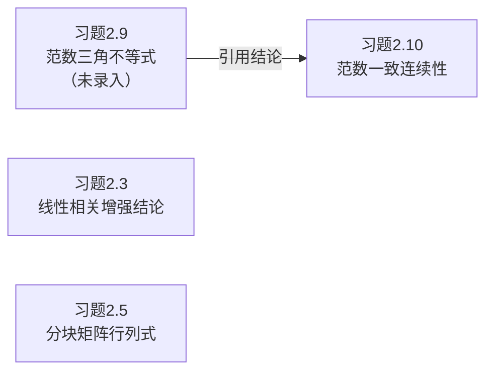

# 第2章 习题库

> **课件笔记：** [[02-向量空间与矩阵]] | **作业范围：** 2.3, 2.5, 2.10

| 题号 | 题目 | 知识点 | 状态 |
|------|------|--------|------|
| 2.3 | [[习题2.3\|线性相关性的增强结论]] | 线性相关、线性组合 | ✅ 已录入 |
| 2.5 | [[习题2.5\|分块矩阵行列式的条件]] | 分块矩阵、行列式 | ✅ 已录入 |
| 2.10 | [[习题2.10\|范数的一致连续性]] | 范数、一致连续性 | ✅ 已录入 |

---

## 依赖关系

