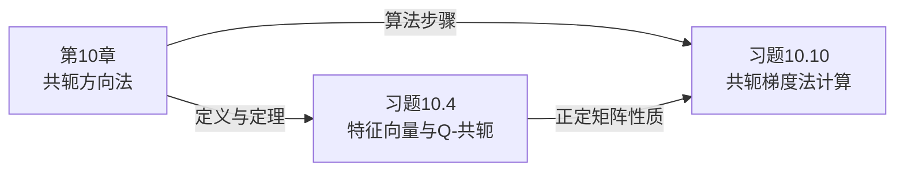

# 第10章 习题库

> **课件笔记：** [[10-共轭方向法]] | **作业范围：** 10.4, 10.10

| 题号 | 题目 | 知识点 | 状态 |
|------|------|--------|------|
| 10.4 | [[习题10.4\|特征向量与Q-共轭向量的等价关系]] | 对称矩阵、特征向量、Q-共轭、正交性 | ✅ 已录入 |
| 10.10 | [[习题10.10\|共轭梯度法求解二维二次函数]] | 共轭梯度法、二次型、精确线搜索 | ✅ 已录入 |

---

## 依赖关系

