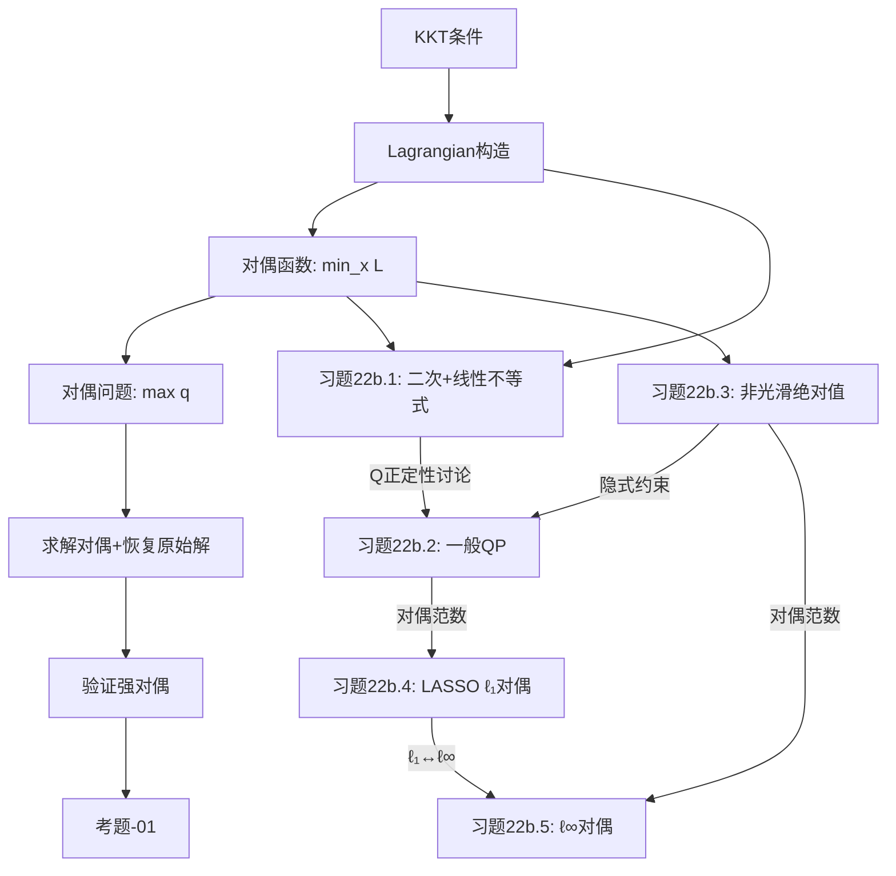

# 第22b章 习题库

> **课件笔记：** [[22b-拉格朗日对偶]] | **知识梳理：** [[../知识点解析梳理/22b-拉格朗日对偶-知识梳理|第22b章 知识梳理]] | **复习纲要：** [[../复习/VII-约束优化及求解方法|VII-约束优化]]

| 题号 | 题目 | 知识点 | 状态 |
|------|------|--------|------|
| 考题-01 | [[考题-对偶问题与原始对偶解\|写对偶问题+分析原始-对偶解]] | Lagrange对偶函数、对偶问题、强对偶验证 | ✅ 已录入 |
| 习题22b.1 | [[习题22b.1\|二次目标+线性不等式约束]] | 三步推导法、隐式约束、互补松弛 | ✅ 已录入 |
| 习题22b.2 | [[习题22b.2\|一般QP等式约束（Q正定性讨论）]] | Q正定/不正定情形、隐式对偶约束 | ✅ 已录入 |
| 习题22b.3 | [[习题22b.3\|非光滑目标+不等式约束（绝对值）]] | 分段求min、乘子不唯一 | ✅ 已录入 |
| 习题22b.4 | [[习题22b.4\|LASSO问题的对偶]] | ℓ₁→ℓ∞ 对偶范数、辅助变量分离 | ✅ 已录入 |
| 习题22b.5 | [[习题22b.5\|ℓ∞范数优化的对偶]] | LP重构法、对偶范数法（min-max） | ✅ 已录入 |

## 作业范围

本章习题覆盖拉格朗日对偶推导的核心技能：构造 Lagrangian → 求对偶函数 $\min_x \mathcal{L}$ → 写对偶问题 → 验证强对偶。从基础（二次+线性约束）到进阶（非光滑目标、LASSO、对偶范数），逐步掌握对偶推导的完整流程。

习题按难度递进：
1. **(1)** 标准凸 QP —— 练习三步推导自动化
2. **(2)** 一般 QP —— **讨论 $Q$ 正定性对推导的影响**（核心考点：$q = -\infty$ 的隐式约束机制）
3. **(3)** 非光滑目标 —— 分段分析处理绝对值函数
4. **(4)** LASSO —— ℓ₁ 正则化的对偶产生 ℓ∞ 约束（对偶范数）
5. **(5)** ℓ∞ 优化 —— 两种推导法（LP 重构 + 对偶范数）殊途同归

## 依赖关系

