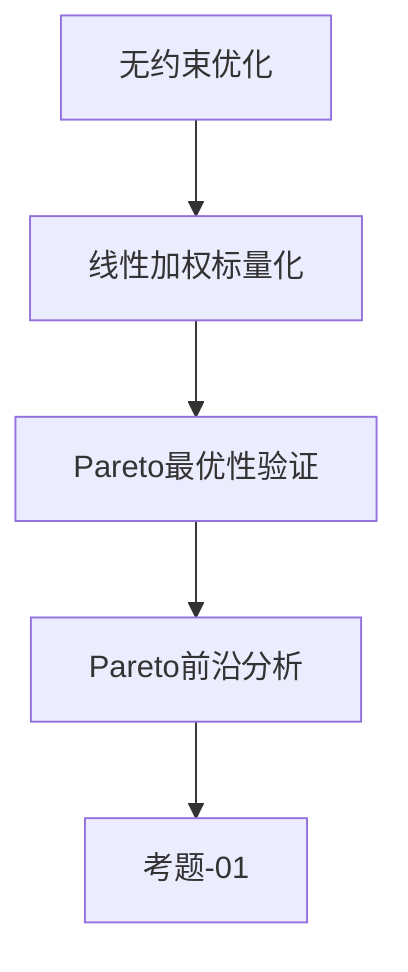

# 第24章 习题库

> **课件笔记：** [[24-多目标优化]] | **知识梳理：** [[../知识点解析梳理/24-多目标优化-知识梳理|第24章 知识梳理]] | **复习纲要：** [[../复习/VIII-多目标规划|VIII-多目标规划]]

| 题号 | 题目 | 知识点 | 状态 |
|------|------|--------|------|
| 考题-01 | [[考题-Pareto最优与线性加权法\|Pareto最优+线性加权法]] | Pareto最优性、线性加权法、Pareto前沿 | ✅ 已录入 |

## 作业范围

本章为复习纲要补充的考试型计算题，覆盖双目标优化问题的线性加权法求解、Pareto 前沿的参数化、Pareto 最优性验证。

## 依赖关系

