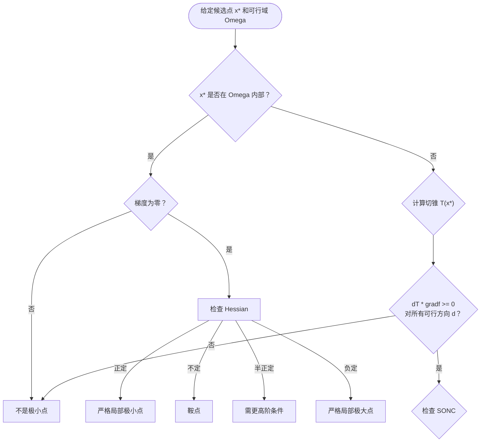
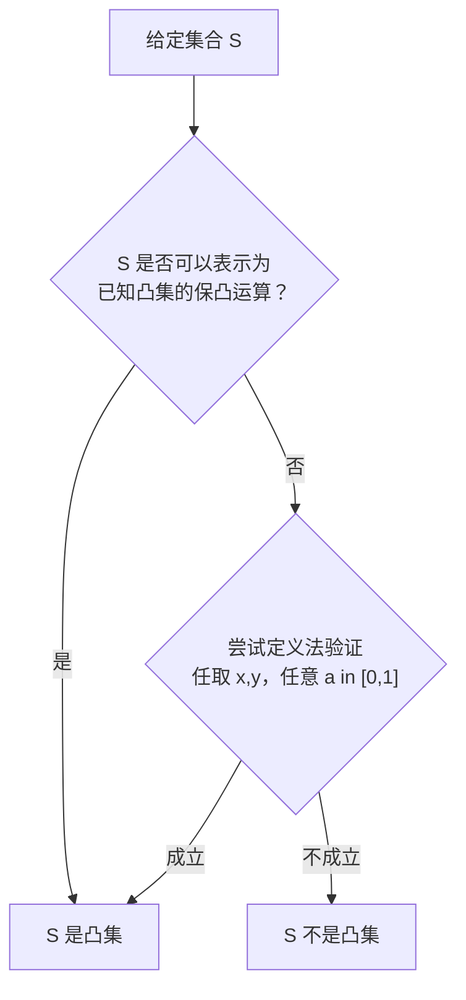
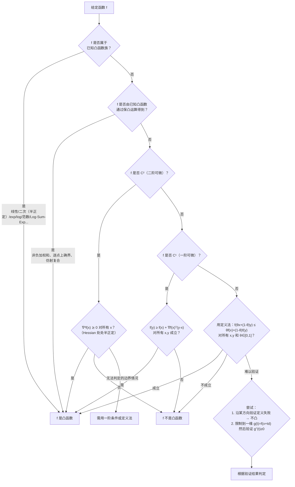

# II. 凸集与凸函数（第4-6章）

> 覆盖：第4章（几何概念）、第5章（微积分基础）、第6章（最优性条件）。这是凸优化理论和无约束优化分析的完整基础。

---

## 一、核心定义速查

### 1.1 几何基础（第4章）

#### 直线、线段与超平面

| 对象 | 定义 | 参数范围 |
|------|------|----------|
| **直线** | $L = \{a x + (1-a) y \mid a \in \mathbb{R}\}$ | $(-\infty, +\infty)$ |
| **线段** | $[x, y] = \{a x + (1-a) y \mid a \in [0, 1]\}$ | $[0, 1]$ |
| **射线** | $R = \{a x + (1-a) y \mid a \geq 0\}$ | $[0, +\infty)$ |

> 一句说清：线段是系数非负且和为 1 的组合（凸组合）；直线不要求非负；射线只在一边不要求非负。

#### 超平面

$$H = \{x \in \mathbb{R}^n \mid v^{\top}(x - a) = 0\}, \quad v \neq 0$$

- $a = 0$ 时：过原点，是子空间
- $a \neq 0$ 时：不过原点，是仿射集

**半空间**：超平面将空间一分为二：

$$H^{+} = \{x \mid v^{\top}(x - a) \geq 0\}, \quad H^{-} = \{x \mid v^{\top}(x - a) \leq 0\}$$

> 不等式约束 $Ax \leq b$ 的本质 = 要求 $x$ 落在若干半空间的交集内。

#### 线性簇

$$L = \{x \in \mathbb{R}^n \mid Ax = b\}$$

多个超平面的交集。维数 $= \dim \mathcal{N}(A)$。

---

### 1.2 凸集与保凸运算（第4章核心）

#### 凸集的定义

$S \subset \mathbb{R}^n$ 是凸集 $\iff$ 对任意 $x, y \in S$：

$$a x + (1-a) y \in S, \quad \forall a \in (0, 1)$$

> 一句说清：凸集就是"连线上没有洞"——任取两点，连线全程在集合内。

#### 常见凸集

| 集合类型 | 是否凸集 | 理由 |
|----------|:---:|------|
| 空集、单点集 | 是 | 平凡 |
| 直线、线段、子空间 | 是 | 仿射集都是凸集 |
| 超平面 | 是 | 仿射集 |
| 半空间 | 是 | 可用定义验证 |
| 多面体 $\{x \mid Ax \leq b\}$ | 是 | 半空间的交 |
| 二阶锥 $\{(x,t) \mid \|x\|_2 \leq t\}$ | 是 | 范数约束 |
| 正半定锥 $\mathbb{S}_+^n$ | 是 | 矩阵不等式 |

#### 五种保凸运算

| 运算 | 定义 | 直观理解 |
|------|------|----------|
| **数乘** | $\alpha S = \{\alpha x \mid x \in S\}$ | 均匀缩放 |
| **交集** | $S_1 \cap S_2$ | 公共区域 |
| **Minkowski 和** | $S_1 \pm S_2 = \{x_1 \pm x_2 \mid x_i \in S_i\}$ | 膨胀叠加 |
| **线性变换** | $A S = \{A x \mid x \in S\}$ | 线性映射 |
| **内部/闭包** | $\operatorname{int}(S), \operatorname{cl}(S)$ | 取内部或闭包 |

> 一句话：保凸运算是"免费"构造新凸集的工具箱——只要原材料是凸的，结果自动是凸的。

---

### 1.3 凸组合、锥组合、仿射组合（第4章核心）

三种"包"是将任意集合"变成"对应类型凸集的最小方式。

| 类型 | 离散形式（$C = \{x_i\}_{i=1}^m$） | 系数条件 | 目的 |
|------|------|----------|------|
| **凸组合/凸包** $\operatorname{conv}(C)$ | $\sum a_i x_i$ | $a_i \geq 0, \sum a_i = 1$ | 包含 $C$ 的最小凸集 |
| **锥组合/锥包** $\operatorname{cone}(C)$ | $\sum a_i x_i$ | $a_i \geq 0$ | 包含 $C$ 的最小凸锥 |
| **仿射组合/仿射包** $\operatorname{aff}(C)$ | $\sum a_i x_i$ | $\sum a_i = 1$ | 包含 $C$ 的最小仿射集 |

> 记忆口诀：凸包=非负+和为1；锥包=仅非负；仿射包=仅和为1（无非负限制）。约束越少，生成的集合越大。

**直观理解**：
- **凸包**：在点之间拉紧绷的橡皮膜
- **锥包**：从原点出发，过每个点画射线，所有射线的"扇形区域"
- **仿射包**：过所有点的最小"平面"

---

### 1.4 球、椭球与凸锥（第4章）

#### 球与椭球

| 对象 | 定义 | 参数 |
|------|------|------|
| **球** | $B(x_0, r) = \{x \mid \|x - x_0\| \leq r\}$ | $x_0$: 球心, $r$: 半径 |
| **椭球**（范数形式） | $E = \{x \mid \|x - x_0\|_{P^{-1}} \leq r\}$ | $P \succ 0$: 形状矩阵 |
| **椭球**（变换形式） | $E = \{x_0 + A u \mid \|u\| \leq r\}$ | $P = AA^\top$, $A$ 非奇异 |

> 一句说清：椭球是对球的仿射变形——在不同方向上拉长或压缩。

#### 最重要的两个凸锥

| 凸锥 | 定义 | 几何直觉 |
|------|------|----------|
| **二阶锥** | $K = \{(x, t) \mid \|x\|_2 \leq t\}$ | "冰淇淋筒"，顶点在原点 |
| **正半定锥** | $\mathbb{S}_+^n = \{A = A^\top \mid A \succeq 0\}$ | 所有半正定对称矩阵 |

---

### 1.5 极点与 Birkhoff 定理（第4章）

#### 极点的定义

$x \in S$ 是 $S$ 的极点 $\iff$ 不能表示为 $S$ 中其他两点的严格凸组合：

$$\nexists u, v \in S, u \neq v, a \in (0, 1): x = a u + (1-a) v$$

**等价刻画**：$x$ 是凸集 $S$ 的极点 $\iff$ $S \setminus \{x\}$ 仍是凸集。

> 一句说清：极点是凸集的"尖角"和"顶点"——无法被"夹在中间"。

#### 典型集合的极点

| 集合                                                       | 极点                                 |
| -------------------------------------------------------- | ---------------------------------- |
| 概率单纯形 $\{x \geq 0 \mid \sum x_i = 1\}$                   | 自然基 $e_1, \ldots, e_n$             |
| $\ell_1$-范数单位球 $\{x \mid \|x\|_1 \leq 1\}$               | $\pm e_1, \ldots, \pm e_n$（$2n$ 个） |
| $\ell_{\infty}$-范数单位球 $\{x \mid \|x\|_{\infty} \leq 1\}$ | 全部分量为 $\pm 1$ 的向量（$2^n$ 个）         |

#### Birkhoff 定理

$\Omega = \{X \in \mathbb{R}_+^{n \times n} \mid Xe = e, e^\top X = e^\top\}$（双随机矩阵集合）的极点是**置换矩阵**，共 $n!$ 个。

> 任何一个双随机矩阵都可写成若干个置换矩阵的凸组合——"Birkhoff-von Neumann 分解"。

---

### 1.6 内点、边界点、紧集与 Weierstrass 定理（第4章）

#### 三类点

| 类型 | 定义 | 直观 |
|------|------|------|
| **内点** | $\exists N(x) \subset S$ | 周围全是 $S$ |
| **边界点** | 任何 $N(x)$ 既含 $S$ 也含补集 | 站在边界上 |
| **相对内点** | $\exists N(x) \cap \operatorname{aff}(S) \subset S$ | 在仿射包内"看"是内点 |

#### 集合分类

| 类型 | 定义 | $\mathbb{R}^n$ 中 |
|------|------|---------------|
| **开集** | 每点都是内点 | 无边界 |
| **闭集** | 包含所有边界点 | 补集是开集 |
| **紧集** | 有界 + 闭集 | Weierstrass 结论成立的前提 |

#### Weierstrass 定理

> 若 $\Omega \subset \mathbb{R}^n$ 是紧集，$f: \Omega \to \mathbb{R}$ 连续，则 $\exists x_0 \in \Omega$ 使得 $f(x_0) = \min_{x \in \Omega} f(x)$。

> 一句说清：紧集 + 连续函数 $\Rightarrow$ 最小值一定存在。这是"最优解存在性"的数学保证。

**注意**：这只保证存在性，不保证唯一性。唯一性需要额外条件（严格凸性、下半连续性、强制性等）。

---

### 1.7 支撑超平面与多面体（第4章）

#### 支撑超平面

设 $S$ 为凸集，$x \in \operatorname{bd}(S)$。过 $x$ 的超平面 $H$ 若使 $S$ 完全位于 $H$ 的一侧，则 $H$ 是 $S$ 在 $x$ 处的**支撑超平面**。

> 一句说清：支撑超平面是"贴着"凸集边界的超平面——整个凸集在一侧。这是分离定理的前身，而分离定理是 Lagrange 对偶理论的几何核心。

#### 多面体与多胞体

| 术语 | 定义 | 有界？ |
|------|------|:---:|
| **多面体** | $S = \{x \mid Ax \leq b\}$（有限个半空间的交） | 不一定 |
| **多胞体** | 非空且有界的多面体 | 一定 |

---

### 1.8 局部/全局极小点（第6章）

| 类型 | 定义 | 关键特征 |
|------|------|----------|
| **局部极小点** | $\exists \delta > 0, \forall x \in \Omega \cap B(x^*, \delta): f(x) \geq f(x^*)$ | 只在邻域内最小 |
| **全局极小点** | $\forall x \in \Omega: f(x) \geq f(x^*)$ | 整个可行域内最小 |
| **严格局部极小点** | 上述"$\geq$"改为"$>$" | 邻域内唯一最小 |
| **严格全局极小点** | 上述"$\geq$"改为"$>$" | 全域唯一最小 |

> 全局极小点一定是局部极小点；反之不成立。但凸优化中局部极小 = 全局极小！

---

### 1.9 可行方向与切锥（第6章）

#### 可行方向

从 $x$ 出发沿 $d$ 走一小步仍落在 $\Omega$ 内：

$$\exists \alpha_0 > 0, \forall \alpha \in [0, \alpha_0]: x + \alpha d \in \Omega$$

#### 切锥 $\mathcal{T}(x)$ 的计算公式

**等式约束** $\Omega = \{x \mid h_i(x) = 0\}$：

$$\mathcal{T}(x) = \{d \in \mathbb{R}^n \mid Dh(x) d = 0\} \quad \text{（子空间）}$$

**不等式约束** $\Omega = \{x \mid g_j(x) \leq 0\}$：

$$\mathcal{T}(x) = \{d \in \mathbb{R}^n \mid Dg_j(x) d < 0, j \in \mathcal{J}(x)\} \quad \text{（开锥）}$$

其中 $\mathcal{J}(x) = \{j \mid g_j(x) = 0\}$ 是**积极约束集**。

**混合约束**（$h_i = 0$, $g_j \leq 0$）：

$$\mathcal{T}(x) = \{d \mid Dh(x)d = 0, \; Dg_j(x)d < 0, \; j \in \mathcal{J}(x)\}$$

> 核心口诀：**"积极约束才有发言权，$Dg \cdot d < 0$ 指向可行侧。"**

#### 切锥计算示例（第一象限）

$\Omega = \{x \in \mathbb{R}^2 \mid x_1 \geq 0, x_2 \geq 0\}$：

| 点 | 积极约束 | 切锥 $\mathcal{T}(x)$ |
|----|---------|---------------------|
| $[1, 3]^\top$（内部） | 无 | $\mathbb{R}^2$ |
| $[0, 3]^\top$（边界） | $-x_1 \leq 0$ | $\{d \mid d_1 > 0\}$ |
| $[0, 0]^\top$（角点） | 两个 | $\{d \mid d_1 > 0, d_2 > 0\}$ |

---

### 1.10 凸函数（第4章 + 跨章）

#### 凸函数的定义

$f$ 是凸函数 $\iff \forall x, y \in \operatorname{dom}(f), \forall a \in [0, 1]$：

$$f(a x + (1-a) y) \leq a f(x) + (1-a) f(y)$$

#### 凸函数的分类

| 类型 | 条件 |
|------|------|
| **凸** | $f(a x + (1-a) y) \leq a f(x) + (1-a) f(y)$ |
| **严格凸** | 上述"$\leq$"改为"$<$"，且 $x \neq y$ |
| **强凸** | $f - \frac{m}{2}\|\cdot\|^2$ 仍是凸函数（存在 $m > 0$） |
| **拟凸** | 下水平集 $\{x \mid f(x) \leq \alpha\}$ 都是凸集 |

#### 凸函数的判定方法

| 方法 | 条件 |
|------|------|
| **定义法** | 直接验证 $f(a x + (1-a) y) \leq a f(x) + (1-a) f(y)$ |
| **一阶条件**（$f \in C^1$） | $f(y) \geq f(x) + \nabla f(x)^\top (y - x)$ |
| **二阶条件**（$f \in C^2$） | $\nabla^2 f(x) \succeq 0$（Hessian 处处半正定） |
| **保凸运算** | 凸函数的非负加权和、逐点上确界、与仿射函数的复合等 |

---

### 1.11 下降方向（第6章）

$d$ 是 $f$ 在 $x$ 处的**下降方向** $\iff$ $\nabla f(x)^\top d < 0$。

> 负梯度方向 $\nabla f(x)$ 是最速下降方向——沿此方向的一阶变化率最大（绝对值）。

---

### 1.12 梯度、Jacobian、Hessian（第5章核心）

#### 三种尺度的导数

| 函数类型 | 导数 | 形状 | 本质 |
|----------|------|------|------|
| $f: \mathbb{R} \to \mathbb{R}$ | $f'(x_0)$ | 标量 | 切线斜率 |
| $f: \mathbb{R}^n \to \mathbb{R}$ | $\nabla f(x_0)$ | $n \times 1$ 向量 | 最速上升方向 |
| $f: \mathbb{R}^n \to \mathbb{R}^m$ | $Df(x_0)$（Jacobian） | $m \times n$ 矩阵 | 各分量梯度的堆叠 |

#### 梯度

$$\nabla f(x) = \begin{bmatrix} \frac{\partial f}{\partial x_1} & \frac{\partial f}{\partial x_2} & \cdots & \frac{\partial f}{\partial x_n} \end{bmatrix}^\top$$

> 梯度三重角色：(1) 代数：各偏导数组成的向量；(2) 几何：水平集的法向量；(3) 优化：最速上升方向。

#### Jacobian 矩阵

$$Df(x) = \begin{bmatrix}
\frac{\partial f_1}{\partial x_1} & \cdots & \frac{\partial f_1}{\partial x_n} \\
\vdots & \ddots & \vdots \\
\frac{\partial f_m}{\partial x_1} & \cdots & \frac{\partial f_m}{\partial x_n}
\end{bmatrix} \in \mathbb{R}^{m \times n}$$

> 第 $i$ 行是第 $i$ 个分量函数 $f_i$ 的梯度（行向量）。

#### Hessian 矩阵

$f: \mathbb{R}^n \to \mathbb{R}$ 的 Hessian 是梯度的 Jacobian：

$$\nabla^2 f(x) = D(\nabla f)(x) = \begin{bmatrix}
\frac{\partial^2 f}{\partial x_i \partial x_j}
\end{bmatrix} \in \mathbb{R}^{n \times n}$$

> 一句说清：Hessian = "梯度的梯度" = 函数在各方向上的曲率。若 $f \in C^2$，Hessian 对称（Schwarz 定理）。

---

### 1.13 方向导数、链式法则与 Taylor 展开（第5章）

#### 方向导数

$$\frac{\partial f}{\partial d} = \lim_{\alpha \to 0} \frac{f(x + \alpha d) - f(x)}{\alpha}$$

可微时简化为：$\frac{\partial f}{\partial d} = \nabla f(x)^\top d$。

| $\nabla f(x)^\top d$ | 含义 |
|----------------------|------|
| $> 0$ | 沿 $d$ 方向上升 |
| $< 0$ | 沿 $d$ 方向下降 |
| $= 0$ | 沿 $d$ 方向一阶不变 |

#### 链式法则

$h(x) = g(f(x))$，$f: \mathbb{R}^n \to \mathbb{R}^m$，$g: \mathbb{R}^m \to \mathbb{R}^p$：

$$Dh(x) = Dg(f(x)) \cdot Df(x), \quad Dh \in \mathbb{R}^{p \times n}$$

> 维度自动对齐：$p \times n = (p \times m) \cdot (m \times n)$。

#### 多元 Taylor 展开

**一阶展开**：

$$f(x) \approx f(x_0) + \nabla f(x_0)^\top (x - x_0)$$

**二阶展开**：

$$f(x) \approx f(x_0) + \nabla f(x_0)^\top (x - x_0) + \frac{1}{2} (x - x_0)^\top \nabla^2 f(x_0) (x - x_0)$$

| 展开阶数 | 优化作用 |
|----------|----------|
| 一阶 | 梯度下降的方向和步长 |
| 二阶 | Newton 法的迭代公式 + FONC/SONC/SOSC 推导 |

---

### 1.14 水平集与梯度的关系（第5章）

**水平集**：$S_c = \{x \in \mathbb{R}^n \mid f(x) = c\}$（"等高线"）

**核心几何事实**：$\nabla f(x_0)$ 是水平集 $S = \{x \mid f(x) = f(x_0)\}$ 上过 $x_0$ 的**法向量**——即梯度垂直于水平集的切线。

> 证明：设 $x(t)$ 是水平集上过 $x_0$ 的曲线，$f(x(t)) = f(x_0)$ 恒成立，两边对 $t$ 求导得 $\nabla f(x(t))^\top x'(t) = 0$。

---

## 二、核心定理

### 2.1 凸集定理

**保凸运算定理**：凸集的数乘、交集、Minkowski 和、线性变换、内部、闭包均为凸集。

**凸集分离定理**：两个不相交的凸集可以由一个超平面分离。这是 Lagrange 对偶的几何基础。

### 2.2 凸函数的保凸运算

| 运算 | 条件 | 结果 |
|------|------|------|
| 非负加权和 | $f_i$ 凸，$w_i \geq 0$ | $\sum w_i f_i$ 凸 |
| 与仿射函数的复合 | $f$ 凸 | $f(Ax + b)$ 凸 |
| 逐点上确界 | $\{f_\alpha\}$ 是凸函数族 | $\sup_\alpha f_\alpha$ 凸 |

### 2.3 凸优化的核心定理

> **局部最优 = 全局最优**：若 $f$ 是凸函数，$\Omega$ 是凸集，则 $f$ 在 $\Omega$ 上的任意局部极小点必是全局极小点。

### 2.4 凸函数的一阶特征（$f \in C^1$）

$f$ 是凸函数 $\iff f(y) \geq f(x) + \nabla f(x)^\top (y - x), \; \forall x, y$

> 一句说清：凸函数的图始终在其切平面之上——这是梯度不等式。

### 2.5 凸函数的二阶特征（$f \in C^2$）

$f$ 是凸函数 $\iff \nabla^2 f(x) \succeq 0, \; \forall x$（Hessian 处处半正定）。

> 严格凸：$\nabla^2 f(x) \succ 0$ 是充分条件（不是必要条件，如 $f(x) = x^4$）。

### 2.6 最优性条件（第6章）

#### 一阶必要条件（FONC）

$f \in C^1$，$x^*$ 是局部极小点：

$$d^\top \nabla f(x^*) \geq 0, \quad \forall d \in \mathcal{T}(x^*)$$

**特殊情形**：

| 情形                                       | 结论                  |
| ---------------------------------------- | ------------------- |
| $x^* \in \operatorname{int}(\Omega)$（内点） | $\nabla f(x^*) = 0$ |
| $\Omega = \mathbb{R}^n$（无约束）             | $\nabla f(x^*) = 0$ |

> 证明：Taylor 展开 $f(x^* + \alpha d) = f(x^*) + \alpha \nabla f(x^*)^\top d + o(\alpha)$。若极小，$\alpha \to 0$ 时 $\nabla f(x^*)^\top d \geq 0$。

#### 二阶必要条件（SONC）

$f \in C^2$，$x^*$ 是局部极小点，$d$ 是可行方向且 $d^\top \nabla f(x^*) = 0$：

$$d^\top \nabla^2 f(x^*) d \geq 0$$

**内点/无约束特殊情形**：$\nabla f(x^*) = 0$ 且 $\nabla^2 f(x^*) \succeq 0$。

#### 二阶充分条件（SOSC）

$f \in C^2$，$x^* \in \operatorname{int}(\Omega)$：

$$\nabla f(x^*) = 0 \quad \text{且} \quad \nabla^2 f(x^*) \succ 0 \;\Longrightarrow\; x^* \text{ 是严格局部极小点}$$

| Hessian 条件 | 结论 |
|-------------|------|
| $\nabla^2 f(x^*) \succ 0$（正定） | 严格局部极小 |
| $\nabla^2 f(x^*) \prec 0$（负定） | 严格局部极大 |
| $\nabla^2 f(x^*)$ 不定 | 鞍点 |
| $\nabla^2 f(x^*) \succeq 0$（半正定） | 无法判断 |
| $\nabla^2 f(x^*) \preceq 0$（半负定） | 无法判断 |

### 2.7 矩阵序列收敛性

- $\lim_{k \to \infty} A^k = 0 \iff \rho(A) < 1$
- $\sum_{k=0}^{\infty} A^k = (I - A)^{-1}$（Neumann 引理，$\rho(A) < 1$ 时）

### 2.8 矩阵值函数的连续性

若 $F(x)$ 在 $x_0$ 处连续且 $F(x_0)$ 可逆，则存在邻域内 $F(x)$ 也可逆，且 $[F(\cdot)]^{-1}$ 在 $x_0$ 处连续。

### 2.9 向量值函数的可微性

$f$ 在 $x_0$ 处可微 $\iff$ 存在线性映射 $L$ 使：

$$\lim_{x \to x_0} \frac{\|f(x) - [f(x_0) + L(x - x_0)]\|}{\|x - x_0\|} = 0$$

---

## 三、计算要点

### 3.1 计算梯度、Jacobian、Hessian

**常用标量函数的梯度**：

| $f(x)$ | $\nabla f(x)$ |
|--------|---------------|
| $a^\top x$ | $a$ |
| $\|x\|^2 = x^\top x$ | $2x$ |
| $\frac{1}{2} x^\top A x$（$A$ 对称） | $A x$ |
| $x^\top A x$（$A$ 对称） | $2A x$ |
| $\|Ax - b\|^2 / 2$ | $A^\top (Ax - b)$ |

**常见函数的链式法则运用**：

| $f(x)$ | $\nabla f(x)$ |
|--------|---------------|
| $f = \frac{1}{2}\|Ax - b\|^2$ | $A^\top(Ax - b)$ |
| $f = \varphi(x_0 + t d)$（$t$ 变量） | $f'(t) = \nabla \varphi(x_0 + t d)^\top d$ |
| $f = (a^\top x)(b^\top x)$ | $(b^\top x)a + (a^\top x)b$ |
| $f = e^{x^\top A x}$（$A$ 对称） | $2e^{x^\top A x} Ax$ |

**自检方法**：算完梯度后，验证在驻点处梯度为零。

**Hessian 计算要点**：
- 对梯度再求一次导（每维对每维求偏导）
- $C^2$ 函数 Hessian 自动对称
- 二次函数 $f(x) = \frac{1}{2}x^\top Q x + c^\top x + d$ 的 Hessian 为常数矩阵 $Q$

**计算示例**：$f(x) = 5x_1 + 8x_2 + x_1 x_2 - 4x_1^2 - 8x_2^2$

$$\nabla f(x) = \begin{bmatrix} 5 + x_2 - 8x_1 \\ 8 + x_1 - 16x_2 \end{bmatrix}, \quad \nabla^2 f(x) = \begin{bmatrix} -8 & 1 \\ 1 & -16 \end{bmatrix}$$

> Hessian 是常数矩阵（因为是二次函数），负定 $\Rightarrow$ 只有极大点。

### 3.2 计算方向导数

可微时：$\frac{\partial f}{\partial d} = \nabla f(x)^\top d$（梯度与方向的内积）。

> 最速下降方向：$d = -\nabla f(x) / \|\nabla f(x)\|$，此时方向导数 $= -\|\nabla f(x)\|$。

### 3.3 计算 Taylor 展开

**一阶展开公式**：

$$f(x_0 + \Delta x) \approx f(x_0) + \nabla f(x_0)^\top \Delta x$$

**二阶展开公式**：

$$f(x_0 + \Delta x) \approx f(x_0) + \nabla f(x_0)^\top \Delta x + \frac{1}{2} \Delta x^\top \nabla^2 f(x_0) \Delta x$$

> 注意记住 $\frac{1}{2}$ 系数（来自 $1/2!$）。

### 3.4 判断集合是否为凸集

**方法一：定义法** — 任取两点，验证其凸组合是否仍在集合内。

**方法二：保凸运算法** — 将集合表示为已知凸集通过保凸运算的结果。

**方法三：凸函数水平集法** — 若 $S = \{x \mid f(x) \leq c\}$，$f$ 是凸函数，则 $S$ 是凸集。

**常见判定步骤**：
1. 如果是半空间的交 $\{x \mid Ax \leq b\}$ $\Rightarrow$ 凸（多面体）
2. 如果是二次不等式 $\{x \mid x^\top A x + b^\top x + c \leq 0, A \succeq 0\}$ $\Rightarrow$ 凸
3. 如果是范数约束 $\{(x, t) \mid \|x\|_2 \leq t\}$ $\Rightarrow$ 凸（二阶锥）

### 3.5 验证投影的定义及特点

投影算子满足：$P = P^\top = P^2$（对称 + 幂等）。

投影到仿射集（如超平面）的公式：找到法向量，用内积计算投影长度。

---

## 四、典型判断题

### 4.1 判断集合是否为凸集

> 复习纲要中的典型题：

**题 1**：$C = \{(x, t) \in \mathbb{R}^n \times \mathbb{R} \mid \|x\|_2 \leq t\}$

**答案**：是凸集。这是二阶锥（second-order cone / Lorentz cone / ice-cream cone）的定义。等价于验证：对于任意 $(x_1, t_1), (x_2, t_2) \in C$ 和 $\theta \in [0, 1]$：
$$\|\theta x_1 + (1-\theta) x_2\|_2 \leq \theta \|x_1\|_2 + (1-\theta) \|x_2\|_2 \leq \theta t_1 + (1-\theta) t_2$$
所以 $(\theta x_1 + (1-\theta) x_2, \theta t_1 + (1-\theta) t_2) \in C$。

**题 2**：$C = \{X \in \mathbb{R}^{n \times n} \mid X \text{ 是对称正定矩阵}\}$

**答案**：是凸集。对称正定矩阵集合是半正定锥 $\mathbb{S}_+^n$ 的内部，而半正定锥是凸锥。取 $X, Y \succ 0$，$\theta \in [0, 1]$，则对任意 $z \neq 0$：
$$z^\top (\theta X + (1-\theta) Y) z = \theta z^\top X z + (1-\theta) z^\top Y z > 0$$
凸组合仍正定。

**题 3**：$C = \{x \in \mathbb{R}^2 \mid e^{-x_1 - x_2} = 0\}$

**答案**：不是凸集。因为 $e^{-x_1 - x_2} > 0$ 对所有 $(x_1, x_2)$，该方程无解——集合为空集。而空集是凸集（平凡）。**等考：** 此题是"空集"——空集凸。若题目本意是 $\{x \mid e^{-x_1 - x_2} \leq 0\}$，同样为空集。

> 变换解读：实际上 $e^{-s} = 0$ 无实数解，所以 $C = \emptyset$（凸）。这是考你是否注意到集合定义隐含着空集。

### 4.2 判断函数是否为凸函数

**题 1**：$f(x, y) = x$，其中 $x, y \in \mathbb{R}$

**答案**：是凸函数。线性函数既是凸函数也是凹函数。$\nabla^2 f = 0 \succeq 0$（半正定）。

**题 2**：$f(x, y) = \log(e^x + e^y)$，其中 $x, y \in \mathbb{R}$

**答案**：是凸函数。这是 Log-Sum-Exp 函数（softmax 的对数版本），是凸函数的标准例子。可以验证 Hessian：
$$\nabla^2 f(x, y) = \frac{e^x e^y}{(e^x + e^y)^2} \begin{bmatrix} 1 & -1 \\ -1 & 1 \end{bmatrix}$$
该矩阵的特征值为 0 和 $\frac{2 e^x e^y}{(e^x + e^y)^2} \geq 0$，半正定。

**题 3**：$f(x, y) = -\sqrt{xy}$，其中 $x, y \in \mathbb{R}$

**答案**：不是凸函数（在定义域内 $\nabla^2 f$ 不定）。注意定义域要求 $xy \geq 0$（即第一、三象限）。在定义域内，二次型可能为正也可能为负。实际上 $-\sqrt{xy}$ 是几何平均的负值——几何平均是凹函数，取负后是凸的，但只在 $x \geq 0, y \geq 0$ 定义域内。严格来说需检验 Hessian。

更简单的判断：检验一阶条件。取 $(1, 1)$ 和 $(4, 4)$，$f(1,1) = -1$，$f(4,4) = -4$。

中点 $(2.5, 2.5)$：$f(2.5, 2.5) = -2.5$，$\frac{-1 + (-4)}{2} = -2.5$。取 $(0.01, 100)$ 和 $(100, 0.01)$，中点 $(50.005, 50.005)$，$f = -\sqrt{2500.5} \approx -50.005$，而 $\frac{f(0.01,100) + f(100,0.01)}{2} = \frac{-1 + (-1)}{2} = -1$。由于 $-50.005 < -1$，不满足凸性（凸函数要求 $f(\frac{x+y}{2}) \leq \frac{f(x)+f(y)}{2}$，而这里是 $< -1$ 即小于中点值，不满足）。实际上令 $d = (1, -1)$，沿 $t(1, -1)$ 方向，函数无定义（$xy < 0$），这说明定义域不是整个 $\mathbb{R}^2$。在第一象限内，Hessian：

$$\nabla f = -\frac{1}{2}\begin{bmatrix} \sqrt{y/x} \\ \sqrt{x/y} \end{bmatrix}, \quad \nabla^2 f = \frac{1}{4x^{3/2}y^{1/2}} \begin{bmatrix} y - x & 2\sqrt{xy} \\ 2\sqrt{xy} & x - y \end{bmatrix}$$

Hessian 不定，函数在定义域内非凸。

---

## 五、判定/决策流程

**凸集判定决策流程**：

**凸函数判定决策流程**：

> **使用优先级**：保凸运算 > 二阶条件（最省力）> 一阶条件 > 定义法（最后手段）。如果二阶可微，直接算 Hessian 看是否半正定——一道题通常 30 秒解决。

---

## 六、核心公式速查表

| 概念          | 公式                                                                                             | 备注                                                                        |          |
| ----------- | ---------------------------------------------------------------------------------------------- | ------------------------------------------------------------------------- | -------- |
| 凸集定义        | $a x + (1-a) y \in S, \forall a \in (0,1)$                                                     | 连线全在集合内                                                                   |          |
| 凸包          | $\operatorname{conv}(C) = \{\sum a_i x_i \mid a_i \geq 0, \sum a_i = 1\}$                      | 非负 + 和为1                                                                  |          |
| 锥包          | $\operatorname{cone}(C) = \{\sum a_i x_i \mid a_i \geq 0\}$                                    | 仅非负                                                                       |          |
| 仿射包         | $\operatorname{aff}(C) = \{\sum a_i x_i \mid \sum a_i = 1\}$                                   | 仅和为1                                                                      |          |
| 超平面         | $H = \{x \mid v^\top (x - a) = 0\}$                                                            | $v \neq 0$（法向量）                                                           |          |
| 多面体         | $S = \{x \mid Ax \leq b\}$                                                                     | 有限半空间交                                                                    |          |
| 二阶锥         | $K = \{(x,t) \mid \|x\|_2 \leq t\}$                                                            | 冰淇淋筒                                                                      |          |
| 二阶锥（等价形式）   | $K = \left\{(x,t) \;\middle                                                                    | \; \begin{bmatrix} t I & x \\ x^\top & t \end{bmatrix} \succeq 0\right\}$ | SDP 等价表达 |
| 正半定锥        | $\mathbb{S}_+^n = \{A = A^\top \mid A \succeq 0\}$                                             | 半正定对称矩阵                                                                   |          |
| 凸函数定义       | $f(\theta x + (1-\theta)y) \leq \theta f(x) + (1-\theta) f(y)$                                 | $\theta \in [0,1]$                                                        |          |
| 凸函数一阶条件     | $f(y) \geq f(x) + \nabla f(x)^\top (y - x)$                                                    | 图在切平面之上                                                                   |          |
| 凸函数二阶条件     | $\nabla^2 f(x) \succeq 0, \forall x$                                                           | Hessian 处处半正定                                                             |          |
| 可行方向        | $\exists \alpha_0 > 0: x + \alpha d \in \Omega, \forall \alpha \in [0, \alpha_0]$              | 走一小步仍是可行                                                                  |          |
| 等式约束切锥      | $\mathcal{T}(x) = \{d \mid Dh(x) d = 0\}$                                                      | 子空间                                                                       |          |
| 不等式约束切锥     | $\mathcal{T}(x) = \{d \mid Dg_j(x) d < 0, j \in \mathcal{J}(x)\}$                              | 开锥                                                                        |          |
| 积极约束集       | $\mathcal{J}(x) = \{j \mid g_j(x) = 0\}$                                                       | 刚好取等的约束                                                                   |          |
| 方向导数        | $\frac{\partial f}{\partial d} = \nabla f(x)^\top d$                                           | 可微时                                                                       |          |
| FONC        | $d^\top \nabla f(x^*) \geq 0, \forall d \in \mathcal{T}(x^*)$                                  | 必要条件                                                                      |          |
| FONC（内点）    | $\nabla f(x^*) = 0$                                                                            | 梯度为零                                                                      |          |
| SONC（内点）    | $\nabla f(x^*) = 0, \nabla^2 f(x^*) \succeq 0$                                                 | 必要条件                                                                      |          |
| SOSC（内点）    | $\nabla f(x^*) = 0, \nabla^2 f(x^*) \succ 0$                                                   | 充分条件                                                                      |          |
| 一阶 Taylor   | $f(x) \approx f(x_0) + \nabla f(x_0)^\top (x - x_0)$                                           | 线性逼近                                                                      |          |
| 二阶 Taylor   | $f(x) \approx f(x_0) + \nabla f^\top \Delta x + \frac{1}{2} \Delta x^\top \nabla^2 f \Delta x$ | 二次逼近                                                                      |          |
| 梯度-水平集关系    | $\nabla f(x_0) \perp$ 水平集切线                                                                    | 法向量                                                                       |          |
| Weierstrass | $\min_{x \in \Omega} f(x)$ 存在                                                                  | $\Omega$ 紧 + $f$ 连续                                                       |          |
| Neumann 引理  | $\sum_{k=0}^{\infty} A^k = (I - A)^{-1}$                                                       | $\rho(A) < 1$                                                             |          |
| 谱半径-矩阵幂     | $\lim_{k \to \infty} A^k = 0 \iff \rho(A) < 1$                                                 | 迭代收敛条件                                                                    |          |

---

## 七、典型易错点

> [!warning] 必要条件 vs 充分条件
> - **FONC、SONC 是必要条件**：满足不一定是最小点（如 $f(x) = x^3$ 在 $x=0$ 处）
> - **SOSC 是充分条件**：满足一定是最小点，但最小点不一定满足（边界点除外）

> [!warning] 边界点不能用 $\nabla f(x^*) = 0$
> 当 $x^*$ 在可行域边界时，必须使用 FONC：$d^\top \nabla f(x^*) \geq 0$ 对所有可行方向成立。

> [!warning] Hessian 半正定 $\neq$ 极小点
> $\nabla^2 f(x^*) \succeq 0$ 只是**必要条件**。例如 $f(x) = x^3$ 在 $x=0$ 处 $f''(0) = 0$（半正定），但不是极小点。

> [!warning] 凸集 $\neq$ "看起来没凹陷"
> 凸集必须满足**任意两点**的连线都在集合内。例如圆盘去掉圆心不是凸集——直径两端点的中点（圆心）不在集合内。

> [!warning] 极点 $\neq$ 边界点
> 圆的边界上每个点都是边界点，但圆盘没有极点——因为圆盘内每个点都可以写成其他两点的凸组合。

> [!warning] Weierstrass 定理条件不可少
> 需要**紧集（有界 + 闭集）+ 连续函数**同时成立。开区间或半无穷区间上最小值可能不存在。

> [!warning] 仿射包 $\neq$ 凸包
> 仿射包不要求系数非负，可延伸到无穷远。$\{a_i \geq 0\}$ 区分了凸包和仿射包。

> [!warning] 链式法则的维度匹配
> $h(x) = g(f(x))$，$f: \mathbb{R}^n \to \mathbb{R}^m$，$g: \mathbb{R}^m \to \mathbb{R}^p$。则 $Dh = Dg \cdot Df$，$p \times n = (p \times m) \cdot (m \times n)$。维度自动对齐。

> [!warning] $\mathbb{R}^n$（$n \geq 2$）没有单调性
> 不能用"单调有界必收敛"。在 $\mathbb{R}^n$ 中要用 Bolzano-Weierstrass（有界序列有收敛子列）。

> [!warning] 梯度是列向量，但内积用行向量
> $\nabla f$ 是列向量，一阶 Taylor 用 $\nabla f(x_0)^\top (x - x_0)$——转置后是行向量乘列向量。

> [!warning] 二阶 Taylor 的 $\frac{1}{2}$ 因子
> 二阶项是 $\frac{1}{2} (x - x_0)^\top \nabla^2 f(x_0) (x - x_0)$，系数来自 $1/2!$。忘记这系数是常见错误。

> [!warning] 凸函数局部最优 = 全局最优
> 前提是 $f$ 是凸函数**且** $\Omega$ 是凸集。两者缺一不可。

> [!warning] 切锥的严格不等式
> 课件中不等式约束的切锥用 $Dg_j(x) d < 0$（严格小于），与经典定义（含等号）略有不同。

---

## 八、相关知识点梳理

| 链接                              | 内容                                                  | 为什么看                            |
| ------------------------------- | --------------------------------------------------- | ------------------------------- |
| [[../知识点解析梳理/04-几何概念-知识梳理]]     | 凸集、凸包、极点、支撑超平面、多面体、Weierstrass定理                    | 本章几何部分的完整知识梳理                   |
| [[../知识点解析梳理/05-微积分基础-知识梳理]]    | 序列与极限、连续性、可微性、梯度/Jacobian/Hessian、链式法则、水平集、Taylor展开 | 本章微积分部分的完整知识梳理                  |
| [[../知识点解析梳理/06-最优性条件-知识梳理]]    | FONC/SONC/SOSC、可行方向、切锥                              | 本章最优性条件部分的完整知识梳理                |
| [[../知识点解析梳理/02-向量空间与矩阵-知识梳理]]  | 子空间、内积、范数                                           | 超平面和线性簇是子空间/仿射集的特例；梯度与方向的内积依赖于此 |
| [[../知识点解析梳理/03-线性代数基础-知识梳理]]   | 特征值、正定性、Rayleigh不等式                                 | Hessian正定性判定依赖于此                |
| [[../知识点解析梳理/08-梯度方法-知识梳理]]     | 最速下降法                                               | 负梯度方向 = 最速下降方向（本章方向导数的直接应用）     |
| [[../知识点解析梳理/20-等式约束优化问题-知识梳理]] | Lagrange乘子法                                         | 切锥 + FONC $\to$ KKT条件的推导        |
| [[../知识点解析梳理/22a-凸优化问题-知识梳理]]   | 凸优化理论                                               | 凸集+凸函数 $\to$ 局部极小=全局极小          |

---

## 九、常考证明

1. **凸函数的局部极小点必是全局极小点**：反证法。设 $x^*$ 不是全局极小点，则 $\exists y$ 使 $f(y) < f(x^*)$。由凸性，连线上中间点比端点小 $\to$ 任何邻域内都有比 $x^*$ 更小的点，矛盾。

2. **最速下降方向是负梯度方向**：对 $\|d\| = 1$，$\nabla f(x)^\top d \leq \|\nabla f(x)\| \|d\| = \|\nabla f(x)\|$（Cauchy-Schwarz），等号当 $d = \nabla f(x)/\|\nabla f(x)\|$。所以梯度方向是最大上升方向，负梯度是最大下降方向。

---

## 十、作业与练习

- [[../习题库/04-几何概念/README|第4章习题库]] — 重点：凸集判定（习题4.3）
- [[../习题库/05-微积分基础/README|第5章习题库]] — 重点：梯度/Hessian计算（5.3）、链式法则（5.6）
- [[../习题库/06-最优性条件/README|第6章习题库]] — 重点：SONC应用（6.16）、切锥计算（6.2）、FONC验证（6.10）、综合判断（6.19）
