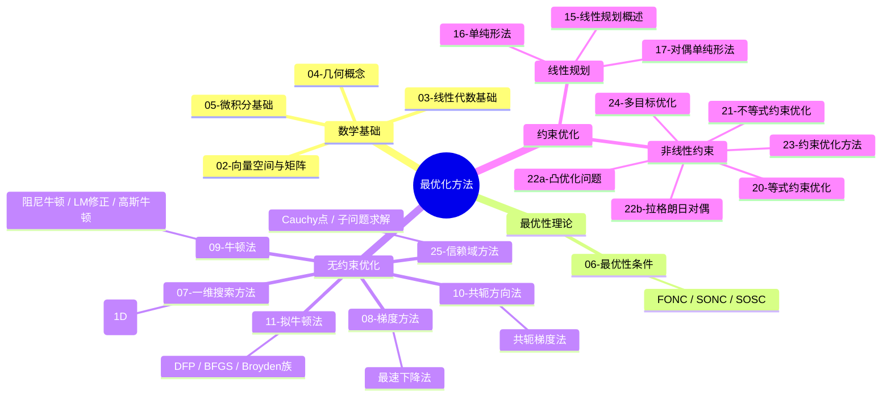
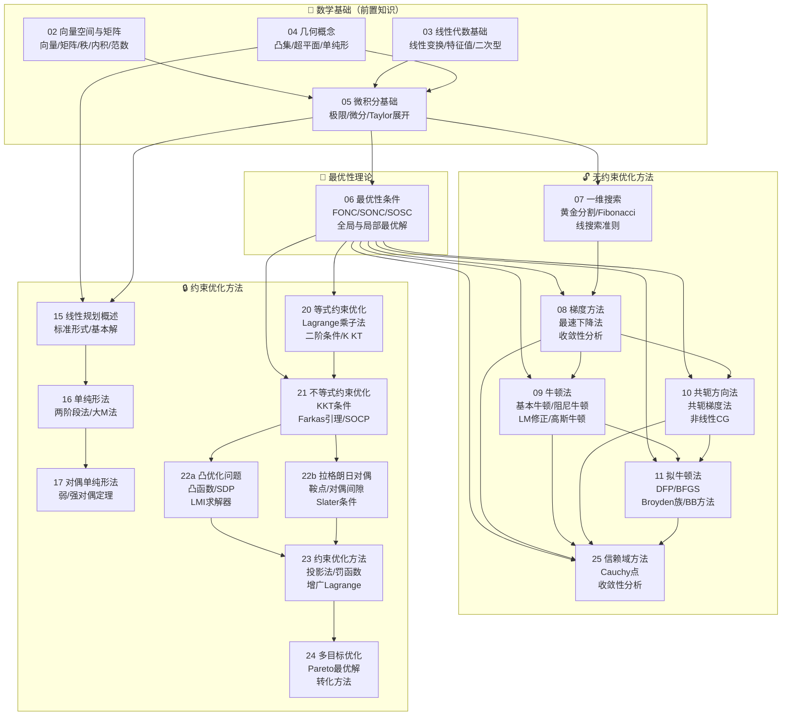
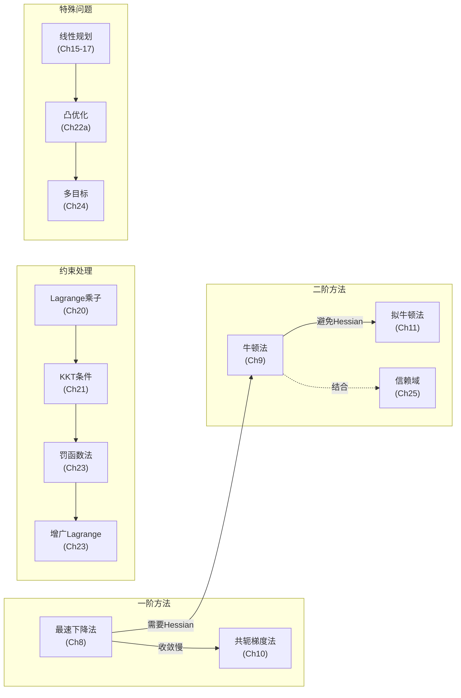

# 最优化方法 - 知识关系图谱

> 授课：张文星（电子科技大学） | 共 20 章

---

## 一、课程结构总览（思维导图）

---

## 二、章节依赖关系（流程图）

---

## 三、方法演进脉络

---

## 四、核心概念对照表

| 领域 | 核心概念 | 相关章节 |
|------|----------|----------|
| **梯度** | $\nabla f(x)$, Jacobian | Ch5, Ch8 |
| **Hessian** | $\nabla^2 f(x)$, 正定性 | Ch5, Ch9 |
| **最优性条件** | FONC, SONC, SOSC | Ch6, Ch20, Ch21 |
| **KKT** | Lagrange乘子, 互补松弛 | Ch21, Ch22a |
| **收敛率** | 线性/超线性/二次收敛 | Ch8, Ch9, Ch11 |
| **对偶** | 弱对偶, 强对偶, 对偶间隙 | Ch17, Ch22b |
| **凸性** | 凸集, 凸函数, epigraph | Ch4, Ch22a |
| **线搜索** | Armijo, Wolfe, Goldstein | Ch7 |
| **罚函数** | 外罚, 内罚, 精确罚 | Ch23 |
| **Pareto** | 支配, Pareto前沿 | Ch24 |

---

## 五、文件索引

| 序号 | 文件 | 核心内容 |
|------|------|----------|
| 02 | [[02-向量空间与矩阵]] | 向量、矩阵、秩、内积、范数 |
| 03 | [[03-线性代数基础]] | 线性变换、特征值、二次型、矩阵范数 |
| 04 | [[04-几何概念]] | 凸集、超平面、椭球、单纯形 |
| 05 | [[05-微积分基础]] | 极限、连续性、微分、Taylor展开 |
| 06 | [[06-最优性条件]] | 无约束问题的FONC/SONC/SOSC |
| 07 | [[07-一维搜索方法]] | 黄金分割、Fibonacci、线搜索准则 |
| 08 | [[08-梯度方法]] | 最速下降法、收敛性分析 |
| 09 | [[09-牛顿法]] | 牛顿法、阻尼牛顿、LM修正、高斯牛顿 |
| 10 | [[10-共轭方向法]] | 共轭梯度法（线性/非线性） |
| 11 | [[11-拟牛顿法]] | DFP、BFGS、Broyden族、BB方法 |
| 15 | [[15-线性规划概述]] | LP标准形式、基本解、极点 |
| 16 | [[16-单纯形法]] | 两阶段法、大M法、单纯形表 |
| 17 | [[17-对偶单纯形法]] | 弱/强对偶定理、互补松弛 |
| 20 | [[20-等式约束优化问题]] | Lagrange乘子、二阶条件、灵敏性 |
| 21 | [[21-不等式约束优化问题]] | KKT条件、Farkas引理、SOCP |
| 22a | [[22a-凸优化问题]] | 凸函数、SDP、LMI求解器 |
| 22b | [[22b-拉格朗日对偶]] | 鞍点、对偶间隙、Slater条件 |
| 23 | [[23-约束优化方法]] | 投影法、罚函数、增广Lagrange |
| 24 | [[24-多目标优化]] | Pareto最优解、四种转化方法 |
| 25 | [[25-信赖域方法]] | 信赖域子问题、Cauchy点、收敛性 |

> **注意：** Wiki-links 需要在 Obsidian 中根据实际文件名调整路径前缀（如 `MD/02-向量空间与矩阵`）。
---

## 六、概念卡片入口

本课程的章节依赖图仍位于上方；这里新增概念层入口，用于把跨章节复用的概念单独组织起来。

- [[课程/归档/最优化方法/最优化方法-概念图谱|最优化方法 - 概念图谱]]
- [[概念/线搜索]]
- [[概念/下降方向]]
- [[概念/精确步长]]
- [[概念/非精确步长]]
- [[概念/Armijo准则]]
- [[概念/Goldstein准则]]
- [[概念/Wolfe准则]]
- [[概念/凸集]]
- [[概念/凸函数]]
- [[概念/KKT条件]]
- [[概念/对偶]]
- [[概念/Pareto最优]]
---

## 七、知识点卡片入口

下列课程应用入口混合引用共享知识点与方法：知识点说明条件与结论，方法说明操作流程；相关对象的定义与边界由共享概念条目说明。本页保留课程中的实际联系，不重复创建课程专用条目。

- [[课程/归档/最优化方法/最优化方法-知识点图谱|最优化方法 - 知识点图谱]]
- [[方法/黄金分割法]]
- [[方法/回溯线搜索]]
- [[知识点/Zoutendijk定理]]
- [[方法/单纯形法]]
- [[知识点/KKT互补松弛]]
- [[知识点/对偶间隙]]
- [[知识点/Pareto前沿]]
