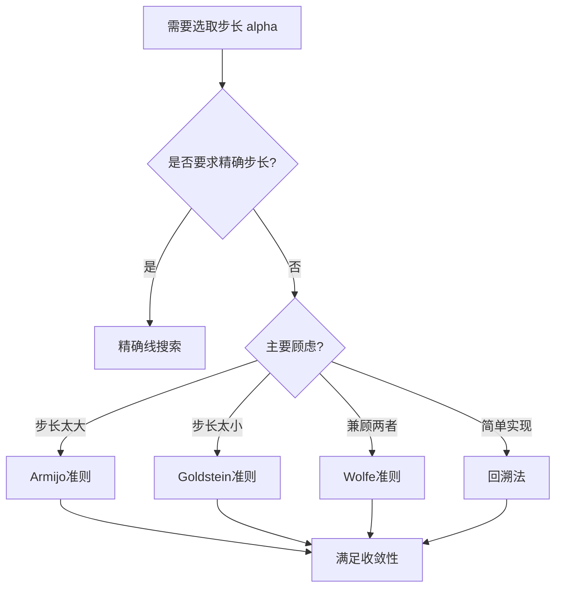

## 1. 本章核心脉络

```mermaid
flowchart LR
    A[一维优化 min f(x)] --> B{可用信息}
    B -->|仅函数值| C[黄金分割法 / 斐波那契法]
    B -->|一阶导数| D[二分法]
    B -->|二阶导数| E[牛顿法]
    B -->|两点信息| F[割线法 / 插值法]
    C --> G[区间消去类]
    D --> G
    E --> H[迭代逼近类]
    F --> H
    G --> I[多维线搜索步长选取]
    H --> I
    I --> J[精确步长]
    I --> K[非精确步长 Armijo / Wolfe / Goldstein]
```

**一句话核心**：一维搜索是多维优化的基石——通过不断缩小包含极小点的区间或直接迭代逼近，为多维优化中的步长选取提供可靠工具。

---

## 2. 基础定义

| 术语 | 符号 | 定义 |
|------|------|------|
| 单峰函数 | — | 区间 $[a_0,b_0]$ 上有唯一极小点 $x^*$，左侧单调减、右侧单调增 |
| 单峰函数性质 | — | 若 $f(x_1) < f(x_2)$，则 $x^* \in [a_0, x_2]$；反之 $x^* \in [x_1, b_0]$ |
| 搜索区间 | $[a_k, b_k]$ | 第 $k$ 步迭代后包含极小点的区间 |
| 区间压缩比 | — | 每次迭代后新区间长度与旧区间长度之比 |
| 精确步长 | $\alpha_k$ | $\arg\min_{\alpha \geq 0} f(x_k + \alpha p_k)$ |
| 下降方向 | $p_k$ | 满足 $p_k^T \nabla f(x_k) < 0$ 的方向 |

---

## 3. 核心方法/定理

### 3.1 黄金分割法

**核心思想**：在单峰区间中对称地放置两个内点，利用单峰性质消去一段区间；通过自相似性使得每次只需计算一个新函数值。

**关键公式**：

$$
\lambda = \frac{3 - \sqrt{5}}{2} \approx 0.382, \qquad \mu = \frac{\sqrt{5} - 1}{2} \approx 0.618
$$

$$
a_1 = a_0 + \lambda(b_0 - a_0), \qquad b_1 = a_0 + \mu(b_0 - a_0)
$$

**区间取舍**：
- 若 $f(a_1) < f(b_1)$，则 $x^* \in [a_0, b_1]$，删除右区间
- 若 $f(a_1) > f(b_1)$，则 $x^* \in [a_1, b_0]$，删除左区间

**直观理解**：0.618 的比例保证了无论消去哪一侧，剩下的那个内点在新区间中的"位置"恰好可以充当下一轮的一个内点，从而每轮只算一个新函数值。

**证明思路**：由对称性 $\lambda = 1 - \mu$ 和自相似性 $\frac{\lambda}{1} = \frac{\mu - \lambda}{1 - \lambda}$，联立得到 $\lambda = \mu^2$，解二次方程即得。

---

### 3.2 二分法

**核心思想**：利用一阶必要条件 $f'(x^*) = 0$，通过导数符号判断极小点位于中点左侧还是右侧。

**迭代格式**：

$$
x^{(k)} = \frac{a_k + b_k}{2}
$$

- $f'(x^{(k)}) > 0$：$x^* \in [a_k, x^{(k)}]$
- $f'(x^{(k)}) < 0$：$x^* \in [x^{(k)}, b_k]$
- $f'(x^{(k)}) = 0$：$x^{(k)}$ 即为极小点

**直观理解**：导数为正说明函数在右侧上升，极小点必在左侧；导数为负则相反。

---

### 3.3 牛顿法（一维）

**核心思想**：在当前点构造二次逼近，将逼近函数的极小点作为下一个迭代点。

**迭代格式**：

$$
x^{(k+1)} = x^{(k)} - \frac{f'(x^{(k)})}{f''(x^{(k)})}
$$

**直观理解**：一阶导数告诉你往哪走，二阶导数告诉你该走多大步——二阶导数大（函数很"陡"）就迈小步，二阶导数小就迈大步。

**证明思路**：对 $f$ 在 $x^{(k)}$ 处作二阶 Taylor 展开 $g(x)$，令 $g'(x) = 0$ 即得更新公式。

---

### 3.4 割线法（拟牛顿法）

**核心思想**：用差商近似代替二阶导数，避免直接计算 $f''$。

**迭代格式**：

$$
x^{(k+1)} = x^{(k)} - \frac{f'(x^{(k)}) \cdot (x^{(k)} - x^{(k-1)})}{f'(x^{(k)}) - f'(x^{(k-1)})}
$$

**直观理解**：用"割线斜率"近似"切线斜率"，是牛顿法的"无导数"版本。

---

### 3.5 多维优化的线搜索

**基本迭代格式**：

$$
x_{k+1} = x_k + \alpha_k p_k
$$

**下降方向判定**：

$$
p_k^T \nabla f(x_k) < 0 \quad \Longleftrightarrow \quad p_k \text{ 是下降方向}
$$

**常见搜索方向**：

| 方向类型 | 公式 | 特点 |
|----------|------|------|
| 梯度方向 | $p_k = -\nabla f(x_k)$ | 局部最速下降，但全局锯齿现象 |
| 牛顿方向 | $p_k = -(\nabla^2 f(x_k))^{-1} \nabla f(x_k)$ | 利用二阶信息，收敛快 |
| 拟牛顿方向 | $p_k = -(B_k)^{-1} \nabla f(x_k)$ | $B_k \approx \nabla^2 f(x_k)$，避免求逆 |
| 共轭梯度方向 | $p_k = -\nabla f(x_k) + \beta_k p_{k-1}$ | 介于梯度与牛顿之间 |

---

### 3.6 步长选取准则

**精确步长（二次函数）**：

若 $f(x) = \frac{1}{2} x^T A x + b^T x + c$，$A \succ 0$，则

$$
\alpha_k = -\frac{p_k^T \nabla f(x_k)}{p_k^T A p_k}
$$

**Armijo 准则**：

$$
f(x_k + \alpha p_k) \leq f(x_k) + c \, \alpha \, p_k^T \nabla f(x_k), \qquad c \in (0, 1)
$$

**Goldstein 准则**：

$$
\begin{cases}
f(x_k + \alpha p_k) \leq f(x_k) + c \, \alpha \, p_k^T \nabla f(x_k) \\[6pt]
f(x_k + \alpha p_k) \geq f(x_k) + (1-c) \, \alpha \, p_k^T \nabla f(x_k)
\end{cases}, \qquad c \in (0, 0.5)
$$

**Wolfe 准则**：

$$
\begin{cases}
f(x_k + \alpha p_k) \leq f(x_k) + c_1 \, \alpha \, p_k^T \nabla f(x_k) \\[6pt]
\nabla f(x_k + \alpha p_k)^T p_k \geq c_2 \, \nabla f(x_k)^T p_k
\end{cases}, \qquad 0 < c_1 < c_2 < 1
$$

**直观理解**：
- Armijo：保证"充分下降"，防止步长太大
- Goldstein：在 Armijo 基础上加下界，防止步长过小
- Wolfe：用曲率条件替代下界，更灵活且保证收敛

---

### 3.7 Zoutendijk 定理

**定理**：设 $f$ 连续可微且梯度 Lipschitz 连续，线搜索 $x_{k+1} = x_k + \alpha_k p_k$ 中 $p_k$ 为下降方向，$\alpha_k$ 满足 Wolfe 准则，则

$$
\sum_{k=0}^{\infty} \cos^2 \theta_k \, \|\nabla f(x_k)\|^2 < +\infty
$$

其中 $\theta_k$ 为 $p_k$ 与 $-\nabla f(x_k)$ 的夹角。

**直观理解**：只要搜索方向不趋于与负梯度正交，梯度范数必趋于 0，即算法收敛到稳定点。

---

## 4. 计算/应用

### 例题1：黄金分割法求迭代次数

**题目**：$f(x) = x^4 - 14x^3 + 60x^2 - 70x$，在 $[0, 2]$ 上用黄金分割法，至少需要多少次迭代将极小点限制在长度为 $0.3$ 的区间内？

**解析步骤**：

1. **确定压缩比**：黄金分割法的区间压缩比为 $\mu = \frac{\sqrt{5}-1}{2} \approx 0.618$
2. **列停机不等式**：$L_0 \times \mu^N < \varepsilon$，即 $2 \times 0.618^N < 0.3$
3. **求解**：$N > \log_{0.618}(0.15) \approx 4$，故至少需要 4 次迭代
4. **迭代演示**：
   - S1：$a_1 = 0.763, b_1 = 1.236$，$f(a_1) = -24.36 < f(b_1) = -18.96$，新区间 $[0, 1.236]$
   - S2：利用 S1 的 $a_1$ 作为新的 $b_2$，只需计算新 $a_2 = 0.472$
   - S3-S4：继续迭代，最终收敛到 $x^* \approx 0.780884$

**点评**：黄金分割法的精髓在于"复用"——每次只需计算一个新函数值，另一个来自上一轮。

---

### 例题2：二分法对比

**题目**：同一函数、同一区间、同一精度要求，用二分法需要几次迭代？

**解析步骤**：

1. **压缩比**：二分法的压缩比为 $\frac{1}{2}$
2. **列不等式**：$2 \times (\frac{1}{2})^N < 0.3$
3. **求解**：$N > \log_2(\frac{2}{0.3}) \approx 3$，即 3 次迭代
4. **关键对比**：二分法虽然迭代次数少，但每次需要计算导数；黄金分割法仅需函数值，但迭代次数略多。

---

### 例题3：回溯技术

**算法流程**：

1. 给定初值 $\bar{\alpha} > 0$，$\rho \in (0, 1)$，$c \in (0, 1)$
2. 置 $\alpha := \bar{\alpha}$
3. **while** $f(x_k + \alpha p_k) > f(x_k) + c \alpha p_k^T \nabla f(x_k)$ **do**
4. $\quad \alpha := \rho \alpha$
5. **end while**
6. $\alpha_k := \alpha$

**点评**：回溯法是工程实现中最常用的步长选取策略，简单、鲁棒、无需精确求解一维优化问题。

---

## 5. 判定/决策流程

### 一维搜索方法选择

```mermaid
flowchart TD
    A[给定一维优化问题 min f(x)] --> B{能否计算 f''?}
    B -->|能| C{初始点靠近极小点?}
    C -->|是| D[牛顿法]
    C -->|否| E[阻尼牛顿法]
    B -->|不能| F{能否计算 f'?}
    F -->|能| G[二分法]
    F -->|不能| H{有几个初始点?}
    H -->|一个区间| I[黄金分割法]
    H -->|两个点| J[割线法]
    H -->|三个点| K[三点二次插值]
    D --> L[多维线搜索步长]
    E --> L
    G --> L
    I --> L
    J --> L
    K --> L
```

### 步长准则选择



---

## 6. 核心公式速查表

| 方法 | 核心公式 |
|------|----------|
| 黄金分割点 | $\lambda = \frac{3-\sqrt{5}}{2} \approx 0.382$，$\mu = \frac{\sqrt{5}-1}{2} \approx 0.618$ |
| 二分法中点 | $x^{(k)} = \frac{a_k + b_k}{2}$ |
| 一维牛顿法 | $x^{(k+1)} = x^{(k)} - \frac{f'(x^{(k)})}{f''(x^{(k)})}$ |
| 割线法 | $x^{(k+1)} = x^{(k)} - \frac{f'(x^{(k)})(x^{(k)}-x^{(k-1)})}{f'(x^{(k)})-f'(x^{(k-1)})}$ |
| 精确步长(二次) | $\alpha_k = -\frac{p_k^T \nabla f(x_k)}{p_k^T A p_k}$ |
| Armijo | $f(x_k + \alpha p_k) \leq f(x_k) + c \alpha p_k^T \nabla f(x_k)$ |
| Goldstein | 上界 + 下界双重约束 |
| Wolfe | 充分下降 + 曲率条件 |
| Zoutendijk | $\sum \cos^2\theta_k \|\nabla f(x_k)\|^2 < \infty$ |

---

## 7. 易错点与注意事项

> [!warning]
> 1. **单峰性假设**：黄金分割法和二分法都依赖单峰函数假设。若函数有多个局部极小点，这些方法可能收敛到非全局最优。
> 2. **牛顿法的二阶条件**：一维牛顿法要求 $f''(x) > 0$。若在某点 $f''(x) \leq 0$，迭代可能发散或收敛到极大点。
> 3. **割线法的初始点**：割线法需要两个初始点，且要求 $f'(x^{(k)}) \neq f'(x^{(k-1)})$，否则分母为零。
> 4. **Wolfe 准则参数**：必须满足 $0 < c_1 < c_2 < 1$，否则曲率条件与充分下降条件可能冲突。
> 5. **进退法找初始区间**：若初始区间不包含极小点，所有区间消去法都会失效。务必先用进退法确认 $f(c) < f(a)$ 且 $f(c) < f(b)$。
> 6. **精确步长的代价**：精确线搜索每步都需求解一个一维优化问题，计算代价高；非精确准则在实践中往往更高效。

---

## 8. 相关知识点链接

- 前置基础：[[02-向量空间与矩阵|向量空间与矩阵]]、[[06-最优性条件|最优性条件]]
- 后续章节：[[08-梯度方法|梯度方法]]（线搜索中的梯度方向）、[[09-牛顿法|牛顿法]]（多维牛顿方向）
- 习题库：[[习题库/07-一维搜索方法/README|第7章习题库]]

---

## 9. 作业与练习

- **课后习题**：7.10, 7.12
- **习题库链接**：[[习题库/07-一维搜索方法/README|第7章习题库]]
