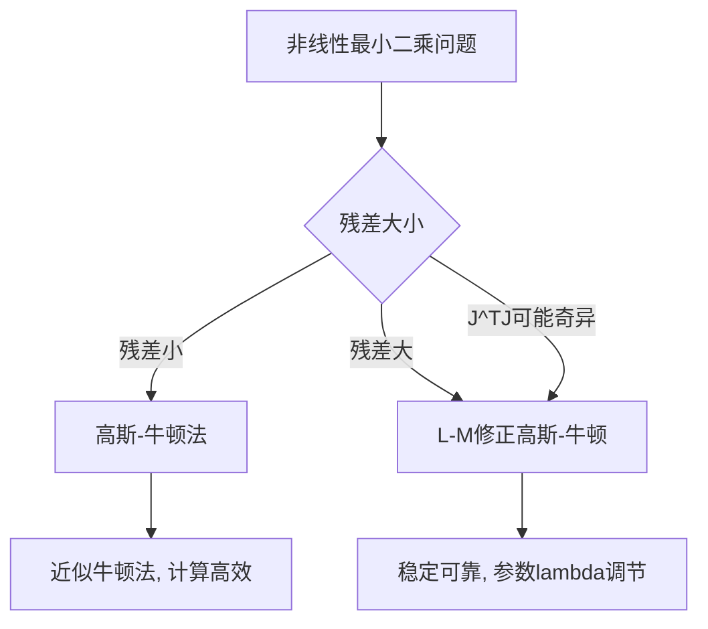

## 1. 本章核心脉络

```mermaid
flowchart LR
    A[无约束优化 min f(x)] --> B[牛顿法]
    B --> C{Hessian是否正定?}
    C -->|是| D[基本牛顿法]
    C -->|否| E[修正牛顿法]
    D --> F[局部2阶收敛]
    E --> G[阻尼牛顿法]
    E --> H[L-M修正]
    G --> I[全局收敛性]
    H --> I
    I --> J[非线性最小二乘]
    J --> K[高斯-牛顿法]
    K --> L[L-M修正高斯-牛顿]
```

**一句话核心**：牛顿法通过在当前点构造二次逼近并利用Hessian信息，实现了局部二次收敛；但当Hessian非正定时，必须通过阻尼或L-M修正来保证全局收敛性和下降性质。

---

## 2. 基础定义

| 术语 | 符号 | 定义 |
|------|------|------|
| 梯度 | $g^{(k)}$ | $\nabla f(x^{(k)})$ |
| Hessian矩阵 | $H(x^{(k)})$ | $\nabla^2 f(x^{(k)})$，二阶偏导数矩阵 |
| 牛顿方向 | $d^{(k)}$ | $-H(x^{(k)})^{-1} g^{(k)}$ |
| Jacobian矩阵 | $J(x)$ | 向量值函数 $g$ 的一阶偏导数矩阵 |
| 阻尼因子 | $\alpha_k$ | 牛顿步的步长参数 |
| L-M参数 | $\lambda$ | 正则化参数，$\lambda \geq 0$ |
| 残差 | $r_i(x)$ | 非线性最小二乘中的第 $i$ 个残差函数 |

---

## 3. 核心方法/定理

### 3.1 牛顿法的基本思想

**核心思路**：
1. 在当前点 $x^{(k)}$ 对 $f$ 作二阶Taylor展开，构造二次逼近
2. 求解该二次函数的极小点作为下一个迭代点
3. 重复直至收敛

**Taylor展开**：

$$
f(x) \approx f(x^{(k)}) + (x - x^{(k)})^T g^{(k)} + \frac{1}{2}(x - x^{(k)})^T H(x^{(k)})(x - x^{(k)}) =: m(x)
$$

**牛顿法迭代格式**：

$$
x^{(k+1)} = x^{(k)} - H(x^{(k)})^{-1} g^{(k)}
$$

**直观理解**：梯度告诉你"往哪走"，Hessian告诉你"路有多弯"——Hessian"弯得厉害"（特征值大）就迈小步，"比较平坦"就迈大步。

**证明思路**：对 $m(x)$ 求梯度并令其为零：$\nabla m(x) = g^{(k)} + H(x^{(k)})(x - x^{(k)}) = 0$，解得 $x = x^{(k)} - H(x^{(k)})^{-1} g^{(k)}$。

---

### 3.2 牛顿法算法

**实现分解**：
1. **求解牛顿方程**：$H(x^{(k)}) d^{(k)} = -g^{(k)}$（解线性方程组，避免直接求逆）
2. **更新迭代点**：$x^{(k+1)} = x^{(k)} + d^{(k)}$

**算法**：

```
Require: x^(0) in R^n, epsilon > 0, k := 0
repeat
    求解 H(x^(k)) d^(k) = -g^(k) 获得牛顿方向 d^(k)
    x^(k+1) = x^(k) + d^(k)
until ||g^(k)|| <= epsilon
```

---

### 3.3 牛顿法求解非线性方程组

**问题**：$g(x) = 0$，$g: \mathbb{R}^n \to \mathbb{R}^n$

**迭代格式**：

$$
x^{(k+1)} = x^{(k)} - J(x^{(k)})^{-1} g(x^{(k)})
$$

其中 $J(x)$ 为 $g$ 的Jacobian矩阵。

**一维退化**：$n=1$ 时退化为 $x^{(k+1)} = x^{(k)} - \frac{g(x^{(k)})}{g'(x^{(k)})}$。

**直观理解**：优化中的牛顿法是"解梯度为零的方程"的特例——将 $g = \nabla f$ 代入即得优化牛顿法。

---

### 3.4 局部收敛性定理

**定理**：若 $f \in C^3$，$x^*$ 满足 $\nabla f(x^*) = 0$，$\nabla^2 f(x^*)$ 可逆，则对充分靠近 $x^*$ 的 $x^{(0)}$，牛顿法有意义且以**至少2阶收敛率**收敛到 $x^*$。

**证明概要**：

对 $\nabla f$ 在 $x^{(k)}$ 处Taylor展开：

$$
\nabla f(x) - \nabla f(x^{(k)}) - \nabla^2 f(x^{(k)})(x - x^{(k)}) = O(\|x - x^{(k)}\|^2)
$$

取 $x = x^*$，利用 $\nabla f(x^*) = 0$：

$$
\|x^{(k+1)} - x^*\| \leq c_1 c_2 \|x^{(k)} - x^*\|^2
$$

**直观理解**：一旦进入"收敛盆地"（离最优解足够近），每步有效数字大约翻倍——这是牛顿法最大的魅力。

---

### 3.5 牛顿方向的下降性质

**定理**：若 $H(x^{(k)}) \succ 0$ 且 $g^{(k)} \neq 0$，则牛顿方向 $d^{(k)} = -H(x^{(k)})^{-1} g^{(k)}$ 是下降方向。

**证明**：设 $\phi(\alpha) = f(x^{(k)} + \alpha d^{(k)})$，则

$$
\phi'(0) = \nabla f(x^{(k)})^T d^{(k)} = -(g^{(k)})^T H(x^{(k)})^{-1} g^{(k)} < 0
$$

（因 $H \succ 0$ 故 $H^{-1} \succ 0$）

**直观理解**：Hessian正定保证了牛顿方向确实指向"下山"方向；若Hessian不正定，牛顿方向可能指向上山。

---

### 3.6 阻尼牛顿法

**动机**：基本牛顿法采用固定步长 $\alpha_k = 1$，当初始点远离最优解时可能发散。

**迭代格式**：

$$
x^{(k+1)} = x^{(k)} - \alpha_k H(x^{(k)})^{-1} g^{(k)}
$$

其中 $\alpha_k = \operatorname{argmin}_{\alpha} f(x^{(k)} - \alpha H(x^{(k)})^{-1} g^{(k)})$。

**性质**：阻尼牛顿法保持下降性，$f(x^{(k+1)}) < f(x^{(k)})$。

**直观理解**：阻尼牛顿法 = 牛顿方向 + 精确线搜索，既利用二阶信息确定方向，又通过线搜索保证全局下降。

---

### 3.7 Levenberg-Marquardt (L-M) 修正

**动机**：当 $H(x^{(k)})$ 非正定时，牛顿方向不是下降方向，甚至 $H$ 可能奇异导致无法求逆。

**修正格式**：

$$
x^{(k+1)} = x^{(k)} - \alpha_k [H(x^{(k)}) + \lambda I]^{-1} g^{(k)}, \quad \lambda \geq 0
$$

**参数 $\lambda$ 的作用**：
- $\lambda \to 0$：趋近经典牛顿法（2阶收敛）
- $\lambda \to \infty$：趋近梯度法（最速下降）

**直观理解**：$H + \lambda I$ 相当于给Hessian的每个特征值都加上 $\lambda$。当 $\lambda$ 足够大时，所有特征值变正，矩阵正定，保证下降方向。

---

### 3.8 高斯-牛顿法（非线性最小二乘）

**问题**：

$$
\min_x \frac{1}{2} \sum_{i=1}^{m} [r_i(x)]^2 = \frac{1}{2} r(x)^T r(x)
$$

**梯度和Hessian**：

$$
\nabla f(x) = J(x)^T r(x)
$$

$$
\nabla^2 f(x) = J(x)^T J(x) + S(x)
$$

其中 $S(x)$ 包含 $r_i$ 的二阶导数项，通常很小。

**高斯-牛顿法**：略去 $S(x)$，迭代格式为

$$
x^{(k+1)} = x^{(k)} - [J(x^{(k)})^T J(x^{(k)})]^{-1} J(x^{(k)})^T r(x^{(k)})
$$

**直观理解**：当残差 $r_i(x)$ 较小时，$S(x)$ 可忽略，高斯-牛顿法近似于牛顿法；当残差大时，$S(x)$ 不可忽略，高斯-牛顿法可能表现不佳。

**L-M修正的高斯-牛顿法**：

$$
x^{(k+1)} = x^{(k)} - [J(x^{(k)})^T J(x^{(k)}) + \lambda I]^{-1} J(x^{(k)})^T r(x^{(k)})
$$

**直观理解**：$J^T J$ 可能奇异，加入 $\lambda I$ 保证可逆，同时在残差大时提供更多"梯度法特性"以增强稳定性。

---

## 4. 计算/应用

### 例题1：牛顿法极小化二次函数

**题目**：$f(x) = x_1^2 + x_2^2$，初始点任意 $x^{(0)} \in \mathbb{R}^2$。

**解析步骤**：

1. **梯度**：$g = \nabla f(x) = [2x_1, 2x_2]^T$
2. **Hessian**：$H = \nabla^2 f(x) = \begin{bmatrix} 2 & 0 \\ 0 & 2 \end{bmatrix} = 2I$
3. **牛顿步**：
   $$
   x^{(1)} = x^{(0)} - (2I)^{-1} (2x^{(0)}) = x^{(0)} - x^{(0)} = 0
   $$

**点评**：对于二次函数，牛顿法**一步收敛**（任意初始点），收敛阶为 $\infty$。这是因为二次逼近恰好等于原函数。

---

### 例题2：牛顿法迭代过程

**题目**：$f(x) = (x_1 - 2)^4 + (x_1 - 2x_2)^2$，初始点 $x^{(0)} = [0, 3]^T$。

**解析步骤**：

1. **计算梯度**：
   $$
   g(x) = \begin{bmatrix} 4(x_1 - 2)^3 + 2(x_1 - 2x_2) \\ -4(x_1 - 2x_2) \end{bmatrix}
   $$

2. **计算Hessian**：
   $$
   H(x) = \begin{bmatrix} 12(x_1 - 2)^2 + 2 & -4 \\ -4 & 8 \end{bmatrix}
   $$

3. **迭代**：求解 $H(x^{(k)}) d^{(k)} = -g(x^{(k)})$，更新 $x^{(k+1)} = x^{(k)} + d^{(k)}$

4. **收敛**：通常5-10次迭代可达较高精度

**点评**：该例题展示了牛顿法在非二次函数上的典型表现——虽然不能一步收敛，但仍保持快速的局部收敛性。

---

### 例题3：非线性方程求解

**题目**：$g(x) = e^x - 1 = 0$，初始点 $x^{(0)} = -1$。

**解析步骤**：

1. **导数**：$g'(x) = e^x$
2. **迭代格式**：$x^{(k+1)} = x^{(k)} - \frac{e^{x^{(k)}} - 1}{e^{x^{(k)}}}$

| $k$ | $x^{(k)}$ | $g(x^{(k)})$ |
|:---:|:---:|:---:|
| 0 | $-1.00000$ | $-0.63212$ |
| 1 | $0.71828$ | $1.05091$ |
| 2 | $0.20587$ | $0.22859$ |
| 3 | $0.01981$ | $0.02000$ |
| 4 | $0.00019$ | $0.00019$ |
| 5 | $0.00000$ | $0.00000$ |

**点评**：牛顿法求解方程时，从 $x^{(0)} = -1$ 出发，仅需5次迭代即达到机器精度。注意第1步时 $x^{(1)} = 0.718$ 跳到了零点的另一侧，这是牛顿法的典型行为。

---

### 例题4：Rosenbrock函数的牛顿法表现

**题目**：$f(x) = (x_1 - 2)^4 + (x_1 - 2)^2 x_2^2 + (x_2 + 1)^2$，初始点 $x^{(0)} = [1, 1]^T$。

**迭代数据**：

| $k$ | $x^{(k)}$ | $f(x^{(k)})$ |
|:---:|:---|:---|
| 0 | $(1.0, 1.0)^T$ | $6.0$ |
| 1 | $(1.0, -0.5)^T$ | $1.5$ |
| 2 | $(1.3913043, -0.69565217)^T$ | $4.09 \times 10^{-1}$ |
| 3 | $(1.7459441, -0.94879809)^T$ | $6.49 \times 10^{-2}$ |
| 4 | $(1.9862783, -1.0482081)^T$ | $2.53 \times 10^{-3}$ |
| 5 | $(1.9987342, -1.0001700)^T$ | $1.63 \times 10^{-5}$ |
| 6 | $(1.9999996, -1.0000016)^T$ | $2.75 \times 10^{-12}$ |

**点评**：
- 第0到第1步：函数值从6降到1.5，下降明显
- 第4到第6步：有效数字迅速翻倍，体现**二次收敛**特征
- 最终收敛到 $x^* \approx (2, -1)^T$

---

## 5. 判定/决策流程

### 牛顿法及其变体选择

```mermaid
flowchart TD
    A[无约束优化 min f(x)] --> B{能否计算Hessian?}
    B -->|否| C[拟牛顿法 或 梯度法]
    B -->|能| D{Hessian是否正定?}
    D -->|是| E{初始点靠近最优?}
    E -->|是| F[基本牛顿法]
    E -->|否| G[阻尼牛顿法]
    D -->|否| H[L-M修正]
    F --> I[2阶局部收敛]
    G --> J[全局收敛 + 快速收敛]
    H --> J
    C --> K[1阶收敛]
```

### 非线性最小二乘方法选择



---

## 6. 核心公式速查表

| 内容 | 公式 |
|------|------|
| 牛顿法迭代 | $x^{(k+1)} = x^{(k)} - H(x^{(k)})^{-1} g^{(k)}$ |
| 二次逼近 | $m(x) = f(x^{(k)}) + (x-x^{(k)})^T g^{(k)} + \frac{1}{2}(x-x^{(k)})^T H(x^{(k)})(x-x^{(k)})$ |
| 非线性方程 | $x^{(k+1)} = x^{(k)} - J(x^{(k)})^{-1} g(x^{(k)})$ |
| 阻尼牛顿法 | $x^{(k+1)} = x^{(k)} - \alpha_k H(x^{(k)})^{-1} g^{(k)}$ |
| L-M修正 | $x^{(k+1)} = x^{(k)} - [H(x^{(k)}) + \lambda I]^{-1} g^{(k)}$ |
| 高斯-牛顿法 | $x^{(k+1)} = x^{(k)} - [J^T J]^{-1} J^T r(x^{(k)})$ |
| L-M高斯-牛顿 | $x^{(k+1)} = x^{(k)} - [J^T J + \lambda I]^{-1} J^T r(x^{(k)})$ |
| 收敛阶 | $\|x^{(k+1)} - x^*\| \leq c \|x^{(k)} - x^*\|^2$ |

---

## 7. 易错点与注意事项

> [!warning]
> 1. **Hessian正定性**：牛顿法要求 $H(x^{(k)}) \succ 0$。若Hessian不正定，牛顿方向可能不是下降方向，甚至 $H$ 奇异导致无法求逆。务必检查或修正。
> 2. **初始点敏感性**：牛顿法仅有**局部收敛性**。初始点远离最优解时，迭代序列可能发散或收敛到鞍点/极大点。
> 3. **二次函数一步收敛**：牛顿法对二次函数一步收敛的前提是Hessian正定。若二次函数的Hessian半正定，极小点可能不唯一。
> 4. **计算代价**：每步需计算Hessian并求解 $n \times n$ 线性方程组，代价为 $O(n^3)$。大规模问题应考虑拟牛顿法或共轭梯度法。
> 5. **L-M参数调节**：$\lambda$ 太小则回到牛顿法（可能不稳定），$\lambda$ 太大则接近梯度法（收敛慢）。实际中常采用自适应策略（如信赖域方法）。
> 6. **高斯-牛顿法的局限**：当残差 $r_i(x)$ 较大时，$S(x)$ 不可忽略，高斯-牛顿法可能收敛缓慢甚至发散。此时应使用L-M修正。
> 7. **Jacobian与Hessian混淆**：非线性方程求解用Jacobian $J$；优化问题中，若 $g = \nabla f$，则Jacobian of $g$ 就是Hessian of $f$。

---

## 8. 相关知识点链接

- 前置基础：[[06-最优性条件|最优性条件]]（二阶充分条件）、[[07-一维搜索方法|一维搜索方法]]（线搜索步长）、[[08-梯度方法|梯度方法]]（一阶方法对比）
- 后续章节：拟牛顿法、共轭梯度法（大规模优化）
- 习题库：[[习题库/09-牛顿法/README|第9章习题库]]

---

## 9. 作业与练习

- **课后习题**：习题9.4 —— Rosenbrock函数的牛顿法与梯度法对比
- **习题库链接**：[[习题库/09-牛顿法/README|第9章习题库]]
