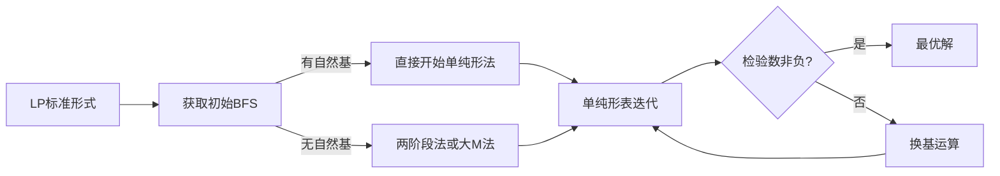
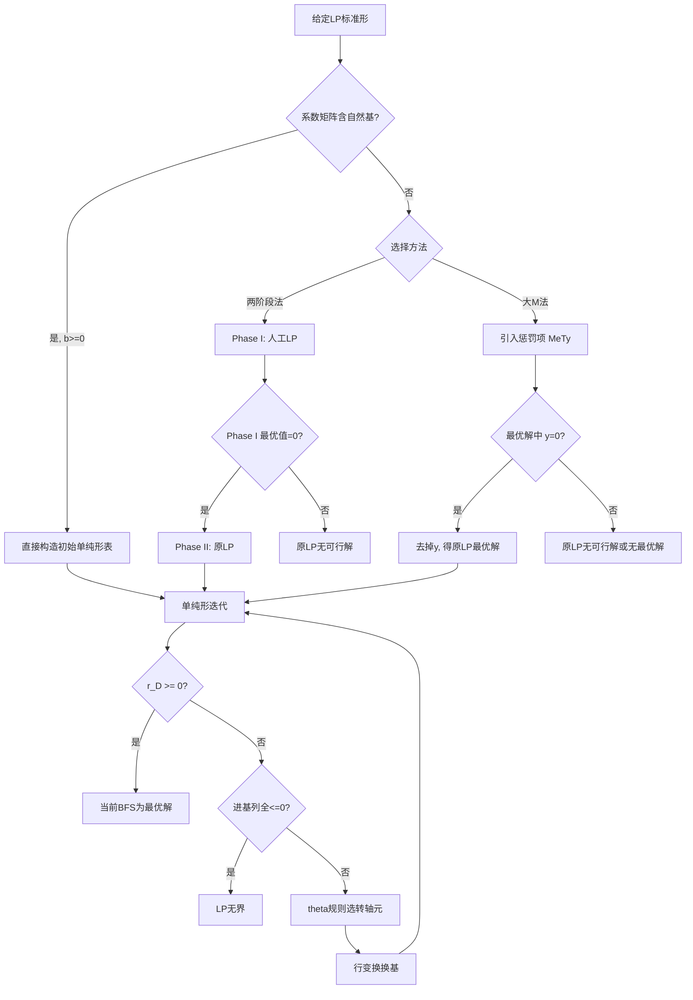

## 1. 本章核心脉络

**核心问题**：从一个基本可行解出发，通过系统地换基迭代（每次只换一个基向量），在有限步内找到最优基本可行解或判定问题无界/无解。

---

## 2. 基础定义

| 术语 | 符号/定义 | 说明 |
|------|-----------|------|
| 判别数 (reduced cost) | $r_D = c_D^T - c_B^T B^{-1}D$ | 非基变量对目标函数的边际影响 |
| 单纯形表 | 增广矩阵经行变换后的典式 | 包含基、BFS、判别数、目标值 |
| 转轴元素 (pivot) | 选定的 $a_{kl}$ | 用于高斯消元换基 |
| $\theta$ 规则 | $\displaystyle\frac{b_k}{a_{kl}} = \min\left\{\frac{b_i}{a_{il}} \mid a_{il} > 0\right\}$ | 保证换基后仍可行 |
| 人工变量 | $y \in \mathbb{R}^m$ | 构造辅助LP以获得初始BFS |
| 两阶段法 | Phase I求人工LP，Phase II求原LP | 系统性处理无自然基的情况 |
| 大M法 | 在目标函数中加 $M e^T y$ 惩罚项 | 单阶段方法 |

---

## 3. 核心方法/定理

### 3.1 判别数与最优性条件

将LP标准形按基变量 $x_B$ 和非基变量 $x_D$ 分块：

$$
\begin{aligned}
\min \quad & c_B^T x_B + c_D^T x_D \\
\text{s.t.} \quad & Bx_B + Dx_D = b, \quad x_B \ge 0, \; x_D \ge 0
\end{aligned}
$$

由 $x_B = B^{-1}b - B^{-1}Dx_D$，代入目标函数得：

$$
z = c_B^T B^{-1}b + (c_D^T - c_B^T B^{-1}D) x_D = z_0 + r_D^T x_D
$$

其中 $r_D = c_D^T - c_B^T B^{-1}D$ 为**判别数**。

**最优性判定**：
- 若 $r_D \ge 0$（所有分量非负），则当前BFS $[B^{-1}b, \; 0]$ 为**最优解**，最优值为 $z_0 = c_B^T B^{-1}b$
- 若 $r_D$ 有负分量，选择最负（或任意负）分量对应的列**进基**，可使目标函数值下降

**直观理解**：判别数 $r_j$ 表示若让 $x_j$ 从0增加到1（保持其他非基变量为0），目标函数的变化量。$r_j < 0$ 意味着"有利可图"。

**证明思路**：由 $z = z_0 + r_D^T x_D$，且 $x_D \ge 0$，若 $r_D \ge 0$ 则 $z \ge z_0$，故 $z_0$ 为极小值。

---

### 3.2 单纯形表的矩阵表示

对增广矩阵进行初等行变换：

$$
\left[\begin{array}{cc|c} B & D & b \\ c_B^T & c_D^T & 0 \end{array}\right]
\xrightarrow{B^{-1} \text{乘上行}}
\left[\begin{array}{cc|c} I_m & B^{-1}D & B^{-1}b \\ c_B^T & c_D^T & 0 \end{array}\right]
\xrightarrow{-c_B^T \text{乘上再加到下}}
\left[\begin{array}{cc|c} I_m & B^{-1}D & B^{-1}b \\ 0 & r_D & -z_0 \end{array}\right]
$$

最后一行最后一列的 $-z_0$ 便于直接读出目标函数值。

---

### 3.3 转轴规则（$\theta$ 规则）

当选定进基列 $l$（$r_l < 0$），转轴行 $k$ 需满足：

$$
\frac{b_k}{a_{kl}} = \min\left\{\frac{b_i}{a_{il}} \;\middle|\; a_{il} > 0\right\}
$$

**直观理解**：进基变量 $x_l$ 增大时，各基变量 $x_{Bi} = b_i - a_{il}x_l$ 会减小。$\theta$ 规则确保最先降到0的基变量出基，从而保证新解仍非负。

**注意**：若进基列中所有 $a_{il} \le 0$，则 $x_l$ 可无限增大而保持可行性，目标函数可无限下降，LP**无界**。

---

### 3.4 两阶段单纯形法

**Phase I**：构造人工LP $(P_1)$

$$
\begin{aligned}
\min \quad & y_1 + y_2 + \cdots + y_m = e^T y \\
\text{s.t.} \quad & [A, I_m] \begin{bmatrix} x \\ y \end{bmatrix} = b, \quad x \ge 0, \; y \ge 0
\end{aligned}
$$

- $(P_0)$ 有可行解 $\iff$ $(P_1)$ 有最优解且最优值为 $0$
- 若 Phase I 最优值 $> 0$，则 $(P_0)$ 无可行解

**Phase II**：
- 若 Phase I 最终表中基变量全是 $x$ 的分量：删去 $y$ 列，将判别数换为 $(P_0)$ 的 $c^T$，继续单纯形法
- 若仍有 $y$ 为基变量：
  - 若对应行 $x$ 的系数全为0，删去该行
  - 否则，选非零 $x$ 系数作转轴元，将人工变量换出

**直观理解**：Phase I 用"最小化人工变量之和"作为目标，迫使人工变量归零，从而在原问题的约束集中"着陆"。

---

### 3.5 大M法

引入人工变量 $y$，在目标函数中加入惩罚项：

$$
\min \quad c^T x + M e^T y
$$

其中 $M > 0$ 为任意大的正数。

**定理**：
- 若 $(P_1)$ 无最优解，则 $(P_0)$ 无最优解
- 若 $(P_1)$ 有最优解 $[x^*, y^*]$：
  - $y^* = 0 \Rightarrow x^*$ 是 $(P_0)$ 的最优解
  - $y^* \neq 0 \Rightarrow $(P_0)$ 无可行解（或无最优解）

**两阶段法 vs 大M法对比**：

| 对比项 | 两阶段法 | 大M法 |
|--------|----------|-------|
| 阶段数 | 两阶段（先求可行解，再优化） | 单阶段 |
| 数值稳定性 | 较好（不涉及大数） | 较差（$M$ 过大可能导致数值问题） |
| 实现复杂度 | 需切换目标函数 | 只需修改目标函数系数 |
| 适用场景 | 编程实现、大规模问题 | 手算、教学演示 |
| 理论清晰度 | 清晰分离可行性与优化 | 可行性与优化耦合 |

---

## 4. 计算/应用

### 4.1 单纯形法手算示例

**例题**：
$$
\begin{aligned}
\max \quad & 7x_1 + 6x_2 \\
\text{s.t.} \quad & 2x_1 + x_2 \le 3 \\
& x_1 + 4x_2 \le 4 \\
& x_1, x_2 \ge 0
\end{aligned}
$$

**解析步骤**：

**Step 0：标准化**
$$
\begin{aligned}
\min \quad & -7x_1 - 6x_2 \\
\text{s.t.} \quad & 2x_1 + x_2 + x_3 = 3 \\
& x_1 + 4x_2 + x_4 = 4 \\
& x_i \ge 0, \; i=1,\dots,4
\end{aligned}
$$

**Step 1：初始单纯形表**

| $x_1$ | $x_2$ | $x_3$ | $x_4$ | $b$ |
|-------|-------|-------|-------|-----|
| 2 | 1 | 1 | 0 | 3 |
| 1 | 4 | 0 | 1 | 4 |
| -7 | -6 | 0 | 0 | 0 |

- 基：$x_3, x_4$；BFS：$(0, 0, 3, 4)$；$r_D = (-7, -6)$；$z = 0$

**Step 2：选转轴元 $a_{11}=2$**

| $x_1$ | $x_2$ | $x_3$ | $x_4$ | $b$ |
|-------|-------|-------|-------|-----|
| 1 | 1/2 | 1/2 | 0 | 3/2 |
| 0 | 7/2 | -1/2 | 1 | 5/2 |
| 0 | -5/2 | 7/2 | 0 | 21/2 |

- 基：$x_1, x_4$；BFS：$(3/2, 0, 0, 5/2)$；$r_2 = -5/2 < 0$，继续

**Step 3：选转轴元 $a_{22}=7/2$**

| $x_1$ | $x_2$ | $x_3$ | $x_4$ | $b$ |
|-------|-------|-------|-------|-----|
| 1 | 0 | 4/7 | -1/7 | 8/7 |
| 0 | 1 | -1/7 | 2/7 | 5/7 |
| 0 | 0 | 23/7 | 5/7 | 86/7 |

- 基：$x_1, x_2$；BFS：$(8/7, 5/7, 0, 0)$；$r_D = (23/7, 5/7) > 0$
- **已达最优**，最优值：原问题 $\max = 86/7$

---

### 4.2 两阶段法示例

**例题**：
$$
\begin{aligned}
\min \quad & 2x_1 + 3x_2 \\
\text{s.t.} \quad & 4x_1 + 2x_2 \ge 12 \\
& x_1 + 4x_2 = 6 \\
& x_1, x_2 \ge 0
\end{aligned}
$$

**解析步骤**：

**Step 0：标准化 $(P_0)$**
$$
\begin{aligned}
\min \quad & 2x_1 + 3x_2 \\
\text{s.t.} \quad & 4x_1 + 2x_2 - x_3 = 12 \\
& x_1 + 4x_2 - x_4 = 6 \\
& x_i \ge 0, \; i=1,\dots,4
\end{aligned}
$$

无自然基，构造人工LP $(P_1)$：
$$
\begin{aligned}
\min \quad & y_1 + y_2 \\
\text{s.t.} \quad & 4x_1 + 2x_2 - x_3 + y_1 = 12 \\
& x_1 + 4x_2 - x_4 + y_2 = 6 \\
& x_i, y_j \ge 0
\end{aligned}
$$

**Phase I**：用单纯形法求解 $(P_1)$，最终得 $y_1=y_2=0$（非基变量），确认 $(P_0)$ 有可行解。

**Phase II**：删去 $y$ 列，将判别数换为 $(P_0)$ 的 $c^T = (2, 3, 0, 0)$，继续迭代。

最终最优解：$(x_1, x_2, x_3, x_4) = (16/7, 8/7, 0, 0)$，最优值 $z^* = 8$。

---

## 5. 判定/决策流程

---

## 6. 核心公式速查表

| 概念 | 公式 |
|------|------|
| 判别数 | $r_D = c_D^T - c_B^T B^{-1}D$ |
| 目标函数值 | $z_0 = c_B^T B^{-1}b$ |
| 基本可行解 | $x_B = B^{-1}b, \; x_D = 0$ |
| $\theta$ 规则 | $\displaystyle\frac{b_k}{a_{kl}} = \min\left\{\frac{b_i}{a_{il}} \mid a_{il} > 0\right\}$ |
| 最优性条件 | $r_D \ge 0$（min问题） |
| 无界判定 | 进基列 $l$ 满足 $a_{il} \le 0$（$\forall i$） |
| 行变换公式 | $\bar{a}_{ij} = a_{ij} - \frac{a_{kj}}{a_{kl}} a_{il}$（$i \neq k$）；$\bar{a}_{kj} = \frac{a_{kj}}{a_{kl}}$ |
| 两阶段Phase I | $\min e^T y, \; \text{s.t.} \; [A,I]\begin{bmatrix}x\\y\end{bmatrix} = b$ |
| 大M法 | $\min c^T x + M e^T y$ |

---

## 7. 易错点与注意事项

> [!warning]
> - **$\theta$ 规则只考虑 $a_{il} > 0$**：若进基列中所有系数非正，LP无界，切勿强行选转轴元。
> - **退化与循环**：若 $B^{-1}b$ 含零分量，可能出现基改变但解不变的循环。Bland规则（按最小下标选进基/出基列）可保证收敛。
> - **大M法的数值问题**：$M$ 取得过大可能导致浮点运算误差，实际编程优先使用两阶段法。
> - **Phase II 的判别数替换**：从 Phase I 切换到 Phase II 时，必须将最后一行完全替换为原LP的目标函数系数，不能简单叠加。
> - **人工变量出基后的处理**：大M法中，一旦人工变量出基，理论上可删去该列；手算时保留不影响结果（因其系数已不影响判别数符号）。
> - **最大化问题的符号**：标准化时 $\max c^T x \to \min (-c)^T x$，最优性条件仍为 $r_D \ge 0$，但最终目标值需取反。

---

## 8. 相关知识点链接

- 前置理论：[[15-线性规划概述]]（标准形式、基本可行解、LP基本定理）
- 后续理论：[[17-对偶单纯形法]]（对偶问题、对偶单纯形表、互补松弛条件）
- 矩阵基础：[[02-向量空间与矩阵#2.5 矩阵的秩|矩阵的秩与极大无关组]]

---

## 9. 作业与练习

- 课后作业：16.1, 16.3, 16.5, 16.7, 16.9（根据实际作业范围调整）
- **习题库**：[[习题库/16-单纯形法/README|第16章习题库]]
