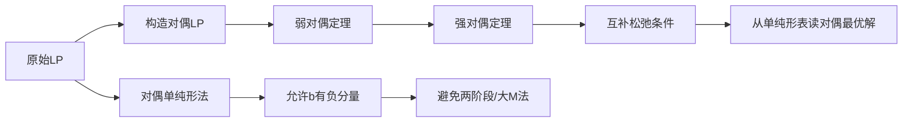
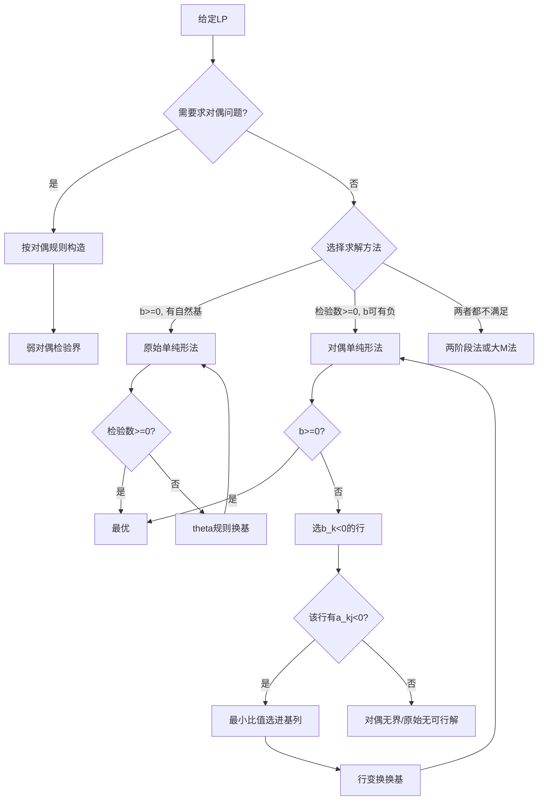

## 1. 本章核心脉络

**核心问题**：每个LP都有一个对偶LP，二者最优值相等（强对偶）；利用对偶视角，可在检验数非负但 $b$ 有负分量时直接启动迭代，绕过寻找初始可行解的困难。

---

## 2. 基础定义

| 术语 | 原始问题 (P) | 对偶问题 (D) |
|------|--------------|--------------|
| 目标 | $\min c^T x$ | $\max b^T \lambda$ |
| 约束 | $Ax = b, \; x \ge 0$ | $A^T \lambda \le c$ |
| 变量 | $x \in \mathbb{R}^n, \; x \ge 0$ | $\lambda \in \mathbb{R}^m$（自由） |

| 术语 | 定义 | 说明 |
|------|------|------|
| 弱对偶 | $c^T x \ge b^T \lambda$ | 对任意可行解 $(x, \lambda)$ 成立 |
| 强对偶 | (P) 有最优解 $\iff$ (D) 有最优解，且最优值相等 | 需要 $M \neq \varnothing$ 等正则条件 |
| 互补松弛 | $(c^T - \lambda^T A)x = 0$ 且 $\lambda^T(Ax - b) = 0$ | KKT条件的特例 |
| 对偶可行 | 检验数 $r = c^T - c_B^T B^{-1} A \ge 0$ | 等价于 $\lambda^T A \le c^T$ |
| 对偶单纯形法 | 保持对偶可行，逐步使原始可行 | $b$ 可以有负分量 |

---

## 3. 核心方法/定理

### 3.1 弱对偶定理

> **定理（弱对偶）**：若 $x$ 是 (P) 的可行解，$\lambda$ 是 (D) 的可行解，则
> $$
> c^T x \ge \lambda^T b
> $$

**证明**：
$$
c^T x \ge \lambda^T A x = \lambda^T b
$$
（第一个不等号由 $A^T \lambda \le c$ 及 $x \ge 0$ 得到；第二个等号由 $Ax = b$ 得到。）

**直观理解**：原始问题的目标值是"上界"，对偶问题的目标值是"下界"，二者始终"夹住"真正的最优值。

**推论**：
- 若 (P) 无界（$c^T x \to -\infty$），则 (D) 无可行解
- 若 (D) 无界（$b^T \lambda \to +\infty$），则 (P) 无可行解

---

### 3.2 强对偶定理

> **定理（强对偶）**：
> 1. 若 $x_0, \lambda_0$ 分别是 (P) 和 (D) 的可行解，且 $c^T x_0 = \lambda_0^T b$，则 $x_0, \lambda_0$ 分别是 (P) 和 (D) 的最优解。
> 2. 若 (P) 有最优解，则 (D) 必有最优解（反之亦然），且二者最优值相等。

**证明思路**：设 $B$ 为 (P) 的最优基，由最优性条件 $r_N = c_N^T - c_B^T B^{-1} N \ge 0$ 及 $r_B = 0$，令 $\lambda^T = c_B^T B^{-1}$，则：
$$
\lambda^T A = [c_B^T, \; \lambda^T N] \le [c_B^T, \; c_N^T] = c^T
$$
故 $\lambda$ 是 (D) 的可行解。又 $\lambda^T b = c_B^T B^{-1} b = z^*$，即 (D) 的最优值等于 (P) 的最优值。

**直观理解**：单纯形法迭代到最优时，检验数非负这一条件本身就"隐藏"着一个对偶可行解 $\lambda^T = c_B^T B^{-1}$。强对偶定理说明，这个解不仅可行，而且是最优的。

---

### 3.3 从单纯形表获取对偶最优解

设 (P) 的最优基为 $B$，则对偶最优解为：

- **Case 1**：$\text{rank}(B) = m$，直接求解 $\lambda^T B = c_B^T$，即 $\lambda^T = c_B^T B^{-1}$
- **Case 2**：$\text{rank}(B) < m$，求解 $\lambda^T A \le c^T$ 且 $c^T x = \lambda^T b$

**直观理解**：最终单纯形表中，基变量对应的判别数为0，非基变量对应的判别数非负。这些判别数与对偶约束 $A^T \lambda \le c$ 直接对应。

---

### 3.4 互补松弛条件

> **定理（互补松弛）**：$x$ 和 $\lambda$ 分别是 (P) 和 (D) 的最优解，当且仅当：
> $$
> (c^T - \lambda^T A) \, x = 0 \quad \text{且} \quad \lambda^T (Ax - b) = 0
> $$

**证明思路**：这是约束优化问题的KKT条件的直接推论。$c^T - \lambda^T A \ge 0$ 与 $x \ge 0$ 互补松弛；$Ax - b = 0$ 为等式约束，第二项自动为0（对原始标准形而言）。

**应用**：已知对偶最优解 $\lambda$，利用互补松弛条件可反解原始最优解 $x$：
- 若 $c_j - \lambda^T a_j > 0$，则 $x_j = 0$
- 结合 $Ax = b$ 求解剩余的 $x_j$

---

### 3.5 对偶单纯形法

**动机**：原始单纯形法要求初始表 $b \ge 0$（原始可行），若 $A$ 中没有自然基或 $b$ 有负分量，需用两阶段法或大M法。对偶单纯形法允许 $b$ 有负分量，只要求**检验数非负**（对偶可行）。

**标准LP**：
$$
\min c^T x, \quad \text{s.t.} \; Ax = b, \; x \ge 0
$$
其中 $b$ **可以有负分量**。

**转轴规则**：
1. **选离基行**：取 $b_k < 0$ 的行 $k$（若有多个，任选其一）
2. **选进基列**：在该行中找 $a_{kj} < 0$ 的列，按
   $$
   \frac{\bar{c}_r}{-a_{kr}} = \max\left\{\frac{\bar{c}_j}{-a_{kj}} \;\middle|\; a_{kj} < 0\right\}
   $$
   即比值最小者进基（等价于 $\min\{\bar{c}_j / |a_{kj}| : a_{kj}<0\}$）
3. **行变换**：以 $a_{kr}$ 为转轴元素进行高斯消元

**直观理解**：原始单纯形法保持 $b \ge 0$、逐步使检验数非负；对偶单纯形法保持检验数非负、逐步使 $b \ge 0$。二者是"对偶"的迭代策略。

**证明思路（保持对偶可行性）**：
变换后检验数
$$
\bar{c}_j' = \bar{c}_j - \frac{a_{kj}}{a_{kr}} \bar{c}_r
$$
因 $a_{kr} < 0$，$b_k < 0$，且按规则 $\frac{\bar{c}_r}{-a_{kr}} \ge \frac{\bar{c}_j}{-a_{kj}}$（对 $a_{kj}<0$），可验证 $\bar{c}_j' \ge 0$。

---

## 4. 计算/应用

### 4.1 对偶问题构造示例

**例题**：写出下列LP的对偶问题
$$
\begin{aligned}
\min \quad & 8x_1 + 6x_2 + 3x_3 + 6x_4 \\
\text{s.t.} \quad & x_1 + 2x_2 + x_4 \ge 3 \\
& 3x_1 + x_2 + x_3 + x_4 \ge 6 \\
& x_3 + x_4 \ge 2 \\
& x_i \ge 0
\end{aligned}
$$

**解析步骤**：
1. 原始为min，对偶为max；原始约束为 $\ge$，对偶变量 $\lambda \ge 0$
2. 原始变量 $x_i \ge 0$，对偶约束为 $\le$
3. 对偶目标系数为原始右端项 $b = [3, 6, 2]^T$
4. 对偶约束矩阵为 $A^T$

对偶问题：
$$
\begin{aligned}
\max \quad & 3\lambda_1 + 6\lambda_2 + 2\lambda_3 \\
\text{s.t.} \quad & \lambda_1 + 3\lambda_2 \le 8 \\
& 2\lambda_1 + \lambda_2 \le 6 \\
& \lambda_2 + \lambda_3 \le 3 \\
& \lambda_1 + \lambda_2 + \lambda_3 \le 6 \\
& \lambda_1, \lambda_2, \lambda_3 \ge 0
\end{aligned}
$$

---

### 4.2 互补松弛条件应用示例

**例题**：已知对偶最优解 $\lambda = -7$，求原始最优解。

原始问题（简化形式）：
$$
\begin{aligned}
\min \quad & [2, 1, 7, 1] x \\
\text{s.t.} \quad & [1, 1, 1, 1] x = 26, \; x \ge 0
\end{aligned}
$$

**解析步骤**：
1. 对偶约束：$\lambda \le 2, \; \lambda \le 1, \; \lambda \le 7, \; \lambda \le 1$，即 $\lambda \le 1$
2. 已知对偶最优 $\lambda = -7$（满足所有约束）
3. 互补松弛：$(c^T - \lambda^T A)x = 0$
   $$
   ([2,1,7,1] - (-7)[1,1,1,1])x = [9, 8, 14, 8]x = 0
   $$
   因系数全正且 $x \ge 0$，故 $x$ 中只能有对应最小系数的分量为正。但更简单的是：由 $Ax=26$，若只有 $x_3$ 非零，则 $x_3 = 26$，验证目标值 $7 \times 26 = 182$；对偶目标值 $(-7) \times 26 = -182$。注意原始是min，对偶是max，符号需统一。实际上标准形下原始为min，对偶为max，若原始目标系数为 $[2,1,7,1]$，对偶最优 $\lambda=-7$ 时原始最优解为 $x=[0,0,26,0]^T$。

---

### 4.3 对偶单纯形法示例

**例题**：用对偶单纯形法求解
$$
\begin{aligned}
\min \quad & x_1 + 2x_2 \\
\text{s.t.} \quad & x_1 + 2x_2 \ge 4 \\
& x_1 \le 5 \\
& 3x_1 + x_2 \ge 6 \\
& x_1, x_2 \ge 0
\end{aligned}
$$

**解析步骤**：

**Step 0：标准化**（注意 $b$ 可有负分量）
$$
\begin{aligned}
\min \quad & x_1 + 2x_2 \\
\text{s.t.} \quad & x_1 + 2x_2 - x_3 = 4 \\
& x_1 + x_4 = 5 \\
& 3x_1 + x_2 - x_5 = 6 \\
& x_i \ge 0
\end{aligned}
$$

**Step 1：构造对偶可行的初始表**

将第1、3行乘以 $-1$（使右端出现负数以启动对偶单纯形法）：

| $x_1$ | $x_2$ | $x_3$ | $x_4$ | $x_5$ | $b$ |
|-------|-------|-------|-------|-------|-----|
| -1 | -2 | 1 | 0 | 0 | -4 |
| 1 | 0 | 0 | 1 | 0 | 5 |
| -3 | -1 | 0 | 0 | 1 | -6 |
| 1 | 2 | 0 | 0 | 0 | 0 |

检验数 $(1, 2, 0, 0, 0) \ge 0$，满足对偶可行。$b$ 有负分量（第1行和第3行）。

**Step 2：选离基行与进基列**
- 选第3行（$b_3 = -6 < 0$）
- 该行负元素：$a_{31}=-3, a_{32}=-1$
- 比值：$\bar{c}_1/|a_{31}| = 1/3, \; \bar{c}_2/|a_{32}| = 2/1 = 2$
- 最小比值 $1/3$，故 $x_1$ 进基，$a_{31}=-3$ 为转轴元

**Step 3：行变换后迭代**

经对偶单纯形迭代，最终表满足 $b \ge 0$ 且检验数 $\ge 0$：

| $x_1$ | $x_2$ | $x_3$ | $x_4$ | $x_5$ | $b$ |
|-------|-------|-------|-------|-------|-----|
| 1 | 0 | -2 | 1 | 1 | 1 |
| 0 | 5 | -3 | 0 | 1 | 6 |
| 0 | 1 | 0 | 1 | 0 | 4 |

**最优解**：$(x_1, x_2) = (4, 0)$，最优值 $z^* = 4$。

---

## 5. 判定/决策流程

---

## 6. 核心公式速查表

| 概念 | 公式 |
|------|------|
| 原始问题 (P) | $\min c^T x, \; \text{s.t.} \; Ax = b, \; x \ge 0$ |
| 对偶问题 (D) | $\max b^T \lambda, \; \text{s.t.} \; A^T \lambda \le c$ |
| 弱对偶 | $c^T x \ge b^T \lambda$（对任意可行解） |
| 强对偶 | (P)最优值 = (D)最优值（若存在） |
| 对偶最优解 | $\lambda^T = c_B^T B^{-1}$（$B$ 为(P)的最优基） |
| 互补松弛 | $(c^T - \lambda^T A)x = 0$ |
| 对偶单纯形进基规则 | $\displaystyle\frac{\bar{c}_r}{-a_{kr}} = \max\left\{\frac{\bar{c}_j}{-a_{kj}} \mid a_{kj} < 0\right\}$ |
| 对偶单纯形离基规则 | 选 $b_k < 0$ 的行 |

---

## 7. 易错点与注意事项

> [!warning]
> - **对偶问题符号**：原始为min且约束为等式时，对偶变量 $\lambda$ 无符号限制；原始变量 $x \ge 0$ 对应的对偶约束为 $A^T \lambda \le c$（不等号方向易混淆，建议用对称形式记忆）。
> - **对偶单纯形法的启动条件**：必须保证初始表**检验数非负**（对偶可行），否则不能直接用对偶单纯形法。
> - **对偶单纯形进基列选取**：只在 $a_{kj} < 0$ 的列中选，若 $b_k < 0$ 的行中所有 $a_{kj} \ge 0$，则对偶问题无界，原始问题无可行解。
> - **强对偶的前提**：需要原始问题有可行解（或对偶问题有可行解）。若两者都无可行解，则强对偶不成立（但弱对偶仍成立）。
> - **互补松弛的零乘零**：互补松弛条件是"至少一个为零"，不是"恰好一个为零"。两个因子同时为零也是允许的。
> - **从最终表读对偶解**：$\lambda^T = c_B^T B^{-1}$，若 $B$ 不是单位阵，需通过求解线性方程组或观察单纯形表的松弛列得到。

---

## 8. 相关知识点链接

- 前置理论：[[15-线性规划概述]]（标准形式、基本可行解、LP基本定理）
- 前置算法：[[16-单纯形法]]（单纯形表、判别数、两阶段法/大M法）
- 优化理论基础：[[06-最优性条件]]（KKT条件、Lagrange对偶）

---

## 9. 作业与练习

- 课后作业：17.5, 17.10, 17.15, 17.24（根据实际作业范围调整）
- **习题库**：[[习题库/17-对偶单纯形法/README|第17章习题库]]
