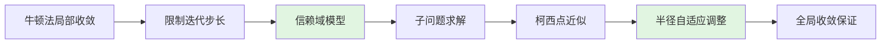

## 1. 本章核心脉络



**核心问题**：牛顿法具有快速的局部二阶收敛性，但对初值敏感且可能因Hessian非正定而失效。信赖域方法通过**限制每步迭代点的移动范围**，在保证全局收敛的同时尽可能利用二阶信息。

---

## 2. 基础定义

| 术语/符号 | 定义 | 备注 |
|:---|:---|:---|
| 信赖域 $\Omega_k$ | $\{x \in \mathbb{R}^n \mid \|x - x_k\| \le r_k\}$ | 以 $x_k$ 为中心、半径 $r_k$ 的球 |
| 信赖域半径 $r_k$ | 控制每步最大移动距离 | 根据模型质量动态调整 |
| 二次模型 $m_k(s)$ | $g_k^T s + \frac{1}{2} s^T B_k s$ | 省略常数项 $f(x_k)$ |
| $B_k$ | Hessian矩阵或其近似 | $B_k = I$ (梯度), $B_k = \nabla^2 f(x_k)$ (牛顿), $B_k \approx \nabla^2 f$ (拟牛顿) |
| 实际下降量 $\Delta_{\text{red}}^k$ | $f(x_k) - f(x_{k+1})$ | 真实函数值的减少 |
| 预估下降量 $\Delta_{\text{pred}}^k$ | $m_k(0) - m_k(s_k)$ | 模型预测的减少 |
| 比值 $\rho_k$ | $\Delta_{\text{red}}^k / \Delta_{\text{pred}}^k$ | 衡量模型可信程度 |
| 柯西点 $x_k^c$ | 沿负梯度方向在信赖域内的极小点 | 提供充分下降保证 |

---

## 3. 核心方法/定理

### 3.1 信赖域模型

**子问题形式**：
$$\min_s \; q(s) = \frac{1}{2} s^T B_k s + g_k^T s \quad \text{s.t.} \quad \|s\| \le r_k$$

> **直观理解**：在 current point 附近画一个"信任圈"，只在圈内相信二次近似；圈外认为近似不可靠。这比线搜索"先定方向再定步长"更灵活——方向和步长同时由子问题决定。

### 3.2 与线搜索方法的对比

| 维度 | 经典线搜索方法 | 信赖域方法 |
|:---|:---|:---|
| 流程 | 先定搜索方向，再定步长 | 先划定搜索范围，再在范围内寻优 |
| 驱动方式 | 方向驱动 | 区域约束驱动 |
| Hessian非正定时 | 可能失效（方向非下降） | 仍可求解（约束保证有界） |
| 全局收敛性 | 需额外假设 | 天然具有 |
| 非凸问题 | 较困难 | 可处理 |
| 每步计算 | 线搜索 + 方向计算 | 求解约束QP子问题 |

### 3.3 信赖域子问题的KKT条件（$\ell^2$范数）

$$\begin{aligned}
(B + \lambda I) s^* + g &= 0 \\
\|s^*\| &\le r \\
\lambda &\ge 0 \\
\lambda(\|s^*\| - r) &= 0
\end{aligned}$$

**情形分析**：
- **$g = 0$ 且 $\lambda_{\min}(B) > 0$**：$s^* = 0$（已到达稳定点）
- **$g = 0$ 且 $\lambda_{\min}(B) < 0$**：$s^*$ 取最小特征值对应的特征向量，$\|s^*\| = r$
- **$g \neq 0$**：需通过迭代求解 $\lambda$

> **证明思路**：利用KKT条件将原问题转化为求 $\lambda$ 使得 $\|s(\lambda)\| = r$，其中 $s(\lambda) = -(B + \lambda I)^{-1} g$。可以证明 $\|s(\lambda)\|$ 关于 $\lambda$ 单调递减。

### 3.4 二分法求解信赖域子问题

**策略**：在 $\lambda \in [\lambda_l, \infty)$ 上二分，其中 $\lambda_l = \max\{0, -\lambda_{\min}(B)\}$。

1. 若 $\|s(\lambda_l)\| < r$，则 $s(\lambda_l)$ 为最优解（约束不活跃）
2. 否则，找 $\lambda_u$ 使得 $\|s(\lambda_u)\| < r$，然后二分缩小区间
3. 当 $|\lambda_u - \lambda_l| < \varepsilon$ 时停机

> **注意**：$s(-\lambda_{\min}(B))$ 不唯一（因 $B + \lambda I$ 奇异），且范数可任意大。

### 3.5 信赖域半径的选取

**核心思想**：根据模型质量（$\rho_k$）动态调整半径。

$$r_{k+1} = \begin{cases}
0.5 r_k, & \rho_k < 0.25 \quad \text{(模型差，缩小)} \\[4pt]
r_k, & \rho_k \in [0.25, 0.75] \quad \text{(模型可接受，不变)} \\[4pt]
\min\{2 r_k, \bar{r}\}, & \rho_k > 0.75 \quad \text{(模型好，扩大)}
\end{cases}$$

> **直观理解**：$\rho_k \approx 1$ 说明模型预测与实际下降高度吻合，可以"大胆"扩大信赖域；$\rho_k \le 0$ 说明模型甚至预测错了下降方向，必须"保守"缩小。

### 3.6 柯西点（Cauchy Point）

**定义**：二次模型沿负梯度方向在信赖域边界上的极小点：
$$x_k^c = x_k - \tau_k \frac{r_k}{\|g_k\|} g_k$$

其中
$$\tau_k = \begin{cases}
1, & g_k^T G_k g_k \le 0 \\[8pt]
\min\!\left(1,\; \dfrac{\|g_k\|^3}{r_k \, g_k^T G_k g_k}\right), & g_k^T G_k g_k > 0
\end{cases}$$

**性质**：
- **充分下降性**：$m_k(x_k^c) - m_k(x_k) \le -c_1 \|g_k\| \min\!\left(r_k,\; \dfrac{\|g_k\|}{\|G_k\|}\right)$
- 方向始终沿 $-g_k$，曲率信息只影响步长

> **直观理解**：柯西点是"最保守"的可接受解——即使什么都不做，只沿梯度下降走到信赖域边界，也能保证足够的下降量。任何比柯西点更好的解都满足收敛要求。

### 3.7 改进的柯西点（二维子空间方法）

在子空间 $\mathcal{K}_k = \text{span}\{g_k,\; G_k^{-1} g_k\}$ 上求解子问题，等价于求解一个4阶多项式的根，计算量小且精度远高于柯西点。

### 3.8 收敛性结论

**假设**：下水平集有界，Hessian在有界集上有界。

**结论**：
- 信赖域方法具有**充分下降性**
- 当 $k \to \infty$ 时，$\nabla f(x_k) \to 0$（**全局收敛到稳定点**）
- $B_k$ 可用一致有界的近似矩阵代替，收敛性仍成立

---

## 4. 计算/应用

### 例题：信赖域子问题的判定

**问题**：设在某迭代点 $g_k = [2, -1]^T$，$B_k = \begin{bmatrix} 3 & 1 \\ 1 & 2 \end{bmatrix}$，$r_k = 1$。判断约束是否活跃，并说明求解思路。

**解析步骤**：

1. **检查 $B_k$ 正定性**：特征值 $\lambda = \frac{5 \pm \sqrt{5}}{2} > 0$，故 $B_k \succ 0$。

2. **计算无约束最优解**：$s^{\text{unc}} = -B_k^{-1} g_k = -\frac{1}{5}\begin{bmatrix} 2 & -1 \\ -1 & 3 \end{bmatrix}\begin{bmatrix} 2 \\ -1 \end{bmatrix} = -\frac{1}{5}\begin{bmatrix} 5 \\ -5 \end{bmatrix} = [-1, 1]^T$

3. **检查约束**：$\|s^{\text{unc}}\| = \sqrt{2} \approx 1.414 > r_k = 1$，故**约束活跃**。

4. **求解策略**：需找 $\lambda > 0$ 使得 $\|s(\lambda)\| = 1$，其中 $s(\lambda) = -(B_k + \lambda I)^{-1} g_k$，用二分法求解。

> **点评**：此例展示了信赖域方法的核心优势——即使无约束牛顿步越界，也能通过约束获得有意义的迭代步。

---

## 5. 判定/决策流程

```mermaid
flowchart TD
    A[当前迭代点 x_k] --> B[构造二次模型 m_k]
    B --> C[求解信赖域子问题]
    C --> D{约束是否活跃?}
    D -->|否| E[s_k = -B_k^-1 g_k]
    D -->|是| F[二分法求 lambda]
    F --> G[s_k = -(B_k + lambda I)^-1 g_k]
    E --> H[计算实际下降与预估下降]
    G --> H
    H --> I[计算比值 rho_k]
    I --> J{rho_k 范围?}
    J -->|rho_k < 0.25| K[缩小半径 r_k+1 = 0.5 r_k]
    J -->|0.25 <= rho_k <= 0.75| L[保持半径 r_k+1 = r_k]
    J -->|rho_k > 0.75| M[扩大半径 r_k+1 = min(2r_k, r_max)]
    K --> N{rho_k > 0?}
    L --> N
    M --> N
    N -->|是| O[接受步长 x_k+1 = x_k + s_k]
    N -->|否| P[拒绝步长 x_k+1 = x_k]
    P --> K
    O --> Q[下一迭代]
    style C fill:#e1f5e1
    style I fill:#fff8e1
```

---

## 6. 核心公式速查表

| 名称 | 公式 |
|:---|:---|
| 信赖域子问题 | $\min_s \frac{1}{2} s^T B s + g^T s, \quad \text{s.t. } \|s\| \le r$ |
| KKT条件 | $(B + \lambda I)s^* + g = 0, \; \lambda \ge 0, \; \lambda(\|s^*\| - r) = 0$ |
| 实际下降量 | $\Delta_{\text{red}} = f(x_k) - f(x_{k+1})$ |
| 预估下降量 | $\Delta_{\text{pred}} = m_k(0) - m_k(s_k)$ |
| 质量比值 | $\rho_k = \Delta_{\text{red}} / \Delta_{\text{pred}}$ |
| 柯西点 | $x_k^c = x_k - \tau_k \frac{r_k}{\|g_k\|} g_k$ |
| 柯西步长参数 | $\tau_k = \min\!\left(1, \dfrac{\|g_k\|^3}{r_k g_k^T G_k g_k}\right)$ (当 $g_k^T G_k g_k > 0$) |
| 半径更新 | $r_{k+1} = \begin{cases} 0.5r_k & \rho_k < 0.25 \\ r_k & \rho_k \in [0.25,0.75] \\ \min(2r_k, \bar{r}) & \rho_k > 0.75 \end{cases}$ |
| 充分下降性 | $m_k(x_k^c) - m_k(x_k) \le -c_1 \|g_k\| \min\!\left(r_k, \dfrac{\|g_k\|}{\|G_k\|}\right)$ |

---

## 7. 易错点与注意事项

> [!warning]
> 1. **$\rho_k$ 为负时的处理**：若 $\rho_k \le 0$，不仅缩小半径，还应**拒绝该步**（$x_{k+1} = x_k$），因为函数值没有下降。
> 2. **范数的选择**：理论上可用任意范数定义信赖域，但 $\ell^2$ 范数（欧氏范数）使子问题有简洁的KKT结构；$\ell^\infty$ 范数则对应box约束，可用其他算法求解。
> 3. **$B_k$ 的选取策略**：
    - $B_k = I$：信赖域梯度法，简单但收敛慢
    - $B_k = \nabla^2 f(x_k)$：信赖域牛顿法，快但需计算Hessian
    - $B_k \approx \nabla^2 f(x_k)$：信赖域拟牛顿法，平衡效率与开销
> 4. **柯西点 vs 精确解**：柯西点仅保证收敛，实际计算中常用二维子空间方法或迭代法（如Steihaug-CG）求更好的近似解。
> 5. **$\lambda = -\lambda_{\min}(B)$ 的奇异性**：当 $B$ 有负特征值且 $\lambda$ 恰好抵消它时，$(B + \lambda I)$ 奇异，$s(\lambda)$ 不唯一；此时需取极限方向或特殊处理（Hard Case）。
> 6. **全局收敛 vs 局部收敛**：信赖域方法保证全局收敛到一阶稳定点；若 $B_k$ 取精确Hessian且解足够接近极小点，仍保持牛顿法的二阶局部收敛速度。

---

## 8. 相关知识点链接

- 前置方法：[[09-最速下降法与牛顿法|最速下降法与牛顿法]]、[[11-拟牛顿法|拟牛顿法]]
- 理论工具：[[08-线搜索方法|线搜索与Wolfe条件]]、[[02-向量空间与矩阵|正定矩阵与特征值]]
- 子问题求解：[[10-共轭方向法|共轭梯度法]] — Steihaug-CG用于大规模信赖域子问题
- 全局优化脉络：最速下降（一阶，慢）→ 共轭梯度（一阶，有限步终止）→ 拟牛顿（近似二阶，超线性）→ **信赖域（全局收敛+二阶局部）**
- 习题练习：[[../习题库/25-信赖域方法/README|第25章 习题库]]

---

## 9. 作业与练习

- 课后习题入口：[[../习题库/25-信赖域方法/README|第25章 习题库]]
- 重点掌握：信赖域子问题的KKT条件、柯西点的计算、半径更新策略、与线搜索方法的对比分析
