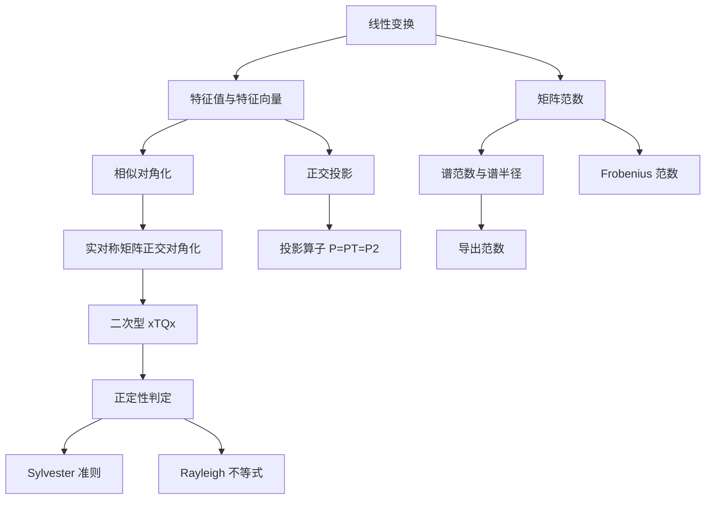
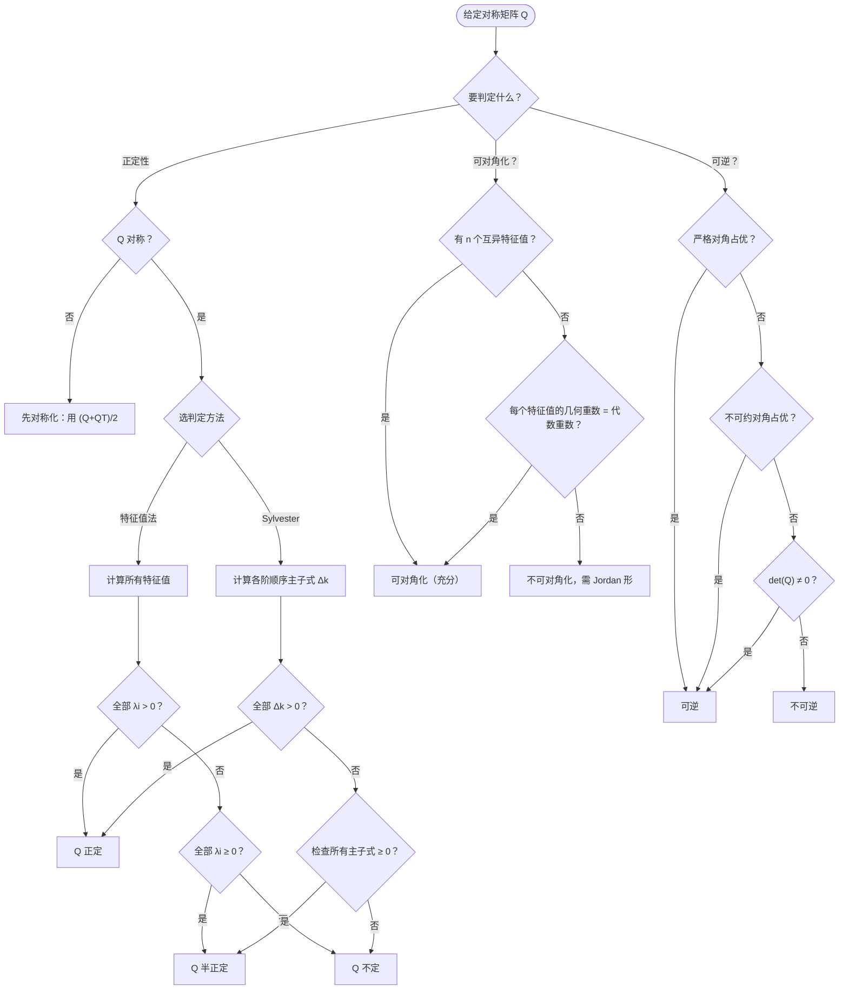

# 第3章 线性代数基础 — 知识点梳理

> 本章解决的核心问题：**为优化算法分析建立线性代数工具箱——特征值用于判定 Hessian 正定性，范数用于刻画收敛速度。这些工具在后续每一章优化算法中反复出现。**

---

## 一、本章核心脉络

> 本章以线性变换为起点，引出特征值与特征向量这一核心概念。特征值是"中枢"：通过正交对角化推导二次型的标准形，正定性判定直接服务于最优性条件（SONC/SOSC）；通过 Rayleigh 商，最大/最小特征值决定了优化算法的收敛率。正交投影为约束优化的可行方向分析提供几何基础。矩阵范数（谱范数、F-范数、导出范数）是定量描述矩阵"大小"的语言，谱半径 $\rho(A)$ 与收敛速度直接相关。整个链条的逻辑是：**变换的结构（特征值）→ 判定函数的凹凸性（正定性/二次型）→ 度量算法收敛的快慢（矩阵范数）。**

---

## 二、线性变换（基础）

### 2.1 定义与判定

**定义**：映射 $L: \mathbb{R}^n \to \mathbb{R}^m$ 是线性变换 $\iff$

$$L(\alpha x) = \alpha L(x); \quad L(x + y) = L(x) + L(y)$$

| 例子 | 是线性变换？ | 原因 |
|------|:---:|------|
| $L(x) = Ax$ | 是 | 矩阵乘法的分配律 |
| $L(x) = (a^\top x)a$ | 是 | 内积再乘向量，满足线性性 |
| $L(x) = Ax + b$ | 否（仿射变换） | 加法不封闭：$L(x+y) \neq L(x)+L(y)$ |
| $L(x) = x^\top x + c$ | 否 | 二次项不满足齐次性 |

> 一句话来说：**线性变换 = 保持"加法和数乘"结构不变的映射。** 在优化中，梯度算子 $\nabla$、Hessian 算子 $\nabla^2$ 在线性项/二次项意义下都与线性变换密切相关。

### 2.2 矩阵表示

选定 $\mathbb{R}^n$ 和 $\mathbb{R}^m$ 中的基后，任意线性变换 $L$ 可表示为矩阵乘法 $y' = A x'$（$x'$, $y'$ 为坐标）。

> 一句话来说：**选好基后，线性变换就是矩阵乘法。** 标准基下直接有 $L(x) = Ax$。

### 2.3 过渡矩阵与相似变换

设 $\{e_i\}$ 和 $\{e_i'\}$ 是 $\mathbb{R}^n$ 的两组基，过渡矩阵 $T$ 满足 $[e_1', \ldots, e_n'] = [e_1, \ldots, e_n] T$。

同一线性变换在不同基下的矩阵表示 $A$ 和 $B$ 满足：

$$B = T^{-1} A T$$

> 一句话来说：**换基导致矩阵左乘右乘逆，就是相似变换。** 相似矩阵对应"同一个线性变换在不同坐标系下的表达"——本质相同、表示不同。

---

## 三、特征值与对角化（核心）

### 3.1 特征值与特征向量

**定义**：$A \in \mathbb{R}^{n \times n}$，若 $\exists \lambda \in \mathbb{C}$，$0 \neq v \in \mathbb{C}^n$ 使 $Av = \lambda v$，则 $\lambda$ 为特征值，$v$ 为对应的特征向量。

$$Av = \lambda v$$

> 一句话来说：**特征向量 = 被矩阵变换后方向不变的"特权方向"；特征值 = 该方向上的缩放倍数。**

| 基本性质 | 说明 |
|----------|------|
| 互异特征值的特征向量线性无关 | 不同缩放倍数的方向天然独立 |
| 特征子空间构成直和 | $\{V_{\lambda_i}\}_{i=1}^r$ 是线性无关子空间的直和 |
| 特征多项式 | $\det(\lambda I - A) = \lambda^n + a_{n-1}\lambda^{n-1} + \cdots + a_0 = 0$ |

> 直观理解：如果把矩阵 $A$ 看作是"空间变换操作"，那么特征向量就是操作后**只被拉伸/压缩而不转向**的方向。这在优化中极其重要——Hessian 的特征向量方向是纯弯曲方向，正负特征值分别对应向上弯和向下弯。

### 3.2 相似对角化

**定理（可对角化的充要条件）**：

| 条件 | 能否推出可对角化 |
|------|:---:|
| $A$ 有 $n$ 个线性无关的特征向量 | 充要 |
| $A$ 有 $n$ 个互异的特征值 | 充分（非必要） |
| 每个特征值的代数重数 = 几何重数 | 充要 |

**对角化操作步骤**：

1. 计算特征值 $\{\lambda_i\}_{i=1}^n$
2. 求各特征值的线性无关特征向量 $\{v_i\}_{i=1}^n$
3. 令 $T = [v_1, \ldots, v_n]$，$\Lambda = \operatorname{diag}(\lambda_1, \ldots, \lambda_n)$，则 $A = T \Lambda T^{-1}$

### 3.3 实对称矩阵的正交对角化

$A \in S^n$（$A = A^\top$）有**三条黄金性质**：

| 性质 | 内容 | 优化中的意义 |
|------|------|-------------|
| 特征值全实数 | $\lambda_i \in \mathbb{R}$ | 正定性判定、排序有意义 |
| 互异特征值的特征向量正交 | $v_i^\top v_j = 0$（$i \neq j$） | 保证正交对角化存在 |
| 可正交对角化 | $A = Q \Lambda Q^\top$，$Q^\top = Q^{-1}$ | 二次型可化简为标准形 |

> 一句话来说：**对称矩阵 = 特征值全实数 + 特征向量可正交化 + 对角化只需转置不求逆。** 这是 Hessian 矩阵最核心的性质——若 $f$ 二阶连续可微，Hessian 必对称，因此必可正交对角化。

**正交对角化操作步骤**：
1. 计算特征值
2. 求特征向量
3. 对同一特征值的特征向量做施密特（Schmidt）正交化
4. 正交向量组单位化，得正交矩阵 $Q$

### 3.4 对角占优矩阵与可约矩阵

| 概念 | 定义 | 与可逆性的关系 |
|------|------|---------------|
| **对角占优** | $|a_{ii}| \geq \sum_{j \neq i} |a_{ij}|$ | 严格对角占优 $\Rightarrow$ 可逆 |
| **严格对角占优** | 上式对所有 $i$ 严格大于 | $\Rightarrow$ 必可逆 |
| **不可约对角占优** | 不可约 + 对角占优 + 至少一个严格不等 | $\Rightarrow$ 必可逆 |
| **可约矩阵** | 存在置换 $P$ 使 $PAP^\top = \begin{bmatrix} B_{11} & B_{12} \\ 0 & B_{22} \end{bmatrix}$ | 意味着可分解为独立子系统 |

> 不可约矩阵的等价刻画：不存在真子集 $I \subset \{1,\ldots,n\}$ 使 $a_{ij} = 0$，$\forall i \in I, j \notin I$ ——即矩阵不能通过行/列置换化为块三角形式。

### 3.5 Gerschgorin 圆盘定理

**定理**：$A \in \mathbb{R}^{n \times n}$ 的所有特征值落在 $n$ 个圆盘的并集中：

$$D_i = \left\{ \lambda \in \mathbb{C} \;\middle|\; |\lambda - a_{ii}| \leq \sum_{j \neq i} |a_{ij}| \right\}$$

特征值范围估计：

$$\lambda_{\min} \geq \min_i \left\{ a_{ii} - \sum_{j \neq i} |a_{ij}| \right\}, \quad \lambda_{\max} \leq \max_i \left\{ a_{ii} + \sum_{j \neq i} |a_{ij}| \right\}$$

> 一句话来说：**特征值一定在以对角元为中心的圆盘内——不需要解特征多项式就能估算特征值的范围。** 在分析 Hessian 的大致条件数时很有用。

### 3.6 特征值扰动定理

设 $A \in S^n$ 的特征值为 $\lambda_1 \geq \cdots \geq \lambda_n$。若 $B = A + \sigma u u^\top$（秩一扰动），特征值为 $\mu_1 \geq \cdots \geq \mu_n$，则：

| 扰动方向 | 结论 |
|----------|------|
| $\sigma < 0$（减去正半定矩阵） | $\mu_i \leq \lambda_i$（所有特征值同向减小） |
| $\sigma > 0$（加上正半定矩阵） | $\mu_i \geq \lambda_i$（所有特征值同向增大） |

> 直观理解：秩一扰动以一致的方向"推"所有特征值——这解释了为什么拟牛顿法中秩一/秩二更新公式能系统地调整 Hessian 近似的特征值。

---

## 四、正交投影（核心）

### 4.1 正交补与正交分解

设 $V \subset \mathbb{R}^n$ 是子空间，其**正交补**：

$$V^{\perp} = \{ x \in \mathbb{R}^n \mid v^\top x = 0,\; \forall v \in V \}$$

$V^{\perp}$ 也是子空间。$\mathbb{R}^n = V \oplus V^{\perp}$（正交直和），即 $\forall x \in \mathbb{R}^n$：

$$x = x_1 + x_2, \quad x_1 \in V,\; x_2 \in V^{\perp}$$

> 一句话来说：**任意向量可以唯一地拆成"在 $V$ 里的分量"和"垂直于 $V$ 的分量"。**

### 4.2 正交投影算子

**定义**：线性变换 $P$ 是 $V$ 上的正交投影算子，若对任意 $x$：$Px \in V$ 且 $x - Px \in V^{\perp}$。

**判定定理**：$P \in \mathbb{R}^{n \times n}$ 是某子空间的正交投影算子 $\iff$ $P = P^\top = P^2$（对称且幂等）。

> 一句话来说：**投影算子的本质 = 对称 + 投影两次等于投影一次（幂等）。** 这两个条件给出了一种代数上验证"是否是投影"的简便方法。

### 4.3 值域与核的对偶关系

对任意 $A \in \mathbb{R}^{m \times n}$：

$$\mathcal{R}(A)^{\perp} = \mathcal{N}(A^\top), \qquad \mathcal{N}(A)^{\perp} = \mathcal{R}(A^\top)$$

| 空间 | 正交补 |
|------|--------|
| 列空间 $\mathcal{R}(A)$ | 左零空间 $\mathcal{N}(A^\top)$ |
| 零空间 $\mathcal{N}(A)$ | 行空间 $\mathcal{R}(A^\top)$ |

> 一句话来说：**列空间与左零空间正交，零空间与行空间正交。** 这就是 Ch20 中"约束的切空间 = 法空间的补"的代数根源。

---

## 五、二次型与正定性（核心）

### 5.1 二次型定义

$f(x) = x^\top Q x$，其中 $Q \in \mathbb{R}^{n \times n}$。**不失一般性，总假设 $Q$ 对称**——若 $Q$ 不对称，用 $\frac{Q + Q^\top}{2}$ 替代即可。

> 一句话来说：**二次型 = 衡量向量在各方向上被"拉伸"程度的函数。$Q$ 的特征值越大，该方向上的二次型值越大。**

### 5.2 正定性分类

设 $Q \in S^n$：

| 类型 | 记号 | 条件 | 在优化中的含义 |
|------|------|------|---------------|
| **正定** | $Q \succ 0$ | $x^\top Q x > 0,\; \forall x \neq 0$ | SOSC（严格局部极小） |
| **半正定** | $Q \succeq 0$ | $x^\top Q x \geq 0,\; \forall x$ | SONC + 凸性 |
| **负定** | $Q \prec 0$ | $x^\top Q x < 0,\; \forall x \neq 0$ | 严格局部极大 |
| **半负定** | $Q \preceq 0$ | $x^\top Q x \leq 0,\; \forall x$ | 非严格极大 |
| **不定** | — | 存在正和负 | 鞍点——不是极值点 |

### 5.3 主子式与顺序主子式

| 概念 | 定义 | 符号 |
|------|------|------|
| **主子式** | $\det(Q_p)$，取相同行和列索引 $i_1 = j_1, \ldots, i_p = j_p$ | 不要求前 $p$ 行/列 |
| **顺序主子式** | $\det(Q_p)$，取前 $p$ 行和前 $p$ 列 | $\Delta_k$ |

> 关键区别：顺序主子式只是主子式的**子集**——顺序主子式取前 $k$ 行/列，而主子式可取任意 $k$ 行/列的组合。共有 $C_n^k$ 个 $k$ 阶主子式，但只有 $1$ 个 $k$ 阶顺序主子式。

### 5.4 Sylvester 准则

**正定性判定**（仅适用于对称矩阵！）：

$$Q \succ 0 \iff \text{所有顺序主子式 } \Delta_k > 0 \;(k=1,\ldots,n) \iff \text{所有特征值 } \lambda_i > 0$$

> 直观理解：Sylvester 准则把"检验所有非零向量的二次型是否为正"这样一个无限验证问题，转化为"检验 $n$ 个行列式是否为正"的有限计算问题。

> [!warning] Sylvester 必须对称
> 若 $Q$ 非对称，Sylvester 准则失效。反例：$Q = \begin{bmatrix} 1 & 0 \\ 4 & 1 \end{bmatrix}$，$\Delta_1 = 1 > 0$，$\Delta_2 = 1 > 0$，但取 $a = [1, -1]^\top$，$a^\top Q a = -2 < 0$，不定。

**通过顺序主子式化简二次型**：

$$x^\top Q x = \Delta_1 y_1^2 + \frac{\Delta_2}{\Delta_1} y_2^2 + \cdots + \frac{\Delta_n}{\Delta_{n-1}} y_n^2$$

（其中 $y = Px$，$P$ 为可逆矩阵，$\Delta_0 \triangleq 1$）

### 5.5 半正定性的判定陷阱

| 判据 | 充分性 | 必要性 |
|------|:---:|:---:|
| 顺序主子式全**正**（$\Delta_k > 0$） | 是（推出正定 $\Rightarrow$ 半正定） | 否（半正定允许 $\Delta_k = 0$） |
| 顺序主子式全**非负**（$\Delta_k \geq 0$） | 否（允许等号时反例存在） | 是 |
| 所有**主子式**非负 | 是 | 是 |
| 特征值全非负 | 是 | 是 |

> [!warning] 顺序主子式全非负 $\neq$ 半正定
> 反例：$Q = \begin{bmatrix} 2 & 2 & 2 \\ 2 & 2 & 2 \\ 2 & 2 & 2 \end{bmatrix}$，$\Delta_1 = 2 \geq 0$，$\Delta_2 = 0$，$\Delta_3 = 0$，但取 $a = [1, 1, -2]^\top$ 得 $a^\top Q a < 0$。必须检查**所有**主子式而非仅顺序主子式。
>
> > 澄清：「顺序主子式全正」比「全非负」多排除了等号——它直接证出正定，而正定天然蕴含半正定。陷阱只在条件被削弱为「$\geq 0$」时才出现。

### 5.6 Frobenius 内积

$$\langle A, B \rangle = \operatorname{Tr}(A^\top B) = \sum_{i=1}^m \sum_{j=1}^n a_{ij} b_{ij}$$

> 一句话来说：**矩阵内积 = 把矩阵拉成向量后的向量内积。** 这统一了向量和矩阵的"内积"概念。

### 5.7 Rayleigh 不等式

设 $Q \in S^n$，$\lambda_{\min}$ 和 $\lambda_{\max}$ 为最小和最大特征值，则对任意 $x \neq 0$：

$$\lambda_{\min}(Q) \, \|x\|_2^2 \leq x^\top Q x \leq \lambda_{\max}(Q) \, \|x\|_2^2$$

> 一句话来说：**二次型的值被夹在最小和最大特征值之间。** 这直接导出梯度法的收敛率：$\left(\frac{\lambda_{\max} - \lambda_{\min}}{\lambda_{\max} + \lambda_{\min}}\right)^2$——特征值分布越宽（条件数越大），收敛越慢。

**证明关键一步**：将 $Q$ 正交对角化 $Q = Q^\top = V \Lambda V^\top$，令 $y = V^\top x$，则 $x^\top Q x = \sum \lambda_i y_i^2$，由 $\lambda_{\min} \sum y_i^2 \leq \sum \lambda_i y_i^2 \leq \lambda_{\max} \sum y_i^2$ 即得。

---

## 六、矩阵范数与谱分析（核心）

### 6.1 矩阵范数的四条公理

$\|A\|$ 必须满足：

| 公理 | 内容 |
|------|------|
| 非负性 | $\|A\| \geq 0$，$=0 \iff A = 0$ |
| 齐次性 | $\|cA\| = \|c\| \cdot \|A\|$ |
| 三角不等式 | $\|A + B\| \leq \|A\| + \|B\|$ |
| 相容性（次乘性） | $\|AB\| \leq \|A\| \cdot \|B\|$ |

> [!warning] 并非所有矩阵范数满足相容性
> 反例：$\|A\| = \max_{i,j} |a_{ij}|$（最大元素绝对值）。取 $A = \frac{1}{2}\begin{bmatrix} 1 & 1 \\ 1 & 1 \end{bmatrix}$，$\|A^2\| = \frac{1}{2} > \|A\|^2 = \frac{1}{4}$，相容性不成立。

### 6.2 Frobenius 范数与 Sparse 范数

| 范数                  | 公式                                                                    | 特点       |     |                |
| ------------------- | --------------------------------------------------------------------- | -------- | --- | -------------- |
| **Frobenius（F-范数）** | $\|A\|_F = \sqrt{\sum a_{ij}^2} = \sqrt{\operatorname{Tr}(A^\top A)}$ | 拉直后的欧式长度 |     |                |
| **Sparse 范数**       | $\|A\|_S = \sum a_{ij}$                                               |          |     | 分量绝对值之和（非诱导范数） |
|                     |                                                                       |          |     |                |

**F-范数的 Cauchy-Schwarz**：

$$|\langle A, B \rangle| \leq \|A\|_F \|B\|_F$$

等号成立 $\iff$ $A$ 和 $B$ 线性相关。

### 6.3 导出范数（诱导范数）

**定义**：由向量范数导出的矩阵范数：

$$\|A\|_{\alpha,\beta} = \max_{x \neq 0} \frac{\|Ax\|_{\beta}}{\|x\|_{\alpha}} = \max_{\|x\|_{\alpha} = 1} \|Ax\|_{\beta}$$

> 一句话来说：**导出范数 = 矩阵作为线性变换时对向量的"最大拉伸倍数"。** 它建立了向量范数和矩阵范数之间的桥梁：$\|Ax\|_{\beta} \leq \|A\|_{\alpha,\beta} \|x\|_{\alpha}$。

**常用诱导范数**（$\alpha = \beta$）：

| 范数 | 公式 | 含义 |
|------|------|------|
| $\|A\|_1$ | $\max_{1 \leq j \leq n} \sum_{i=1}^m \lvert a_{ij}\rvert$ | 最大列和 |
| $\|A\|_\infty$ | $\max_{1 \leq i \leq m} \sum_{j=1}^n \lvert a_{ij}\rvert$ | 最大行和 |
| $\|A\|_2$（谱范数） | $\sqrt{\lambda_{\max}(A^\top A)}$ | 最大奇异值 |

### 6.4 谱范数与谱半径

| 概念 | 定义 | 适用对象 |
|------|------|:---:|
| **谱范数** $\|A\|_2$ | $\sqrt{\lambda_{\max}(A^\top A)}$ | 任意矩阵 |
| **谱半径** $\rho(A)$ | $\max_i \lvert\lambda_i(A)\rvert$ | 仅方阵 |

**关系**：$\rho(A) \leq \|A\|_2$。若 $A \in S^n$（对称矩阵），则 $\rho(A) = \|A\|_2$。

> 一句话来说：**谱半径看特征值的绝对最大值，谱范数看奇异值的最大值。对称时两者相等——特征值就是奇异值。**

**典型例子**：$A = \begin{bmatrix} 0 & 1 \\ 0 & 0 \end{bmatrix}$，$\rho(A) = 0$ 但 $\|A\|_2 = 1$（非对称时差距可以很大）。

**谱范数的计算**（以 $A = \begin{bmatrix} 2 & 1 \\ 1 & 2 \end{bmatrix}$ 为例）：
1. 算 $A^\top A = \begin{bmatrix} 5 & 4 \\ 4 & 5 \end{bmatrix}$
2. 求特征值：$\det(\lambda I - A^\top A) = \lambda^2 - 10\lambda + 9 = 0$，$\lambda_1 = 9$，$\lambda_2 = 1$
3. $\|A\|_2 = \sqrt{9} = 3$

### 6.5 谱范数的性质

| 性质        | 公式                                                                         |     |     |
| --------- | -------------------------------------------------------------------------- | --- | --- |
| 转置不变      | $\|A^\top\|_2 = \|A\|_2$                                                   |     |     |
| 正交不变      | $\|U A V\|_2 = \|A\|_2$（$U,V$ 正交）                                          |     |     |
| 与 F-范数的关系 | $\|A\|_2 \leq \|A\|_F \leq \sqrt{r} \|A\|_2$（$r = \operatorname{rank}(A)$） |     |     |
| 对偶表示      | $\|A\|_2 = \max_{\|x\|_2 = 1, \|y\|_2 = 1}x^\top A y$                      |     |     |

### 6.6 一般诱导范数的计算复杂度

| $p \setminus q$ |        $q = 1$         |              $q = 2$              |      $q = \infty$      |        |     |
| :-------------: | :--------------------: | :-------------------------------: | :--------------------: | ------ | --- |
|     $p = 1$     | $\max_j \|A_{:,j}\|_1$ |      $\max_j \|A_{:,j}\|_2$       |      $\max_{i,j}       | a_{ij} | $   |
|     $p = 2$     |        NP-hard         | $\sqrt{\lambda_{\max}(A^\top A)}$ | $\max_i \|A_{i,:}\|_2$ |        |     |
|  $p = \infty$   |        NP-hard         |              NP-hard              | $\max_i \|A_{i,:}\|_1$ |        |     |

> 关键结论：$\|A\|_{2,2}$（谱范数）是少数多项式时间可算的混合范数之一，且是最常用的。$\|A\|_{1,\infty}$ 等大部分混合范数是 NP-hard 的。

### 6.7 非诱导范数

| 范数 | 公式 | 与奇异值的关系 |
|------|------|---------------|
| **核范数** | $\|A\|_* = \sum_{i=1}^r \sigma_i$ | 奇异值之和 |
| **Frobenius** | $\|A\|_F = \sqrt{\sum_{i=1}^r \sigma_i^2}$ | 奇异值的欧式范数 |

> 注：非诱导范数不满足 $\|I\| = 1$（充分条件），核范数和 F-范数都是直接定义而非由向量范数导出。

---

## 七、判定/决策流程

**判定要点**：
1. **正定性**：特征值法最可靠（适用于所有对称矩阵）。Sylvester 更快捷但要警惕"对称"前提和"半正定需检查所有主子式"。
2. **可对角化**：对称矩阵必可正交对角化；一般矩阵看特征向量是否够 $n$ 个线性无关。
3. **可逆性**：严格对角占优或不可约对角占优是"一眼就能判断"的充分条件。

---

## 八、核心公式速查表

| 概念 | 公式 | 在优化中的应用 |
|------|------|---------------|
| 特征方程 | $Av = \lambda v$ | Hessian 的特征值 = 曲率 |
| 正交对角化 | $A = Q \Lambda Q^\top$（$A \in S^n$） | Hessian 分解，二次型化简 |
| 相似变换 | $B = T^{-1} A T$ | 不同基下的矩阵表示 |
| 正交投影判定 | $P = P^\top = P^2$ | 投影梯度法 |
| 空间对偶 | $\mathcal{R}(A)^\perp = \mathcal{N}(A^\top)$ | KKT 理论的几何基础 |
| 二次型 | $f(x) = x^\top Q x$（$Q$ 对称） | 二阶 Taylor 展开的 Hessian 项 |
| Sylvester 正定 | $\Delta_k > 0$，$k = 1,\ldots,n$ | SOSC 判定（对称 Hessian） |
| 半正定充要 | 所有主子式 $\geq 0$（或特征值全 $\geq 0$） | SONC 判定 |
| Rayleigh | $\lambda_{\min}\|x\|^2 \leq x^\top Q x \leq \lambda_{\max}\|x\|^2$ | 收敛率 $\propto (\frac{\lambda_{\max}-\lambda_{\min}}{\lambda_{\max}+\lambda_{\min}})^2$ |
| Gerschgorin | $\lambda \in \bigcup_i \{|\lambda - a_{ii}| \leq \sum_{j\neq i} |a_{ij}|\}$ | 特征值范围估计 |
| 特征值扰动 | $B = A + \sigma u u^\top$，$\sigma > 0 \Rightarrow \mu_i \geq \lambda_i$ | 拟牛顿法更新分析 |
| 谱范数 | $\|A\|_2 = \sqrt{\lambda_{\max}(A^\top A)}$ | 矩阵的最大拉伸倍数 |
| 谱半径 | $\rho(A) = \max_i |\lambda_i(A)|$ | 迭代法收敛速度 |
| 谱范数-谱半径 | $\rho(A) \leq \|A\|_2$（对称时相等） | 收敛性分析 |
| F-范数 | $\|A\|_F = \sqrt{\sum a_{ij}^2}$ | 矩阵"欧式长度" |
| 导出范数 | $\|A\|_{\alpha,\beta} = \max_{\|x\|_\alpha=1} \|Ax\|_\beta$ | 向量范数到矩阵范数的桥梁 |

---

## 九、易错点与注意事项

> [!warning] Sylvester 准则只对对称矩阵有效
> 使用 Sylvester 前必须先确认 $Q = Q^\top$。非对称矩阵的正定性没有简洁的行列式判据——必须检查所有非零向量的二次型值。

> [!warning] 顺序主子式非负 ≠ 半正定
> 半正定需要**所有**主子式非负（或特征值全非负），仅顺序主子式不够。考试中最容易在此设陷阱。

> [!warning] 谱半径 vs 谱范数
> 谱半径 $\rho(A)$ 仅对方阵有定义；谱范数 $\|A\|_2$ 对所有矩阵有定义。非对称时 $\rho(A)$ 可能远小于 $\|A\|_2$（如 nilpotent 矩阵 $[0\;1;0\;0]$：$\rho = 0$，$\|A\|_2 = 1$）。

> [!warning] 并非所有范数都满足相容性
> $\|A\| = \max |a_{ij}|$ 不满足相容性。在算法分析中使用范数时需确认其满足相容性（次乘性）。

> [!warning] 二次型要求 $Q$ 对称
> 给定非对称 $Q$，必须用 $\frac{Q + Q^\top}{2}$ 替代——因为 $x^\top Q x = x^\top (\frac{Q + Q^\top}{2}) x$。Hessian 矩阵自动满足对称性（Schwarz 定理），但手算二次型时可能写出非对称矩阵。

> [!warning] 投影算子需同时验证对称和幂等
> 仅幂等（$P^2 = P$）是斜投影算子，还需对称才是**正交**投影算子。在优化中用到的是正交投影。

> [!warning] Gerschgorin 只能给出特征值的范围
> 圆盘定理给出的是特征值所在的区域，不是精确值。当需要精确特征值时仍需解特征多项式。

> [!warning] 混合 $\|A\|_{p,q}$ 导出的范数可能 NP-hard
> 只有 $\|A\|_{1,1}$、$\|A\|_{1,2}$、$\|A\|_{1,\infty}$、$\|A\|_{2,2}$（谱范数）、$\|A\|_{\infty,\infty}$ 等少数组合是多项式时间可算的。不要以为所有导出范数都容易计算。

---

## 十、相关知识点链接

| 链接 | 为什么需要这个前置知识 |
|------|----------------------|
| [[02-向量空间与矩阵\|内积与范数基础]] | 特征向量是向量，子空间是特征子空间；内积 $\to$ 正交性 $\to$ 正交对角化 |
| [[04-几何概念\|凸集与凸锥]] | 半正定矩阵构成的集合 $S_+^n$ 是一个凸锥——Ch22 SDP 的可行域 |
| [[05-微积分基础\|二阶 Taylor 展开]] | Hessian 是实对称矩阵，Taylor 展开的二次项 $d^\top \nabla^2 f d$ 就是二次型 |
| [[06-最优性条件\|SONC / SOSC]] | Sylvester 准则和特征值法直接用于判定 Hessian 的正定性 |
| [[07-一维搜索方法\|精确线搜索]] | 线搜索的终止条件使用矩阵范数度量步长 |
| [[08-梯度方法\|最速下降收敛率]] | 收敛率 $\left(\frac{\kappa-1}{\kappa+1}\right)^2$，其中 $\kappa = \lambda_{\max} / \lambda_{\min}$ 直接来自 Rayleigh 不等式 |
| [[22a-凸优化问题\|半正定规划 SDP]] | 线性矩阵不等式 $A(x) \succeq 0$ 是 SDP 的核心约束 |
| [[11-拟牛顿法\|BFGS 更新公式]] | Hessian 近似的秩二更新相当于特征值扰动 |

---

## 十一、作业与练习

课后习题已录入：[[习题库/03-线性代数基础/README|第3章习题库]]

| 题号 | 练什么 | 建议 |
|------|--------|------|
| 3.17 | 特征值与正定性 | 先算特征值，再用 Sylvester 交叉验证 |
| 3.21 | 矩阵范数计算 | 区分谱范数、F-范数、谱半径的公式 |
| 3.22 | 正交投影与正交分解 | 熟练 $P = P^\top = P^2$ 的验证方法 |
