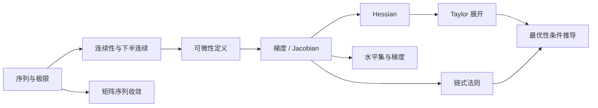
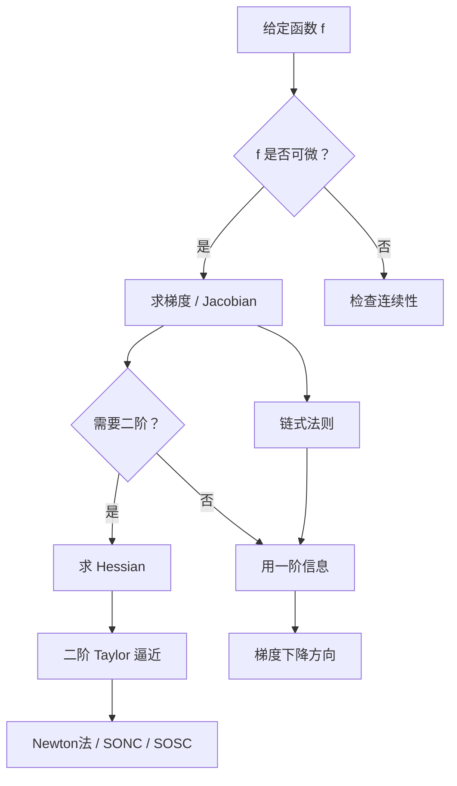

# 第5章 微积分基础 — 知识点梳理

> 本章解决的核心问题：**建立优化算法的全部分析工具——梯度告诉你"往哪走"，Hessian 告诉你"地面曲率"，Taylor 展开是 FONC/SONC/SOSC 的数学基础，链式法则是复合函数求导和反向传播的核心。**

---

## 一、本章核心脉络

> 图中主要路径：从序列与极限出发，连续性/下半连续和矩阵收敛是两条并行基础线。可微性定义是主轴——将函数局部近似为仿射函数。从可微性分出：一阶信息（梯度/Jacobian）通向链式法则（复合函数求导），也通向水平集与梯度（几何意义）。对一阶信息再求导得到 Hessian（二阶信息），Hessian 通向 Taylor 展开，Taylor 展开和链式法则共同构成 FONC/SONC/SOSC 的推导基础。

> 理解这个顺序：从极限（保证"越来越近"有意义）出发，建立连续性（保证函数不会"跳"）。可微性是本章的主轴——用线性/二次函数局部逼近非线性函数。一阶信息（梯度/Jacobian）给下降方向，二阶信息（Hessian）给曲率和步长估计。Taylor 展开将一阶和二阶信息统一为逼近工具。链式法则让复合函数求导机械化。水平集揭示了梯度的几何角色——梯度方向就是函数值增长最快的方向。

---

## 二、序列与极限基础

### 2.1 $\mathbb{R}$ 中的数列

**基本定义**：

| 概念 | 含义 | 记号 |
|------|------|------|
| 数列 | 一列有序实数 | $\{x_k\}_{k=1}^{\infty}$ |
| 递增 | $x_k < x_{k+1}$，对所有 $k$ | $x_k \uparrow$ |
| 单调 | 非增或非减 | — |

**极限定义**（$\varepsilon$-$K$ 语言）：

$$\forall \varepsilon > 0, \; \exists K > 0, \; \forall k > K: \; |x_k - x^*| < \varepsilon$$

> 一句话来说：**数列收敛到 $x^*$ 意味着——从某项之后，所有项都落在 $x^*$ 的任意小邻域内。**

### 2.2 $\mathbb{R}^n$ 中的序列

将 $\mathbb{R}$ 中的绝对值 $|\cdot|$ 换成 $\mathbb{R}^n$ 中的范数 $\|\cdot\|$：

$$\forall \varepsilon > 0, \; \exists K > 0, \; \forall k > K: \; \|x^{(k)} - x^*\| < \varepsilon$$

> 一句话来说：**$\mathbb{R}^n$ 中收敛就是每个分量都收敛，或者说序列点到极限点的"距离"趋于零。**

**关键定理：**

| 定理 | 内容 | 重要性 |
|------|------|--------|
| 单调有界定理（$\mathbb{R}$） | $\mathbb{R}$ 中单调有界数列必收敛 | 只需验证单调 + 有界 |
| Bolzano-Weierstrass | $\mathbb{R}^n$ 中有界序列必有收敛子列 | 紧集论证的核心工具 |
| 子列收敛性 | 收敛序列的任意子列收敛到同一极限 | 反证法常用 |

> **注意**：$\mathbb{R}^n$（$n \geq 2$）中没有自然的"序"——不能定义"递增"、不能使用单调有界定理。这是 $\mathbb{R}^n$ 和 $\mathbb{R}$ 的关键区别。

### 2.3 上确界与下确界

| 概念 | 定义 | 记号 |
|------|------|------|
| 上界 | 对所有 $k$ 有 $x_k \leq M$ | — |
| 上确界 | 最小上界 | $\sup \{x_k\}$ |
| 下确界 | 最大下界 | $\inf \{x_k\}$ |

> 一句话来说：上确界 = "天花板的最低高度"，下确界 = "地板砖的最高位置"。

---

## 三、连续性与下半连续（难点）

### 3.1 向量值函数的连续性

$f: \mathbb{R}^n \to \mathbb{R}^m$ 在 $x_0$ 处**连续** $\Longleftrightarrow$：

$$\forall \varepsilon > 0, \; \exists \delta > 0: \; \|y - x_0\| < \delta \Rightarrow \|f(y) - f(x_0)\| < \varepsilon$$

等价刻画：

$$\lim_{x \to x_0} f(x) = f(x_0) \quad \Longleftrightarrow \quad \forall \{x^{(k)}\} \to x_0: \; \lim_{k \to \infty} f(x^{(k)}) = f(x_0)$$

> 一句话来说：**连续 = 输入变化小则输出变化也小——函数没有"跳跃"。**

**三个等价条件合在一起看：**
1. $\varepsilon$-$\delta$ 定义（静态视角）
2. 极限等于函数值（点态视角）
3. 序列保极限（动态视角）——这是三个中最常用于证明的

### 3.2 下半连续（lower semicontinuous）

$f: \mathbb{R}^n \to \mathbb{R}$ 在 $x_0$ 处**下半连续**：

$$\liminf_{k \to \infty} f(x_k) \geq f(x_0), \quad \forall \{x_k\} \to x_0$$

> 一句话来说：**下半连续 = 函数值可以在极限处突然"掉下去"，但不能突然"跳上来"。** 连续函数自然是下半连续的。

**直观对比**：

| 函数行为 | 连续性 | 下半连续性 | 举例 |
|----------|:---:|:---:|------|
| 无跳跃 | 是 | 是 | $f(x) = \|x\|$ |
| 仅在 $x_0$ 处向下跳 | 否 | 是 | $f(x) = 0$ 当 $x=0$，否则 $f(x)=1$ 且在 $x \to 0$ 时 $\liminf = 0$ |
| 在 $x_0$ 处向上跳 | 否 | **否** | $f(x) = 1$ 当 $x=0$，否则 $f(x)=0$ |

**为什么优化中关心下半连续性？** Weierstrass 定理可以推广：如果 $f$ 下半连续且水平集紧，最小值仍然存在。下半连续是比连续更弱的条件，但足以保证许多存在性结果。

### 3.3 函数的闭性

$f: \mathbb{R}^n \to \mathbb{R}$ 是**闭函数** $\Longleftrightarrow$ $\text{dom}(f)$ 是闭集且 $f$ 下半连续。

**等价条件**（三个说法等价）：
1. 任意常数 $\gamma$，下水平集 $\{x \mid f(x) \leq \gamma\}$ 是闭集
2. $f$ 在每一点下半连续
3. $f$ 是闭函数

> 一句话来说：**闭函数 = 水平集都是闭集 = 下半连续 + 定义域闭。** 这三个性质其实是一个意思从不同角度说。

---

## 四、矩阵序列与矩阵级数（难点）

### 4.1 矩阵序列的收敛

$\{A_k\} \subset \mathbb{R}^{m \times n}$ 收敛到 $A$ $\Longleftrightarrow$ $\lim_{k \to \infty} \|A_k - A\| = 0$。

### 4.2 谱半径与方阵幂的收敛

> **关键引理**：$\displaystyle\lim_{k \to \infty} A^k = 0 \Longleftrightarrow \rho(A) = \max_i |\lambda_i(A)| < 1$

其中 $\rho(A)$ 是 $A$ 的**谱半径**——所有特征值绝对值的最大值。

> 一句话来说：**方阵的幂趋于零阵，当且仅当所有特征值都严格在单位圆内。** 这是线性迭代算法收敛性的理论基础。

**证明核心洞察**（利用 Jordan 标准形）：任意方阵 $A$ 相似于 Jordan 形 $J = \text{diag}[J(\lambda_1), \ldots, J(\lambda_r)]$。每个 Jordan 块 $J(\lambda_i)$ 的 $k$ 次幂的行为由 $\lambda_i^k$ 主导（对角元）。$\lambda_i^k \to 0 \Longleftrightarrow |\lambda_i| < 1$。

### 4.3 von Neumann 引理

> **引理**：矩阵级数 $\sum_{k=0}^{\infty} A^k$ 收敛 $\Longleftrightarrow$ $\lim_{k \to \infty} A^k = 0$。此时 $\sum_{k=0}^{\infty} A^k = (I - A)^{-1}$。

> 一句话来说：**这是几何级数 $1 + r + r^2 + \cdots = \frac{1}{1-r}$ 的矩阵版本——条件是谱半径小于 1。**

**推论（可逆性的扰动稳定性）**：

> 设方阵 $A$ 可逆。若 $\|A^{-1}\| \cdot \|A - B\| < 1$，则 $B$ 也可逆，且：
> $$B^{-1} = \sum_{k=0}^{\infty} (I - A^{-1}B)^k A^{-1}, \quad \|B^{-1}\| \leq \frac{\|A^{-1}\|}{1 - \|A^{-1}\| \cdot \|A - B\|}$$

> 一句话来说：**如果 $B$ 离可逆阵 $A$ 足够近，$B$ 也一定可逆，而且 $B^{-1}$ 可以用级数表示并给出范数上界。** 这保证了 Hessian 矩阵在小扰动下仍然可逆。

### 4.4 矩阵值函数的连续性

$F: \mathbb{R}^n \to \mathbb{R}^{m \times n}$ 在 $x_0$ 处连续 $\Longleftrightarrow$ $\lim_{x \to x_0} \|F(x) - F(x_0)\| = 0$。

> **引理**：若 $F(x)$ 在 $x_0$ 处连续且 $F(x_0)$ 可逆，则存在邻域 $N(x_0)$ 使得对所有 $x \in N(x_0)$，$F(x)$ 也可逆。且 $[F(\cdot)]^{-1}$ 在 $x_0$ 处也连续。

> 一句话来说：**可逆性在连续扰动下是"稳定"的。** 这对 Newton 法中要求 Hessian 可逆至关重要。

**证明核心**：令 $K(x) = F(x_0)^{-1}[F(x_0) - F(x)]$，则 $F(x) = F(x_0)[I - K(x)]$。由连续性 $\|K(x)\| \to 0$，当 $\|K(x)\| < 1$ 时 $I - K(x)$ 可逆（Neumann 引理），从而 $F(x)$ 可逆。

---

## 五、微分：从一维到多维（核心）

### 5.1 可微 = 局部的仿射逼近

函数 $f$ 在 $x_0$ 处**可微**：存在线性映射 $L$ 使得仿射函数 $a(x) = f(x_0) + L(x - x_0)$ 满足：

$$\lim_{x \to x_0} \frac{\|f(x) - a(x)\|}{\|x - x_0\|} = 0$$

> 一句话来说：**可微就是在 $x_0$ 附近，$f$ 可以被一个"平面"（仿射函数）以高于一阶的精度逼近——二者的差距除以距离仍然趋于零。**

**为什么是"仿射"而不是"线性"？** 因为逼近函数必须过点 $(x_0, f(x_0))$，而过原点的线性函数不一定过该点。仿射函数 = 线性 + 平移，刚好可以做到这一点。

### 5.2 三种尺度的导数

| 函数类型 | 导数记号 | 形状 | 本质 |
|----------|----------|------|------|
| $f: \mathbb{R} \to \mathbb{R}$ | $f'(x_0)$ | 标量 | 切线斜率 |
| $f: \mathbb{R}^n \to \mathbb{R}$ | $\nabla f(x_0)$ | $n$ 维行向量 | 最速上升方向 |
| $f: \mathbb{R}^n \to \mathbb{R}^m$ | $Df(x_0)$ | $m \times n$ 矩阵 | 各分量梯度的堆叠 |

**从一维到多维的递进关系：**

标量 → 梯度（向量） → Jacobian（矩阵）

- 一维：$f'(x_0) = \lim_{h \to 0} \frac{f(x_0 + h) - f(x_0)}{h}$
- 多维标量函数：$\nabla f(x_0)$ 是 $n$ 维向量（各偏导），逼近关系为 $f(x) \approx f(x_0) + \nabla f(x_0)^{\top}(x - x_0)$
- 多维向量函数：$Df(x_0)$ 是 $m \times n$ 矩阵（Jacobian），逼近关系为 $f(x) \approx f(x_0) + Df(x_0)(x - x_0)$

---

## 六、梯度、Jacobian 与 Hessian（核心）

### 6.1 梯度 $\nabla f(x)$

$f: \mathbb{R}^n \to \mathbb{R}$ 的梯度：

$$\nabla f(x) = \begin{bmatrix} \frac{\partial f}{\partial x_1} & \frac{\partial f}{\partial x_2} & \cdots & \frac{\partial f}{\partial x_n} \end{bmatrix}^{\top}$$

> 一句话来说：**梯度是一个 $n$ 维列向量，指向函数值增长最快的方向，其模长等于该方向上的最大变化率。**

**梯度三个角色的统一理解：**
1. **代数**：各偏导数组成的向量
2. **几何**：水平集的法向量方向
3. **优化**：最速上升方向（负梯度是最速下降方向）

### 6.2 Jacobian 矩阵 $Df(x)$

$f: \mathbb{R}^n \to \mathbb{R}^m$ 的 Jacobian：

$$Df(x) = \begin{bmatrix}
\frac{\partial f_1}{\partial x_1} & \cdots & \frac{\partial f_1}{\partial x_n} \\
\vdots & \ddots & \vdots \\
\frac{\partial f_m}{\partial x_1} & \cdots & \frac{\partial f_m}{\partial x_n}
\end{bmatrix} \in \mathbb{R}^{m \times n}$$

> 一句话来说：**Jacobian 是 $m$ 个梯度向量横向堆叠成的矩阵——第 $i$ 行是第 $i$ 个分量函数 $f_i$ 的梯度（行向量）。**

### 6.3 Hessian 矩阵 $\nabla^2 f(x)$

$f: \mathbb{R}^n \to \mathbb{R}$ 的 Hessian 是梯度的 Jacobian：

$$\nabla^2 f(x) = D(\nabla f)(x) = \begin{bmatrix}
\frac{\partial^2 f}{\partial x_1^2} & \cdots & \frac{\partial^2 f}{\partial x_1 \partial x_n} \\
\vdots & \ddots & \vdots \\
\frac{\partial^2 f}{\partial x_n \partial x_1} & \cdots & \frac{\partial^2 f}{\partial x_n^2}
\end{bmatrix} \in \mathbb{R}^{n \times n}$$

> 一句话来说：**Hessian 是"梯度的梯度"——描述函数在每个方向上的弯曲程度（曲率）。** 对角线元素表示单一方向上的曲率，非对角元素表示两个方向之间的"交叉弯曲"。

**Schwarz 定理**：若 $f$ 二阶连续可微，则 $\nabla^2 f(x)$ 是对称矩阵（$\frac{\partial^2 f}{\partial x_i \partial x_j} = \frac{\partial^2 f}{\partial x_j \partial x_i}$）。

> 直观理解：二阶混合偏导与求导次序无关——先对 $x_1$ 再对 $x_2$ 求导，和反过来做，结果一样。

### 6.4 计算示例

**课件例题**：$f(x) = 5x_1 + 8x_2 + x_1 x_2 - 4x_1^2 - 8x_2^2$

$$\nabla f(x) = \begin{bmatrix} 5 + x_2 - 8x_1 \\ 8 + x_1 - 16x_2 \end{bmatrix}, \quad \nabla^2 f(x) = \begin{bmatrix} -8 & 1 \\ 1 & -16 \end{bmatrix}$$

> 注意到：Hessian 是常数矩阵（函数是二次函数），且是负定的——这个二次函数只有极大点。

**更多练习（建议自查）**：

| 函数 | 需要注意的点 |
|------|-------------|
| $f(x) = \ln(e^{x_1} + e^{x_2})$ | 链式法则 + softmax 的原型 |
| $f(x) = x_1 / x_2$ | 商的求导法则 |
| $f(x) = x_1^{-1} x_2^{-1}$ | 乘积 + 幂函数的混合 |
| $f(x) = 4x_1^2 - 2x_1 + 3x_1 x_2 + 4x_2^2$ | 完整练习：$\nabla f$, $\nabla^2 f$, $f(x_0+p)$ |

---

## 七、微分法则与链式法则（核心）

### 7.1 常用导数公式速查

| 函数 $f(x)$ | 导数 / 梯度 | 记忆要点 |
|-------------|-------------|----------|
| $f(x) = a$（常数） | $0$ | — |
| $f(x) = a^{\top} x$（线性） | $a^{\top}$ | 系数就是导数 |
| $f(x) = \|x\|^2 = x^{\top} x$ | $2x^{\top}$ | 对标量 $x^2$ 求导 |
| $f(x) = \frac{1}{2} x^{\top} A x$ | $x^{\top} \frac{A + A^{\top}}{2}$ 或 $x^{\top} A$（$A$ 对称时） | 是标量 $ax^2$ 的矩阵推广 |
| $f(x) = x^{\top} A x$ | $x^{\top}(A + A^{\top})$ | 与上条差 2 倍 |
| $f(x) = Ax$（矩阵乘向量） | $A$ | Jacobian = 矩阵本身 |
| $f(x) = x^a$（幂函数） | $a x^{a-1}$ | 对标量求导法则 |
| $f(X) = \text{tr}(A^{\top} X)$ | $A$ | 矩阵微分的起点 |

> 一句话来说：**标量函数的这些公式是 AI/优化的"数学语法"——梯度下降中每一步都要用到它们。** 特别记住 $\frac{1}{2} x^{\top} A x$ 的梯度是 $A x$（$A$ 对称时），这是最常用的二次型求导。

### 7.2 链式法则

设 $h(x) = g(f(x))$，$f: \mathbb{R}^n \to \mathbb{R}^m$，$g: \mathbb{R}^m \to \mathbb{R}^p$：

$$Dh(x) = Dg(f(x)) \cdot Df(x), \quad Dh \in \mathbb{R}^{p \times n}$$

> 一句话来说：**链式法则就是"导数矩阵相乘"——外层导数矩阵乘以内层导数矩阵，维度自动对齐。** 这是反向传播（backpropagation）的数学本质。

**课件链式法则应用示例**：

1. $f(x) = \frac{1}{2}\|Ax - b\|^2$ — 令 $h(y) = \frac{1}{2}\|y - b\|^2$，$y = g(x) = Ax$，则 $\nabla f = A^{\top}(Ax - b)$
2. $f(x) = \varphi(x_0 + t d)$ — 单变量函数的链式法则，$f'(t) = \nabla \varphi(x_0 + t d)^{\top} d$
3. $f(x) = (a^{\top} x)(b^{\top} x)$ — 乘积法则 + 链式法则：$\nabla f = (b^{\top} x)a + (a^{\top} x)b$
4. $f(x) = e^{x^{\top} A x}$ — $\nabla f = e^{x^{\top} A x} \cdot (A + A^{\top})x$

---

## 八、水平集与梯度的几何意义（核心）

### 8.1 水平集的定义与性质

函数 $f: \mathbb{R}^n \to \mathbb{R}$ 关于常数 $c$ 的**水平集**：

$$S_c = \{x \in \mathbb{R}^n \mid f(x) = c\}$$

> 一句话来说：**水平集是 $f$ 值相等的所有点构成的"等高线/等高面"——就像地形图上的等高线。**

**三个基本性质：**

| 性质 | 说明 |
|------|------|
| 互不相交 | $S_{c_1} \cap S_{c_2} = \emptyset$（$c_1 \neq c_2$）— 一个点只能有一个函数值 |
| 疏密反映变化率 | 水平集越密集，函数值变化越快（梯度模长大） |
| 梯度与水平集正交 | $\nabla f(x)$ 是过 $x$ 的水平集的法向量 |

### 8.2 梯度是水平集的法向量

> **核心几何事实**：$\nabla f(x_0)$ 是水平集 $S = \{x \mid f(x) = f(x_0)\}$ 上过 $x_0$ 的任意光滑曲线的切向量的**法向量**。

**证明思路**：设 $x(t)$ 是水平集上过 $x_0$ 的一条曲线（$x(0) = x_0$）。因为 $f(x(t)) = f(x_0)$ 恒成立，两边对 $t$ 求导（链式法则）：

$$0 = \frac{d}{dt}f(x(t)) = \nabla f(x(t))^{\top} x'(t)$$

所以 $\nabla f(x_0) \perp x'(0)$——梯度与任意切线方向正交。

> 一句话来说：**站在水平集上看，梯度永远垂直于你脚下的等高线，指向"上山"（函数值增大）的方向。**

### 8.3 最速上升路径

> $\nabla f(x_0)$ 是函数 $f$ 在点 $x_0$ 处**增长最快的方向**。

**为什么？** 沿单位方向 $d$（$\|d\| = 1$）的方向导数 $\frac{\partial f}{\partial d} = \nabla f(x_0)^{\top} d$。由 Cauchy-Schwarz：

$$\nabla f(x_0)^{\top} d \leq \|\nabla f(x_0)\| \cdot \|d\| = \|\nabla f(x_0)\|$$

等号成立当且仅当 $d = \nabla f(x_0) / \|\nabla f(x_0)\|$——即方向与梯度方向一致时内积最大。

> 一句话来说：**负梯度方向是最速下降方向，梯度方向是最速上升方向。** 这是所有梯度类优化算法的物理直觉基础。

### 8.4 函数的图与切平面

函数 $f: \mathbb{R}^n \to \mathbb{R}$ 的**图**（graph）是 $\mathbb{R}^{n+1}$ 中的一个 $n$ 维曲面：

$$\text{gph}(f) = \{(x, f(x)) \mid x \in \mathbb{R}^n\}$$

在点 $(x_0, f(x_0))$ 处的**切平面**：

$$x_{n+1} = f(x_0) + \nabla f(x_0)^{\top}(x - x_0)$$

> 一句话来说：**切平面就是用一阶 Taylor 展开逼近函数图——它是 $\mathbb{R}^{n+1}$ 中"贴着"函数曲面的超平面。**

---

## 九、Taylor 展开（核心）

### 9.1 一元函数的 Taylor 展开

若 $f: (a, b) \to \mathbb{R}$ 是 $m$ 阶连续可微的：

$$f(x) = f(x_0) + \frac{f'(x_0)}{1!}(x - x_0) + \frac{f''(x_0)}{2!}(x - x_0)^2 + \cdots + \frac{f^{(m)}(x_0)}{m!}(x - x_0)^m + R_m$$

**Lagrange 余项**：$R_m = \frac{f^{(m+1)}(\xi)}{(m+1)!}(x - x_0)^{m+1}$，$\xi \in (x_0, x)$。

> 一句话来说：**Taylor 展开是用多项式在一点附近"复印"一个函数——阶数越高，复印件越像原件。余项告诉我们复印件和原件之间差了多少。**

### 9.2 符号 $O$ 和 $o$（了解即可）

| 符号 | 含义 | 直观 |
|------|------|------|
| $f(x) = O(g(x))$ | $\frac{|f(x)|}{|g(x)|}$ 在原点附近有上界 | $f$ 增长不超过 $g$ |
| $f(x) = o(g(x))$ | $\lim_{x \to 0} \frac{|f(x)|}{|g(x)|} = 0$ | $f$ 比 $g$ 更"小" |

> 一句话来说：$O$ 是"不超过"，$o$ 是"远小于"。**在最优性条件的推导中，$o(\|x - x_0\|)$ 表示"比距离更高阶的无穷小"，可以在一阶分析中忽略。**

### 9.3 多元函数的 Taylor 展开

$f: \Omega \subset \mathbb{R}^n \to \mathbb{R}$ 是 $m$ 阶连续可微的：

**一阶展开（线性逼近）：**

$$f(x) \approx f(x_0) + \nabla f(x_0)^{\top}(x - x_0)$$

**二阶展开（二次逼近）：**

$$f(x) \approx f(x_0) + \nabla f(x_0)^{\top}(x - x_0) + \frac{1}{2}(x - x_0)^{\top} \nabla^2 f(x_0) (x - x_0)$$

**一般形式：**

$$f(x) = f(x_0) + Df(x_0)(x - x_0) + \frac{1}{2}(x - x_0)^{\top} \nabla^2 f(x_0)(x - x_0) + \cdots + R_m$$

| 展开阶数 | 逼近形式 | 在优化中的作用 |
|----------|----------|---------------|
| **一阶** | $f(x_0) + \nabla f^{\top}(x - x_0)$ | 梯度下降的方向和步长 |
| **二阶** | 一阶 + $\frac{1}{2}(x - x_0)^{\top} \nabla^2 f (x - x_0)$ | Newton 法的迭代公式 |
| **高阶余项** | $o(\|x - x_0\|^m)$ | SONC/SOSC 的推导基础 |

> 一句话来说：**一阶 Taylor 展开是梯度下降的数学基础，二阶 Taylor 展开是 Newton 法的数学基础。** 整个 Ch06-Ch11 的无约束优化方法都在这两种展开上构建。

---

## 十、中值定理

### 向量值函数的中值定理

设 $f: \Omega \subset \mathbb{R}^n \to \mathbb{R}^m$ 在开集 $\Omega$ 上可微。则对任意 $x, y \in \Omega$，存在矩阵 $M \in \mathbb{R}^{m \times n}$ 使得：

$$f(x) - f(y) = M(x - y)$$

**特殊情形：**
- $\Omega \subset \mathbb{R}$（一维），$f: \Omega \to \mathbb{R}$：经典中值定理 $f(a) - f(b) = f'(\xi)(a - b)$
- $\Omega \subset \mathbb{R}^n$，$f: \Omega \to \mathbb{R}$：$f(a) - f(b) = \int_a^b \nabla f(\xi)^{\top} d\xi$

> 一句话来说：**中值定理是说"函数值的变化等于某处的导数乘以自变量的变化"——它把差商和导数联系在了一起。**

**在优化中怎么用？** 中值定理常用于证明：$\|f(x) - f(y)\| \leq L\|x - y\|$（Lipschitz 连续性），这是梯度下降收敛性分析的基础工具。

---

## 判定 / 决策流程

---

## 核心公式速查表

| 概念 | 公式 | 备注 |
|------|------|------|
| $\mathbb{R}^n$ 极限 | $\forall \varepsilon > 0, \exists K: \forall k > K, \|x^{(k)} - x^*\| < \varepsilon$ | 范数代替绝对值 |
| Bolzano-Weierstrass | 有界序列必有收敛子列 | $\mathbb{R}^n$ 版本 |
| 下半连续 | $\liminf f(x_k) \geq f(x_0)$ | 比连续弱 |
| 闭函数 | $\{x \mid f(x) \leq \gamma\}$ 是闭集 | 等价于下半连续 + dom 闭 |
| 谱半径 | $\rho(A) = \max_i |\lambda_i(A)|$ | $A^k \to 0 \iff \rho(A) < 1$ |
| Neumann 引理 | $\sum_{k=0}^{\infty} A^k = (I - A)^{-1}$ | $\rho(A) < 1$ 时 |
| 梯度（标量场） | $\nabla f = [\partial f/\partial x_i]_{n \times 1}$ | $n$ 维列向量 |
| Jacobian（向量场） | $Df = [\partial f_i/\partial x_j]_{m \times n}$ | 每行是一个梯度 |
| Hessian | $\nabla^2 f = D(\nabla f)$ | $n \times n$ 对称（$C^2$ 时） |
| $\frac{1}{2}x^{\top}Ax$ 的梯度 | $x^{\top}A$（$A$ 对称时） | 最常用二次型求导 |
| 链式法则 | $Dh(x) = Dg(f(x)) \cdot Df(x)$ | 矩阵乘积 |
| 水平集 | $S_c = \{x \mid f(x) = c\}$ | 等高线 |
| 梯度与水平集 | $\nabla f(x_0) \perp$ 水平集切线 | 法向量关系 |
| 方向导数（可微时） | $\frac{\partial f}{\partial d} = \nabla f(x)^{\top} d$ | $d$ 方向变化率 |
| 一阶 Taylor | $f(x) \approx f(x_0) + \nabla f(x_0)^{\top}(x - x_0)$ | 线性逼近 |
| 二阶 Taylor | $f(x) \approx f(x_0) + \nabla f^{\top}(x - x_0) + \frac{1}{2}(x - x_0)^{\top}\nabla^2 f (x - x_0)$ | 二次逼近 |
| 中值定理 | $f(x) - f(y) = M(x - y)$ | $M$ 为某矩阵 |
| 切平面 | $x_{n+1} = f(x_0) + \nabla f(x_0)^{\top}(x - x_0)$ | 函数图的切超平面 |

---

## 易错点与注意事项

> [!warning] $\mathbb{R}^n$（$n \geq 2$）没有单调性
> $\mathbb{R}$ 中的"单调有界必收敛"定理不能在 $\mathbb{R}^n$ 中直接使用。在 $\mathbb{R}^n$ 中要用 Bolzano-Weierstrass 定理（有界序列有收敛子列）。

> [!warning] 梯度是列向量，但常用行向量写内积
> $\nabla f(x)$ 是 $n$ 维列向量，但一阶 Taylor 展开常写成 $\nabla f(x_0)^{\top}(x - x_0)$——转置后是行向量乘以列向量（内积）。Jacobian 是矩阵，不需要转置：$f(x) \approx f(x_0) + Df(x_0)(x - x_0)$。

> [!warning] Hessian 的对称性需要 $C^2$ 条件
> Schwarz 定理要求函数二阶连续可微（$C^2$）才保证 Hessian 对称。如果只是二阶偏导存在但不连续，Hessian 可能不对称。

> [!warning] 链式法则的维度匹配
> $h(x) = g(f(x))$，$f: \mathbb{R}^n \to \mathbb{R}^m$，$g: \mathbb{R}^m \to \mathbb{R}^p$。则 $Dh \in \mathbb{R}^{p \times n} = \mathbb{R}^{p \times m} \cdot \mathbb{R}^{m \times n}$（$Dg \cdot Df$）。维度自动对齐——如果算不出来，检查函数复合的维度是否正确。

> [!warning] 二阶 Taylor 展开的 $\frac{1}{2}$ 因子
> 二阶项是 $\frac{1}{2}(x - x_0)^{\top} \nabla^2 f(x_0)(x - x_0)$，注意系数 $\frac{1}{2}$ 来自 Taylor 公式的 $\frac{1}{2!}$。忘记这个系数是常见错误。

> [!warning] Neumann 引理的前提条件
> $\sum_{k=0}^{\infty} A^k = (I - A)^{-1}$ 要求 $\rho(A) < 1$（不是 $\|A\| < 1$）。$\|A\| < 1$ 是更保守的充分条件但不是必要条件。

---

## 相关知识点链接

- 前置知识：[[03-线性代数基础#矩阵范数|矩阵范数]] — 矩阵序列收敛的定义依赖范数
- 前置知识：[[03-线性代数基础#特征值与二次型|特征值与 Jordan 形]] — 谱半径和 $A^k \to 0$ 的证明使用 Jordan 标准形
- 直接应用：[[06-最优性条件#FONC|一阶必要条件 FONC]] — Taylor 展开是 FONC/SONC/SOSC 推导的全部数学基础
- 直接应用：[[06-最优性条件#方向导数|方向导数]] — 梯度和方向导数的关系
- 后续核心：[[07-一维搜索|一维搜索（线搜索）]] — 方向导数用于确定下降方向和步长
- 后续核心：[[08-梯度方法|梯度下降法]] — 负梯度方向迭代
- 后续核心：[[10-牛顿法|Newton 法]] — 二阶 Taylor 展开 + Hessian 的迭代公式
- 后续核心：[[09-共轭梯度法|共轭梯度法]] — 二次函数 $\frac{1}{2}x^{\top}Ax$ 的梯度结构

---

## 作业与练习

课后习题：[[习题库/05-微积分基础/README|第5章习题库]]

| 题号 | 类型 | 建议 |
|------|------|------|
| 5.3 | 求导计算 | 练习梯度和 Hessian 的手算，注意 $\frac{1}{2}x^{\top}Ax$ 型 |
| 5.6 | 链式法则应用 | 重点练习复合函数的一阶和二阶导数 |

> 本章是后续所有优化方法的计算语言。建议重点掌握：**梯度/Hessian 的手算能力**（特别是 $\frac{1}{2}x^{\top}Ax$ 型）、**链式法则的维度匹配**、**一阶和二阶 Taylor 展开的写法**、**梯度是水平集法向量的几何直觉**。这些技能在 Ch06-Ch11 的每一个算法推导中都会反复使用。
