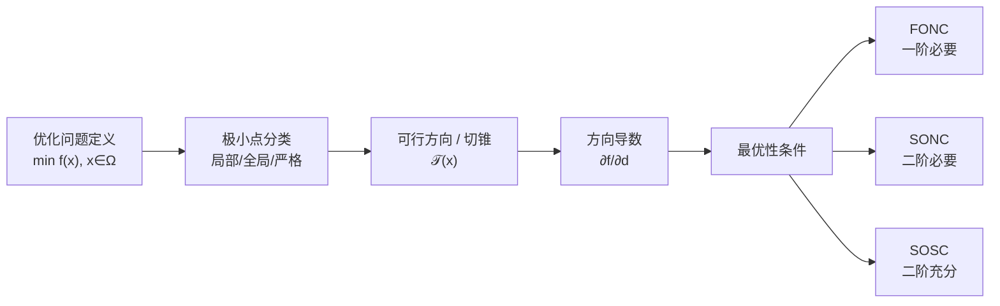
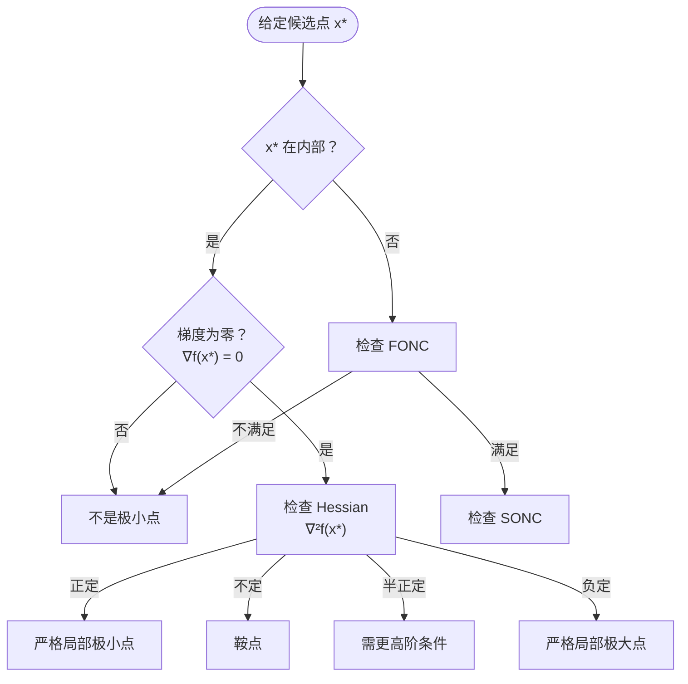

# 第6章 最优性条件 — 知识点梳理

> 本章解决的核心问题：**给定一个点 $x^*$，如何判断它是不是优化问题的局部极小点？**

---

## 一、本章核心脉络

---

## 二、优化问题的基本定义

### 2.1 一般形式

$$
\min_{x \in \Omega} f(x)
$$

| 符号 | 名称 | 含义 |
|------|------|------|
| $f: \mathbb{R}^n \to \mathbb{R}$ | **目标函数** | 要最小化的函数 |
| $x \in \mathbb{R}^n$ | **决策变量** | $n$ 维向量 |
| $\Omega \subseteq \mathbb{R}^n$ | **可行集/约束集** | $x$ 允许取值的范围 |

### 2.2 约束集的标准形式

$$
\Omega = \{ x \in \mathbb{R}^n \mid h_i(x) = 0, \; i=1,\ldots,m; \quad g_j(x) \leq 0, \; j=1,\ldots,p \}
$$

- **等式约束**：$h_i(x) = 0$（如 $x_1 - x_2 = 0$）
- **不等式约束**：$g_j(x) \leq 0$（如 $-x_1 \leq 0$ 等价于 $x_1 \geq 0$）
- **无约束优化**：$\Omega = \mathbb{R}^n$

### 2.3 极小点的分类

| 类型 | 定义 | 关键特征 |
|------|------|----------|
| **局部极小点** | $\exists \delta > 0$，$\forall x \in \Omega \cap B(x^*, \delta)$，有 $f(x) \geq f(x^*)$ | 只在邻域内最小 |
| **全局极小点** | $\forall x \in \Omega$，有 $f(x) \geq f(x^*)$ | 整个可行域内最小 |
| **严格局部极小点** | 上述"$\geq$"改为"$>$" | 邻域内唯一最小 |
| **严格全局极小点** | 上述"$\geq$"改为"$>$" | 整个域内唯一最小 |

> ⚠️ **重要**：全局极小点一定是局部极小点；反之不成立。

---

## 三、可行方向与切锥（难点）

### 3.1 可行方向的直观理解

**定义**：若从 $x$ 出发沿方向 $d$ 走一小步仍落在 $\Omega$ 内，则 $d$ 是 $x$ 处的**可行方向**。

$$\exists \alpha_0 > 0, \quad \forall \alpha \in [0, \alpha_0]: \; x + \alpha d \in \Omega$$

### 3.2 两类点的可行方向特征

| 点的位置 | 可行方向集合 | 直观理解 |
|----------|-------------|----------|
| $x \in \text{int}(\Omega)$（内部） | 整个 $\mathbb{R}^n$ | 所有方向都可行 |
| $x \in \text{bd}(\Omega)$（边界） | 锥 / 半空间 / 子空间 | 受约束限制 |

### 3.3 切锥 $\mathcal{T}(x)$ 的计算公式

> $\mathcal{T}(x)$ 是 **$x$ 处所有线性化可行方向** 构成的集合。

#### ① 等式约束：$\Omega = \{ x \mid h_i(x) = 0 \}$

$$\mathcal{T}(x) = \{ d \in \mathbb{R}^n \mid Dh(x) \, d = 0 \}$$

- $Dh(x)$ 是 $h$ 的 Jacobian 矩阵（$m \times n$）
- $\mathcal{T}(x)$ 是一个**子空间**（过原点的线性空间）
- 几何意义：$d$ 与所有等式约束的梯度正交

**快速计算**：$Dh(x) d = 0$ 就是一个齐次线性方程组，解空间即 $\mathcal{T}(x)$。

#### ② 不等式约束：$\Omega = \{ x \mid g_j(x) \leq 0 \}$

$$\mathcal{T}(x) = \{ d \in \mathbb{R}^n \mid Dg_j(x) \, d < 0, \; j \in \mathcal{J}(x) \}$$

- **积极约束集**：$\mathcal{J}(x) = \{ j \mid g_j(x) = 0 \}$（在 $x$ 处刚好取等的约束）
- 只有积极约束才限制方向
- $\mathcal{T}(x)$ 是一个**锥**（严格不等式定义的开锥）

**核心口诀**：
> **"积极约束才有发言权，$Dg \cdot d < 0$ 指向可行侧。"**

#### ③ 混合约束：等式 + 不等式

$$\mathcal{T}(x) = \{ d \in \mathbb{R}^n \mid Dh(x) d = 0, \; Dg_j(x) d < 0, \; j \in \mathcal{J}(x) \}$$

### 3.4 切锥计算：第一象限例题

> **例题**：$\Omega = \{ x \in \mathbb{R}^2 \mid x_1 \geq 0, x_2 \geq 0 \}$，求各点的 $\mathcal{T}(x)$。

**步骤**：
1. 改写为标准形式：$g_1(x) = -x_1 \leq 0$，$g_2(x) = -x_2 \leq 0$
2. 求梯度：$Dg_1 = [-1, 0]$，$Dg_2 = [0, -1]$
3. 判断积极约束：哪些 $g_j(x) = 0$
4. 代入公式解不等式

| 点 | 积极约束 | 不等式条件 | 切锥 $\mathcal{T}(x)$ |
|----|---------|-----------|---------------------|
| $[1, 3]^T$（内部）| 无 | — | $\mathbb{R}^2$ |
| $[0, 3]^T$（左边界）| $g_1$ | $-d_1 < 0$ | $\{ d \mid d_1 > 0 \}$ |
| $[1, 0]^T$（下边界）| $g_2$ | $-d_2 < 0$ | $\{ d \mid d_2 > 0 \}$ |
| $[0, 0]^T$（角点）| $g_1, g_2$ | $-d_1 < 0, -d_2 < 0$ | $\{ d \mid d_1 > 0, d_2 > 0 \}$ |

> 💡 **几何理解**：内点 $	o$ 全空间；边界 $	o$ 半空间；角点 $	o$ 锥。

---

## 四、方向导数

### 4.1 定义

$$\frac{\partial f}{\partial d} = \lim_{\alpha \to 0} \frac{f(x + \alpha d) - f(x)}{\alpha}$$

### 4.2 可微情形（最常用）

若 $f$ 可微，方向导数简化为：

$$\frac{\partial f}{\partial d} = \nabla f(x)^T d$$

> 这是梯度与方向向量的内积。

### 4.3 方向导数的符号含义

| $\nabla f(x)^T d$ | 含义 |
|-------------------|------|
| $> 0$ | 沿 $d$ 方向函数值**上升** |
| $< 0$ | 沿 $d$ 方向函数值**下降** |
| $= 0$ | 沿 $d$ 方向函数值**不变**（一阶近似） |

---

## 五、最优性条件（本章核心）

### 5.1 一阶必要条件（FONC）

> **定理**：设 $f \in C^1$，$x^*$ 是局部极小点，则对 $x^*$ 处的**任意可行方向** $d$：
> $$d^T \nabla f(x^*) \geq 0$$

**直观理解**：局部极小点处，沿任何可行方向都不能下降（否则就不是极小点了）。

**证明思路**：Taylor 展开
$$f(x^* + \alpha d) = f(x^*) + \alpha \nabla f(x^*)^T d + o(\alpha)$$
若 $x^*$ 是极小点，则对小的 $\alpha > 0$ 有 $f(x^* + \alpha d) \geq f(x^*)$，故 $\nabla f(x^*)^T d \geq 0$。

#### FONC 的推论（重要！）

| 情形 | 结论 |
|------|------|
| $x^* \in \text{int}(\Omega)$（内点） | $\nabla f(x^*) = 0$（梯度必须为零向量）|
| $\Omega = \mathbb{R}^n$（无约束） | $\nabla f(x^*) = 0$ |

> 证：内点时可行方向为全空间 $\mathbb{R}^n$，$d^T \nabla f(x^*) \geq 0$ 对所有 $d$ 成立 $\Rightarrow \nabla f(x^*) = 0$。

### 5.2 一阶充分条件（FOSC）

> **定理**：若对 $x^*$ 处的**任意可行方向** $d$：
> $$d^T \nabla f(x^*) > 0$$
> 则 $x^*$ 是**严格局部极小点**。

| 条件                                                      | 结论       |
| ------------------------------------------------------- | -------- |
| $d^T \nabla f(x^*) > 0, \forall d \in \mathcal{F}(x^*)$ | 严格局部极小点  |
| $d^T \nabla f(x^*) < 0, \forall d \in \mathcal{F}(x^*)$ | 严格局部极大点  |
| 同时存在 $>0$ 和 $<0$                                        | 既非极小也非极大 |

### 5.3 二阶必要条件（SONC）

> **定理**：设 $f \in C^2$，$x^*$ 是局部极小点，$d$ 是可行方向。若 $d^T \nabla f(x^*) = 0$，则：
> $$d^T \nabla^2 f(x^*) d \geq 0$$

**适用场景**：一阶条件"失效"时——即梯度与可行方向正交，一阶变化为零，需要用二阶信息判断。

**证明思路**：二阶 Taylor 展开
$$f(x^* + \alpha d) = f(x^*) + \alpha \nabla f(x^*)^T d + \frac{\alpha^2}{2} d^T \nabla^2 f(x^*) d + o(\alpha^2)$$
当 $\nabla f(x^*)^T d = 0$ 时，$f(x^* + \alpha d) - f(x^*) \approx \frac{\alpha^2}{2} d^T \nabla^2 f(x^*) d \geq 0$。

#### SONC 的推论（内点/无约束情形）

若 $x^* \in \text{int}(\Omega)$ 且 $\nabla f(x^*) = 0$，则：
$$\nabla^2 f(x^*) \succeq 0 \quad \text{（Hessian 半正定）}$$

### 5.4 二阶充分条件（SOSC）— 内点情形

> **定理**：设 $f \in C^2$，$x^* \in \text{int}(\Omega)$。若：
> $$\nabla f(x^*) = 0 \quad \text{且} \quad \nabla^2 f(x^*) \succ 0$$
> 则 $x^*$ 是**严格局部极小点**。

| Hessian 判定 | 结论 |
|-------------|------|
| $\nabla^2 f(x^*) \succ 0$（正定） | 严格局部极小点 ✅ |
| $\nabla^2 f(x^*) \prec 0$（负定） | 严格局部极大点 |
| $\nabla^2 f(x^*)$ 不定 | 鞍点 ❌ |
| $\nabla^2 f(x^*) \succeq 0$（半正定） | 无法判断（需更高阶信息） |
| $\nabla^2 f(x^*) \preceq 0$（半负定） | 无法判断（需更高阶信息） |

---

## 六、判定流程图（决策树）

**内点判定流程：**
1. 检查 $\nabla f(x^*) = 0$？
   - 否 $\Rightarrow$ **不是极小点**
   - 是 $\Rightarrow$ 继续检查 Hessian
2. 检查 $\nabla^2 f(x^*)$：
   - 正定 $\Rightarrow$ **严格局部极小点**
   - 负定 $\Rightarrow$ **严格局部极大点**
   - 不定 $\Rightarrow$ **鞍点**
   - 半正定（非正定）$\Rightarrow$ 需更高阶条件

**边界点判定流程：**
1. 检查 FONC：$d^T \nabla f(x^*) \geq 0$ 对所有可行方向 $d$ 是否成立？
   - 否 $\Rightarrow$ **不是极小点**
   - 是 $\Rightarrow$ 继续检查 SONC
2. 检查 SONC：对满足 $d^T \nabla f(x^*) = 0$ 的方向，是否有 $d^T \nabla^2 f(x^*) d \geq 0$？

---

## 七、核心公式速查表

| 概念 | 公式 | 备注 |
|------|------|------|
| 可行方向定义 | $\exists \alpha_0 > 0, \forall \alpha \in [0, \alpha_0]: x + \alpha d \in \Omega$ | $d \neq 0$ |
| 等式约束切锥 | $\mathcal{T}(x) = \{ d \mid Dh(x) d = 0 \}$ | 子空间 |
| 不等式约束切锥 | $\mathcal{T}(x) = \{ d \mid Dg_j(x) d < 0, j \in \mathcal{J}(x) \}$ | 开锥 |
| 方向导数 | $\frac{\partial f}{\partial d} = \nabla f(x)^T d$ | 可微时 |
| FONC（一般） | $d^T \nabla f(x^*) \geq 0, \; \forall d \in \mathcal{T}(x^*)$ | 必要条件 |
| FONC（内点） | $\nabla f(x^*) = 0$ | 梯度为零 |
| SONC（内点） | $\nabla f(x^*) = 0, \; \nabla^2 f(x^*) \succeq 0$ | 必要条件 |
| SOSC（内点） | $\nabla f(x^*) = 0, \; \nabla^2 f(x^*) \succ 0$ | **充分条件** |

---

## 八、易错点与注意事项

> [!warning] 必要条件 vs 充分条件
> - **FONC、SONC 是必要条件**：满足它们不一定是最小点（如 $f(x) = x^3$ 在 $x=0$ 处满足一阶和二阶必要条件，但不是极小点）
> - **SOSC 是充分条件**：满足它一定是最小点，但最小点不一定满足它（如边界点不能用 SOSC）

> [!warning] 切锥定义中的严格不等式
> 课件中不等式约束的切锥使用 $Dg_j(x) d < 0$（**严格**小于），这与经典定义（含等号）略有不同，但在推导一阶条件时更为方便。

> [!warning] 边界点不能用无约束的结论
> 当 $x^*$ 在可行域边界上时，不能直接令 $\nabla f(x^*) = 0$。必须使用 **FONC**：$d^T \nabla f(x^*) \geq 0$ 对所有可行方向 $d$ 成立。

> [!warning] Hessian 半正定 ≠ 极小点
> $\nabla^2 f(x^*) \succeq 0$ 只是**必要条件**，不是充分条件。例如 $f(x) = x^3$ 在 $x=0$ 处 $f''(0) = 0$（半正定），但不是极小点。

---

## 九、相关知识点链接

- 数学基础：[[03-线性代数基础#特征值与二次型|Hessian 正定性判定]]
- 数学基础：[[05-微积分基础#Taylor展开|Taylor 展开]]
- 后续章节：[[20-等式约束优化问题|等式约束优化的 Lagrange 乘子法]]
- 后续章节：[[21-不等式约束优化问题|KKT 条件（约束优化的一阶必要条件）]]

---

## 十、作业与练习

课后习题：[[习题库/06-最优性条件/README|第6章习题库]]

| 题号   | 类型      | 建议               |
| ---- | ------- | ---------------- |
| 6.16 | SONC 应用 | 先检验 FONC，再检验二阶条件 |
| 6.2  | 切锥计算    | 熟练掌握积极约束的判断      |
| 6.10 | FONC 验证 | 注意区分内点和边界点       |
| 6.19 | 综合判断    | 完整走一遍判定流程        |
