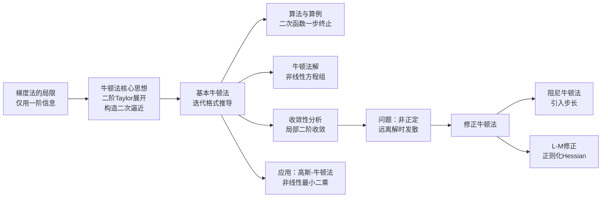
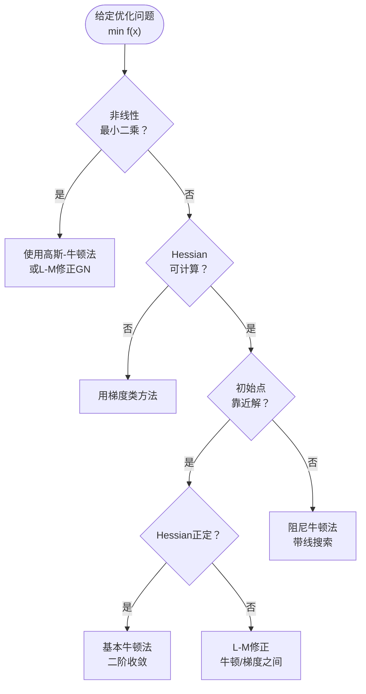

# 第9章 牛顿法 — 知识点梳理

> 本章解决的核心问题：**梯度法只用一阶信息，收敛慢；能不能利用二阶（曲率）信息，让每一步"看得更远"，从而实现更快收敛？**

---

## 一、本章核心脉络

上图展示了一条从"梯度法不够快"出发、逐步引入二阶信息、再到处理 Hessian 非正定问题的完整演进路径。核心逻辑是：二阶信息带来速度，但也带来脆弱性（非正定、远离解时发散），后续的所有修正方法都在速度和稳健性之间寻找平衡。

---

## 二、牛顿法的基本思想与推导

### 2.1 核心动机

梯度类方法（如最速下降法）仅在当前点构造一阶逼近（切线/切平面），因此只能"看到"局部的线性趋势。当目标函数曲率较大时，梯度法只能小步慢行。

> 一句话来说：**梯度法像闭眼走一步试探，牛顿法像睁开眼睛看清地面的弯曲再走。**

牛顿法的思路：在当前点对目标函数做**二阶 Taylor 展开**（不仅用到梯度，还用到了 Hessian 表示曲率），然后用这个二次逼近函数的极小点作为下一个迭代点。

### 2.2 推导过程

设 $f: \mathbb{R}^n \to \mathbb{R}$ 二次连续可微，在 $x^{(k)}$ 处的二阶 Taylor 展开：

$$f(x) \approx f(x^{(k)}) + (x - x^{(k)})^T g^{(k)} + \frac{1}{2}(x - x^{(k)})^T H(x^{(k)})(x - x^{(k)}) =: m(x)$$

其中 $g^{(k)} = \nabla f(x^{(k)})$，$H(x^{(k)}) = \nabla^2 f(x^{(k)})$。

对逼近函数 $m(x)$ 求一阶最优性条件：

$$0 = \nabla m(x) = g^{(k)} + H(x^{(k)})(x - x^{(k)})$$

若 $H(x^{(k)}) \succ 0$（正定），则 $m(x)$ 的极小点唯一：

$$x^{(k+1)} = x^{(k)} - H(x^{(k)})^{-1} g^{(k)}$$

这就是**牛顿法的迭代格式**。牛顿方向为：

$$d^{(k)} = -H(x^{(k)})^{-1} g^{(k)}$$

> 一句话来说：**牛顿方向 = 负梯度左乘 Hessian 的逆——相当于把局部"曲率"信息编码进了搜索方向，在弯曲方向"走得少"，在平直方向"走得多"。**

### 2.3 与梯度法的对比

| 特性 | 梯度法（最速下降法） | 牛顿法 |
|------|---------------------|--------|
| 使用的导数信息 | 一阶（梯度） | 二阶（梯度 + Hessian） |
| 搜索方向 | $d^{(k)} = -g^{(k)}$ | $d^{(k)} = -H(x^{(k)})^{-1} g^{(k)}$ |
| 每次迭代计算量 | $O(n)$（仅梯度） | $O(n^3)$（需解 $n$ 元线性方程组或求逆） |
| 二次函数收敛 | 线性收敛，需多次迭代 | 一步终止 |
| 一般函数收敛 | 线性收敛 | 局部二阶收敛 |
| 全局收敛性 | 有（带线搜索） | 无（需修正） |

---

## 三、基本牛顿法算法与算例

### 3.1 算法流程

牛顿法的实现分解为两步：

1. **求解牛顿方程**：解 $n$ 元线性方程组 $H(x^{(k)}) d^{(k)} = -g^{(k)}$ 获得牛顿方向
2. **更新迭代点**：$x^{(k+1)} = x^{(k)} + d^{(k)}$

> **基本牛顿法算法：**
>
> 输入：$x^{(0)} \in \mathbb{R}^n, \varepsilon > 0$，置 $k := 0$
>
> 1. **repeat**
> 2.   &emsp;求解 $H(x^{(k)}) d^{(k)} = -g^{(k)}$ 获得 $d^{(k)}$
> 3.   &emsp;$x^{(k+1)} = x^{(k)} + d^{(k)}$
> 4. **until** $\|g^{(k)}\| \leq \varepsilon$

> [!hint] 实用建议
> 实际实现中直接求解方程组 $H d = -g$，不需要显式求 $H^{-1}$。对于中小规模问题（$n \leq 1000$），可用 Cholesky 分解（当 $H \succ 0$ 时）高效求解。

### 3.2 关键算例

**例1（二次函数 — 一步终止）**：极小化 $f(x) = x_1^2 + x_2^2$，任意初始点。

$$
\text{解：} H = \begin{bmatrix} 2 & 0 \\ 0 & 2 \end{bmatrix}, \quad g^{(0)} = \begin{bmatrix} 2x_1^{(0)} \\ 2x_2^{(0)} \end{bmatrix}, \quad x^{(1)} = x^{(0)} - H^{-1} g^{(0)} = \begin{bmatrix} 0 \\ 0 \end{bmatrix}
$$

牛顿法仅一步即到极小点 $x^* = (0, 0)^T$。

> 一句话来说：**二次函数被自己的二阶 Taylor 展开精确表示，所以牛顿法一步就能直接跳到极小点。**

**例2（一般函数 — 四阶函数）**：极小化 $f(x) = (x_1 - 2)^4 + (x_1 - 2)^2 x_2^2 + (x_2 + 1)^2$，初始点 $x^{(0)} = [1, 1]^T$。

迭代过程展示典型的二阶收敛行为——每一步有效数字大约翻倍：

| $k$ | $x^{(k)}$ | $f(x^{(k)})$ |
|:---:|:---|:---|
| 0 | $(1.0, 1.0)^T$ | $6.0$ |
| 1 | $(1.0, -0.5)^T$ | $1.5$ |
| 2 | $(1.3913, -0.6957)^T$ | $4.09 \times 10^{-1}$ |
| 3 | $(1.7459, -0.9488)^T$ | $6.49 \times 10^{-2}$ |
| 4 | $(1.9863, -1.0482)^T$ | $2.53 \times 10^{-3}$ |
| 5 | $(1.9987, -1.0002)^T$ | $1.63 \times 10^{-5}$ |
| 6 | $(2.0000, -1.0000)^T$ | $2.75 \times 10^{-12}$ |

#### 牛顿方程的计算练习

考虑 $f(x)=(x_1-2)^4+(x_1-2x_2)^2$，初始点 $x^{(0)}=(0,3)^T$。梯度与 Hessian 为
$$
g(x)=\begin{bmatrix}
4(x_1-2)^3+2(x_1-2x_2)\\
-4(x_1-2x_2)
\end{bmatrix},\qquad
H(x)=\begin{bmatrix}
12(x_1-2)^2+2&-4\\
-4&8
\end{bmatrix}.
$$
每步求解 $H(x^{(k)})d^{(k)}=-g(x^{(k)})$，再更新 $x^{(k+1)}=x^{(k)}+d^{(k)}$。

### 3.3 牛顿法的基本特点

- 若 $H(x^{(k)})$ **不是正定**的，牛顿方向 $d^{(k)} = -H(x^{(k)})^{-1} g^{(k)}$ **不是下降方向**（此时牛顿法可能发散或停滞）。
- 若 $f$ 是**二次函数**，牛顿法仅需一步迭代即可到达极小点（收敛率相当于 $\infty$ 阶）。

---

## 四、牛顿法求解非线性方程组

### 4.1 从优化到方程求根

非线性方程组问题：$g(x) = 0$，其中 $g: \mathbb{R}^n \to \mathbb{R}^n$ 连续可微。

记 $J(x) \in \mathbb{R}^{n \times n}$ 为 $g$ 的 **Jacobian 矩阵**：$J_{ij}(x) = \frac{\partial g_i}{\partial x_j}$。

类比优化中的牛顿法，对向量值函数做一阶 Taylor 展开：

$$g(x) \approx g(x^{(k)}) + J(x^{(k)})(x - x^{(k)}) = 0$$

解得迭代格式：

$$x^{(k+1)} = x^{(k)} - J(x^{(k)})^{-1} g(x^{(k)})$$

> 一句话来说：**解非线性方程组 $g(x) = 0$ 的牛顿法，本质上就是在求 $g$ 的根，用 Jacobian 替代了优化中的 Hessian。**

当 $n = 1$（一元情形）时退化为经典的一元牛顿法：

$$x^{(k+1)} = x^{(k)} - \frac{g(x^{(k)})}{g'(x^{(k)})}$$

### 4.2 算例

求解 $g(x) = e^x - 1 = 0$，初始点 $x^{(0)} = -1$（真实根为 $x^* = 0$）。

| $k$ | $x^{(k)}$ | $g(x^{(k)})$ |
|:---:|:---:|:---:|
| 0 | $-1.00000$ | $-0.63212$ |
| 1 | $0.71828$ | $1.05091$ |
| 2 | $0.20587$ | $0.22859$ |
| 3 | $0.01981$ | $0.02000$ |
| 4 | $0.00019$ | $0.00019$ |
| 5 | $0.00000$ | $0.00000$ |

通常 5--10 次迭代可获高精度解。但需注意：牛顿法产生的序列**有时会发散**。

---

## 五、牛顿法的收敛性分析（本章核心）

### 5.1 局部收敛性定理

> **定理（局部收敛性）**：若 $f \in C^3$，$x^* \in \mathbb{R}^n$ 且 $\nabla f(x^*) = 0$，$\nabla^2 f(x^*)$ 可逆。则对任意 $x^{(0)}$ 充分靠近 $x^*$，牛顿法有意义且迭代序列以**至少 2 阶**收敛率收敛到 $x^*$。

**直观理解**：如果初始点离解足够近，每一步的误差平方缩小——误差 $10^{-1} \to 10^{-2} \to 10^{-4} \to 10^{-8}$，表现为有效数字每步翻倍。

**证明核心洞察**（不展开完整证明）：
1. 对 $\nabla f$ 在 $x^{(k)}$ 处做 Taylor 展开，在 $x^*$ 处取值得出误差关系
2. 利用 $f \in C^3$ 和 $\nabla^2 f(x^*)$ 可逆，存在常数 $c_1, c_2 > 0$ 使得

$$\|x^{(k+1)} - x^*\| \leq c_1 c_2 \|x^{(k)} - x^*\|^2$$

3. 这正是**二次收敛**的定义：每一步误差与上一步误差的平方成正比。

> [!warning] 关键条件："充分靠近"
> 该定理是**局部**的——初始点必须在解附近。若 $x^{(0)}$ 远离极小点，牛顿法可能不收敛甚至发散。

### 5.2 牛顿方向的下降性质

> **定理（牛顿方向的下降性质）**：设 $\{x^{(k)}\}$ 是牛顿法极小化 $f$ 产生的迭代序列。若 $\nabla^2 f(x^{(k)}) \succ 0$ 且 $g^{(k)} \neq 0$，则牛顿方向 $d^{(k)} = -\nabla^2 f(x^{(k)})^{-1} g^{(k)}$ 是下降方向，即存在 $\bar{\alpha} > 0$，使得对任意 $\alpha \in (0, \bar{\alpha})$：
>
> $$f(x^{(k)} + \alpha d^{(k)}) < f(x^{(k)})$$

**证明思路**：设 $\phi(\alpha) = f(x^{(k)} + \alpha d^{(k)})$，则：

$$\phi'(0) = \nabla f(x^{(k)})^T d^{(k)} = -{g^{(k)}}^T H(x^{(k)})^{-1} g^{(k)} < 0$$

（最后一步利用了 $H(x^{(k)}) \succ 0$，所以 $H^{-1} \succ 0$，二次型为负）

因此存在充分小的 $\alpha$ 使得函数值下降。

> 一句话来说：**只要 Hessian 正定，牛顿方向保证是局部下降方向；但若 Hessian 非正定，牛顿方向可能反而导致函数值上升。**

### 5.3 数值表现总结

| 情况 | 牛顿法的表现 |
|------|-------------|
| 初始点靠近解 + Hessian 正定 | 二阶收敛，非常快（通常 5--10 步到位） |
| 初始点远离解 | 可能发散或不收敛 |
| Hessian 奇异（不可逆） | 算法停滞，牛顿方程无解 |
| Hessian 非正定 | 牛顿方向不是下降方向，可能走向极大点或鞍点 |

> [!warning] 核心矛盾
> 牛顿法的**速度**（二阶收敛）和**稳健性**（需要近解 + Hessian 正定）之间存在张力。后续所有修正方法都是在解决这一矛盾。

---

## 六、修正的牛顿法（难点）

### 6.1 阻尼牛顿法（引入步长）

基本牛顿法步长恒为 1（$x^{(k+1)} = x^{(k)} + d^{(k)}$），远离解时步长可能过大导致函数值不降反升。

**阻尼牛顿法**引入线搜索确定步长：

$$x^{(k+1)} = x^{(k)} - \alpha_k H(x^{(k)})^{-1} g^{(k)}$$

其中 $\alpha_k = \arg\min_\alpha f\left(x^{(k)} - \alpha \, H(x^{(k)})^{-1} g^{(k)}\right)$。

> 一句话来说：**阻尼牛顿法保留了牛顿方向（二阶信息），但用线搜索调整步长，解决"一步迈太大"的问题。**

阻尼牛顿法保证 $f(x^{(k+1)}) < f(x^{(k)})$（单调下降），因此改善了全局收敛性。

### 6.2 Levenberg-Marquardt（L-M）修正

当 Hessian 非正定时，牛顿方向不是下降方向。L-M 修正通过在 Hessian 上加正则化项解决：

$$x^{(k+1)} = x^{(k)} - \alpha_k \left[H(x^{(k)}) + \lambda I\right]^{-1} g^{(k)}, \quad \lambda \geq 0$$

**核心技巧**：对正数 $\lambda$ 足够大（$\lambda > -\lambda_{\min}(H)$），矩阵 $H + \lambda I$ 必定正定，从而搜索方向 $d = -(H + \lambda I)^{-1} g$ 是下降方向。

| $\lambda$ 取值 | 方法行为 |
|:---:|------|
| $\lambda \to 0$ | 趋近经典牛顿法（二阶收敛，速度快） |
| $\lambda \to \infty$ | 趋近最速下降法（方向趋近负梯度，$d \approx -\frac{1}{\lambda}g$） |

> 一句话来说：**L-M 修正用一个旋钮 $\lambda$ 在牛顿法（快但脆弱）和梯度法（慢但稳健）之间平滑切换。**

L-M 修正的策略：当迭代进展顺利时减小 $\lambda$ 靠近牛顿法；遇到困难时增大 $\lambda$ 增加稳健性（类似梯度法）。

---

## 七、高斯-牛顿法——非线性最小二乘

### 7.1 问题描述

非线性最小二乘问题：

$$\min_x \frac{1}{2} \sum_{i=1}^{m} \left[r_i(x)\right]^2$$

其中 $r_i: \mathbb{R}^n \to \mathbb{R}$（$i = 1, \dots, m$）是可微函数。记向量值函数 $r(x) = [r_1(x), \dots, r_m(x)]^T$，则目标函数：

$$f(x) = \frac{1}{2} r(x)^T r(x)$$

> 一句话来说：**非线性最小二乘就是"用模型 $r(x)$ 去拟合数据，让残差平方和最小"的问题——曲线拟合、参数估计的数学本质都是它。**

### 7.2 梯度与 Hessian 的特殊结构

梯度：

$$\nabla f(x) = J(x)^T r(x)$$

其中 $J(x) \in \mathbb{R}^{m \times n}$ 是 $r$ 的 Jacobian 矩阵，$J_{ij} = \frac{\partial r_i}{\partial x_j}$。

Hessian：

$$\nabla^2 f(x) = J(x)^T J(x) + S(x)$$

其中 $S(x)$ 的元素 $(k, j)$ 为 $\sum_{i=1}^{m} r_i(x) \frac{\partial^2 r_i}{\partial x_k \partial x_j}$。

Hessian 分解为两部分：
- $J^T J$：一阶项，仅依赖 Jacobian（一阶导数），可"免费"获取
- $S(x)$：二阶项，涉及 $r$ 的二阶导数，计算量大且通常值很小

### 7.3 高斯-牛顿法的核心近似

将完整的牛顿法迭代格式中的 $S(x)$ **省略**，得到高斯-牛顿法：

$$x^{(k+1)} = x^{(k)} - \left[J(x^{(k)})^T J(x^{(k)})\right]^{-1} J(x^{(k)})^T r(x^{(k)})$$

> 一句话来说：**高斯-牛顿法 = 用 $J^T J$ 近似完整的 Hessian，省去二阶导数计算，当残差很小时近似效果极好。**

| 方法 | Hessian 的使用 | 计算量 | 适用场景 |
|------|:---:|------|------|
| 牛顿法 | 完整 $J^T J + S$ | 高（需二阶导 $S$） | 一般非线性最小二乘 |
| 高斯-牛顿法 | 仅 $J^T J$ | 中（仅需 Jacobian） | 残差较小的最小二乘问题 |

> [!warning] 高斯—牛顿法的大残差情形
> 当残差 $r_i(x)$ 较大时，Hessian 中的 $S(x)$ 可能不可忽略，高斯—牛顿法可能收敛缓慢甚至发散。此时可考虑 L-M 修正。

### 7.4 L-M 修正的高斯-牛顿法

$J(x)^T J(x)$ 可能奇异（不可逆），此时高斯-牛顿法失效。引入 L-M 修正：

$$x^{(k+1)} = x^{(k)} - \left[J(x^{(k)})^T J(x^{(k)}) + \lambda I\right]^{-1} J(x^{(k)})^T r(x^{(k)})$$

当 $\lambda \to 0$ 时趋近高斯-牛顿法；当 $\lambda \to \infty$ 时趋近梯度下降法。

---

## 判定/决策流程

选择策略总结：
- 二次函数且 Hessian 正定：基本牛顿法，一步终止
- Hessian 可计算 + 近解 + Hessian 正定：基本牛顿法
- Hessian 可计算 + 离解远：阻尼牛顿法（带线搜索）
- Hessian 非正定或奇异：L-M 修正
- 非线性最小二乘问题：高斯-牛顿法或 L-M 修正的高斯-牛顿法
- Hessian 难以计算：用梯度类方法替代

---

## 核心公式速查表

| 概念           | 公式                                                                                | 备注                                 |
| ------------ | --------------------------------------------------------------------------------- | ---------------------------------- |
| 牛顿法迭代格式      | $x^{(k+1)} = x^{(k)} - H(x^{(k)})^{-1} g^{(k)}$                                   | $H = \nabla^2 f$                   |
| 牛顿方程         | $H(x^{(k)}) d^{(k)} = -g^{(k)}$                                                   | 求解方向而非求逆                           |
| 非线性方程组牛顿法    | $x^{(k+1)} = x^{(k)} - J(x^{(k)})^{-1} g(x^{(k)})$                                | $J$ 为 Jacobian                     |
| 一维退化         | $x^{(k+1)} = x^{(k)} - \frac{g(x^{(k)})}{g'(x^{(k)})}$                            | 经典一元牛顿法                            |
| 二阶收敛不等式      | $\|x^{(k+1)} - x^*\| \leq c_1 c_2 \|x^{(k)} - x^*\|^2$                            | 局部收敛                               |
| 阻尼牛顿法        | $x^{(k+1)} = x^{(k)} - \alpha_k H(x^{(k)})^{-1} g^{(k)}$                          | $\alpha_k$ 通过线搜索确定                 |
| L-M 修正       | $x^{(k+1)} = x^{(k)} - \alpha_k \left[H(x^{(k)}) + \lambda I\right]^{-1} g^{(k)}$ | $\lambda \geq 0$，确保正定              |
| 非线性最小二乘目标    | $f(x) = \frac{1}{2} r(x)^T r(x)$                                                  | $r: \mathbb{R}^n \to \mathbb{R}^m$ |
| 残差梯度         | $\nabla f(x) = J(x)^T r(x)$                                                       | $J$ 为 $r$ 的 Jacobian               |
| 残差 Hessian   | $\nabla^2 f(x) = J(x)^T J(x) + S(x)$                                              | $S$ 涉及二阶导数                         |
| 高斯-牛顿法       | $x^{(k+1)} = x^{(k)} - \left[J^T J\right]^{-1} J^T r$                             | 省略 $S(x)$                          |
| L-M 修正高斯-牛顿法 | $x^{(k+1)} = x^{(k)} - \left[J^T J + \lambda I\right]^{-1} J^T r$                 | 防止 $J^T J$ 奇异                      |

---

## 易错点与注意事项

> [!warning] 牛顿方向不一定是下降方向
> 仅当 Hessian 对称正定时，牛顿方向 $d^{(k)} = -H^{-1} g$ 才是下降方向。若 Hessian 非正定，$d^{(k)}$ 可能指向函数值上升方向或鞍点方向。

> [!warning] 二阶收敛是"局部"性质
> "至少二阶收敛"的前提是**初始点充分靠近解**。这与梯度法的全局收敛性不同。远离解时牛顿法可能发散。

> [!warning] 基本牛顿法步长始终为 1
> 基本牛顿法直接取 $x^{(k+1)} = x^{(k)} + d^{(k)}$（步长 = 1），不做线搜索。这在远离解时可能导致函数值不降反升。阻尼牛顿法通过线搜索修正此问题。

> [!warning] $J^T J$ 可能奇异
> 高斯-牛顿法中 $J(x)^T J(x)$ 可能为奇异矩阵（不可逆），此时算法失效。L-M 修正通过加 $\lambda I$ 确保可逆，这是工程实践中常用的保险措施。

> [!warning] 牛顿法 vs 高斯-牛顿法：适用场景不同
> 牛顿法求解一般无约束优化问题，需要完整 Hessian。高斯-牛顿法专门针对非线性最小二乘，用 $J^T J$ 近似 Hessian 的 $J^T J$ 部分，省去 $S(x)$ 的二阶导计算。两者不应混淆。

> [!warning] 收敛率的数值观察
> 二阶收敛在数值上表现为：每步有效数字大约翻倍。若观察不到此行为，可能是 Hessian 计算有误或尚未进入局部收敛区域。

---

## 相关知识点链接

- 前置知识：[[06-最优性条件#一阶必要条件|一阶最优性条件（FONC）]] —— 牛顿法的推导正是基于逼近函数 $m(x)$ 的一阶条件
- 前置知识：[[03-线性代数基础#特征值与二次型|Hessian 正定性判定]] —— 牛顿方向是否为下降方向取决于 Hessian 的正定性
- 前置知识：[[05-微积分基础#Taylor展开|Taylor 展开]] —— 牛顿法本质上是二阶 Taylor 展开的应用
- 前置知识：[[08-梯度法|梯度法 / 最速下降法]] —— 理解牛顿法相对于一阶方法的优势与局限
- 后续章节：[[10-共轭方向法|共轭方向法 / 共轭梯度法]] —— 介于梯度法和牛顿法之间的方法，不需要 Hessian 但比梯度法快
- 非线性最小二乘是数据拟合、机器学习（如高斯过程回归）中频繁出现的问题形式

---

## 作业与练习

课后习题：[[../习题库/09-牛顿法/README|第9章习题库]]

| 题号 | 类型 | 建议 |
|------|------|------|
| 9.4 | Rosenbrock 函数 + 牛顿法 + 梯度法对比 | 亲手计算 Hessian、求逆、迭代；体会牛顿法二阶收敛与梯度法 zigzag 现象的差异 |

做题建议：
1. 先手算一遍梯度 $\nabla f$ 和 Hessian $\nabla^2 f$ 的表达式（对 Rosenbrock 函数这是基本功）
2. 牛顿法计算中注意 Hessian 矩阵求逆（二维用伴随矩阵公式）
3. 对比牛顿法（2 步精确收敛）和固定步长梯度法（缓慢 zigzag），这比任何文字描述都更有说服力
