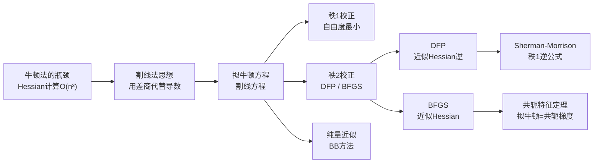
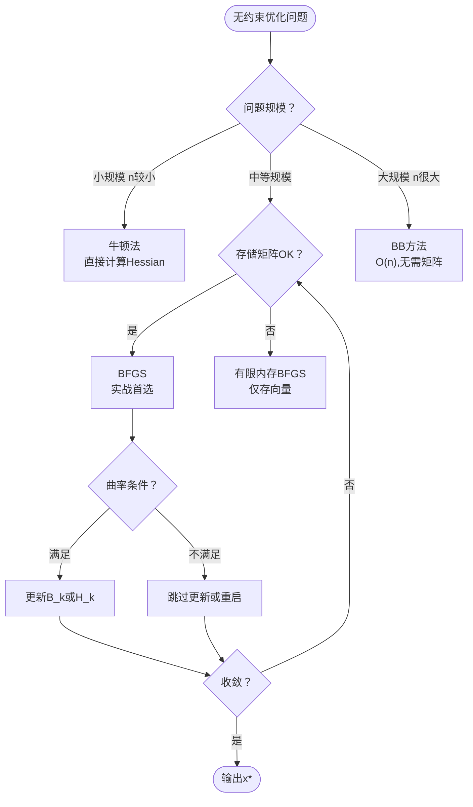

# 第11章 拟牛顿法 — 知识点梳理

> 本章解决的核心问题：**牛顿法每次迭代要算 Hessian 矩阵及其逆（$O(n^3)$），有没有办法避开，但保持快速收敛？**

---

## 一、本章核心脉络

> 整章的逻辑线是：从牛顿法的代价出发，用拟牛顿方程约束近似矩阵的更新；秩1校正最简单但不稳定；秩2校正（DFP/BFGS）稳定且能保持正定性；BB方法更进一步连矩阵都不要，只用标量逼近曲率。

---

## 二、拟牛顿法的动机与基本思想

### 2.1 牛顿法的代价

牛顿法迭代格式：

$$x^{(k+1)} = x^{(k)} - [F(x^{(k)})]^{-1} g^{(k)}$$

其中 $F(x^{(k)}) = \nabla^2 f(x^{(k)})$ 是 Hessian 矩阵。每次迭代的计算开销：

| 步骤 | 操作 | 计算量 |
|------|------|:---:|
| 计算 Hessian | $\nabla^2 f(x^{(k)})$ | $O(n^2)$ 个偏导数 |
| 求解牛顿方程 | $F(x^{(k)}) d^{(k)} = -g^{(k)}$ | $O(n^3)$ |
| 计算梯度 | $g^{(k)}$ | $O(n)$ |

> 一句话来说：牛顿法快，但 Hessian 的存储和求逆在大规模问题上太贵了。

### 2.2 割线法的启示（一维情形）

一维情况下，牛顿法需要 $f''(x^{(k)})$，割线法用差商替代：

$$B_k = \frac{f'(x^{(k)}) - f'(x^{(k-1)})}{x^{(k)} - x^{(k-1)}} \approx f''(x^{(k)})$$

> 一句话来说：割线法只用了函数值和梯度信息（不需要二阶导数），却保留了超线性收敛速度。

### 2.3 多维推广：两种设计思路

**版本1（近似 Hessian 逆）：**
$$x^{(k+1)} = x^{(k)} - H_k g^{(k)}, \quad H_k \approx [F(x^{(k)})]^{-1}$$

**版本2（近似 Hessian）：**
$$x^{(k+1)} = x^{(k)} - B_k^{-1} g^{(k)}, \quad B_k \approx F(x^{(k)})$$

两种版本的权衡：版本1可以直接得到下降方向（$d^{(k)} = -H_k g^{(k)}$）；版本2需要每步求解线性方程组 $B_k d^{(k)} = -g^{(k)}$，但 $B_k$ 的更新公式更简洁。

---

## 三、拟牛顿方程（本章核心）

### 3.1 推导出发点

对 $f$ 在 $x^{(k+1)}$ 处做一阶 Taylor 展开（将 $x^{(k)}$ 代入）：

$$\nabla f(x^{(k)}) \approx \nabla f(x^{(k+1)}) + \nabla^2 f(x^{(k+1)}) (x^{(k)} - x^{(k+1)})$$

整理得：

$$\nabla^2 f(x^{(k+1)}) (x^{(k)} - x^{(k+1)}) \approx \nabla f(x^{(k)}) - \nabla f(x^{(k+1)})$$

### 3.2 拟牛顿方程（割线方程）

引入记号：
$$s^{(k)} = x^{(k)} - x^{(k+1)}, \quad y^{(k)} = g^{(k)} - g^{(k+1)}$$

将 $\nabla^2 f(x^{(k+1)})$ 替换为近似矩阵并强制等号成立，得到：

> **拟牛顿方程（版本1）：**
> $$H_{k+1} y^{(k)} = s^{(k)}$$

> **拟牛顿方程（版本2）：**
> $$B_{k+1} s^{(k)} = y^{(k)}$$

> 一句话来说：近似矩阵 $H_{k+1}$ 必须"模仿"真实 Hessian 逆的行为——将梯度差 $y^{(k)}$ 映射为步长差 $s^{(k)}$。

### 3.3 欠定性

拟牛顿方程 $H_{k+1} y^{(k)} = s^{(k)}$ 是 $n$ 个方程、$\frac{n(n+1)}{2}$ 个未知数的欠定方程组——有无穷多个解 $H_{k+1}$。这正是"设计空间"所在：不同的附加约束产生不同的拟牛顿公式。

### 3.4 曲率条件

为保证 $H_{k+1} \succ 0$（即保持正定性），需要：

$$s^{(k)T} y^{(k)} > 0$$

该条件在采用强 Wolfe 线搜索时恒成立。

> [!warning] 曲率条件不满足时
> 如果 $s^{(k)T} y^{(k)} \leq 0$，则拟牛顿更新后的 $H_{k+1}$ 可能不正定，导致 $d^{(k+1)} = -H_{k+1} g^{(k+1)}$ 不是下降方向。实践中用强制线搜索（如强 Wolfe）来保证曲率条件。

---

## 四、秩1校正公式

### 4.1 问题提法

对 $H_{k+1} = H_k + \Delta H_k$ 施加最简单约束：$\Delta H_k$ 是一个**秩1矩阵**。

给定 $H_k, y^{(k)}, s^{(k)}$，求解：

$$\begin{cases} H_{k+1} y^{(k)} = s^{(k)} \\ H_{k+1} = H_k + a u u^T \end{cases}$$

> 一句话来说：秩1校正就是"用最少的改动（秩1）让 $H_k$ 满足拟牛顿方程"。

### 4.2 秩1校正公式

解为：

$$H_{k+1} = H_k + \frac{(s^{(k)} - H_k y^{(k)})(s^{(k)} - H_k y^{(k)})^T}{y^{(k)T}(s^{(k)} - H_k y^{(k)})}$$

**推导核心洞察**：将 $H_{k+1} = H_k + a u u^T$ 代入拟牛顿方程 $H_{k+1} y^{(k)} = s^{(k)}$，得到 $a u (u^T y^{(k)}) = s^{(k)} - H_k y^{(k)}$。这意味着 $u$ 必须与 $s^{(k)} - H_k y^{(k)}$ 平行，取 $u = s^{(k)} - H_k y^{(k)}$，反解 $a$ 即得上式。

### 4.3 秩1校正的缺陷

| 问题 | 说明 |
|------|------|
| 正定性可能丧失 | $H_{k+1}$ 不一定正定，$d^{(k+1)}$ 可能不是下降方向 |
| 分母接近零 | $y^{(k)T}(s^{(k)} - H_k y^{(k)}) \approx 0$ 时数值溢出 |
| 对二次函数也不可靠 | 极小化二次函数时仍可能出现 $H_k \not\succ 0$ |

> [!warning] 秩1校正的数值稳定性差
> 尽管理论上最简单（自由度最低），但数值问题上表现不佳。秩1校正公式在实用中已被秩2公式（DFP/BFGS）取代。

---

## 五、共轭特征定理（难点）

### 5.1 定理陈述

> **定理（共轭特征）：** 用拟牛顿法极小化强凸二次函数时，若 $H_{k+1} y^{(k)} = s^{(k)}$ 对所有 $k$ 成立，且线搜索步长非零，则搜索方向 $\{d^{(k)} = -H_k g^{(k)}\}_{k=0}^{n-1}$ 是 $Q$-共轭向量组。

### 5.2 直观理解

> 一句话来说：只要 $H_k$ 满足拟牛顿方程，拟牛顿法在二次函数上的行为就和一个已经共轭化的方法（如共轭梯度法）完全一样——每个方向都 $Q$-共轭于之前所有方向。

### 5.3 推论：有限步终止

由于方向是 $Q$-共轭的，拟牛顿法在二次函数上至多 $n$ 步收敛到极小点——这与共轭梯度法的性质完全一致。

> 这一结论的意义在于：拟牛顿法不需要显式构造共轭方向，通过拟牛顿方程自动实现了共轭性。这是拟牛顿法理论最优美的结果之一。

---

## 六、DFP 公式（秩2校正，近似 Hessian 逆）

### 6.1 动机与问题提法

秩1校正仍有缺陷（正定性不保证），DFP（Davidon-Fletcher-Powell）用**秩2校正**来克服。

求解：

$$\begin{cases} H_{k+1} y^{(k)} = s^{(k)} \\ H_{k+1} = H_k + a u u^T + b v v^T \end{cases}$$

### 6.2 DFP 公式

$$H_{k+1} = H_k + \frac{s^{(k)} s^{(k)T}}{s^{(k)T} y^{(k)}} - \frac{H_k y^{(k)} y^{(k)T} H_k}{y^{(k)T} H_k y^{(k)}}$$

**公式结构解析**：
- 第一项 $H_k$：上一步的近似矩阵
- 第二项 $\frac{s s^T}{s^T y}$：**正贡献项**，保证 $H_{k+1} y^{(k)} = s^{(k)}$
- 第三项 $-\frac{H_k y y^T H_k}{y^T H_k y}$：**负修正项**，消除旧信息中的不一致

> 一句话来说：DFP 用秩2校正同时满足拟牛顿方程和正定性保持，是第一个成功的拟牛顿方法。

### 6.3 正定性遗传定理

> **定理：** 假设 $g^{(k)} \neq 0$。若 $H_k \succ 0$，则 DFP 公式给出的 $H_{k+1} \succ 0$。

这保证了每一步的搜索方向 $d^{(k)} = -H_k g^{(k)}$ 都是下降方向。证明的关键在于 $s^{(k)T} y^{(k)} > 0$（由强 Wolfe 线搜索保证）。

### 6.4 DFP 的局限

求解大规模问题时，$H_k$ 可能渐近奇异（"停滞"现象），导致数值性能下降。这也是 BFGS 后来更受青睐的原因之一。

---

## 七、BFGS 公式（秩2校正，近似 Hessian，本章核心）

### 7.1 动机与问题提法

BFGS（Broyden-Fletcher-Goldfarb-Shanno）从**版本2**出发：设计 $B_k \approx F(x^{(k)})$。

由拟牛顿方程 $B_{k+1} s^{(k)} = y^{(k)}$，求解 $B_{k+1} = B_k + a u u^T + b v v^T$。

### 7.2 BFGS 公式

$$B_{k+1} = B_k + \frac{y^{(k)} y^{(k)T}}{y^{(k)T} s^{(k)}} - \frac{B_k s^{(k)} s^{(k)T} B_k}{s^{(k)T} B_k s^{(k)}}$$

### 7.3 BFGS 中 $H_{k+1} = B_{k+1}^{-1}$ 的计算

利用 Sherman-Morrison 公式推导出的直接更新式：

$$H_{k+1} = \left(I - \rho_k s^{(k)} y^{(k)T}\right) H_k \left(I - \rho_k y^{(k)} s^{(k)T}\right) + \rho_k s^{(k)} s^{(k)T}$$

其中 $\rho_k = \dfrac{1}{y^{(k)T} s^{(k)}}$。

> 一句话来说：BFGS 是目前公认表现最好的拟牛顿公式——近似 Hessian 而非其逆，数值上比 DFP 更稳健。

### 7.4 与 DFP 的对偶关系

| | DFP | BFGS |
|---|---|---|
| **近似对象** | $H_k \approx [F(x^{(k)})]^{-1}$ | $B_k \approx F(x^{(k)})$ |
| **公式** | $H_{k+1} = H_k + \frac{s s^T}{s^T y} - \frac{H_k y y^T H_k}{y^T H_k y}$ | $B_{k+1} = B_k + \frac{y y^T}{y^T s} - \frac{B_k s s^T B_k}{s^T B_k s}$ |
| **对偶关系** | 做替换 $H \leftrightarrow B$，$s \leftrightarrow y$，DFP 变为 BFGS | 对称的 |

---

## 八、Sherman-Morrison 公式

### 8.1 引理

> **Sherman-Morrison 公式：** 设 $A \in \mathbb{R}^{n \times n}$ 可逆，$u, v \in \mathbb{R}^n$，则：
> $$(A + u v^T)^{-1} = A^{-1} - \frac{A^{-1} u v^T A^{-1}}{1 + v^T A^{-1} u}$$

### 8.2 一般形式

设 $U \in \mathbb{R}^{n \times m}$，$V \in \mathbb{R}^{m \times n}$，若 $I_m + VU$ 可逆，则：

$$(I_n + UV)^{-1} = I_n - U(I_m + VU)^{-1} V$$

> 一句话来说：秩-$m$ 修正的矩阵逆可以用原矩阵的逆加一个秩-$m$ 修正来计算——避免了 $O(n^3)$ 的重新求逆。

### 8.3 在 BFGS 中的应用

BFGS 的 $B_{k+1}$ 是 $B_k$ 的秩2修正，两次应用 Sherman-Morrison 公式即可递推地从 $H_k$ 得到 $H_{k+1}$，无需每次求解 $B_{k+1} d = -g$。

---

## 九、DFP 与 BFGS 的对比与 Broyden 族

### 9.1 对比总结

| 维度 | DFP | BFGS |
|------|-----|------|
| **出发点** | 近似 $[F]^{-1}$（版本1） | 近似 $F$（版本2） |
| **更新方式** | 秩2更新 $H_k$ | 秩2更新 $B_k$ |
| **方向计算** | $d^{(k)} = -H_k g^{(k)}$ 直接 | 需解 $B_k d^{(k)} = -g^{(k)}$ |
| **数值表现** | 大规模可能停滞 | 更稳健，实践中首选 |
| **正定性遗传** | 有 | 有 |

### 9.2 Broyden 族

将 DFP 和 BFGS 的修正矩阵做凸组合：

$$H_{k+1}^{\phi} = \phi H_{k+1}^{\text{DFP}} + (1 - \phi) H_{k+1}^{\text{BFGS}}$$

这是一族拟牛顿公式。$\phi = 0$ 退化为 BFGS，$\phi = 1$ 退化为 DFP。

---

## 十、Barzilai-Borwein (BB) 方法

### 10.1 基本思想

BFGS 用秩2更新逼近 $F(x^{(k)})$，BB 方法进一步简化：**直接用纯量矩阵 $\alpha_k I$ 近似 Hessian**。

$$B_{k+1} = \alpha_{k+1} I$$

代入拟牛顿方程 $\alpha_{k+1} s^{(k)} \approx y^{(k)}$（无精确解），用最小二乘求解 $\alpha_{k+1}$。

### 10.2 BB 步长公式

最小二乘解有两种形式：

$$\alpha_{k+1}^{BB} = \frac{s^{(k)T} y^{(k)}}{s^{(k)T} s^{(k)}} \quad \text{或} \quad \alpha_{k+1}^{BB} = \frac{y^{(k)T} y^{(k)}}{s^{(k)T} y^{(k)}}$$

> 一句话来说：BB 方法放弃了矩阵近似，用一个标量"平均"了曲率信息——实现简单到只比最速下降法多存储一组 $s, y$，但收敛快得多。

### 10.3 与最速下降法的关系

对二次函数 $f(x) = \frac{1}{2}x^T Q x - b^T x$，BB 步长恰好等于上一步最速下降法（精确线搜索）的步长：

$$\alpha_{k+1}^{BB} = \frac{s^{(k)T} y^{(k)}}{s^{(k)T} s^{(k)}} = \frac{g^{(k)T} g^{(k)}}{g^{(k)T} Q g^{(k)}} = \alpha_k^{SD}$$

BB 方法成为连接最速下降法和拟牛顿法的"桥梁"——存储和计算开销接近 SD，收敛速度却远超 SD。

### 10.4 BB 方法的特点

| 优点 | 计算量 $O(n)$，无需存储矩阵 |
|------|-----|
| **优点** | 对大规模问题尤其有吸引力 |
| **局限** | 非单调收敛（函数值可能震荡），需结合非单调线搜索 |

---

## 十一、数值表现与方法对比

### 11.1 Rosenbrock 函数测试

以 $f(x_1, x_2) = 100(x_2 - x_1^2)^2 + (1 - x_1)^2$ 为例，初值 $x^{(0)} = [-1.2, 1]^T$（精确解 $x^* = [1, 1]^T$）：

| 迭代步数 | 最速下降法 | BFGS 拟牛顿法 | 牛顿法 |
|:---:|:---:|:---:|:---:|
| 达到精度 $\|g\|_\infty < 10^{-5}$ | 5264 步 | 34 步 | 21 步 |

> BFGS 只需 34 步，远优于最速下降法的 5264 步，接近牛顿法的 21 步——但每步计算量仅为 $O(n^2)$。

### 11.2 各类方法综合对比

| 方法 | 所需信息 | Hessian 近似方式 | 每步计算量 | 收敛速度 |
|:---|:---|:---|:---:|:---|
| 牛顿法 | $f, \nabla f, \nabla^2 f$ | 直接计算 | $O(n^3)$ | 二次收敛 |
| 秩1校正拟牛顿法 | $f, \nabla f$ | 秩1更新 | $O(n^2)$ | 超线性 |
| DFP 拟牛顿法 | $f, \nabla f$ | 秩2更新（近似 $[F]^{-1}$） | $O(n^2)$ | 超线性 |
| BFGS 拟牛顿法 | $f, \nabla f$ | 秩2更新（近似 $F$） | $O(n^2)$ | 超线性 |
| BB 方法 | $f, \nabla f$ | 纯量矩阵 | $O(n)$ | 中等 |

### 11.3 对非二次函数的注意

- 拟牛顿法对非二次函数不再具有 $n$ 步有限终止性
- 实践中可周期性"重启"（若干步后重新取负梯度方向），类似共轭梯度法的策略

---

## 十二、判定/决策流程

---

## 十三、核心公式速查表

| 概念 | 公式 | 备注 |
|------|------|------|
| 拟牛顿方程（H版） | $H_{k+1} y^{(k)} = s^{(k)}$ | $s^{(k)} = x^{(k)} - x^{(k+1)}$，$y^{(k)} = g^{(k)} - g^{(k+1)}$ |
| 拟牛顿方程（B版） | $B_{k+1} s^{(k)} = y^{(k)}$ | 曲率条件：$s^{(k)T} y^{(k)} > 0$ |
| 秩1校正 | $H_{k+1} = H_k + \frac{(s - H_k y)(s - H_k y)^T}{y^T(s - H_k y)}$ | 可能不正定 |
| DFP 公式 | $H_{k+1} = H_k + \frac{s s^T}{s^T y} - \frac{H_k y y^T H_k}{y^T H_k y}$ | 近似 $[F]^{-1}$，秩2 |
| BFGS 公式 | $B_{k+1} = B_k + \frac{y y^T}{y^T s} - \frac{B_k s s^T B_k}{s^T B_k s}$ | 近似 $F$，秩2 |
| BFGS 逆更新 | $H_{k+1} = (I - \rho s y^T) H_k (I - \rho y s^T) + \rho s s^T$ | $\rho = 1/(y^T s)$ |
| Sherman-Morrison | $(A + u v^T)^{-1} = A^{-1} - \frac{A^{-1} u v^T A^{-1}}{1 + v^T A^{-1} u}$ | 秩1逆公式 |
| BB 步长 | $\alpha_k^{BB} = \frac{s^{(k-1)T} s^{(k-1)}}{s^{(k-1)T} y^{(k-1)}}$ | 纯量近似 |
| Broyden 族 | $H_{k+1}^{\phi} = \phi H_{k+1}^{\text{DFP}} + (1 - \phi) H_{k+1}^{\text{BFGS}}$ | 凸组合 |

---

## 十四、易错点与注意事项

> [!warning] 曲率条件不可忽略
> 拟牛顿法必须保证 $s^{(k)T} y^{(k)} > 0$，否则 $H_{k+1}$ 或 $B_{k+1}$ 可能不正定。实践中用 **强 Wolfe 线搜索** 来保证。

> [!warning] DFP vs BFGS：选哪个？
> BFGS 在数值上普遍优于 DFP，实际应用中首选 BFGS 或其有限内存版本（L-BFGS）。DFP 在大规模问题中可能因 $H_k$ 渐近奇异而停滞。

> [!warning] 秩1校正的正定性
> 秩1校正公式不保证 $H_{k+1} \succ 0$，即使是极小化二次函数也可能出现问题。不要在生产代码中使用裸的秩1校正。

> [!warning] BB 方法的非单调性
> BB 方法虽然简单高效，但函数值不是单调下降的。实际使用中需结合**非单调线搜索**策略（如 Grippo 非单调技术）。

> [!warning] 拟牛顿法与共轭梯度法的关系
> 共轭特征定理适用于**精确线搜索下的二次函数**情形。对非二次函数或不精确线搜索，拟牛顿法的方向不再严格共轭。

> [!warning] 初始矩阵的选择
> 通常取 $H_0 = I$ 或 $B_0 = I$。虽然理论上 $H_0$ 任意正定矩阵都行，但初始近似的"好坏"会显著影响前几步的收敛速度。

---

## 十五、相关知识点链接

- 数学基础：[[03-线性代数基础#矩阵的秩|秩1/秩2修正的代数含义]]——秩的含义是修正矩阵张成空间的维数
- 本章前置：[[06-最优性条件#二阶必要条件|Hessian 矩阵的角色]]——理解为什么需要近似 Hessian
- 本章前置：[[08-线搜索技术#Wolfe条件|强 Wolfe 线搜索]]——保证曲率条件 $s^T y > 0$
- 本章前置：[[10-共轭梯度法|共轭梯度法]]——共轭特征定理揭示的深层联系
- 经典方法：[["牛顿法"|牛顿法与拟牛顿法的对比]]
- 后续扩展：有限内存 BFGS（L-BFGS）是 BFGS 的大规模版本，仅存储最近 $m$ 对 $(s, y)$，计算量为 $O(mn)$，适用于无法接受 $O(n^2)$ 存储的大规模问题。
- 后续章节：[[16-单纯形法|单纯形法]]——线性规划的主要算法

---

## 十六、作业与练习

课后习题入口：[[课程/归档/最优化方法/习题库/11-拟牛顿法/README|第11章习题库]]，其中收录 DFP/BFGS 公式推导计算题。

**建议练习方向：**
- 手工对一个小规模二次函数执行几轮 BFGS 迭代，感受 $B_k$ 的更新过程
- 编程对比最速下降法、BFGS、BB 方法在 Rosenbrock 函数上的收敛曲线
- 验证 DFP 与 BFGS 在对偶替换 $H \leftrightarrow B$，$s \leftrightarrow y$ 下的对称关系
- 用 Sherman-Morrison 公式手工推导 BFGS 的 $H_{k+1}$ 显式更新式
