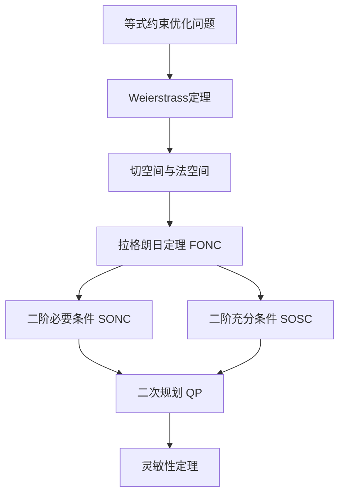
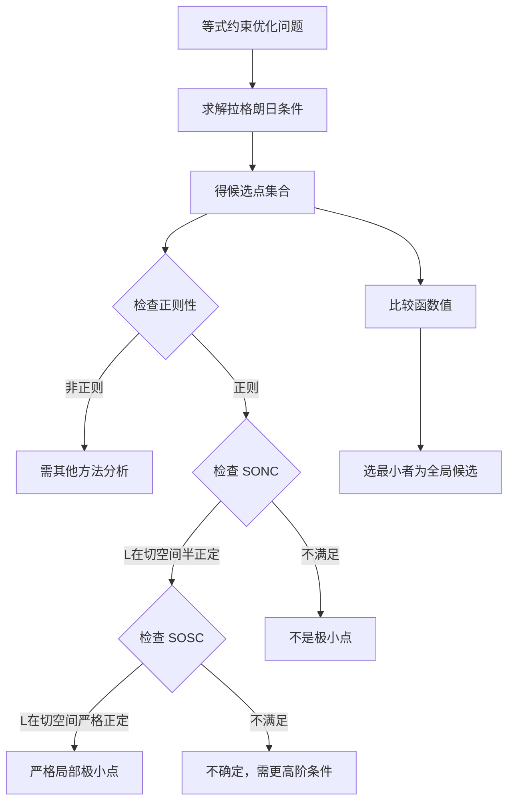

 
# 第20章 等式约束优化问题 — 知识点梳理

> 本章解决的核心问题：**在有等式约束 $h(x)=0$ 的情况下，如何刻画局部极小点 $x^*$ 的必要条件和充分条件？以及当约束发生微小扰动时，最优值会如何变化？**

---

## 一、本章核心脉络

> 概念演进逻辑：先问"解存在吗"（Weierstrass）-> 再问"可行方向有哪些"（切空间/法空间）-> 用几何关系导出极值的一阶条件（拉格朗日定理）-> 一阶条件只是候选，需要二阶信息来确认（SONC/SOSC）-> 把理论用到最简单的非线性约束问题（QP闭式解）-> 最后问"约束变了，最优值变多少"（灵敏性/影子价格）。

---

## 二、问题描述与 Weierstrass 定理

### 2.1 等式约束优化问题的一般形式

$$
\min_{x \in \mathbb{R}^n} f(x), \quad \text{s.t.} \quad h(x) = 0
$$

其中 $h: \mathbb{R}^n \to \mathbb{R}^m$，由 $m$ 个等式约束 $h_i(x) = 0$（$i = 1, \dots, m$）组成。可行域为：

$$
\Omega = \{x \in \mathbb{R}^n \mid h(x) = 0\}
$$

> 一句话来说：**在满足 $m$ 个方程的曲面上，找一个使 $f$ 最小的点。**

| 符号 | 名称 | 含义 |
|------|------|------|
| $f: \mathbb{R}^n \to \mathbb{R}$ | 目标函数 | 要最小化的函数 |
| $h: \mathbb{R}^n \to \mathbb{R}^m$ | 等式约束函数 | $m$ 个曲面方程 |
| $\Omega$ | 可行域 | 所有满足 $h(x)=0$ 的点 |

### 2.2 Weierstrass 定理（了解即可）

> **定理 (Weierstrass)**：函数 $f$ 在 $\Omega$ 上的极小点集是非空紧集的**充分条件**：$\Omega$ 是闭集，$f$ 在 $\Omega$ 上下半连续，且以下任一成立：
>
> 1. $\Omega$ 是有界集
> 2. 存在水平集 $\{x \in \Omega \mid f(x) \leq c\}$ 非空有界
> 3. $f$ 是强制的（$\displaystyle\lim_{\|x\| \to \infty} f(x) = \infty$）

> 一句话来说：**Weierstrass 定理告诉你什么时候极小点一定存在——约束集闭且有界，或者目标函数在无穷远处趋于无穷大。**

**重要例题（约束改变极小点数量）**：

$$
\min f(x) = 0.01x_1^2 + (x_2 + 100)^2
$$

- $\Omega = \mathbb{R}^2$：唯一极小点
- $\Omega = \{x \mid \cos(x_1) \leq x_2\}$：无穷多个极小点 $[k\pi, -1]^T$（$k = \pm 1, \pm 3, \dots$）

> **点评**：同一个目标函数，约束不同，解的个数可以从 1 变到无穷——这体现了约束对优化问题结构的决定性影响。

---

## 三、切空间与法空间（核心）

### 3.1 可行方向与切锥

**定义（可行方向）**：$d \neq 0$ 是 $x \in \Omega$ 处的可行方向，若存在 $\alpha_0 > 0$ 使得 $x + \alpha d \in \Omega$ 对所有 $\alpha \in [0, \alpha_0]$ 成立。

> 一句话来说：**从 $x$ 出发沿 $d$ 走一小步，还在可行域内。**

当 $x$ 在边界上时，可行方向构成锥或子空间；当 $x$ 在内部时，所有方向都可行。

**定义（线性化可行方向 / 切锥）**：对于等式约束 $\Omega = \{x \mid h(x) = 0\}$（$h$ 可微），$x$ 处的切空间为：

$$
\mathcal{T}(x) = \{d \in \mathbb{R}^n \mid Dh(x) \, d = 0\}
$$

其中 $Dh(x)$ 是 $h$ 的 Jacobian 矩阵（$m \times n$）。$\mathcal{T}(x)$ 是矩阵 $Dh(x)$ 的**零空间**：$\mathcal{T}(x) = \mathcal{N}(Dh(x))$。

> 一句话来说：**切空间中的方向 $d$ 与所有等式约束的梯度正交——沿 $d$ 走一小步，约束值的一阶变化为零。**

### 3.2 正则点

**定义**：$x^* \in \Omega$ 是**正则点**，若 $\{\nabla h_1(x^*), \dots, \nabla h_m(x^*)\}$ 线性无关（等价于 $Dh(x^*)$ 行满秩，即 $\text{rank}(Dh(x^*)) = m$）。

正则点的几何意义：$\dim(\mathcal{T}(x^*)) = n - m$。

> 一句话来说：**正则点处，$m$ 个约束的梯度线性无关，切空间的维数恰好等于 $n - m$——约束曲面在该点附近是一个 $(n-m)$ 维的光滑流形。**

> [!warning] 正则性是拉格朗日定理的前提
> 若 $x^*$ 不是正则点，拉格朗日定理可能不成立（后面有反例）。

**例题**：$\mathcal{S} = \{x \in \mathbb{R}^3 \mid h_1(x) = x_1 = 0,\; h_2(x) = x_1 - x_2 = 0\}$

$$
Dh = \begin{bmatrix} 1 & 0 & 0 \\ 1 & -1 & 0 \end{bmatrix}
$$

两行线性无关，故 $\forall x \in \mathcal{S}$ 是正则点。$\dim \mathcal{T} = 3 - 2 = 1$。

### 3.3 法空间

$x^* \in \Omega$ 处的**法空间**是切空间的正交补：

$$
\mathcal{N}(x^*) = \mathcal{T}(x^*)^\perp = \mathcal{R}(Dh(x^*)^T) = \text{span}\{\nabla h_1(x^*), \dots, \nabla h_m(x^*)\}
$$

**切空间与法空间的关系**：

$$
\mathcal{T}(x^*) = \mathcal{N}(x^*)^\perp, \qquad \mathcal{T}(x^*)^\perp = \mathcal{N}(x^*), \qquad \mathbb{R}^n = \mathcal{N}(x^*) \oplus \mathcal{T}(x^*)
$$

> 一句话来说：**法空间由所有约束梯度的线性组合张成，切空间与法空间正交互补——整个空间被拆成"沿约束曲面"和"垂直约束曲面"两个方向。**

### 3.4 曲面上的曲线

**核心命题**：若 $x^*$ 是正则点，则 $d \in \mathcal{T}(x^*)$ 当且仅当存在过 $x^*$ 的可微曲线 $x(t) \subset \Omega$ 使得 $\dot{x}(t^*) = d$。

> 一句话来说：**切空间中的每个方向，都可以实现为约束曲面上某条曲线在 $x^*$ 处的切向量。** 这个事实是拉格朗日定理证明的关键桥梁——把"方向"转化为"曲线"，再用一元函数极值条件。

---

## 四、拉格朗日定理与一阶必要条件（本章核心）

### 4.1 二维情形的几何直觉

在二维空间中，等式约束 $h(x) = 0$ 定义了一条曲线。设 $x(t)$ 是曲线的参数方程，则：

- $\nabla h(x^*)$ 与曲线的切向量 $\dot{x}(t^*)$ 正交
- 若 $x^*$ 是 $f$ 在曲线上的极小点，则沿曲线方向导数为零：$\nabla f(x^*)^T \dot{x}(t^*) = 0$，即 $\nabla f(x^*)$ 也与切向量正交
- **结论**：$\nabla f(x^*)$ 和 $\nabla h(x^*)$ 都与切向量正交，因此它们**共线**——存在 $\lambda^*$ 使得 $\nabla f(x^*) = \lambda^* \nabla h(x^*)$

> 直观理解：**在约束曲线上找极小点 = 找目标函数的等高线与约束曲线相切的点。相切意味着两个梯度平行。**

### 4.2 拉格朗日定理（$n$ 维情形）

> **定理（拉格朗日定理 / FONC）**：若 $x^*$ 是局部极小点且是正则点，则存在唯一的 $\lambda^* \in \mathbb{R}^m$ 使得：
>
> $$\nabla f(x^*) + Dh(x^*)^T \lambda^* = 0 \quad \text{或} \quad \nabla f(x^*) + \sum_{i=1}^{m} \lambda_i^* \nabla h_i(x^*) = 0$$
>
> 且 $h(x^*) = 0$。

**证明核心洞察（两种证法殊途同归）**：

- **证法一（曲线法）**：取任意 $d \in \mathcal{T}(x^*)$，构造过 $x^*$ 的曲线 $x(t)$ 使 $\dot{x}(t^*) = d$。$x^*$ 是极小点 $\Rightarrow$ $t^*$ 是 $\phi(t) = f(x(t))$ 的极小点 $\Rightarrow$ $\phi'(t^*) = \nabla f(x^*)^T d = 0$。这对所有 $d \in \mathcal{T}(x^*)$ 成立，故 $\nabla f(x^*) \in \mathcal{T}(x^*)^\perp = \mathcal{N}(x^*) = \mathcal{R}(Dh(x^*)^T)$。

- **证法二（子空间法）**：$\mathcal{T}(x^*)$ 是子空间。若 $\nabla f(x^*)^T d \geq 0$ 对所有 $d \in \mathcal{T}(x^*)$ 成立，由于子空间关于取反封闭（$d \in \mathcal{T} \Rightarrow -d \in \mathcal{T}$），必须 $\nabla f(x^*)^T d = 0$。因此 $\nabla f(x^*) \in \mathcal{T}(x^*)^\perp = \mathcal{N}(x^*)$。

> 直观理解：**在极小点处，目标函数的梯度落在法空间内——即它可以用约束梯度的线性组合表示。沿着切空间的任意方向，目标函数的一阶变化为零（否则沿反方向就能下降）。**

### 4.3 拉格朗日函数

定义拉格朗日函数 $l: \mathbb{R}^n \times \mathbb{R}^m \to \mathbb{R}$：

$$
l(x, \lambda) = f(x) + \lambda^T h(x) = f(x) + \sum_{i=1}^{m} \lambda_i h_i(x)
$$

$\lambda^* \in \mathbb{R}^m$ 称为**拉格朗日乘子**。拉格朗日定理等价于：

$$
\nabla l(x^*, \lambda^*) = \begin{bmatrix} \nabla_x l(x^*, \lambda^*) \\ \nabla_\lambda l(x^*, \lambda^*) \end{bmatrix} = \begin{bmatrix} \nabla f(x^*) + Dh(x^*)^T \lambda^* \\ h(x^*) \end{bmatrix} = \begin{bmatrix} 0 \\ 0 \end{bmatrix}
$$

即 $n + m$ 个方程，$n + m$ 个未知数。

> 一句话来说：**拉格朗日函数的驻点条件，把约束优化的一阶必要条件写成了无约束优化的形式。**

> [!warning] FONC 不是充分条件
> 拉格朗日定理刻画的是**必要条件**——满足 $\nabla l = 0$ 的点只是"候选点"，可能不是极小点（需二阶条件确认）。

### 4.4 拉格朗日乘子法例题

> **例 1**：$\min f(x) = x_1^2 + x_2^2$，s.t. $h(x) = x_1^2 + 2x_2^2 - 1 = 0$

**步骤分解**：
1. 构造拉格朗日函数：$l(x, \lambda) = x_1^2 + x_2^2 + \lambda(x_1^2 + 2x_2^2 - 1)$
2. 列方程：$\nabla_x l = 0$ 和 $h(x) = 0$
3. 分类讨论（$x_1 = 0$ 或 $\lambda = -1$；$x_2 = 0$ 或 $\lambda = -1/2$）
4. 得四个候选点并比较函数值

**结果**：$x^{(1),(2)} = [0, \pm 1/\sqrt{2}]^T$（$\lambda = -1/2$，$f = 1/2$，极小点）；$x^{(3),(4)} = [\pm 1, 0]^T$（$\lambda = -1$，$f = 1$，极大点）。

> **点评**：拉格朗日条件本身不区分极小/极大——函数值的比较或二阶条件才能做出判断。

> **例 2（Rayleigh 商）**：$\displaystyle\max \frac{x^T Q x}{x^T P x}$，$Q \succeq 0$，$P \succ 0$

**关键技巧**：利用目标函数的**齐次性**（$f(tx) = f(x)$），将问题等价化为：

$$
\max \{x^T Q x \mid x^T P x = 1\}
$$

再由拉格朗日条件得 $Qx = \lambda P x$——即 $x^*$ 是广义特征向量，$\lambda^*$ 是广义特征值。在 $x^T P x = 1$ 下，目标值 $= \lambda^*$。因此**极大值 = 矩阵 $P^{-1}Q$ 的最大特征值**。

> **点评**：这是一个经典应用——把看似复杂的比值优化问题通过齐次性化为等式约束特征值问题。齐次性是约束优化中常用的"降维"技巧。

### 4.5 正则性的必要性（反例）

**反例**：$\min f(x) = x$，s.t. $h(x) = 0$，其中

$$
h(x) = \begin{cases} x^2 - 2x & x \leq 0 \\ 0 & 0 \leq x \leq 1 \\ (x-1)^2 & x \geq 1 \end{cases}
$$

约束集本质上是 $[0, 1]$。极小点 $x^* = 0$，$f'(x^*) = 1$，$h'(x^*) = 0$。拉格朗日条件 $f' = \lambda h'$ 无法成立——因为 $h'(0) = 0$，$x^*$ 不是正则点（$h$ 在 $0$ 处不光滑）。

> [!warning] 没有正则性，拉格朗日定理失效。正则性保证了 $Dh(x^*)$ 满秩，从而法空间的维数恰好为 $m$，梯度投影有唯一表示。

---

## 五、二阶条件（核心 / 难点）

设 $f, h_i \in C^2$。拉格朗日函数关于 $x$ 的 Hessian 矩阵：

$$
L(x, \lambda) = \nabla^2 f(x) + \sum_{i=1}^{m} \lambda_i \nabla^2 h_i(x) = F(x) + \lambda^T \nabla^2 h(x)
$$

> 一句话来说：**$L(x, \lambda)$ 是拉格朗日函数对 $x$ 的 Hessian——它在二阶条件中的地位，等同于无约束优化中 $F(x)$ 的地位，但只需在切空间上判定。**

### 5.1 二阶必要条件（SONC）

> **定理（SONC）**：若 $x^*$ 是局部极小点且是正则点，则存在 $\lambda^* \in \mathbb{R}^m$ 满足拉格朗日条件，且
>
> $$d^T L(x^*, \lambda^*) d \geq 0, \quad \forall d \in \mathcal{T}(x^*)$$

**证明核心洞察**：
1. 取 $d \in \mathcal{T}(x^*)$，构造**二次可微**曲线 $x(t)$（需要 $f, h \in C^2$），$\dot{x}(t^*) = d$
2. $x^*$ 极小 $\Rightarrow$ $t^*$ 是 $\phi(t) = f(x(t))$ 的极小点
3. 对 $\phi(t)$ 应用无约束 SONC：$\phi''(t^*) \geq 0$
4. 展开 $\phi''(t^*)$，利用 $h(x(t)) \equiv 0$ 的二阶导数条件消去 $\ddot{x}(t^*)$ 项
5. 最终得 $d^T L(x^*, \lambda^*) d \geq 0$

> 直观理解：**在切空间方向上，拉格朗日函数的 Hessian 必须半正定——否则沿该方向会有二阶下降，破坏极小性。** 注意这与无约束优化的 SONC 形式完全一致，只是"全空间"变成了"切空间"。

### 5.2 二阶充分条件（SOSC）

> **定理（SOSC）**：若 $x^* \in \mathbb{R}^n$ 和 $\lambda^* \in \mathbb{R}^m$ 满足拉格朗日条件，且
>
> $$d^T L(x^*, \lambda^*) d > 0, \quad \forall d \in \mathcal{T}(x^*),\; d \neq 0$$
>
> 则 $x^*$ 是**严格局部极小点**。

> 直观理解：**在切空间上 $L$ 严格正定——沿每个可行方向，目标函数都是"向上弯"的，所以 $x^*$ 一定是严格的局部极小点。**

**与无约束 SOSC 的对比**：

| | 无约束优化 | 等式约束优化 |
|---|---|---|
| 梯度条件 | $\nabla f(x^*) = 0$ | $\nabla f(x^*) + Dh(x^*)^T \lambda^* = 0$ |
| Hessian 矩阵 | $F(x^*)$ | $L(x^*, \lambda^*) = F(x^*) + \sum \lambda_i^* \nabla^2 h_i(x^*)$ |
| 判定空间 | $\mathbb{R}^n$（全空间） | $\mathcal{T}(x^*)$（仅切空间） |
| SOSC | $F(x^*) \succ 0$ 在 $\mathbb{R}^n$ | $L(x^*, \lambda^*) \succ 0$ 在 $\mathcal{T}(x^*)$ |

**关键区别**：等式约束优化的 SOSC 只需要在切空间（$(n-m)$ 维子空间）上正定，不需要在全空间上正定。这大大**放宽了条件**。

### 5.3 二阶条件应用例题

> **例 1**：$\min f(x) = \frac{1}{2}(x_1^2 + x_2^2 + x_3^2)$，s.t. $x_1 + x_2 + x_3 = 3$

拉格朗日条件得 $x^* = [1, 1, 1]^T$，$\lambda^* = -1$。$L(x^*, \lambda^*) = I \succ 0$（在全空间正定，在切空间自然也正定），SOSC 成立，$x^*$ 是严格局部极小点。

> **点评**：当 $L$ 在全空间正定时，判定最简单——无需计算切空间。

> **例 2**：$\min f(x) = -(x_1 x_2 + x_2 x_3 + x_3 x_1)$，s.t. $x_1 + x_2 + x_3 = 3$

拉格朗日条件得 $x^* = [1, 1, 1]^T$，$\lambda^* = 2$。

$$
L(x^*, \lambda^*) = \begin{bmatrix} 0 & -1 & -1 \\ -1 & 0 & -1 \\ -1 & -1 & 0 \end{bmatrix}
$$

这个矩阵在 $\mathbb{R}^3$ 上**不是正定的**（特征值 $-2, 1, 1$），但在切空间上需要验证：

$$
\mathcal{T}(x^*) = \{d \in \mathbb{R}^3 \mid d_1 + d_2 + d_3 = 0\}
$$

切空间的一组基：$P = \begin{bmatrix} -1 & -1 \\ 1 & 0 \\ 0 & 1 \end{bmatrix}$。则

$$
d^T L d = k^T P^T L P k = k^T \begin{bmatrix} 2 & 1 \\ 1 & 2 \end{bmatrix} k > 0 \quad (\forall k \neq 0)
$$

在切空间上正定，SOSC 成立。

> **点评**：这是 SOSC 需要"在切空间上"正定的典型例子——$L$ 全空间不定，但在切空间上正定，极小性仍成立。先用基矩阵 $P$ 把 $L$ 约化到切空间，再判断约化后矩阵的正定性。

> **例 3（Rayleigh 商极大）**：$\max \frac{x^T Q x}{x^T P x}$，$Q = \text{diag}(1, 2)$，$P = \text{diag}(2, 1)$

$L(x^*, \lambda^*) = 2Q - 2\lambda^* P = \text{diag}(-2, -4)$，切空间为 $\mathcal{T}(x^*) = \{d \mid d_1 = 0\}$。对 $d \in \mathcal{T}(x^*)$（即 $d = [0, a]^T$），$d^T L d = -4a^2 < 0$，在切空间上 $L \prec 0$，SOSC 判定为严格局部**极大**点。

> **点评**：SOSC 同样适用于极大点——只需把"正定"换成"负定"。

### 5.4 辅助引理（了解即可）

> **引理**：已知 $P, Q$ 对称，$Q \succeq 0$，且在 $\mathcal{N}(Q)$ 上 $P \succ 0$，则存在 $\bar{c} \in \mathbb{R}$ 使得 $P + cQ \succ 0$ 对所有 $c \geq \bar{c}$ 成立。

> 直观理解：**如果 $Q$ 只在某些方向上"没贡献"（$x^T Q x = 0$），而 $P$ 在这些方向上正定，那么把 $cQ$ 加到 $P$ 上当 $c$ 足够大，就能填平所有方向得到全空间正定。** 这个引理在灵敏性定理的证明和罚函数法中有用。

---

## 六、等式约束的二次规划

### 6.1 QP 的闭式解

二次规划（QP）：

$$
\min \frac{1}{2} x^T Q x, \quad \text{s.t.} \quad Ax = b
$$

其中 $Q \in \mathbb{R}^{n \times n}$，$A \in \mathbb{R}^{m \times n}$（$\text{rank}(A) = m$，$m \leq n$）。

拉格朗日函数：$l(x, \lambda) = \frac{1}{2} x^T Q x + \lambda^T(b - Ax)$

拉格朗日条件：

$$
\begin{cases} Qx - A^T \lambda = 0 \\ Ax = b \end{cases}
$$

若 $Q^{-1}$ 存在，得闭式解：

$$
x^* = Q^{-1} A^T (A Q^{-1} A^T)^{-1} b, \qquad \lambda^* = (A Q^{-1} A^T)^{-1} b
$$

> 一句话来说：**QP 是唯一有闭式解的约束优化问题——解由 KKT 线性方程组直接给出。** 若 $Q \succ 0$，由 SOSC 知 $x^*$ 是严格极小点（此时 $L = Q \succ 0$ 在全空间成立）。

> [!hint] 凸 QP 的重要性
> 若 $Q \succeq 0$（即使不可逆），QP 也是凸优化问题，KKT 条件变为**充分条件**，且存在高效的数值求解方法。

---

## 七、灵敏性定理（难点）

### 7.1 影子价格直觉

考虑约束的微小扰动：将 $h(x) = 0$ 改为 $h(x) = u$（$u$ 是小扰动向量），极小点和最优值如何变化？

**单约束的一阶分析**（$a^T x = b + \delta b$）：

$$
\delta f = f(x^* + \delta x) - f(x^*) = \nabla f(x^*)^T \delta x + o(\|\delta x\|) = -\lambda^* a^T \delta x + o = -\lambda^* \delta b + o(\|\delta x\|)
$$

> 一句话来说：**拉格朗日乘子 $\lambda^*$ 的负值就是目标函数极值对约束右端项的导数——经济学中称为"影子价格"：约束多松一个单位，目标值能改善多少。**

### 7.2 灵敏性定理

记扰动问题 $\min\{f(x) \mid h(x) = u\}$ 的极小点为 $x(u)$，乘子为 $\lambda(u)$，原始函数 $p(u) = f(x(u))$。

> **定理（灵敏性定理）**：若 $x^* = x(0)$ 是正则点且 $\lambda^* = \lambda(0)$ 唯一，则存在 $\eta > 0$，使得：
>
> 1. $(x(u), \lambda(u))$ 在 $B(0, \eta)$ 上存在
> 2. $x(\cdot)$ 和 $\lambda(\cdot)$ 在 $B(0, \eta)$ 上连续可微
> 3. $\nabla p(u) = -\lambda(u)^T$，特别地 $\nabla p(0) = -(\lambda^*)^T$

**证明核心洞察**：将拉格朗日条件写成 $F(x, \lambda, u) = 0$ 的形式（$n + m$ 个方程），其 Jacobian 矩阵为

$$
J = \begin{bmatrix} L(x^*, \lambda^*) & Dh(x^*)^T \\ Dh(x^*) & 0 \end{bmatrix}
$$

由 SOSC 和正则性可证 $J$ 非奇异，应用隐函数定理即得结论。

> 直观理解：**在正则点和 SOSC 的保证下，极小点和乘子关于扰动是光滑的——约束"连续地"移动，极小点也"连续地"移动。而且乘子的负值精确给出了最优值的变化率。**

### 7.3 例题与正则性警告

> **例**：$\min f(x) = -\frac{1}{2}x_1^2 - \frac{5}{2}x_2^2$，s.t. $h(x) = x_2 - 5 = 0$

原始函数：$p(u) = -\frac{5}{2}(5 + u)^2$，$\nabla p(0) = -25$，由拉格朗日定理 $\lambda^* = 25$，满足 $-\lambda^* = \nabla p(0)$。

> **关键警告**：若将约束换为 $h(x) = x_2^2 = 0$（$x^* = [0, 0]^T$ 不是正则点），则
>
> $$p(u) = \begin{cases} -\frac{5}{2}u & u \geq 0 \\ \text{不存在} & u < 0 \end{cases}$$
>
> $p$ 在 $u = 0$ 处不可微，灵敏性定理不适用。

> [!warning] 正则性对灵敏性定理至关重要。非正则点处，最优值对约束扰动可能是不可微的（甚至扰动问题可能无解）。

---

## 八、判定 / 决策流程

**判定步骤**：
1. 解拉格朗日条件得到所有候选点（FONC）
2. 验证正则性（不满足时 FONC 可能失效）
3. 对正则候选点，计算 $L(x^*, \lambda^*)$ 和切空间
4. 在切空间上判断 $L$ 的正定性：
   - 正定 $\Rightarrow$ 严格局部极小
   - 不定或负定 $\Rightarrow$ 不是极小
   - 半正定（非正定）$\Rightarrow$ 无法确定
5. 比较所有局部极小点的函数值，找全局极小点

---

## 九、核心公式速查表

| 概念 | 公式 | 备注 |
|------|------|------|
| 问题形式 | $\min f(x)$ s.t. $h(x) = 0$ | $h: \mathbb{R}^n \to \mathbb{R}^m$ |
| 切空间 | $\mathcal{T}(x) = \{d \mid Dh(x) d = 0\} = \mathcal{N}(Dh(x))$ | 零空间，维数 $n - \text{rank}(Dh)$ |
| 法空间 | $\mathcal{N}(x) = \mathcal{R}(Dh(x)^T) = \text{span}\{\nabla h_i\}$ | 与切空间正交互补 |
| 正则点条件 | $\text{rank}(Dh(x^*)) = m$ | $\{\nabla h_i\}$ 线性无关 |
| 拉格朗日函数 | $l(x, \lambda) = f(x) + \lambda^T h(x)$ | $\lambda \in \mathbb{R}^m$ |
| FONC | $\nabla_x l(x^*, \lambda^*) = 0, \; h(x^*) = 0$ | 必要条件 |
| 拉格朗日 Hessian | $L(x, \lambda) = F(x) + \sum \lambda_i \nabla^2 h_i(x)$ | $n \times n$ 对称 |
| SONC | $d^T L(x^*, \lambda^*) d \geq 0,\; \forall d \in \mathcal{T}(x^*)$ | 在切空间上半正定 |
| SOSC | $d^T L(x^*, \lambda^*) d > 0,\; \forall 0 \neq d \in \mathcal{T}(x^*)$ | 在切空间上正定（充分条件） |
| QP 闭式解 | $x^* = Q^{-1}A^T(AQ^{-1}A^T)^{-1}b$ | $Q \succ 0$，$\text{rank}(A) = m$ |
| 灵敏性 | $\nabla p(0) = -(\lambda^*)^T$ | 影子价格 |

---

## 十、易错点与注意事项

> [!warning] FONC vs SOSC
> - **FONC 是必要条件**，不是充分条件。满足拉格朗日条件只是"候选点"。
> - **SOSC 是充分条件**，但需要 $L$ 在切空间上严格正定。仅在全空间正定是更强的条件。
> - 只满足 FONC 不满足 SOSC 的点可能是鞍点、极大点、或需更高阶条件判断。

> [!warning] 正则性是拉格朗日定理的前提
> 若 $x^*$ 不是正则点，拉格朗日定理可能完全不成立（如 4.5 节反例）。在实际问题中，检查 $\text{rank}(Dh(x^*)) = m$ 是第一步。

> [!warning] 二阶条件只在切空间上判定
> 等式约束优化的 SONC/SOSC 只需要在**切空间**（$(n-m)$ 维）上判定，不需要在全 $\mathbb{R}^n$ 上。判断方法：找切空间的一组基 $P$（$n \times (n-m)$），计算 $P^T L P$ 的正定性。

> [!warning] 拉格朗日乘子的唯一性
> 当 $x^*$ 是正则点时，乘子 $\lambda^*$ 是唯一的；当非正则时，乘子可能不唯一。灵敏性定理也要求乘子唯一。

> [!warning] QP 中 $Q$ 的半正定性
> 若 $Q \succeq 0$ 但不可逆，闭式解公式失效。但此时问题是凸的，可用数值方法求解。

---

## 十一、相关知识点链接

- **向量空间**：[[02-向量空间与矩阵#零空间与列空间|零空间与列空间]]——切空间 = $\mathcal{N}(Dh)$、法空间 = $\mathcal{R}(Dh^T)$，这些概念直接来自线性代数的四个基本子空间
- **微积分基础**：[[05-微积分基础#Taylor展开|Taylor 展开]]——拉格朗日定理的证明依赖一阶展开，SONC/SOSC 的证明依赖二阶展开
- **最优性条件**：[[06-最优性条件#三、可行方向与切锥|可行方向与切锥]]——第 6 章建立了无约束/一般约束下的 FONC/SONC/SOSC 框架，本章将其特化到等式约束
- **线性代数基础**：[[03-线性代数基础#特征值与二次型|特征值与二次型]]——Rayleigh 商例题将优化问题转化为广义特征值问题
- **后续章节**：[[21-不等式约束优化问题|不等式约束优化]]——加入不等式约束后，KKT 条件替代拉格朗日定理，临界锥替代切空间

---

## 十二、作业与练习

课后习题：20.3, 20.8, 20.10, 20.15

| 题号 | 知识点 | 建议 |
|------|--------|------|
| 20.3 | 拉格朗日乘子法 | 列拉格朗日函数 $\to$ 求解 KKT 方程组 $\to$ 比较各候选点函数值 |
| 20.8 | 二阶条件验证 | 先解 FONC 得乘子，再计算 $L$ 在切空间上的正定性 |
| 20.10 | QP 闭式解 | 直接用 $x^* = Q^{-1}A^T(AQ^{-1}A^T)^{-1}b$，注意验证 $\text{rank}(A)$ |
| 20.15 | 灵敏性分析 | 将约束扰动 $b + \delta b$，用 $\nabla p(0) = -\lambda^*$ 估计目标变化 |
