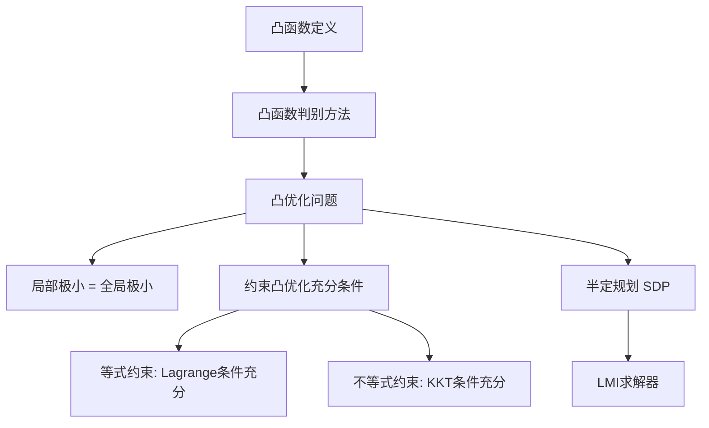
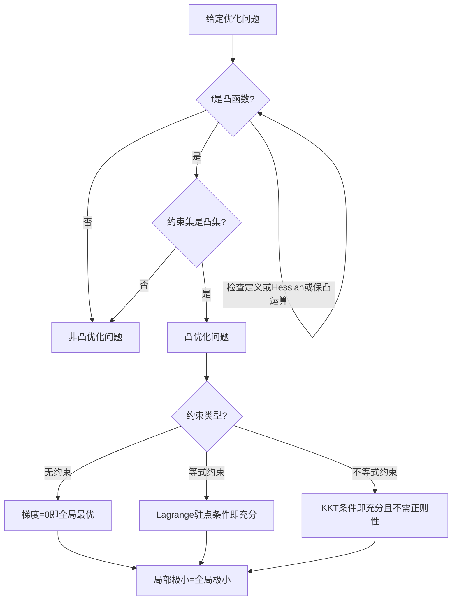

# 第22a章 凸优化问题 — 知识点梳理

> 本章解决的核心问题：**为什么凸优化问题"好解"？——凸函数的特殊几何结构使得局部极小自动成为全局极小，KKT 条件从必要条件升级为全局最优的充分条件（且不需要正则性假设）。**

---

## 一、本章核心脉络



> 本章的逻辑演进：先定义"什么是凸函数"（几何定义 → 代数定义）→ 建立判别凸性的工具箱（可微切平面、次梯度、Hessian半正定、保凸运算）→ 利用凸性简化优化问题（局部即全局）→ 推广到约束凸优化（KKT 条件变为充分条件）→ 最后拓展到矩阵不等式（SDP / LMI），展示凸优化理论在控制工程中的应用。

本章内容分为三大部分：

| 部分 | 范围 | 核心问题 |
|------|------|----------|
| **A. 凸函数理论** | 第22.2节 | 什么是凸函数？如何判别？ |
| **B. 凸优化性质** | 第22.3节 | 凸性如何简化优化问题的求解？ |
| **C. 半定规划与LMI** | 第22.4–22.5节 | 凸优化在矩阵不等式中的应用 |

---

## 二、凸函数的基本定义（核心）

### 2.1 函数图像与上图

函数 $f: \Omega \subseteq \mathbb{R}^n \to \mathbb{R}$ 有两种几何表示：

| 概念 | 符号 | 定义 | 维度 |
|------|------|------|------|
| **函数图像 (graph)** | $\text{gph}(f)$ | $\{(x, \beta) \in \mathbb{R}^{n+1} \mid \beta = f(x),\; x \in \Omega\}$ | $n+1$ 维曲面 |
| **上图 (epigraph)** | $\text{epi}(f)$ | $\{(x, \beta) \in \mathbb{R}^{n+1} \mid \beta \ge f(x),\; x \in \Omega\}$ | $n+1$ 维区域 |

> 直观来说：$\text{gph}(f)$ 是函数图像这条"线"（或曲面），而 $\text{epi}(f)$ 是这条线"以上"的全部空间——即函数图像上方所有点构成的立体区域。

### 2.2 几何定义

> **定义（凸函数——几何定义）**：$f$ 是 $\Omega$ 上的**凸函数** $\iff$ $\text{epi}(f)$ 是 $\mathbb{R}^{n+1}$ 中的凸集。

> 一句话来说：**凸函数就是"上部区域"是凸集的函数——把函数图像以上的空间想象成一个碗，这个碗的内部不能有凹陷。**

### 2.3 定义域的凸性

> **定理：** 若 $f: \Omega \to \mathbb{R}$ 是凸函数，则定义域 $\Omega$ 是凸集合。

**证明核心洞察（反证法）**：若 $\Omega$ 不是凸集，则存在 $y_1, y_2 \in \Omega$ 和 $\alpha \in (0,1)$ 使得 $\bar{x} = \alpha y_1 + (1-\alpha)y_2 \notin \Omega$。取 $\bar{\beta} = \alpha f(y_1) + (1-\alpha)f(y_2)$，则 $(\bar{x}, \bar{\beta}) \notin \text{epi}(f)$，破坏凸性。

> 一句话来说：**凸函数的定义域必须是凸集——否则上图内部会"缺一块"，不可能是凸的。**

### 2.4 代数定义（Jensen 不等式）

> **定义（凸函数——代数定义）**：
> $$f(\alpha x + (1-\alpha)y) \le \alpha f(x) + (1-\alpha)f(y), \quad \forall x, y \in \Omega,\; \alpha \in (0,1)$$

推广到多点加权和（Jensen 不等式）：
$$f\!\left(\sum_i \alpha_i x_i\right) \le \sum_i \alpha_i f(x_i), \quad \forall x_i \in \Omega,\; \alpha_i \in (0,1),\; \sum_i \alpha_i = 1$$

> 一句话来说：**凸函数在任意两点之间，弦在弧的上方——函数值不超过线性插值。**

### 2.5 严格凸与强凸

| 类型 | 定义 | 直观理解 |
|------|------|----------|
| **凸** | $f(\alpha x + (1-\alpha)y) \le \alpha f(x) + (1-\alpha)f(y)$ | 弦在弧之上（允许重合） |
| **严格凸** | $f(\alpha x + (1-\alpha)y) < \alpha f(x) + (1-\alpha)f(y),\;\forall x \neq y$ | 弦严格在弧之上 |
| **强凸**（$\mu$-强凸） | $f(\alpha x + (1-\alpha)y) \le \alpha f(x) + (1-\alpha)f(y) - \frac{\mu}{2}\alpha(1-\alpha)\|x-y\|^2$ | 不仅弦在弧之上，还差一个二次"间隙" |

> 一句话来说：**严格凸意味着没有直线段，强凸更进一步——函数的弯曲程度有一个正的下界 $\mu$，像一个真正的碗而非平底锅。**

### 2.6 应用举例：KL 散度的非负性

> **例**：设 $\{p_i\}$ 是离散概率分布，证明 $D_{KL}(p,q) = \sum_i p_i \ln\frac{p_i}{q_i} \ge 0$。

**证明思路**：令 $f(t) = -\ln(t)$（凸函数），由 Jensen 不等式：
$$D_{KL}(p,q) = -\sum_i p_i \ln\!\left(\frac{q_i}{p_i}\right) \ge -\ln\!\left(\sum_i p_i \cdot \frac{q_i}{p_i}\right) = -\ln(1) = 0$$

> **点评**：KL 散度非负性是信息论的基础不等式，其证明只需 $-\ln(t)$ 的凸性加上 Jensen 不等式——展示了凸函数在理论分析中的强大作用。

---

## 三、凸函数的判别方法（核心）

### 3.1 可微凸函数：切平面支撑性质

> **定理**：设 $\Omega \subseteq \mathbb{R}^n$ 是开凸集，$f \in C^1$。若 $f$ 是 $\Omega$ 上的凸函数，则：
> $$f(y) \ge f(x) + \nabla f(x)^\top (y-x), \quad \forall x, y \in \Omega$$

**直观理解**：在任意点 $x$ 处，以 $\nabla f(x)$ 为法向量构造切平面 $g(y) = f(x) + \nabla f(x)^\top (y-x)$。凸性意味着整个函数图像都在这个切平面的**上方**——切平面是函数的一个全局**下估计**。

> 一句话来说：**可微凸函数的一阶 Taylor 展开是该函数的全局下界——在任何点处，切线（切平面）永不超过函数值。**

若对任意 $x \neq y$，"$>$" 成立，则 $f$ 是严格凸的。

### 3.2 不可微凸函数：次梯度

当函数不可微时，切平面的概念推广为**次梯度**。

> **定义（次梯度）**：向量 $g \in \mathbb{R}^n$ 称为 $f$ 在 $x \in \Omega$ 处的**次梯度**，若：
> $$f(y) \ge f(x) + g^\top (y - x), \quad \forall y \in \Omega$$

$f$ 在 $x$ 处的所有次梯度的集合称为**次微分**，记为 $\partial f(x)$。

> 一句话来说：**次梯度是可微凸函数中梯度的推广——不可微点处（如 $|x|$ 在 $x=0$）存在多个次梯度，它们中的每一个都提供一个全局下估计。**

|        | 可微凸函数 | 不可微凸函数 |
| ------ | ---------------------------------------- | ------------------------------------------------------------- |
| 梯度/次微分 | $\nabla f(x)$ 唯一 | $\partial f(x)$ 是一个**集合** |
| 全局下估计  | $f(y) \ge f(x) + \nabla f(x)^\top (y-x)$ | $f(y) \ge f(x) + g^\top (y-x)$, $\forall g \in \partial f(x)$ |
| 例子     | $f(x) = x^2$ | $f(x) = \vert x \vert$，$\partial f(0) = [-1, 1]$ |

### 3.3 凸函数的二阶充要条件（Hessian 判别）

> **定理（$C^2$ 凸函数的 Hessian 条件）**：设 $\Omega \subseteq \mathbb{R}^n$ 是开凸集，$f \in C^2$。则：
> $$f \text{ 是 } \Omega \text{ 上的凸函数} \iff \nabla^2 f(x) \succeq 0, \quad \forall x \in \Omega$$

> 一句话来说：**对于光滑函数，凸性等价于 Hessian 矩阵处处半正定——这是最实用的凸性判别方法。**

**证明核心洞察**：

($\Leftarrow$，充分性)：由二阶 Taylor 展开：$f(y) = f(x) + \nabla f(x)^\top (y-x) + \frac{1}{2}(y-x)^\top \nabla^2 f(\xi)(y-x)$。若 Hessian 处处半正定，则二次项非负，故 $f(y) \ge f(x) + \nabla f(x)^\top (y-x)$，$f$ 是凸函数。

($\Rightarrow$，必要性，反证法)：若存在 $x$ 使 $\nabla^2 f(x) \nsucceq 0$，则存在方向 $d$ 使 $d^\top \nabla^2 f(x) d < 0$。由连续性，沿 $d$ 方向附近 Hessian 仍负定，二阶 Taylor 展开给出 $f(y) < f(x) + \nabla f(x)^\top (y-x)$，破坏凸性。

> [!hint] 判别凸性的标准流程
> 1. 判断定义域 $\Omega$ 是否为凸集
> 2. 计算 Hessian $\nabla^2 f(x)$
> 3. 检查对任意 $x \in \Omega$ 是否有 $\nabla^2 f(x) \succeq 0$（所有顺序主子式非负，或所有特征值非负）
> 4. 若 $\nabla^2 f(x) \preceq 0$，则为凹函数；若不定，则既非凸也非凹

**例题精要**：

| 函数 | Hessian | 结论 |
|------|---------|------|
| $f(x) = x_1^4 + x_2^4 + \cdots + 6x_1x_2 + \cdots$ | 常数矩阵，顺序主子式判定 | $\nabla^2 f(x) \succeq 0$，凸函数 |
| $f(x) = 2x_1x_2 - x_1^2 - x_2^2$ | $\begin{bmatrix} -2 & 2 \\ 2 & -2 \end{bmatrix}$ | $\nabla^2 f(x) \preceq 0$，凹函数 |
| $f(x) = x_1 x_2$ | $\begin{bmatrix} 0 & 1 \\ 1 & 0 \end{bmatrix}$（不定） | 非凸非凹 |

### 3.4 Nesterov 二阶性质（$L$-光滑与 $\mu$-强凸）

> **定理（Nesterov 定理 2.1.5）**：若 $\nabla^2 f(x) \preceq L I$（$L$-光滑），则：
> $$f(y) - f(x) - \nabla f(x)^\top (y-x) \le \frac{L}{2}\|y-x\|^2$$
> $$\langle \nabla f(y) - \nabla f(x),\; y - x \rangle \ge \frac{1}{L}\|\nabla f(y) - \nabla f(x)\|^2$$

若 $\nabla^2 f(x) \succeq \mu I$（$\mu$-强凸），则：
$$f(y) - f(x) - \nabla f(x)^\top (y-x) \ge \frac{\mu}{2}\|y-x\|^2$$
$$\langle \nabla f(y) - \nabla f(x),\; y - x \rangle \ge \mu\|y-x\|^2$$

> 一句话来说：**$L$ 和 $\mu$ 分别刻画了 Hessian 的"天花板"和"地板"——$L$ 控制梯度变化的剧烈程度，$\mu$ 保证函数弯曲的下界。**

这些不等式在收敛分析中至关重要：$L$-光滑给出梯度步长的安全上界，$\mu$-强凸保证线性收敛速度。

### 3.5 保凸运算

常见的保凸运算（凸函数经过这些运算后仍是凸函数）：

| 运算 | 表达式 | 保凸性 | 闭性 | 说明 |
|------|--------|:------:|:----:|------|
| 非负加权和 | $\sum_{j \in J} w_j f_j, \; w_j \ge 0$ | 保持 | 保持 | 最常用的构造方法 |
| 逐点极大 | $\sup_{j \in J} f_j$ | 保持 | 保持 | 产生"分段凸"函数 |
| 与仿射复合 | $g(Ax + b)$ | 保持 | 保持 | $g$ 凸 $\Rightarrow$ $g(Ax+b)$ 凸 |
| 透视函数 | $t \cdot g(x/t), \; t>0$ | 需保证 | 需保证 | 用于构造齐次凸函数 |
| 加法 | $f_1 + f_2$ | 保持 | 可能破坏 | 特例：非负加权和 |
| 取下确界 | $\inf_y g(x, y)$ | 保持 | 可能破坏 | 用于构造值函数 |
| 线性映射 | — | 破坏 | 破坏 | 凸函数经线性映射不一定凸 |
| 凸包 | $\text{co } f$ | 可保证 | 可保证 | 构造凸函数的最后手段 |

> 一句话来说：**非负加权和、逐点极大、与仿射复合是保凸性的"三大护法"——判断复杂函数的凸性时，先尝试将其分解为已知凸函数经过这些保凸运算的组合。**

**典型应用**：
- $f(x) = \max\{f_1(x), f_2(x)\}$，若 $f_1, f_2$ 凸则 $f$ 凸（逐点极大）
- $f(x) = \|Ax + b\|^2$，已知 $\|x\|^2$ 凸，与仿射 $Ax+b$ 复合后仍凸
- $f(x) = \sum_i w_i f_i(x)$，$w_i \ge 0$，各 $f_i$ 凸 → $f$ 凸

### 3.6 常见凸函数举例

**一元凸函数**：
$$f(x) = e^{ax},\quad f(x) = |x|^p \;(p > 1),\quad f(x) = x^2,\quad f(x) = -\ln(1 + |x|)$$

**多元凸函数**：

| 函数 | 凸性条件 | 典型应用 |
|------|---------|----------|
| $f(x) = \frac{1}{2}x^\top A x + b^\top x + c$ | $A \in \mathbb{S}_+^n$（对称半正定） | 二次规划 |
| $f(x) = \ln\!\left(\sum_{i=1}^{n} e^{x_i}\right)$ | 无条件（全局凸） | 机器学习中的 softmax / log-sum-exp |

> **log-sum-exp 的凸性证明**：记 $g(x) = \sum_i e^{x_i}$，$f(x) = \ln(g(x))$。$\nabla f(x) = \frac{1}{g(x)}[e^{x_1}, \ldots, e^{x_n}]^\top$。可推导 $\nabla^2 f(x) = \frac{1}{g(x)}\operatorname{diag}(e^{x_i}) - \frac{1}{g(x)^2}[e^{x_i}e^{x_j}]$，验证其为半正定。这是一个经典的 max 函数的平滑近似：$\max_i x_i \le f(x) \le \max_i x_i + \ln n$。

---

## 四、凸优化问题的极值性质（本章核心）

### 4.1 核心定理：局部极小 $\iff$ 全局极小

> **定理**：$f: \Omega \subseteq \mathbb{R}^n \to \mathbb{R}$ 是凸函数。$f$ 在 $\Omega$ 上的**全局极小点** $\iff$ $f$ 在 $\Omega$ 上的**局部极小点**。

> 一句话来说：**对于凸函数，不存在"深坑"和"浅坑"的区别——只要你站在一个坑里（局部极小），你就已经站在最深的地方了（全局极小）。**

**证明核心洞察（反证法）**：

假设 $x^*$ 是局部极小但不是全局极小。存在 $y \in \Omega$ 使 $f(y) < f(x^*)$。由凸性：
$$f(\alpha y + (1-\alpha)x^*) \le \alpha f(y) + (1-\alpha)f(x^*) < f(x^*)$$

这意味着在 $x^*$ 的任意小邻域内（取 $\alpha$ 充分小），都存在函数值严格小于 $f(x^*)$ 的点，与局部极小矛盾。

> **关键**：凸性保证了从 $x^*$ 到 $y$ 的整条线段上函数值不超过端点值的线性插值，因此比 $x^*$ 更优的点 $y$ 的存在会沿整条线段"污染" $x^*$ 的局部极小性。

### 4.2 凸函数的下水平集

> **引理**：$f: \Omega \subseteq \mathbb{R}^n \to \mathbb{R}$ 是凸函数。则 $f$ 关于任意常数 $c$ 的**下水平集** $S_f(c) = \{x \in \Omega \mid f(x) \le c\}$ 是凸集。

> 一句话来说：**凸函数的所有"等高线以下"的区域都是凸的——这相当于"碗里的水平截面总是圆的"。**

> [!warning] 注意方向
> 下水平集的凸性是凸函数的**必要条件**而非充分条件。存在非凸函数其所有下水平集都是凸集（称为拟凸函数）。例如 $f(x) = \sqrt{|x|}$ 不是凸函数，但下水平集是凸的。

### 4.3 全局极小点的判定条件

> **引理**：设 $f: \Omega \subseteq \mathbb{R}^n \to \mathbb{R}$ 是凸函数且 $f \in C^1$。

| 编号 | 条件 | 结论 |
|:---:|------|------|
| 1 | $\nabla f(x^*)^\top (x - x^*) \ge 0,\; \forall x \in \Omega$ | $x^*$ 是全局极小点 |
| 2 | $x^*$ 处的任意可行方向 $d$ 有 $d^\top \nabla f(x^*) \ge 0$ | $x^*$ 是全局极小点 |
| 3 | $x^* \in \operatorname{int}(\Omega)$ 且 $\nabla f(x^*) = 0$ | $x^*$ 是全局极小点 |
| 4 | $x^* \in \operatorname{int}(\Omega)$ 且 $\nabla^2 f(x^*) \succ 0$ | $x^*$ 是**唯一**全局极小点 |

**直观理解**：

- 条件 1 和 2 本质上等价于 FONC——但区别在于，对于凸函数这不仅是**必要条件**，还是**充分条件**。
- 条件 3 是无约束凸优化中最常用的判据：梯度为零即全局最优，无需检查二阶条件。
- 条件 4 是更强的保证——Hessian 正定确保极小点的唯一性。

> 一句话来说：**在凸优化中，FONC 被"升级"了——找 KKT 点不必担心它是鞍点或局部极大点，它一定是全局极小点。**

---

## 五、约束凸优化的全局最优充分条件（核心）

### 5.1 等式约束凸优化

> **推论（等式约束凸优化）**：设 $\Omega = \{x \in \mathbb{R}^n \mid h(x) = 0\}$，$h \in C^1$，$\Omega$ 是凸集。$f$ 凸且 $f \in C^1$。若存在 $x^* \in \Omega$, $\lambda^* \in \mathbb{R}^m$ 使得：
> $$\nabla f(x^*) + \lambda^{*\top} \nabla h(x^*) = 0^\top$$
> 则 $x^*$ 是 $f$ 在 $\Omega$ 上的**全局极小点**。

> 一句话来说：**当目标函数凸、约束集凸（等式约束需为仿射才能保证约束集凸）时，Lagrange 驻点条件直接成为全局最优的充分条件——不需要验证二阶条件，也不需要担心鞍点。**

**证明关键步骤**：
1. 由 $f$ 的凸性：$f(x) \ge f(x^*) + \nabla f(x^*)(x - x^*)$
2. 代入 Lagrange 条件：$= f(x^*) - \lambda^{*\top}\nabla h(x^*)(x - x^*)$
3. 利用 $\Omega$ 的凸性和 $h(x^*) = h(x) = 0$，沿线段 $(1-\alpha)x^* + \alpha x$ 取极限 $\alpha \to 0$，得 $\lambda^{*\top}\nabla h(x^*)(x - x^*) = 0$
4. 故 $f(x) \ge f(x^*), \forall x \in \Omega$

> **核心洞察**：凸性保证了 $f(x) \ge f(x^*) + \nabla f(x^*)(x-x^*)$（切平面下估计），而 $\Omega$ 的凸性保证了 $\lambda^{*\top}\nabla h(x^*)(x-x^*) = 0$，两者相加即得全局最优性。

### 5.2 不等式约束凸优化：KKT 条件 = 全局最优

> **定理（KKT 充分条件——凸优化版）**：设 $f$ 凸且 $f \in C^1$，约束集 $\Omega = \{x \mid h(x) = 0,\; g(x) \le 0\}$ 是凸集，$h, g \in C^1$。若存在 $x^* \in \Omega$, $\lambda^* \in \mathbb{R}^m$, $\mu^* \in \mathbb{R}^p$ 满足：
>
> 1. **对偶可行性**：$\mu^* \ge 0$
> 2. **稳定性（Stationarity）**：$\nabla f(x^*) + \lambda^{*\top}\nabla h(x^*) + \mu^{*\top}\nabla g(x^*) = 0^\top$
> 3. **互补松弛性**：$\mu^{*\top} g(x^*) = 0$
>
> 则 $x^*$ 是 $f$ 在 $\Omega$ 上的**全局极小点**。

> 一句话来说：**在凸优化中，KKT 条件被"加冕"为充分条件——只要找到满足 KKT 的点（不需要任何正则性条件如 LICQ），它就是全局最优解。**

**证明核心洞察（与一般 KKT 的关键区别）**：

一般非凸优化中，KKT 只是**必要条件**（还需要正则性条件），且满足 KKT 的点可能只是鞍点或局部极值。凸优化中三个条件各自发挥了关键作用：

1. $f$ 凸 $\Rightarrow$ $f(x) \ge f(x^*) + \nabla f(x^*)(x - x^*)$（全局下估计）
2. 代入 KKT 稳定性条件：$f(x) \ge f(x^*) - \lambda^{*\top}\nabla h(x^*)(x-x^*) - \mu^{*\top}\nabla g(x^*)(x-x^*)$
3. 由 $\Omega$ 凸 + $h(x)=h(x^*)=0$ $\Rightarrow$ $\lambda^{*\top}\nabla h(x^*)(x-x^*) = 0$（同等式约束的情形）
4. 由 $g(x) \le 0$、$g(x^*) = 0$（积极约束）+ $\mu^* \ge 0$（对偶可行）+ 互补松弛 $\Rightarrow$ $\mu^{*\top}\nabla g(x^*)(x-x^*) \le 0$
5. 综合得 $f(x) \ge f(x^*)$

> **关键**：条件 (3) 和 (4) 中隐含着 $\mu^* \ge 0$ **取代了正则性条件的作用**——正是 $\mu^* \ge 0$ 保证了不等式约束的梯度项"方向正确"（非正），使得 KKT 的各项组合起来给出下界。

| | 一般非凸优化 | 凸优化 |
|---|---|---|
| KKT 条件性质 | **必要条件**（需正则性） | **充分条件**（不需正则性） |
| 满足 KKT 的含义 | 可能为鞍点、局部极值、全局极值 | 一定是全局极小点 |
| 需要二阶条件？ | 需要 | 不需要 |

---

## 六、凹函数的极值性质

> **性质**：若凹函数在凸集内部取得极小值，则该函数在此凸集上必是常值函数。

**证明核心洞察（反证法）**：设 $x^*$ 满足 $f(x^*) = \min_{x \in \Omega} f(x)$。若存在 $x$ 使 $f(x) > f(x^*)$。连接 $[x, x^*]$ 并延长到 $\bar{x} \in \Omega$。由凹性：$f(x^*) > \alpha f(\bar{x}) + (1-\alpha)f(x)$（插值在端点值之下），但这与 $f(x^*)$ 是极小值矛盾（因为 $f(\bar{x}) > f(x^*)$ 意味着 $f(x^*)$ 可以更小）。

> 一句话来说：**凹函数如果在内部有极小点，那整个函数必须是"平的"——因为凹函数的极小点只能出现在边界上，内部极小意味着处处相等。**

**应用意义**：这个性质告诉我们，对于凹函数求极小的问题，极小点一定在边界上（除非函数恒为常数），因此凸优化问题中不等式约束 $g_j(x) \le 0$ 中的 $g_j$ 必须是凸函数（保证可行域是凸的），而不能是凹函数。

---

## 七、半定规划 SDP 与 LMI 求解器（难点）

### 7.1 半定规划（SDP）的定义

> **定义（半定规划）**：在线性矩阵不等式（LMI）约束下极小化线性函数：
> $$\min_x \; c^\top x, \quad \text{s.t.} \quad F(x) = F_0 + \sum_{i=1}^n x_i F_i \succeq 0$$
> 其中 $F_i = F_i^\top \in \mathbb{R}^{p \times p}$，$i = 0, 1, \ldots, n$。

> 一句话来说：**SDP 是线性规划（LP）的矩阵推广——将 LP 中"每个分量 $\ge 0$"的不等式约束替换为"矩阵半正定"的约束。**

集合 $\{x \mid F(x) \succeq 0\}$ 是凸集（半正定锥的仿射原像），因此 SDP 是**凸优化问题**。

**多 LMI 系统**可合并为块对角形式：
$$\operatorname{diag}(F_1(x), F_2(x), \ldots, F_k(x)) \succeq 0 \;\Longleftrightarrow\; F_1(x) \succeq 0,\; \ldots,\; F_k(x) \succeq 0$$

### 7.2 Schur 补

> **定义（Schur 补）**：设分块矩阵 $A = \begin{bmatrix} A_{11} & A_{12} \\ A_{21} & A_{22} \end{bmatrix}$，其中 $A_{11}, A_{22}$ 方阵。
> - 若 $A_{11}$ 可逆，则 $A_{11}$ 的 Schur 补为 $\tilde{A}_{11} = A_{22} - A_{21}A_{11}^{-1}A_{12}$
> - 若 $A_{22}$ 可逆，则 $A_{22}$ 的 Schur 补为 $\tilde{A}_{22} = A_{11} - A_{12}A_{22}^{-1}A_{21}$

> **重要性质**：$A \succeq 0 \;\Longleftrightarrow\; A_{11} \succeq 0 \text{ 且 } \tilde{A}_{11} \succeq 0 \;\Longleftrightarrow\; A_{22} \succeq 0 \text{ 且 } \tilde{A}_{22} \succeq 0$

> 一句话来说：**Schur 补将大矩阵的半正定性判定转化为小块矩阵的条件——把非线性矩阵不等式转化为等价的 LMI。** 这是 SDP 建模中最核心的技术之一。

### 7.3 Lyapunov 不等式

**问题**：矩阵 $A \in \mathbb{R}^{n \times n}$ 的所有特征值是否都在左半开复平面（即 $A$ 是 Hurwitz 稳定矩阵）？

**解答**：$A$ 稳定 $\iff$ 存在对称正定矩阵 $P \in \mathbb{R}^{n \times n}$ 使得（Lyapunov 不等式）：
$$A^\top P + PA \prec 0 \;\Longleftrightarrow\; \begin{bmatrix} 0 & A^\top P \\ PA & 0 \end{bmatrix} \succ 0$$

> 一句话来说：**Lyapunov 不等式是控制论中稳定性判据的 SDP 形式——"矩阵是否稳定"等价于"是否存在满足某个 LMI 的正定矩阵"。**

更一般地，对于含参数的矩阵 $A(x) = \sum x_i A_i$：
$$A(x)^\top P + P A(x) = x_1(A_1^\top P + P A_1) + \cdots + x_n(A_n^\top P + P A_n)$$

稳定区域可通过解可行性问题 $F(x) \succ 0$ 得到。

### 7.4 MATLAB LMI 求解器

MATLAB 的 Robust Control Toolbox 提供三个主要求解器：

| 求解器 | 功能 | 问题形式 |
|--------|------|----------|
| **feasp** | 可行性判定 | 找 $x$ 使 $F(x) \succeq 0$ |
| **mincx** | 线性目标最小化 | $\min c^\top x$, s.t. LMI |
| **gevp** | 广义特征值最小化 | $\min \lambda$, s.t. $C \prec D$, $0 \prec B$, $A \prec \lambda B$ |

**基本使用流程**：

```matlab
setlmis([])                              % 初始化 LMI 系统
X = lmivar(1, [n, 1])                    % 定义矩阵变量（type=1: 对称块）
% ... 用 lmiterm 逐个添加 LMI 项 ...
lmis = getlmis;                          % 获取 LMI 系统
[tmin, xfeas] = feasp(lmis);            % 求可行解
P = dec2mat(lmis, xfeas, X);            % 提取矩阵变量
[obj, xopt] = mincx(lmis, c, options);  % 最小化（需构造 c 向量）
[lopt, xopt] = gevp(lmis, nflc);        % 广义特征值最小化
```

**feasp 示例**（求 $P$ 使得 $P \succ 0.5I$，且 $A_1^\top P + PA_1 \prec 0$，$A_2^\top P + PA_2 \prec 0$）：

```matlab
A_1 = [1 0; 0 -1];
A_2 = [2 0; 1 -1];
setlmis([])
P = lmivar(1, [2, 1])

lmiterm([1 1 1 P], A_1', 's')    % A_1'*P + P*A_1 < 0
lmiterm([2 1 1 P], A_2', 's')    % A_2'*P + P*A_2 < 0
lmiterm([3 1 1 0], 0.5)          % 0.5*I
lmiterm([3 1 1 P], 1, 1)         % P > 0.5*I
lmis = getlmis;

[tmin, xfeas] = feasp(lmis);
P = dec2mat(lmis, xfeas, P)
```

**gevp 示例**（求最小 $\alpha$ 使 $P \succ 0$ 且 $A^\top P + PA \prec -\alpha P$）：

```matlab
A = [-1.1853  0.9134  0.2785;
      0.9058 -1.3676  0.5469;
      0.1270  0.0975 -3.0000];
setlmis([]);

P = lmivar(1, [3 1]);

lmiterm([1 1 1 P], 1, 1)          % P
lmiterm([1 1 1 0], 0.01)          % P >= 0.01*I
lmiterm([2 1 1 P], 1, A, 's')     % A'*P + P*A (LHS of fractional)
lmiterm([2 1 1 P], 1, 1)          % P (RHS of fractional)

lmis = getlmis;
[gamma, P_opt] = gevp(lmis, 1);
P = dec2mat(lmis, P_opt, P)
alpha = -gamma                      % alpha = 0.6561
```

**trace 目标的 mincx**：求解 $\min \operatorname{trace}(P)$ s.t. LMI 时，需构造向量 $c$ 使 $c^\top x = \operatorname{trace}(P)$：

```matlab
q = decnbr(lmisys);
c = zeros(q, 1);
for j = 1:q
    Pj = defcx(lmisys, j, P);
    c(j) = trace(Pj);
end
[obj, xopt] = mincx(lmisys, c);
```

> [!hint] LMI 求解器的使用要点
> - **lmivar**：type=1 对称块矩阵，type=2 全矩阵，type=3 其他结构
> - **lmiterm** 第三个参数为矩阵变量，第四个参数为左乘因子，第五个参数为右乘因子，'s' 表示对称化
> - 每个 lmiterm 的调用只添加 LMI 的一项，MATLAB 会自动组装
> - **gevp** 中的线性分式约束 $A \prec \lambda B$ 需在 $\lambda=1$ 时被包含在 LMI 系统中

---

## 判定 / 决策流程

### 优化问题的凸性判定



**凸优化判定口诀**：
1. 目标函数凸 + 约束集凸 $\Rightarrow$ 凸优化问题
2. 等式约束 $h(x)=0$ 中 $h$ 必须是仿射函数（否则约束集不凸）
3. 不等式约束 $g(x) \le 0$ 中 $g$ 必须是凸函数
4. 凸优化中，找 KKT 点 = 找全局最优解

---

## 核心公式速查表

| 概念 | 公式 | 备注 |
|------|------|------|
| 凸函数代数定义 | $f(\alpha x + (1-\alpha)y) \le \alpha f(x) + (1-\alpha)f(y)$ | Jensen 形式 |
| 几何定义 | $f$ 凸 $\iff$ $\text{epi}(f)$ 凸 | 上图是凸集 |
| 严格凸 | $f(\alpha x + (1-\alpha)y) < \alpha f(x) + (1-\alpha)f(y)$ | $x \neq y$ |
| 强凸 | $f(\alpha x + (1-\alpha)y) \le \alpha f(x) + (1-\alpha)f(y) - \frac{\mu}{2}\alpha(1-\alpha)\|x-y\|^2$ | $\mu$-强凸 |
| 切平面支撑 | $f(y) \ge f(x) + \nabla f(x)^\top (y-x)$ | 可微凸函数 |
| 次梯度 | $f(y) \ge f(x) + g^\top (y-x)$, $\forall y$ | $g \in \partial f(x)$ |
| Hessian 条件 | $f \in C^2$ 凸 $\iff$ $\nabla^2 f(x) \succeq 0$, $\forall x$ | 充要条件 |
| 局部 $\iff$ 全局 | 凸函数局部极小点即全局极小点 | 凸优化的核心性质 |
| 下水平集 | $S_f(c) = \{x \mid f(x) \le c\}$ 凸 | 必要非充分 |
| 内点梯度为零 | $x^* \in \operatorname{int}(\Omega), \nabla f(x^*) = 0$ $\Rightarrow$ 全局极小 | 凸函数 |
| $C^1$ 凸函数全局极小条件 | $\nabla f(x^*)^\top (x - x^*) \ge 0$, $\forall x \in \Omega$ | 充分条件 |
| 等式约束 Lagrange 条件 | $\nabla f(x^*) + \lambda^{*\top} \nabla h(x^*) = 0^\top$ | 凸优化下为充分条件 |
| KKT 充分条件（凸） | 对偶可行 + 稳定性 + 互补松弛 | **不需要正则性** |
| SDP 标准形式 | $\min c^\top x$, s.t. $F_0 + \sum x_i F_i \succeq 0$ | $F_i$ 对称 |
| Schur 补 | $\tilde{A}_{11} = A_{22} - A_{21}A_{11}^{-1}A_{12}$ | $A \succeq 0$ 等价判定 |
| Lyapunov 不等式 | $A^\top P + PA \prec 0$, $P \succ 0$ | $A$ 稳定 $\iff$ 存在 $P$ |
| $L$-光滑 | $f(y) - f(x) - \nabla f(x)^\top (y-x) \le \frac{L}{2}\|y-x\|^2$ | Hessian $\preceq LI$ |
| $\mu$-强凸 | $f(y) - f(x) - \nabla f(x)^\top (y-x) \ge \frac{\mu}{2}\|y-x\|^2$ | Hessian $\succeq \mu I$ |

---

## 易错点与注意事项

> [!warning] 下水平集的凸性是必要条件不是充分条件
> 存在非凸函数（称为拟凸函数）其所有下水平集都是凸集，但函数本身不是凸的。不能仅凭下水平集的凸性判断函数凸性。反例：$f(x) = \sqrt{|x|}$。

> [!warning] 凸函数的定义域必须是凸集
> 这是经常被忽略的前提条件。如果定义域不是凸集，即使 Jensen 不等式在定义域内成立的任意两点之间都成立，也不能说函数是凸的（因为定义域上不满足凸性的定义要求）。

> [!warning] KKT 条件的角色在凸优化中翻转
> 一般非凸优化中：KKT 是**必要条件**（需 LICQ 等正则性条件）。
> 凸优化中：KKT 是**充分条件**（不需任何正则性条件）。这是因为凸性本身提供了全局下估计，只需 KKT 条件来"锚定"这个下界。

> [!warning] 等式约束必须为仿射函数才能保证约束集凸
> 对于等式约束 $h(x) = 0$，$h$ 必须是一次函数（即 $h(x) = Ax - b$ 的形式），否则集合 $\{x \mid h(x) = 0\}$ 通常不是凸集（除非 $h$ 同时在正方向和负方向上都保持凸性，这极其罕见）。

> [!warning] 凸优化中 Hessian 正定 $\Rightarrow$ 唯一全局极小（更强保证）
> 但反过来不成立：唯一全局极小点的 Hessian 可以是半正定而非正定（如 $f(x) = x^4$ 在 $x=0$ 处 $f''(0) = 0$）。

> [!warning] 牛顿法在凸优化中与一般情形不同
> 如果 $f$ 凸且 $\nabla^2 f(x) \succeq 0$，牛顿法的 Hessian 总是半正定，不会出现"跳到极大点"的问题。但若 Hessian 奇异（半正定但不正定），牛顿方向可能不唯一或不存在。

---

## 相关知识点链接

- **微积分基础**：[[05-微积分基础-知识梳理|Taylor 展开]]——凸函数的切平面支撑性质本质上是一阶 Taylor 展开作为全局下界，Nesterov 二阶不等式依赖于二阶 Taylor 展开的余项控制。
- **最优性条件**：[[06-最优性条件-知识梳理|FONC / SONC / SOSC]]——理解一般非凸优化中最优性条件的必要性，才能体会到凸优化中这些条件被"升级"为充分条件的深刻含义。
- **等式约束优化**：[[20-等式约束优化问题|Lagrange 乘子法]]——一般等式约束优化中 Lagrange 条件只是必要条件，凸优化中升级为充分条件。
- **不等式约束优化**：[[21-不等式约束优化问题|KKT 条件]]——理解一般 KKT（含 LICQ 正则性要求）与凸优化中 KKT（无需正则性）的区别。
- **线性规划**：[[15-线性规划概述|线性规划]]——LP 是凸优化的子类（$f$ 和 $g$ 都是仿射函数），SDP 是其矩阵推广。
- **非线性规划**：[[08-梯度方法-知识梳理|梯度法 / 牛顿法]]——凸性保证这些迭代方法不会陷入局部极小。

---

## 作业与练习

课后习题：[[习题库/22-凸优化问题/README|第22章习题库]]

| 题号 | 类型 | 知识点 | 建议 |
|------|------|--------|------|
| — | Hessian 判别 | 凸函数判定 | 熟练掌握顺序主子式法和特征值法判断 Hessian 半正定性 |
| — | 保凸运算 | 构造凸函数 | 练习将复杂函数拆解为已知凸函数的保凸组合 |
| — | KKT 充分条件 | 凸优化全局最优 | 注意对比一般 KKT（必要条件）和凸优化 KKT（充分条件）的关键区别 |
| — | Schur 补 | SDP 建模 | 练习用 Schur 补将二次矩阵不等式转化为 LMI |

> **做题建议**：本章的重点不在计算而在理论理解——为什么凸优化"好解"？建议先透彻理解"局部极小即全局极小"的证明（反证法），再掌握约束凸优化下 KKT 条件如何从必要条件变成充分条件。SDP 和 LMI 部分建议结合 MATLAB 实践。
---

## 相关概念

- [[概念/最优化方法/凸集]]
- [[概念/最优化方法/凸函数]]
