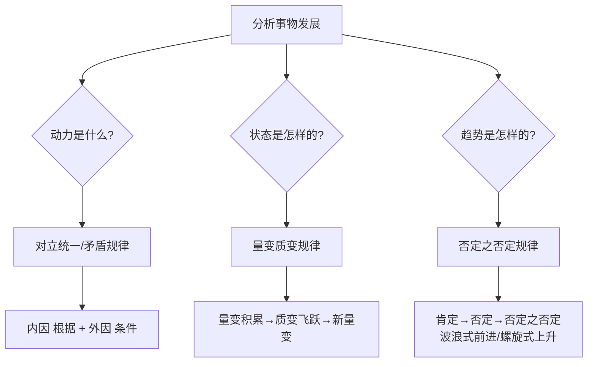

# II. 唯物辩证法

> 一句说清：唯物辩证法回答"世界是怎样的"——世界是普遍联系和永恒发展的，矛盾（对立统一）是其根本规律，量变质变和辩证否定是其基本规律。

---

## 一、核心定义速查

### 1.1 两大总特征

| 特征 | 含义 | 方法论意义 |
|------|------|------------|
| **普遍联系** | 事物内部各要素和事物之间相互影响、相互制约、相互作用 | 用联系的眼光看问题，反对孤立 |
| **永恒发展** | 新事物不断产生、旧事物不断灭亡 | 用发展的眼光看问题，反对静止 |

> 联系具有客观性、普遍性、多样性、条件性。发展是前进的、上升的运动，实质是新事物代替旧事物。

### 1.2 三大规律

| 规律 | 地位 | 回答的问题 |
|------|------|------------|
| **对立统一规律**（矛盾规律） | **根本规律/核心** | 事物发展的**动力**是什么？ |
| **量变质变规律** | 基本规律 | 事物发展的**状态**是怎样的？ |
| **否定之否定规律** | 基本规律 | 事物发展的**趋势**是怎样的？ |

### 1.3 矛盾（对立统一）

| 概念 | 含义 |
|------|------|
| **矛盾的同一性** | 矛盾双方相互依存、相互贯通的性质和趋势 |
| **矛盾的斗争性** | 矛盾双方相互排斥、相互分离的性质和趋势 |
| **辩证关系** | 同一性是有条件的相对的，斗争性是无条件的绝对的；同一性离不开斗争性，斗争性寓于同一性之中 |

> [!important] 矛盾是事物发展的根本动力
> 内因（内部矛盾）是事物发展的**根据**（第一位原因）；外因（外部矛盾）是事物发展的**条件**（第二位原因）。

### 1.4 矛盾的普遍性与特殊性

| 概念 | 含义 | 关系 |
|------|------|------|
| **普遍性**（共性） | 矛盾存在于一切事物中，贯穿始终 | 共性寓于个性之中 |
| **特殊性**（个性） | 具体事物的矛盾各有特点 | 个性包含着共性 |

> 方法论意义：具体问题具体分析（马克思主义活的灵魂）；坚持共性与个性相统一。

### 1.5 量变与质变

| 概念 | 含义 | 特点 |
|------|------|------|
| **量变** | 事物数量的增减和组成要素排列次序的变动 | 渐进性、不显著性、连续性 |
| **质变** | 事物性质的根本变化 | 飞跃性、显著性、间断性 |
| **度** | 保持事物性质的量的界限 | 关节点/临界点 |

> 辩证关系：量变是质变的必要准备；质变是量变的必然结果；质变又引起新的量变。

### 1.6 辩证否定观

| 要点 | 内容 |
|------|------|
| **否定的本质** | 事物的自我否定（内部矛盾运动的结果） |
| **否定的作用** | 发展的环节（旧→新）+ 联系的环节（保留合理因素） |
| **实质** | **扬弃**——既克服又保留，既批判又继承 |

> 与形而上学的区别：形而上学把否定理解为全盘抛弃、外在的否定。

---

## 二、核心原理详解

### 2.1 矛盾同一性与斗争性（Q9）

| 对比维度 | 同一性 | 斗争性 |
|----------|--------|--------|
| 性质 | 有条件的、相对的 | 无条件的、绝对的 |
| 表现 | 相互依存、相互贯通 | 相互排斥、相互分离 |
| 作用 | 维持矛盾统一体存在 | 推动矛盾转化和解决 |
| 关系 | 离不开斗争性 | 寓于同一性之中 |

> 意义：要求我们在对立中把握统一、在统一中把握对立。

### 2.2 "一点论"与"两点论"（Q10）

| 方法论 | 含义 |
|--------|------|
| **两点论** | 看问题要全面，既要看到主要方面又要看到次要方面 |
| **重点论** | 看问题要把握主要矛盾和矛盾的主要方面 |
| **关系** | "两点论"是基础，"重点论"是关键。两点是有重点的两点，重点是两点中的重点 |

> "一点论" = 只抓一点不及其余 → 形而上学。正确的方法是"两点论"与"重点论"的统一。

### 2.3 矛盾的普遍性与特殊性（Q11）

- 普遍性：事事有矛盾，时时有矛盾
- 特殊性：①不同事物的矛盾各有特点；②同一事物不同发展阶段的矛盾各有特点；③矛盾各方面各有特点
- **方法论意义**：马克思主义普遍真理与中国具体实际相结合（共性与个性统一）；具体问题具体分析

### 2.4 "度"的方法论意义（Q12）

- 度是质与量的统一，是保持事物性质的量的界限
- **方法论**：坚持适度原则，把握分寸；注意关节点，防止"过"与"不及"

### 2.5 量变质变辩证关系（Q13）

- 量变是质变的必要准备（没有量变就没有质变）
- 质变是量变的必然结果（量变积累到一定程度必然引起质变）
- 质变又引起新的量变（循环往复）
- **方法论**：注重量的积累，抓住时机促成质变

### 2.6 辩证否定观（Q14）

- 否定是事物的自我否定，不是外力强加
- 否定是发展环节和联系环节的统一
- 实质是"扬弃"——既克服又保留
- **方法论**：对待一切事物要有科学分析的态度，不能简单地肯定一切或否定一切

---

## 三、判定决策流程

---

## 四、易错点

> [!warning] 矛盾同一性与斗争性不可分割
> 不能说"矛盾只有同一性没有斗争性"或反之。同一性离不开斗争性，斗争性寓于同一性之中。

> [!warning] 矛盾普遍性 ≠ 矛盾特殊性不重要
> 矛盾的普遍性告诉我们矛盾无处不在，但特殊性（具体问题具体分析）才是马克思主义活的灵魂。

> [!warning] 量变与质变不是割裂的
> 量变中包含部分质变，质变中也有量的扩张。不能理解为"先量变再质变"的简单线性过程。

> [!warning] 辩证否定 ≠ 全盘否定
> 扬弃 = 既克服又保留。形而上学否定观是"要么全盘肯定，要么全盘否定"。

> [!warning] 度 ≠ 关节点
> 度是范围（量的活动区间），关节点是度的极限（临界点）。超出关节点，事物就发生质变。

> [!warning] "两点论"≠"均衡论"
> 两点论是有重点的两点，不是主次不分、平均用力。
