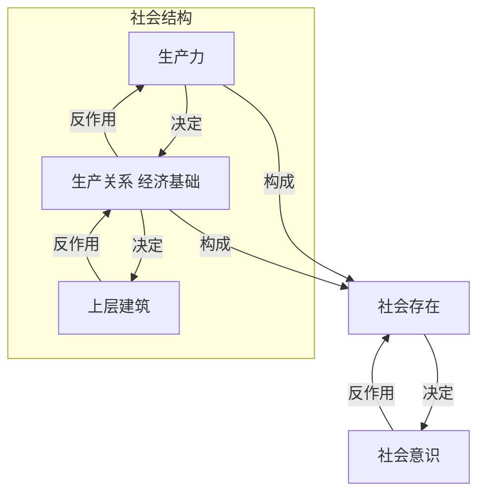

# IV. 历史唯物主义

> 一句说清：历史唯物主义把唯物主义推广到社会历史领域——社会存在决定社会意识，生产力决定生产关系，经济基础决定上层建筑，人民群众是历史的创造者。

---

## 一、核心定义速查

### 1.1 社会存在与社会意识

| 概念 | 含义 | 构成 |
|------|------|------|
| **社会存在** | 社会生活的物质方面 | 地理环境、人口因素、**物质资料生产方式**（决定性因素） |
| **社会意识** | 社会生活的精神方面 | 社会心理、社会意识形式（政治法律思想、道德、艺术、宗教、哲学等） |

> 辩证关系：社会存在**决定**社会意识（第一性）；社会意识对社会存在有**反作用**（相对独立性）。

### 1.2 社会结构

| 层次 | 内容 | 核心 |
|------|------|------|
| **生产力** | 劳动者 + 劳动资料 + 劳动对象 | 人（劳动者） |
| **生产关系（经济基础）** | 生产资料所有制 + 人与人的关系 + 产品分配 | **生产资料所有制** |
| **上层建筑** | 政治上层建筑（国家、法律）+ 观念上层建筑（意识形态） | 国家政权 |

> 基本结论：生产力决定生产关系，经济基础决定上层建筑；后者对前者有反作用。

### 1.3 社会基本规律

| 规律 | 内容 |
|------|------|
| **生产关系一定要适合生产力状况的规律** | 生产力决定生产关系，生产关系反作用于生产力 |
| **上层建筑一定要适合经济基础状况的规律** | 经济基础决定上层建筑，上层建筑反作用于经济基础 |

> 这两大规律是社会发展的基本规律，是社会形态更替的根本动力。

### 1.4 社会发展动力

| 动力 | 作用 |
|------|------|
| **社会基本矛盾**（生产力-生产关系、经济基础-上层建筑） | **根本动力** |
| **阶级斗争** | 阶级社会发展的**直接动力** |
| **社会革命** | 社会形态更替的**决定性环节** |
| **改革** | 社会制度的自我调整和完善 |
| **科学技术** ⭐⭐⭐（23年简答真题） | 重要动力 |
| **文化** | 推动社会发展的重要力量 |

### 1.5 科学技术在社会发展中的作用 ⭐⭐⭐（23年简答真题）

1. 对**生产方式**产生深刻影响：改变生产力构成要素、改变劳动形式、改变产业结构
2. 对**生活方式**产生巨大影响
3. 促进**思维方式**的变革

### 1.5 国家

| 方面 | 内容 |
|------|------|
| **涵义** | 国家是阶级统治的工具，是经济上占统治地位的阶级进行阶级统治的暴力机关 |
| **产生** | 阶级矛盾不可调和的产物 |
| **实质** | 一个阶级统治另一个阶级的工具 |
| **职能** | 对内职能（政治统治、社会管理）+ 对外职能（保卫、交往） |
| **国体** | 国家的阶级性质（各阶级在国家中的地位） |
| **政体** | 政权的组织形式（统治阶级采取何种形式组织自己的政权） |

> 国体决定政体，政体体现国体。

### 1.6 人民群众

| 方面 | 内容 |
|------|------|
| **人民群众** | 一切对社会历史发展起推动作用的人（主体是劳动群众） |
| **历史作用** | 人民群众是历史的创造者：物质财富创造者 + 精神财富创造者 + 社会变革决定力量 |
| **群众观点** | 相信群众、依靠群众、全心全意为人民服务 |
| **群众路线** | 一切为了群众、一切依靠群众，从群众中来、到群众中去 |

---

## 二、核心原理详解

### 2.1 社会存在决定社会意识（Q21）

社会存在是第一性的，社会意识是第二性的。社会意识在反映社会存在的同时，具有相对独立性——对社会存在有能动的反作用。

### 2.2 社会意识的一般特点（Q24）

- 社会意识依赖于社会存在
- 社会意识具有相对独立性
- 社会意识对社会存在有反作用

### 2.3 社会物质生活条件（社会存在）的作用（Q26）

地理环境、人口因素是社会存在和发展的必要条件，**物质资料生产方式**是社会发展的决定力量。

---

## 三、结构关系图

---

## 四、典型问答

> 对应复习纲要 Q21-28

**Q21：社会存在与社会意识的辩证关系**
- 社会存在决定社会意识（内容、发展、变化）
- 社会意识具有相对独立性和反作用

**Q22：社会结构的构成及基本结论**
- 生产力 → 生产关系（经济基础）→ 上层建筑
- 基本结论：生产力是社会发展的最终决定力量；经济基础决定上层建筑

**Q23：社会的基本规律**
- 生产关系适合生产力状况规律
- 上层建筑适合经济基础状况规律

**Q24：社会意识的一般特点**
- 依赖于社会存在；具有相对独立性；有反作用

**Q25：国家**
- 阶级统治的工具；阶级矛盾不可调和的产物
- 国体（阶级性质）vs 政体（组织形式），国体决定政体

**Q26：社会物质生活条件的作用**
- 地理环境、人口因素是必要条件
- 物质资料生产方式是决定力量

**Q27：社会发展动力**
- 根本动力：社会基本矛盾
- 直接动力：阶级斗争
- 人民群众是历史的创造者
- 科学技术是重要动力

**Q28：人民群众是历史的创造者**
- 创造物质财富、精神财富，是社会变革的决定力量
- 群众观点和群众路线

---

## 五、易错点

> [!warning] 社会存在 ≠ 地理环境
> 社会存在包括地理环境、人口因素和物质资料生产方式，其中**物质资料生产方式**是决定力量。不能把社会存在等同于自然环境。

> [!warning] 社会意识的相对独立性
> 社会意识并不是机械地、同步地反映社会存在。社会意识与社会存在的发展有不完全同步性，且有历史继承性。

> [!warning] 经济基础 = 生产关系的总和
> 经济基础不是生产方式（生产方式 = 生产力 + 生产关系），不要把生产力混入经济基础。

> [!warning] 国家不是"全民的"
> 马克思主义认为国家是阶级统治的工具，不存在超阶级的"全民国家"。国家的实质是经济上占统治地位的阶级的工具。

> [!warning] 人民群众 ≠ 所有人
> 人民群众是指对社会历史发展起推动作用的人，不是指社会中的每一个人。反动阶级和腐朽势力不属于人民群众。
