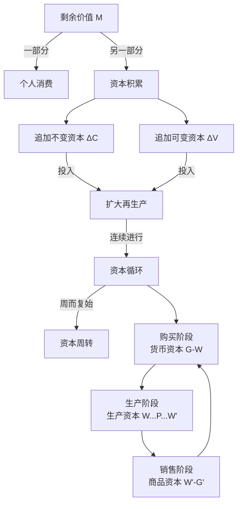

# IX. 资本积累与再生产

> 一句说清：资本家把剩余价值的一部分转化为资本（资本积累），使再生产在扩大的规模上进行。资本在运动中依次经历购买、生产、销售三个阶段（资本循环），不断重复的资本循环就是资本周转，全社会范围的再生产需要两大部分按比例协调发展。

---

## 一、核心定义速查

### 1.1 资本积累（Q19）

| 概念 | 含义 |
|------|------|
| **资本积累** | 把剩余价值转化为资本（剩余价值的资本化） |
| **实质** | 资本家利用无偿占有的剩余价值来扩大剥削规模 |
| **动因** | ① 内在动力：追求更多剩余价值；② 外在压力：竞争 |

### 1.2 简单再生产与扩大再生产（Q20）

| 类型 | 含义 | 特点 |
|------|------|------|
| **简单再生产** | 剩余价值全部用于资本家个人消费，生产在原有规模上重复 | 理论的抽象 |
| **扩大再生产** | 剩余价值的一部分转化为追加资本，生产在扩大规模上进行 | 资本主义特征 |

> 分析简单再生产的意义：揭示资本主义再生产的实质——不仅再生产商品和剩余价值，而且再生产资本主义生产关系本身。

### 1.3 资本循环（Q21-23）

| 概念 | 内容 |
|------|------|
| **资本循环** | 资本从一种形式出发，经过一系列形式变化，又回到原来出发点的运动 |

**产业资本循环的三个阶段和三种职能形式**（Q22）：

| 阶段 | 职能形式 | 职能 | 公式 |
|------|----------|------|------|
| 购买阶段 | **货币资本** | 购买生产资料和劳动力 | $G - W$ |
| 生产阶段 | **生产资本** | 生产商品，创造剩余价值 | $W \cdots P \cdots W'$ |
| 销售阶段 | **商品资本** | 实现价值和剩余价值 | $W' - G'$ |

**三种循环形式**：

| 循环形式 | 公式 | 起点和终点 |
|----------|------|:---:|
| 货币资本循环 | $G - W \cdots P \cdots W' - G'$ | 货币 → 货币 |
| 生产资本循环 | $P \cdots W' - G' - W \cdots P$ | 生产 → 生产 |
| 商品资本循环 | $W' - G' - W \cdots P \cdots W'$ | 商品 → 商品 |

**正常进行的前提条件**（Q23）：
1. 三种职能形式**在空间上并存**
2. 三个阶段**在时间上继起**

### 1.4 资本周转（Q24-26）

| 概念 | 含义 |
|------|------|
| **资本周转** | 周而复始、不断重复的资本循环 |
| **周转时间** | 生产时间 + 流通时间 |
| **周转次数** | 一年内资本周转的次数 |

### 1.5 固定资本与流动资本（Q25）

| 类型 | 含义 | 周转方式 | 举例 |
|------|------|----------|------|
| **固定资本** | 以厂房、机器、设备等形式存在 | 价值分次转移 | 机器、厂房 |
| **流动资本** | 以原料、燃料、辅助材料和劳动力形式存在 | 价值一次转移或再生产 | 原料、工资 |

> [!warning] 固定/流动资本 ≠ 不变/可变资本
> 两种划分标准不同：不变/可变资本划分依据是**在剩余价值生产中的作用**；固定/流动资本划分依据是**价值周转方式**。

### 1.6 预付总资本周转（Q26）

$$\text{预付总资本周转次数} = \frac{\text{1年内固定资本周转总值} + \text{1年内流动资本周转总值}}{\text{预付资本总值}}$$

**制约因素**：
1. 固定资本与流动资本的**比例**
2. 固定资本和流动资本各自的**周转速度**

---

## 二、社会总产品与社会再生产（Q27-28）

### 2.1 社会总产品

社会总产品：社会在一定时期内（通常为一年）生产的全部物质资料的总和。

| 划分角度 | 分类 |
|----------|------|
| **实物形态** | 生产资料（第I部类）+ 消费资料（第II部类） |
| **价值形态** | $C + V + M$（不变资本 + 可变资本 + 剩余价值） |

### 2.2 社会再生产的核心问题

**核心问题**：社会总产品的**实现问题**（价值补偿 + 实物补偿）

**理论前提**：
1. 社会总产品的价值形态：$C + V + M$
2. 社会生产分为两大部类：第I部类（生产资料）+ 第II部类（消费资料）

### 2.3 社会再生产的实现条件

| 类型 | 条件 | 公式 |
|------|------|------|
| **简单再生产** | 基本实现条件 | $I(V+M) = II(C)$ |
| **扩大再生产** | 基本前提条件 | $I(V+M) > II(C)$ |

---

## 三、核心关系图

---

## 四、计算示例

### 示例：预付总资本周转次数

> 某企业固定资本 100 万元，年周转 0.1 次；流动资本 50 万元，年周转 4 次。求预付总资本周转次数。

**解**：
- 固定资本年周转总值：$100 \times 0.1 = 10$ 万元
- 流动资本年周转总值：$50 \times 4 = 200$ 万元
- 预付资本总值：$100 + 50 = 150$ 万元
- 预付总资本周转次数：$(10 + 200) / 150 = 1.4$ 次

---

## 五、典型问答

> 对应复习纲要政治经济学 Q19-28

**Q19：资本积累**
- 剩余价值转化为资本
- 实质：利用无偿占有的剩余价值扩大剥削

**Q20：简单再生产 vs 扩大再生产**
- 简单：剩余价值全部消费，规模不变
- 扩大：剩余价值部分追加，规模扩大

**Q21：资本循环**
- 资本从一种形式出发回到出发点的运动

**Q22：三个阶段、三种职能形式、三种循环形式**
- 三个阶段：购买（G-W）、生产（W...P...W'）、销售（W'-G'）
- 三种职能形式：货币资本、生产资本、商品资本
- 三种循环：货币资本循环、生产资本循环、商品资本循环

**Q23：正常进行的前提条件**
- 空间上并存 + 时间上继起

**Q24：资本周转**
- 周而复始不断重复的资本循环

**Q25：固定资本 vs 流动资本**
- 固定：价值分次转移（机器厂房）
- 流动：价值一次转移（原料、工资）

**Q26：预付总资本周转次数计算**
- 公式见上

**Q27：社会总产品**
- 实物形态 + 价值形态（C+V+M）

**Q28：社会再生产核心问题和理论前提**
- 核心：社会总产品的实现问题
- 前提：价值形态三分 + 两大部类划分

---

## 六、易错点

> [!warning] 不变/可变资本 ≠ 固定/流动资本
> 划分标准不同。原料是流动资本但属不变资本；劳动力是流动资本但工资来自可变资本。

> [!warning] 资本积累 ≠ 原始积累
> 资本积累是剩余价值资本化，以剩余价值为前提；原始积累是资本主义生产方式的起点，通过暴力掠夺完成。

> [!warning] 资本循环中断
> 三个阶段任何一个中断，整个资本循环就中断——空间并存和时间继起缺一不可。

> [!warning] 周转时间越长，周转速度越慢
> 资本家总是设法缩短周转时间——加快生产、减少库存、缩短流通。

> [!warning] 社会再生产的实现条件
> 简单再生产基本条件：I(V+M) = II(C)。以此为基础可以推导出其他条件。
