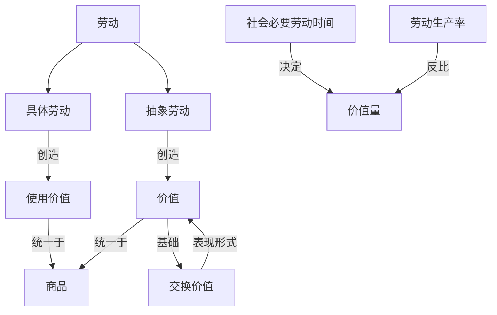

# VI. 商品经济理论

> 一句说清：马克思从商品入手分析资本主义——商品是使用价值和价值的统一体，劳动二重性（具体劳动 + 抽象劳动）是理解政治经济学的枢纽，价值规律是商品经济的基本规律。

---

## 一、核心定义速查

### 1.1 商品

| 概念 | 定义 | 关键点 |
|------|------|--------|
| **商品** | 用来交换的劳动产品 | 必须是劳动产品 + 用于交换 |
| **使用价值** | 商品能满足人们某种需要的属性 | 自然属性，构成社会财富的物质内容 |
| **交换价值** | 一种使用价值与另一种使用价值相交换的量的关系 | 表象 |
| **价值** | 凝结在商品中的无差别的一般人类劳动 | 本质，交换价值的基础 |

> [!important] 商品是使用价值和价值的统一体
> 使用价值是价值的物质承担者。有使用价值不一定是商品（如空气），有价值的一定是商品。

### 1.2 使用价值与价值的关系

| 对比维度 | 使用价值 | 价值 |
|----------|----------|------|
| 属性 | 自然属性 | 社会属性 |
| 反映 | 人与自然的关系 | 人与人的关系（生产者之间） |
| 特点 | 各商品不同（异质的） | 同质的（无差别人类劳动） |
| 统一 | 使用价值是价值的物质承担者 | — |
| 对立 | 商品生产者要实现价值，必须让渡使用价值 | 购买者要获得使用价值，必须支付价值 |

### 1.3 交换价值与价值的关系

| 概念 | 地位 |
|------|------|
| **交换价值** | 价值的**表现形式** |
| **价值** | 交换价值的**基础/内容** |

> 交换价值是现象，价值是本质。科学任务是从现象中发现本质。

### 1.4 劳动二重性

| 类型 | 含义 | 创造 | 属性 |
|------|------|------|------|
| **具体劳动** | 在一定具体形式下进行的劳动 | **使用价值** | 自然属性 |
| **抽象劳动** | 撇开具体形式的无差别的一般人类劳动 | **价值** | 社会属性 |

> [!important] 劳动二重性是理解政治经济学的枢纽
> ① 使劳动价值论建立在科学基础上；② 为剩余价值理论奠定基础；③ 解决了政治经济学的一系列重大理论问题。

### 1.5 商品价值量

| 要素 | 内容 |
|------|------|
| **决定因素** | 社会必要劳动时间（而非个别劳动时间） |
| **社会必要劳动时间** | 在现有社会正常生产条件下，在社会平均劳动熟练程度和劳动强度下制造某种使用价值所需的劳动时间 |
| **价值量变动** | 与劳动生产率成反比——劳动生产率越高，单位商品价值量越低 |

> 公式：单位商品价值量 = 1 / 劳动生产率

---

## 二、核心原理

### 2.1 价值规律（Q6）⭐⭐⭐（24年简答真题）

| 方面 | 内容 |
|------|------|
| **基本内容** | 商品的价值量由社会必要劳动时间决定；商品交换以价值量为基础实行等价交换 |
| **表现形式** | 价格围绕价值上下波动（受供求关系影响） |

**价值规律在市场配置资源中的积极作用**：
1. 自发地调节生产资料和劳动力在社会各生产部门之间的分配比例
2. 自发地刺激社会生产力的发展
3. 自发地调节社会收入的分配

**消极后果**：
1. 导致社会资源浪费
2. 阻碍技术进步
3. 导致收入两极分化

> 价格围绕价值波动不是对价值规律的否定，恰恰是价值规律在商品经济中的实现形式。

### 2.2 马克思劳动价值论的意义 ⭐⭐⭐（24年简答真题）

1. 扬弃了英国古典政治经济学的观点，为**剩余价值论**的创立奠定了基础
2. 揭示了**私有制条件下商品经济的基本矛盾**，从物与物背后揭示人与人的关系
3. 揭示了**商品经济的一般规律**，对理解社会主义市场经济具有指导意义

### 2.3 深化对劳动价值论的认识 ⭐

1. 深化对创造价值的劳动的认识，对生产性劳动作出新的界定
2. 深化对科技人员、经营管理人员（脑力劳动）在社会生产和价值创造中所起作用的认识
3. 深化对价值创造与价值分配关系的认识

### 2.2 简单商品经济的基本矛盾（Q7）

| 矛盾 | 内容 |
|------|------|
| **私人劳动与社会劳动的矛盾** | 生产商品的劳动，一方面是**私人劳动**（生产资料私有制），另一方面是**社会劳动**（社会分工） |

> 这一矛盾是简单商品经济一切矛盾的根源。它决定了：使用价值与价值的矛盾、具体劳动与抽象劳动的矛盾。

---

## 三、概念关系图

---

## 四、典型问答

> 对应复习纲要政治经济学 Q1-7

**Q1：什么是商品？**
- 用来交换的劳动产品；使用价值与价值的统一体

**Q2：使用价值、交换价值、价值**
- 使用价值：有用性（自然属性）
- 交换价值：交换的量的关系（表象）
- 价值：无差别人类劳动的凝结（本质）

**Q3：使用价值与价值的关系 / 交换价值与价值的关系**
- 使用价值 vs 价值：统一（使用价值是物质承担者）+ 对立（不能同时占有）
- 交换价值 vs 价值：交换价值是价值的表现形式

**Q4：劳动二重性**
- 具体劳动创造使用价值；抽象劳动创造价值
- 是理解政治经济学的枢纽

**Q5：商品价值量的决定和变动**
- 由社会必要劳动时间决定
- 与劳动生产率成反比

**Q6：价值规律**
- 内容：社会必要劳动时间决定价值量，等价交换
- 形式：价格围绕价值波动
- 作用：调节分配、刺激改进技术、两极分化

**Q7：简单商品经济的基本矛盾**
- 私人劳动 vs 社会劳动
- 是商品经济一切矛盾的根源

---

## 五、计算要点

### 5.1 价值量与劳动生产率

$$\text{单位商品价值量} \propto \frac{1}{\text{劳动生产率}}$$

| 变化 | 单位商品价值量 | 使用价值量（商品数量） | 价值总量 |
|------|:---:|:---:|:---:|
| 劳动生产率提高 | ↓ | ↑ | 不变 |
| 劳动生产率降低 | ↑ | ↓ | 不变 |

---

## 六、易错点

> [!warning] 使用价值 ≠ 价值
> 使用价值是自然属性（所有有用物品都有），价值是社会属性（只有商品才有）。

> [!warning] 交换价值 ↑ 价值
> 交换价值是价值的表现形式。两者不能等同。

> [!warning] 具体劳动 ≠ 抽象劳动是两种劳动
> 不是两次劳动或两种劳动，而是同一劳动的两个方面。

> [!warning] 劳动生产率与价值量
> 劳动生产率提高 → 单位商品价值量降低，但同一劳动创造的价值总量不变。

> [!warning] 价格波动否定价值规律？
> 不。价格围绕价值波动正是价值规律的实现形式，不是否定。
