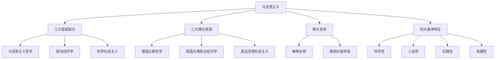

# 导论：马克思主义概论

> 本章回答"马克思主义是什么、怎么来的、有什么用"。是整个课程的总纲，概念多但深度浅，重在**建立整体框架**。

---

## 一、本章核心脉络

> 导论的逻辑：马克思主义是什么（定义+组成）→ 怎么来的（来源+发现）→ 什么特点（特征）→ 有什么用（当代价值）→ 怎么学。

---

## 二、什么是马克思主义（了解即可）

| 概念 | 内容 |
|------|------|
| **马克思主义** | 由马克思、恩格斯创立并为后继者不断发展的科学理论体系 |
| **三大组成部分** | 马克思主义哲学、马克思主义政治经济学、科学社会主义 |
| **核心概括** | 马克思主义基本原理体现**科学性**和**革命性**的统一 |

> 一句话来说：马克思主义 = 看世界的方法（哲学）+ 批判资本主义（政治经济学）+ 走向共产主义的路（科学社会主义）。

---

## 三、马克思主义的创立与发展

### 3.1 三大直接理论来源

| 来源 | 为马克思主义提供了 |
|------|-------------------|
| **德国古典哲学** | 辩证法思想（黑格尔）+ 唯物主义（费尔巴哈） |
| **英国古典政治经济学** | 劳动价值论（亚当·斯密、大卫·李嘉图） |
| **英法空想社会主义** | 对资本主义的批判和对未来社会的设想 |

### 3.2 三大自然科学前提

细胞学说、能量守恒与转化定律、生物进化论——为马克思主义提供了自然科学基础，证明了世界的物质统一性和发展的辩证性。

### 3.3 两大伟大发现（核心）

> [!important] **唯物史观** + **剩余价值学说** = 马克思一生的两个伟大发现
> 这两大发现使社会主义从空想变为科学。唯物史观揭示了人类社会发展的一般规律；剩余价值学说揭开了资本主义剥削的秘密。

---

## 四、马克思主义的基本特征（核心）

| 特征 | 内涵 |
|------|------|
| **科学性** | 对自然、社会和人类思维发展本质和规律的**正确反映** |
| **人民性** | 人民性是马克思主义的**本质属性**，人民至上是**政治立场** |
| **实践性** | 从实践中来、到实践中去、在实践中接受检验、随实践发展 |
| **发展性** | 不断发展的开放学说，具有**与时俱进的理论品质** |

> 一句话来说：科学性、人民性、实践性、发展性——四个特征统一，用一句话概括就是**科学性与革命性的统一**。后三者属革命性。

---

## 五、马克思主义的当代价值 ⭐

| 价值维度 | 含义 |
|----------|------|
| **认识工具** | 观察当代世界变化的认识工具 |
| **行动指南** | 指引当代中国发展的行动指南 |
| **科学真理** | 引领人类社会进步的科学真理 |

---

## 六、自觉学习和运用马克思主义 ⭐

大学生如何学习马克思主义理论：
1. 掌握**基本立场观点方法**
2. 掌握**中国化时代化**的理论成果
3. 坚持**理论联系实际**的马克思主义学风
4. 自觉将马克思主义**内化于心、外化于行**

---

## 七、核心公式速查表

| 概念 | 内容 |
|------|------|
| 三大组成部分 | 哲学 + 政治经济学 + 科学社会主义 |
| 三大理论来源 | 德国古典哲学 + 英国古典政治经济学 + 英法空想社会主义 |
| 两大发现 | 唯物史观 + 剩余价值学说 |
| 四大特征 | 科学性 + 人民性 + 实践性 + 发展性 |
| 当代价值 | 认识工具 + 行动指南 + 科学真理 |

---

## 八、易错点与注意事项

> [!warning] 科学性和革命性不是两个独立的特征
> 四个特征中，科学性是第一个，人民性、实践性、发展性都属革命性范畴。它们是统一的，不是割裂的。

> [!warning] 两大发现 ≠ 三大来源
> 两大发现（唯物史观、剩余价值学说）是马克思**自己的**发现；三大来源是马克思**吸收借鉴**的前人成果。考试经常混淆。

---

## 九、相关知识点链接

本章为总论，后续各章分别展开三大组成部分：
- [[复习/II-唯物辩证法|唯物辩证法]] + [[复习/IV-历史唯物主义|唯物史观]] = 马克思主义哲学
- [[复习/VI-商品经济理论|商品经济]] + [[复习/VII-剩余价值生产|剩余价值]] = 政治经济学
- [[复习/V-科学社会主义|科学社会主义]]
