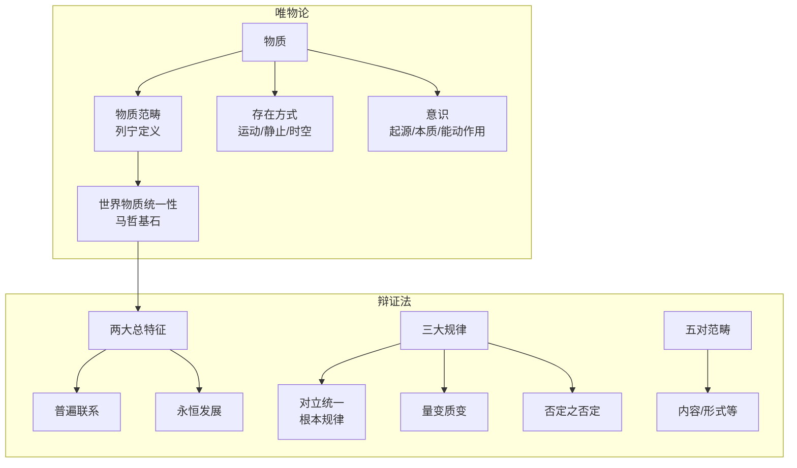
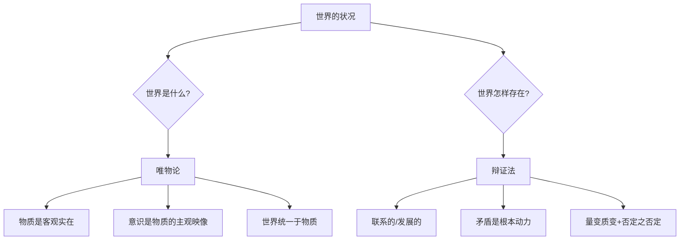

# 世界的物质性及发展规律（辩证唯物主义）

> 辩证法回答"世界是怎样存在的"——世界是物质的、普遍联系的、永恒发展的，对立统一是其根本规律。本章是马原考试**最重的一块**（📚📚📚📚）。

---

## 一、本章核心脉络

> 逻辑：先搞清楚世界"是什么"（物质）→ 再搞清楚世界"怎么变"（辩证法）。唯物论是基础，辩证法是核心。

---

## 二、唯物论：世界的物质统一性

### 2.1 哲学基本问题

| 问题 | 两种回答 | 派别 |
|------|----------|------|
| 物质和意识谁为**本原**（第一性） | 物质第一 | **唯物主义** |
| | 意识第一 | **唯心主义** |
| 物质和意识有无**同一性** | 有（世界可知） | **可知论** |
| | 无（世界不可知） | **不可知论** |

### 2.2 物质范畴（核心）

> [!important] **列宁的物质定义**：物质是标志客观实在的哲学范畴，这种客观实在是人通过感觉感知的，**不依赖于我们的感觉而存在**，为我们的感觉所复写、摄影、反映。

> 一句话来说：物质 = 不管你看不看它、想不想它，它就在那里的东西。"客观实在性"是物质的唯一特性。

**马克思主义物质范畴的理论意义** ⭐：
1. 坚持了**唯物主义一元论**，同唯心主义和二元论划清界限
2. 坚持了**能动的反映论**和**可知论**，批判了不可知论
3. 体现了**唯物论和辩证法的统一**，克服了形而上学唯物主义的缺陷
4. 体现了**唯物主义自然观与历史观的统一**，为彻底的唯物主义奠定基础

### 2.3 物质的存在方式

| 概念 | 含义 | 性质 |
|------|------|:---:|
| **运动** | 物质的根本属性和存在方式 | 绝对的 |
| **静止** | 物质运动在一定条件下的稳定状态 | 相对的 |
| **时间** | 物质运动的持续性、顺序性 | 一维性 |
| **空间** | 物质运动的广延性、伸张性 | 三维性 |

> 关键关系：物质与运动不可分；运动绝对 vs 静止相对；时空与物质运动不可分。

### 2.4 意识（核心）

**意识的定义**：人脑的机能和属性，是**物质世界的主观映像**。意识是物质世界长期发展的产物，是社会实践的产物。

**物质对意识的决定作用** ⭐——表现在意识的起源和本质上：
1. 从起源看：意识是自然界长期发展的产物
2. 从本质看：意识是人脑的机能和属性，是客观世界的主观映像

**意识对物质的能动作用** ⭐⭐⭐（23年简答题真题）：
1. 意识具有**目的性和计划性**
2. 意识具有**创造性**
3. 意识具有**指导实践改造客观世界**的作用
4. 意识具有**调控人的行为和生理活动**的作用

### 2.5 主观能动性与客观规律性 ⭐

- 尊重客观规律是正确发挥主观能动性的**前提**
- 只有充分发挥主观能动性，才能**正确认识和利用**客观规律
- 正确发挥主观能动性需要：从实际出发（前提）、实践（根本途径）、一定的物质条件和手段

### 2.6 人工智能无法取代人类智能 ⭐

1. 人类意识是知情意的统一体，AI 只模拟理性智能
2. 社会性是人的意识的本质属性，AI 不具备
3. 人类自然语言是思维的物质外壳，AI 难以完全理解
4. AI 只能获得可化约为数字信号的内容

### 2.7 世界的物质统一性 ⭐

> 世界的统一性在于它的**物质性**——这是**马克思主义哲学的基石**。
> 自然界是物质的，人类社会本质上是生产实践基础上形成的物质体系。

---

## 三、唯物辩证法：联系和发展

### 3.1 两大总特征：联系和发展

| 总特征 | 核心观点 |
|--------|----------|
| **普遍联系** | 事物内部各要素和事物之间相互影响、制约、作用 |
| **永恒发展** | 新事物不断产生、旧事物不断灭亡 |

**联系的特点** ⭐：客观性、普遍性、多样性、条件性。

**新事物必然战胜旧事物的原因**：
1. 新事物有新的功能和结构，适应环境变化
2. 新事物是对旧事物的**扬弃**

### 3.2 五对基本范畴（了解即可）

内容与形式 / 本质与现象 / 原因与结果 / 必然与偶然 / 现实与可能

---

## 四、对立统一规律（根本规律，核心）

> 一句话来说：矛盾就是事物内部或事物之间的对立统一关系——没有矛盾就没有发展。矛盾分析法是认识和改造世界的**根本方法**。

### 4.1 矛盾的基本属性 ⭐

| 属性 | 含义 | 性质 |
|------|------|:---:|
| **同一性** | 矛盾双方**相互依存、相互贯通** | 有条件的、相对的 |
| **斗争性** | 矛盾双方**相互排斥、相互分离** | 无条件的、绝对的 |

> 二者相互联结、相辅相成。要在对立中把握统一，在统一中把握对立。

### 4.2 矛盾的普遍性和特殊性（矛盾问题的精髓）

| | 普遍性（共性） | 特殊性（个性） |
|------|:---:|:---:|
| 含义 | 事事有矛盾、时时有矛盾 | 具体事物的矛盾各有特点 |
| 性质 | 无条件的、绝对的 | 有条件的、相对的 |
| 关系 | 共性**寓于**个性之中 | 没有离开共性的个性 |

> 方法论：**具体问题具体分析**——马克思主义活的灵魂。

### 4.3 矛盾的不平衡发展原理

- **主要矛盾** vs 次要矛盾
- **矛盾的主要方面** vs 次要方面
- 事物的性质由**主要矛盾的主要方面**决定
- 方法论：坚持**"两点论"和"重点论"的统一**

---

## 五、量变质变规律

### 5.1 基本概念

| 概念 | 含义 |
|------|------|
| **质** | 事物成为自身并区别于他事物的内在规定性 |
| **量** | 事物的规模、程度、速度等数量规定性 |
| **度** | 保持事物质稳定性的数量界限（关节点/临界点） |
| **量变** | 渐进性、不显著性、连续性 |
| **质变** | 飞跃性、显著性、间断性 |

### 5.2 量变和质变的辩证关系 ⭐

1. 量变是质变的**必要准备**
2. 质变是量变的**必然结果**
3. 量变和质变是**相互渗透**的

> 揭示了事物发展的**渐进性和飞跃性的统一**。方法论：注重量的积累，把握适度原则，抓住时机促成质变。

---

## 六、否定之否定规律

### 6.1 唯物辩证法的否定观 ⭐

1. 否定是**事物的自我否定、自我发展**
2. 否定是**事物发展的环节**
3. 否定是**新旧事物联系的环节**
4. 辩证否定的**实质是"扬弃"**——既批判又继承，既克服又保留

### 6.2 辩证否定过程

**两次否定、三个阶段**：肯定 → 否定 → 否定之否定，波浪式前进、螺旋式上升。

> 揭示了事物发展的**前进性和曲折性的统一**。

---

## 七、唯物辩证法是认识改造世界的根本方法

唯物辩证法的**实质和核心是对立统一规律**。矛盾分析方法是对立统一规律在方法论上的体现。

六种思维能力：辩证思维、历史思维、系统思维、战略思维、底线思维、创新思维。

---

## 八、判定决策流程

---

## 九、核心公式速查表

| 规律 | 回答的问题 | 核心观点 |
|------|-----------|----------|
| 对立统一 | 发展的**动力**是什么？ | 矛盾推动发展 |
| 量变质变 | 发展的**状态**是怎样的？ | 渐进性与飞跃性统一 |
| 否定之否定 | 发展的**趋势**是怎样的？ | 前进性与曲折性统一 |

---

## 十、易错点与注意事项

> [!warning] 物质 ≠ 具体物质形态
> 列宁定义中的"物质"是哲学范畴，"客观实在性"是其唯一特性。不能等同于原子、分子。

> [!warning] 意识能反作用 ≠ 意识决定物质
> 夸大 → 唯心主义；否认能动作用 → 机械唯物主义。

> [!warning] 同一性与斗争性不可分割
> 不能说矛盾只有同一性或只有斗争性。斗争性寓于同一性之中。

> [!warning] 扬弃 ≠ 全盘否定
> 既克服又保留。形而上学否定观是"要么全要要么全扔"。

> [!warning] 度 ≠ 关节点
> 度是范围，关节点是极限。超出关节点，事物就质变。

---

## 十一、相关知识点链接

- [[../复习/I-绪论与唯物论|复习：绪论与唯物论]]
- [[../复习/II-唯物辩证法|复习：唯物辩证法]]
- [[知识点解析梳理/01-导论-知识梳理|前置：导论]] — 马克思主义的整体框架
- [[知识点解析梳理/03-认识论-知识梳理|后续：认识论]] — 意识→认识，实践检验真理
