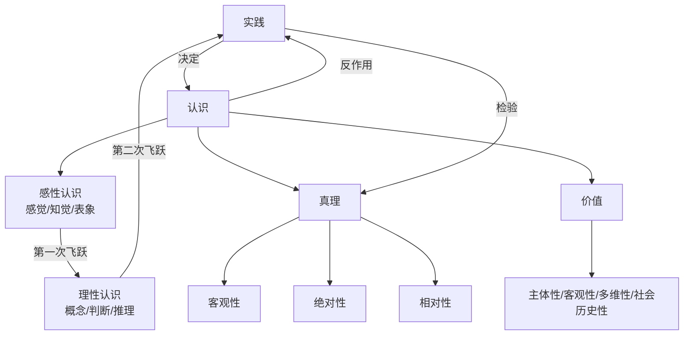
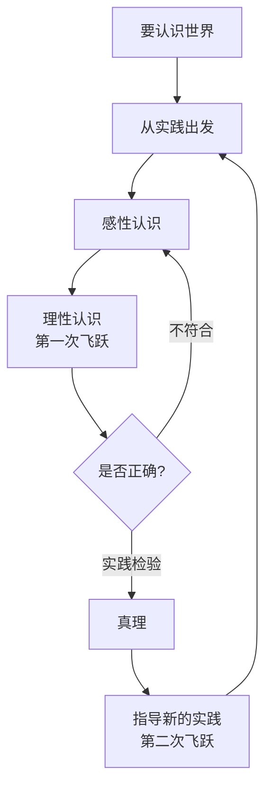

# 实践与认识及其发展规律（认识论）

> 认识论回答"人能否认识世界、如何认识世界"。**实践性**是马克思主义区别于其他理论的根本特征。本章有两个⭐较重要：实践的基本特征（24简答）、实践对认识的决定作用（23简答）。

---

## 一、本章核心脉络

> 逻辑：实践是认识的来源和归宿 → 认识从感性到理性再回到实践 → 认识的结果有真理和价值两个维度 → 实践是检验真理的唯一标准。

---

## 二、实践（核心）

### 2.1 科学实践观的意义 ⭐

1. 克服旧唯物主义缺陷 → 为**辩证唯物主义**奠基
2. 揭示实践对认识的决定作用 → 为**能动反映论**奠基
3. 揭示社会生活的实践本质 → 为**唯物史观**奠基
4. 提供了**思想方法和工作方法**

### 2.2 实践的本质

实践是人类**能动的改造世界**的社会性的物质活动。

> 一句话来说：实践 = 人有目的地去改变世界，不是坐在那想，是真动手干。

### 2.3 实践的基本特征 ⭐⭐⭐（24年简答题真题）

| 特征 | 含义 |
|------|------|
| **客观实在性** | 受客观条件制约，能把脑中的变成现实的 |
| **自觉能动性** | 实践受意识指导，有目的有计划 |
| **社会历史性** | 不同社会和历史下的实践不同 |

### 2.4 实践的基本结构 ⭐

| 要素 | 含义 |
|------|------|
| **实践主体** | 从事现实社会实践的人 |
| **实践客体** | 实践活动所指向的对象 |
| **实践中介** | 工具、手段及运用方法 |

> 主体与客体的关系：实践关系（最根本）、认识关系、价值关系。双向运动：主体客体化 + 客体主体化。

### 2.5 实践对认识的决定作用 ⭐⭐⭐（23年简答题真题）

1. 实践是认识的**来源**
2. 实践是认识发展的**动力**
3. 实践是认识的**目的**
4. 实践是检验认识真理性的**唯一标准**

> 一句话来说：认识从哪里来（来源）→ 靠什么进步（动力）→ 为了什么（目的）→ 对错怎么判（标准）——四个都是实践。

---

## 三、认识的本质与过程

### 3.1 认识的本质

主体在实践基础上对客体的**能动反映**。

| 派别 | 观点 | 缺陷 |
|------|------|------|
| 唯心主义 | 先验论（认识是天生/上帝给的） | 否认反映 |
| 旧唯物主义 | 直观反映论 | 缺实践、缺辩证法 |
| **辩证唯物主义** | **能动反映论** | 引入了实践 + 辩证法 |

### 3.2 感性认识与理性认识

| | 感性认识 | 理性认识 |
|------|----------|----------|
| 反映 | 现象、外部联系 | 本质、内部联系 |
| 形式 | 感觉 → 知觉 → 表象 | 概念 → 判断 → 推理 |
| 特点 | 直接性、具体性 | 间接性、抽象性 |
| 阶段 | 初级阶段 | 高级阶段 |

### 3.3 感性认识和理性认识的辩证统一 ⭐

1. 理性认识**依赖于**感性认识
2. 感性认识**有待于发展和深化为**理性认识
3. 二者**相互渗透、相互包含**

> 一句话来说：感性是"看到什么"，理性是"理解了什么"。二者不是对错关系，是深浅关系。

### 3.4 认识过程的两次飞跃

| 飞跃 | 内容 | 重要性 |
|------|------|:---:|
| **第一次** | 感性认识 → 理性认识（实践→认识） | 基础 |
| **第二次** | 理性认识 → 实践（认识→实践） | **更重要** ⭐ |

> 第二次飞跃更重要：①认识世界是为了**改造世界**；②认识的真理性只有在**实践中**才能检验和发展。

---

## 四、真理

### 4.1 真理的概念

真理是标志主观与客观相符合的哲学范畴，是对客观事物及其规律的**正确反映**。内容客观，形式主观。

### 4.2 真理的属性 ⭐

| 属性 | 含义 |
|------|------|
| **客观性** | 内容客观，标准客观——本质属性 |
| **绝对性** | 主客观统一的确定性和发展的无限性 |
| **相对性** | 一定条件下正确认识总是有限度的、不完善的 |

> 绝对与相对的辩证统一：相互依存、相互包含、从相对走向绝对。

### 4.3 真理与谬误 ⭐

- 相互对立（不能混淆）
- 在一定条件下**能够相互转化**
- 相比较而存在、相斗争而发展

### 4.4 实践是检验真理的唯一标准 ⭐

由真理的本性（主观符合客观）和实践的特点（**直接现实性**）决定的。

实践标准的确定性（最终性）与不确定性（条件性）是辩证统一的。

---

## 五、价值

### 5.1 价值的基本特性 ⭐

主体性、客观性、多维性、社会历史性。

### 5.2 真理与价值的辩证统一 ⭐

- **真理尺度**：按规律办事（合规律性）
- **价值尺度**：按需要办事（合目的性）
- 成功的实践 = 两个尺度的统一

---

## 六、判定决策流程

---

## 七、易错点

> [!warning] 感性认识和理性认识不是对错关系，是深浅关系
> 没有纯粹的感性认识（已有理性渗透），也没有纯粹的理性认识（以感性为基础）。

> [!warning] 真理是一元的（内容上），形式是多元的
> 对同一事物的正确认识只有一个（一元），但表达方式可以多种（多元）。

> [!warning] 实践标准是确定性和不确定性的统一
> 确定性 = 只有实践才能最终检验；不确定性 = 具体实践受历史条件限制。

---

## 八、相关知识点链接

- [[../复习/III-认识论|复习：认识论]]
- [[知识点解析梳理/02-辩证唯物主义-知识梳理|前置：辩证唯物主义]] — 意识→认识，物质→实践客体
- [[知识点解析梳理/04-唯物史观-知识梳理|后续：唯物史观]] — 社会存在与意识
