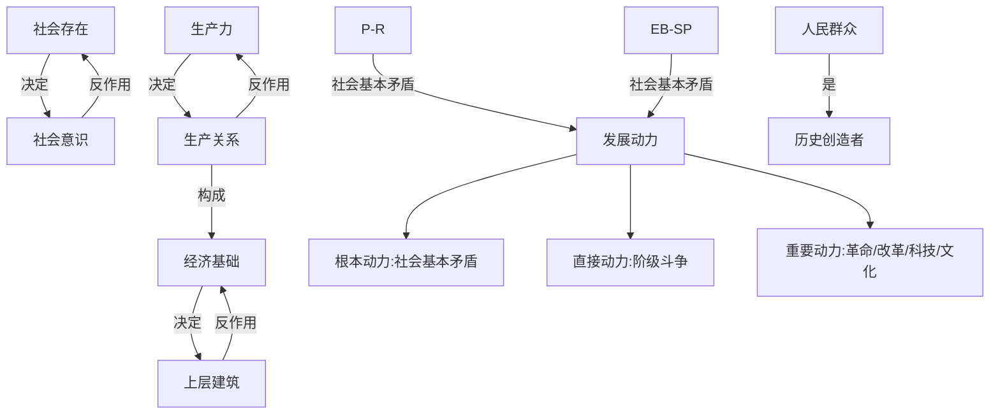
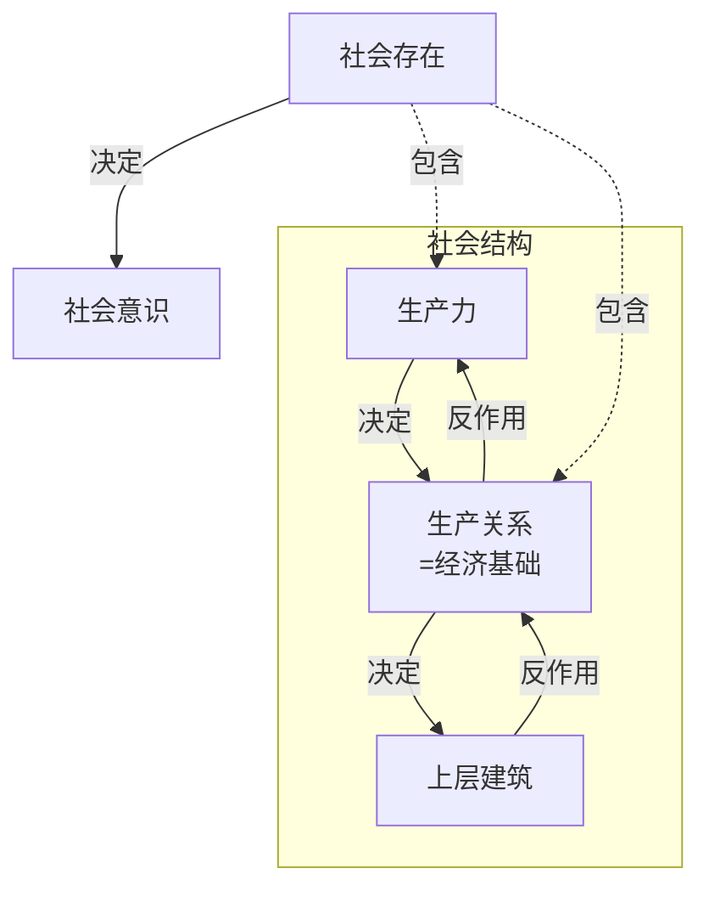

# 人类社会及其发展规律（唯物史观）

> 唯物史观把唯物主义推广到社会历史领域。核心两对矛盾：生产力-生产关系、经济基础-上层建筑。社会存在决定社会意识，人民群众是历史创造者。

---

## 一、本章核心脉络

> 逻辑：先搞清楚社会的"硬件"（社会存在 → 生产力和生产关系 → 经济基础和上层建筑）→ 再看社会的"软件"（社会意识）→ 然后看怎么变（发展动力）→ 最后谁在推动（人民群众）。

---

## 二、社会存在与社会意识

### 2.1 社会历史观的基本问题

社会存在与社会意识何者为第一性 → **唯物史观 vs 唯心史观**

### 2.2 生产方式是社会历史发展的决定力量 ⭐

1. 是人类社会赖以存在和发展的**基础**
2. 决定社会的**结构、性质和面貌**
3. 决定社会**形态**从低级向高级的更替

### 2.3 社会存在与社会意识的辩证关系 ⭐

**社会存在决定社会意识**：社会存在是社会意识内容的客观来源；社会意识是人们社会物质交往的产物；社会意识是具体的、历史的。

**社会意识的相对独立性**（对社会存在的反作用）：
1. 与社会发展具有不完全同步性和不平衡性
2. 内部各种形式相互影响且各具历史继承性
3. 对社会存在具有能动的反作用——这是**相对独立性的突出表现**

---

## 三、生产力与生产关系

### 3.1 两者的构成

| 生产力 | 生产关系 |
|--------|----------|
| 劳动资料（最重要的是生产工具） | 生产资料**所有制**（最基本的、决定性） |
| 劳动对象 | 生产中人与人的关系 |
| 劳动者（最活跃的因素） | 产品分配关系 |

### 3.2 生产力和生产关系的辩证关系 ⭐

1. **生产力决定生产关系**
2. **生产关系反作用于生产力**（适合 → 推动；不适合 → 阻碍）
3. **生产关系一定要适合生产力状况的规律**——人类社会发展的**基本规律**

> 一句话来说：生产力是内容，生产关系是形式——内容决定形式，形式反过来影响内容。

---

## 四、经济基础与上层建筑

### 4.1 概念辨析

| 概念 | 含义 |
|------|------|
| **经济基础** | 由生产力决定的生产关系的总和 |
| **上层建筑** | 政治上层建筑（国家政权为核心）+ 观念上层建筑（意识形态） |

### 4.2 辩证统一关系 ⭐

1. **经济基础决定上层建筑**
2. **上层建筑反作用于经济基础**
3. **上层建筑一定要适合经济基础状况的规律**

---

## 五、社会历史发展的动力

### 5.1 六大动力

| 动力 | 地位 |
|------|------|
| **社会基本矛盾** | 根本动力 |
| **阶级斗争** | 阶级社会发展的直接动力 |
| **社会革命** | 实现社会形态更替的决定性环节 |
| **改革** | 社会制度的自我调整和完善 |
| **科学技术** ⭐⭐⭐（23简答） | 重要动力 |
| **文化** | 重要力量 |

### 5.2 社会基本矛盾在历史发展中的作用 ⭐

1. **生产力**是最基本的动力因素，是**最终决定力量**
2. 社会基本矛盾决定其他矛盾的存在和发展
3. 影响和促进社会形态的变化和发展

### 5.3 科学技术的作用 ⭐⭐⭐（23简答）

1. 对**生产方式**产生深刻影响（改变生产力要素、劳动形式、产业结构）
2. 对**生活方式**产生巨大影响
3. 促进**思维方式**的变革

---

## 六、人民群众

### 6.1 人民群众是历史的创造者 ⭐

1. 社会**物质财富**的创造者
2. 社会**精神财富**的创造者
3. **社会变革**的决定力量
4. 既是创造主体，也是实现自身利益的根本力量

### 6.2 群众观点与群众路线 ⭐

- **群众观点**：相信自己解放自己、全心全意为人民服务、一切向人民群众负责、虚心向人民群众学习
- **群众路线**：一切为了群众，一切依靠群众，从群众中来，到群众中去

### 6.3 群众、阶级、政党、领袖

四者环环相扣：群众划分为阶级 → 阶级由政党领导 → 政党由领袖主持。

---

## 七、结构关系图

---

## 八、易错点

> [!warning] 唯物史观和唯心史观的分水岭 ≠ 社会历史观的基本问题
> 社会历史观的基本问题是社会存在与社会意识的关系。唯物/唯心史观的分水岭是"历史创造者是谁"——人民群众还是英雄。

> [!warning] 经济基础 = 生产关系的总和，不是生产方式
> 生产方式 = 生产力 + 生产关系。经济基础 = 生产关系（不含生产力）。

> [!warning] 社会存在 ≠ 地理环境
> 社会存在包含地理环境、人口因素和**物质资料生产方式**（决定性因素）。

---

## 九、相关知识点链接

- [[../复习/IV-历史唯物主义|复习：历史唯物主义]]
- [[知识点解析梳理/03-认识论-知识梳理|前置：认识论]] — 社会意识→真理性认识
- [[知识点解析梳理/05-政治经济学-知识梳理|后续：政治经济学]] — 资本主义社会的具体应用
