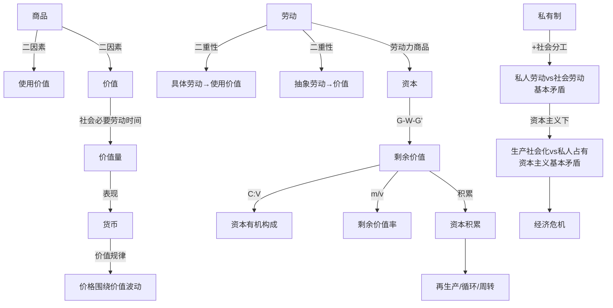
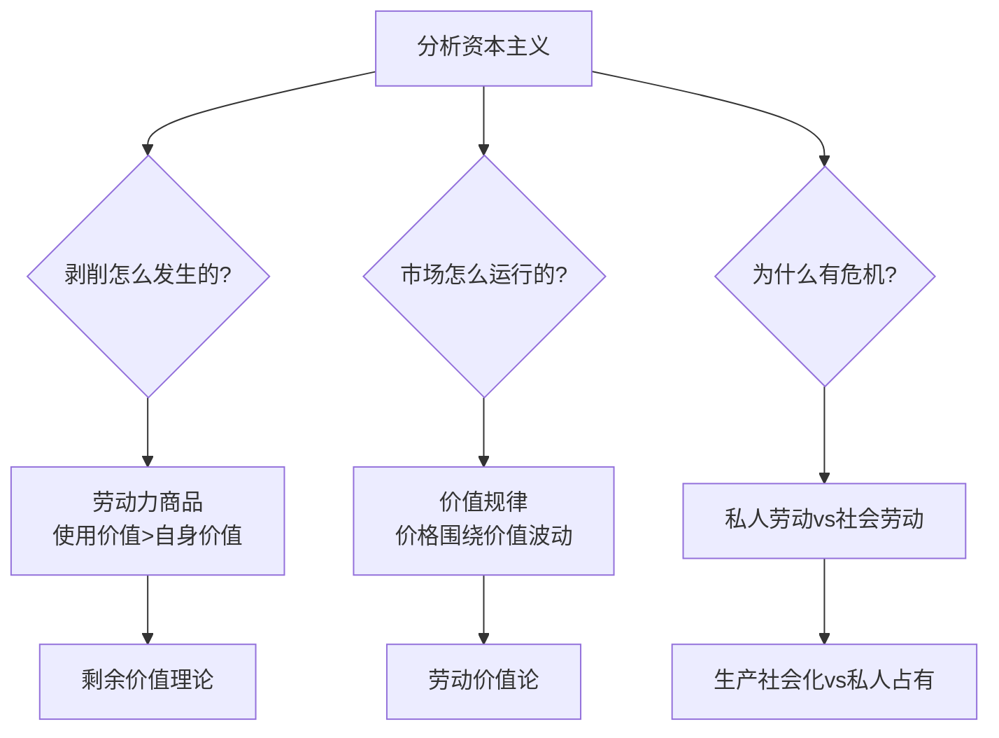

# 资本主义的本质及规律（政治经济学）

> 政治经济学从商品出发，揭示资本主义的运行规律和剥削本质。两大理论支柱：**劳动价值论**（商品、价值、货币）+ **剩余价值理论**（资本、剥削、危机）。

---

## 一、本章核心脉络

> 逻辑：从最小的经济细胞（商品）出发 → 劳动二重性解释商品的二因素 → 价值规律调节市场 → 劳动力成为商品使货币变资本 → 剩余价值揭示剥削 → 资本积累和再生产 → 基本矛盾导致危机。

---

## 二、劳动价值论：商品、价值、货币

### 2.1 商品经济产生的历史条件

1. **存在社会分工**
2. **生产资料和劳动产品属于不同的所有者**

### 2.2 商品的二因素（核心）

| 因素 | 含义 | 属性 |
|------|------|:---:|
| **使用价值** | 满足人的某种需要的**有用性** | 自然属性 |
| **价值** | 凝结在商品中的无差别的一般人类劳动 | 社会属性 |

> 一句话来说：使用价值 = "这东西有啥用"（自然属性）；价值 = "这东西值多少"（社会关系）。商品 = 使用价值 + 价值的统一体。

**对立统一关系** ⭐：
- 对立：同一商品所有者不能同时占有二者
- 统一：使用价值是价值的**物质承担者**

**交换价值**：价值的表现形式。价值是交换价值的**基础**。

### 2.3 劳动的二重性（核心）

| 类型 | 形成什么 | 属性 | 是否永恒 |
|------|----------|:---:|:---:|
| **具体劳动** | 使用价值 | 自然属性 | 永恒范畴 |
| **抽象劳动** | 价值 | 社会属性 | 历史范畴 |

> [!important] 劳动二重性**决定**商品二因素。这是理解政治经济学的**枢纽**。

**对立统一关系** ⭐：同一劳动过程的两个方面，不可分割。

### 2.4 商品价值量的决定

- 决定因素：**社会必要劳动时间**（不是个别劳动时间）
- 与劳动生产率成**反比**：效率越高 → 单个商品价值量越低
- 简单劳动 vs 复杂劳动：市场自发调控倍率

### 2.5 货币

五大职能：**价值尺度**（最基本）、**流通手段**（最基本）、贮藏手段、支付手段、世界货币。

### 2.6 价值规律

| 维度 | 内容 |
|------|------|
| **基本内容** | 商品价值量由社会必要劳动时间决定，等价交换 |
| **表现形式** | **价格围绕价值自发波动** |

**价值规律在市场配置资源中的作用** ⭐⭐⭐（24年简答真题）：

**积极作用**：
1. 自发调节生产资料和劳动力在各生产部门的分配
2. 自发刺激社会生产力发展
3. 自发调节社会收入分配

**消极后果**：导致资源浪费、阻碍技术进步、导致收入两极分化。

### 2.7 私有制商品经济的基本矛盾 ⭐

**私人劳动与社会劳动的矛盾**——是商品经济一切矛盾的**根源**。

| 劳动的性质 | 来源 |
|-----------|------|
| 社会劳动 | 社会分工决定 |
| 私人劳动 | 生产资料私有制决定 |

> 交换是解决这一矛盾的**唯一途径**。这一矛盾在资本主义下发展为**资本主义基本矛盾**。

### 2.8 马克思劳动价值论的意义 ⭐⭐⭐（24年简答真题）

1. 扬弃了英国古典政治经济学的观点，为**剩余价值论**奠基
2. 揭示了**私有制下商品经济的基本矛盾**，从物与物背后揭示人与人的关系
3. 揭示了**商品经济的一般规律**，对社会主义市场经济有指导意义

---

## 三、剩余价值理论：资本、剥削、危机

### 3.1 劳动力成为商品

**两个条件**：
1. 劳动者是**自由人**（有人身自由）
2. 劳动者**一无所有**（没有生产资料）

**劳动力商品的价值**（三个部分）⭐：
1. 维持劳动者本人生存所需
2. 维持家属生存所需
3. 教育和训练费用

**劳动力商品的使用价值**：能够创造**大于自身价值的价值**——这是解开资本总公式矛盾的关键！

### 3.2 资本总公式

| 公式 | 含义 |
|------|------|
| $W - G - W$ | 简单商品流通（为买而卖） |
| **$G - W - G'$** | **资本总公式**（为卖而买，$G'>G$） |

> $G' = G + \Delta G$，$\Delta G$ = 剩余价值。等价交换中如何增殖？——关键在于**劳动力商品**。

### 3.3 资本主义生产过程

**二重性**：劳动过程 + 价值增殖过程（资本主义生产过程的本质特点）

**不变资本（C）** vs **可变资本（V）**：
- 不变资本：以生产资料形式存在，只转移价值不增殖
- 可变资本：用来购买劳动力，创造新价值（含剩余价值）

### 3.4 商品价值构成（计算）

$$W = C + V + M$$

- $C$：不变资本（转移价值）
- $V$：可变资本（劳动力价值）
- $M$：剩余价值

$$m' = \frac{M}{V} = \frac{\text{剩余劳动}}{\text{必要劳动}}$$

### 3.5 资本循环 ⭐

| 阶段 | 职能形式 | 职能 |
|------|----------|------|
| 购买阶段 | **货币资本** | $G-W$ |
| 生产阶段 | **生产资本** | $W...P...W'$ |
| 售卖阶段 | **商品资本** | $W'-G'$ |

**产业资本运动的条件**：空间上并存 + 时间上继起。

### 3.6 剩余价值理论的意义 ⭐

1. 深刻揭露了资本主义剥削本质，指出无产阶级革命的必然性
2. 是马克思经济学说的**核心内容和基石**
3. 揭示了商品经济和社会化生产的一般规律

### 3.7 资本主义基本矛盾 ⭐

**生产社会化**与**生产资料资本主义私人占有**之间的矛盾。

具体表现：
1. 生产无限扩大 vs 劳动人民有支付能力的需求相对缩小
2. 单个企业有组织 vs 整个社会无政府状态

> 这一矛盾使资本主义制度最终被社会主义制度代替具有客观必然性。

---

## 四、资本主义上层建筑

### 资本主义政治制度的局限性 ⭐

1. 民主 = 金钱操纵下的民主
2. 法律名义平等掩盖事实不平等
3. 政党制维护资产阶级统治
4. 政党恶斗导致决策效率低下

---

## 五、判定决策流程

---

## 六、核心公式速查表

| 公式 | 含义 |
|------|------|
| $W = C + V + M$ | 商品价值构成 |
| $m' = M / V$ | 剩余价值率（剥削程度） |
| $G - W - G'$ | 资本总公式 |
| 价值量 ∝ 1/劳动生产率 | 劳动生产率与单位商品价值量反比 |

---

## 七、易错点

> [!warning] 劳动力是商品，劳动不是商品
> 资本家购买的是**劳动力**，不是**劳动**。工资是劳动力的价值，不是劳动的价值。

> [!warning] 不变资本 vs 固定资本
> 划分标准不同：不变/可变按**剩余价值生产中是否增殖**划分；固定/流动按**价值周转方式**划分。

> [!warning] 价格围绕价值波动 ≠ 违背价值规律
> 价格波动正是价值规律的**实现形式**，不是否定。

> [!warning] 私人劳动与社会劳动 ≠ 资本主义基本矛盾
> 前者是私有制商品经济的基本矛盾；后者是资本主义特有的基本矛盾（生产社会化 vs 私人占有）。

---

## 八、相关知识点链接

- [[../复习/VI-商品经济理论|复习：商品经济理论]]
- [[../复习/VII-剩余价值生产|复习：剩余价值生产]]
- [[../复习/VIII-剩余价值分配|复习：剩余价值分配]]
- [[../复习/IX-资本积累与再生产|复习：资本积累与再生产]]
- [[../复习/常考查的概念辨析|复习：常考查概念辨析]]
