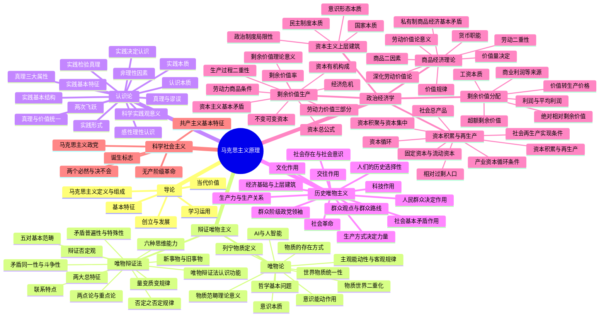
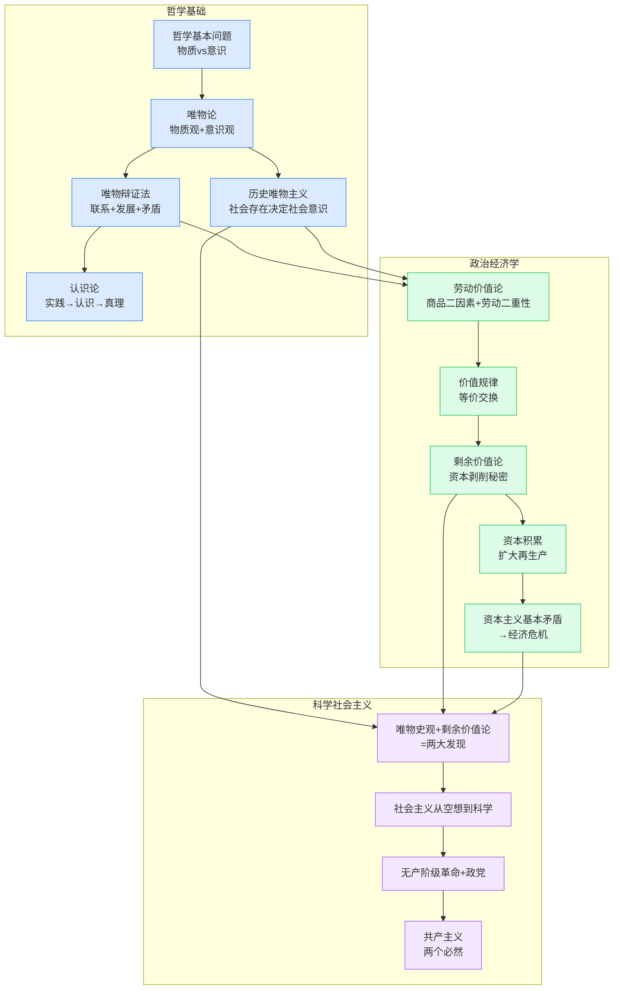

# 马克思主义原理 — 知识图谱

> 基于[[纲要.改|知识纲要]] | 共 105 个知识点 | 点击下方链接跳转到对应知识点文件

---

## 一、课程结构总览（思维导图）

---

## 二、核心概念演进关系

---

## 三、知识点索引（点击跳转）

### 导论

| 文件 | 定义 | 题型 |
|------|------|:--:|
| [[导论/01-马克思主义定义与组成\|马克思主义定义与组成]] | 三大组成部分 + 科学性革命性统一 | 选择/判断 |
| [[导论/02-马克思主义创立与发展\|马克思主义创立与发展]] | 三大来源 + 两大发现 + 三大前提 | 选择/判断 |
| [[导论/03-马克思主义基本特征\|马克思主义基本特征]] | 科学性/人民性/实践性/发展性 ⭐ | 选择/简答 |
| [[导论/04-马克思主义当代价值\|马克思主义当代价值]] | 认识工具/行动指南/科学真理 ⭐ | 简答 |
| [[导论/05-学习运用马克思主义\|学习运用马克思主义]] | 四条方法 ⭐ | 简答 |

### 唯物论

| 文件                                | 定义                  |    题型    |
| --------------------------------- | ------------------- | :------: |
| [[唯物论/01-哲学基本问题\|哲学基本问题]]         | 两大基本问题 + 唯物主义三种形态   |  选择/判断   |
| [[唯物论/02-列宁物质定义\|列宁物质定义]]         | 客观实在 + 可知论 + 能动反映   |  简答/选择   |
| [[唯物论/03-物质范畴理论意义\|物质范畴理论意义]]     | 四条理论意义 ⭐            |    简答    |
| [[唯物论/04-物质的存在方式\|物质的存在方式]]       | 运动(根本属性) + 时空(存在形式) |  选择/判断   |
| [[唯物论/05-物质世界二重化\|物质世界二重化]]       | 自然界⇄人类社会 + 实践是关键    |  选择/判断   |
| [[唯物论/06-意识本质\|意识本质]]             | 人脑机能 + 主观映像         |  选择/判断   |
| [[唯物论/07-意识能动作用\|意识能动作用]]         | 四表现 ⭐⭐⭐ (23简答真题)    | 简答/选择/材料 |
| [[唯物论/08-主观能动性与客观规律\|主观能动性与客观规律]] | 辩证统一 ⭐              |  简答/材料   |
| [[唯物论/09-AI与人智能\|AI与人智能]]         | 四个原因 ⭐              |  简答/选择   |
| [[唯物论/10-物质统一性\|世界物质统一性]]         | 马克思主义哲学基石 ⭐         |  简答/选择   |
|                                   |                     |          |

### 唯物辩证法

| 文件 | 定义 | 题型 |
|------|------|:--:|
| [[唯物辩证法/01-两大总特征\|两大总特征]] | 联系 + 发展 | 选择/判断 |
| [[唯物辩证法/02-五对基本范畴\|五对基本范畴]] | 内容形式/本质现象/原因结果/必然偶然/现实可能 | 选择/判断 |
| [[唯物辩证法/03-联系特点\|联系特点]] | 客观性/普遍性/多样性/条件性 ⭐ | 简答/材料 |
| [[唯物辩证法/04-新事物与旧事物\|新事物与旧事物]] | 扬弃 + 不可战胜的两个原因 | 选择/判断 |
| [[唯物辩证法/05-矛盾同一性与斗争性\|矛盾同一性与斗争性]] | 基本属性 ⭐ (同一性=相对, 斗争性=绝对) | 简答/材料 |
| [[唯物辩证法/06-矛盾普遍性与特殊性\|矛盾普遍性与特殊性]] | 矛盾问题精髓 + 具体问题具体分析 | 简答/材料 |
| [[唯物辩证法/07-两点论与重点论\|两点论与重点论]] | 主要矛盾 + 矛盾主要方面 | 选择/材料 |
| [[唯物辩证法/08-量变质变规律\|量变质变规律]] | 度/关节点 + 适度原则 ⭐ | 简答/选择 |
| [[唯物辩证法/09-辩证否定观\|辩证否定观]] | 四条 ⭐⭐⭐ (24简答真题) | 简答 |
| [[唯物辩证法/10-否定之否定规律\|否定之否定规律]] | 两次否定三阶段 + 前进性曲折性统一 | 选择/判断 |
| [[唯物辩证法/11-六种思维能力\|六种思维能力]] | 辩证/历史/系统/战略/底线/创新 | 选择/判断 |
| [[唯物辩证法/12-唯物辩证法认识功能\|唯物辩证法认识功能]] | 批判的革命的 + 对立统一是核心 | 选择/判断 |

### 认识论

| 文件 | 定义 | 题型 |
|------|------|:--:|
| [[认识论/01-科学实践观意义\|科学实践观意义]] | 四条意义 ⭐ | 简答 |
| [[认识论/02-实践本质\|实践本质]] | 能动改造世界的社会性物质活动 | 选择/判断 |
| [[认识论/03-实践基本特征\|实践基本特征]] | 客观实在性/自觉能动性/社会历史性 ⭐⭐⭐ (24简答) | 简答 |
| [[认识论/04-实践基本结构\|实践基本结构]] | 主体+客体+中介 ⭐ | 简答/选择 |
| [[认识论/05-实践形式\|实践形式]] | 物质生产(最基本)/社会政治/科学文化 | 选择/判断 |
| [[认识论/06-实践决定认识\|实践决定认识]] | 来源/动力/目的/检验标准 ⭐⭐⭐ (23简答) | 简答/材料 |
| [[认识论/07-认识本质\|认识本质]] | 能动反映论 vs 直观反映论 vs 先验论 | 选择/简答 |
| [[认识论/08-感性理性认识\|感性理性认识]] | 深浅关系 + 辩证统一 ⭐ | 简答/材料 |
| [[认识论/09-两次飞跃\|两次飞跃]] | 第一次(感性→理性) + 第二次(理性→实践, 更重要) ⭐ | 简答/选择 |
| [[认识论/10-非理性因素\|非理性因素]] | 理性因素 + 非理性因素 | 选择/判断 |
| [[认识论/11-真理三大属性\|真理三大属性]] | 客观性(本质)+绝对性+相对性 ⭐ | 简答/选择 |
| [[认识论/12-真理与谬误\|真理与谬误]] | 对立统一+相互转化 ⭐ | 简答/选择 |
| [[认识论/13-实践检验真理\|实践检验真理]] | 唯一标准(真理本性+实践特点) ⭐ | 简答/选择 |
| [[认识论/14-真理与价值统一\|真理与价值统一]] | 真理尺度+价值尺度+四特性+四特点 ⭐ | 简答/材料 |

### 历史唯物主义

| 文件 | 定义 | 题型 |
|------|------|:--:|
| [[历史唯物主义/01-社会存在与社会意识\|社会存在与社会意识]] | 社会历史观基本问题 + 辩证关系 ⭐ | 简答/材料 |
| [[历史唯物主义/02-生产方式决定力量\|生产方式决定力量]] | 三个原因 ⭐ | 简答/选择 |
| [[历史唯物主义/03-生产力与生产关系\|生产力与生产关系]] | 辩证关系 ⭐ (24材料题) | 简答/材料 |
| [[历史唯物主义/04-经济基础与上层建筑\|经济基础与上层建筑]] | 辩证统一 ⭐ | 简答/材料 |
| [[历史唯物主义/05-社会基本矛盾作用\|社会基本矛盾作用]] | 根本动力 + 三条作用 ⭐ | 简答/选择 |
| [[历史唯物主义/06-科技作用\|科技作用]] | 三方面 ⭐⭐⭐ (23简答真题) | 简答/材料 |
| [[历史唯物主义/07-文化作用\|文化作用]] | 思想指引+精神动力+凝聚力量+智力支持 | 简答/材料 |
| [[历史唯物主义/08-交往作用\|交往作用]] | 四作用 ⭐ | 选择/判断 |
| [[历史唯物主义/13-人们的历史选择性\|人们的历史选择性]] | 三层递进 ⭐ | 简答/选择 |
| [[历史唯物主义/09-人民群众决定作用\|人民群众决定作用]] | 四方面 ⭐ | 简答/材料 |
| [[历史唯物主义/10-群众观点与群众路线\|群众观点与群众路线]] | 四观点+路线内容 ⭐ | 简答/选择 |
| [[历史唯物主义/11-社会革命作用\|社会革命作用]] | 三作用 ⭐ | 简答/选择 |
| [[历史唯物主义/12-群众阶级政党领袖\|群众阶级政党领袖]] | 四层关系链 | 选择/判断 |

### 概念辨析（跨章节）

| 文件 | 概念对 | 所属 |
|------|--------|:--:|
| [[概念辨析/01-使用价值vs价值\|使用价值 vs 价值]] | 自然属性 vs 社会属性 | 商品经济 |
| [[概念辨析/02-具体劳动vs抽象劳动\|具体劳动 vs 抽象劳动]] | 自然属性(永恒) vs 社会属性(历史) | 商品经济 |
| [[概念辨析/03-不变资本vs可变资本\|不变资本 vs 可变资本]] | 按作用分: 只转移 vs 能增殖 | 剩余价值生产 |
| [[概念辨析/04-绝对vs相对剩余价值\|绝对 vs 相对剩余价值]] | 延长工作日 vs 缩短必要劳动 | 剩余价值分配 |
| [[概念辨析/05-固定资本vs流动资本\|固定资本 vs 流动资本]] | 按周转分: 分批转移 vs 一次转移 | 资本积累 |
| [[概念辨析/06-资本循环vs资本周转\|资本循环 vs 资本周转]] | 一次运动(静态) vs 反复运动(动态) | 资本积累 |
| [[概念辨析/07-感性认识vs理性认识\|感性认识 vs 理性认识]] | 现象 vs 本质 (深浅关系) | 认识论 |
| [[概念辨析/08-社会存在vs社会意识\|社会存在 vs 社会意识]] | 物质 vs 精神 (社会历史观基本问题) | 唯物史观 |
| [[概念辨析/09-量变vs质变\|量变 vs 质变]] | 渐进连续 vs 飞跃中断 | 辩证法 |
| [[概念辨析/10-矛盾同一性vs斗争性\|矛盾同一性 vs 斗争性]] | 有条件相对 vs 无条件绝对 | 辩证法 |

### 政治经济学

#### 商品经济理论

| 文件 | 定义 | 题型 |
|------|------|:--:|
| [[商品经济理论/01-商品二因素\|商品二因素]] | 使用价值(自然)+价值(社会) | 选择/判断 |
| [[商品经济理论/02-劳动二重性\|劳动二重性]] | 具体劳动→使用价值, 抽象劳动→价值 ⭐ | 选择/简答 |
| [[商品经济理论/03-价值量决定\|价值量决定]] | 社会必要劳动时间, 与生产率成反比 | 选择/计算 |
| [[商品经济理论/04-货币职能\|货币职能]] | 五大职能(价值尺度+流通手段最基本) | 选择/判断 |
| [[商品经济理论/05-价值规律\|价值规律]] | 三作用 ⭐⭐⭐ (24简答) | 简答/选择 |
| [[商品经济理论/06-私有制商品经济基本矛盾\|私有制基本矛盾]] | 私人劳动 vs 社会劳动 ⭐ | 选择/简答 |
| [[商品经济理论/07-劳动价值论意义\|劳动价值论意义]] | 三条 ⭐⭐⭐ (24简答) | 简答 |
| [[商品经济理论/08-深化劳动价值论\|深化劳动价值论]] | 三个深化 ⭐ | 选择/判断 |

#### 剩余价值生产

| 文件 | 定义 | 题型 |
|------|------|:--:|
| [[剩余价值生产/01-资本总公式\|资本总公式]] | G-W-G' | 选择/判断 |
| [[剩余价值生产/02-劳动力商品条件\|劳动力商品条件]] | 人身自由 + 一无所有 | 选择/判断 |
| [[剩余价值生产/03-劳动力价值三部分\|劳动力价值三部分]] | 本人+家属+教育 ⭐ | 选择/简答 |
| [[剩余价值生产/04-生产过程二重性\|生产过程二重性]] | 劳动过程+价值增殖过程 | 选择/判断 |
| [[剩余价值生产/05-不变可变资本\|不变可变资本]] | c(转移) vs v(增殖) | 选择/判断 |
| [[剩余价值生产/06-资本有机构成\|资本有机构成]] | c:v, 技术构成决定 | 选择/计算 |
| [[剩余价值生产/07-剩余价值率\|剩余价值率]] | m'=m/v=剩余劳动/必要劳动 | 选择/计算 |
| [[剩余价值生产/08-剩余价值理论意义\|剩余价值理论意义]] | 三条 ⭐ | 简答 |
| [[剩余价值生产/09-资本主义基本矛盾\|资本主义基本矛盾]] | 生产社会化 vs 私人占有 | 选择/简答 |
| [[剩余价值生产/10-经济危机\|经济危机]] | 生产过剩 + 周期性 | 选择/判断 |

#### 剩余价值分配

| 文件 | 定义 | 题型 |
|------|------|:--:|
| [[剩余价值分配/01-绝对相对剩余价值\|绝对相对剩余价值]] | 延长工作日 vs 缩短必要劳动 | 选择/简答 |
| [[剩余价值分配/02-超额剩余价值\|超额剩余价值]] | 个别价值<社会价值的差额 | 选择/判断 |
| [[剩余价值分配/03-工资本质\|工资本质]] | 劳动力价值(非劳动价格) | 选择/判断 |
| [[剩余价值分配/04-利润与平均利润\|利润与平均利润]] | 利润率=m/(c+v), 掩盖剥削 | 选择/简答 |
| [[剩余价值分配/05-价值转生产价格\|价值转生产价格]] | 生产成本+平均利润 | 选择/判断 |
| [[剩余价值分配/06-商业利润等来源\|商业利润等来源]] | 都是剩余价值的瓜分 | 选择/判断 |

#### 资本积累与再生产

| 文件 | 定义 | 题型 |
|------|------|:--:|
| [[资本积累与再生产/01-资本积累与再生产\|资本积累与再生产]] | 剩余价值资本化, 简单/扩大再生产 | 选择/简答 |
| [[资本积累与再生产/02-资本循环\|资本循环]] | 购买(货币)→生产(生产)→售卖(商品) ⭐ | 选择/判断 |
| [[资本积累与再生产/03-产业资本循环条件\|产业资本循环条件]] | 空间并存+时间继起 | 选择/判断 |
| [[资本积累与再生产/04-固定资本与流动资本\|固定资本与流动资本]] | 按周转方式分 | 选择/判断 |
| [[资本积累与再生产/05-社会总产品\|社会总产品]] | c+v+m, Ⅰ(生产资料)+Ⅱ(消费资料) | 选择/判断 |
| [[资本积累与再生产/06-社会再生产实现条件\|社会再生产实现条件]] | 价值补偿+实物补偿 ⭐ | 选择/简答 |
| [[资本积累与再生产/07-资本积聚与资本集中\|资本积聚与资本集中]] | 内源增长 vs 外源扩张 | 选择/判断 |
| [[资本积累与再生产/08-相对过剩人口\|相对过剩人口]] | 有机构成提高→失业 | 选择/判断 |

#### 资本主义上层建筑

| 文件 | 定义 | 题型 |
|------|------|:--:|
| [[资本主义上层建筑/01-国家本质\|国家本质]] | 资产阶级阶级统治工具 | 选择/判断 |
| [[资本主义上层建筑/02-民主制度本质\|民主制度本质]] | 政治统治和社会管理手段 | 选择/判断 |
| [[资本主义上层建筑/03-政治制度局限性\|政治制度局限性]] | 四大局限性 ⭐ | 简答/选择 |
| [[资本主义上层建筑/04-意识形态本质\|意识形态本质]] | 观念上层建筑+阶级意识集中体现 | 选择/判断 |

### 科学社会主义

| 文件 | 定义 | 题型 |
|------|------|:--:|
| [[科学社会主义/01-诞生标志\|诞生标志]] | 《共产党宣言》+两大理论基础 | 选择/判断 |
| [[科学社会主义/02-无产阶级革命\|无产阶级革命]] | 主要形式是暴力革命 | 选择/判断 |
| [[科学社会主义/03-马克思主义政党\|马克思主义政党]] | 民主集中制+全心全意为人民服务 | 选择/简答 |
| [[科学社会主义/04-共产主义基本特征\|共产主义基本特征]] | 按需分配+人的自由全面发展 | 选择/简答 |
| [[科学社会主义/05-两个必然与决不会\|两个必然与决不会]] | 趋势与条件的统一 | 选择/判断 |

---

## 四、已考真题速查

| 年份 | 题型 | 题目 | 对应知识点 |
|------|:--:|------|------|
| 2023 | 简答 | 意识能动作用 | [[唯物论/07-意识能动作用\|意识能动作用 ⭐⭐⭐]] |
| 2023 | 简答 | 实践对认识的决定作用 | [[认识论/06-实践决定认识\|实践决定认识 ⭐⭐⭐]] |
| 2023 | 简答 | 科学技术在社会发展中的作用 | [[历史唯物主义/06-科技作用\|科技作用 ⭐⭐⭐]] |
| 2024 | 简答 | 辩证否定观 | [[唯物辩证法/09-辩证否定观\|辩证否定观 ⭐⭐⭐]] |
| 2024 | 简答 | 实践的基本特征 | [[认识论/03-实践基本特征\|实践基本特征 ⭐⭐⭐]] |
| 2024 | 简答 | 劳动价值论的意义 | [[商品经济理论/07-劳动价值论意义\|劳动价值论意义 ⭐⭐⭐]] |
| 2024 | 材料 | 生产力与生产关系 | [[历史唯物主义/03-生产力与生产关系\|生产力与生产关系]] |

---

## 五、复习策略

1. **先看图再查表**：思维导图建立全局 → 概念演进图理解因果关系 → 索引表逐个过
2. **⭐必背**：所有标注 ⭐ 的知识点必须能默写要点
3. **⭐⭐⭐真题必熟**：6道已考真题对应的知识点必须滚瓜烂熟（每年重复概率低但变体概率高）
4. **概念辨析优先**：[[概念辨析/|10组易混淆概念]]是选择/判断题高频陷阱
5. **政治经济学重计算**：剩余价值率 $m'=m/v$、商品价值 $W=c+v+m$、预付总资本周转次数背好公式
