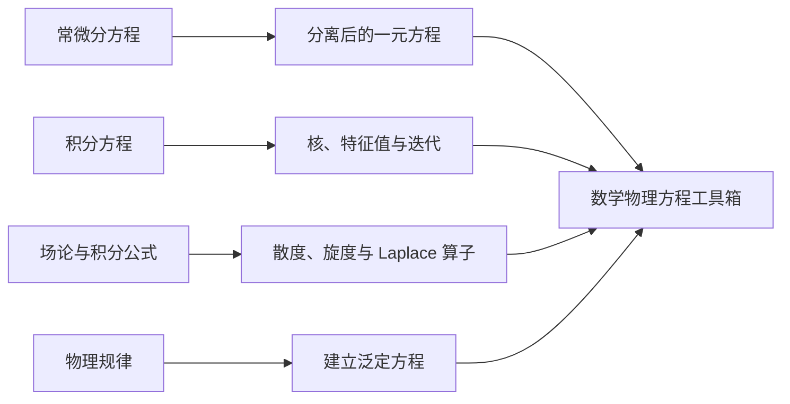
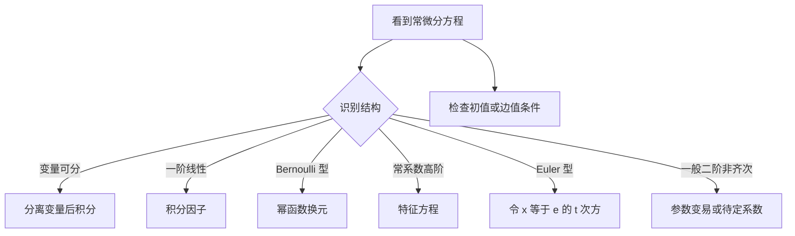

# 第一章 绪论 — 知识点梳理

## 一、本章核心脉络

本章不是直接求解三类典型偏微分方程，而是搭建后续课程的工具箱：用常微分方程处理分离后的单变量问题，用积分方程理解另一类函数方程，用场论和积分公式描述空间中的源、通量与旋转，再用基本物理定律建立波动、热传导和静电场模型。

> 一句话来说：第一章回答“后面建模和解方程时，需要提前准备哪些数学与物理工具”。

---

## 二、微分方程基本语言【基础】

- **常微分方程**：未知函数只有一个自变量。
- **偏微分方程**：未知函数有多个自变量，并出现偏导数。
- **阶数**：方程中出现的最高阶导数的阶数。
- **解**：代入方程后使其成为恒等式的函数。
- **通解与特解**：常微分方程的通解通常含有与阶数相同数量的任意常数；偏微分方程的“通解”往往含任意函数。
- **线性与非线性**：看未知函数及其导数是否以线性方式出现。

> 一句话来说：先认清方程的未知量、阶数和线性结构，才能选择正确方法。

---

## 三、一阶常微分方程【核心工具】

### 3.1 可分离变量方程

若可写成

$$
f(x)\,\mathrm dx=g(y)\,\mathrm dy,
$$

则两边分别积分：

$$
\int f(x)\,\mathrm dx=\int g(y)\,\mathrm dy.
$$

> 一句话来说：把含 $x$ 的项和含 $y$ 的项分到两边，再分别积分。

### 3.2 一阶齐次型方程

方程

$$
\frac{\mathrm dy}{\mathrm dx}=F\!\left(\frac yx\right)
$$

用换元 $u=y/x$，即 $y=ux$、$y'=u+xu'$，化为可分离变量方程。

> 一句话来说：右端只依赖比例 $y/x$ 时，用 $y=ux$ 消掉这种比例结构。

### 3.3 一阶线性方程与积分因子

标准形式为

$$
y'+p(x)y=q(x).
$$

积分因子

$$
\mu(x)=\exp\!\left(\int p(x)\,\mathrm dx\right)
$$

使左端成为乘积导数：

$$
(\mu y)'=\mu q.
$$

因此

$$
y=e^{-\int p\,\mathrm dx}
\left[\int q(x)e^{\int p\,\mathrm dx}\,\mathrm dx+C\right].
$$

> 一句话来说：积分因子的作用是把“两个项”拼成一个可以直接积分的乘积导数。

### 3.4 Bernoulli 方程

$$
y'+p(x)y=q(x)y^n,\qquad n\ne0,1.
$$

令 $u=y^{1-n}$，得到一阶线性方程

$$
u'+(1-n)p(x)u=(1-n)q(x).
$$

> 一句话来说：Bernoulli 方程看似非线性，但幂函数换元后会变成线性方程。

---

## 四、高阶常微分方程【核心工具】

### 4.1 可降阶方程

1. $y''=f(x,y')$：令 $p(x)=y'$，得到 $p'=f(x,p)$。
2. $y''=f(y,y')$：令 $p(y)=y'$，利用

$$
y''=\frac{\mathrm dp}{\mathrm dx}
=\frac{\mathrm dp}{\mathrm dy}\frac{\mathrm dy}{\mathrm dx}
=p\frac{\mathrm dp}{\mathrm dy}.
$$

> 一句话来说：方程缺少 $y$ 或缺少 $x$ 时，利用缺失变量选择不同的降阶换元。

### 4.2 常系数齐次线性方程

对

$$
y^{(n)}+a_1y^{(n-1)}+\cdots+a_ny=0,
$$

令 $y=e^{\lambda x}$，得到特征方程

$$
\lambda^n+a_1\lambda^{n-1}+\cdots+a_n=0.
$$

- 不同实根 $lambda_i$ 对应 $e^{\lambda_i x}$；
- $m$ 重实根 $lambda$ 对应 $e^{\lambda x},xe^{\lambda x},\ldots,x^{m-1}e^{\lambda x}$；
- 复根 $\alpha\pm i\beta$ 对应 $e^{\alpha x}\cos\beta x$ 与 $e^{\alpha x}\sin\beta x$，重根还要乘 $x^k$。

> 一句话来说：常系数线性微分方程通过特征多项式，把微分问题转成代数求根问题。

### 4.3 非齐次方程：齐次通解加特解

对

$$
y''+py'+qy=f(x),
$$

总解为

$$
y=y_h+y_p.
$$

当右端是“多项式 $\times$ 指数 $\times$ 正余弦”时，使用待定系数法；若试探形式与齐次解重复，就额外乘 $x^k$ 消除共振。

> 一句话来说：先解齐次方程，再找任意一个特解，二者相加就是非齐次通解。

### 4.4 参数变易法

若 $y_1,y_2$ 是齐次方程的线性无关解，设

$$
y_p=u(x)y_1(x)+v(x)y_2(x).
$$

令 Wronsky 行列式

$$
W=y_1y_2'-y_1'y_2,
$$

则可取

$$
u'=-\frac{y_2f}{W},\qquad
v'=\frac{y_1f}{W}.
$$

这会在第三章非齐次模态方程中产生卷积型积分。

> 一句话来说：参数变易法把齐次通解中的常数改成函数，以吸收非齐次外力。

### 4.5 Euler 方程

Euler 方程各阶导数前的 $x$ 次幂与导数阶数匹配。通过

$$
x=e^t\qquad(t=\ln x)
$$

可化为常系数线性方程，并利用

$$
x^ky^{(k)}=D(D-1)\cdots(D-k+1)y.
$$

> 一句话来说：对数坐标把“按比例变化”变成“按平移变化”，从而把 Euler 方程化为常系数方程。

---

## 五、特殊方程与固有值问题【后续伏笔】

### 5.1 Bessel 方程族

标准 Bessel 方程为

$$
x^2y''+xy'+(x^2-\nu^2)y=0.
$$

教材还列出半奇数阶、修正 Bessel 方程以及球 Bessel 方程。它们会在圆柱坐标或球坐标下分离变量时自然出现。

> 一句话来说：出现圆形、圆柱形或径向结构时，应预期径向方程可能是 Bessel 型。

### 5.2 Legendre 方程

$$
(1-x^2)y''-2xy'+n(n+1)y=0,qquad -1\le x\le1.
$$

它通常来自球坐标中的角向分离。

> 一句话来说：球面角向问题往往把 Legendre 多项式作为自然模态。

### 5.3 Sturm–Liouville 方程

$$
\frac{\mathrm d}{\mathrm dx}
\left[k(x)y'(x)\right]
+[\lambda\rho(x)-q(x)]y(x)=0.
$$

其中 $\rho(x)$ 是权函数，$\lambda$ 是固有值参数。第三章将系统使用其固有值、正交性和广义 Fourier 展开。

> 一句话来说：Sturm–Liouville 问题是“分离变量后为什么能用正交模态展开”的理论核心。

---

## 六、定解问题、稳定性与简单偏微分方程【理解】

### 6.1 初值问题与边值问题

- **Cauchy 初值问题**：在同一个初始点给出足够数量的初值。
- **边值问题**：在区间不同端点给出函数值或导数关系。

> 一句话来说：方程给出变化规律，定解条件负责从众多可能解中选出实际过程。

### 6.2 Lyapunov 稳定性

若初值的充分小扰动始终只引起解的充分小扰动，则平凡解稳定；若存在任意小初始扰动最终离开某个固定邻域，则不稳定。

> 一句话来说：稳定性问的不是“能否写出解”，而是“数据稍有误差时解会不会失控”。

### 6.3 简单偏微分方程的直接积分与变量变换

- $u_{xy}=0$：
  $$u(x,y)=f(x)+g(y).$$
- $u_x=x+y$：
  $$u=\frac12x^2+xy+f(y).$$
- $u_x-u_y=0$：取特征变量 $s=x+y$，得
  $$u=f(x+y).$$

> 一句话来说：对某个变量积分时，“积分常数”应允许依赖其他变量。

---

## 七、积分方程基础【了解到会识别】

积分号下含未知函数的方程称为积分方程。

### 7.1 分类

- 第一类线性积分方程：未知函数只在积分号内；
- 第二类线性积分方程：未知函数同时出现在积分号内外；
- Fredholm 型：积分上下限固定；
- Volterra 型：具有三角型核或等价的变上限结构；
- 弱奇异核、奇异核：核在 $x=t$ 附近具有可积或主值意义的奇性。

核 $k(x,t)$ 还可分为连续核、$L^2$ 核、Hermite 核、对称核和斜对称核。

> 一句话来说：积分方程的类别主要由“未知函数出现的位置”和“积分核的结构”决定。

### 7.2 特征值与特征函数

若齐次方程

$$
y(x)=\lambda\int_a^b k(x,t)y(t)\,\mathrm dt
$$

在 $\lambda=\lambda_0$ 时存在非零解，则 $\lambda_0$ 是特征值，对应非零解是特征函数。

> 一句话来说：特征值是使齐次问题突然出现非零解的特殊参数。

### 7.3 逐次逼近与预解核

第二类方程

$$
y=f+\lambda Ky
$$

可从 $y_0=f$ 开始迭代，形成 Neumann 级数。若 $|\lambda|<1/[M(b-a)]$ 等条件成立，级数一致绝对收敛并给出唯一解。退化核可把积分方程化为有限维线性方程组。

> 一句话来说：迭代法把积分算子反复作用产生的无穷级数，看成算子版的几何级数。

---

## 八、场论基本概念【核心】

### 8.1 标量场、向量场与梯度

- 温度、电势等是标量场；
- 速度、电场强度等是向量场；
- 梯度 $\nabla u$ 指向标量场增长最快方向，其模是最大方向导数。

> 一句话来说：梯度把“一个标量在空间中怎样变”转换成一个方向向量。

### 8.2 通量与散度

向量场 $\boldsymbol A$ 穿过有向曲面 $S$ 的通量为

$$
\iint_S\boldsymbol A\cdot\boldsymbol n\,\mathrm dS.
$$

散度

$$
\operatorname{div}\boldsymbol A=\nabla\cdot\boldsymbol A
$$

是单位体积净流出量的极限：正值表示源，负值表示汇，零表示无源。

> 一句话来说：散度测量一个点附近“向外冒出多少”或“向内吸入多少”。

### 8.3 环流与旋度

沿闭曲线的环流为

$$
\oint_L\boldsymbol A\cdot\mathrm d\boldsymbol r.
$$

旋度

$$
\operatorname{rot}\boldsymbol A=\nabla\times\boldsymbol A
$$

描述局部旋转强度。无旋且定义域条件合适时，场可写成势函数的梯度。

> 一句话来说：旋度测量流场在一个点附近“想不想打转”。

### 8.4 Helmholtz 思想

在适当条件下，一个向量场可分解为无旋部分与无散部分；散度和旋度分别刻画发散源与旋涡源。

> 一句话来说：知道场的散度、旋度及边界行为，通常就掌握了决定该场的主要信息。

---

## 九、常用算符与三大积分公式【核心】

### 9.1 算符

$$
\nabla=\left(\frac{\partial}{\partial x},
\frac{\partial}{\partial y},
\frac{\partial}{\partial z}\right),
\qquad
\Delta=\nabla^2=\frac{\partial^2}{\partial x^2}
+\frac{\partial^2}{\partial y^2}
+\frac{\partial^2}{\partial z^2}.
$$

常用关系：

$$
\operatorname{grad}u=\nabla u,\qquad
\operatorname{div}\boldsymbol A=\nabla\cdot\boldsymbol A,
\qquad
\operatorname{rot}\boldsymbol A=\nabla\times\boldsymbol A,
\qquad
\Delta u=\nabla\cdot\nabla u.
$$

> 一句话来说：$\nabla$ 是统一产生梯度、散度、旋度和 Laplace 算子的微分工具。

### 9.2 Green、Stokes 与 Gauss 公式

- Green 公式把平面闭曲线积分转为区域积分；
- Stokes 公式把边界环流转为曲面上的旋度通量：

$$
\oint_L\boldsymbol A\cdot\mathrm d\boldsymbol r
=\iint_S(\nabla\times\boldsymbol A)\cdot\boldsymbol n\,\mathrm dS;
$$

- Gauss 公式把闭曲面通量转为体内散度积分：

$$
\oiint_S\boldsymbol A\cdot\boldsymbol n\,\mathrm dS
=\iiint_V\nabla\cdot\boldsymbol A\,\mathrm dV.
$$

> 一句话来说：三大积分公式都把“边界上的总效应”与“内部的局部变化率”联系起来。

---

## 十、特殊函数与常用结论【了解】

### 10.1 Gamma、Beta 与误差函数

$$
\Gamma(x)=\int_0^\infty t^{x-1}e^{-t}\,\mathrm dt,
\qquad
\Gamma(x+1)=x\Gamma(x),
\qquad
\Gamma(n+1)=n!.
$$

$$
B(p,q)=\int_0^1t^{p-1}(1-t)^{q-1}\,\mathrm dt
=\frac{\Gamma(p)\Gamma(q)}{\Gamma(p+q)}.
$$

$$
\operatorname{erf}(x)=\frac2{\sqrt\pi}\int_0^xe^{-t^2}\,\mathrm dt,
\qquad
\operatorname{erfc}(x)=1-\operatorname{erf}(x).
$$

> 一句话来说：这些函数把无法用初等函数表达的常见积分封装成标准对象。

### 10.2 球面法向导数与 Poisson 核恒等式

对以原点为球心的球面，外法向就是径向，因此

$$
\frac{\partial u}{\partial n}=u_r.
$$

教材还给出

$$
\frac12+\sum_{n=1}^{\infty}k^n\cos n\alpha
=\frac12\frac{1-k^2}{1-2k\cos\alpha+k^2},
\qquad |k|<1,
$$

它将在第三章把圆域级数解化为 Poisson 积分公式。

> 一句话来说：几何对称性和级数恒等式会直接简化后续圆域、球域问题。

---

## 十一、建模常用物理规律【必须会翻译】

| 规律 | 数学表达 | 主要用途 |
|:--|:--|:--|
| Newton 第二定律 | $F=ma$ | 波动方程、杆振动 |
| Hooke 定律 | $p=Yu_x$ | 弹性杆应力与应变 |
| Fourier 定律 | $\boldsymbol q=-k\nabla u$ | 热传导方程与热流边界 |
| Newton 冷却定律 | $q=h(u-u_{\mathrm{ext}})$ | 第三类换热边界 |
| 热量守恒 | 流入净热量加内热源等于内能增量 | 热方程 |
| 扩散定律 | $\boldsymbol J=-k\nabla c$ | 扩散方程 |
| Gauss 定律 | 闭面电通量等于包围电荷除以介电常数 | Poisson 方程 |
| Coulomb 定律 | 点电荷电势与 $1/r$ 成正比 | 基本解与点源 |
| Kirchhoff 定律 | 节点电流守恒、回路电势守恒 | 传输线方程 |
| Faraday 定律 | 感应电动势与磁通变化率负值成正比 | 电磁波建模 |

> 一句话来说：建模的关键是把物理守恒或实验定律应用到一个微元，再令微元尺寸趋于零。

---

## 十二、判定与解题流程

---

## 十三、核心公式速查表

| 内容 | 公式 |
|:--|:--|
| 一阶线性积分因子 | $\mu=e^{\int p(x)\,\mathrm dx}$ |
| Bernoulli 换元 | $u=y^{1-n}$ |
| 参数变易 | $u'=-y_2f/W$，$v'=y_1f/W$ |
| Euler 换元 | $t=\ln x$ |
| Laplace 算子 | $\Delta u=u_{xx}+u_{yy}+u_{zz}$ |
| Gauss 公式 | $\oiint_S\boldsymbol A\cdot\boldsymbol n\,\mathrm dS=\iiint_V\nabla\cdot\boldsymbol A\,\mathrm dV$ |
| Stokes 公式 | $\oint_L\boldsymbol A\cdot\mathrm d\boldsymbol r=\iint_S(\nabla\times\boldsymbol A)\cdot\boldsymbol n\,\mathrm dS$ |
| Gamma 递推 | $\Gamma(x+1)=x\Gamma(x)$ |
| Beta–Gamma 关系 | $B(p,q)=\Gamma(p)\Gamma(q)/\Gamma(p+q)$ |

---

## 十四、易错点与注意事项

> [!warning] 易错点
> 1. 对偏微分方程按某变量积分时，积分“常数”通常是其他变量的任意函数。
> 2. “一阶齐次型方程”与“线性齐次方程”不是同一个概念。
> 3. 参数变易公式中的 Wronsky 行列式符号要与自己的定义保持一致。
> 4. 散度是标量，旋度是向量；二者物理意义不同。
> 5. Fourier 定律的负号表示热量沿温度下降方向传播。
> 6. 球面上 $\partial u/\partial n=u_r$ 只因外法向恰为径向；一般曲面不能直接替换。
> 7. 特殊函数在本章重点是识别来源，不要求此时掌握全部展开和渐近性质。

---

## 十五、相关知识点链接

- [[02-定解问题与偏微分方程理论-知识梳理]]：把本章的物理规律、场论算子用于建立三类典型方程。
- [[03-分离变量法-知识梳理]]：把本章的常微分方程与 Sturm–Liouville 工具用于真正求解定解问题。
- [[课程/数学物理方程/课堂笔记/2026-09-16-第1节-数理方程课程导论与基础知识回顾|第1节课堂笔记]]：常微分方程、场论与波动方程建模回顾。

## 十六、作业与练习

- 能独立识别并求解可分离变量、一阶线性、Bernoulli 和 Euler 方程。
- 验证 $u_{xy}=0$ 的一般解为 $f(x)+g(y)$。
- 用 Gauss 公式解释散度的“单位体积净流出量”意义。
- 尝试从 Fourier 定律与热量守恒写出一维热方程，为第二章做准备。

