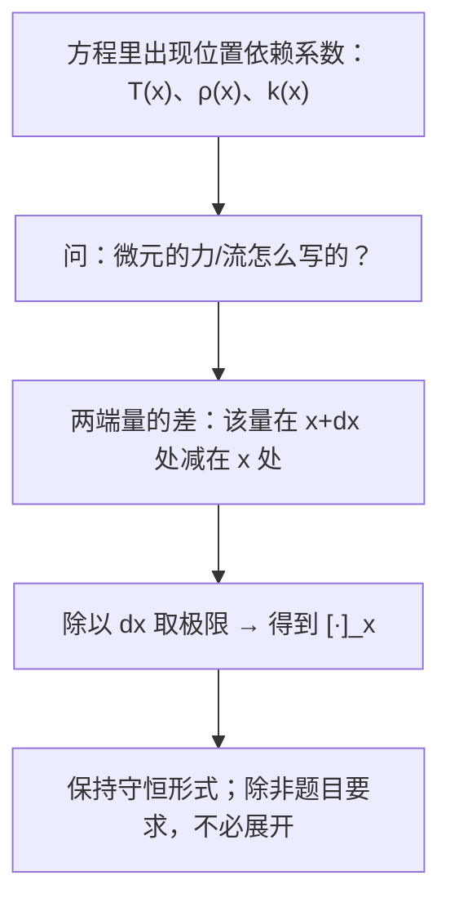

# 第2章 答疑 — 「守恒形式」是什么意思

> 问题：清单里"能把变张力弦方程写成守恒形式 $\rho u_{tt}=[T(x)u_x]_x$"是什么意思？

> 来源：[[课程/数学物理方程/作业/9月21日数学作业]]「必须掌握」清单（L396）

---

## 0. 一句话兜底

它是**一种写法**，不是新物理：**守恒形式是微元分析的"原样输出"，展开反而是多余的一步。**
记号 $[\,\cdot\,]_x$ 就是 $\dfrac{\partial}{\partial x}(\cdot)$。

$$\rho u_{tt}=\bigl[T(x)u_x\bigr]_x
\quad\Longleftrightarrow\quad
\underbrace{\partial_t(\rho u_t)}_{\text{密度变化}}+\underbrace{\partial_x(-Tu_x)}_{\text{通量变化}}=0$$

后者正是守恒律的标准长相：$\partial_t(\text{密度})+\partial_x(\text{通量})=0$。

## 1. 为什么叫"守恒"

对任意区间 $[a,b]$ 积分：

$$\frac{\mathrm d}{\mathrm dt}\int_a^b \rho u_t\,\mathrm dx=\Bigl[T u_x\Bigr]_a^b$$

**读法**：区间内总动量 $\int\rho u_t\,\mathrm dx$ 的变化率，**只取决于两端 $a,b$ 的 $Tu_x$**，与区间内部无关。

> [!important] "守恒"的含义
> 内部**不产生、不消灭**动量，只能从边界进出。通量 $-Tu_x$ 就是"张力沿位置传递动量"的速率。

## 2. 关键：它是推导的**原样输出**

作业 2.1-1 的微元方程：

$$T(x+\mathrm dx)u_x(x+\mathrm dx,t)-T(x)u_x(x,t)=\rho\,\mathrm dx\,u_{tt}$$

除以 $\mathrm dx$、令 $\mathrm dx\to0$，**立刻得到** $[T(x)u_x]_x=\rho u_{tt}$——这就是守恒形式。

而展开式 $u_{tt}=g[(L-x)u_{xx}-u_x]$ 是把乘积**再**求导一次（$(Tu_x)_x=T'u_x+Tu_{xx}$）得到的**额外**一步。

> [!tip] 顺序很重要
> **守恒形式在前，展开式在后。** 不是"把展开式整理成守恒形式"，而是"守恒形式展开成展开式"。
> 守恒形式不需要这一步，因此**不要求 $T$ 可导**。

## 3. 为什么清单专门要求掌握它

| 理由 | 说明 |
|:--|:--|
| ① 常系数是特例 | $T$ 为常数时 $[Tu_x]_x=Tu_{xx}$，退回 $u_{tt}=a^2u_{xx}$。守恒形式**更一般** |
| ② 不要求 $T$ 光滑 | $T(x)$ **分片常数**（两种材料接起来）时 $T'$ 不存在，展开式无意义，但 $Tu_x$ 仍连续可写 |
| ③ 物理意义直白 | 一眼看出"张力沿弦传力"，而非两个抽象项相加 |
| ④ 数值方法前提 | 有限元/有限体积对 $\int Tu_x v'\,\mathrm dx$ 分部积分，必须从守恒形式出发 |
| ⑤ 识别题眼的钥匙 | 见"张力/密度随位置变化"⇒ 先写 $[\ ]_x$，**别急着展开** |

## 4. 怎么一眼认出该用守恒形式

**口诀**：微元分析中凡是"**右端点的量 − 左端点的量**"，取极限后自动得到**散度形式** $[\ ]_x$。

## 5. 同类形式对照

| 方程 | 守恒形式 | 密度 | 通量 |
|:--|:--|:--|:--|
| 变张力弦 | $\rho u_{tt}=[T(x)u_x]_x$ | $\rho u_t$ | $-Tu_x$ |
| 变系数热传导 | $c\rho u_t=[k(x)u_x]_x$ | $c\rho u$ | $-ku_x$ |
| 连续性方程 | $\rho_t+(\rho v)_x=0$ | $\rho$ | $\rho v$ |
| 一维守恒律 | $u_t+[f(u)]_x=0$ | $u$ | $f(u)$ |

规律：**都是 $\partial_t(\cdot)+\partial_x(\cdot)=0$ 的形状**。第 10 章的非线性波动、守恒律都从这里长出来。

> [!warning] 展开时别丢项
> $(Tu_x)_x=T'u_x+Tu_{xx}$，**两项都要**。
> 取 $T=\rho g(L-x)$，$T'=-\rho g$，故 $\rho u_{tt}=-\rho g\,u_x+\rho g(L-x)u_{xx}$，即 $u_{tt}=g[(L-x)u_{xx}-u_x]$ ✓

## 6. 速记

> **守恒形式 = 微元分析的"原样输出"**：$\partial_t(\text{密度})+\partial_x(\text{通量})=0$。
> 系数随位置变时**优先用它**——不用展开、不要求系数可导、物理含义直白。
> $T$ 为常数时才退化成 $u_{tt}=a^2u_{xx}$。

---

## 相关链接

- 作业原题：[[课程/数学物理方程/作业/9月21日数学作业]]（习题 2.1 第 1 题、学习清单）
- 相关答疑：[[课程/数学物理方程/答疑/02-定解问题与偏微分方程理论/2.2-Fourier定律符号与热流方向]]
- 课堂笔记：[[课程/数学物理方程/课堂笔记/2026-09-16-第1节-数理方程课程导论与基础知识回顾]]
