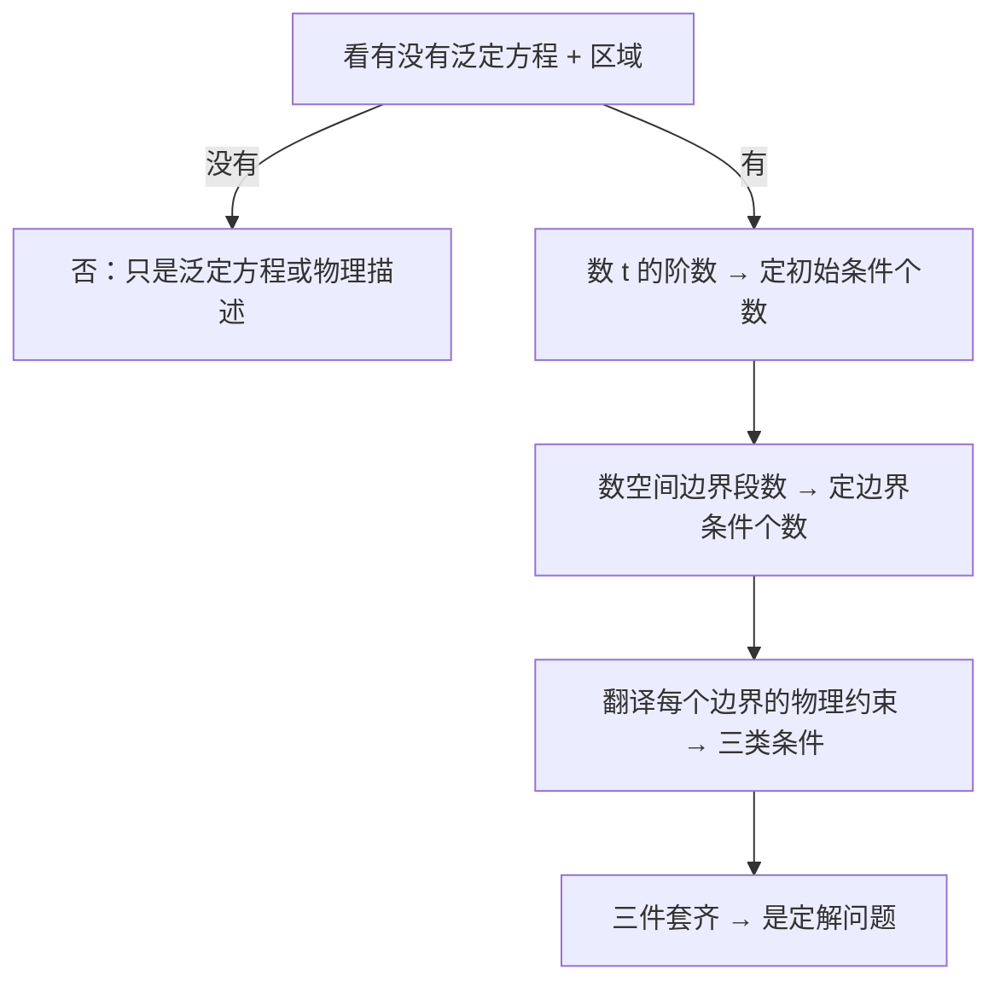

# 第2章 答疑 — 如何判断一个问题是"定解问题"

> 问题：作业里写到最后来一句"因而定解问题为 ……"，怎么判断它就算定解问题了？

> 来源：[[课程/数学物理方程/作业/9月21日数学作业]] 习题 2.1 第 2 题（L160–L171）

---

## 0. 一句话兜底

**"泛定方程 + 定解条件"补齐了，才叫定解问题。**
"定解"就是"确定解"——光有方程，解有无穷多个；配上条件，解才被唯一确定。

## 1. 三件套（缺一不可）

| 成分 | 作用 | 习题 2.1-2 中对应 |
|:--|:--|:--|
| **泛定方程** | 描述"内部"的普遍规律，不含具体环境 | $u_{tt}=a^2u_{xx}$ |
| **初始条件** | 描述 $t=0$ 的系统状态 | $u(x,0)=\frac{b}{L}x,\ u_t(x,0)=0$ |
| **边界条件** | 描述区域边界上的物理约束 | $u(0,t)=0,\ u_x(L,t)=0$ |

外加**区域声明**：$0<x<L,\ t>0$。三行用大括号分组列出，正好是定解问题的标准长相。

## 2. 判别流程

## 3. 数目校验表（最关键）

**初始条件个数 = 方程对 $t$ 的阶数：**

| 方程 | 对 $t$ 阶数 | 初始条件 | 例子 |
|:--|:--:|:--|:--|
| 波动方程 $u_{tt}=a^2u_{xx}$ | 2 | **2 个**（初位移 + 初速度） | 弦横振动、杆纵振动 |
| 热方程 $u_t=a^2u_{xx}$ | 1 | **1 个**（初始温度） | 热传导 |
| Laplace $u_{xx}+u_{yy}=0$ | 0 | **0 个** | 稳态场 |

**边界条件个数 = 空间边界段数：** 一维区域有 2 个端点 ⇒ 每端各 1 个 ⇒ 共 2 个。

> [!warning] 最常见的错
> 把波动方程的"两个初始条件"照搬到热方程。热方程对 $t$ 只有一阶，**只需一个**初始条件，多给一个即超定。

## 4. 不完整情形的对照（反向识别）

| 手里有的 | 叫什么 | 解唯一吗 |
|:--|:--|:--:|
| 只有方程 | 泛定方程 | ✗ 无穷多解 |
| 方程 + 初始条件（无界域） | Cauchy 问题（**也是**定解问题） | ✓ |
| 方程 + 边界条件（无初始） | 边值问题（稳态） | ✓ |
| 方程 + 初始 + 边界 | 初边值问题 / 混合问题 | ✓ |
| 方程 + 初始，漏掉一端边界 | 不完整 | ✗ |

## 5. 用作业里的三题现场跑一遍

**习题 2.1 第 2 题（弹性杆）**

- 泛定方程 $u_{tt}=a^2u_{xx}$，区域 $0<x<L,\ t>0$ ✓
- 时间二阶 ⇒ 要 2 个初始条件 ⇒ $u(x,0)=\frac{b}{L}x$、$u_t(x,0)=0$ ✓ 正好 2 个
- 一维两端 ⇒ 要 2 个边界条件 ⇒ $x=0$ 固定给 $u(0,t)=0$（第一类），$x=L$ 自由给 $u_x(L,t)=0$（第二类）✓ 正好 2 个
- 三件套齐 ⇒ **是定解问题**

**习题 2.1 第 4 题（冲量）**：结构相同，只是初速度改成分段形式或 $\delta$ 形式——**条数不变**，仍是定解问题。

**习题 2.2 第 4 题（热传导）**：$u_t=a^2u_{xx}$ 对 $t$ 一阶 ⇒ **只给 1 个**初始条件 $u(x,0)=\varphi(x)$；边界照旧 2 个。

## 6. 两个容易混的点

> [!warning] "是不是定解问题" ≠ "定解问题相不相容"
> 习题 2.1-2 中 $u_x(L,0)=b/L\neq0$，与释放后的 $u_x(L,t)=0$ 在角点 $t=0$ 冲突，即**初边值不相容**。
> 它只影响"有没有连续经典解"，**不影响它是不是一个定解问题**。两者是不同层面的问题。

> [!note] 名字本身就在提示
> **泛定方程** = 普遍的、还定不下具体问题的方程；**定解条件** = 把解"钉死"的条件。
> 配齐条件后，才从"泛定方程"升级为"定解问题"。

## 7. 速记

> **定解问题 = 泛定方程 + 初始条件 + 边界条件**
> 初始条件个数看 $t$ 的阶数，边界条件个数看空间边界段数，条件类型看物理描述。

---

## 相关链接

- 作业原题：[[课程/数学物理方程/作业/9月21日数学作业]]（习题 2.1 第 2、4 题，2.2 第 4 题）
- 课堂笔记：[[课程/数学物理方程/课堂笔记/2026-09-18-第2节-偏微分方程课程讲授]]（定解条件与相容条件）
- 相关答疑：[[课程/数学物理方程/答疑/02-定解问题与偏微分方程理论/2.1-细弦线横振动与波动方程推导]]
