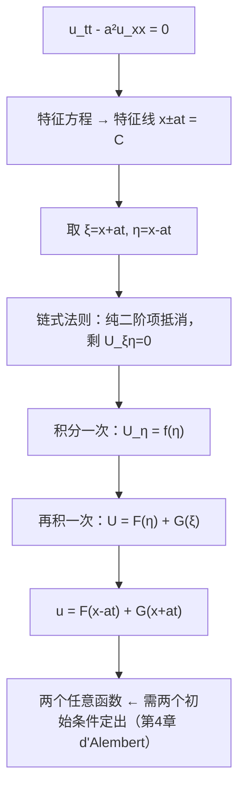

# 第2章 答疑 — 波动方程通解 $u=F(x+at)+G(x-at)$ 怎么得到的

> 问题：$u(x,t)=F(x+at)+G(x-at)$ 这一步是怎么来的？

> 来源：[[课程/数学物理方程/课堂笔记/2026-09-23-第3节-二阶PDE化简与理论授课]] 第五节（L145–L149）

---

## 0. 一句话兜底

三步连招：**换特征坐标** ⇒ 方程塌成 $U_{\xi\eta}=0$ ⇒ **连积两次**，每次放出一个任意函数。

## 1. 第 0 步：为什么盯上 $\xi=x+at,\ \eta=x-at$

不是猜的，来自**特征方程**。对 $u_{tt}-a^2u_{xx}=0$：

$$(\mathrm dt)^2-a^2(\mathrm dx)^2=0\ \Longrightarrow\ \mathrm dt=\pm a\,\mathrm dx\ \Longrightarrow\ x\mp at=\text{常数}$$

两族特征线为 $x+at=C_1$、$x-at=C_2$。**取它们的积分常数作新坐标**，即 $\xi=x+at$，$\eta=x-at$。

$\xi=\text{常数}$ 与 $\eta=\text{常数}$ 各是一族特征线，$(\xi,\eta)$ 就是沿两族特征线的坐标。

## 2. 第 1 步：链式法则换元

记 $u(x,t)=U(\xi,\eta)$，$\xi_x=1,\ \xi_t=a,\ \eta_x=1,\ \eta_t=-a$：

$$u_x=U_\xi+U_\eta,\qquad u_{xx}=U_{\xi\xi}+2U_{\xi\eta}+U_{\eta\eta}$$
$$u_t=aU_\xi-aU_\eta,\qquad u_{tt}=a^2\bigl(U_{\xi\xi}-2U_{\xi\eta}+U_{\eta\eta}\bigr)$$

相减：

$$u_{tt}-a^2u_{xx}
=a^2\bigl(U_{\xi\xi}-2U_{\xi\eta}+U_{\eta\eta}\bigr)-a^2\bigl(U_{\xi\xi}+2U_{\xi\eta}+U_{\eta\eta}\bigr)
=\boxed{-4a^2U_{\xi\eta}}$$

**$U_{\xi\xi}$ 与 $U_{\eta\eta}$ 全部抵消，只剩混合项**——这正是选这两个坐标的目的。方程化为

$$U_{\xi\eta}=0$$

> [!note] 捷径（等价，但快得多）
> 常系数算子可交换，直接因式分解：
> $$u_{tt}-a^2u_{xx}=(\partial_t-a\partial_x)(\partial_t+a\partial_x)u=0$$
> 又 $\partial_t+a\partial_x=2a\partial_\xi$，$\partial_t-a\partial_x=-2a\partial_\eta$，代回同样得 $U_{\xi\eta}=0$。
> 两条路等价，因式分解那条更好记。

## 3. 第 2 步：连积两次（关键在这）

$$U_{\xi\eta}=0\ \Longleftrightarrow\ \frac{\partial}{\partial\xi}\Bigl(\frac{\partial U}{\partial\eta}\Bigr)=0$$

**对 $\xi$ 积一次**：说明 $U_\eta$ 不依赖 $\xi$，即 $U_\eta=f(\eta)$。

**对 $\eta$ 再积一次**：

$$U(\xi,\eta)=\int f(\eta)\,\mathrm d\eta+G(\xi)=F(\eta)+G(\xi)$$

### 为什么是"任意函数"而不是"任意常数"

| | ODE $y''=0$ | PDE $U_{\xi\eta}=0$ |
|:--|:--|:--|
| 第一次积分 | $y'=C_1$（常数） | $U_\eta=f(\eta)$（**函数**） |
| 第二次积分 | $y=C_1\xi+C_2$ | $U=F(\eta)+G(\xi)$（**两个函数**） |

关键：对 $\xi$ 积分时，"积分常数"**允许含 $\eta$**——因为它对 $\xi$ 求导确实为 0。常数于是升级为函数。

> [!important] 记住
> **每积一次分放出一个任意函数；方程对 $t$ 二阶 ⇒ 两个任意函数 ⇒ 需要两个初始条件。**
> （呼应 [[课程/数学物理方程/答疑/02-定解问题与偏微分方程理论/2.1-初始条件个数与方程阶数]]）

## 4. 第 3 步：换回原变量

$$u(x,t)=U(x+at,\ x-at)
\quad\Longrightarrow\quad
\boxed{u(x,t)=F(x+at)+G(x-at)}$$

> [!warning] $F$、$G$ 谁配谁都行
> 严格推出的是 $F(\eta)+G(\xi)=F(x-at)+G(x+at)$，笔记写作 $F(x+at)+G(x-at)$。
> **$F,G$ 是任意函数，两个名字对调不改变结论。**
> 只需记住：**一个含 $x-at$（右行），一个含 $x+at$（左行）**。

## 5. 验证与物理意义

**代回验证**：取 $u=F(x-at)$，则 $u_t=-aF'$，$u_{tt}=a^2F''$；$u_x=F'$，$u_{xx}=F''$。
于是 $u_{tt}-a^2u_{xx}=a^2F''-a^2F''=0$ ✓

**物理意义（行波）**：$F(x-at)$ 在 $t=0$ 时是波形 $F(x)$；$t$ 时刻在 $x+at$ 处取到相同的值，
即**整个波形原样向右平移 $at$**。

$$F(x-at):\ \text{右行波（速度 }a\text{）};\qquad G(x+at):\ \text{左行波（速度 }a\text{）}$$

## 6. 全景链条

## 7. 速记

> **特征坐标的妙处**：让 $U_{\xi\xi}$、$U_{\eta\eta}$ 相消，方程塌成 $U_{\xi\eta}=0$。
> **$U_{\xi\eta}=0$ 的解法**：积两次，每次放出一个任意函数 ⇒ $U=F(\eta)+G(\xi)$。
> **回到原变量**：$u=F(x+at)+G(x-at)$ —— 一右行、一左行，速度都是 $a$。

---

## 补充：$U_\eta=f(\eta)$ 里的 $f$ 是什么

> 追问：这个 $f$ 是什么？

**$f$ 就是"$U$ 对 $\eta$ 的偏导数"，且它恰好只跟 $\eta$ 有关：**

$$f(\eta):=U_\eta(\xi,\eta)\qquad\text{——注意右边没有 }\xi\text{ 出现}$$

### 1. 怎么冒出来的（一步）

$$U_{\xi\eta}=0\ \Longleftrightarrow\ \frac{\partial}{\partial\xi}\bigl(U_\eta\bigr)=0$$

把 $U_\eta$ 整体看成 $\varphi(\xi,\eta)$。"对 $\xi$ 的偏导为 0" ⇒ $\varphi$ 与 $\xi$ 无关 ⇒ 只能是 $\eta$ 的函数，命名为 $f(\eta)$。

> [!tip] 一句话
> "$U_\eta$ 对 $\xi$ 求导为零" ⇔ "**$U_\eta$ 沿 $\xi$ 方向是常数**" ⇔ "它的值只取决于你在哪条 $\eta$ 线上"。

### 2. 为什么"与 $\xi$ 无关"就是"$\eta$ 的函数"

二元函数有恒等式：在连通区域上 $\dfrac{\partial g}{\partial\xi}\equiv0\Longleftrightarrow g(\xi,\eta)=g(\eta)$。
$\xi$ 成了"哑变量"，$g$ 完全不响应它的变化，信息只能来自 $\eta$。

### 3. $f$ 只是中间变量，会被吸收掉

$$U(\xi,\eta)=\int f(\eta)\,\mathrm d\eta+G(\xi)=F(\eta)+G(\xi)$$

$\int f(\eta)\mathrm d\eta$ 被重新命名为 $F(\eta)$。所以可以不起名，直接连积：

$$\frac{\partial}{\partial\xi}(U_\eta)=0\ \Rightarrow\ U_\eta=\varphi(\eta)\ \Rightarrow\ U=\int\varphi\,\mathrm d\eta=F(\eta)+G(\xi)$$

### 4. 类比：$f$ 就是 ODE 里的 $C_1$

| 步骤 | ODE $y''=0$ | PDE $U_{\xi\eta}=0$ |
|:--|:--|:--|
| 第一次积分 | $y'=\boldsymbol{C_1}$ | $U_\eta=\boldsymbol{f(\eta)}$ |
| 第二次积分 | $y=C_1x+\boldsymbol{C_2}$ | $U=F(\eta)+\boldsymbol{G(\xi)}$ |
| 第一次积出的东西 | 常数 $C_1$ | 函数 $f(\eta)$ |
| 是否出现在最终答案 | 否（被 $C_1x$ 吸收） | 否（被 $F(\eta)$ 吸收） |

角色完全相同，只是一个退化成数、一个升级成函数。

### 5. 自由度账

$f$ 的自由度是**整个一族 $\eta$ 的函数**；它积分出 $F$，$G$ 则是 $\xi$ 侧的积分常数。
最终任意性落在**两个任意函数** $F,G$ 上——这正是需要两个初始条件的原因。

> [!warning] 别混淆 $f$ 与 $F$
> $f(\eta)$ 是 $\eta$ 空间里的"$U_\eta$"；$F(\eta)$ 是它的一个原函数。**$f=F'$。**

### 6. 速记

> $U_{\xi\eta}=0$ ⇒ "**$U_\eta$ 不随 $\xi$ 变**" ⇒ 记作 $U_\eta=f(\eta)$。
> 再对 $\eta$ 积一次（$\int f\,\mathrm d\eta\to F(\eta)$）⇒ $U=F(\eta)+G(\xi)$。
> **$f$ 与 ODE 里的 $C_1$ 同角色**：过渡符号，不进最终答案。

---

## 补充：逐字说清"对谁积分、把谁当参数"

> 追问：这是对什么积分？

| 步骤 | 对谁积分 | 把谁**当参数**（固定） | "积分常数"可依赖谁 |
|:--|:--|:--|:--|
| 第一次 | **$\xi$** | $\eta$ | $\eta$ ⇒ 写作 $f(\eta)$ |
| 第二次 | **$\eta$** | $\xi$ | $\xi$ ⇒ 写作 $G(\xi)$ |

两次都是**偏积分**：只对一个变量求原函数，另一个变量全程当常数看待。

### 第一次：对 $\xi$ 积分（$\eta$ 当参数）

$$U_{\xi\eta}=0\ \Longleftrightarrow\ \frac{\partial}{\partial\xi}\bigl(U_\eta\bigr)=0
\ \Longrightarrow\ \int\frac{\partial}{\partial\xi}\bigl(U_\eta\bigr)\mathrm d\xi=\int 0\,\mathrm d\xi
\ \Longrightarrow\ U_\eta=f(\eta)$$

右边是"对 $\xi$ 而言的常数"，但**允许含 $\eta$**（它对 $\xi$ 求导仍是 0）。

> [!important] 关键在"常数升级成函数"
> 一元积分 $\int 0\,\mathrm dx=C$，$C$ 是**数**；
> 偏积分里被固定的变量**渗透进常数**，所以 $C$ 变成 $f(\eta)$。

### 第二次：对 $\eta$ 积分（$\xi$ 当参数）

$$\int U_\eta\,\mathrm d\eta=\int f(\eta)\,\mathrm d\eta
\ \Longrightarrow\ U(\xi,\eta)=F(\eta)+G(\xi),\qquad F(\eta)=\int f\,\mathrm d\eta$$

这次的"对 $\eta$ 而言的常数"允许含 $\xi$，记作 $G(\xi)$。

### 求导反验（最快确认）

$$U=F(\eta)+G(\xi)\ \Longrightarrow\ U_\xi=G'(\xi)\ (\text{因 }F(\eta)\text{ 对 }\xi\text{ 导为 }0)
\ \Longrightarrow\ U_{\xi\eta}=0\ \checkmark$$

**$F(\eta)$ 在算 $\xi$ 导数时自动消失，$G(\xi)$ 在算 $\eta$ 导数时自动消失**——"两个函数各管一个变量"。

### 与一元积分对照

| | 一元 | 偏积分 |
|:--|:--|:--|
| 操作 | $\int\dfrac{\mathrm dy}{\mathrm dx}\mathrm dx=y$ | $\int\dfrac{\partial U}{\partial\xi}\mathrm d\xi=U$ |
| 固定谁 | 无 | 另一个变量 |
| 常数 | $C$（数） | $f(\eta)$（函数） |
| 下次积分 | — | 对 $\eta$ 再来一遍，得 $G(\xi)$ |

> [!note] 顺序可以换
> 混合偏导可交换（$\partial_\xi\partial_\eta=\partial_\eta\partial_\xi$），也可**先对 $\eta$**：
> $U_\xi=g(\xi)$，再对 $\xi$ 积得 $U=G(\xi)+F(\eta)$，**结果一样**。

### 落到最后的 $x,t$ 上

$$\xi=x+at,\quad \eta=x-at;\qquad U=F(\eta)+G(\xi)\ \Longrightarrow\ u(x,t)=F(x-at)+G(x+at)$$

**积分用的是特征坐标 $(\xi,\eta)$，不是 $x,t$**：先在 $(\xi,\eta)$ 下把方程解干净，最后才换回物理变量。

### 速记

> **第一积对 $\xi$（固定 $\eta$）⇒ 冒出 $f(\eta)$；第二积对 $\eta$（固定 $\xi$）⇒ 冒出 $F(\eta)+G(\xi)$。**
> 口诀：**对谁积分，另一个就"藏进"积分常数里。**

---

## 相关链接

- 课堂笔记：[[课程/数学物理方程/课堂笔记/2026-09-23-第3节-二阶PDE化简与理论授课]]（第五节 波动方程与达朗贝尔通解）
- 章节索引：[[课程/数学物理方程/答疑/02-定解问题与偏微分方程理论/README|第2章答疑索引]]
- 相关答疑：
  - [[课程/数学物理方程/答疑/02-定解问题与偏微分方程理论/2.1-初始条件个数与方程阶数]]（为什么是两个任意函数 ⇒ 两个初始条件）
  - [[课程/数学物理方程/答疑/02-定解问题与偏微分方程理论/2.1-守恒形式是什么意思]]（散度形式的同类写法）
