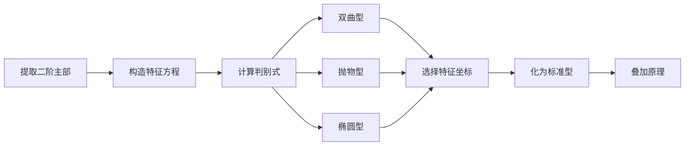

# 2026-09-23 第3节 二阶线性 PDE 的分类、标准型与叠加原理

## 资料来源

- 原始逐字稿：[[raw/2026-09-23-二阶PDE化简与理论授课-625152-逐字稿.md]]
- 智能纪要：[[raw/2026-09-23-二阶PDE化简与理论授课-625152-纪要.md]]
- 课程内知识梳理：[[课程/数学物理方程/知识点解析梳理/02-定解问题与偏微分方程理论-知识梳理|定解问题与偏微分方程理论]]
- 开始时间：2026-09-23 10:22
- 本课程目录中暂未发现可与本节可靠匹配的 PPT、PPTX 或 PDF。公式以逐字稿、纪要及课程内知识梳理交叉核对。

## 一、本节课核心脉络

本节系统处理二维二阶线性偏微分方程：由主部系数构造特征方程，用判别式区分双曲型、抛物型和椭圆型，再选取适当坐标把主部化为标准型。课堂以波动方程说明特征坐标和达朗贝尔通解，并在最后讨论线性方程的有限叠加、级数叠加与参数积分。

## 二、方程主部与分类

采用课堂中的记号，将二维二阶线性方程写成

$$
A u_{xx}+2B u_{xy}+C u_{yy}+D u_x+E u_y+F u=G.
$$

分类只由二阶主部决定。定义判别式

$$
\Delta=B^2-AC.
$$

| 条件 | 类型 | 特征根 | 典型主部 |
|:--|:--|:--|:--|
| $\Delta>0$ | 双曲型 | 两个不同实根 | $U_{\xi\eta}$ 或 $U_{\xi\xi}-U_{\eta\eta}$ |
| $\Delta=0$ | 抛物型 | 一个二重实根 | $U_{\eta\eta}$ |
| $\Delta<0$ | 椭圆型 | 一对共轭复根 | $U_{\xi\xi}+U_{\eta\eta}$ |

> [!warning] 先确认交叉项约定
> 若方程写成 $A u_{xx}+B u_{xy}+C u_{yy}$，判别式和特征方程中的系数会相应改变。本节统一使用交叉项系数为 $2B$ 的约定。

## 三、特征方程与坐标变换

特征曲线满足

$$
A\left(\frac{dy}{dx}\right)^2-2B\frac{dy}{dx}+C=0.
$$

解出特征曲线族后，选取彼此独立的函数

$$
\xi=\phi(x,y),\qquad \eta=\psi(x,y),
$$

并令 $u(x,y)=U(\xi,\eta)$。新坐标必须满足

$$
\frac{\partial(\xi,\eta)}{\partial(x,y)}
=\xi_x\eta_y-\xi_y\eta_x\ne0.
$$

化简有两种常见方法：

1. 直接用链式法则展开各阶导数；
2. 将主部写成对称矩阵

$$
\mathcal A=
\begin{pmatrix}
A & B\\
B & C
\end{pmatrix},
$$

再用坐标变换的 Jacobian 变换主部矩阵。若 $Q$ 表示新坐标对旧坐标的 Jacobian，则新主部矩阵可写为 $Q\mathcal A Q^{\mathsf T}$。

## 四、三类方程的标准化思路

### 1. 双曲型

$\Delta>0$ 时有两族不同的实特征曲线。分别取两族曲线的积分常数为 $\xi,\eta$，主部可化为 $U_{\xi\eta}$，或经过线性组合化为 $U_{\xi\xi}-U_{\eta\eta}$。双曲型方程描述波的传播，特征曲线给出信息传播方向。

### 2. 抛物型

$\Delta=0$ 时只有一族重特征曲线。先取一个特征不变量作 $\xi$，再选一个与之独立的变量作 $\eta$，使 Jacobian 非零。标准主部只保留一个二阶纯导数，典型代表是热方程。

课堂例子

$$
x^2u_{xx}+2xyu_{xy}+y^2u_{yy}=0
$$

具有重特征方向，特征积分给出 $y/x$ 为常数，因此可取 $\xi=y/x$，再配合一个独立坐标完成变换。逐字稿对后续系数转写不稳定，本笔记只保留可可靠核对的特征结论。

### 3. 椭圆型

$\Delta<0$ 时没有实特征方向。可从复特征积分中取实部和虚部作为两个实坐标，将主部化为 $U_{\xi\xi}+U_{\eta\eta}$。Laplace 方程是最典型的椭圆型方程。

## 五、波动方程与达朗贝尔通解

对一维波动方程

$$
u_{tt}-a^2u_{xx}=0,
$$

取特征坐标

$$
\xi=x+at,\qquad \eta=x-at.
$$

方程化为 $U_{\xi\eta}=0$，两次积分得到

$$
u(x,t)=F(x+at)+G(x-at).
$$

$F$ 与 $G$ 分别表示沿相反方向以速度 $a$ 传播的波形。它们的具体形式由初始位移和初始速度决定。

## 六、变系数方程的类型变化

方程

$$
u_{yy}-y u_{xx}=0
$$

的主部系数为 $A=-y,B=0,C=1$，因此 $\Delta=y$。于是：

- $y>0$ 时为双曲型；
- $y=0$ 时退化为抛物型；
- $y<0$ 时为椭圆型。

这类 Tricomi 型方程说明：变系数方程的类型可能随空间位置改变，不能只给整个区域贴一个固定标签。

## 七、线性方程的叠加原理

若 $L$ 是线性微分算子，则

$$
L(c_1u_1+c_2u_2)=c_1L(u_1)+c_2L(u_2).
$$

因此，若 $L(u_i)=f_i$，则

$$
L\left(\sum_{i=1}^{n}c_i u_i\right)
=\sum_{i=1}^{n}c_i f_i.
$$

特别地，齐次方程的有限线性组合仍是齐次方程的解。对无穷级数

$$
u=\sum_{n=1}^{\infty}u_n
$$

或参数积分 $u(x)=\int u(x,\lambda)\,d\lambda$，不能仅凭标量收敛就把微分算子移入求和号或积分号。还要有足够的统一收敛性、可积控制或其他正则性条件，以保证逐项求导合法。

## 八、易错点

1. 分类时漏掉交叉项前的系数约定，导致判别式差一个系数。
2. 找到特征函数后未检查 Jacobian，可能得到退化坐标。
3. 抛物型只有一族特征曲线，第二个坐标应选独立变量。
4. 变系数方程可能在不同区域属于不同类型。
5. 叠加原理适用于线性算子；非线性方程一般不满足。
6. 无穷叠加需验证逐项微分条件，不能把有限叠加结论直接外推。

## 九、作业记录

- 完成课堂指定的第二大题相关小问；逐字稿对具体题号的转写不稳定，以课程群内正式通知为准。
- 本周作业需按教师要求线上提交。

## 十、课堂疑惑与解答

本次检查未发现当日日计划中的待回答疑惑。

## 十一、课堂导航

- 上一节：[[2026-09-18-第2节-偏微分方程课程讲授|第2节 波动方程定解问题、热方程与二阶方程分类]]
- 延伸梳理：[[课程/数学物理方程/知识点解析梳理/02-定解问题与偏微分方程理论-知识梳理|定解问题与偏微分方程理论]]
- 上级索引：[[README|数学物理方程课堂笔记]]

