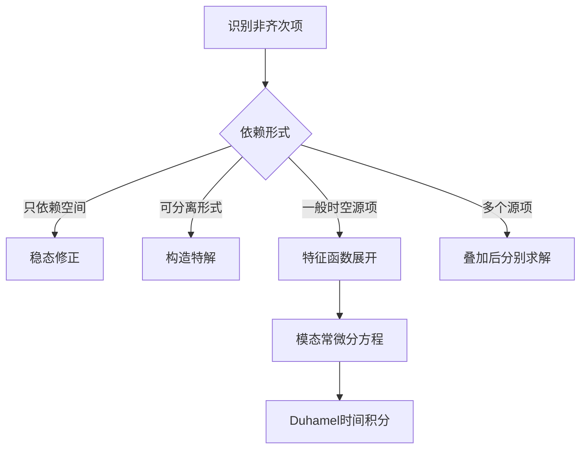

# 2026-10-14 第7节 非齐次方程复习与期中考试安排

## 资料来源

- 原始逐字稿：[[raw/2026-10-14-偏微分方程期末复习与考试安排-949888-逐字稿.md]]
- 智能纪要：[[raw/2026-10-14-偏微分方程期末复习与考试安排-949888-纪要.md]]
- 相关梳理：[[课程/数学物理方程/知识点解析梳理/03-分离变量法-知识梳理|分离变量法知识梳理]]
- 说明：录制标题写“期末复习”，但课堂实际公布的是期中考试范围与安排，笔记标题据内容校正。

## 一、本节课核心脉络

本节复习非齐次波动方程与热方程的处理方法，强调应先识别非齐次项结构，再选择稳态修正、特征函数展开、Duhamel齐次化或叠加。后半节公布期中考试范围、题型与作业要求。

## 二、非齐次方程的三条主线

考虑

$$
u_{tt}-a^2u_{xx}=f(x,t)
$$

或相应的非齐次热方程。

### 1. 稳态修正与特解法

当右端仅依赖 $x$ 时，可寻找 $W(x)$ 吸收非齐次项，令

$$
u=v+W,
$$

从而把 $v$ 的方程化为齐次形式。若源项含 $e^{-t}$ 等已知时间因子，可以尝试

$$
u=v+W(x)e^{-t},
$$

代回方程后确定 $W$。这种方法依赖源项结构，不能用于任意 $f(x,t)$。

### 2. 特征函数展开

将源项和解按边界条件对应的特征函数展开：

$$
f(x,t)=\sum_{n=1}^{\infty}f_n(t)X_n(x),
\qquad
u(x,t)=\sum_{n=1}^{\infty}q_n(t)X_n(x).
$$

偏微分方程被化为一族常微分方程。波动方程对应二阶受迫振子，热方程对应一阶线性方程。求出各模态 $q_n(t)$ 后再叠加得到 $u$。

### 3. Duhamel齐次化原理

把持续外力看作各时刻瞬时作用的叠加。若 $S(t)$ 表示齐次问题的演化算子，零初值非齐次问题形式上可写为

$$
u(t)=\int_0^tS(t-\tau)f(\tau)\,\mathrm d\tau.
$$

课堂强调它本质上仍是线性叠加：每个时刻产生一个齐次响应，再对作用时间积分。

## 三、特殊项与换元注意事项

- 若方程左端还含 $u$ 或 $u_t$，仍可尝试分离变量，但时间方向的特征方程会改变；
- 若通过指数因子换元消去一阶时间项，必须完整计算 $u_t$、$u_{tt}$，不能只替换函数而漏掉导数项；
- 多个非齐次项可利用线性叠加原理拆成多个较简单的问题；
- 先处理边界齐次化，再做特征函数展开，避免选错基函数。

## 四、期中考试安排

- 时间：初步安排在10月底或11月初，具体日期下周确认并在群内通知；
- 时长：约100分钟；
- 范围：第1章至第3章；
- 题型：定解问题、方程化简，以及波动方程和热方程的常规求解；
- 积分过于复杂时可以保留积分形式，主要评分点是建模、化简和求解框架。

> [!important] 复习重点
> 两类方程都会考查。应能从边界条件确定特征函数，写出系数公式和时间模态方程，并明确初始条件如何进入系数，而不是只背最终级数。

## 五、作业与学习要求

- 下周作业完成至教材第160页；
- 可以使用AI辅助理解，但不能直接复制生成内容，应验证公式并用自己的语言重写；
- 复习时把“源项类型—方法选择—齐次化—展开—系数确定”串成完整流程。

## 课堂疑惑与解答

当日日计划 `每日疑惑/2026-10-14.md` 尚未生成，本次无可回写的课堂疑惑。

## 课堂导航

- 上一课：[[2026-10-10-第6节-偏微分方程解法课程|第6节 极值原理与非齐次波动方程]]
- 上级索引：[[README|数学物理方程课堂笔记]]
