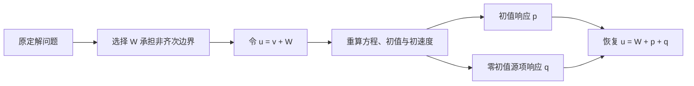
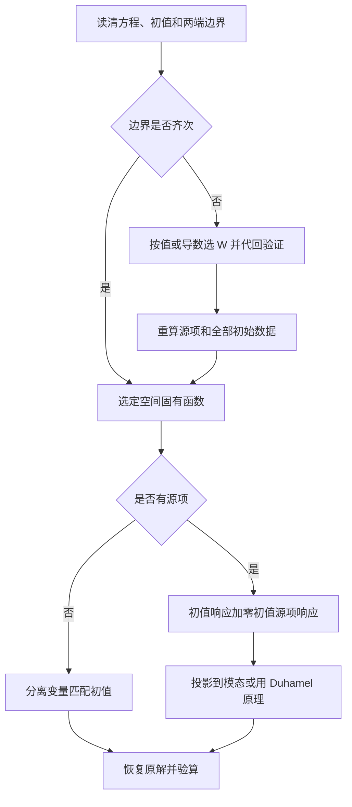

# 2026-10-21 第8节 非齐次边界条件的齐次化

> [!info] 来源与整理边界
> 本课对应教材第三章 §3.6。主体依据[[课程/数学物理方程/课堂笔记/raw/2026-10-21-偏微分方程非齐次边界条件授课-208768-逐字稿|课堂逐字稿]]，并用[[课程/数学物理方程/课堂笔记/raw/2026-10-21-偏微分方程非齐次边界条件授课-208768-纪要|纪要]]定位主题。结合本地教材 §3.6、既有知识梳理核对公式；未发现本课专用 PPT/PDF。原始材料与个人小测文档均未改写。标明“补充解释／补充推导”的内容不冒充教师原话；最后一道例题的原方程仍需板书核对。

课次承接 10月14日第7节；[[课表]]明确 10月16日停课、不计课次，因此本次是第8节，而非自动归档的第9节。

## 一、本节核心脉络

核心问题：边界会随时间变化，为什么不能直接套齐次边界的正弦级数？怎样把这种变化交给一个已知函数，剩下的问题就能用熟悉的方法解？

必要先修：

- 线性叠加：同一个线性算子的解可以按源项和初值分工，再相加。
- Dirichlet 边界规定函数值，Neumann 边界规定导数；不能混用它们的提升函数。
- 固有函数与 Fourier 系数：两端零值对应正弦基，两端零导数对应包含常数项的余弦基。先修见[[课程/数学物理方程/知识点解析梳理/03-分离变量法-知识梳理|分离变量法知识梳理]]。
- 非齐次方程的初值响应与源项响应，回看[[课程/数学物理方程/课堂笔记/2026-10-14-第7节-偏微分方程期中复习与考试安排|上一课的齐次化原理]]。

阅读路线：先会构造 $W$，再逐项改写定解问题，接着完成波动／热方程例题，最后检查方法的边界和易错点。

## 二、提升函数只负责什么？【核心】

### 2.1 先匹配边界，不强求它也是方程的解

设 $0<x<L$、$t>0$，波速 $a>0$，已知源项 $f$、初位移 $\varphi$、初速度 $\psi$：

$$
u_{tt}=a^2u_{xx}+f,\qquad
u(x,0)=\varphi(x),\quad u_t(x,0)=\psi(x).
$$

若边界为 $u(0,t)=h_1(t)$、$u(L,t)=h_2(t)$，令

$$
u=v+W,\qquad
W=h_1(t)+\frac{h_2(t)-h_1(t)}Lx.
$$

则 $v(0,t)=v(L,t)=0$。这里 $W$ 是“边界提升函数”，并不要求 $W_{tt}=a^2W_{xx}+f$。

代入原方程、再把已知项移到右侧，得到完整的新问题：

$$
\begin{cases}
v_{tt}=a^2v_{xx}+\widetilde f,\\
v(0,t)=v(L,t)=0,\\
v(x,0)=\varphi(x)-W(x,0),\\
v_t(x,0)=\psi(x)-W_t(x,0),
\end{cases}
\qquad
\widetilde f=f+a^2W_{xx}-W_{tt}.
$$

> 一句话来说：边界齐次化不是只把边界上的数改成零，而是一次更换未知函数，所有方程和初始数据都要随之改变。

教师在录音开头及例题中反复提醒：漏改初始条件，特别是漏减 $W_t(x,0)$，是常见失分点。

### 2.2 热方程要减的是一阶时间导数

对 $u_t=a^2u_{xx}+f$，同样令 $u=v+W$，但结果是

$$
v_t=a^2v_{xx}+f+a^2W_{xx}-W_t,\qquad
v(x,0)=\varphi(x)-W(x,0).
$$

热方程不额外给初速度。不能把波动方程中的 $-W_{tt}$ 机械复制到这里。

> 一句话来说：先看原方程对时间是几阶，再计算提升函数相应的时间导数。

## 三、四种边界怎样选择 W？【必须会算】

下表的 $h_1,h_2$ 均为 $t$ 的函数，导数均指沿 $x$ 正方向的 $u_x$，不是外法向导数。

| 边界条件 | 一种简单的 $W(x,t)$ |
|---|---|
| $u(0,t)=h_1,\ u(L,t)=h_2$ | $h_1+(h_2-h_1)x/L$ |
| $u(0,t)=h_1,\ u_x(L,t)=h_2$ | $h_1+xh_2$ |
| $u_x(0,t)=h_1,\ u(L,t)=h_2$ | $h_1(x-L)+h_2$ |
| $u_x(0,t)=h_1,\ u_x(L,t)=h_2$ | $h_1x+(h_2-h_1)x^2/(2L)$ |

前三种只需关于 $x$ 的一次式。最后一种若用一次式，其导数在两端相同，不能匹配一般的 $h_1\ne h_2$，因此改用二次式：

$$
W=A(t)x^2+B(t)x,\qquad
B=h_1,\quad 2AL+B=h_2.
$$

可额外加任意合适的 $C(t)$；这里取零使计算简洁。**纪要中的“$Ax^2+B$”缺少一次项，不能表达一般的左端非零导数；应以代回边界的检验为准。**

课堂的 $L=1$ 小例子：

1. $u_x(0,t)=t,\ u(1,t)=\sin t$：$W=t(x-1)+\sin t$。
2. $u(0,t)=t,\ u_x(1,t)=\sin t$：$W=t+x\sin t$。
3. $u_x(0,t)=t,\ u_x(1,t)=\sin t$：$W=tx+\frac12(\sin t-t)x^2$。

> 一句话来说：先区分“值”还是“导数”，再把候选函数代到两端，次数能低就低。

## 四、波动方程：边界齐次后，初速度不再是零

### 4.1 课堂例题与完整代换

录音约 00:12—00:25 讨论 $0<x<1$ 上

$$
u_{tt}=u_{xx},\quad
u(0,t)=t,\quad u(1,t)=\sin t,\quad
u(x,0)=u_t(x,0)=0.
$$

按两端给值，取

$$
W=t+x(\sin t-t),\quad
W_{xx}=0,\quad W_{tt}=-x\sin t,\quad
W(x,0)=0,\quad W_t(x,0)=1.
$$

因此

$$
v_{tt}=v_{xx}+x\sin t,\quad
v(0,t)=v(1,t)=0,\quad
v(x,0)=0,\quad v_t(x,0)=-1.
$$

然后令 $v=p+q$：

- $p_{tt}=p_{xx}$，初值 $(p,p_t)|_{t=0}=(0,-1)$，齐次边界；
- $q_{tt}=q_{xx}+x\sin t$，初值全零，齐次边界。

这个拆分让一个问题只处理初值，另一个只处理源项。

> [!warning] 与小测文档的区别
> [[课程/数学物理方程/作业/10月21日课堂小测|小测文档]]第2题写的 $W=tx+\sin t-t$ 对应左端给导数、右端给值的另一种边界，不能用于本题两端给值。正确性应直接用 $W(0,t)=t$、$W(1,t)=\sin t$ 验证。此处保留该文档原样，只在本笔记纠正。

### 4.2 从分工走到可计算的级数【补充推导】

令 $k_n=n\pi$。初速度与源项的正弦系数分别为

$$
b_n=2\int_0^1(-1)\sin(k_nx)\,dx
=\frac{2((-1)^n-1)}{k_n},
$$

$$
f_n(t)=2\int_0^1x\sin t\sin(k_nx)\,dx
=-\frac{2(-1)^n}{k_n}\sin t.
$$

每个模态满足 $v_n''+k_n^2v_n=f_n$，$v_n(0)=0$、$v_n'(0)=b_n$，故

$$
u=W+\sum_{n=1}^\infty
\left[
\frac{b_n}{k_n}\sin(k_nt)
+\int_0^t\frac{\sin(k_n(t-\tau))}{k_n}f_n(\tau)\,d\tau
\right]\sin(k_nx).
$$

第一项来自初速度，积分项来自每一时刻的外力，不能漏掉其中任何一项。

### 4.3 若同时存在源项和非零初位移

课堂还把同一边界下的方程改为

$$
u_{tt}=u_{xx}+e^{-t},\quad u(x,0)=x,\quad u_t(x,0)=0.
$$

沿用同一个 $W$，则

$$
v_{tt}=v_{xx}+e^{-t}+x\sin t,\qquad
v(x,0)=x,\quad v_t(x,0)=-1.
$$

用 $p$ 承担 $(x,-1)$，用零初值的 $q$ 承担 $e^{-t}+x\sin t$。求解流程不因两种非齐次项同时出现而改变。

## 五、热方程：巧解失败后怎样兜底？【课堂重点】

### 5.1 为什么一个指数乘积未必能解决问题

课堂约 00:25 起讨论

$$
u_t=u_{xx}+e^{-t},\quad
u(x,0)=x,\quad u(0,t)=2,\quad u(1,t)=4e^{-t}.
$$

若想用 $W=F(x)e^{-t}$ 同时消掉源项并承担边界，方程要求 $F''+F=-1$。但左边界又要求 $F(0)e^{-t}=2$ 对所有 $t$ 成立，这不可能由固定的 $F(0)$ 实现。**分离形式必须同时适合两端的时间依赖，不能只看右端边界。**

教师强调：可以找巧妙的特解，但一般方法必须掌握。

> 一句话来说：能代进方程不够，还必须代进全部边界；巧解走不通就回到边界提升。

### 5.2 一次提升与初值响应

直接取

$$
W=2+x(4e^{-t}-2).
$$

因为 $W_t=-4xe^{-t}$、$W_{xx}=0$，所以

$$
v_t=v_{xx}+(4x+1)e^{-t},\quad
v(0,t)=v(1,t)=0,\quad
v(x,0)=x-(2+2x)=-x-2.
$$

仍分 $v=p+q$，其中 $p$ 解齐次热方程、初值 $-x-2$；$q$ 解带源项的热方程、初值零。

### 5.3 系数与 Duhamel 时间变量【补充推导】

设 $\lambda_n=n^2\pi^2$，

$$
c_n=2\int_0^1(-x-2)\sin(n\pi x)\,dx
=\frac{2(3(-1)^n-2)}{n\pi},
$$

$$
a_n=2\int_0^1(4x+1)\sin(n\pi x)\,dx
=\frac{2(1-5(-1)^n)}{n\pi}.
$$

对每个固定的施加时刻 $\tau$，先解齐次热方程，其演化时间记作 $s$：

$$
F(x,s;\tau)=e^{-\tau}\sum_{n=1}^\infty
a_ne^{-\lambda_ns}\sin(n\pi x),\qquad
F(x,0;\tau)=(4x+1)e^{-\tau}.
$$

再让它演化 $t-\tau$，并把所有时刻的贡献相加：

$$
q(x,t)=\int_0^tF(x,t-\tau;\tau)\,d\tau.
$$

积分后得到

$$
\boxed{
u=2+x(4e^{-t}-2)
+\sum_{n=1}^\infty
\left[
c_ne^{-\lambda_nt}
+a_n\frac{e^{-t}-e^{-\lambda_nt}}{\lambda_n-1}
\right]\sin(n\pi x).
}
$$

本题 $\lambda_n\ne1$。$c_n$ 是初值系数，不应多除一次 $n^2\pi^2$；源项的 $e^{-\tau}$ 与演化因子 $e^{-\lambda_n(t-\tau)}$ 来自不同时间变量，不能提前都写成 $e^{-t}$。

> 一句话来说：Duhamel 原理把“何时施加”和“施加后演化多久”分开计算，再累积响应。

## 六、两端给导数：确认的结论与尚待核对的题干

### 6.1 能可靠确认的边界提升

录音后半讨论 $u_x(0,t)=e^{-t}$、$u_x(1,t)=0$，可取

$$
W=e^{-t}g(x),\qquad g(x)=x-\frac{x^2}{2}.
$$

验算 $W_x=e^{-t}(1-x)$ 即可同时满足两端要求。

> [!warning] 最后一道例题暂不认定完整题干
> 录音约 01:18—01:31 多次出现 $u_{tt}$、反应项 $+u$，以及时间频率 $\sqrt{n^2\pi^2-1}$；而个人小测第3题记为 $u_t=u_{xx}+4+e^{-xt}$。两者不是同一道方程，纪要也不足以消除冲突。保留两种记录的来源，不把热方程和波动方程拼成一个“教师答案”。需要原题截图或板书确认。

### 6.2 按录音中的反应波动结构校验【条件性补充理解】

**若**原式为 $u_{tt}=u_{xx}+u+e^{-xt}$，则由 $W_{tt}=W$、$W_{xx}=-e^{-t}$ 得

$$
v_{tt}=v_{xx}+v+e^{-xt}-e^{-t},\qquad
v_x(0,t)=v_x(1,t)=0.
$$

若原初位移、初速度均为零，还应有 $v(x,0)=-g(x)$、$v_t(x,0)=g(x)$。这是条件性推导，不是已经核实的原题全文。

余弦空间模态为 $1,\cos(n\pi x)$，$n\ge1$；对应时间方程

$$
v_n''+\bigl(n^2\pi^2-1\bigr)v_n=F_n(t).
$$

正模态频率才是 $\omega_n=\sqrt{n^2\pi^2-1}$。**常数模态 $n=0$ 不能漏：它满足 $v_0''-v_0=F_0$，对应双曲函数而非正频率的正弦余弦。**

例如在上述零原初值的条件下，取“常数项等于平均值”的约定，

$$
v_0(0)=-\int_0^1g(x)\,dx=-\frac13,\qquad
v_0'(0)=\frac13,
$$

$$
F_0(t)=\int_0^1(e^{-xt}-e^{-t})\,dx
=\frac{1-e^{-t}}t-e^{-t},
$$

$t=0$ 按连续极限取零。于是零模态为

$$
v_0(t)=-\frac13\cosh t+\frac13\sinh t
+\int_0^t\sinh(t-\tau)F_0(\tau)\,d\tau.
$$

这项用于指出从 $n=1$ 开始求和的遗漏风险，不据此擅自改写小测第3题。

> 一句话来说：边界决定空间模态，而反应项改变时间方程；纯 Neumann 边界的常数模态必须单独检查。

## 七、判定与解题流程

## 八、核心公式速查表

| 对象 | 公式与检查条件 |
|---|---|
| 波动方程新源项 | $\widetilde f=f+a^2W_{xx}-W_{tt}$ |
| 热方程新源项 | $\widetilde f=f+a^2W_{xx}-W_t$ |
| 新初位移、初速度 | $\widetilde\varphi=\varphi-W(\cdot,0)$；波动方程另有 $\widetilde\psi=\psi-W_t(\cdot,0)$ |
| 波动模态响应 | $y''+\omega^2y=F$ 的零初值响应为 $\int_0^t\sin(\omega(t-\tau))F(\tau)/\omega\,d\tau$，此式要求 $\omega>0$ |
| 热模态响应 | $y'+\lambda y=F$ 的零初值响应为 $\int_0^te^{-\lambda(t-\tau)}F(\tau)\,d\tau$ |
| 余弦投影 | 本文常数项 $F_0=\int_0^1F\,dx$；正模态 $F_n=2\int_0^1F\cos(n\pi x)\,dx$ |

## 九、易错点与注意事项

> [!warning] 先验算条件，再信级数
> 1. 两端给值与一端给导数不能共用未经检查的 $W$。
> 2. “二次式”不能写漏一次项；最终验证的是两个导数值。
> 3. 改边界后必须改初值；波动方程要多检查一个初速度。
> 4. 初值响应和源项响应分工不能重叠，也不能遗漏。
> 5. 非齐次边界的原问题不必处处拥有光滑至角点的经典解。上述热例在 $t=0$ 的端点初值与边界值不相容；波动例在角点的初速度与边界时间导数不相容。这里的级数表达按内部／形式解理解，不宣称满足闭区域上的全部经典正则性要求。（补充解释）
> 6. 纯 Neumann 的零模态及余弦级数归一化必须写明；不能把常数项再无故乘二。
> 7. 来源冲突应保留待核对，不把自动纪要或个人答案当成无误原题。

## 十、课堂疑惑与解答

截至本次检查，未找到当日日计划“每日疑惑/2026-10-21.md”，未新增用户问题或虚构作答记录。上面的公式校验属于整理勘误；最后一道题干仍待板书确认。

## 十一、相关知识点链接

- [[课程/数学物理方程/知识点解析梳理/03-分离变量法-知识梳理#十一、非齐次边界条件的齐次化【必须掌握】|边界提升的通用方法]]：补方法背景；其中混合边界也可用本课的一次式直接构造。
- [[课程/数学物理方程/课堂笔记/2026-10-14-第7节-偏微分方程期中复习与考试安排|上一课]]：复查初值响应与齐次化原理。
- [[课程/数学物理方程/课堂笔记/README|课堂笔记索引]]：按修正后的学期课次导航。
- [[课程/数学物理方程/课本/数学物理方程 第2版 (李明奇，田太心主编, 主编李明_ (z-library.sk, 1lib/数学物理方程 第2版 (李明奇，田太心主编, 主编李明_ (z-library.sk, 1lib.|教材 §3.6]]：核对 $u=v+W$ 的完整代换和分解原则；教材另有例题，不混写成本次课堂例题。

## 十二、作业与练习

课堂安排：本次讲完第三章；下次课复习并讲试卷，仍有课堂小测。录音提到预计11月4日考试，具体安排以教师后续通知为准。教师要求自行走完边界齐次化、分离变量及源项响应的流程；较复杂积分可按课堂要求保留，但须写清系数与积分变量。

练习原记录：[[课程/数学物理方程/作业/10月21日课堂小测|10月21日课堂小测]]，其中第1、2、4题的系数、提升函数和时间参数请与本笔记校验；第3题先核对原题。

### 自测一（新编）：只多改一个条件

在波动例题中把原初速度改为 $\psi(x)=x$，其余条件不变。求新初速度，并写出它的正弦系数积分式。

> [!hint]- 提示
> 先计算 $W_t(x,0)$，不是 $W(x,0)$。

> [!solution]- 解析
> $W_t(x,0)=1$，故 $v_t(x,0)=x-1$。系数为 $2\int_0^1(x-1)\sin(n\pi x)\,dx=-2/(n\pi)$。

### 自测二（新编）：独立构造

在 $0<x<2$ 上，已知 $u_x(0,t)=t$、$u_x(2,t)=3t$。构造一个二次提升函数，验算边界；若方程是热方程，写出新源项。

> [!hint]- 提示
> 写成 $W=A(t)x^2+B(t)x$，先由左端确定 $B$。

> [!solution]- 解析
> 可取 $W=tx+\tfrac12tx^2$。$W_x=t+tx$，两端分别为 $t,3t$。若原式 $u_t=a^2u_{xx}+f$，则新源项 $f+a^2t-x-\tfrac12x^2$。

### 自测三（新编）：检查遗漏

若两端零导数、初值为常数1，只写 $\sum_{n=1}^\infty c_n\cos(n\pi x)$ 能否表达初值？给出积分理由。

> [!hint]- 提示
> 对空间区间 $(0,1)$ 积分，比较两侧平均值。

> [!solution]- 解析
> 不能。每个正频余弦模态的积分均为零，无法表达平均值1；需加入常数模态。对反应波动方程，其时间行为还需单独解对应的零模态 ODE。
