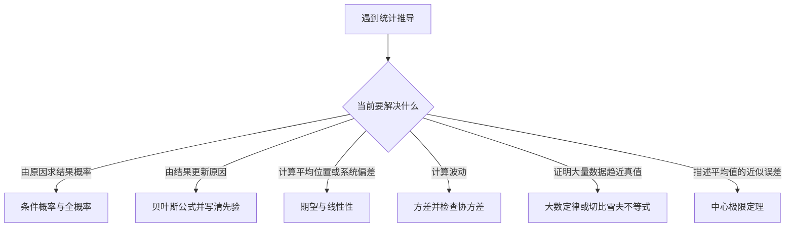

# 概率基础与数理统计课程入门

> [!info] 怎么读这份笔记
> 这是从零开始的前置桥梁，不要求先把整门概率论重学一遍。第一次优先读第三至七部分，第二部分的公理化语言先理解用途即可。教学补充例子用于解释课件，不等同于老师布置的作业。

## 一、本章核心脉络

假设一批产品的次品率是 $p$。**概率论**通常先给定 $p$，计算抽到次品的概率；**数理统计**先抽检产品，再用结果推断未知的 $p$。

整门课的方向因此是：**明确随机模型，得到样本，提取样本信息，再推断未知参数，同时交代推断的不确定性。**

> 一句话来说：概率论从模型推数据，统计学利用数据反推模型中的未知部分。

## 二、概率空间与随机变量（了解语言，暂不深究测度论）

### 1. 概率空间的三个部件

$$
(\Omega,\mathcal F,P).
$$

| 符号 | 负责什么 | 抛一次硬币的例子 |
|---|---|---|
| $\Omega$ | 列出所有可能结果 | $\{正面,反面\}$ |
| $\mathcal F$ | 规定哪些结果集合可以作为事件 | $\varnothing,\Omega,\{正面\},\{反面\}$ |
| $P$ | 为事件赋予概率 | 公平硬币下正面概率为 $1/2$ |

$\mathcal F$ 是 $\sigma$-代数：包含 $\Omega$，对取补集和可列并集封闭；因此也对可列交集封闭。这样，“事件不发生”“至少一个事件发生”等运算仍得到合法事件。

概率测度满足非负性、$P(\Omega)=1$，以及对两两不相交事件的可列可加性：
$$
P\left(\bigcup_{j=1}^{\infty}A_j\right)
=\sum_{j=1}^{\infty}P(A_j).
$$

> 一句话来说：概率空间先说明能发生什么、哪些事件可以讨论，再规定它们的概率怎样计算。

### 2. 随机变量不是观测到的那个数字

随机变量是一个函数 $X:\Omega\to\mathbb R$。例如质检时，令合格映射成 $0$，次品映射成 $1$。抽检前，$X$ 的取值尚不确定；抽检后，得到具体观测值 $x=0$ 或 $x=1$。

可测性要求对每个实数 $a$，事件 $\{X\le a\}$ 都属于 $\mathcal F$，从而分布函数
$$
F_X(a)=P(X\le a)
$$
有定义。

> 一句话来说：随机变量是记录结果的规则，观测值是按这条规则记录出来的一个数。

这正是下一篇中“大写 $X_i$ 表示样本，小写 $x_i$ 表示样本值”的来源。

## 三、条件概率与贝叶斯公式（核心）

### 1. 条件概率：知道新信息后重新限定范围

当 $P(B)>0$ 时，
$$
P(A\mid B)=\frac{P(A\cap B)}{P(B)}.
$$

分母把研究范围从全部结果缩小到 $B$；分子只保留其中同时满足 $A$ 的结果。

> 一句话来说：条件概率是在已经知道 $B$ 发生的范围内，重新计算 $A$ 的比例。

**课堂例子：至少一个男孩。** 假设两孩性别独立、男女等可能，按长幼区分，且信息恰好是“至少一个男孩”。原本等可能结果为 $BB,BG,GB,GG$；排除 $GG$ 后，两个都是男孩的概率为 $1/3$。如果信息来自“随机遇见一个孩子是男孩”，条件机制变了，不能直接照搬 $1/3$。

### 2. 独立：知道一件事不改变另一件事的概率

事件独立的定义是
$$
P(A\cap B)=P(A)P(B).
$$
随机变量独立意味着它们的联合分布可按各自分布相乘。于是简单随机样本的联合密度有
$$
f_\theta(x_1,\ldots,x_n)=\prod_{i=1}^n f_\theta(x_i).
$$

> 一句话来说：独立性允许把多个观测的概率模型乘起来，这一步以后会变成似然函数。

### 3. 全概率与贝叶斯：从原因预测结果，再由结果更新原因

设 $B_1,\ldots,B_m$ 是互不重叠、合起来覆盖全部可能的原因，且相关条件概率有定义：
$$
P(A)=\sum_j P(A\mid B_j)P(B_j),
$$
$$
P(B_i\mid A)
=\frac{P(A\mid B_i)P(B_i)}
{\sum_jP(A\mid B_j)P(B_j)}.
$$

> 一句话来说：全概率汇总各种原因产生结果的可能性，贝叶斯公式用已经出现的结果重新比较这些原因。

**教学补充：两个袋子。** 等可能选袋子甲或乙。甲袋白球占 $9/10$，乙袋白球占 $1/10$。抽到白球后，
$$
P(甲\mid 白)
=\frac{(9/10)(1/2)}
{(9/10)(1/2)+(1/10)(1/2)}
=\frac9{10}.
$$

这里用到了袋子被选中的**先验概率**。以后极大似然估计只比较数据在不同参数下的似然，不自动引入先验，二者不能混成同一个方法。

## 四、期望、方差与协方差（后面推导的工具箱）

### 1. 期望：长期重复实验的平均位置

离散型和连续型分别为
$$
E[g(X)]=\sum_x g(x)P(X=x),\qquad
E[g(X)]=\int g(x)f(x)\,dx,
$$
前提是相关期望存在。最常用的性质是**线性性**：
$$
E(aX+bY+c)=aE(X)+bE(Y)+c.
$$
这条性质不要求 $X,Y$ 独立。

> 一句话来说：期望描述随机量的平均位置，而不是保证每次观测都等于这个位置。

例如 $X\sim\operatorname{Bernoulli}(p)$ 时，
$$
E(X)=0(1-p)+1p=p.
$$
所以“用样本平均估计次品率”以后可以从 $E(X)=p$ 直接推出来。

### 2. 方差：围绕平均位置有多分散

$$
\operatorname{Var}(X)
=E[(X-E(X))^2]
=E(X^2)-[E(X)]^2.
$$
因此
$$
E(X^2)=\operatorname{Var}(X)+[E(X)]^2,
\qquad
\operatorname{Var}(aX+b)=a^2\operatorname{Var}(X).
$$

> 一句话来说：方差测量随机波动的大小；把数值放大 $a$ 倍，方差就放大 $a^2$ 倍。

对 Bernoulli 变量，$X^2=X$，所以
$$
\operatorname{Var}(X)=p-p^2=p(1-p).
$$

### 3. 协方差与独立性

$$
\operatorname{Cov}(X,Y)=E[(X-EX)(Y-EY)],
$$
$$
\operatorname{Var}(aX+bY)
=a^2\operatorname{Var}(X)+b^2\operatorname{Var}(Y)
+2ab\operatorname{Cov}(X,Y).
$$

独立且二阶矩有限时，协方差为零。于是独立同分布样本的平均有
$$
E(\bar X)=\mu,\qquad
\operatorname{Var}(\bar X)=\frac{\sigma^2}{n}.
$$
求和的方差先得到 $n\sigma^2$，再除以 $n^2$，便得到 $\sigma^2/n$。

> 一句话来说：独立观测的平均能抵消一部分随机波动，标准差缩小到原来的 $1/\sqrt n$。

一般情形下“不相关”不能反推独立；**联合正态**是重要的特殊情形。

### 4. 为什么以后还要学条件期望？

$E(U\mid T)$ 表示已知统计量 $T$ 后，对 $U$ 的剩余随机性求平均。现在先记住：
$$
E[E(U\mid T)]=E(U),
$$
$$
\operatorname{Var}(U)
=E[\operatorname{Var}(U\mid T)]
+\operatorname{Var}[E(U\mid T)].
$$

> 一句话来说：条件期望保留已知信息，把其余随机波动平均掉；这会成为改进无偏估计的方法。

完整例子见 [[课程/数理统计/知识点解析梳理/07a-充分完备统计量与最优无偏估计-知识梳理|充分完备统计量与最优无偏估计]]，现在不用提前硬算。

## 五、常见总体分布（先看模型含义，再看参数）

| 总体模型 | 数学表达及取值 | 均值 | 方差 | 常见问题 |
|---|---|---|---|---|
| Bernoulli $(p)$ | $P(X=x)=p^x(1-p)^{1-x}$，$x=0,1$ | $p$ | $p(1-p)$ | 一件产品是否次品 |
| 二项 $B(N,p)$ | $P(X=k)=\binom Nk p^k(1-p)^{N-k}$ | $Np$ | $Np(1-p)$ | 一批 $N$ 次试验的成功数 |
| Poisson $(\lambda)$ | $P(X=k)=e^{-\lambda}\lambda^k/k!$，$k\ge0$ | $\lambda$ | $\lambda$ | 某时段的事件计数 |
| 几何 $(p)$ | $P(X=k)=p(1-p)^{k-1}$，$k\ge1$ | $1/p$ | $(1-p)/p^2$ | 首次成功的试验次数 |
| 指数，率参数 $\lambda$ | $f(x)=\lambda e^{-\lambda x}$，$x>0$ | $1/\lambda$ | $1/\lambda^2$ | 等待时间、元件寿命 |
| 均匀 $U(0,\theta)$ | $f(x)=1/\theta$，$0<x<\theta$ | $\theta/2$ | $\theta^2/12$ | 未知取值上限 |
| 正态 $N(\mu,\sigma^2)$ | $f(x)=e^{-(x-\mu)^2/(2\sigma^2)}/(\sqrt{2\pi}\sigma)$ | $\mu$ | $\sigma^2$ | 近似对称的连续测量 |

这些不是“抽样分布四大家族”的替代清单。它们首先描述**单个观测的总体**；下一篇研究由多个观测构成的统计量服从什么分布。

> [!warning] 两处必须先读题目
> 指数分布也常用尺度参数 $\theta=1/\lambda$，此时密度为 $\theta^{-1}e^{-x/\theta}$、均值为 $\theta$。几何分布也有从 $0$ 开始计数的版本，本课程当前例题采用从 $1$ 开始。参数化、取值范围不同，估计公式也会变化。

## 六、大数定律与中心极限定理（核心，但问题不同）

### 1. 大数定律：平均值会靠近哪里？

在独立同分布且 $E|X|<\infty$ 等相应条件下，
$$
\bar X_n\xrightarrow{P}\mu;
$$
在强大数定律条件下还可得到几乎必然收敛。

> 一句话来说：样本越来越多，平均值会越来越靠近总体均值。

它支持用样本平均替代总体期望，因而支持后面的矩估计和相合性。

### 2. 中心极限定理：靠近真值时怎样波动？

若独立同分布，$E(X)=\mu$，$0<\sigma^2<\infty$，则
$$
\frac{\sqrt n(\bar X_n-\mu)}{\sigma}
\xrightarrow{d}N(0,1).
$$

> 一句话来说：平均值的误差按它自身的标准差缩放后，大样本下呈现近似正态形状。

大数定律解释**会靠近真值**，中心极限定理解释**误差的形状与尺度**。前者用来证明相合，后者用来构造大样本区间。

> [!warning] “精确正态”与“近似正态”
> 正态总体的样本均值在每个有限样本量下就精确正态。一般非正态总体满足中心极限定理，只能得到大样本近似；不存在对所有总体都可靠的统一“$n\ge30$ 就够了”规则。

## 七、判定/决策流程

## 八、核心公式速查表

| 用途 | 公式 | 条件提醒 |
|---|---|---|
| 条件概率 | $P(A\mid B)=P(A\cap B)/P(B)$ | $P(B)>0$ |
| 独立事件 | $P(A\cap B)=P(A)P(B)$ | 需要证实独立 |
| 方差计算 | $\operatorname{Var}(X)=E(X^2)-(EX)^2$ | 二阶矩有限 |
| 独立样本平均 | $E\bar X=\mu$，$\operatorname{Var}(\bar X)=\sigma^2/n$ | 独立同分布 |
| 全期望 | $E[E(U\mid T)]=EU$ | 可积 |
| 全方差 | $\operatorname{Var}(U)=E[\operatorname{Var}(U\mid T)]+\operatorname{Var}[E(U\mid T)]$ | 二阶矩有限 |
| 大样本均值误差 | $\sqrt n(\bar X-\mu)/\sigma\xrightarrow{d}N(0,1)$ | CLT条件 |

## 九、易错点与注意事项

> [!warning]
> 1. $E(X^2)$ 通常不等于 $[E(X)]^2$。
> 2. 期望线性性不要求独立，直接把方差相加则需要处理协方差。
> 3. 正态分布记号第二个参数在本笔记中是方差，不是标准差。
> 4. 参数固定但未知，样本在抽样前随机；不要把两者角色交换。
> 5. 条件概率中的信息获取方式属于模型的一部分。
> 6. “服从某种分布”必须同时核对参数和取值范围。

## 十、相关知识点链接

- [[课程/数理统计/知识点解析梳理/06-抽样分布-知识梳理|下一篇：抽样分布]]：把这里的单个随机变量扩展成样本，并研究样本函数。
- [[课程/数理统计/课堂笔记/2026-09-01-第1节-概率论基础回顾与贝叶斯思想|第1次课堂记录]]：对应概率空间、贝叶斯与可测性回顾。
- [[课程/数理统计/课件/C6_1/C6_1|C6.1课件]]：用次品率问题说明从概率论进入统计推断的原因。
- [[课程/数理统计/知识点解析梳理/README|学习导航]]：查看从零追赶到第11次课的顺序。

## 十一、作业与练习

以下为**初学补充自测**，不是新增教师作业。

1. 次品率为 $p$ 时，为什么 $X_i$ 的均值是 $p$，$\bar X$ 的方差是 $p(1-p)/n$？
2. 两个独立观测 $X,Y$ 都有方差 $\sigma^2$，求 $(X+Y)/2$ 与 $X-Y$ 的方差。
3. 用自己的话解释：大数定律与中心极限定理各回答什么问题？
4. 两个孩子例题为什么不能省略“怎样得到至少一个男孩这条信息”？
5. 对 $X\sim U(0,\theta)$，用积分验证 $E(X)=\theta/2$、$\operatorname{Var}(X)=\theta^2/12$。

> [!solution]- 自测答案与检查点
> 1. $X_i^2=X_i$，所以 $EX_i=p$、$\operatorname{Var}(X_i)=p(1-p)$；独立平均的方差再除以 $n$。
> 2. 分别为 $\sigma^2/2$ 与 $2\sigma^2$。
> 3. 前者回答平均值的去向，后者回答标准化误差的分布。
> 4. 不同信息机制对应不同条件事件。
> 5. $EX=\theta/2$，$EX^2=\theta^2/3$，相减得 $\theta^2/12$。
