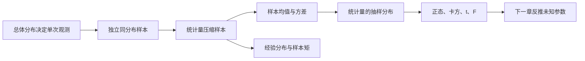
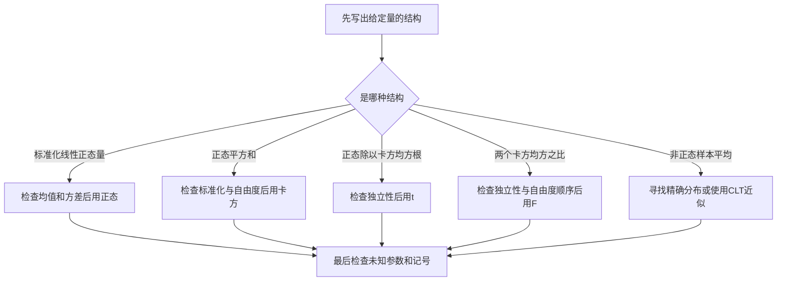

# 第六章 抽样分布

> [!info] 本篇定位与资料范围
> 综合 C6.1—C6.3 的课件/PPT转换稿、第2、3、5次课堂记录，并核对现存 C6.2 原版PDF的经验分布记号。面向第一次学习：先理解样本和统计量，再理解四种分布，最后读“九条结论”。第4次课缺少课堂资料，不推测其具体授课边界。

## 一、本章核心脉络

上一份 [[课程/数理统计/知识点解析梳理/00-概率基础与课程入门-知识梳理|课程入门]] 说明：统计学需要从数据推断未知参数。现在问题变成：

**同一个总体，每次抽到的数据都可能不同；根据样本算出的平均值、方差也会变化。它们怎样变化？**

这就是抽样分布研究的对象。它不是在研究“抽样过程用了哪种方法”，而是在研究**样本函数的概率分布**。

> 一句话来说：总体分布描述一个观测怎样随机，抽样分布描述由一组观测算出的量怎样随机。

**贯穿例子。** 抽检 $n$ 件产品，$X_i=1$ 表示第 $i$ 件是次品，$X_i=0$ 表示合格。单件服从 Bernoulli $(p)$；次品总数 $K=\sum X_i$ 服从 $B(n,p)$；次品比例 $\bar X=K/n$ 则有自己的抽样分布。不要把这三种对象当成同一个变量。

## 二、总体、样本、统计量：先把对象分清（核心）

### 1. 总体最终对应什么数学对象？

实际总体可以是所有元件、所有学生；数学上通常只研究其中一项数量指标，例如寿命、身高、是否次品，并用随机变量 $X$ 的分布描述它。

例如“产品是否次品”的总体分布为
$$
P_p(X=1)=p,\qquad P_p(X=0)=1-p.
$$
分布类型已知，参数 $p$ 未知。

> 一句话来说：总体不是眼前抽到的那几条数据，而是生成观测的分布模型。

### 2. 简单随机样本与样本值

若 $X_1,\ldots,X_n$ 相互独立，且都与总体 $X$ 同分布，就称为容量为 $n$ 的简单随机样本，记作 i.i.d.。

| 对象 | 例子 | 是否随抽样变化 |
|---|---|---|
| 总体参数 | 次品率 $p$ | 固定但可能未知 |
| 样本 | $(X_1,\ldots,X_5)$ | 抽样前随机 |
| 样本值 | $(1,0,0,1,0)$ | 本次已观测的数据 |
| 样本空间 | 样本向量所有可能取值 | Bernoulli样本有 $\{0,1\}^5$ |

因为独立，联合分布可乘起来：
$$
P_\theta(X_1=x_1,\ldots,X_n=x_n)
=\prod_i p_\theta(x_i),
$$
连续情形则为
$$
f_\theta(x_1,\ldots,x_n)=\prod_i f_\theta(x_i);
$$
联合分布函数也有 $\prod_iF_\theta(x_i)$ 的形式。

> 一句话来说：样本是取得数据前的随机变量组，样本值是这组变量的一次实现。

**为什么强调抽样方式？** 对有限总体均匀随机有放回抽样，每次抽取机制相同且彼此独立，可以满足上述模型。无放回抽样通常不独立；总体远大于样本时才常作近似。1936年民调案例的教学重点是：抽样框系统性偏向某类人，不能靠增加样本量消除偏差。

### 3. 统计量与统计值

统计量是只由样本及已知常数确定、不含未知参数的函数：
$$
T=T(X_1,\ldots,X_n).
$$
代入样本值后的结果 $t=T(x_1,\ldots,x_n)$ 是统计值。

课件例题中 $p$ 未知：
- $X_1+X_2$、$\max_iX_i$、$(X_5-X_1)^2$ 是统计量；
- $X_5+2p$ 不是，因为无法仅由数据算出来。

> 一句话来说：判断统计量就问“拿到数据、但不知道参数，能不能把它算出来？”

注意：**统计量的公式不含未知参数，其分布却通常含未知参数。** $\bar X$ 是统计量，但 $E_p\bar X=p$；正因为它的分布随 $p$ 变化，才可以用它估计 $p$。

### 4. 顺序统计量：有时大小比出现顺序更重要

将样本从小到大排列：
$$
X_{(1)}\le\cdots\le X_{(n)},\qquad
R=X_{(n)}-X_{(1)}.
$$
分别得到最小项、最大项和极差。

例如数据 $(3,1,4,2)$ 的最大值是 $4$，不在乎它第几次出现。对于 $U(0,\theta)$，未知的是上限 $\theta$，最大值自然很重要；第七章会用它构造 MLE，后续还会发现它是充分统计量。

> 一句话来说：顺序统计量按大小提取样本信息，未知支撑端点的问题常靠最大值或最小值解决。

## 三、从一串数据到数字特征（核心）

### 1. 经验分布函数：用样本频率描绘总体分布

本梳理统一采用通常的**右连续约定**：
$$
F_n(x)=\frac1n\sum_{i=1}^n\mathbf1_{\{X_i\le x\}}.
$$
它统计“有多大比例的数据不超过 $x$”。

例如样本值 $(1,2,2,4)$：
$$
F_n(x)=
\begin{cases}
0,&x<1,\\
1/4,&1\le x<2,\\
3/4,&2\le x<4,\\
1,&x\ge4.
\end{cases}
$$
在 $2$ 处一次跳 $2/4$，因为有两个观测等于 $2$。

> 一句话来说：经验分布函数把每个观测分配 $1/n$ 的概率，用样本构造一张分布图。

对固定 $x$，指示变量独立且成功概率为 $F(x)$，所以
$$
nF_n(x)\sim B(n,F(x)),
$$
$$
E[F_n(x)]=F(x),\qquad
\operatorname{Var}[F_n(x)]=\frac{F(x)(1-F(x))}{n}.
$$
**这有什么用？先用身高比例看一个具体例子。**

假设我们想知道学生的身高分布，随机抽取100名学生测量身高。这里的 $x$ 是我们设定的**身高分界线**，不是某个学生。例如，取 $x=170$，就是问“身高不超过170厘米的学生占多少比例？”

- $F(170)$：总体中身高不超过170厘米的真实比例。
- $F_{100}(170)$：这100名样本中身高不超过170厘米的比例。若有53人，就是 $53/100=0.53$。

下面的总体比例是假设值，只用于理解定理，不是实际调查数据：

| 身高分界线 $x$ | 总体真实比例 $F(x)$ | 100人样本比例 $F_{100}(x)$ | 两者差距 |
|---|---|---|---|
| 160厘米 | 10% | 12% | 2个百分点 |
| 170厘米 | 50% | 53% | 3个百分点 |
| 180厘米 | 90% | 91% | 1个百分点 |

**只在170厘米这一个分界线上估得准，还不足以说明整张身高分布图估得准。** 我们希望不论把分界线放在160、170、180厘米，还是其他任何位置，样本比例与真实比例都相差不大。

Glivenko–Cantelli 定理回答的就是这个更强的问题。对来自同一总体的独立同分布样本，当样本量 $n$ 不断增大时：

$$
\sup_x\vert F_n(x)-F(x)\vert\xrightarrow{a.s.}0.
$$

把公式逐项翻译：

1. $\vert F_n(x)-F(x)\vert$：在一个身高分界线 $x$ 处，样本比例与真实比例相差多少。
2. $\sup_x$：考察**所有实数分界线**，取差距的上确界，可以直观理解为“最坏位置的误差”。不是只检查上表的三个位置。
3. $\to0$：样本量越来越大时，这个最坏位置的误差也会趋于零。
4. $a.s.$：几乎必然，意思是上述收敛发生的概率为1。它描述不断继续抽样的极限过程，不是说任何一批有限样本都已经准确。

> 一句话来说：独立同分布样本足够多时，用样本画出的累计比例图，不只是某一处接近真实分布，而是在整个横轴上，连最坏处的误差也趋于零。

**为什么要学这个结论？** 实际中 $F$ 通常未知，不能直接算出上表中的真实差距。定理的作用是说明：用经验分布函数 $F_n$ 去估计未知的总体分布，有理论依据。

> [!warning] 不要读成“每增加一个样本都更准”
> 增加某个观测后，误差可能暂时变大。定理说的是样本量趋于无穷时的收敛，不保证误差逐步单调下降，也没有在这条公式中给出具体需要多少样本。

> [!warning] 课件的端点约定
> C6.2 原版PDF与转换稿使用 $\mathbf1_{\{X_i<x\}}$ 和 $P(X<x)$，阶梯在端点处的取值与本篇不同。按老师原记号做题可保持“小于”的约定，但不要与本篇的“不超过”混写。尤其离散总体有 $P(X=x)>0$ 时，两者不相等；通常的右连续分布函数定义采用 $\le$。

### 2. 总体矩与样本矩：理论数字与数据数字的对应

总体原点矩、中心矩为
$$
\mu_r'=E(X^r),\qquad
\mu_r=E[(X-EX)^r],
$$
需要相应矩存在。特别地：
$$
\mu_1'=\mu,\quad \mu_2'=\sigma^2+\mu^2,\quad
\mu_1=0,\quad \mu_2=\sigma^2.
$$
总体矩是由总体分布决定的固定数。

样本对应量为
$$
A_r=\frac1n\sum_iX_i^r,\qquad
B_r=\frac1n\sum_i(X_i-\bar X)^r.
$$
它们随样本变化，是统计量。对经验分布积分恰好给出样本平均，例如
$$
\int x^r\,dF_n(x)=A_r.
$$

> 一句话来说：总体矩是模型的数字特征，样本矩是从数据算出的对应数字，下一章矩估计就把二者对齐。

**具体算一遍。** 数据为 $(1,2,3)$：
$$
\bar x=2,\quad
a_2=\frac{1+4+9}{3}=\frac{14}{3},\quad
b_2=\frac{1+0+1}{3}=\frac23.
$$
关系 $B_2=A_2-A_1^2$ 在这组数据中就是 $14/3-4=2/3$。

### 3. 两种样本方差：统一本课程记号

$$
\bar X=A_1=\frac1n\sum_iX_i,
$$
$$
S^2=\frac1n\sum_i(X_i-\bar X)^2=A_2-A_1^2,
$$
$$
S^{*2}=\frac1{n-1}\sum_i(X_i-\bar X)^2
=\frac n{n-1}S^2,\qquad n\ge2.
$$
本篇 $S$ 与 $S^*$ 分别表示两种方差的非负平方根。

上例中 $s^2=2/3$，$s^{*2}=1$。两个值不同不是计算出错，而是分母不同。课件转换稿有时丢失星号，读公式必须回到定义。

> 一句话来说：分母为 $n$ 的方差是样本中心矩，分母为 $n-1$ 的方差用来修正估计总体方差时的偏差。

“为什么有偏”和“为什么修正后无偏”在下一篇推导；先别只记一个字母 $S$ 就直接代入公式。

## 四、样本均值的分布：第一次真正看到抽样分布

独立同分布且均值、方差存在时，
$$
E\bar X=\mu,\qquad \operatorname{Var}(\bar X)=\frac{\sigma^2}{n}.
$$
这给出了均值和方差，**尚未自动确定完整分布**。

### 1. 正态总体：有限样本就是精确正态

$$
X_i\overset{\mathrm{i.i.d.}}{\sim}N(\mu,\sigma^2)
\quad\Longrightarrow\quad
\bar X\sim N\left(\mu,\frac{\sigma^2}{n}\right).
$$

> 一句话来说：正态样本的平均仍然正态，中心不变，波动缩小。

### 2. 二项总体：精确分布与大样本近似

课件设每次观测 $X_i\sim B(N,p)$，独立观察 $n$ 次。这里 $N$ 是每次二项试验的次数，$n$ 是抽到的观测数。
$$
\sum_iX_i\sim B(nN,p),\qquad
E\bar X=Np,\quad
\operatorname{Var}(\bar X)=\frac{Np(1-p)}n.
$$
固定 $N$、$0<p<1$，由中心极限定理，
$$
\frac{\bar X-Np}{\sqrt{Np(1-p)/n}}\xrightarrow{d}N(0,1).
$$
因此大样本下近似为
$$
\bar X\approx N\left(Np,\frac{Np(1-p)}n\right).
$$

> 一句话来说：二项观测本身不是正态，但大量独立观测的平均可以近似正态。

例：每批检查 $100$ 件，记录每批次品数，独立检查 $50$ 批时，$N=100$、$n=50$。不要把两个样本规模混用。

## 五、四种常用分布：按构造结构理解（核心）

### 1. 标准正态与上侧分位数

$Z\sim N(0,1)$。本课程上侧分位数定义为
$$
P(Z>z_\alpha)=\alpha.
$$
例如 $z_{0.025}\approx1.96$：
$$
P(-1.96\le Z\le1.96)\approx0.95.
$$
由对称性，$z_{1-\alpha}=-z_\alpha$。

> 一句话来说：上侧 $\alpha$ 分位数是一个门槛，其右边只剩 $\alpha$ 的概率。

查表先问“右边留多少概率”，再查数。95%中央区间两尾各 $0.025$，不能查成 $z_{0.05}$。

### 2. 卡方分布：平方误差总量

若 $Z_1,\ldots,Z_\nu$ 独立且服从 $N(0,1)$，
$$
V=\sum_{j=1}^{\nu}Z_j^2\sim\chi^2(\nu).
$$
其中 $\nu$ 是自由度：
$$
EV=\nu,\qquad \operatorname{Var}(V)=2\nu.
$$
独立卡方变量相加仍是卡方，自由度相加；不独立时不能直接套可加性。

> 一句话来说：卡方分布记录若干个独立标准正态误差的平方总和。

它非负，通常右偏。自由度越大，形状越接近对称：
$$
\frac{V-\nu}{\sqrt{2\nu}}\xrightarrow{d}N(0,1)
\quad(\nu\to\infty).
$$
因此 $\chi^2_\alpha(\nu)\approx\nu+\sqrt{2\nu}\,z_\alpha$ 是大自由度近似，不是恒等式。

### 3. $t$ 分布：标准化时方差也要用数据估计

若 $Z\sim N(0,1)$、$V\sim\chi^2(\nu)$，且两者独立，
$$
T=\frac{Z}{\sqrt{V/\nu}}\sim t(\nu).
$$

> 一句话来说：$t$ 分布是在正态误差下面，除以一个也有随机性的标准差尺度。

分母偶尔偏小，会让比值出现较大绝对值，所以小自由度 $t$ 比正态尾部更厚。$t$ 关于零对称，$t_{1-\alpha}(\nu)=-t_\alpha(\nu)$；自由度增大时趋于标准正态。

### 4. $F$ 分布：两个独立误差均方的比值

若 $V_1\sim\chi^2(\nu_1)$、$V_2\sim\chi^2(\nu_2)$ 独立，
$$
F=\frac{V_1/\nu_1}{V_2/\nu_2}\sim F(\nu_1,\nu_2).
$$

> 一句话来说：$F$ 分布比较两组独立的平方误差平均量，常用来推断方差比。

分子自由度在前、分母自由度在后，顺序不能交换：
$$
1/F\sim F(\nu_2,\nu_1),
$$
$$
F_{1-\alpha}(\nu_1,\nu_2)
=\frac1{F_\alpha(\nu_2,\nu_1)}.
$$
若 $T\sim t(\nu)$，还有 $T^2\sim F(1,\nu)$。

> [!tip] 不靠死记的识别顺序
> 线性误差标准化想到正态；平方和想到卡方；正态除以独立卡方均方的平方根想到 $t$；两个独立卡方均方之比想到 $F$。

> [!note]- 分布密度（了解即可，做结构识别题不用背）
> 记 $\Gamma(a)=\int_0^\infty u^{a-1}e^{-u}\,du$。
> 卡方密度为
> $$
> f_V(v)=\frac{v^{\nu/2-1}e^{-v/2}}{2^{\nu/2}\Gamma(\nu/2)},\qquad v>0.
> $$
> $t$ 密度为
> $$
> f_T(t)=\frac{\Gamma((\nu+1)/2)}{\sqrt{\nu\pi}\Gamma(\nu/2)}
> \left(1+\frac{t^2}{\nu}\right)^{-(\nu+1)/2}.
> $$
> $F$ 密度为
> $$
> f_F(f)=\frac{\Gamma((\nu_1+\nu_2)/2)}
> {\Gamma(\nu_1/2)\Gamma(\nu_2/2)}
> \left(\frac{\nu_1}{\nu_2}\right)^{\nu_1/2}
> f^{\nu_1/2-1}
> \left(1+\frac{\nu_1}{\nu_2}f\right)^{-(\nu_1+\nu_2)/2},\quad f>0.
> $$
> 支撑范围外密度为零。它们帮助核对分布定义，但本章主要解题工具是构造结构与独立性。

## 六、正态抽样定理：理解“九条结论”的来历（核心与难点）

### 1. 一个正态总体的五条结论

设 $X_1,\ldots,X_n\overset{\mathrm{i.i.d.}}{\sim}N(\mu,\sigma^2)$，$n\ge2$。

**① 平均值：**
$$
\bar X\sim N(\mu,\sigma^2/n).
$$

**② 围绕真均值的平方和：**
$$
\frac{\sum_i(X_i-\mu)^2}{\sigma^2}\sim\chi^2(n).
$$
因为 $(X_i-\mu)/\sigma$ 是 $n$ 个独立标准正态变量。

**③ 围绕样本均值的平方和：**
$$
\frac{nS^2}{\sigma^2}
=\frac{(n-1)S^{*2}}{\sigma^2}
\sim\chi^2(n-1).
$$

**④ 独立性：** $\bar X$ 与 $S^2$ 相互独立，也与 $S^{*2}$ 独立。

**⑤ 学生化均值：**
$$
\frac{\bar X-\mu}{S^*/\sqrt n}
=\frac{\bar X-\mu}{S/\sqrt{n-1}}
\sim t(n-1).
$$

> 一句话来说：正态样本的均值与离差平方和分别提供正态、卡方两块独立积木，组合起来就是 $t$。

**自由度为什么减一？** 离差满足
$$
\sum_i(X_i-\bar X)=0.
$$
例如只有两个数据，知道第一个离差后，第二个只能取相反数；两个离差只有一个可以自由变化。一般 $n$ 个离差只有 $n-1$ 个独立方向。

更精确地，
$$
\sum_i(X_i-\mu)^2
=\sum_i(X_i-\bar X)^2+n(\bar X-\mu)^2.
$$
正态样本经正交变换可以拆成一个“均值方向”和 $n-1$ 个“离差方向”；这些标准正态坐标独立。平方和分别给出自由度 $1$ 与 $n-1$，总计 $n$。

**$t$ 公式怎样拼出来？**
$$
Z=\frac{\bar X-\mu}{\sigma/\sqrt n},\qquad
V=\frac{(n-1)S^{*2}}{\sigma^2}.
$$
将 $Z/\sqrt{V/(n-1)}$ 约掉 $\sigma$，恰好得到第五条。未知标准差不见了，分布仍然已知，下一章就可以反解均值区间。

### 2. 两个独立正态总体的四条结论

两组样本独立，分别来自 $N(\mu_1,\sigma_1^2)$、$N(\mu_2,\sigma_2^2)$，容量为 $n_1,n_2\ge2$。

**① 方差已知时的均值差：**
$$
\frac{(\bar X-\bar Y)-(\mu_1-\mu_2)}
{\sqrt{\sigma_1^2/n_1+\sigma_2^2/n_2}}\sim N(0,1).
$$
独立差的方差是两部分相加，不是相减。

**② 方差未知但相等时：**
$$
S_w^2=\frac{(n_1-1)S_X^{*2}+(n_2-1)S_Y^{*2}}
{n_1+n_2-2}
=\frac{n_1S_X^2+n_2S_Y^2}{n_1+n_2-2},
$$
$$
\frac{(\bar X-\bar Y)-(\mu_1-\mu_2)}
{S_w\sqrt{1/n_1+1/n_2}}
\sim t(n_1+n_2-2).
$$
分子是均值方向；分母把两组独立残差平方和相加，自由度为 $(n_1-1)+(n_2-1)$。若方差不相等，这个合并方差公式不能当成精确结果使用。

**③ 围绕各自样本均值的方差比：**
$$
\frac{S_X^{*2}/\sigma_1^2}{S_Y^{*2}/\sigma_2^2}
\sim F(n_1-1,n_2-1).
$$
若采用分母为 $n_i$ 的 $S_i^2$，先换成修正方差，不能在容量不同的时候直接删掉修正因子。

**④ 围绕真均值的均方比：**
$$
\frac{\sum_i(X_i-\mu_1)^2/(n_1\sigma_1^2)}
{\sum_j(Y_j-\mu_2)^2/(n_2\sigma_2^2)}
\sim F(n_1,n_2).
$$

> 一句话来说：两组正态样本的均值差按方差条件选择正态或 $t$，两组误差均方之比选择 $F$。

“九条结论是一部词典”意味着：下一章不用重新推导每个分布，而是根据题设找到能反解未知参数的那一条。

> [!note]- 多元正态工具（课件补充，第一次可后读）
> 当 $C$ 对称正定时，$X\sim N(\mu,C)$ 的密度为
> $$
> f(x)=\frac{\exp[-(x-\mu)^{\mathsf T}C^{-1}(x-\mu)/2]}
> {(2\pi)^{n/2}\det(C)^{1/2}},
> $$
> 特征函数为
> $$
> \varphi_X(t)=\exp\left(it^{\mathsf T}\mu-\frac12t^{\mathsf T}Ct\right).
> $$
> 对固定矩阵 $K$，$KX\sim N(K\mu,KCK^{\mathsf T})$；若变换后协方差矩阵奇异，得到退化正态而不一定有通常的密度。
> **联合正态**向量中，零交叉协方差可以推出对应子向量独立；一般分布不能这样推。正态样本均值与离差向量的交叉协方差为零，因此独立，离差平方和也就与样本均值独立。

## 七、典型例题与判定/决策流程

### 例1：从数据算出的数，与抽样分布的区别

若 $X_i\sim N(\mu,4)$，$n=16$，则
$$
\bar X\sim N(\mu,1/4),\qquad
2(\bar X-\mu)\sim N(0,1).
$$
拿到数据后可以算 $\bar x$；但 $\mu$ 未知时不能直接算出 $2(\bar x-\mu)$。后者不是统计量，却可以作为含待估参数的**枢轴量**，以后用来反解 $\mu$。

**点评：** 分布已知不等于数值可直接计算，统计量与枢轴量的要求不同。

### 例2：判断 $t$ 分布要明确独立性（教学补充）

设 $X_1,\ldots,X_5$ 来自 $N(\mu,\sigma^2)$。用后三个数据计算修正方差
$$
S_B^{*2}=\frac12\sum_{i=3}^5(X_i-\bar X_B)^2.
$$
则
$$
Z=\frac{X_1-X_2}{\sqrt2\,\sigma}\sim N(0,1),\qquad
V=\frac{2S_B^{*2}}{\sigma^2}\sim\chi^2(2).
$$
两者由不重叠的独立样本组构造，故独立。于是
$$
\frac{X_1-X_2}{\sqrt2\,S_B^*}\sim t(2).
$$

**点评：** 不是总共用了五个观测就写自由度 $4$。分母实际来自三个观测、估计了一个均值，所以自由度为 $2$。

### 例3：查表与尾概率

采用上侧分位数：
$$
z_{0.025}\approx1.96,\quad
t_{0.025}(9)\approx2.262,\quad
\chi^2_{0.025}(15)\approx27.488.
$$
同一个下标是相同的**右尾概率**，不代表相同的门槛值。卡方不对称，不能把另一侧分位数简单写成负数。

## 八、核心公式速查表

| 对象 | 公式或分布 | 条件 |
|---|---|---|
| 样本均值 | $E\bar X=\mu$，$\operatorname{Var}(\bar X)=\sigma^2/n$ | 独立同分布、二阶矩有限 |
| 经验分布 | $nF_n(x)\sim B(n,F(x))$ | 固定 $x$，右连续约定 |
| 两种方差 | $nS^2=(n-1)S^{*2}$ | $n\ge2$ |
| 单正态均值 | $(\bar X-\mu)/(\sigma/\sqrt n)\sim N(0,1)$ | 正态总体 |
| 单正态方差 | $(n-1)S^{*2}/\sigma^2\sim\chi^2(n-1)$ | 正态总体 |
| 学生化均值 | $(\bar X-\mu)/(S^*/\sqrt n)\sim t(n-1)$ | 正态总体 |
| 合并方差均值差 | 标准化均值差 $\sim t(n_1+n_2-2)$ | 独立正态、未知等方差 |
| 修正方差比 | $(S_X^{*2}/\sigma_1^2)/(S_Y^{*2}/\sigma_2^2)\sim F(n_1-1,n_2-1)$ | 独立正态样本 |
| 倒数分位数 | $F_{1-\alpha}(\nu_1,\nu_2)=1/F_\alpha(\nu_2,\nu_1)$ | 上侧分位数 |

## 九、易错点与注意事项

> [!warning]
> 1. 统计量不含未知参数，不等于它的分布不含未知参数。
> 2. 正态抽样定理需要总体正态；不能对任意总体的小样本直接套 $t$、卡方结论。
> 3. 构造 $t$、$F$ 必须检查独立性，不能只看外形。
> 4. $\bar X$ 与样本方差的独立性是正态模型的特殊性质。
> 5. $S^2$、$S^{*2}$ 混用会同时写错尺度和自由度。
> 6. 合并方差 $t$ 需要两总体方差相等，方差比不需要它们相等。
> 7. 上侧分位数的下标越小，门槛通常越大。
> 8. 两组观测出现在同一道题里，不自动意味着独立；同一对象前后观测可能是配对数据。

## 十、相关知识点链接

- [[课程/数理统计/知识点解析梳理/00-概率基础与课程入门-知识梳理|前置：概率基础]]：期望、方差与独立性是本章推导工具。
- [[课程/数理统计/知识点解析梳理/07-参数估计-知识梳理|下一篇：参数估计]]：利用已知抽样分布，从样本反解参数范围。
- [[课程/数理统计/课件/C6_1/C6_1|C6.1]]、[[课程/数理统计/课件/C6_2(2)/C6_2(2)|C6.2]]、[[课程/数理统计/课件/C6_3/C6_3|C6.3]]：概念、数字特征和抽样定理来源。
- [[课程/数理统计/课件/PPT/C6_1.ppt|C6.1原PPT]]、[[课程/数理统计/课件/PPT/C6_2(2).ppt|C6.2原PPT]]、[[课程/数理统计/课件/PPT/C6_2(2).pdf|C6.2原PDF]]：现存原始课件。
- [[课程/数理统计/课堂笔记/2026-09-03-第2节-总体样本统计量与经验分布|第2次课]]、[[课程/数理统计/课堂笔记/2026-09-08-第3节-四大抽样分布与分位数|第3次课]]、[[课程/数理统计/课堂笔记/2026-09-15-第5节-抽样分布与矩估计方法授课|第5次课]]：课堂解释和“九条结论”的应用。
- [[课程/数理统计/知识点解析梳理/README|学习导航]]：资料边界和分段学习建议。

## 十一、作业与练习

### 学习检查清单

保留原笔记已有勾选状态，不因本次生成自动标记学会。

- [x] 能区分总体、样本、样本值、统计量和统计值。
- [ ] 能判断表达式是否为统计量，并写出样本联合分布。
- [ ] 能写经验分布函数，处理相同观测值与端点。
- [ ] 会区分总体矩、样本矩和样本矩的观测值。
- [ ] 能解释单正态五条结论及自由度 $n-1$。
- [ ] 能用结构与独立性识别 $t$、$F$。
- [ ] 能解释两总体四条结论的使用条件。

### 初学自测（教学补充）

1. 数据 $(1,2,2,4)$ 的 $F_n(2)$ 是多少？若用 $X_i<x$ 的约定又是多少？
2. 数据 $(1,2,3)$ 的 $s^2,s^{*2}$ 各是多少？
3. $X_i\sim N(\mu,\sigma^2)$ 时，写出 $\bar X$ 与两种离差平方和的分布。
4. 如果两个独立正态总体方差未知但相等，为什么 $t$ 的自由度是 $n_1+n_2-2$？
5. 一个式子形式上是正态变量除以卡方均方根，为什么仍不能立即宣布服从 $t$？

> [!solution]- 自测答案与检查点
> 1. 分别为 $3/4$、$1/4$；相差的是等于 $2$ 的那两个观测。
> 2. $2/3$ 与 $1$。
> 3. $\bar X\sim N(\mu,\sigma^2/n)$；绕 $\mu$ 的标准化平方和为 $\chi^2(n)$；绕 $\bar X$ 的为 $\chi^2(n-1)$。
> 4. 两组残差各损失一个均值方向，两个独立卡方量的自由度相加。
> 5. 还要检查正态标准化、卡方自由度归一化和两部分独立性。

### 教师作业与原题回看

- [[课程/数理统计/作业/9月15日数理统计作业|9月15日数理统计作业]]：已有作业记录，不在本次重复创建习题。
- C6.1 的 Bernoulli 统计量判断与联合分布题、C6.2 的二项均值极限分布题已在正文覆盖。
- C6.3 转换稿中部分“统计量分布”原题的关键公式缺失，现存课堂笔记不能恢复全部原式；正文例2是明确标注的同结构教学补充，不冒充缺失原题。
