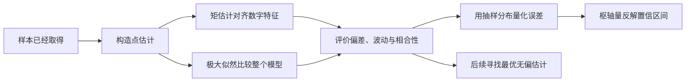
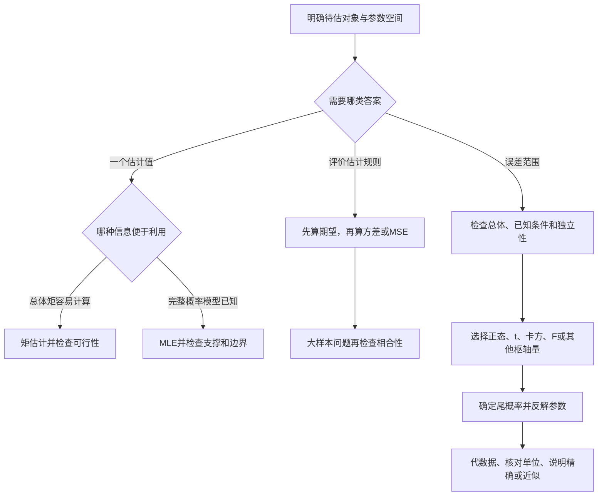

# 第七章 参数估计

> [!info] 本篇定位
> 综合 C7.1、C7.2、C7.4 的PPT转换稿与第5—8次课堂记录。前半解决“怎样估计、怎样评价”，后半解决“估计误差有多大”。第9—11次课的最优无偏估计、充分性与完备性单独放在 [[课程/数理统计/知识点解析梳理/07a-充分完备统计量与最优无偏估计-知识梳理|下一篇]]，以免第一次阅读负担过大。

## 一、本章核心脉络

上一章知道了样本均值、方差的分布。现在把方向反过来：**总体参数未知，已知样本，能推断参数是什么吗？推断可靠吗？**

以次品率 $p$ 为例：抽检100件，有8件次品，$0.08$ 是一个自然估计。但是：
- 为什么选择 $0.08$？
- 换一批样本会不会差很多？
- 能否给出一个带可靠程度的范围？

这三个问题依次对应**构造点估计、评价估计量、构造置信区间**。

> 一句话来说：点估计给一个答案，评价准则检查答案的产生规则，区间估计交代这种规则的误差范围。

## 二、点估计：从数据构造参数的猜测（核心）

设模型为 $f_\theta(x)$ 或 $p_\theta(x)$，参数取值范围为 $\Theta$。**估计量**
$$
\widehat\theta=T(X_1,\ldots,X_n)
$$
是统计量；**估计值** $T(x_1,\ldots,x_n)$ 是观察数据后算出的数。

对 Bernoulli 总体，$\widehat p=\bar X$ 是估计量；100件中8件次品对应的 $\widehat p=0.08$ 是估计值。

> 一句话来说：估计量是一条遇到新数据仍可重复使用的规则，估计值是规则在这批数据上的输出。

**参数空间不能省略。** 概率 $p$ 必须落在 $[0,1]$，率参数 $\lambda>0$，方差 $\sigma^2>0$。算出候选式以后，还要检查它是否符合题目模型。

## 三、矩估计：让样本数字与模型数字对齐（核心）

### 1. 为什么这种替换合理？

总体矩 $m_r(\theta)=E_\theta(X^r)$ 反映模型特征，样本矩 $A_r=n^{-1}\sum X_i^r$ 对应同一类平均。若 $E|X|^r<\infty$，则
$$
EA_r=E(X^r),\qquad A_r\xrightarrow{P}E(X^r).
$$
因此用 $A_r$ 替换 $m_r(\theta)$，就可以从数据解出参数。

> 一句话来说：模型说参数决定哪些平均数，矩估计让模型的平均数与样本算出的平均数相匹配。

有 $l$ 个未知参数，通常找 $l$ 个能识别参数的矩方程：
$$
A_r=m_r(\widehat\theta_1,\ldots,\widehat\theta_l).
$$
不是任意凑出 $l$ 个方程就一定能解，也不能忽略矩不存在、方程多解或参数不可识别的问题。

### 2. 例：Bernoulli、Poisson与均匀分布

**Bernoulli：** $EX=p$，令 $\bar X=p$，得到 $\widehat p_M=\bar X$。

**Poisson：** $EX=\lambda$，同理 $\widehat\lambda_M=\bar X$。

**$U(0,\theta)$：** $EX=\theta/2$，令 $\bar X=\theta/2$，得到
$$
\boxed{\widehat\theta_M=2\bar X}.
$$

**点评：** 同样的 $\bar X$ 在不同模型中估计不同对象，必须先写总体矩与参数的关系。

### 3. 例：平移指数模型的两个参数（课件例7.1.2）

$$
f(x;\mu,\theta)=
\begin{cases}
\theta^{-1}e^{-(x-\mu)/\theta},&x\ge\mu,\\
0,&x<\mu,
\end{cases}
\qquad \theta>0.
$$
令 $Y=X-\mu$，它是尺度参数为 $\theta$ 的指数变量，因此
$$
EX=\mu+\theta,\qquad
EX^2=(\mu+\theta)^2+\theta^2.
$$
对齐两阶矩：
$$
A_1=\mu+\theta,\qquad
A_2=(\mu+\theta)^2+\theta^2.
$$
先相减得到 $\theta^2=A_2-A_1^2=S^2$，再解出
$$
\boxed{\widehat\theta_M=S,\qquad \widehat\mu_M=\bar X-S}.
$$

> 一句话来说：两个参数不能只靠一个均值确定，还需要方差提供第二条独立信息。

这里 $S^2$ 分母为 $n$，因为矩估计对齐的是二阶样本中心矩，不能无说明换成修正方差。

### 4. 例：两个未知参数的二项模型（课堂补充）

若 $X\sim B(N,p)$，$N,p$ 都未知：
$$
\bar X=Np,\qquad S^2=Np(1-p).
$$
当 $\bar X>0$ 且 $\bar X>S^2$ 时，形式解为
$$
\widehat p=1-\frac{S^2}{\bar X},\qquad
\widehat N=\frac{\bar X^2}{\bar X-S^2}.
$$
但 $N$ 必须是整数，形式解可能不是整数，也可能因样本波动而没有可行解；这时不能把形式解当成自动满足模型的答案。

### 5. 相关系数的矩估计（课件例7.1.3）

对成对观测 $(X_i,Y_i)$，
$$
\rho=\frac{E(XY)-EX\,EY}{\sqrt{\operatorname{Var}(X)\operatorname{Var}(Y)}}.
$$
用对应样本矩替换：
$$
\widehat\rho_M=
\frac{\sum_i(X_i-\bar X)(Y_i-\bar Y)}
{\sqrt{\sum_i(X_i-\bar X)^2\sum_i(Y_i-\bar Y)^2}},
$$
两组样本平方离差和均非零时才有定义。

> 一句话来说：矩估计也可以使用混合矩，样本相关系数就是把总体相关系数中的期望换成样本平均。

## 四、极大似然：哪些参数最能解释已经看到的数据？（核心与难点）

### 1. 概率与似然只是“谁固定、谁变化”不同

抽检样本已知时，Bernoulli模型给出
$$
L(p;x)=p^k(1-p)^{n-k},\qquad k=\sum_i x_i.
$$
把 $p$ 固定，这是不同数据的概率模型；把数据固定，让 $p$ 变化，就是似然函数。MLE选择
$$
\widehat\theta_{\mathrm{ML}}(x)
=\arg\max_{\theta\in\Theta}L(\theta;x).
$$

> 一句话来说：极大似然不是猜哪个参数“本身最有概率”，而是比较哪个参数使眼前的数据最容易出现。

课件的白球引例中，“白球占90%”对看到白球的似然是 $0.9$，“白球占10%”的似然是 $0.1$。这能支持似然比较，但不引入先验就不能自动说前一个模型的后验概率是90%。

连续型模型使用**密度乘积**
$$
L(\theta;x)=\prod_i f_\theta(x_i),
$$
而不是连续变量单点概率的乘积。密度值比较对应同样大小的小邻域概率的比较。

### 2. 对数似然为什么方便？

$$
\ell(\theta)=\log L(\theta)=\sum_i\log f_\theta(x_i).
$$
对数严格递增，不改变最大值位置，同时把乘积变成和。

> 一句话来说：取对数不改变“谁最好”，但让求导更容易。

求解路线是：写单点模型 → 写联合似然和支撑条件 → 取对数 → 找内部候选点 → 检查边界与最大性 → 写回估计量。求导等于零只是找候选点，不是定义。

### 3. 例：Bernoulli总体（完整推导）

当 $0<k<n$，
$$
\ell(p)=k\log p+(n-k)\log(1-p),
$$
$$
\ell'(p)=\frac{k}{p}-\frac{n-k}{1-p}=0
\quad\Longrightarrow\quad \widehat p=\frac kn.
$$
且
$$
\ell''(p)=-\frac{k}{p^2}-\frac{n-k}{(1-p)^2}<0.
$$
因此内部点是最大值，写成随机样本形式：
$$
\boxed{\widehat p_{\mathrm{ML}}=\bar X}.
$$

若参数空间是 $[0,1]$，全为0或全为1时最大值分别在端点0、1；若题目限定 $(0,1)$，这些样本只有边界上确界，没有可取得的MLE。课件写开区间时必须补上这项边界说明。

**点评：** 本例MM与MLE相同，但原因是两个方法在这个模型里碰巧得到同一式子，不是两个方法相同。

### 4. 例：指数与正态模型

**尺度参数指数：**
$$
\ell(\theta)=-n\log\theta-\frac{\sum x_i}{\theta},
\quad
\ell'(\theta)=0\Longrightarrow
\widehat\theta_{\mathrm{ML}}=\bar X.
$$
**率参数指数：**
$$
\ell(\lambda)=n\log\lambda-\lambda\sum x_i,
\quad
\widehat\lambda_{\mathrm{ML}}=\frac1{\bar X}.
$$

**课件寿命数据：** 16、29、50、68、100、130、140、270、280、340、410、450、520、620、190、210、800、1100。总和5723，样本量18，因此尺度参数MM和MLE均为
$$
\bar x=5723/18\approx317.944\text{小时}.
$$

**正态模型的教学补充：** 两参数均未知时，
$$
\ell(\mu,\sigma^2)
=-\frac n2\log(2\pi\sigma^2)
-\frac{\sum_i(x_i-\mu)^2}{2\sigma^2}.
$$
先对 $\mu$ 优化得到 $\widehat\mu=\bar x$，再对方差优化得到
$$
\widehat\sigma^2_{\mathrm{ML}}
=\frac1n\sum_i(X_i-\bar X)^2=S^2.
$$
这里要求样本平方离差和非零；若所有观测相同且限制 $\sigma^2>0$，似然在方差趋零时无界，不存在通常的有限MLE。

> 一句话来说：MLE由“最大化似然”决定，不负责自动无偏；正态方差MLE分母是 $n$，不是 $n-1$。

### 5. 例：MM与MLE不同的幂密度模型（课件例7.1.6）

根据转换稿保留的对数似然与矩积分，可识别模型
$$
f(x;\theta)=(\theta+1)x^\theta,\quad 0<x<1.
$$
以下按归一化允许的参数空间 $\theta>-1$ 推导；若题目另有限制，需再检查边界。
$$
EX=\frac{\theta+1}{\theta+2}
\quad\Longrightarrow\quad
\boxed{\widehat\theta_M=\frac1{1-\bar X}-2}.
$$
而
$$
\ell(\theta)=n\log(\theta+1)+\theta\sum_i\log x_i,
$$
$$
\ell'(\theta)=\frac n{\theta+1}+\sum_i\log x_i=0,
$$
所以
$$
\boxed{\widehat\theta_{\mathrm{ML}}
=-\frac n{\sum_i\log X_i}-1}.
$$

**校正说明：** 转换稿的MLE式子漏了前面的负号；由于 $\sum\log x_i<0$，正确结果必须使用上式。它是根据保留下来的似然方程重算得到的，不照抄损坏答案。

### 6. 例：均匀分布的边界最优

采用课件的闭端点密度版本 $U[0,\theta]$：
$$
L(\theta;x)=\theta^{-n}
\mathbf1_{\{0\le x_{(1)},\,x_{(n)}\le\theta\}}.
$$
可行性要求 $\theta\ge x_{(n)}$，而 $\theta^{-n}$ 随 $\theta$ 增大而减小，所以
$$
\boxed{\widehat\theta_{\mathrm{ML}}=X_{(n)}}.
$$
MM为 $2\bar X$。两端都未知时，最短的可行区间给出
$$
\widehat\theta_1=X_{(1)},\qquad \widehat\theta_2=X_{(n)},
$$
通常考虑 $n\ge2$ 且最大值大于最小值。

> 一句话来说：参数控制支撑范围时，先让所有数据有可能出现，再在可行范围内优化。

**端点说明：** 连续均匀分布的开闭端点不改变概率分布，但会影响“逐点定义的似然是否在边界取得最大值”。本例沿用课件闭端点版本；严格使用 $x<\theta$ 的版本时，$\theta=x_{(n)}$ 是边界上确界位置。做常规题按题目给定版本处理。

### 7. 钓鱼问题：参数是整数，不能只用导数（课件应用）

先标记 $r$ 条鱼放回，再抽取 $s$ 条，发现其中 $x$ 条有标记。假设标记不影响再捕获机会、充分混合，第二次无放回均匀抽取，则
$$
L(N)=\frac{\binom rx\binom{N-r}{s-x}}{\binom Ns},
\qquad N\in\mathbb N,\quad N\ge r+s-x.
$$
这是超几何模型，不是把第二次抽到的鱼机械当成独立Bernoulli样本。

比较相邻似然：
$$
\frac{L(N)}{L(N-1)}
=\frac{(N-r)(N-s)}{N(N-r-s+x)}.
$$
在比值有定义的内部，似然增加的条件等价于 $N\le rs/x$。当 $x>0$：
- $rs/x$ 非整数时，常规最大点为 $\lfloor rs/x\rfloor$；
- 若为整数 $m$，且 $m-1,m$ 都可行，两点可并列最大；
- 若 $x=0$ 且没有额外总体上界，不能给出有限的常规MLE。

> 一句话来说：离散参数用相邻似然比较，$rs/x$ 是中心位置，取整、并列与可行性都要检查。

### 8. 两种方法怎样比较？

| 方法 | 用到了什么 | 优点 | 局限 |
|---|---|---|---|
| 矩估计 | 若干总体矩与样本矩 | 直观、计算常较简单 | 矩可能不存在，可能没有可行解 |
| 极大似然 | 完整样本联合模型 | 系统利用分布形式 | 可能有边界、多峰、不存在或非唯一问题 |

不要把“MLE常有良好大样本性质”写成“每个模型、每个样本量都更好”。接下来必须先说明按什么标准比较。

## 五、评价估计量：偏不偏、散不散、会不会靠近真值？（核心）

### 1. 无偏性：长期平均位置正确

对所有参数值，
$$
E_\theta\widehat\theta=\theta.
$$
偏差为 $b(\theta)=E_\theta\widehat\theta-\theta$；若 $n\to\infty$ 时偏差趋零，称渐近无偏。若目标为 $g(\theta)$，应检查 $EU=g(\theta)$，不能检查错对象。

> 一句话来说：无偏不保证这次算得准，只保证重复抽样后估计值的平均中心在真值上。

非线性变换不保无偏，例如
$$
E(\bar X^2)=\mu^2+\sigma^2/n\ne\mu^2.
$$

**样本方差为何需要修正？**
$$
\sum_i(X_i-\bar X)^2
=\sum_i(X_i-\mu)^2-n(\bar X-\mu)^2.
$$
两边取期望：
$$
nE(S^2)=n\sigma^2-n\operatorname{Var}(\bar X)
=(n-1)\sigma^2.
$$
所以
$$
E(S^2)=\frac{n-1}{n}\sigma^2,\qquad
E(S^{*2})=\sigma^2.
$$
若真均值 $\mu$ 已知，$n^{-1}\sum(X_i-\mu)^2$ 本来就无偏，不需要再减一个自由度。

> 一句话来说：用数据自身的平均值做中心会把离差压小，分母改成 $n-1$ 是对这种压小的修正。

### 2. 有效性：同样无偏，谁的波动小？

若 $T_1,T_2$ 都无偏，并且对所有参数有
$$
\operatorname{Var}_\theta(T_1)\le
\operatorname{Var}_\theta(T_2),
$$
就说 $T_1$ 比 $T_2$ 有效。全体无偏估计中方差最小者称MVUE或UMVUE。

> 一句话来说：有效性是在没有系统偏差的同类估计之间比较稳定程度。

课件的三个观测例子中，$X_1$ 和 $\bar X$ 都对均值无偏；前者方差为 $\sigma^2$，后者为 $\sigma^2/3$。加权量 $0.1X_1+0.2X_2+0.7X_3$ 也无偏，但方差为 $0.54\sigma^2$，仍大于平均值的方差。

**为何等权平均在线性无偏类里最优？** 对
$$
T=\sum_i c_iX_i,
$$
要求对任意未知均值都无偏，便有 $\sum_i c_i=1$。由Cauchy不等式，
$$
1=(\sum_i c_i)^2\le n\sum_i c_i^2,
$$
所以
$$
\operatorname{Var}(T)=\sigma^2\sum_i c_i^2
\ge\sigma^2/n.
$$
等号在所有 $c_i=1/n$ 时成立。课件用拉格朗日乘子也能得到同一结果。

**范围边界：** 这只证明了**线性**无偏类最优；要证明全体无偏类最优，需要下一篇的进一步工具。

### 3. 贯穿例子：$U(0,\theta)$ 的最大值为何值得保留？

令 $M=X_{(n)}$，则
$$
P_\theta(M\le m)=(m/\theta)^n,\quad 0<m<\theta,
$$
$$
f_M(m)=nm^{n-1}/\theta^n,
$$
$$
EM=\frac n{n+1}\theta,\qquad
\operatorname{Var}(M)
=\frac{n\theta^2}{(n+1)^2(n+2)}.
$$
MLE $M$ 有向下偏差。修正为
$$
U=\frac{n+1}{n}M
$$
就无偏，且
$$
\operatorname{Var}(U)=\frac{\theta^2}{n(n+2)}
\le\frac{\theta^2}{3n}
=\operatorname{Var}(2\bar X).
$$
$n>1$ 时严格更小。

> 一句话来说：先用最大值把估计做得稳定，再修正其系统偏差，可以得到比矩估计更好的无偏估计。

至此只比较了 $U$ 与 $2\bar X$，还没证明 $U$ 比所有无偏估计都好。充分完备统计量将补上这最后一步。

### 4. 均方误差：允许偏差时怎样公平比较？

$$
\operatorname{MSE}(\widehat\theta)
=E[(\widehat\theta-\theta)^2]
=\operatorname{Var}(\widehat\theta)+b(\theta)^2.
$$

> 一句话来说：MSE同时计入中心偏移和随机波动，能比较有偏与无偏估计。

均匀模型中，
$$
\operatorname{MSE}(M)=\frac{2\theta^2}{(n+1)(n+2)},\qquad
\operatorname{MSE}(2\bar X)=\frac{\theta^2}{3n}.
$$
$n\ge3$ 时，虽有偏的MLE仍有更小MSE；$n=1,2$ 两者MSE相等。仅比较有偏估计的方差，不能直接宣布它更好。

### 5. 相合性：更多数据会不会把估计拉向真值？

弱相合：
$$
\widehat\theta_n\xrightarrow{P}\theta,
\quad\text{即}\quad
P_\theta(\vert\widehat\theta_n-\theta\vert\ge\varepsilon)\to0
\quad(\forall\varepsilon>0).
$$
强相合要求几乎必然收敛，比弱相合更强。

> 一句话来说：相合性描述随样本量增加，估计偏离真值一段固定距离的概率是否趋于零。

**常用证明：**
- 大数定律：直接得到样本均值、样本原点矩的相合性；
- 偏差与方差都趋零：用Chebyshev不等式或MSE的Markov界；
- 已知分布：直接计算偏离概率。

如 $X_i\sim N(0,\sigma^2)$，$T_n=n^{-1}\sum X_i^2$：
$$
ET_n=\sigma^2,\quad
\operatorname{Var}(T_n)=2\sigma^4/n,
$$
$$
P(\vert T_n-\sigma^2\vert\ge\varepsilon)
\le\frac{2\sigma^4}{n\varepsilon^2}\to0.
$$
若 $E|X|^k<\infty$，$A_k$ 同时是总体 $k$ 阶原点矩的无偏、相合估计。若二阶矩有限，$S^2=A_2-\bar X^2$ 与 $S^{*2}$ 也相合。

无偏不推出相合：无论有多少数据都只用 $X_1$，它可以始终无偏，却不会因 $n$ 增加更集中。渐近无偏也只控制期望，不能替代相合性。

> [!note] 正态方差估计的后续结论
> 正态两参数模型下，$S^{*2}$ 是方差的最优无偏估计，但不一定达到有限样本信息下界。其方差为 $2\sigma^4/(n-1)$，与信息下界 $2\sigma^4/n$ 的效率比趋于1，因此可称渐近优效。下界需要正规信息矩阵工具，详见下一篇，不能凭“无偏”直接推出。

## 六、区间估计：点估计之后还缺什么？（核心）

抽到100件有8件次品，$\widehat p=0.08$ 没告诉我们误差大小。区间估计用随机端点 $L(X),U(X)$ 构造范围，典型精确区间满足
$$
P_\theta\{L(X)\le\theta\le U(X)\}=1-\alpha.
$$
有些离散模型使用至少 $1-\alpha$ 的覆盖要求；大样本方法给近似覆盖。

> 一句话来说：置信区间不是保证这次绝不出错，而是规定一条长期按给定比例覆盖真值的构造规则。

参数在频率学派模型中固定，抽样前的区间随机。拿到数据后区间固定，它实际上要么覆盖参数、要么没有覆盖；95%描述**反复使用这种方法的覆盖比例**。

同类构造中，提高置信水平通常使区间变宽；增加样本量通常使区间变窄。已知方差的正态均值区间长度为 $2z_{\alpha/2}\sigma/\sqrt n$，所以要把宽度减半，样本量需要约变为四倍。

## 七、枢轴量：把第六章的分布变成参数区间（核心与难点）

### 1. 枢轴量是什么？

构造 $W(X;\theta)$，它可以包含待估参数，但其**抽样分布不含未知参数**。找到常数 $a,b$ 满足
$$
P_\theta(a\le W\le b)=1-\alpha,
$$
再将不等式反解成参数范围。

> 一句话来说：枢轴量是一把分布已知的随机尺子，用它量出样本与参数之间的差距。

统计量要求表达式不含未知参数；枢轴量要求分布不含未知参数。它们的要求不同。如果最终区间端点仍含未知参数，构造尚未完成。

### 2. 方差已知的正态均值：完整走一遍

第六章给出
$$
W=\frac{\bar X-\mu}{\sigma/\sqrt n}\sim N(0,1).
$$
取中央 $1-\alpha$ 概率：
$$
-z_{\alpha/2}\le
\frac{\bar X-\mu}{\sigma/\sqrt n}
\le z_{\alpha/2}.
$$
乘以正数 $\sigma/\sqrt n$，再把 $\mu$ 移到中间：
$$
\boxed{
\mu\in\left[
\bar X-z_{\alpha/2}\frac{\sigma}{\sqrt n},
\bar X+z_{\alpha/2}\frac{\sigma}{\sqrt n}
\right]}.
$$
这里 $\mu\in[\cdots]$ 简写置信区间，不表示本次区间确定覆盖 $\mu$。

**课件例题。** $X\sim N(\mu,0.09)$，数据12.6、13.4、12.8、13.2：
$$
\bar x=13,\quad n=4,\quad\sigma=0.3,\quad
z_{0.025}=1.96.
$$
所以95%区间为
$$
[13-1.96(0.3/2),13+1.96(0.3/2)]
=[12.706,13.294].
$$

**点评：** 四个数据已经够用精确正态结论，因为总体被假定正态，不是因为“小样本也能靠CLT”。

### 3. 方差未知：为什么换成 $t$？

如果直接沿用上一式，端点还有未知 $\sigma$，算不出来。用 $S^*$ 替换后，尺子本身也变随机，不能仍假装是精确标准正态。正态抽样定理给出
$$
\frac{\bar X-\mu}{S^*/\sqrt n}\sim t(n-1).
$$
因此
$$
\boxed{\mu\in
\bar X\pm t_{\alpha/2}(n-1)\frac{S^*}{\sqrt n}}.
$$
这里 $c\pm d$ 表示区间 $[c-d,c+d]$。课件写法 $S/\sqrt{n-1}$ 与 $S^*/\sqrt n$ 等价。

> 一句话来说：未知方差多了一层估计不确定性，正态模型用更厚尾的 $t$ 分布准确计入它。

### 4. 方差区间：倒数会交换上下端点

若 $\mu$ 未知，
$$
Q=\sum_i(X_i-\bar X)^2=(n-1)S^{*2},\qquad
Q/\sigma^2\sim\chi^2(n-1).
$$
按上侧分位数，
$$
\chi^2_{1-\alpha/2}(n-1)
\le Q/\sigma^2
\le\chi^2_{\alpha/2}(n-1).
$$
取倒数并乘 $Q$：
$$
\boxed{\sigma^2\in
\left[
\frac{Q}{\chi^2_{\alpha/2}(n-1)},
\frac{Q}{\chi^2_{1-\alpha/2}(n-1)}
\right]}.
$$
若 $\mu$ 已知，用 $Q_0=\sum_i(X_i-\mu)^2$，自由度改成 $n$。

> 一句话来说：均值区间围绕样本均值加减误差，方差区间把平方误差除以两个卡方门槛。

上侧下标小的分位数大，所以**大的分母给下限**。卡方不对称，等尾区间一般不对称，且不能把“等尾”普遍等同于“最短”。

## 八、两个正态总体：把同一套方法推广

以下精确公式均需要两组样本独立。记 $\Delta=\mu_1-\mu_2$，$R=S_X^{*2}/S_Y^{*2}$。

### 1. 均值差

方差已知：
$$
\boxed{\Delta\in
(\bar X-\bar Y)\pm z_{\alpha/2}
\sqrt{\sigma_1^2/n_1+\sigma_2^2/n_2}}.
$$
方差未知但相等：
$$
S_w^2=\frac{(n_1-1)S_X^{*2}+(n_2-1)S_Y^{*2}}
{n_1+n_2-2},
$$
$$
\boxed{\Delta\in
(\bar X-\bar Y)\pm
t_{\alpha/2}(n_1+n_2-2)S_w\sqrt{1/n_1+1/n_2}}.
$$

> 一句话来说：从“一个均值的标准误”换成“均值差的标准误”，反解区间的逻辑没有改变。

### 2. 方差比

两均值未知时，
$$
F=\frac{R}{\sigma_1^2/\sigma_2^2}
\sim F(n_1-1,n_2-1).
$$
所以
$$
\boxed{\frac{\sigma_1^2}{\sigma_2^2}\in
\left[
\frac R{F_{\alpha/2}(n_1-1,n_2-1)},
\frac R{F_{1-\alpha/2}(n_1-1,n_2-1)}
\right]}.
$$
两均值已知时，把 $R$ 换成
$$
R_0=\frac{\sum_i(X_i-\mu_1)^2/n_1}
{\sum_j(Y_j-\mu_2)^2/n_2},
$$
自由度换成 $(n_1,n_2)$。

> 一句话来说：$F$把观测到的方差比与真实方差比连接起来，仍然通过除以门槛反解。

区间整体大于1支持第一总体方差较大，整体小于1支持较小；包含1表示在相应检验框架下证据不足，**不证明两个方差相等**。同样，均值差区间包含0不证明均值相等。

## 九、课件数值例题：实际算一遍并核对记号

### 1. 零件长度方差

课件16个数据，单位mm：12.15、12.12、12.01、12.28、12.09、12.16、12.03、12.01、12.06、12.13、12.07、12.11、12.08、12.01、12.03、12.06。

由列出的数据重算：
$$
\bar x=12.0875,\quad Q=0.0761,\quad
s^2=0.00475625,\quad s^{*2}=0.00507333.
$$
自由度15。使用上侧分位数约27.488与6.262，95%方差区间约为
$$
[0.002768,\ 0.012152]\ \mathrm{mm}^2.
$$
课件报出的0.0048对应分母为 $n$ 的点估计；若要求无偏估计应使用约0.005073。课件均值经过提前舍入，本篇保留数据重算值。

### 2. 婴儿体重：均值用 $t$，方差用卡方

12个数据，单位克：3100、2520、3000、3000、3600、3160、3560、3320、2880、2600、3400、2540。

$$
\bar x=3056.667,\qquad
s^2=129122.222,\qquad
s^{*2}=140860.606.
$$
95%均值区间：
$$
\bar x\pm t_{0.025}(11)\frac{s^*}{\sqrt{12}}
\approx[2818.204,\ 3295.130]\text{克}.
$$
95%方差区间：
$$
\left[
\frac{1549466.667}{\chi^2_{0.025}(11)},
\frac{1549466.667}{\chi^2_{0.975}(11)}
\right]
\approx[70687.189,\ 406071.513]\text{克}^2.
$$

**点评：** 体重与体重方差的单位不同；$s^*\approx375.314$，课件采用的 $s\approx359.336$ 配 $S/\sqrt{n-1}$ 也会给出同一均值区间。

### 3. 两稻种产量：先检查数据与独立性

| 序号 | 1 | 2 | 3 | 4 | 5 | 6 | 7 | 8 | 9 | 10 |
|---|---|---|---|---|---|---|---|---|---|---|
| 甲 | 140 | 137 | 136 | 140 | 145 | 148 | 140 | 135 | 144 | 141 |
| 乙 | 135 | 118 | 115 | 140 | 128 | 131 | 130 | 115 | 121 | 125 |

课件列出的乙组数据重算得到 $\bar y=125.8$、$s_Y^{*2}=72.6222$，与转换稿解答中的126.8、71.956不一致。本篇按**现有表格数据**计算，不混用两套数字。

若沿用课件解答的**独立正态、等方差假设**：
$$
\bar x-\bar y=14.8,\quad
s_X^{*2}=16.9333,\quad s_w\approx6.69162,
$$
$$
\Delta\in14.8\pm
t_{0.025}(18)s_w\sqrt{1/10+1/10}
\approx[8.513,\ 21.087]\text{公斤}.
$$

> [!warning] 题干设计与解答假设的边界
> 题干说同一块田中甲乙各种一半，这种设计可能产生配对相关，不能仅凭“两组数据”断言独立。上式是在课件额外采用独立假设时成立。若实际按配对设计，应该对每块田的差值 $D_i=X_i-Y_i$ 建模；假定各田差值独立正态，则配对 $t$ 的自由度为9，对现有数据得到约 $[9.470,20.130]$。配对方法是解释模型边界的教学补充，不冒充新增授课内容。

## 十、单侧与非正态区间：仍然先找分布

### 1. 单侧置信限

只问“至少多大”或“至多多大”，可用单侧界：
$$
P_\theta(L(X)\le\theta)=1-\alpha,\qquad
P_\theta(\theta\le U(X))=1-\alpha.
$$
正态已知方差时：
$$
L_\mu=\bar X-z_\alpha\sigma/\sqrt n,\qquad
U_\mu=\bar X+z_\alpha\sigma/\sqrt n.
$$
方差未知时把 $z_\alpha\sigma$ 换成 $t_\alpha(n-1)S^*$。

> 一句话来说：单侧把允许漏掉的 $\alpha$ 全放在一个方向，因此用 $\alpha$ 而不是 $\alpha/2$。

### 2. 非正态但有精确分布：指数率参数

若 $X_i$ 来自率参数 $\lambda$ 的指数分布，
$$
2\lambda\sum_iX_i=2n\lambda\bar X\sim\chi^2(2n).
$$
可由Gamma分布求和或特征函数 $\varphi_X(t)=(1-it/\lambda)^{-1}$ 核对。

双侧区间：
$$
\boxed{\lambda\in
\left[
\frac{\chi^2_{1-\alpha/2}(2n)}{2\sum_iX_i},
\frac{\chi^2_{\alpha/2}(2n)}{2\sum_iX_i}
\right]}.
$$
单侧上限为 $\chi^2_\alpha(2n)/(2\sum X_i)$，下限为 $\chi^2_{1-\alpha}(2n)/(2\sum X_i)$；结合参数空间 $\lambda>0$ 表述单侧区间。

> 一句话来说：不是正态总体也可以有精确置信区间，关键是找到分布确切已知的枢轴量。

### 3. 只有大样本：用CLT和相合的尺度估计

对一般独立同分布总体，有限非零方差与相应条件下，常用
$$
\mu\in\bar X\pm z_{\alpha/2}\frac{S^*}{\sqrt n}
$$
作为大样本近似区间，不能写成小样本精确 $t$ 区间。

对 Bernoulli $(p)$，常见近似式是
$$
p\in\widehat p\pm
z_{\alpha/2}\sqrt{\frac{\widehat p(1-\widehat p)}n}.
$$
例如100件中8件次品，95%近似区间约为 $[0.0268,0.1332]$。这是教学演示的正态近似，不是精确区间；小样本或 $p$ 接近0、1时覆盖可能不好，尤其全成功/全失败时该式退化，不能照搬。

## 十一、判定/决策流程

## 十二、核心公式速查表

所有分位数为上侧分位数，$S^{*2}$ 分母为 $n-1$。

| 任务 | 公式 | 条件 |
|---|---|---|
| 矩估计 | $A_r=E_{\widehat\theta}(X^r)$ | 所需矩存在，方程可识别 |
| MLE | $\widehat\theta=\arg\max_{\theta\in\Theta}\prod f_\theta(X_i)$ | 检查支撑与边界 |
| 无偏 | $E_\theta\widehat\theta=\theta$ | 对所有参数成立 |
| MSE | $\operatorname{Var}(\widehat\theta)+\operatorname{Bias}(\widehat\theta)^2$ | 有限二阶矩 |
| 相合 | $\widehat\theta_n\xrightarrow{P}\theta$ | 大样本性质 |
| 均值区间，方差已知 | $\bar X\pm z_{\alpha/2}\sigma/\sqrt n$ | 正态精确 |
| 均值区间，方差未知 | $\bar X\pm t_{\alpha/2}(n-1)S^*/\sqrt n$ | 正态精确 |
| 方差区间，均值未知 | $[(n-1)S^{*2}/\chi^2_{\alpha/2},(n-1)S^{*2}/\chi^2_{1-\alpha/2}]$ | 自由度 $n-1$ |
| 方差区间，均值已知 | $[Q_0/\chi^2_{\alpha/2},Q_0/\chi^2_{1-\alpha/2}]$ | 自由度 $n$ |
| 均值差，未知等方差 | $(\bar X-\bar Y)\pm t_{\alpha/2}(n_1+n_2-2)S_w\sqrt{1/n_1+1/n_2}$ | 独立正态 |
| 方差比 | $[R/F_{\alpha/2},R/F_{1-\alpha/2}]$ | 独立正态，自由度 $(n_1-1,n_2-1)$ |
| 指数率参数区间 | $[\chi^2_{1-\alpha/2}(2n)/(2\sum X_i),\chi^2_{\alpha/2}(2n)/(2\sum X_i)]$ | 指数总体精确 |

## 十三、易错点与注意事项

> [!warning]
> 1. “能算出估计量”不等于“估计量无偏或最优”。
> 2. 非线性变换通常不保无偏；估计 $\lambda$ 与估计 $1/\lambda$ 是不同目标。
> 3. MLE不能省略参数空间、支持条件、边界与最大性检查。
> 4. 只比较几个无偏估计，不足以证明全体无偏类最优。
> 5. 有偏估计要用MSE等明确标准比较，不能只看方差。
> 6. 无偏、渐近无偏、相合是不同维度的性质。
> 7. 枢轴量允许含待估参数，但最终区间端点必须可由数据计算。
> 8. 等尾区间方便查表，不保证对所有分布都最短。
> 9. 均值差区间包含0是证据不足，不是证明两个总体相同。
> 10. 原始表格与课件解答数字不一致时，不混用；先明确采用哪一套数据。

## 十四、相关知识点链接

- [[课程/数理统计/知识点解析梳理/06-抽样分布-知识梳理|前置：抽样分布]]：这里每个枢轴量的分布都从上一章取得。
- [[课程/数理统计/知识点解析梳理/07a-充分完备统计量与最优无偏估计-知识梳理|下一篇：最优无偏估计]]：解释为什么某个无偏估计能胜过全体其他无偏估计。
- [[课程/数理统计/课件/C7_1/C7_1|C7.1：矩法与MLE]]、[[课程/数理统计/课件/C7_2/C7_2|C7.2：优良性准则]]、[[课程/数理统计/课件/C7_4(1)/C7_4(1)|C7.4：区间估计]]：主要PPT转换稿。
- [[课程/数理统计/课堂笔记/2026-09-15-第5节-抽样分布与矩估计方法授课|第5次课]]、[[课程/数理统计/课堂笔记/2026-09-17-第6节-极大似然估计法课程讲座|第6次课]]：点估计方法。
- [[课程/数理统计/课堂笔记/2026-09-22-第7节-参数估计与区间估计讲座|第7次课]]、[[课程/数理统计/课堂笔记/2026-09-24-第8节-正态总体区间估计课程宣讲|第8次课]]：评价标准与区间构造。
- [[课程/数理统计/知识点解析梳理/README|学习导航]]：分段阅读，不必一次背完速查表。

## 十五、作业与练习

### 学习检查清单

- [ ] 能从总体矩关系推导估计量，不只记答案。
- [ ] 能完整推导Bernoulli的MLE并说明端点情况。
- [ ] 能解释均匀模型为何不能只靠求导。
- [ ] 能证明 $E(S^2)=(n-1)\sigma^2/n$。
- [ ] 能解释线性无偏最优与全体无偏最优的区别。
- [ ] 会用大数定律或Chebyshev证明相合性。
- [ ] 能从枢轴量完整反解均值、方差与方差比区间。
- [ ] 遇到两组数据先判断独立还是配对。
- [ ] 会说明置信区间的覆盖含义，而不是只报数字。

### 初学自测（教学补充）

1. 对 $U(0,\theta)$ 推导MM、MLE及最大值的无偏修正。
2. 证明 $\bar X^2$ 不是 $\mu^2$ 的无偏估计。
3. 对率参数指数总体求MLE，并解释为什么它不自动无偏。
4. 为什么 $S^{*2}$ 无偏，但 $S^*$ 不一定对 $\sigma$ 无偏？
5. 正态均值方差未知时，试图用标准正态门槛构造“小样本精确区间”会漏掉什么？
6. 把方差区间的两个卡方门槛调换，为什么会得到反向的上下限？

> [!solution]- 自测答案与检查点
> 1. 依次为 $2\bar X$、$M=X_{(n)}$、$(n+1)M/n$，并核对支撑版本。
> 2. $E\bar X^2=\mu^2+\sigma^2/n$。
> 3. MLE为 $1/\bar X$；期望不能与倒数交换，下一篇会给出无偏修正。
> 4. 平方根是非线性变换，一般 $E\sqrt{S^{*2}}\ne\sqrt{ES^{*2}}$。
> 5. 标准差估计自身的随机性；正态模型的精确分布应为 $t(n-1)$。
> 6. 上侧小下标对应大门槛，大分母应当给下限。

### 课件练习线索与教师作业

- [[课程/数理统计/作业/9月15日数理统计作业|现有教师作业记录]]。
- [[课程/数理统计/作业/10月15日数理统计作业|10月15日作业：参数估计章末15题完整解答]]：矩估计、MLE、无偏性与方差比较、最优线性组合、样本量配置及置信区间。
- C7.1的次品率、平移指数、相关系数、寿命、幂密度、均匀分布与钓鱼题已在正文逐项覆盖。
- C7.2的无偏变换反例、方差修正、均匀估计比较、线性最优、正态二阶矩相合与样本原点矩相合已在正文覆盖。
- C7.4末尾“两个均值加权后求区间”的练习题干不完整。可做如下**同结构补充**：两独立正态样本有共同均值 $\mu$，样本均值方差为已知 $v_1,v_2>0$，求 $a\bar X+b\bar Y$ 的最小方差无偏组合。由 $a+b=1$ 得
  $$
  a=\frac{v_2}{v_1+v_2},\quad
  b=\frac{v_1}{v_1+v_2},\quad
  \operatorname{Var}(a\bar X+b\bar Y)=\frac{v_1v_2}{v_1+v_2}.
  $$
  据其精确正态分布构造均值区间。该题不冒充缺失的原题全文。
