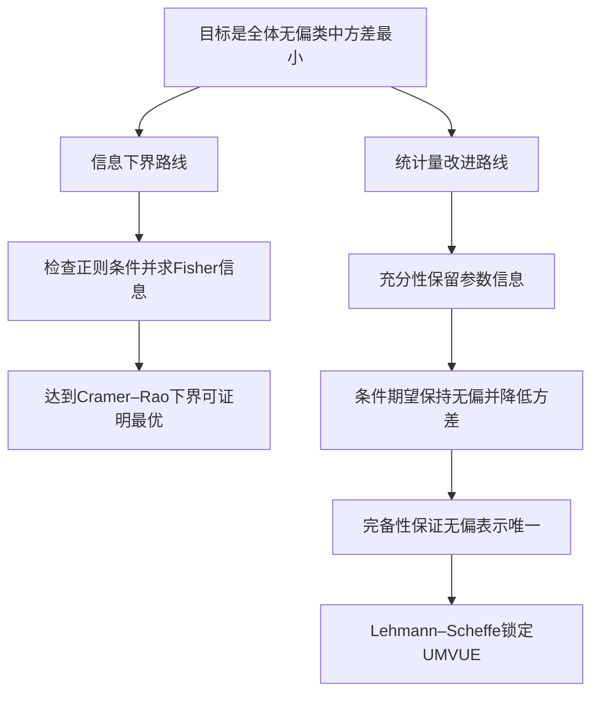
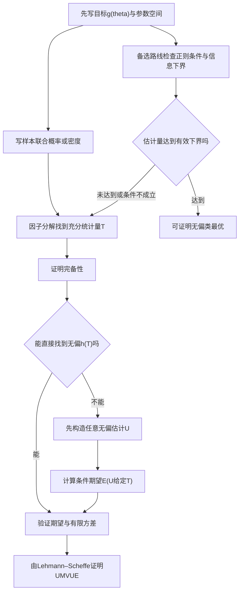

 
# 充分完备统计量与最优无偏估计

> [!info] 当前课堂进度对应篇
> 对应第9—11次课，综合估计量评价课件、充分完备统计量PPT转换稿和课堂记录。转换稿有较多公式缺失，正文用课堂中可确认的模型重建标准表达；模型补充、证明补充与缺失原题的边界均注明。
> 先学会 [[课程/数理统计/知识点解析梳理/07-参数估计-知识梳理|点估计与无偏性]] 再读本篇。第一次抓住“充分性保信息、条件期望降波动、完备性保唯一”这条主线；Fisher信息与指数族条件可在主线读完后回看。

## 一、本章核心脉络

前面已经能造出估计量，也会比较两个无偏估计。比如对 $U(0,\theta)$，
$$
2\bar X,\qquad \frac{n+1}{n}X_{(n)}
$$
都无偏，后者方差更小。

但我们仍没回答：**会不会还有某个没想到的无偏估计，比它更好？**

直接枚举全部样本函数做不到，所以课堂引入两条系统路线：

1. **找所有正则无偏估计共同的方差下界**，某估计达到它就最优；
2. **提取不丢失参数信息的统计量**，用条件期望改进估计，再用完备性证明无偏表示唯一。

> 一句话来说：本篇不再只问“哪个估计比另一个好”，而是问“怎样证明它比所有其他无偏估计都好”。

## 二、最小方差无偏估计：最优到底限定在哪个范围？（核心）

设目标是 $g(\theta)$，而不一定是参数 $\theta$ 本身。若 $U$ 无偏，且对任何其他有限方差无偏估计 $V$，
$$
E_\theta U=g(\theta),\qquad
\operatorname{Var}_\theta(U)\le\operatorname{Var}_\theta(V)
\quad(\forall\theta\in\Theta),
$$
称 $U$ 为最小方差无偏估计，记作MVUE；强调“对所有参数统一最优”时常记作UMVUE或UMVU估计。

> 一句话来说：UMVUE是在所有无偏估计里都不更差的那个，不是在所有估计里一概最好的那个。

它不保证优于有偏估计的MSE，也不保证最短置信区间。前篇证明的“最小方差线性无偏”只比较线性函数，本篇比较整个无偏类。

### 1. 若存在，为什么唯一？

若 $U_1,U_2$ 都达到同一最小方差 $v_\theta$，它们的平均仍无偏：
$$
\operatorname{Var}_\theta\left(\frac{U_1+U_2}{2}\right)
=v_\theta-\frac14\operatorname{Var}_\theta(U_1-U_2).
$$
最小性不允许它严格更小，所以 $\operatorname{Var}_\theta(U_1-U_2)=0$。又因 $E(U_1-U_2)=0$，有
$$
P_\theta(U_1=U_2)=1.
$$

> 一句话来说：两个真正最优的估计若会给出不同结果，把它们平均还能降低波动，会与“已经最优”矛盾。

唯一是**几乎处处唯一**，允许在零概率集合上采用不同定义。存在性则不能自动保证：有些目标没有无偏估计，有些无偏类没有统一最优者。

### 2. 正交判别法为何较抽象？（课堂衔接，了解即可）

在相应有限二阶矩条件下，$U$ 是UMVUE的判别条件是：对每个满足 $E_\theta Z=0$（所有参数值）的统计量 $Z$，
$$
\operatorname{Cov}_\theta(U,Z)=0\quad(\forall\theta).
$$
因为任意其他无偏估计可写成 $U+Z$。若正交，
$$
\operatorname{Var}(U+Z)=\operatorname{Var}(U)+\operatorname{Var}(Z).
$$
反过来，考察 $U+aZ$ 对所有常数 $a$ 的方差，最小性要求线性项中的协方差为零。

> 一句话来说：最优估计必须与所有“均值为零的可加扰动”正交，否则还能沿某个扰动方向降低方差。

困难是“所有 $Z$”仍太多，下面两条路线才把判定变得可操作。

## 三、Fisher信息与Cramér–Rao下界（第9次课）

### 1. 信息量从哪里来？

单个观测的得分函数是
$$
s_\theta(X)=\frac{\partial}{\partial\theta}\log f_\theta(X).
$$
它衡量对数似然在参数方向上的变化。信息量为
$$
I_1(\theta)=E_\theta[s_\theta(X)^2].
$$
在相关正则条件下，
$$
E_\theta s_\theta(X)=0,\qquad
I_1(\theta)=-E_\theta\left[
\frac{\partial^2}{\partial\theta^2}\log f_\theta(X)
\right].
$$
对独立同分布样本，总得分是各项之和，信息量为
$$
I_n(\theta)=nI_1(\theta).
$$

> 一句话来说：Fisher信息描述模型对参数变化有多敏感；在正则无偏估计中，更多信息对应更低的理论方差门槛。

### 2. 正则条件为什么不能省略？

常用条件包括：参数空间内部可微；通常采用共同且不随参数变化的支撑；求导与积分/求和可以交换；相关矩有限且信息量正。

求导与积分交换给出
$$
\frac{d}{d\theta}\int f_\theta(x)\,dx=0,
$$
于是得分均值为零。若支撑随参数移动，可能出现边界项，原推导就不能机械使用。

> 一句话来说：下界靠一组可交换运算的条件成立，不是任何模型看见一个导数就能套公式。

$U(0,\theta)$ 的支撑随 $\theta$ 变化，是本课程最重要的反例。

### 3. 下界公式与证明洞察

若 $U$ 对 $g(\theta)$ 无偏，满足相应正则条件：
$$
\boxed{
\operatorname{Var}_\theta(U)
\ge\frac{[g'(\theta)]^2}{nI_1(\theta)}
}.
$$
证明抓住两步：
$$
\operatorname{Cov}_\theta\left(U,\sum_i s_\theta(X_i)\right)
=g'(\theta),
$$
再用
$$
\operatorname{Cov}(A,B)^2\le
\operatorname{Var}(A)\operatorname{Var}(B).
$$
总得分方差为 $nI_1(\theta)$，便得到下界。

> 一句话来说：无偏性决定估计必须跟着参数变化，Cauchy–Schwarz把这种变化需求转换成最低波动要求。

**达到下界是最优的充分条件，不是必要条件。** 在下界确实约束所比较无偏类的正则设定下，达到它就证明UMVUE；没有达到它不能据此否定UMVUE；标准下界不适用也不说明最优无偏估计不存在。

### 4. 典型模型

| 模型及目标 | 单观测信息量 | 方差下界 | 达到它的估计 |
|---|---|---|---|
| $N(\mu,\sigma^2)$，$\sigma^2$已知，估计 $\mu$ | $1/\sigma^2$ | $\sigma^2/n$ | $\bar X$ |
| Bernoulli $(p)$，估计 $p$ | $1/[p(1-p)]$ | $p(1-p)/n$ | $\bar X$ |
| 指数率参数 $\lambda$，估计 $1/\lambda$ | $1/\lambda^2$ | $1/(n\lambda^2)$ | $\bar X$ |
| 指数率参数 $\lambda$，估计 $\lambda$ | $1/\lambda^2$ | $\lambda^2/n$ | 后面给出的UMVUE并不达到 |
| $U(0,\theta)$，估计 $\theta$ | 不能直接套标准路线 | 标准推导不适用 | 改走充分完备路线 |

以Bernoulli为例，
$$
s_p(X)=\frac{X-p}{p(1-p)},\qquad
I_1(p)=\frac1{p(1-p)}.
$$
$\bar X$ 无偏，方差 $p(1-p)/n$ 恰好等于下界。

> [!note]- 正态方差为什么可以最优但不达下界？（证明补充）
> 令参数为 $(\mu,\tau)$，$\tau=\sigma^2$，两者未知。正则两参数模型的样本信息矩阵为
> $$
> I_n(\mu,\tau)=
> \begin{pmatrix}
> n/\tau&0\\
> 0&n/(2\tau^2)
> \end{pmatrix}.
> $$
> 对目标 $\tau$，向量Cramér–Rao界为 $2\tau^2/n$。但修正样本方差有
> $$
> \operatorname{Var}(S^{*2})=\frac{2\tau^2}{n-1}>
> \frac{2\tau^2}{n}.
> $$
> 它仍是UMVUE，最优性来自后面的充分完备统计量定理。两者效率比 $(n-1)/n\to1$，说明渐近达到门槛，不代表有限样本达到。
> 此处有未知干扰参数 $\mu$，应使用信息矩阵而不是省略干扰参数后随意套一参数式。

## 四、充分统计量：压缩样本时保留了什么？（第10次课核心）

### 1. 直观例子：次数有用，出现位置未必有用

课件打靶10次命中8次。在独立、同一命中率 $p$ 的模型下，“总共命中8次”帮助估计 $p$；“恰好第3、6次没中”只是排列细节。

令
$$
T=\sum_iX_i.
$$
只保存 $T$ 并非能恢复全部数据，而是能保留样本中**与这个模型的未知参数有关的信息**。

> 一句话来说：充分统计量不是保留每个数据细节，而是不丢掉当前模型里用于推断参数的信息。

若各次命中率不同、有趋势或相依，位置可能有信息；充分性总是相对于指定模型而言。

### 2. 正式定义与Bernoulli验证

若给定 $T=t$ 后，整个样本 $X=(X_1,\ldots,X_n)$ 的条件分布与 $\theta$ 无关，就称 $T$ 对 $\theta$ 充分。

对 $0<p<1$ 的Bernoulli样本，若 $\sum x_i=t$：
$$
P_p(X=x)=p^t(1-p)^{n-t},\qquad
P_p(T=t)=\binom ntp^t(1-p)^{n-t}.
$$
因此
$$
P_p(X=x\mid T=t)=\frac1{\binom nt}.
$$
参数完全消失，$T$ 充分。

> 一句话来说：知道 $T$ 之后，再观察剩余数据细节，已经不能进一步区分不同参数值。

**反例：** $n\ge2$ 时只保存 $X_1$，其余独立变量 $X_2$ 的条件分布仍含 $p$，所以 $X_1$ 不是整组样本对 $p$ 的充分统计量。

连续型条件分布有时集中在曲面或超平面上，不能把“$T=t$ 概率为零”理解成条件分布不存在，也不能直接拿两个普通密度随意相除。实际做题优先使用下一节的分解判据。

## 五、因子分解定理：怎样快速找充分统计量？（核心）

在具有共同控制测度的常用离散/连续模型中，$T(X)$ 充分，当且仅当联合概率或密度可以分解为
$$
\boxed{f_\theta(x)=h(x)g_\theta(T(x))}
$$
（允许相应零测集上的版本差异）。$h$ 与参数无关，含参数的部分只能通过 $T(x)$ 依赖样本。

> 一句话来说：把联合分布里的参数相关部分圈出来，看它究竟通过哪些样本函数出现。

### 1. Bernoulli与Poisson

Bernoulli：
$$
f_p(x)=p^{\sum x_i}(1-p)^{n-\sum x_i}
\prod_i\mathbf1_{\{x_i\in\{0,1\}\}}.
$$
Poisson：
$$
f_\lambda(x)
=\left(\prod_i\frac1{x_i!}\right)
e^{-n\lambda}\lambda^{\sum x_i},
\qquad x_i\in\{0,1,\ldots\}.
$$
参数都只通过 $\sum_i x_i$ 与数据发生关联，所以样本和充分，均值也充分。

### 2. 正态：均值未知，与两参数都未知不同

$\sigma^2$ 已知时，
$$
\sum_i(x_i-\mu)^2
=\sum_i(x_i-\bar x)^2+n(\bar x-\mu)^2.
$$
第一部分与 $\mu$ 无关，含 $\mu$ 的部分只通过 $\bar x$，所以 $\bar X$ 对 $\mu$ 充分。

若 $\mu,\sigma^2$ 都未知，
$$
f_{\mu,\sigma^2}(x)
=(2\pi\sigma^2)^{-n/2}
\exp\left[
-\frac{\sum x_i^2-2\mu\sum x_i+n\mu^2}{2\sigma^2}
\right].
$$
参数通过 $\sum x_i,\sum x_i^2$ 出现，所以联合统计量
$$
T=\left(\sum_iX_i,\sum_iX_i^2\right)
$$
充分。对固定 $n\ge2$，它与 $(\bar X,S^{*2})$ 一一对应，后者也充分。

> 一句话来说：需要保留多少信息，取决于哪些参数未知；两参数都未知时，只保留均值一般不够。

### 3. 均匀模型：支撑条件也包含参数信息

$$
f_\theta(x)
=\theta^{-n}
\mathbf1_{\{x_{(1)}\ge0\}}
\mathbf1_{\{x_{(n)}\le\theta\}}.
$$
取
$$
h(x)=\mathbf1_{\{x_{(1)}\ge0\}},\qquad
g_\theta(m)=\theta^{-n}\mathbf1_{\{m\le\theta\}},
$$
所以 $M=X_{(n)}$ 充分。

> 一句话来说：最大值告诉我们未知上限至少有多大，信息不仅在指数或幂次中，也在支持范围里。

不能因为“真实样本肯定为正”就在整个样本空间上的密度公式中漏掉正值条件。第11次课特别指出了原课件这个省略的问题。

### 4. 充分统计量不唯一

$T$ 充分、$S=s(T)$ 是在取值范围上一一对应的变换，则 $S$ 充分，因为它能恢复 $T$。例如样本和与均值；非负 $T$ 的平方与 $T$。

> 一句话来说：换一种能无损恢复的记法不改变充分性，任意多对一压缩则未必保留信息。

整个样本向量本身总是充分，但未必真正压缩数据；“充分”不自动意味着维度小或最小充分。

## 六、Rao–Blackwell：为什么条件期望能改进估计？（核心与难点）

### 1. 先明确它要保留什么、平均掉什么

已有无偏估计 $U$，找到充分统计量 $T$，构造
$$
U^*=E_\theta(U\mid T).
$$
给定 $T$ 后，把样本排列等剩余随机细节平均掉。充分性确保这个条件分布不含参数，因此 $U^*$ 能写成**同一个不含未知参数的样本函数**，是一条可实际使用的估计规则。

> 一句话来说：不要随机挑一种与参数无关的数据细节来决定估计，而是对这些细节取平均。

### 2. 为什么仍然无偏，为什么方差不增？

假设 $U$ 对 $g(\theta)$ 无偏，并对所有参数有有限二阶矩。全期望给出
$$
E_\theta U^*
=E_\theta[E_\theta(U\mid T)]
=E_\theta U=g(\theta).
$$
全方差给出
$$
\operatorname{Var}_\theta(U)
=E_\theta[\operatorname{Var}_\theta(U\mid T)]
+\operatorname{Var}_\theta(U^*),
$$
所以
$$
\boxed{\operatorname{Var}_\theta(U^*)
\le\operatorname{Var}_\theta(U)}.
$$

> 一句话来说：条件平均不移动估计中心，却删去了剩余随机性带来的那部分波动。

等号对应给定 $T$ 后 $U$ 已不再有剩余波动，即 $U$ 已经几乎处处是 $T$ 的函数。此时不必期待严格改进。

### 3. 贯穿例子：只用第一件产品，改成使用整个样本

Bernoulli模型中，$U=X_1$ 已对 $p$ 无偏，但浪费了其余产品。给定次品总数 $T=t$，各位置对称：
$$
E(X_1\mid T=t)=P(X_1=1\mid T=t)=t/n.
$$
所以
$$
U^*=T/n=\bar X.
$$
改进前后方差为
$$
p(1-p)\quad\text{与}\quad p(1-p)/n.
$$

> 一句话来说：把“恰好抽第一件”的偶然性平均掉，自然得到所有产品等权平均。

### 4. 贯穿例子：均匀模型把MM改进成修正最大值

$U=2\bar X$ 无偏，$M=X_{(n)}$ 充分。对于连续独立均匀样本，给定 $M=m$，一个观测为最大值，其余的无序观测在 $(0,m)$ 内均匀分布（采用相应条件分布版本）。因此
$$
E\left(\sum_iX_i\mid M=m\right)
=m+(n-1)m/2,
$$
$$
\boxed{E(2\bar X\mid M)=\frac{n+1}{n}M}.
$$

**联系：** 上一篇我们靠期望修正得到的最大值估计，现在从“对充分统计量取条件期望”又得到同一式子。它方差更小，但到这里仍只保证改进，不保证全局最优。

## 七、完备性：从“更好”走到“唯一且最优”（第11次课核心）

### 1. 定义为什么看起来奇怪？

若对每个可测函数 $a$，在所有 $E_\theta|a(T)|<\infty$ 的相关条件下，
$$
E_\theta[a(T)]=0\quad(\forall\theta\in\Theta)
$$
能推出
$$
P_\theta(a(T)=0)=1\quad(\forall\theta\in\Theta),
$$
则称统计量 $T$ 的分布族完备，简称 $T$ 完备。

> 一句话来说：完备性排除一种特殊扰动——明明不是零，却在所有参数下都平均为零的统计量函数。

这里是“对所有参数都零均值”，不是“恰好某一个参数下零均值”；结论是几乎处处为零，不要求每个无概率支持的点上都为零。

### 2. 为什么它保证无偏表示唯一？

若 $h_1(T),h_2(T)$ 都对 $g(\theta)$ 无偏，
$$
E_\theta[h_1(T)-h_2(T)]=0\quad(\forall\theta).
$$
完备性迫使
$$
h_1(T)=h_2(T)\quad\text{几乎处处}.
$$

> 一句话来说：基于一个完备统计量，同一个目标不能有两个真正不同的无偏表示。

充分性与完备性回答不同问题：
- **充分性：** 是否保留参数信息？
- **完备性：** 其函数中的无偏表示是否唯一？

它们不能相互代替。对 $n\ge2$ 的Bernoulli完整样本向量，整个样本当然充分；但 $X_1-X_2$ 对所有 $p$ 均值为零又不恒为零，故完整样本并不完备。这也说明保留更多细节未必保留完备性。

### 3. Bernoulli样本和的完备性：多项式系数被迫为零

$T=\sum X_i\sim B(n,p)$，$p\in(0,1)$。若
$$
\sum_{k=0}^n a(k)\binom nkp^k(1-p)^{n-k}=0
\quad(\forall p),
$$
除以 $(1-p)^n$，令 $q=p/(1-p)$：
$$
\sum_{k=0}^n a(k)\binom nkq^k=0
\quad(\forall q>0).
$$
一个多项式在整个区间恒为零，所有系数必须为零，因此 $a(k)=0$，$T$ 完备。均值与和一一对应，均值也完备。

> 一句话来说：参数遍历整个区间，零均值方程就不是一个约束，而是一整族约束，足以把所有系数锁成零。

若把参数空间缩成单点 $p=p_0$，$a(T)=T-np_0$ 便是非零的零均值函数，完备性可能消失。这里 $p_0$ 是该单点模型中已知常数，不是被允许混入统计量的未知参数。

### 4. Poisson与均匀模型的证明洞察

**Poisson：** $T\sim\operatorname{Poisson}(n\lambda)$。零均值方程乘以 $e^{n\lambda}$ 后成为
$$
\sum_{k=0}^\infty a(k)\frac{(n\lambda)^k}{k!}=0.
$$
在相应可积条件下，幂级数的唯一性给出所有系数为零，故 $T$ 完备。

**均匀最大值：** 密度为 $nm^{n-1}/\theta^n$，$0<m<\theta$。零均值意味着
$$
\int_0^\theta a(m)m^{n-1}\,dm=0
\quad(\forall\theta>0).
$$
积分函数对上限求导，在几乎处处意义下得到 $a(\theta)\theta^{n-1}=0$，所以 $M$ 完备。

> 一句话来说：离散分布常靠多项式或幂级数唯一性，连续端点模型常靠积分上限变化，把“所有参数下均值零”转化成函数本身零。

## 八、指数型分布族：一类方便寻找充分完备统计量的模型

### 1. “指数型”不等于“指数分布”

若密度或概率函数可写成
$$
f_\theta(x)=h(x)
\exp\left\{\sum_{j=1}^k\eta_j(\theta)t_j(x)-A(\theta)\right\},
$$
则属于相应指数型分布族。独立样本联合模型中的自然统计量为
$$
T_j=\sum_{i=1}^n t_j(X_i).
$$
因子分解定理立刻给出充分性。

> 一句话来说：指数型分布族是一种模型表达结构，Bernoulli、Poisson、正态也可以具有这种结构。

### 2. 完备结论还需要什么条件？

常用完整/满秩指数族定理要求自然参数向量的取值集合包含 $\mathbb R^k$ 中的非空开集，并在去除冗余仿射约束后的自然统计量表示下使用定理。不能看见一个 $\exp$ 就直接断言完备；曲指数族或受限参数空间需要另行分析。此处条件与完备性结论核对自 [UC Berkeley Stat 210A课程讲义](https://stat210a.berkeley.edu/fall-2024/reader/completeness.html)。

> 一句话来说：模型形式给充分性，参数能在足够丰富的范围内变化才支持这条快捷完备性结论。

| 总体 | 自然参数 | 自然统计量（或一一对应版本） |
|---|---|---|
| Bernoulli $(p)$，$0<p<1$ | $\log[p/(1-p)]\in\mathbb R$ | $\sum X_i$ |
| Poisson $(\lambda)$，$\lambda>0$ | $\log\lambda\in\mathbb R$ | $\sum X_i$ |
| 指数率参数 $\lambda>0$ | $-\lambda<0$ | $\sum X_i$ |
| 几何 $(p)$，取值从1开始 | $\log(1-p)<0$ | $\sum X_i$ |
| 正态均值未知、方差已知 | $\mu/\sigma^2\in\mathbb R$ | $\sum X_i$ |
| 正态两参数未知 | $(\mu/\sigma^2,-1/(2\sigma^2))$ | $(\sum X_i,\sum X_i^2)$ |

正态两参数的自然参数范围为 $\mathbb R\times(-\infty,0)$，是二维开集。$U(0,\theta)$ 的支撑随参数变，不能机械套这一快捷版本，但其最大值可用上一节直接证明完备。

## 九、Lehmann–Scheffé：最后一步为什么能证明全局最优？

设 $T$ **充分且完备**，目标 $g(\theta)$ 存在有限方差无偏估计。

- 若 $h(T)$ 已对目标无偏，它就是几乎处处唯一的UMVUE；
- 若已有任意无偏估计 $U$，则 $E(U\mid T)$ 是UMVUE。

> 一句话来说：充分性让每个竞争者都能被改进到 $T$ 的函数，完备性又迫使所有这些无偏函数变成同一个答案。

**把逻辑连起来。** 任取竞争者 $V$：
1. Rao–Blackwell使 $V^*=E(V\mid T)$ 仍无偏，方差不大于 $V$；
2. 若已有无偏 $h(T)$，完备性给出 $V^*=h(T)$；
3. 因而 $\operatorname{Var}[h(T)]\le\operatorname{Var}(V)$；
4. $V$ 是任意的，所以得到对整个无偏类的最优性。

**定理不能少一项：** 只有充分性保证改进，只有完备性保证相应函数唯一；若 $T$ 不是目标的无偏估计，也不能把 $T$ 本身直接认作UMVUE。

## 十、完整例题：把定义、判据和目标真正接起来

### 例1：Bernoulli次品率——从第一件到最优频率

目标 $p$，$T=\sum X_i$。前面已证明 $T$ 充分且完备。因为
$$
E(T/n)=p,
$$
所以
$$
\boxed{\widehat p_{\mathrm{UMVU}}=T/n=\bar X}.
$$

**联系：** 矩估计、MLE、Rao–Blackwell和Lehmann–Scheffé都得到样本频率。每条路线回答的问题不同：构造方法、模型拟合、方差改进、全局无偏最优。

### 例2：Poisson均值及零事件概率

对 $X_i\sim\operatorname{Poisson}(\lambda)$，$T=\sum X_i$ 充分完备，$E(T/n)=\lambda$，故 $\bar X$ 为 $\lambda$ 的UMVUE。

**教学补充：** 若目标改成 $e^{-\lambda}=P_\lambda(X=0)$，不能仍报 $\bar X$。取 $U=\mathbf1_{\{X_1=0\}}$ 无偏。对 $n\ge2$，给定 $T=t$，
$$
X_1\mid T=t\sim B(t,1/n),
$$
所以
$$
\boxed{\widehat{e^{-\lambda}}_{\mathrm{UMVU}}
=(1-1/n)^T}.
$$
这清楚说明“充分完备统计量”提供的是信息，最终还要为**具体目标**寻找无偏函数。

### 例3：几何模型中的成功概率（第11次课例题）

$$
P_p(X_i=k)=p(1-p)^{k-1},\quad k=1,2,\ldots,\quad0<p<1.
$$
令 $T=\sum_iX_i$，$n\ge2$。联合概率为
$$
p^n(1-p)^{T-n},
$$
故 $T$ 充分；用完整指数族结论或幂级数可证完备。

但 $ET=n/p$，所以 $T$ 不是 $p$ 的无偏估计。先构造
$$
U=\mathbf1_{\{X_1=1\}},\qquad EU=p.
$$
给定 $T=t$，所有正整数分拆 $(x_1,\ldots,x_n)$ 的概率相同：
- 总分拆数 $\binom{t-1}{n-1}$；
- 固定 $x_1=1$ 后的分拆数 $\binom{t-2}{n-2}$。

于是
$$
E(U\mid T=t)
=\frac{\binom{t-2}{n-2}}{\binom{t-1}{n-1}}
=\frac{n-1}{t-1}.
$$
得到
$$
\boxed{\widehat p_{\mathrm{UMVU}}
=\frac{n-1}{T-1}},\qquad n\ge2.
$$
比如 $n=3,T=8$，估计值为 $2/7$。矩估计与MLE为 $n/T=3/8$，并不与此相同。

**点评：** 不能看到 $ET=n/p$ 就把倒数取进去断言 $E(n/T)=p$。$n=1$ 时上述分拆公式不适用，应单独使用 $\mathbf1_{\{X_1=1\}}$。

### 例4：均匀上限——完成前两篇留下的问题

$T=M=X_{(n)}$ 已证明充分完备，且
$$
E\left(\frac{n+1}{n}M\right)=\theta.
$$
所以
$$
\boxed{\widehat\theta_{\mathrm{UMVU}}
=\frac{n+1}{n}M},
\qquad
\operatorname{Var}(\widehat\theta_{\mathrm{UMVU}})
=\frac{\theta^2}{n(n+2)}.
$$

**联系：** 最大值MLE有偏；修正后无偏；条件期望说明它改进MM；充分完备性最后证明它是整个无偏类的最优者。这个模型即使不能用标准Cramér–Rao界，照样可以有UMVUE。

### 例5：指数率参数——最优但不达到标准下界（证明补充）

若 $X_i\sim\operatorname{Exp}(\lambda)$，令 $T=\sum_iX_i$。它充分完备，且 $T$ 有Gamma密度
$$
f_T(t)=\frac{\lambda^n}{\Gamma(n)}t^{n-1}e^{-\lambda t},\quad t>0.
$$
由积分可得
$$
E(1/T)=\frac{\lambda}{n-1}\quad(n>1),
$$
$$
E(1/T^2)=\frac{\lambda^2}{(n-1)(n-2)}
\quad(n>2).
$$
因此对 $n>2$ 的有限方差问题，
$$
\boxed{\widehat\lambda_{\mathrm{UMVU}}=\frac{n-1}{T}},
$$
$$
\operatorname{Var}(\widehat\lambda_{\mathrm{UMVU}})
=\frac{\lambda^2}{n-2}>
\frac{\lambda^2}{n}.
$$
它是UMVUE但不达到Cramér–Rao下界。

MLE是 $n/T$，$n>1$ 时其期望为 $n\lambda/(n-1)$，有偏。$n=2$ 时 $(n-1)/T$ 仍无偏，但方差无限，不能忽略有限方差条件套用上述最小方差结论。

### 例6：正态两参数模型——解释课件的两个最优结论

对 $n\ge2$、$\mu\in\mathbb R,\sigma^2>0$，统计量 $(\bar X,S^{*2})$ 充分且完备。其函数
$$
E\bar X=\mu,\qquad ES^{*2}=\sigma^2.
$$
所以 $\bar X$ 是 $\mu$ 的UMVUE，$S^{*2}$ 是 $\sigma^2$ 的UMVUE。

**点评：** 并非“所有总体的样本均值都自动是全体无偏类最优”，这里使用了正态模型的充分完备性。

## 十一、判定/决策流程

这里的“未达到”是改用其他工具的提示，不是宣布该估计不最优。

## 十二、核心公式速查表

| 工具 | 核心公式或条件 | 能得到什么 |
|---|---|---|
| UMVUE | 无偏且对所有参数方差不大于任何竞争者 | 全体无偏类最优 |
| 信息量 | $I_1(\theta)=E_\theta[(\partial_\theta\log f_\theta(X))^2]$ | 正则模型的参数敏感性 |
| Cramér–Rao界 | $\operatorname{Var}(U)\ge[g'(\theta)]^2/[nI_1(\theta)]$ | 正则无偏类方差门槛 |
| 充分性 | 给定 $T$ 的样本条件分布不含参数 | 不丢参数信息 |
| 因子分解 | $f_\theta(x)=h(x)g_\theta(T(x))$ | 实用充分性判据 |
| Rao–Blackwell | $U^*=E(U\mid T)$ | 充分性使规则可计算；无偏且方差不增 |
| 完备性 | 所有参数下 $Ea(T)=0$ 推出 $a(T)=0$ 几乎处处 | 无偏函数表示唯一 |
| 完整指数族 | 自然参数含非空开集等条件 | 自然统计量充分完备 |
| Lehmann–Scheffé | 充分完备 $T$ 加无偏有限方差 $h(T)$ | 唯一UMVUE |

| 模型与目标 | 充分完备统计量 | 常见UMVUE及条件 |
|---|---|---|
| Bernoulli的 $p$ | $T=\sum X_i$ | $T/n$ |
| Poisson的 $\lambda$ | $T=\sum X_i$ | $T/n$ |
| 几何的 $p$，从1计数 | $T=\sum X_i$ | $(n-1)/(T-1)$，$n\ge2$ |
| 指数率参数 $\lambda$ | $T=\sum X_i$ | $(n-1)/T$，有限方差用 $n>2$ |
| 指数均值 $1/\lambda$ | $T=\sum X_i$ | $T/n$ |
| 均匀上限 $\theta$ | $M=X_{(n)}$ | $(n+1)M/n$ |
| 正态均值、方差 | $(\bar X,S^{*2})$ | 分别为 $\bar X,S^{*2}$，$n\ge2$ |

## 十三、易错点与注意事项

> [!warning]
> 1. 充分性与完备性不是同一概念，不能只证明一个就写“充分完备”。
> 2. 完备性中的零均值要对所有参数成立；参数空间属于定理条件。
> 3. 因子分解不能漏掉含参数的支持条件，也不能丢掉不含参数却仍限制样本的条件。
> 4. 一一变换保留充分性与完备性，任意压缩不保证充分性；随意增加数据细节也不保证完备性。
> 5. Rao–Blackwell只保证方差不增，不单独保证UMVUE。
> 6. 充分完备统计量本身未必对目标无偏，必须先找正确函数。
> 7. 不能用 $E[1/T]=1/E[T]$，也不能用 $E[g(T)]=g(ET)$ 代替实际计算。
> 8. 指数型分布族的充分性与快捷完备结论需要区分条件。
> 9. UMVUE可以存在却不达到信息下界，标准界不适用不等于没有UMVUE。
> 10. 有限方差、样本量、取值从0还是1开始等条件，会改变例题结论的适用范围。

## 十四、相关知识点链接

- [[课程/数理统计/知识点解析梳理/00-概率基础与课程入门-知识梳理|概率工具]]：条件概率、全期望和全方差是改进估计的基础。
- [[课程/数理统计/知识点解析梳理/06-抽样分布-知识梳理|抽样分布]]：均值与方差的分布、顺序统计量支撑后续比较。
- [[课程/数理统计/知识点解析梳理/07-参数估计-知识梳理|参数估计]]：矩估计、MLE、无偏性是本篇的起点。
- [[课程/数理统计/课件/C7_2/C7_2|估计量优良性准则课件]]、[[课程/数理统计/课件/7.3.1充分完备统计量(1)(1)/7.3.1充分完备统计量(1)(1)|充分完备统计量PPT转换稿]]：本篇对应课件。
- [[课程/数理统计/课堂笔记/2026-09-29-第9节-最小方差无偏估计讲座|第9次课：信息下界]]。
- [[课程/数理统计/课堂笔记/2026-10-08-第10节-充分统计量概念与定理授课|第10次课：充分性与条件期望]]。
- [[课程/数理统计/课堂笔记/2026-10-13-第11节-充分完备统计量讲座|第11次课：完备性与最优无偏估计]]。
- [[课程/数理统计/知识点解析梳理/README|学习导航]]：本篇标记为老师当前进度，但不代表第七章后续已全部结束。

## 十五、作业与练习

### 必会检查

- [ ] 能用自己的话解释充分性，而不是只背条件分布定义。
- [ ] 会写Bernoulli、Poisson、正态、均匀模型的完整联合分布。
- [ ] 能用因子分解找到充分统计量并保留支持条件。
- [ ] 能证明Bernoulli样本和的完备性。
- [ ] 能解释条件期望为什么保持无偏并降低方差。
- [ ] 能完整叙述Lehmann–Scheffé最优性的逻辑。
- [ ] 能重做第11次课几何分布例题，说明 $n\ge2$ 条件。
- [ ] 能说明“达到下界”“UMVUE”“标准下界不适用”之间的关系。

### 初学自测（教学补充）

1. 为什么Bernoulli样本的总成功次数充分，而仅用 $X_1$ 不充分？
2. 在Bernoulli模型中，从 $U=X_1$ 出发做Rao–Blackwell改进。
3. 证明充分完备统计量上的两个无偏函数必须几乎处处相同。
4. 对 $U(0,\theta)$，按“联合密度—充分性—完备性—无偏函数”的顺序证明修正最大值最优。
5. 重做几何分布的条件分拆计数，不直接背最后公式。
6. 为什么指数率参数的UMVUE不达到下界，却仍然最优？

> [!hint]- 关键提示
> 1. 给定样本和后只剩等可能排列；给定 $X_1$ 后，$X_2$ 的分布仍含 $p$。
> 2. 利用交换对称性得到 $E(X_1\mid T)=T/n$。
> 3. 对两个函数作差，使用完备性定义。
> 4. 最大值密度是 $nm^{n-1}/\theta^n$，积分上限随参数变化。
> 5. 比较 $\binom{t-2}{n-2}$ 与 $\binom{t-1}{n-1}$。
> 6. 下界未必可达到，最优性可由充分完备性另行证明。

### 教师作业与资料边界

- [[课程/数理统计/作业/9月15日数理统计作业|现有教师作业记录]]。
- [[课程/数理统计/作业/10月15日数理统计作业#习题 16|10月15日作业第16题]]：用零均值扰动的正交判别，证明最优无偏估计量的线性组合仍最优。
- 本篇自测为学习补充，没有把未确认的题目标记成老师新增作业。
- 充分完备统计量转换稿中个别离散反例的分布律、观测值及公式未保留，不能可靠恢复原题。本篇的明确模型反例用于讲清概念，不假装补回原题全文。
