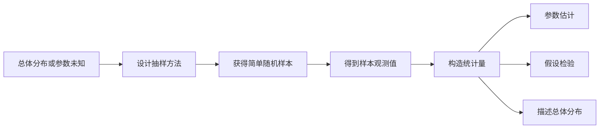
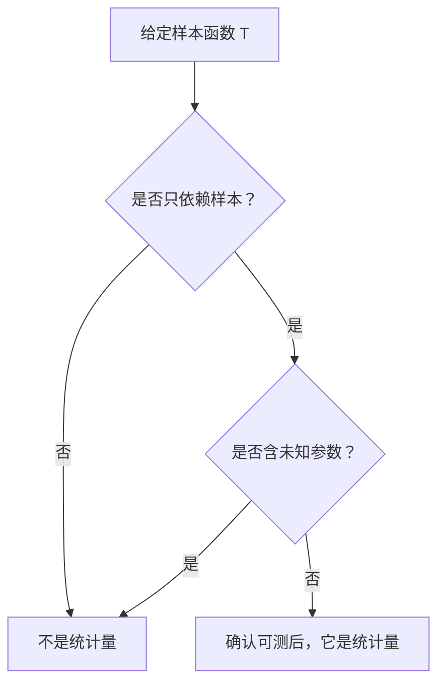

# 2026-09-03 第2节 总体、样本、统计量与经验分布

> [!abstract] 本节定位
> 本节正式进入数理统计：先回答“统计学为什么存在”，再建立总体、样本和统计量三个层次，最后用经验分布函数与样本矩说明如何把一组观测数据压缩成可用于推断的信息。

## 资料来源

- 原始逐字稿：[[课程/数理统计/课堂笔记/raw/2026-09-03-数理统计基础概念与样本分布教学-960832-逐字稿|第2节逐字稿]]
- 智能纪要：[[课程/数理统计/课堂笔记/raw/2026-09-03-数理统计基础概念与样本分布教学-960832-纪要|第2节智能纪要]]
- 对应课件：[[课程/数理统计/课件/C6_1/C6_1|C6.1 总体、样本与统计量]]、[[课程/数理统计/课件/C6_2(2)/C6_2(2)|C6.2 样本的数字特征及其分布]]
- 开始时间：2026-09-03 10:21

## 一、核心脉络

> [!info] 学习导读（补充解释）
> **本节问题**：怎样把有限观测变成可以描述总体的统计量？
> **先修提醒**：随机变量是函数、观测值是一次实现；回看[[课程/数理统计/课堂笔记/2026-09-01-第1节-概率论基础回顾与贝叶斯思想#四、随机变量为什么必须可测|随机变量与可测性]]。均值与方差分别描述位置和波动。
> **阅读路线**：总体与样本 → 独立同分布 → 统计量判定 → 经验分布 → 样本矩 → 均值的抽样分布。
> **来源边界**：逐字稿、纪要与 C6.1、C6.2 交叉核对；经验分布沿用课堂的 $<$ 约定。下列导读及新编自测属于补充解释。

> 一句话来说：数理统计是在总体规律未知时，用有限样本提供的证据对总体作出带有不确定性的推断。

## 二、为什么从概率论走向数理统计

课堂以产品次品率 $p$ 为例：若 $p$ 已知，就可以直接计算一箱产品中没有次品的概率、次品数的期望等；但现实中 $p$ 往往未知，概率论公式无法直接使用，于是需要先抽样，再由样本反推 $p$。

数理统计的主要任务可以概括为：

1. **数据收集与整理**：怎样抽样，怎样避免系统性偏差；
2. **参数估计**：利用样本估计未知参数，包括点估计和区间估计；
3. **假设检验**：判断有关总体参数或分布的假设是否与样本证据相容。

> [!example] 质检问题
> - “次品率 $p$ 是多少？”属于参数估计。
> - “若出厂标准为 $p<0.01$，这批产品能否出厂？”属于假设检验。

## 三、总体、个体与样本

### 1. 总体与个体

- **总体**：研究对象的全体；
- **个体**：组成总体的每一个单位；
- **数量指标**：真正被研究的数值属性，如身高、元件寿命、是否为次品。

统计分析通常不关心个体的全部属性，而只关心某个数量指标。因此课件把总体与该指标对应的随机变量 $\xi$ 视为同一研究对象，并把 $\xi$ 的分布称为总体分布。

> 一句话来说：统计学中的“总体”常常不是一堆对象本身，而是对象上某个数量指标所服从的分布。

### 2. 样本、样本值与样本空间

从总体 $\xi$ 中抽取容量为 $n$ 的样本，记作

$$
(\xi_1,\xi_2,\ldots,\xi_n).
$$

在观测之前，它是一个随机向量；进行一次实际观测后得到

$$
(x_1,x_2,\ldots,x_n),
$$

称为样本观测值或样本值。样本所有可能取值的集合称为样本空间。

| 层次 | 对象 | 性质 |
|---|---|---|
| 总体 | $\xi$ 及其分布 | 规律通常含未知部分 |
| 样本 | $(\xi_1,\ldots,\xi_n)$ | 随机向量 |
| 样本值 | $(x_1,\ldots,x_n)$ | 一组已经观测到的数 |

### 3. 简单随机样本

若 $\xi_1,\ldots,\xi_n$ 满足：

1. 每个 $\xi_i$ 与总体 $\xi$ **同分布**；
2. $\xi_1,\ldots,\xi_n$ **相互独立**；

则称其为来自总体 $\xi$ 的容量为 $n$ 的简单随机样本，简称样本。也就是常说的 i.i.d. 样本。

> 一句话来说：同分布保证“抽到的仍代表总体”，独立性保证“一次抽取不会改变另一次抽取的规律”。

若总体分布函数为 $F$，连续型总体密度为 $f$，则简单随机样本的联合分布具有乘积形式：

$$
F_{\xi_1,\ldots,\xi_n}(x_1,\ldots,x_n)
=\prod_{i=1}^{n}F(x_i),
$$

$$
f_{\xi_1,\ldots,\xi_n}(x_1,\ldots,x_n)
=\prod_{i=1}^{n}f(x_i).
$$

离散型总体也有

$$
P(\xi_1=x_1,\ldots,\xi_n=x_n)
=\prod_{i=1}^{n}P(\xi=x_i).
$$

> [!warning] 有放回与无放回
> 对有限总体，有放回抽样能严格保证各次抽取独立同分布；无放回抽样一般不独立。当总体容量 $N$ 远大于样本容量 $n$ 时，无放回抽样常近似视为简单随机抽样。

### 4. 样本量大不等于样本有代表性

课件回顾了 1936 年美国总统选举民调：《文学摘要》寄出约一千万份问卷，却主要从电话簿和俱乐部名册中抽取受访者，系统性遗漏了大量较贫困选民，最终作出错误预测。

> 一句话来说：抽样偏差不会因样本量巨大而自动消失；有偏的大样本仍然可能稳定地给出错误结论。

## 四、统计量与统计值

设 $T$ 是样本的函数：

$$
T=T(\xi_1,\ldots,\xi_n).
$$

若 $T$ 是随机变量，并且表达式中**不含未知参数**，则称 $T$ 为统计量。把样本值代入后得到的

$$
T(x_1,\ldots,x_n)
$$

称为统计值。

> 一句话来说：统计量是“用样本构造出来、可以实际计算”的随机变量；统计值是它在本次样本上的具体结果。

### 课堂例题：判断统计量

设总体 $\xi\sim B(1,p)$，其中 $p$ 未知，$(\xi_1,\ldots,\xi_5)$ 为简单随机样本。判断下列各式：

$$
\xi_1+\xi_2,\qquad
\max_{1\le i\le5}\xi_i,\qquad
\xi_5+2p,\qquad
(\xi_5-\xi_1)^2.
$$

四个式子中，只有

$$
\xi_5+2p
$$

不是统计量，因为它显式含有未知参数 $p$。其余三个都是统计量。

样本联合分布律为

$$
P(\xi_1=x_1,\ldots,\xi_5=x_5)
=p^{\sum_{i=1}^{5}x_i}(1-p)^{5-\sum_{i=1}^{5}x_i},
\qquad x_i\in\{0,1\}.
$$

### 顺序统计量与极差

将样本按从小到大排列：

$$
\xi_{(1)}\le\xi_{(2)}\le\cdots\le\xi_{(n)}.
$$

其中 $\xi_{(k)}$ 为第 $k$ 个顺序统计量，特别地，

$$
\xi_{(1)}=\min_i\xi_i,
\qquad
\xi_{(n)}=\max_i\xi_i.
$$

极差为

$$
R=\xi_{(n)}-\xi_{(1)},
$$

它反映样本覆盖范围的宽窄。

## 五、经验分布函数

### 1. 课堂与课件采用的记号

课件采用左连续的分布函数约定

$$
F(x)=P(\xi<x),
$$

因此经验分布函数写为

$$
F_n^*(x)=\frac1n\sum_{i=1}^{n}\mathbf 1_{\{\xi_i<x\}}.
$$

对已经排序的样本值 $x_{(1)}\le\cdots\le x_{(n)}$，

$$
F_n^*(x)=
\begin{cases}
0, & x\le x_{(1)},\\
\dfrac{k}{n}, & x_{(k)}<x\le x_{(k+1)},\quad k=1,\ldots,n-1,\\
1, & x>x_{(n)}.
\end{cases}
$$

> 一句话来说：$F_n^*(x)$ 就是样本中严格小于 $x$ 的观测值所占的比例。

![[课程/数理统计/课件/C6_2(2)/images/a3855c1b6a48a47c768dae7d54bc1660e6b1b1acf7fd3eeeae76a92467359ed2.jpg|720]]

*图：课件中的经验分布函数。互异观测值对应的跳跃为 $1/n$；若某值重复 $m$ 次，该处总跳跃为 $m/n$，形成阶梯形状。*

> [!warning] 两种分布函数约定要保持一致
> 现代教材更常用 $F(x)=P(\xi\le x)$，相应经验分布函数为 $F_n(x)=n^{-1}\sum_i\mathbf 1_{\{\xi_i\le x\}}$，它是右连续的。课堂课件使用 $P(\xi<x)$ 的左连续版本。连续型总体的两种总体分布函数相同，但给定数据的两种经验分布在观测点处仍会不同；离散型总体的两种总体分布函数也可能不同。计算时应保持约定一致。

### 2. 固定 $x$ 时的分布

固定 $x$ 后，每个指标变量

$$
I_i=\mathbf 1_{\{\xi_i<x\}}
$$

都服从参数为 $F(x)$ 的伯努利分布，且相互独立。因此

$$
nF_n^*(x)=\sum_{i=1}^{n}I_i\sim B(n,F(x)),
$$

从而

$$
P\left(F_n^*(x)=\frac{k}{n}\right)
=\binom nk[F(x)]^k[1-F(x)]^{n-k}.
$$

这也说明：$x$ 固定时，$F_n^*(x)$ 是一个统计量，而不是固定常数。

### 3. 格列汶科—坎泰利定理

令

$$
D_n=\sup_{x\in\mathbb R}|F_n^*(x)-F(x)|,
$$

则

$$
P\left(\lim_{n\to\infty}D_n=0\right)=1.
$$

也就是说，经验分布函数几乎必然地一致逼近总体分布函数。

> 一句话来说：样本量越来越大时，用样本比例画出的阶梯分布会在整个实数轴上越来越接近真实分布。

## 六、样本的数字特征

### 1. 样本矩

样本 $r$ 阶原点矩为

$$
A_r=\frac1n\sum_{i=1}^{n}\xi_i^r,
$$

样本 $r$ 阶中心矩为

$$
B_r=\frac1n\sum_{i=1}^{n}(\xi_i-\bar\xi)^r,
$$

其中样本均值

$$
\bar\xi=A_1=\frac1n\sum_{i=1}^{n}\xi_i.
$$

课件中的样本方差采用分母 $n$：

$$
S_n^2=\frac1n\sum_{i=1}^{n}(\xi_i-\bar\xi)^2
=B_2=A_2-A_1^2.
$$

> 一句话来说：样本矩把总体矩的定义搬到经验分布上，是用有限数据描述位置、离散程度和形状的基本工具。

### 2. 修正样本方差

后续进行参数估计与抽样分布推导时，常使用分母为 $n-1$ 的修正样本方差：

$$
S_*^2=\frac1{n-1}\sum_{i=1}^{n}(\xi_i-\bar\xi)^2
=\frac{n}{n-1}S_n^2.
$$

它是总体方差 $\sigma^2$ 的无偏估计量。不同教材可能直接把修正样本方差记作 $S^2$，做题时要先确认符号约定。

> [!warning] 样本矩与总体矩
> 样本矩是样本的函数，在抽样前是随机变量；总体矩如 $E(\xi)$、$D(\xi)$ 是由总体分布决定的数值，可能含有未知参数。不要把“未知”误解为“随机”。

## 七、样本均值的分布

### 1. 正态总体

若 $\xi_1,\ldots,\xi_n$ 独立同分布，且

$$
\xi_i\sim N(\mu,\sigma^2),
$$

则由正态分布的线性组合性质，

$$
\boxed{\bar\xi\sim N\left(\mu,\frac{\sigma^2}{n}\right)}.
$$

样本均值仍以 $\mu$ 为中心，但方差缩小为原来的 $1/n$。

### 2. 二项总体的渐近分布

若总体 $\xi\sim B(N,p)$，则

$$
E(\xi)=Np,
\qquad
D(\xi)=Np(1-p).
$$

由中心极限定理，

$$
\frac{\bar\xi-Np}{\sqrt{Np(1-p)/n}}
\xrightarrow{d}N(0,1),
$$

所以当 $n$ 足够大时，

$$
\bar\xi\approx N\left(Np,\frac{Np(1-p)}{n}\right).
$$

> [!warning] 正态分布第二个参数
> 本笔记统一采用 $N(\mu,\sigma^2)$ 表示“均值、方差”。课件末页把标准差写在第二个位置，容易与常用记号混淆；使用公式时应先确认第二个参数代表方差还是标准差。

## 八、判定与解题流程

遇到抽样问题时还应依次检查：

1. 总体与研究指标是什么；
2. 样本是否同分布；
3. 样本之间是否独立；
4. 所构造的量是统计量还是统计值；
5. 需要描述的是总体规律、样本规律，还是统计量的分布。

## 九、核心公式速查

| 内容 | 公式 |
|---|---|
| 简单随机样本 | $\xi_1,\ldots,\xi_n$ 相互独立且均与总体同分布 |
| 连续样本联合密度 | $\prod_{i=1}^{n}f(x_i)$ |
| 极差 | $R=\xi_{(n)}-\xi_{(1)}$ |
| 经验分布函数（课堂约定） | $F_n^*(x)=n^{-1}\sum_i\mathbf1_{\{\xi_i<x\}}$ |
| 固定点分布 | $nF_n^*(x)\sim B(n,F(x))$ |
| 样本均值 | $\bar\xi=n^{-1}\sum_i\xi_i$ |
| 样本方差（分母 $n$） | $S_n^2=A_2-A_1^2$ |
| 修正样本方差 | $S_*^2=(n-1)^{-1}\sum_i(\xi_i-\bar\xi)^2$ |
| 正态总体的样本均值 | $\bar\xi\sim N(\mu,\sigma^2/n)$ |

## 十、易错点与课后练习

> [!warning] 易错点
> 1. “样本”是随机变量组，“样本值”才是具体数据。
> 2. 独立和同分布是两个条件，缺一不可。
> 3. 统计量不能含未知参数，但它的分布可以依赖未知参数。
> 4. 大样本不能修复选择偏差。
> 5. 经验分布函数使用 $<$ 还是 $\le$，必须与所采用的分布函数约定一致。
> 6. 分母为 $n$ 与 $n-1$ 的两个样本方差要区分。

1. 重新完成课件中的 $B(1,p)$ 样本统计量判定与联合分布推导。
2. 给定一组样本值，手工画出课堂约定下的左连续经验分布函数，并改写为常用右连续版本。
3. 解释为什么格列汶科—坎泰利定理为“用经验分布近似总体分布”提供了理论依据。

## 自测（新编）

### 1. 同一数据的两种经验分布

观测值为 $1,2,2,5$。求课堂约定 $F_n^*(2)=n^{-1}\sum_i\mathbf1_{\{x_i<2\}}$，以及常见右连续约定 $F_n(2)=n^{-1}\sum_i\mathbf1_{\{x_i\le2\}}$。再求 $\bar x$、$S_n^2$ 和 $S_*^2$。

> [!hint]- 提示
> 分清严格小于与小于等于；用平方和恒等式算离差平方和。

> [!solution]- 解析
> $F_n^*(2)=1/4$，$F_n(2)=3/4$。$\bar x=10/4=2.5$；$\sum_i(x_i-\bar x)^2=(1+4+4+25)-4(2.5)^2=9$，所以 $S_n^2=9/4$，$S_*^2=9/3=3$。两种经验分布在观测点处可能不同。

### 2. 统计量能否包含未知量

总体为 $N(\mu,\sigma^2)$，两参数均未知。$\bar X$、$\bar X-\mu$、$\sum_i(X_i-\bar X)^2$ 哪些是统计量？为什么后两类表达式仍可能一起出现在抽样分布定理中？

> [!hint]- 提示
> 统计量必须能仅由数据计算；含参数的枢轴量则是另一类对象。

> [!solution]- 解析
> 第一、第三个是统计量；第二个含未知 $\mu$，不是统计量。抽样分布定理可以研究“统计量与参数组成的量”的分布，例如 $(\bar X-\mu)/(\sigma/\sqrt n)$，这不改变统计量的定义。

## 课堂导航

- 上一节：[[课程/数理统计/课堂笔记/2026-09-01-第1节-概率论基础回顾与贝叶斯思想|第1节 概率论基础回顾与贝叶斯思想]]
- 下一节：[[课程/数理统计/课堂笔记/2026-09-08-第3节-四大抽样分布与分位数|第3节 四大抽样分布与分位数]]
- 对应课件：[[课程/数理统计/课件/C6_1/C6_1|C6.1]]、[[课程/数理统计/课件/C6_2(2)/C6_2(2)|C6.2]]
