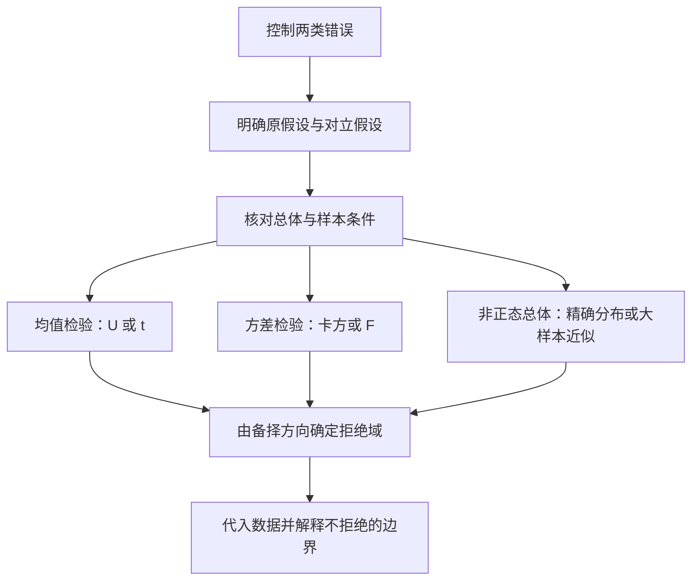
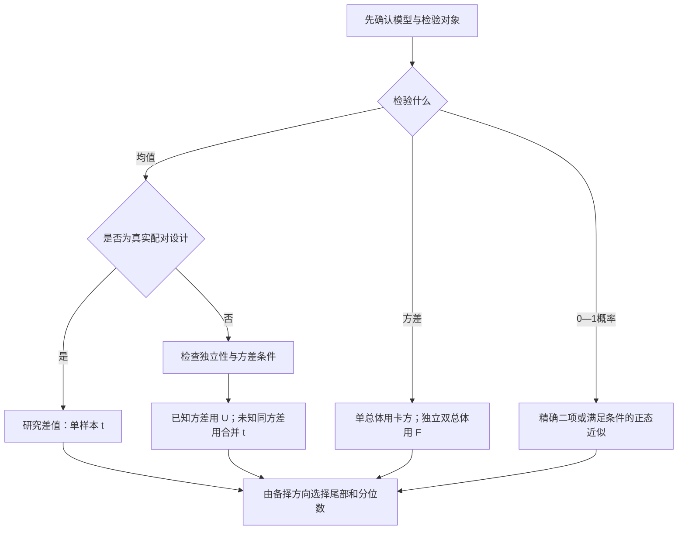

# 2026-10-20 第13节 正态总体参数检验与大样本近似

## 课程信息、来源与核对边界

- 课表时间：2026-10-20，第8周星期二第7—8节，16:20—17:55；录音自16:27:14开始。
- [[课程/数理统计/课堂笔记/raw/2026-10-20-参数假设检验方法授课-787904-逐字稿|逐字稿]]与[[课程/数理统计/课堂笔记/raw/2026-10-20-参数假设检验方法授课-787904-纪要|纪要]]均保留原样；下文时间戳为录音相对时间。
- 对照[[课程/数理统计/课本/概率论与数理统计/概率论与数理统计|教材]]第八章 §8.2（参数检验）、§8.4（两类错误），以及 §8.3 的拟合检验思想。现有本地课件主要为第六、七章，未找到录音中展示的本课PPT，因此不虚构其表格与页码。
- 课次：承接[[课程/数理统计/课堂笔记/2026-10-15-第12节-假设检验的基本思想与检验步骤|10月15日第12节]]，本次为第13节，纠正自动生成的第14节；沿用前次核对的国庆假期扣除口径。10月16日停课不影响本课程周二、四排课。
- 新增推理、条件辨析和自测已标明；“已完成”指可确认授课范围已整理，未能辨认的原题数据仍待补，不能据此称例题数值已全部复核。

## 一、本次课核心脉络

本课核心问题：在指定错误风险下，如何根据参数类型、方差是否已知、样本是否独立或配对，选择一个在原假设下分布明确的统计量？

**先修提醒**：上侧分位数满足 $P(Z>u_\gamma)=\gamma$；修正样本方差分母为 $n-1$。不熟悉时回看[[课程/数理统计/知识点解析梳理/06-抽样分布-知识梳理|抽样分布与自由度]]和[[课程/数理统计/课堂笔记/2026-10-15-第12节-假设检验的基本思想与检验步骤|上一课的检验步骤]]。

阅读路线：先理解错误概率，再比较均值和方差的统计量，最后用元件更新率例检查近似分布与显著性水平。

## 二、两类错误如何权衡（核心）

来源：00:00—14:24。第一类错误是 $H_0$ 为真却拒绝；第二类错误是某个备择参数为真却不拒绝。第二类错误概率通常随真实参数变化，写作 $\beta(\theta)$；功效为 $1-\beta(\theta)$。

课堂沿用正态均值的右尾检验。设 $X_i$ 独立同分布于 $N(\mu,\sigma^2)$，$\sigma$ 已知，比较 $H_0:\mu=\mu_0$ 与固定备择 $\mu_1>\mu_0$。拒绝域为

$$
U=\frac{\bar X-\mu_0}{\sigma/\sqrt n}>u_\alpha.
$$

在 $\mu=\mu_1$ 下，不能再称 $U$ 为标准正态；必须按真实均值标准化。**依课堂思路整理推导**：

$$
\begin{aligned}
\beta(\mu_1)
&=P_{\mu_1}\!\left(\bar X\le\mu_0+
u_\alpha\frac{\sigma}{\sqrt n}\right)\\
&=\Phi\!\left(u_\alpha-\frac{(\mu_1-\mu_0)\sqrt n}{\sigma}\right).
\end{aligned}
$$

这里 $\Phi$ 为标准正态分布函数。由公式可见，在此固定模型、固定备择和同一阈值检验族中：

- 降低 $\alpha$ 会增大 $u_\alpha$，因此增大 $\beta$；
- 固定 $\alpha$，增加 $n$ 会增大均值偏移相对标准误的幅度，因此降低 $\beta$；
- 课堂采用先控制第一类错误，再争取降低第二类错误的原则；本课没有展开最佳检验定理的完整证明。

> 一句话来说：更严格地拒绝原假设，会更容易漏掉真实差异；更多数据可以帮助分清差异与随机波动。

**补充解释**：“两类错误冲突”不能记成随机变量之间的“负相关系数”，也不能脱离检验族断言所有检验之间绝无同时改进的可能。上面的单调关系有明确模型与阈值前提。

课堂以不同药物风险、无罪者被误判等情境讨论后果轻重。必须先写清 $H_0$ 和实际决策，再判定哪类错误更严重；第一类错误并非在所有情境中都具有更严重的实际后果。这些是统计风险类比，不是药物安全建议。

### 自测（新编）：由公式判断改进方向

已知 $\sigma=2$、$\mu_1-\mu_0=1$，固定 $\alpha$ 且 $u_\alpha=1.645$。分别写出 $n=4$ 与 $n=16$ 的第二类错误概率，不必查表；哪一个功效更高？

> [!hint]- 提示
> 先计算 $(\mu_1-\mu_0)\sqrt n/\sigma$，再利用 $\Phi$ 单调递增。

> [!solution]- 解析
> $n=4$ 时 $\beta=\Phi(0.645)$；$n=16$ 时 $\beta=\Phi(-0.355)$。后者更小，故功效更高。比较的是同一真实备择、同一水平下的检验，不是改变真实差异来“提高效果”。

## 三、参数假设的写法与统一记号

来源：14:27—16:54。参数空间为 $\Omega$，不是样本空间；$H_0:\theta\in\Omega_0$，$H_1:\theta\in\Omega\setminus\Omega_0$。只含一个参数点的假设为简单假设，含多个点的为复合假设；两者都简单时需将参数空间明确限定为两个点。

本笔记统一采用

$$
S^{*2}=\frac1{n-1}\sum_{i=1}^n(X_i-\bar X)^2,\qquad
S^2=\frac1n\sum_{i=1}^n(X_i-\bar X)^2,
\qquad
nS^2=(n-1)S^{*2}.
$$

星号表示**修正**样本方差。教材与课件记号可能不同，先看定义，不能只看字母。以下所有统计量的分布均在 $H_0$ 成立和列明模型条件下讨论；正态总体方差假定严格为正，涉及修正样本方差的各组样本量至少为2。

## 四、均值检验：U 与 t（核心）

来源：16:54—37:58；教材 §8.2 的正态均值检验。所有精确结论均要求相应正态模型；独立双样本还要求两组样本相互独立。

### 1. 方差已知：用 U 检验

单总体检验 $H_0:\mu=\mu_0$：

$$
U=\frac{\bar X-\mu_0}{\sigma_0/\sqrt n}\sim N(0,1).
$$

两个独立正态总体检验 $H_0:\mu_1-\mu_2=\Delta_0$，已知方差时：

$$
U=\frac{(\bar X-\bar Y)-\Delta_0}
{\sqrt{\sigma_1^2/n_1+\sigma_2^2/n_2}}\sim N(0,1).
$$

课堂主要取 $\Delta_0=0$，即比较两个总体均值是否相等，并用地区平均身高差作背景。两个独立均值差的方差相加，不能把标准差直接相加。

### 2. 单总体方差未知：用 t 检验

在正态总体、$n\ge2$、方差未知时，

$$
T=\frac{\bar X-\mu_0}{S^*/\sqrt n}\sim t(n-1).
$$

**推理提醒（补充解释）**：用估计量替代标准差后不再是精确标准正态；样本均值和离差平方和的正态抽样独立性给出 $t$ 分布。

> 一句话来说：均值差除以它的标准误；标准误中的方差是已知还是估计出来，决定用 U 还是 t。

双侧检验均将两端各分配 $\alpha/2$：分别比较 $\lvert U\rvert>u_{\alpha/2}$，或 $\lvert T\rvert>t_{\alpha/2}(n-1)$。

### 3. 两独立总体方差未知但相等：合并 t

设 $\sigma_1^2=\sigma_2^2$，合并修正方差为

$$
S_w^2=
\frac{(n_1-1)S_1^{*2}+(n_2-1)S_2^{*2}}{n_1+n_2-2}.
$$

于是

$$
T=\frac{(\bar X-\bar Y)-\Delta_0}
{S_w\sqrt{1/n_1+1/n_2}}
\sim t(n_1+n_2-2).
$$

当 $n_1=n_2=n$，只是在相同模型下简化为

$$
T=\frac{(\bar X-\bar Y)-\Delta_0}
{\sqrt{(S_1^{*2}+S_2^{*2})/n}}
=\frac{\sqrt{n-1}\,[(\bar X-\bar Y)-\Delta_0]}
{\sqrt{S_1^2+S_2^2}}.
$$

样本量相同不会自动把独立双样本变成配对样本，方差相等条件也没有因代数化简而消失。

### 4. 课堂例题及可复核范围

| 课堂例题 | 可确认建模与步骤 | 数值边界 |
|:--|:--|:--|
| 测温枪测量铁水6次，基准1310度 | 假定测量结果为正态；$H_0:\mu=1310$，未知方差，用 $t(5)$ | 录音读到 $\bar x=1314$；统计量有“20783”及“2.783”等冲突，6个原数据未上传，不能独立复算 |
| 男性156例、女性74例红细胞数 | 独立正态、假定同方差；均值差双侧检验，合并自由度为 $156+74-2=228$ | 课堂报统计量约5.688并拒绝均值相等；样本均值、标准差原表未上传，结果仅作课堂记录 |

测温枪例课堂比较了 $t_{0.025}(5)\approx2.5706$ 与 $t_{0.005}(5)\approx4.032$，意在说明预设水平不同可能导致判断不同。若统计量确为2.783，则5%拒绝、1%不拒绝；**这是条件判断，不是已核验该题统计量**。更早的数字冲突须待PPT或完整6次测量值确认。

> [!warning] 不要扩大结论
> 不拒绝“无系统误差”不等于证明仪器绝对准确。红细胞均值的组间统计差异也不等于已经证明某个因果机制。样本量大时以正态分位数近似 t 临界值是近似步骤，不能把所有有限自由度 t 分布直接写成标准正态。

## 五、配对 t 检验：先研究每一对的差（核心）

来源：43:09—55:44；用教材“配对数据的 t 检验”核对条件。

课堂用10块实验田、每块田甲乙稻种各占一半的产量比较，引入 $D_i=X_i-Y_i$。一对中可以相关，不要求 $\sigma_X^2=\sigma_Y^2$；精确配对 t 要求各对独立同分布、差值为正态（二维正态模型足以保证差值正态），且差值方差非零。

$$
T_D=\frac{\bar D-\Delta_0}{S_D^*/\sqrt n}\sim t(n-1),
\qquad
S_D^{*2}=\frac1{n-1}\sum_i(D_i-\bar D)^2.
$$

从比较 $\mu_X-\mu_Y$ 转成检验差值均值，不是直接把两个独立样本标准差相减。

**补充解释：为何仅有各组均值、方差不够？**

$$
S_D^{*2}=S_X^{*2}+S_Y^{*2}-2S_{XY},
\quad
S_{XY}=\frac1{n-1}\sum_i(X_i-\bar X)(Y_i-\bar Y).
$$

缺少配对信息或协方差，就通常不能从两组边际汇总量还原差值方差。

课堂稻种例先按独立且同方差的模型演示 $t(18)$（报约4.9455），再按逐田差值演示 $t(9)$（报约6.28，5%临界值约2.262），两者课堂判断均为拒绝均值相等。两模型**前提不同**：真实同田配对设计应尊重配对相关性，不能据此说两种方法无条件互换。原产量表未上传，两个数值未独立复算。

> 一句话来说：配对比较消化的是“一对之内的共同背景”，剩下每对差值作为一个新样本。

**课堂讨论与补充边界**：录音讨论把3000与2000条记录截成等长后再作差。相同长度只是能逐项相减的条件，不自动证明具有研究设计中的配对关系；若将独立数据人为组成对，仍须检查差值的独立同分布和正态等条件，且可能损失数据。不能把“随意删掉多余数据”记为通用最优方案。

### 自测（新编）：完成一次差值检验

五对观测的差值为 $1,2,3,2,2$。检验 $H_0:\mu_D=0$，假定独立正态差值，给定 $t_{0.025}(4)=2.776$，计算统计量并判断。

> [!hint]- 提示
> 先算差值均值及以 $n-1$ 为分母的差值方差；此处自由度是4，不是8。

> [!solution]- 解析
> $\bar d=2$，离差平方和为2，故 $S_D^{*2}=2/4=0.5$。$t=2/(\sqrt{0.5}/\sqrt5)=2\sqrt{10}\approx6.325$，超过2.776，拒绝 $H_0$。结论有赖于差值模型条件，不表示可以无条件套在任意五对数上。

## 六、方差检验：卡方与 F（核心）

来源：56:08—01:07:42；教材 §8.2 的方差检验。以下使用**上侧分位数**：$P(V>q_\gamma)=\gamma$，所以 $\gamma$ 小的分位点在右边。

### 1. 一个正态总体：先看均值是否已知

检验 $H_0:\sigma^2=\sigma_0^2$：

- 真均值 $\mu$ 已知：

$$
Q=\frac{\sum_i(X_i-\mu)^2}{\sigma_0^2}\sim\chi^2(n).
$$

- 均值未知，以 $\bar X$ 代入：

$$
Q=\frac{(n-1)S^{*2}}{\sigma_0^2}
=\frac{nS^2}{\sigma_0^2}\sim\chi^2(n-1).
$$

估计均值用掉一个自由度；不能把均值未知时的平方和配给 $n$ 个自由度。双侧拒绝域为

$$
Q<\chi^2_{1-\alpha/2}(\nu)
\quad\text{或}\quad
Q>\chi^2_{\alpha/2}(\nu).
$$

卡方分布不对称，不能像标准正态那样用“绝对值超过一个临界点”代替两端判断。

课堂车床例：31件零件、7种长度与频数，原标准差为0.424，均值未知。应使用样本量31而不是7，自由度30，分母为 $0.424^2$。按频数表可算

$$
\bar x=\frac{\sum_{j=1}^7m_jx_j}{31},\qquad
(n-1)S^{*2}=\sum_{j=1}^7m_jx_j^2-31\bar x^2.
$$

课堂报 $Q\approx44.51$，比较的接受区间约为16.8至47，作不拒绝原加工精度的判断；完整频数表缺失，暂不独立复算。不能把“不拒绝”写成已证实精度完全不变。

### 2. 两个独立正态总体：方差比

若两个均值未知，检验 $H_0:\sigma_1^2=\sigma_2^2$：

$$
F=\frac{S_1^{*2}}{S_2^{*2}}\sim F(n_1-1,n_2-1).
$$

若真实均值都已知，记 $A_j=n_j^{-1}\sum_i(X_{j,i}-\mu_j)^2$，则 $F=A_1/A_2\sim F(n_1,n_2)$。两种情况不能混用自由度。

双侧拒绝域为

$$
F<F_{1-\alpha/2}(\nu_1,\nu_2)
\quad\text{或}\quad
F>F_{\alpha/2}(\nu_1,\nu_2).
$$

课堂红细胞方差例读到 $F\approx1.232$，比较后不拒绝方差相等；教师现场纠正了课件左右分位点写反的问题。本笔记已按上侧分位数统一方向，未编造缺失的完整临界值。

> 一句话来说：一个方差用平方和，两个方差用“各自按自由度标准化后的平方和之比”。

### 3. “先 F 再合并 t”的课堂路线及边界

对新工艺前后各10个灯泡的例题，教师先检验方差相等（$F(9,9)$），若不拒绝，再沿课堂同方差模型检验均值（合并 $t(18)$）。原均值和标准差数据未上传，此处只保留流程。

**补充解释**：F检验不拒绝不等于证明方差相等；这一两阶段路线不能直接当成“任何未知方差问题都必须先F”的普遍定理。这里只说明课堂已教方法的适用路径，未把其他未讲方法冒充课堂内容。

### 自测（新编）：自由度与尾部方向

正态样本 $n=10$，真实均值未知，$S^{*2}=4$，检验 $H_0:\sigma^2=2$。计算统计量并写出双侧拒绝域的两个端点记号。若真均值已知，是否只把自由度从9改成10就够了？

> [!hint]- 提示
> 注意给定的是原假设方差2，而不是标准差2；均值已知时平方和的中心也要变化。

> [!solution]- 解析
> $Q=9\times4/2=18$，分布为 $\chi^2(9)$，拒绝域为 $Q<\chi^2_{1-\alpha/2}(9)$ 或 $Q>\chi^2_{\alpha/2}(9)$。
> 均值已知时须改用 $\sum_i(X_i-\mu)^2/2$，自由度10；若只保留 $S^{*2}$，还缺 $\bar X-\mu$，不能只改自由度而不改统计量。

## 七、单侧检验为什么用边界确定临界值

来源：01:08:03—01:10:19；教材 §8.2 的单侧讨论。

对 $H_0:\mu\le\mu_0$、$H_1:\mu>\mu_0$，课堂说“按 $\mu=\mu_0$ 处理”。这不是两组假设逻辑上相等，而是在此单调模型中，用边界原假设校准同一右尾拒绝域。

**补充解释：已知方差的证明**。令

$$
Z=\frac{\bar X-\mu}{\sigma/\sqrt n}\sim N(0,1),\qquad
U=Z+\frac{\mu-\mu_0}{\sigma/\sqrt n}.
$$

当 $\mu\le\mu_0$，有 $U\le Z$，所以

$$
\sup_{\mu\le\mu_0}P_\mu(U>u_\alpha)
=P_{\mu_0}(U>u_\alpha)=\alpha.
$$

最大拒真概率在边界取得，故可在边界定阈值。

| 对立假设方向 | 拒绝域 |
|:--|:--|
| $\mu>\mu_0$ | $U>u_\alpha$ 或 $T>t_\alpha(\nu)$ |
| $\mu<\mu_0$ | $U<-u_\alpha$ 或 $T<-t_\alpha(\nu)$ |
| $\mu\ne\mu_0$ | 两侧各分配 $\alpha/2$ |

> 一句话来说：对立假设指出异常应出现在哪边，边界分布负责控制整个复合原假设下的拒真概率。

## 八、非正态总体：1024个元件的更新率

来源：01:10:29—01:17:25。令 $X_i$ 为第 $i$ 个元件是否更换的0—1指标，假定相互独立且更换概率相同为 $p$，则 $K=\sum_iX_i\sim\operatorname{Bin}(n,p)$。

检验 $H_0:p=0.03$ 对 $H_1:p\ne0.03$。由二项分布的正态近似，

$$
U=\frac{K-np_0}{\sqrt{np_0(1-p_0)}}\approx N(0,1).
$$

这里是 $H_0$ 下的近似分布，并非单个0—1变量变成正态。取 $n=1024,K=18$，**依据题中数值复算**：

$$
np_0=30.72,\quad
np_0(1-p_0)=29.7984,\quad
u=\frac{18-30.72}{\sqrt{29.7984}}\approx-2.3302.
$$

课堂最终比较 $\lvert u\rvert\approx2.33$ 与临界值约2.575，作“不拒绝更新率为0.03”的判断。2.575对应约1%的**双侧**水平；较早的水平转写存在混杂，待本课PPT确认，不能只照抄纪要而省略水平。

> [!warning] 同一数据的结论取决于事先指定的水平
> 若预设 $\alpha=0.01$，$\lvert u\rvert<2.576$，不拒绝；若预设 $\alpha=0.05$，$\lvert u\rvert>1.96$，拒绝。不能事后换水平来选择喜欢的结论。
> 近似依赖独立同分布及足够的期望成功、失败次数；存在共同失效因素时，独立性需要另行检查。本文复现课堂的未作连续性校正版本。

### 自测（新编）：写出正确的拒绝域

沿用元件例的 $u\approx-2.3302$，分别写出事先指定双侧水平1%与5%时的判断。“不拒绝0.03”是否排除0.029？

> [!hint]- 提示
> 与同一水平对应的临界值比较；检验未拒绝某一点，不意味着唯一确定该点。

> [!solution]- 解析
> 1%时不拒绝，5%时拒绝；“不拒绝0.03”不排除对某些其他参数值也不拒绝。假设检验不是从所有可能参数中证明唯一的真值。

## 九、拟合与独立性检验：本课只是引入

来源：01:17:43—01:28:07。课堂先提出“分布类型本身未知怎么办”，建议用极差、组距分组并画频率直方图，从形状提出候选分布，再研究理论与观察的差异。

**补充解释（由教材校正量纲）**：观察频数 $O_j$ 应与理论频数 $E_j=np_j$ 比较，而不是把“个数”直接减“概率”。Pearson统计量的基本形式为

$$
Q_{\rm P}=\sum_j\frac{(O_j-E_j)^2}{E_j}.
$$

课堂仅讲差异汇总的思想，未完整给出分组条件、估计参数后的自由度修正和证明。本笔记不把上述补充公式及后续细节写成已讲完；完整内容回看教材 §8.3。直方图相似不是分布得到证明，独立性检验也不等于因果证明。

教师预告分布拟合检验和独立性检验均在考试大纲范围内，后续继续讲；没有据此扩大为已公布的期中考试完整范围。

## 十、判定流程与公式速查

此图只覆盖本课已介绍的路线；不满足条件时应停下来查证，不能强行套某一格。

| 内容 | 核心式 | 关键条件 |
|:--|:--|:--|
| 单样本均值未知方差 | $(\bar X-\mu_0)/(S^*/\sqrt n)$ | 正态，$t(n-1)$ |
| 配对均值差 | $(\bar D-\Delta_0)/(S_D^*/\sqrt n)$ | 独立正态差值，$t(n-1)$ |
| 单总体方差，均值未知 | $(n-1)S^{*2}/\sigma_0^2$ | 正态，$\chi^2(n-1)$ |
| 双总体方差相等 | $S_1^{*2}/S_2^{*2}$ | 独立正态，$F(n_1-1,n_2-1)$ |
| 0—1概率近似 | $(K-np_0)/\sqrt{np_0(1-p_0)}$ | 独立同分布，大样本 |

## 十一、课堂疑惑与解答、缺课回填与待查

本次未找到“每日疑惑/2026-10-20.md”，没有可提取、判重或回写的当日用户疑惑；未代建日计划。

- 已检查[[课程/数理统计/课堂笔记/2026-09-10-第4节-缺少逐字稿|第4节缺失记录]]：已有依据课件补入的单正态抽样分布，但原课边界、例题、作业仍不明确。本课复用这些结论不能证明它们全部在9月10日讲完，故不重复回填或擅改状态。
- 待上传：本课假设检验PPT、测温枪6次测量值、红细胞汇总表、稻种10对产量表、车床频数表与灯泡练习数据。
- 待核对：测温枪统计量转写冲突、元件例原题显著性水平。已保留可靠公式和条件判断，未以猜测数字填满解答。
- 本节自测未收到实际作答，不标记“已掌握”。

## 十二、相关链接与课堂要求

- [[课程/数理统计/课本/概率论与数理统计/概率论与数理统计|教材第八章]]：核对统计量条件、上侧分位数及配对模型，不把源MD中的损坏上下标直接搬进笔记。
- [[课程/数理统计/课堂笔记/2026-10-15-第12节-假设检验的基本思想与检验步骤|上一课]]：补足原假设、小概率原理和检验步骤。
- [[课程/数理统计/课堂笔记/README|课堂索引]]：查看课次、缺失与整理状态。

**教师明确提醒**：本周四即2026-10-22有期中考试，带计算器，尽量提前到场；这是课程当堂通知，不额外创建提醒或修改考试日程。非正态总体精确分布例请自行看课件，分布拟合与独立性检验后续讲。本课灯泡问题及教材相关题可用于练习，但原PPT缺失，未伪造完整作业题面或另行新增作业要求。
