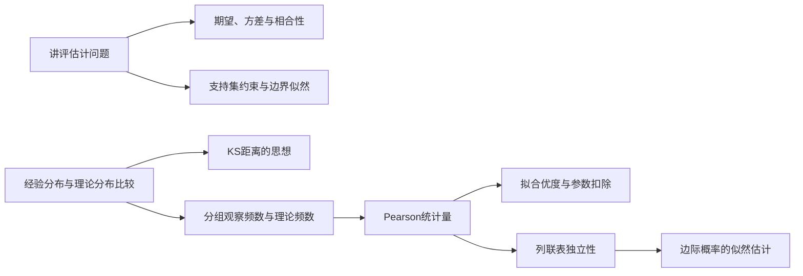
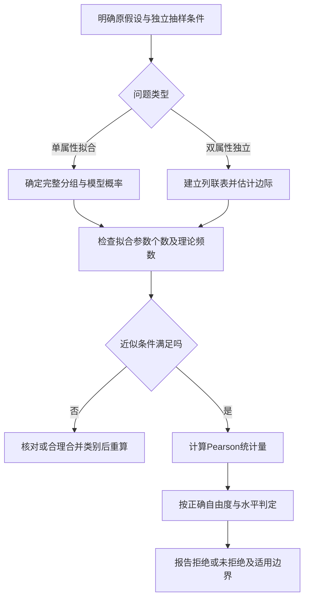

# 2026-10-27 第15节 试卷讲评、拟合优度与列联表检验

> [!info] 范围、课次与来源分工
> 课堂前约22分钟讲评估计与区间估计题，随后进入非参数检验：Pearson拟合优度、分组与自由度、列联表独立性及其似然函数。录制标题含“期末复习”，但不能据此把本次说成期末考试。按[[课表]]及[[课程/数理统计/课堂笔记/README|课堂索引]]承接10月22日第14节，本次为第15节，已纠正自动编号“第16节”。
> 复习部分结合现有C7.1、C7.2、C7.4课件；未发现本次非参数检验的独立配套课件，使用教材§8.3核对。泊松暴雨例的原始数据与部分作业定位未能完整核实，单列待核；“已完成”表示确认范围的整理完成。

## 一、本课主线与必要先修

核心问题：看到样本与理论模型不完全一致时，怎样区分抽样波动和足以拒绝模型的差异？

先修提醒：

- [[概念/独立性]]：样本独立同分布，并不使同一样本产生的分组频数相互独立。
- [[课程/数理统计/课件/C7_2/C7_2|估计量准则课件]]：无偏看期望，相合看大样本下误差概率；无偏本身不保证误差趋零。
- [[课程/数理统计/课件/C7_4(1)/C7_4(1)|区间估计课件]]：先确认方差是否已知及样本方差的分母，再选择枢轴量。
- 检验中的 $H_0,\alpha$ 与拒绝域须预先明确；“未拒绝”不等于证明原假设为真。

## 二、试卷讲评：从事件、权重与支持集出发

### 1. 最大值与最小值的联合分布

设 $X_1,\ldots,X_n$ 独立同分布，分布函数为 $F$，$U=\min_iX_i$，$V=\max_iX_i$。求 $G(x,y)=P(U\le x,V\le y)$：

- 若 $x<y$，从“全体不超过 $y$”中去掉“全体落在 $(x,y]$”：
$$
G(x,y)=F(y)^n-[F(y)-F(x)]^n.
$$
- 若 $x\ge y$，$V\le y$ 已经蕴含 $U\le x$，所以 $G(x,y)=F(y)^n$。

> 一句话来说：先把联合事件画清楚，再用独立样本乘积；不能把最小值和最大值直接当成独立变量。

边缘分布为 $P(U\le x)=1-[1-F(x)]^n$、$P(V\le y)=F(y)^n$。对同一非退化总体的有限独立样本，二者一般不独立。**补充辨析：** 仅有 $U\le V$ 这一形式关系并不是所有随机变量不独立的通用证明；这里依赖它们来自同一组样本。

### 2. 加权平均的无偏性与相合性

课堂讲评
$$
Y_n=\frac{2}{n(n+1)}\sum_{i=1}^niX_i,
\qquad E(X_i)=\mu,\quad \operatorname{Var}(X_i)=\sigma^2<\infty.
$$
权重和为1，故 $E(Y_n)=\mu$。独立性使协方差项消失：
$$
\begin{aligned}
\operatorname{Var}(Y_n)
&=\frac{4\sigma^2}{n^2(n+1)^2}\sum_{i=1}^ni^2\\
&=\frac{2\sigma^2(2n+1)}{3n(n+1)}\longrightarrow0.
\end{aligned}
$$
课堂也可用 $\sum i^2\le n^3$ 估计，不必为了证明趋零坚持求精确和。由Chebyshev不等式，
$$
P(|Y_n-\mu|\ge\varepsilon)
\le\frac{\operatorname{Var}(Y_n)}{\varepsilon^2}\to0,
$$
所以 $Y_n\xrightarrow{P}\mu$。

> 一句话来说：权重和保证中心正确，权重平方和趋零保证波动缩小。

此例与库内旧测试卷第二题一致，可用于核对公式；旧卷日期是2026年5月14日，**不能把整份旧卷认定为10月22日实际试卷**。

### 3. 平移指数模型：边界比求导更重要

课堂约00:08—00:14讨论已知尺度 $\sigma>0$、未知位置 $\theta$ 的模型
$$
f(x;\theta)=\frac1\sigma e^{-(x-\theta)/\sigma}\mathbf1_{\{x\ge\theta\}}.
$$
由 $EX=\theta+\sigma$，矩估计为 $\hat\theta_{\mathrm M}=\bar X-\sigma$，且无偏。似然为
$$
L(\theta)=\sigma^{-n}
\exp\left(-\frac{\sum_i x_i}{\sigma}+\frac{n\theta}{\sigma}\right)
\mathbf1_{\{\theta\le x_{(1)}\}}.
$$
在可行区间上随 $\theta$ 增大，故 $\hat\theta_{\mathrm{MLE}}=X_{(1)}$；不能只对指数项求导后说“没有解”。

**补充解释：** $X_{(1)}-\theta$ 为尺度 $\sigma/n$ 的指数变量，所以
$$
E(X_{(1)})=\theta+\frac\sigma n;
$$
它有偏，而 $X_{(1)}-\sigma/n$ 无偏。最小值的分布来自
$$
P(X_{(1)}-\theta>z)=\prod_{i=1}^nP(X_i-\theta>z)=e^{-nz/\sigma},\quad z\ge0.
$$

> [!warning] 密度边界约定
> 原转写写成 $x>\theta$。若逐字按该密度版本令边界取0，似然在 $\theta<x_{(1)}$ 上只有上确界，没有取到的最大值；课堂常用的“最小值为MLE”对应包含边界的版本。两版本给出相同概率分布，但点值似然的边界要说明。这里明确采用 $x\ge\theta$，不是把严格不等号静默替换。
> 现有旧测试卷第三题为另一种有界密度，不能用它替代本课这个平移指数题。

### 4. 正态样本：MLE方差与无偏方差必须分开

课堂回顾正态样本均值、方差的估计及均值区间。设 $X_i\overset{\mathrm{iid}}{\sim}N(\mu,\sigma^2)$、$n\ge2$，统一记
$$
V_n=\frac1n\sum_i(X_i-\bar X)^2,\qquad
S^2=\frac1{n-1}\sum_i(X_i-\bar X)^2.
$$
则 $\hat\mu_{\mathrm{MLE}}=\bar X$、$\hat\sigma^2_{\mathrm{MLE}}=V_n$（非退化观测），而 $E(V_n)=(n-1)\sigma^2/n$、$E(S^2)=\sigma^2$。

若 $\sigma$ 未知，$(\bar X-\mu)/(S/\sqrt n)\sim t_{n-1}$；若 $\sigma$ 已知则标准化后服从标准正态。设 $t_{1-\alpha/2,n-1}$、$z_{1-\alpha/2}$ 为**下侧累计概率**分位数：
$$
\mu\in\left[\bar X-t_{1-\alpha/2,n-1}\frac S{\sqrt n},
\bar X+t_{1-\alpha/2,n-1}\frac S{\sqrt n}\right]
$$
给出未知方差时置信水平 $1-\alpha$ 的区间；已知方差改为 $\bar X\pm z_{1-\alpha/2}\sigma/\sqrt n$。

**课件核对：** C7.4用分母为 $n$ 的样本方差时，标准误写成 $\sqrt{V_n}/\sqrt{n-1}$，等于 $S/\sqrt n$。课件MD存在上标、星号和符号缺失，不能看到两处都叫 $S$ 就混用。上述记号统一是补充整理；不从旧卷移植未经本次录音确认的样本数值。

### 5. 频数的线性无偏估计

若 $X$ 取 $1,2,3$，对应概率为 $1-\theta,\theta-\theta^2,\theta^2$，$0<\theta<1$。样本容量 $n$，$N_j$ 表示第 $j$ 类频数。要求
$$
T=\alpha_1N_1+\alpha_2N_2+\alpha_3N_3,\qquad E_\theta T=\theta.
$$
因为 $E(N_j)=np_j$，
$$
E_\theta T=n\left[\alpha_1+(-\alpha_1+\alpha_2)\theta+
(-\alpha_2+\alpha_3)\theta^2\right].
$$
比较多项式系数，得
$$
\alpha_1=0,\quad\alpha_2=\alpha_3=\frac1n,\qquad
T=\frac{N_2+N_3}{n}=1-\frac{N_1}n.
$$
又 $N_2+N_3\sim B(n,\theta)$，所以
$$
\operatorname{Var}(T)=\frac{\theta(1-\theta)}n.
$$

> 一句话来说：把“对所有参数都无偏”变成多项式恒等式，再用合并类别计算方差。

$N_1,N_2,N_3$ 之和固定为 $n$，它们不是独立计数；期望可直接线性相加，方差不能擅自省去协方差。这道讲评也能与旧卷第五题互核。

### 自测（新编）

若独立同分布样本有有限方差，$Z_n=\sum_{i=1}^nw_{ni}X_i$ 的确定权重满足 $\sum_iw_{ni}=1$、$\sum_iw_{ni}^2\to0$，证明 $Z_n$ 相合估计 $\mu$。

> [!hint]-
> 分别算期望、方差，再写出一个对任意 $\varepsilon>0$ 有效的概率上界。

> [!solution]-
> $EZ_n=\mu$，$\operatorname{Var}(Z_n)=\sigma^2\sum_iw_{ni}^2\to0$。由Chebyshev得 $P(|Z_n-\mu|\ge\varepsilon)\le\sigma^2\sum_iw_{ni}^2/\varepsilon^2\to0$。只用权重和为1不能得到这个结论。

## 三、非参数检验：比较分布，不只比较均值

课堂约00:24—00:32。参数检验通常在给定分布族中检验参数；拟合优度检验考察总体分布是否符合某个模型，模型也可能含待估参数。“非参数检验”不等于所有原假设中绝无参数。

课堂以某地区100名成年男性的身高为例，提出正态分布模型的检验问题；未取得完整身高数据，不能据此给出数值检验结论。模型参数若由该样本估计，要和完全指定的分布区别处理。

设 $F_n(x)=n^{-1}\sum_i\mathbf1_{\{X_i\le x\}}$ 为经验分布函数，课堂简述KS距离
$$
D_n=\sup_x|F_n(x)-F_0(x)|.
$$
差得过大则拒绝指定模型。课堂随后主要采用分组频数的Pearson方法。**补充边界：** KS的常用无分布临界值要求连续且完全给定的 $F_0$；若参数由同一样本拟合，不能直接照用该表。本课未完整推导KS检验分布。

> 一句话来说：不要求经验曲线恰好等于模型，而要判断差异是否大到难以用抽样波动解释。

## 四、Pearson拟合优度：统计量、自由度与分组

### 1. 观察频数与理论频数

把整个取值范围划成 $m$ 个互不相交且穷尽的组 $A_1,\ldots,A_m$。在 $H_0$ 下
$$
p_i=P_0(X\in A_i),\qquad
\nu_i=\sum_{j=1}^n\mathbf1_{\{X_j\in A_i\}},
\qquad \sum_i\nu_i=n,\quad\sum_ip_i=1.
$$
理论频数为 $E_i=np_i$，对 $p_i>0$ 定义
$$
Q=\sum_{i=1}^m\frac{(\nu_i-np_i)^2}{np_i}.
$$

> 一句话来说：把每组观察值偏离理论值的平方，按该组理论规模标准化后加起来。

不能只把差相加，因为 $\sum_i(\nu_i-np_i)=0$。展开得课堂常用的计算形式
$$
Q=\sum_i\frac{\nu_i^2}{np_i}-2\sum_i\nu_i+n\sum_ip_i
=\sum_i\frac{\nu_i^2}{np_i}-n.
$$

### 2. 用二分类看清“少一个自由度”

设两类概率为 $p,1-p$，$0<p<1$，则 $\nu_2=n-\nu_1$：
$$
Q=\frac{(\nu_1-np)^2}{np}
+\frac{(\nu_1-np)^2}{n(1-p)}
=\left(\frac{\nu_1-np}{\sqrt{np(1-p)}}\right)^2.
$$
由二项分布中心极限定理，括号中的量趋于 $N(0,1)$，所以 $Q\xrightarrow{d}\chi_1^2$。

**关键逻辑：** 不是两组各自独立提供一个自由度；和为 $n$ 的约束留下一个自由方向。卡方是渐近分布，不能写成任意有限 $n$ 的精确分布。

课堂01:15说明：一般 $m$ 类的严格极限分布证明需更多背景，本课程大纲主要要求会使用结论；本课详细推导的是二分类情形。不要把自由度计数直觉误写为一般极限定理的完整证明。

### 3. 一般自由度和判定

在固定类别数、正组概率等常规条件下：

- 原假设完全给定：$Q\xrightarrow{d}\chi^2_{m-1}$。
- 同一样本还估计了 $l$ 个独立参数：满足相应正则性及适当拟合条件时，常用 $\chi^2_{m-1-l}$ 近似；不是任意估计方法和任意分组都自动适用。

令 $q_{1-\alpha,d}$ 为自由度 $d$ 卡方分布的下侧 $1-\alpha$ 分位数。若 $Q>q_{1-\alpha,d}$，在水平 $\alpha$ 下拒绝 $H_0$。

课堂经验准则提到样本量约不低于50、理论频数通常不小于5。这是近似使用的经验检查，不是满足就精确服从卡方的定理。合并稀疏类别时，**合并观察频数、概率与理论频数，并重新计算 $m$ 和自由度**。判断稀疏要看理论频数，不能只看哪一格观察次数少；连续分组含尾部，泊松模型含所有非负整数尾部。

### 4. 课堂例：骰子120次

00:54—01:01给出六面观察次数
$$
(18,20,22,19,20,21),\qquad n=120.
$$
检验 $H_0:p_1=\cdots=p_6=1/6$，各理论频数20，故
$$
Q=\frac{4+0+4+1+0+1}{20}=0.5,\qquad d=6-1=5.
$$
原转写中显著性水平与查表数字有混杂。**补充核算：** 若取 $\alpha=0.05$，临界值约11.070，未拒绝均匀骰子假设；这并不是证明骰子完全均匀。此显著性水平是为复核而明确选取，未冒充唯一可确认的课堂原值。

### 5. 课堂例：130年暴雨次数的泊松拟合（数值待核）

01:04—01:13用某地区130年每年夏季暴雨次数讨论泊松模型。可确认的处理路线为：

1. 假设年度次数服从某个 $\operatorname{Poisson}(\lambda)$；这是待检验模型，不能仅凭“稀有事件”叙述当作已证事实。
2. 若第 $j$ 次数的观察频数为 $\nu_j$，用原始次数估计
$$
\hat\lambda=\frac1{130}\sum_{j\ge0}j\nu_j.
$$
3. 算 $p_j=e^{-\hat\lambda}\hat\lambda^j/j!$；对尾组合并，例如 $p_{\ge6}=1-\sum_{j=0}^5p_j$，观察尾组也相加，覆盖6以上所有可能次数。
4. 在已核实拟合条件下计算 $Q$，若最终为7组且估计1个参数，使用 $d=7-1-1=5$。

> [!warning] 保留原例与不确定性
> 转写仅能清楚辨认前几项频数7、18、29、30、20；后几项、完整频数表及参数数值未能可靠恢复。课堂转写报出约1.978并作未拒绝结论，但本次无法独立重算，故不把该值列为已验证答案，也不按猜测补齐表格。
> 本地教材例8.3.3是2608次α粒子实验，例8.3.4为267次电话接错，均不是这道130年暴雨例，不能移用其数据。需要原始投影页或完整原表才能完成数值核对。

## 五、列联表：把独立性化成频数模型

### 1. 计数、边际与假设

课堂01:16起，以“是否吸烟”和“是否患病”构成四类观察的例子，引出需要同时记录两个属性的思路；录音没有提供可复算的完整四格计数，不补造数据或医学因果结论。

把两个属性各分为 $r$ 类、$s$ 类，记 $n_{ik}$ 为第 $i$ 行第 $k$ 列频数，
$$
n_{i\cdot}=\sum_kn_{ik},\qquad
n_{\cdot k}=\sum_in_{ik},\qquad
n=\sum_i\sum_kn_{ik}.
$$
若联合格概率为 $p_{ik}$，边际概率为 $a_i,b_k$，独立性原假设为
$$
H_0:p_{ik}=a_ib_k\quad\text{对所有 }i,k,\qquad
\sum_ia_i=\sum_kb_k=1.
$$

> 一句话来说：独立时，每格理论比例由对应的行比例乘列比例给出。

对原本连续的变量，有限分箱检验直接检验的是分组属性；通过有限个格子的关系不能证明任意精细尺度的完整随机变量独立（补充边界）。

### 2. 似然函数：课堂落点与补充完成

课堂01:25—01:33要求建立似然函数，并指出不应跳过此步直接套估计结果。对独立同分布的分类观测，计数表在固定总数 $n$ 下服从多项分布。取
$$
L(a,b)=\frac{n!}{\prod_{i,k}n_{ik}!}
\prod_{i,k}(a_ib_k)^{n_{ik}}
=\frac{n!}{\prod_{i,k}n_{ik}!}
\left(\prod_i a_i^{n_{i\cdot}}\right)
\left(\prod_k b_k^{n_{\cdot k}}\right).
$$
若按逐个有序观测写似然，可略去与参数无关的多项式系数，两者给出相同最大化问题。**不需要假定各格计数独立**。

**补充推导（依据教材§8.3）：** 在正边际计数的常规情形，最大化行部分
$$
\sum_i n_{i\cdot}\log a_i+\lambda\left(\sum_i a_i-1\right).
$$
求导得 $n_{i\cdot}/a_i+\lambda=0$，求和得 $\lambda=-n$，因此
$$
\hat a_i=\frac{n_{i\cdot}}n,\qquad
\hat b_k=\frac{n_{\cdot k}}n,\qquad
\hat E_{ik}=n\hat a_i\hat b_k=\frac{n_{i\cdot}n_{\cdot k}}n.
$$
后两步采用教材补足，未声称录音末尾完整讲完了所有求导。零边际需先删除空类别并按剩余表重新计数，不能直接对0取对数或除以0。

### 3. 检验统计量与自由度

**教材衔接（补充解释）：**
$$
Q=\sum_{i=1}^r\sum_{k=1}^s
\frac{(n_{ik}-\hat E_{ik})^2}{\hat E_{ik}}.
$$
共有 $rs$ 格，频数总和扣1；拟合行概率 $r-1$ 个、列概率 $s-1$ 个，得到
$$
d=rs-1-(r+s-2)=(r-1)(s-1).
$$
在独立抽样、适当理论频数及固定类别等条件下用卡方渐近近似，$Q$ 过大则拒绝分组独立性。检验结论是关联判断，不推导因果关系。

### 自测（新编）

对观察表 $\begin{pmatrix}30&20\\20&30\end{pmatrix}$，求独立性假设下的理论频数、$Q$ 与自由度；若取 $\alpha=0.05$，是否拒绝？

> [!hint]-
> 先算行列边际与总数，不要拿行总数当作理论频数。

> [!solution]-
> 总数100，行列边际均50，所以每格理论频数25。$Q=4(5^2/25)=4$，自由度1。临界值约3.841，因此在0.05水平拒绝独立性；这不说明哪一个属性导致另一个属性。

## 六、方法选择流程

## 七、核心公式速查

| 对象 | 公式 | 先核对什么 |
|---|---|---|
| 加权估计相合 | $\operatorname{Var}(Y_n)=2\sigma^2(2n+1)/(3n(n+1))$ | 独立同分布、有限方差 |
| 平移指数矩估计 | $\bar X-\sigma$ | 尺度已知，参数为位置 |
| 平移指数MLE | $X_{(1)}$ | 似然支持集与密度边界约定 |
| Pearson统计量 | $Q=\sum_i(\nu_i-np_i)^2/(np_i)$ | 完整分组、正理论频数 |
| 完全给定拟合模型 | $d=m-1$ | 固定类别与渐近条件 |
| 拟合含参模型 | $d=m-1-l$ | 估计方式及正则性 |
| 列联表理论频数 | $\hat E_{ik}=n_{i\cdot}n_{\cdot k}/n$ | 独立性原假设 |
| 列联表自由度 | $(r-1)(s-1)$ | 非空有效行列 |

## 八、易错点与注意事项

> [!warning] 不要混淆五组概念
> 无偏不等于相合；MLE不等于无偏；独立样本不等于独立频数；渐近卡方不等于有限样本精确卡方；未拒绝不等于证明假设成立。
> 已拟合参数要检查自由度扣除条件；稀疏尾组合并后组数要重算。方差先写定义，再套标准误。

## 九、课堂疑惑与解答

当日“每日疑惑/2026-10-27.md”不存在，未发现可可靠提取、匹配的个人课堂疑惑。本节的纠错与补充依据原始资料及课件、教材，不冒充个人提问记录。

## 十、作业线索、缺失课回查与来源

- 课堂末尾要求继续完善列联表似然函数，本文“五、2”保留问题并给出教材补充推导。转写提到的练习编号无法唯一定位，不擅自指定某本书的某题。
- 开头提到后续将学回归、Bayes等内容，尚未展开；不把未来教学计划写成今天已讲知识。
- 已回查9月10日第4节与10月22日第14节。今天的复习不能界定9月10日全部课堂范围，原边界待确认标记保留；10月22日是事先通知的期中考试，今天讲评可作为后续线索，但不能恢复原始试卷或考试实录。
- [[课程/数理统计/课堂笔记/2026-10-22-第14节-缺少逐字稿|10月22日考试资料核对]]：保留缺失事实与新讲评链接；本次未将考试标成无录音的新授课。
- [[课程/数理统计/课堂笔记/raw/2026-10-27-数理统计期末复习与新课讲授-488896-逐字稿|逐字稿]]：00:00—00:22讲评；00:24—00:54非参数检验及Pearson推导；00:54—01:13骰子与暴雨例；01:16—01:33列联表。之后为非教学杂音，不作课程知识来源。
- [[课程/数理统计/课堂笔记/raw/2026-10-27-数理统计期末复习与新课讲授-488896-纪要|纪要]]：辅助定位，完整条件与数值以核对结果为准。
- [[课程/数理统计/课件/C7_1/C7_1|C7.1]]：核对矩法、似然法基本原则；其中单参数指数寿命例不是本次平移指数原题。
- [[课程/数理统计/课件/C7_2/C7_2|C7.2]]：核对无偏、相合与方差分母；[[课程/数理统计/课件/C7_4(1)/C7_4(1)|C7.4]]：核对正态总体均值区间，重建丢失的上标与记号。
- [[课程/数理统计/课本/概率论与数理统计/概率论与数理统计|教材§8.3]]：拟合优度、渐近分布、列联表似然与统计量的补充依据；该章不同数值例题未冒充本课原例。
- [[课程/数理统计/作业/数理统计期中测试/数理统计期中测试|库内旧测试卷]]：仅核对与本次明确一致的加权估计、三类别频数题；日期与第三题模型不符，不认定为本次考试卷。
- [[课程/数理统计/课堂笔记/README|课堂索引]]：查看连续课次与状态。
