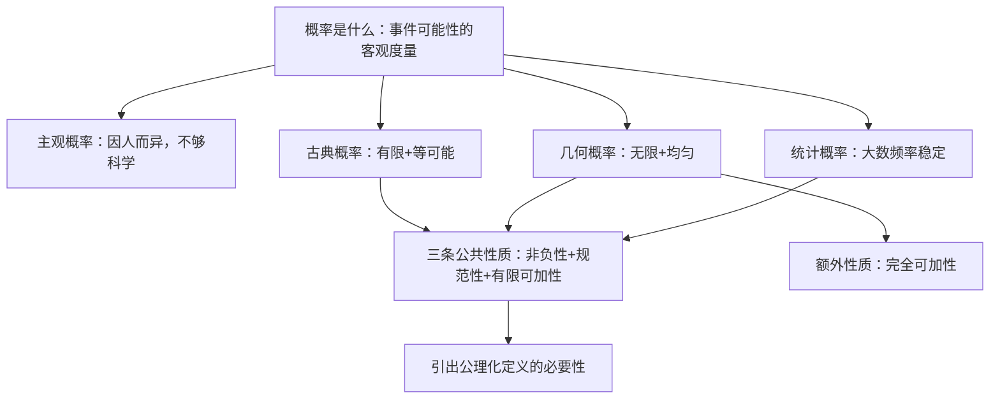
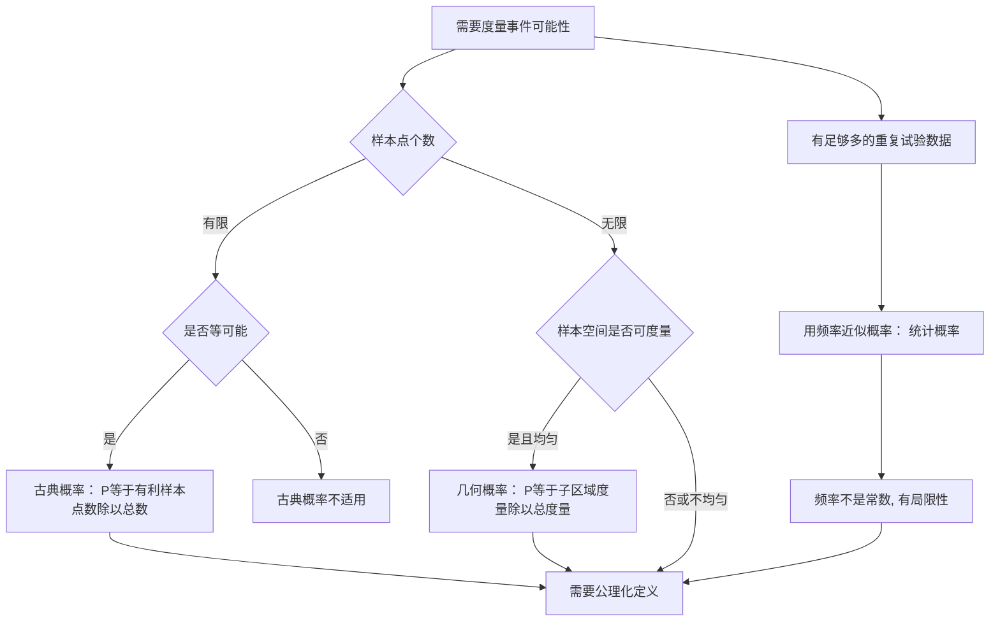

## 一、本章核心脉络

**核心问题**：如何客观地度量随机事件发生的可能性大小？这个度量需要满足哪些数学性质？

> [!info] 学习导读
> **必要先修**：回看[[课程/概率论/知识点解析梳理/01a-随机事件的直观意义及其运算-知识梳理|事件与样本空间]]，尤其是事件的集合表示。
> **来源边界**：正文依据[[课程/概率论/PPT课件/MD/C1.2 概率的直观意义及其运算|C1.2 课件源文]]重组；补充例子与下方自测均明确作为学习层内容。
> **阅读路线**：先区分古典、几何与统计概率的适用前提，再比较它们共有的概率性质，最后理解为何需要公理化。

> 这个顺序反映了概率概念的历史发展脉络：从最朴素的主观判断，到最简单理想的古典模型，再到突破"有限性"的几何模型，再到基于实验的频率学派，最终发现它们共享三条核心性质，从而引出了概率的公理化体系。

---

## 二、概率的直观意义与主观概率

### 2.1 概率的直观意义

随机事件发生的可能性大小是一个客观存在的量。**概率**是对随机事件发生可能性大小的客观度量，事件 $A$ 出现的概率记为 $P(A)$。

> **一句话来说**：概率就是把"有多可能发生"这个模糊感觉，变成一个严格在 $[0,1]$ 之间的数字。

### 2.2 主观概率（了解即可）

**定义**：主观概率是某人对特定事件发生可能性的个人度量。

例如：对于事件 $A = \{\text{明天白天会下雨}\}$，甲认为可能性为0.7，乙认为可能性为0.2。

> **一句话来说**：主观概率就是你"觉得"有多大概率——有道理但不科学，因为不同的人判断不同。

**局限性**：有一定依据，但很难一致，不够科学。因此需要寻求客观度量方法。

### 2.3 概率概念发展时间轴

| 阶段 | 代表人物与时间 | 核心思想 |
|:--|:--|:--|
| 古典概率 | 帕斯卡、费马1654 → 棣莫弗1738 → 拉普拉斯1812 | 离散、有限、等可能；基础是组合数学 |
| 几何概率 | 蒲丰1777 | 连续区域上的"等可能"；连接离散与连续 |
| 频率/统计概率 | 伯努利1713 → 冯·米泽斯1919 | 基于经验与频率；适用于一切可重复试验 |
| 公理化定义 | 柯尔莫哥洛夫1933 | 以测度论为基础，将概率严格化、一般化 |

---

## 三、古典概率（核心）

### 3.1 古典概型的两个条件

**定义**：设 $E$ 是一个随机试验，若满足：
1. 仅有有限多个基本事件；
2. 每个基本事件发生的可能性相等。

则称 $E$ 为**古典概型**试验。

> **一句话来说**：古典概型就是"样本点有限且每个样本点公平"——像掷一枚均匀骰子，6个面谁都一样可能。

**古典概型的例子**：抛均匀硬币（2个等可能基本事件）、从一副扑克牌任取一张（54个等可能基本事件）。

**非古典概型的例子**：检查N件产品中的次品数（基本事件可能性不均等）、测量身高（有无穷不可列个基本事件）。

### 3.2 古典概率定义

**定义**：设试验 $E$ 为古典概型试验，则

$$P(A) = \frac{A \text{ 所含的基本事件个数}}{\text{基本事件总数}} = \frac{A \text{ 所含样本点的数目}}{\text{样本空间的样本点总数}}$$

> **一句话来说**：古典概率就是"数数"——数出A包含多少个样本点，除以总样本点数。

### 3.3 古典概率的三条性质

| 性质 | 内容 |
|:--|:--|
| （1）非负性 | 对任意事件 $A$，有 $0 \leq P(A) \leq 1$ |
| （2）规范性 | $P(\Omega) = 1$ |
| （3）有限可加性 | 若 $A_1, A_2, \cdots, A_m$ 互不相容，则 $P(\cup_{i=1}^{m} A_i) = \sum_{i=1}^{m} P(A_i)$ |

> **直观理解**：这三条性质非常自然——（1）概率不能是负数也不能超过100%；（2）必然事件概率必须是1；（3）互不相容的事件的概率可以直接相加。

---

### 3.4 古典概率典型例题

#### 例6 鸽笼问题（一步法：排列组合直接计算）

一个鸽场养了 $n$ 只鸽子，每只鸽子都等可能地飞入 $N$ 个鸽笼中的任意一个 $(n \leq N)$。求：

**（1）指定的 $n$ 个鸽笼各有一只鸽子去住**

> [!solution]- 点击展开详细解析
> - 基本事件总数：每只鸽子有 $N$ 种选择，$N^n$
> - 指定的 $n$ 个鸽笼各有一只鸽子：$n$ 只鸽子在 $n$ 个指定笼子中全排列，有 $n!$ 种
> - $$P(A) = \frac{n!}{N^n}$$
> 
> **（2）恰好有 $n$ 个鸽笼，每个各有一只鸽子**
> 
> - 先从 $N$ 个鸽笼中选出 $n$ 个：$C_N^n$
> - 再在选出的 $n$ 个中各放一只：$n!$
> - $$P(B) = \frac{C_N^n n!}{N^n}$$
> 
> > **步骤点评**：古典概率计算的两种思路——（1）样本点较少时逐个列举；（2）样本点很多时用排列组合。这里用的是思路（2），关键是一致地在同一套"计数单位"中计算分子和分母。

**延伸——生日问题**：一个23人的班上有人生日相同的概率？将365天比作鸽笼，23个人比作鸽子，用上述公式计算某人"生日全不同"的对立事件概率，结果是约50.7%。

#### 例7 分类取球（超几何概率）

袋中有 $N$ 个球，其中 $M$ 个红球，$N-M$ 个白球，从袋中任取 $n$ 个球，求其中恰有 $m$ 个红球的概率：

> [!solution]- 点击展开详细解析
> $$P(A_m) = \frac{C_M^m C_{N-M}^{\,n-m}}{C_N^n}, \quad m = 0,1,2,\cdots,n; \; n \leq M$$
> 
> > **直观理解**：分子是"从红球中选 $m$ 个"乘以"从白球中选 $n-m$ 个"（分步计数），分母是所有可能的选法。

**推广——分类取球一般模型**：

袋中有 $n$ 个球，第 $1$ 类有 $n_1$ 个，...，第 $k$ 类有 $n_k$ 个，$n_1 + n_2 + \cdots + n_k = n$。从中取 $m$ 个，恰有 $m_i$ 个第 $i$ 类球的概率为：

$$p = \frac{C_{n_1}^{m_1} C_{n_2}^{m_2} \cdots C_{n_k}^{m_k}}{C_n^m}$$

> **一句话来说**：这就是**超几何概率**——不放回抽样下，从有限总体中统计各类别数目的概率公式。

#### 例8 有放回 vs 无放回抽样

袋中有10个小球，4个红的，6个白的。求取3球得"2红1白"的概率。

> [!solution]- 点击展开详细解析
> **（1）有放回抽样**：
> 
> - 样本点总数：$N = 10^3$
> - 有利样本数：$r = C_3^2 \times 4^2 \times 6$（3次中选2次位置放红球，每次4种红球，每次6种白球）
> - $$P = \frac{C_3^2 \times 4^2 \times 6}{10^3} = 0.288$$
> 
> **（2）无放回抽样**：
> 
> - 解法一（考虑顺序）：$N = 10 \times 9 \times 8$，$r = C_3^2 \times 4 \times 3 \times 6$
>   $$P = \frac{C_3^2 \times 4 \times 3 \times 6}{10 \times 9 \times 8} = 0.3$$
> - 解法二（不考虑顺序）：$N = C_{10}^3$，$r = C_4^2 \times C_6^1$
>   $$P = \frac{C_4^2 \times C_6^1}{C_{10}^3} = 0.3$$
> 
> > **关键要点**：计算古典概率时可选择不同的样本空间，但必须保证有限性和等可能性，且**分子分母必须在同一个样本空间中进行**！

---

## 四、几何概率（核心）

### 4.1 动机与定义

**古典概率的局限性**：要求基本事件的有限性和等可能性。当样本点为不可数无穷多个时（如幸运转盘问题），无法使用古典概率。

**定义**：设 $n$ 维欧氏空间的子集 $\Omega$ 表示样本空间，若 $\Omega$ 及其子集 $A$ 均可度量，则度量值之比

$$P(A) = \frac{\mu(A)}{\mu(\Omega)}$$

称为事件 $A$ 发生的**几何概率**。其中 $\mu$ 的指标为长度、面积、体积等。

> **一句话来说**：几何概率就是"量尺寸"——A区域有多大除以整个样本空间有多大。

**前提**：样本点在样本空间中的分布具有"均匀性"——样本点落入样本空间子区域的概率与形状、位置等均无关，只与其面积（或长度/体积）有关。

### 4.2 几何概率的性质

几何概率同样满足三条性质，且额外满足**完全（可列）可加性**：

| 性质 | 内容 |
|:--|:--|
| 非负性 | $0 \leq P(A) \leq 1$ |
| 规范性 | $P(\Omega) = 1$ |
| 有限可加性 | $P(\cup_{i=1}^{m} A_i) = \sum_{i=1}^{m} P(A_i)$（$A_i$ 互不相容） |
| **完全可加性** | $P(\cup_{i=1}^{\infty} A_i) = \sum_{i=1}^{\infty} P(A_i)$（$A_i$ 互不相容） |

> **直观理解**：几何概率比古典概率多出的"完全可加性"，是因为它在连续空间中自然支持"可数无穷个互不相容事件的概率可加"，这不是古典概率（只涉及有限个事件）能表达的。

### 4.3 几何概率典型例题

#### 例9 折棒问题

把长为 $l$ 的木棒任意折成3段，求它们能构成一个三角形的概率。

> [!solution]- 点击展开详细解析
> **分析**：设第一段长 $x$，第二段长 $y$，则第三段为 $l-x-y$。
> 
> 样本空间区域（满足 $0 \leq x \leq l, 0 \leq y \leq l, x+y \leq l$）：
> 
> $$G = \{(x,y) \mid 0 \leq x \leq l,\; 0 \leq y \leq l,\; x+y \leq l\}$$
> 
> 面积为 $\frac{1}{2}l^2$（直角三角形区域）。
> 
> 能构成三角形的充要条件（三角形两边之和大于第三边）：
> 
> $$\begin{cases}
> 0 < x < \frac{l}{2} \\
> 0 < y < \frac{l}{2} \\
> x + y > \frac{l}{2}
> \end{cases}$$
> 
> 该区域为 $G$ 内部的一个小三角形，面积为 $\frac{1}{2}(\frac{l}{2})^2 = \frac{l^2}{8}$。
> 
> 故概率为：
> 
> $$p = \frac{\frac{1}{2}(\frac{l}{2})^2}{\frac{1}{2}l^2} = \frac{1}{4}$$
> 
> > **步骤点评**：折棒问题的关键是——将"任意折成三段"转化为"在区域 $G$ 中均匀选点"，再用三角形不等式确定有利区域。

#### 例10 区间取数

在区间 $[0,2]$ 上任意取两个数 $x, y$，求满足 $x^2 \leq 4y \leq 4x$ 的概率。

> [!solution]- 点击展开详细解析
> **分析**："任意选取"意味着 $(x,y)$ 在边长为 $2$ 的正方形 $[0,2] \times [0,2]$ 上均匀分布。
> 
> 不等式条件化为：$y \geq \frac{1}{4}x^2$ 且 $y \leq x$。
> 
> 有利区域由曲线 $y = \frac{1}{4}x^2$ 和直线 $y = x$ 围成（在 $[0,2]$ 内）。
> 
> $$p = \frac{1}{4} \int_0^2 \left(x - \frac{1}{4}x^2\right) dx = \frac{1}{3}$$

### 4.4 几何概率的局限性与贝特朗悖论

**蒲丰投针（1777）**：自学内容（教材P37），是几何概率最早的应用之一。

**贝特朗悖论（1889）**：在圆内随机取一条弦，求该弦长度大于内接等边三角形边长的概率。三种不同解法得到三个不同答案（$1/2, 1/3, 1/4$）。这揭示了一个深刻的问题：**样本空间和"均匀性"的定义方式不同，会导致不同的概率结果**。这引发了概率论基础的反思，推动了公理化体系的建立。

> **一句话来说**：贝特朗悖论不只是一个有趣的谜题——它暴露了几何概率的根本问题：什么是"等可能"？"无差别原则"并不自明，从而催生了柯尔莫哥洛夫的公理化体系。

---

## 五、频率和统计概率（核心）

### 5.1 频率的定义

**定义**：在相同条件下，进行 $n$ 次试验，事件 $A$ 发生了 $k$ 次，称比值

$$f_n(A) = \frac{k}{n}$$

为事件 $A$ 发生的**频率**。

> **一句话来说**：频率就是"事件实际发生了多少次除以一共试了多少次"——来自实践的最朴素概率概念。

### 5.2 频率的两重性

| 特性 | 说明 |
|:--|:--|
| **不确定性** | 随试验次数不同、实验者不同而随机波动 |
| **稳定性** | 随试验次数增加，逐渐"稳定于"某个常数 |

> **直观理解**：频率不是常数，是变量——但它在宏观上表现出了"规律性"，这种在随机波动中呈现的稳定性正是统计规律的本质体现。

**抛硬币历史数据**：

| 实验者 | 抛掷次数 | 正面次数 | 频率 $m/n$ |
|:--|:--|:--|:--|
| 德·摩根 | 2048 | 1061 | 0.5181 |
| 蒲丰 | 4040 | 2048 | 0.5069 |
| 皮尔逊 | 24000 | 12012 | 0.5005 |
| 维尼 | 30000 | 14994 | 0.4998 |

**$\pi$ 的数码频率**：法国学者（1973年）统计 $\pi$ 的前100万位小数中各数码的出现频率，虽然各有起伏，但都稳定于 $1/10$。

### 5.3 统计概率

**定义**：固定 $n$ 时（$n$ 足够大），称事件 $A$ 的频率 $f(A)$ 为**统计概率**。

$$f(A) = \frac{k}{n}$$

统计概率的三条性质（与古典概率一致）：

| 性质 | 内容 |
|:--|:--|
| 非负性 | $0 \leq f(A) \leq 1$ |
| 规范性 | $f(\Omega) = 1$，$f(\Phi) = 0$ |
| 有限可加性 | $f(\cup_{i=1}^{m} A_i) = \sum_{i=1}^{m} f(A_i)$（$A_i$ 互不相容） |

> **局限**：频率是变量，不是常数。作为度量指标存在缺陷——每次实验的频率可能不同。

---

## 六、三种概率的共性与公理化必要的引出

| 概率类型 | 适用范围 | 核心思路 | 公共性质 |
|:--|:--|:--|:--|
| 古典概率 | 有限+等可能 | 数数（组合数学） | 非负+规范+有限可加 |
| 几何概率 | 无限+均匀 | 量尺寸（几何度量） | 非负+规范+完全可加 |
| 统计概率 | 一般可重复试验 | 数频率（经验数据） | 非负+规范+有限可加 |

> **总结**：三种概率定义在各自适用范围内有效，但都存在局限性。它们共享的三条基本性质（非负性、规范性、可加性）为概率的公理化定义提供了出发点——从这些共性出发，定义更具普适性的概率概念。

**引出问题**：若样本点有不可数无穷多个，且在样本空间的分布是不均匀的，又该如何定义概率？

---

## 判定/决策流程

---

## 核心公式速查表

| 名称 | 公式 | 适用条件 |
|:--|:--|:--|
| 古典概率 | $P(A) = \frac{\lvert A \rvert}{\lvert \Omega \rvert}$ | 有限+等可能 |
| 几何概率 | $P(A) = \frac{\mu(A)}{\mu(\Omega)}$ | 可度量+均匀 |
| 频率 | $f_n(A) = \frac{k}{n}$ | 任何可重复试验 |
| 超几何概率 | $p = \frac{C_{n_1}^{m_1} \cdots C_{n_k}^{m_k}}{C_n^m}$ | 不放回分类取球 |
| 鸽笼问题概率 | $P(B) = \frac{C_N^n n!}{N^n}$ | n鸽入N笼，每笼至多1鸽 |
| 概率三性质 | 非负性+规范性+可加性 | 所有概率定义共同满足 |

---

## 易错点与注意事项

> [!warning] 易错点

1. **古典概率的两个条件缺一不可**：有限性和等可能性必须同时满足。实际中使用的古典概型不一定严格满足这两个条件（如赛马问题，只能假定等可能）。

2. **分子分母必须在同一套样本空间中计算**：特别是在无放回抽样问题中，如果分子考虑顺序，分母也必须考虑顺序；如果分子不考虑顺序，分母也必须不考虑顺序。两种思路都是合理的，只要一致。

3. **古典概型的"等可能性"是假设，不是结论**：如赛马问题（例5），我们不知道各匹马的实际状况，只能假定它们获胜机会均等。这种假设可能偏离现实。

4. **几何概率的前提是"均匀性"**：贝特朗悖论告诉我们，"均匀分布"的假设本身可能不唯一，不同的样本空间构造方式会导致不同的结果。这是几何概率的根本缺陷。

5. **频率不等于概率**：频率是变量（每次实验不同），概率是常数（客观存在）。频率的稳定性使它可以近似概率，但绝不能等同。

6. **统计概率的"有限可加性"不等于"完全可加性"**：频率只能验证有限可加，无法验证可列可加。而几何概率天然满足完全可加性——后续公理化定义正是以完全可加性为基础的。

---

## 自测（新编）

在区间 $[0,1]$ 上均匀取一点 $X$。求事件 $X(1-X)>\frac{3}{16}$ 的概率，并说明使用的概率模型。

> [!hint]- 提示
> 解不等式得到允许的区间，再用区间长度之比计算。

> [!solution]- 解析
> $X(1-X)>\frac{3}{16}$ 等价于 $\frac14<X<\frac34$。这是几何概率模型，因此概率为 $(\frac34-\frac14)/(1-0)=\frac12$。

## 相关知识点链接

- **前置**：[[01a-随机事件的直观意义及其运算]] — 概率的计算对象是事件，必须先掌握事件的表示和运算（特别是德·摩根律的运用）。
- **后续**：[[01c-概率模型与公理化结构]] — 三种概率定义的共性（非负性+规范性+可加性）直接导出了柯尔莫哥洛夫公理体系。
- **后续**：[[01d-事件的独立性]] — 独立性的计算法则 $P(AB) = P(A)P(B)$ 是概率运算的核心工具。

---

## 作业与练习

参见习题库中第1章对应节次的习题，重点练习：
1. 古典概率的排列组合计数（鸽笼问题、分类取球、有放回/无放回）
2. 几何概率中有利区域的确定与面积计算
3. 理解三种概率定义的共性与差异
